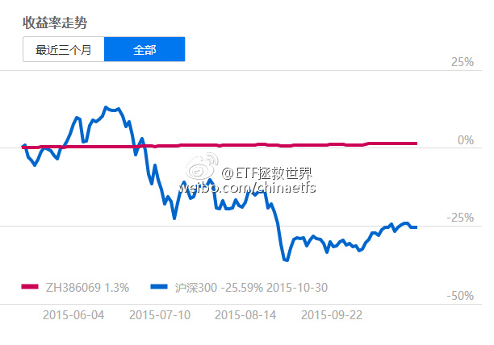
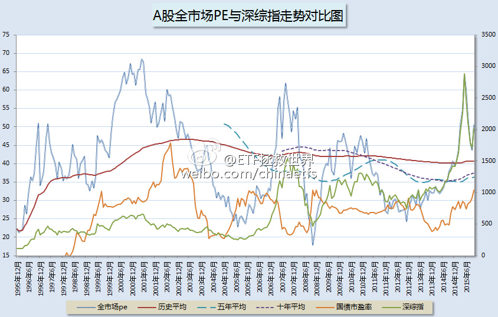
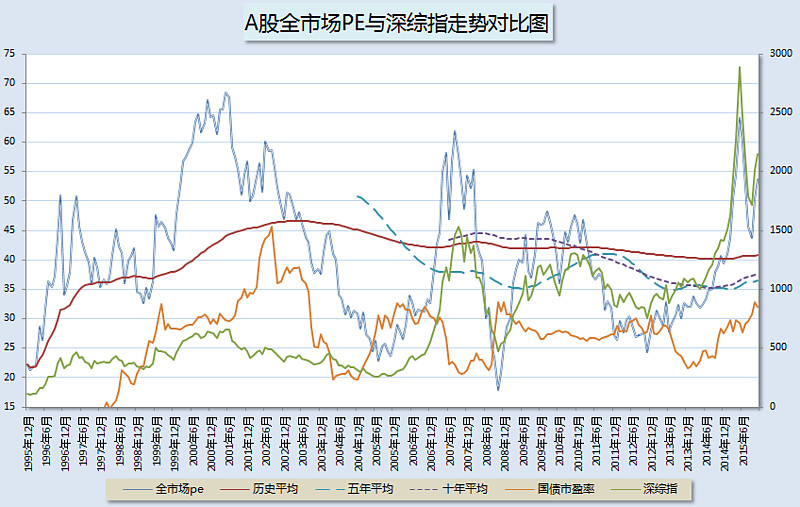
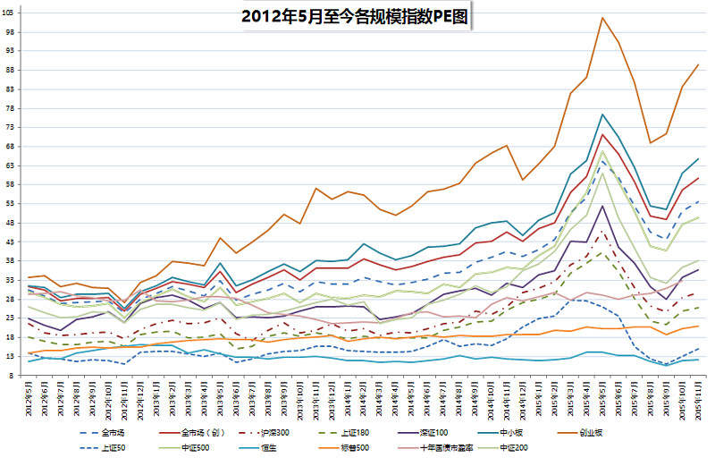
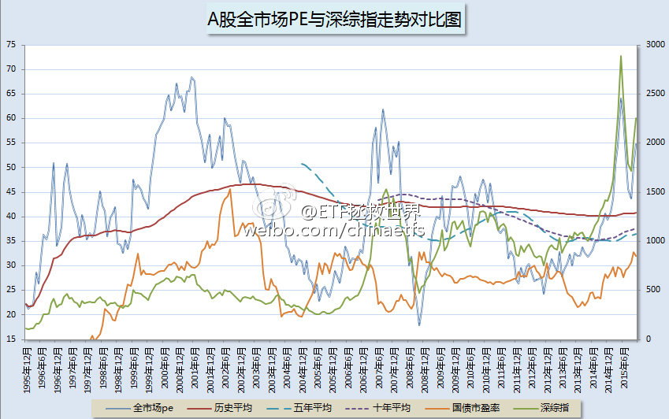
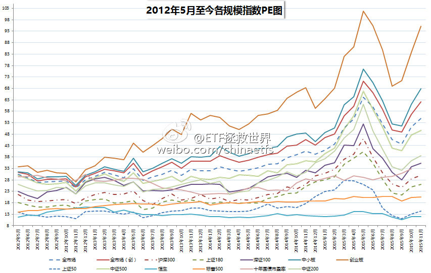
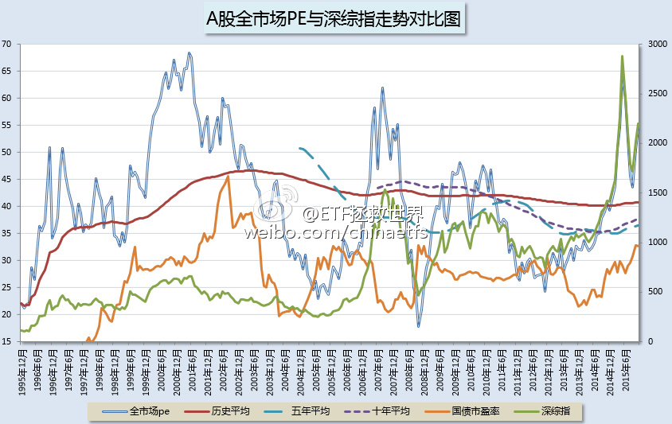
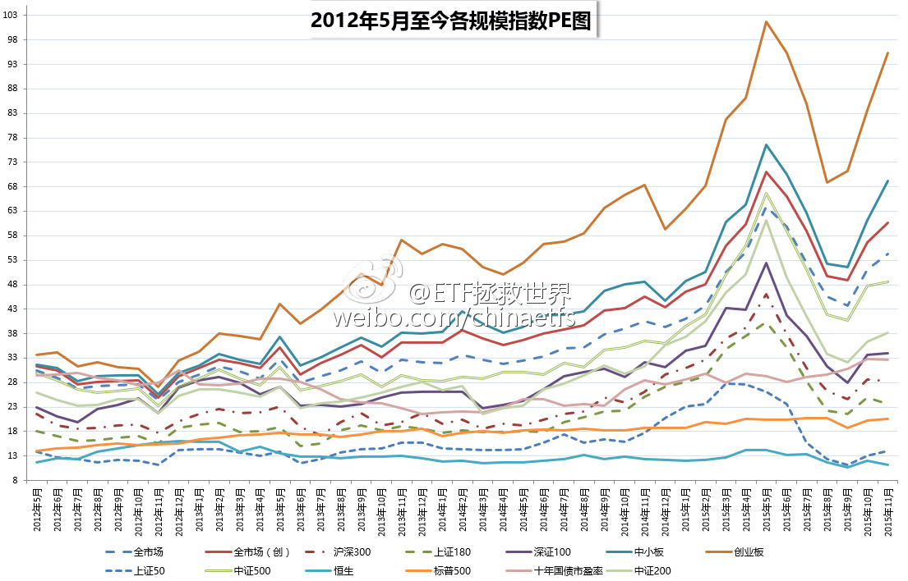
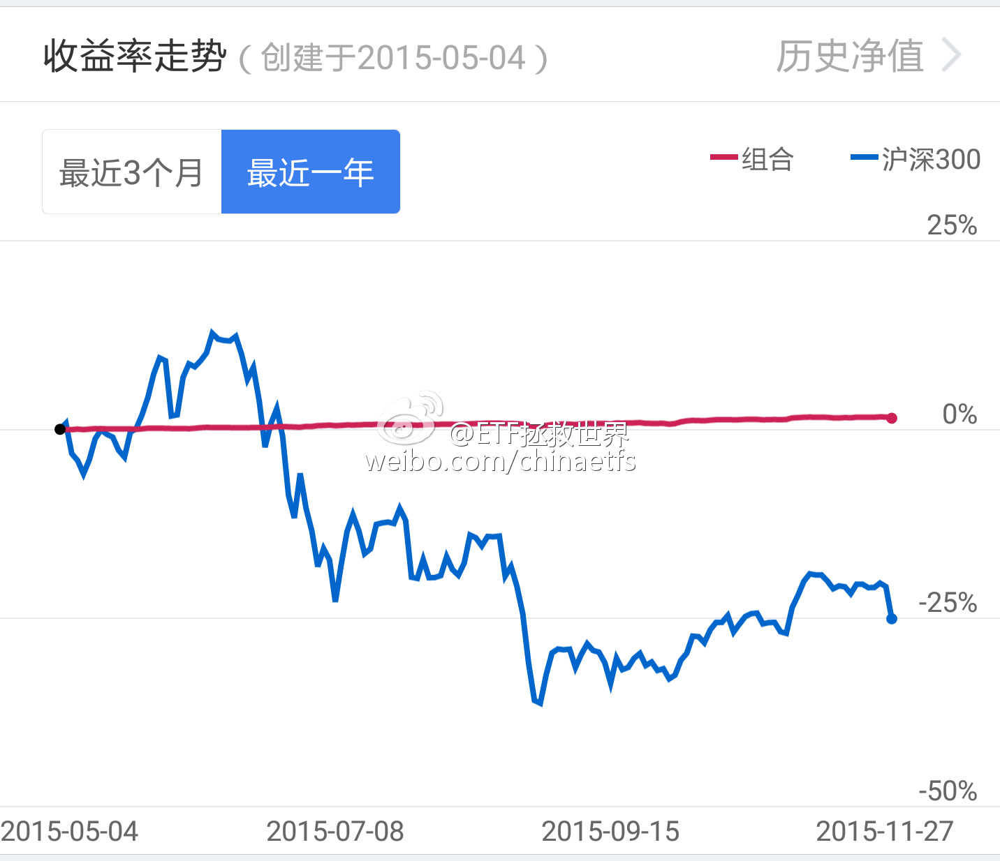

## 2015-11-01 10:20

2015年11月ETF计划  ​​​

写在前面，重要：

朋友们，开始浏览本月ETF计划前，请仔细阅读以下两点：

1、本计划绝非任何形式的投资建议或是投资指导。

在这里，仅仅是将本人十年前开始，一些朋友五年前开始进行的一个投资指数的计划公之于众，我们会在这里如实记录我们的投资历程。

如果这个计划能帮助您，我们会替您感到高兴，仅此而已。我们绝不会向您以各种形式收费、分成。如果您因为这个计划而亏损，我们也只能说一声很遗憾。也是仅此而已，我们不会承担任何责任。

2、请任何朋友开始参考这个计划前，要再三考虑自己是否能忍受甚至可能长达3-4年的熊市。

本计划虽然过去12年取得了超过10倍的盈利，但大家要知道，在12年中，真正让利润大幅增长的时间大概只有5-6年的三次大牛市。中国股市是个牛短熊长的市场。我们在超过7年的大熊市中慢慢买入，最终才取得了牛市利润的爆发。你一定要清楚，70%以上的人无法忍耐几年的熊市。所以，确认你自己能忍，再开始参考本计划。

11月ETF计划操作如下：

买入1份:

买入159920（恒生ETF）一份 （价格不超过1.13）

*上个月能收到估值邮件并已提前买入的朋友无需重复购买

这个月要说的东西也是不少：

**壹：**

上个月无疑是坑爹的一个月——由于国庆长假后大幅高开，所有朋友都没有买到该买的……

没有关系，想买的朋友记着价格，以后到了依然可以买。实际上再次重申：2015年8月起，任何一个月没有买到的，以后到了当月的价格都可以买。

具体想看某个月的计划，回复数字即可。比如15年8月，回复“1508”。

**贰：**

像上个月说的一样，十月份A股大幅反弹的几率非常大，ETF计划由于仓位不高，大概率跑输。但还是那句话：投资，是一场马拉松比赛，某个100米的成绩并不重要。

下面这张图是ETF计划2015年5月以来的模拟走势，朋友们，在投资这场长跑中，我们要做的，就是市场大幅下跌的时候不赔钱，至少是不赔大钱，然后在市场上涨的时候尽量跟上。

熊市中抢到每一个反弹这种梦想固然美丽，但实践起来并不容易。我们，还是做大概率的事情。

朋友们，投资，尽量不要赔大钱：赔33%，需要涨50%回本；赔50%，需要涨100%回本。资产增加100%何其难！而亏损50%则易如反掌。

每年复利增长，绝对值增加，才是最重要的。

怎么才能不赔大钱？买的够低相信是奥妙之一。所以，不要急，财不入急门。人予我取，人取我予，水则资车，旱则资舟，现在都不是好时候。

**叁：**

上个月在文章中放入了一个投票，结果基本已经出来了，大家可以继续投票或者看看结果：

本公众号现有万余左右关注者，有1800人左右参加了投票。虽然比例较低，但还是有代表性的。

有66%的朋友，准备投资10万以上在ETF计划。这部分朋友我没什么好说的，可以把资产分成150份然后按部就班即可。

而还有34%的朋友，投资额在10万以下，或者没有储蓄而以工资余额投入。对这部分朋友，我想多说两句。

首先，还是找到佣金低的券商，尤其是没有5块钱门槛的那种——你要买500块钱etf，却要5块佣金，手续费要1%？太亏了。

其次，对于资本较少的朋友来说，不高的收益率意义不大。比如说300万以上的朋友，每年10%收益即可有30万收入。而如果只有5万，那么5000块似乎解决不了大问题。这个时候，有两个方法让资产较少的朋友获得更大的收益率。

第一，是上更高的杠杆。比如各种方式的借款。第二，是买的更低。

第一种方式我不推荐。我更看好买的更低。

所以，资本少的朋友，可以在现在这种相对高估的时候再度减少投入。比如，只有每个月有结余的朋友，这个月可以把结余的一半存入各种货币基金，另一半参考ETF计划。多攒一些本金，在我们ETF计划大举买入的时候（虽然看起来很遥远，但那一天终将出现），全部投入，获得超额收益。这个过程中虽然也许会有一些机会成本，但多攒点然后在低位全部投入，是我能为你们想到最好的提高收益率的方法了。

为什么说现在还相对高估？

说一万句也不如看一张图，看看我们伟大的A股到底有多贵吧：

## 2015-11-07 10:40

@ETF拯救世界:一晚上过去，大家情绪都平复点了吧。咱们一起推演一下IPO新政实施后会发生的事情： 1、打新者会不会大量配置股票充当打新门票 之前每次IPO，都会冻结上万亿的资金。即使在情绪高涨的5000点，场外也有这么多资金虎视眈眈... 分享自@雪球  ​​​

> @ETF拯救世界
> 
> **沙盘推演IPO重启的影响**
> 
> 一晚上过去，大家情绪都平复点了吧。咱们一起推演一下IPO新政实施后会发生的事情：
> 
> **1、打新者会不会大量配置股票充当打新门票**
> 
> 之前每次IPO，都会冻结上万亿的资金。即使在情绪高涨的5000点，场外也有这么多资金虎视眈眈只吃新股。也就是说，不管二级市场多么火热，这些资金并不为之所动，而是打新、拉高、出货，把筹码交给二级市场投资者。
> 
> 这么看，这些资金应该都是风险偏好非常保守的。那么，新政下，他们会不会大量买入股票充当门票呢？
> 
> 从风险收益比的角度来看，风险没有变化，那么就要看收益——打新的收益会是多少？
> 
> **2、新政后的打新收益**
> 
> 新政前，打新年化收益根据资金量不同略有不同。以本人上半年的打新收益来看，年化十几二十个点是有的。问题在于，这十几二十个点的收益，是与万亿资金争夺的结果。未来，将是全民打新的节奏。
> 
> 现在并不清楚发行价如何制定。之前的新股之所以疯狂翻好几倍，是因为管理层人为压低IPO价格，基本都在20倍左右pe发行，才导致中签的就跟中彩票一样发财。如果放开发行价，中签收益就需要掂量掂量。
> 
> 根据wind数据，现在全市场自由流通市值在30万亿左右，流通市值在40万亿，总市值在50万亿左右。
> 
> 好了，由于不知道是否像以前一样有单账户封顶的细则，综上简单估算，中签率应该至少只有过去的10%。也就是从千分之n变为万分之n。年化整体收益率降到2%左右应该不是问题。
> 
> 2%的收益率，会对那些保守的打新资金产生多大的吸引力呢？
> 
> 有多大吸引力，是由风险和收益决定的。收益2%，多说了4%。那么，风险呢？
> 
> **3、现在股市的整体风险。**
> 
> 别说那么多，先上图。
> 
> 
> 
> 截至昨日收盘，本人计算的A股全市场PE在55倍左右，在过去249个月中排名39位。
> 
> 当然，很多人在现在这样的反弹走势下，会再度不认可这样的数据。但我相信的是，场外那些打新资金对A股有多贵是懂的。就像汇金5月大举离场的时候，也没几个人相信这张图。
> 
> 但是，上面这张图是A股估值的全部吗？并不是。
> 
> 如果打新资金一定要入场配置股票，说实话，他们还是会找到一些能够下手的东西的。
> 
> **4、他们会买什么**
> 
> 继续看图
> 
> 
> 
> 根据本人长期跟踪的18个规模、行业指数估值来看，即使大涨一个多月后的现在，依然有50、180、金融和恒生估值远低于过去120个月的均值。
> 
> 上证50更是在9.29日创下了过去120个月的估值最低点。这也是为什么我们的计划买入50和恒生的原因。
> 
> 如果打新资金一定要配置，他们会买哪些股票？接盘神创还是买入低估的大蓝筹做为门票？
> 
> 当然，我说的是一定要配置的话。
> 
> **5、谁是受益者。**
> 
> 这次IPO新规，谁是真正的受益者？券商、IPO公司、持仓万亿伟大证金就不说了。
> 
> 真正的受益者，是那些值得尊重的长期投资者。他们数年如一日的持有心仪股票，这次的新政，相当于给他们集体每年加2%以上的分红。
> 
> 恭喜。
> 
> **6、关于我们的ETF**
> 
> 悲催啊，同志们。ETF并不算市值。
> 
> 但本人一笑置之。股票投资者承担了我没有承受的风险，多给他们2%红利我认为理所应当，也并不眼红。
> 
> 至于资金大的朋友，完全可以把300指数的一篮子股票买一遍，然后做空期指对冲来打新。但为了2%-4%的收益率这么干值不值我也不清楚，可以自己考虑一下。
> 
> 最后，由衷的佩服我们管理者的智慧。真的，这次他们走了一步惊天妙棋。他们轻轻落下一子，居然让市场闻之色变的“圈钱”IPO变成了“特大利好”，持股者信心百倍，持币者心急如焚。
> 
> 表个态，举双手赞成IPO重启，恢复资本市场融资再融资功能，让资本市场为经济发展尽一份力！

## 2015-11-13 09:37

我知道，在微博这种地方提示风险不会讨好，但我还是想贴张图。中小、创业，逆天了。 ​​​
 

## 2015-11-18 05:06

几年前1860清仓持有7年的黄金后，这货居然跌了快一半了。现在么，依然不出手。

## 2015-11-19 00:13

我不信大霄不知道现在股市的真实估值水平。有些话如果不能说，可以选择不说话。很多人很相信你，未来，他们会怎样？

## 2015-11-19 00:15

分指数。上证 300等几乎不可能。中小创业500之类有机会

## 2015-11-19 10:53

“多空机制不均衡”——这么说现在与股在前比，是均衡了还是更加不均衡了呢

## 2015-11-19 11:08

有个睿智的老人说，如果你加入一个牌局，十分钟后还不知道哪个对手是傻瓜，那么，你就是那个傻瓜——谁能想到，A股很多人连对手是谁都没看清就out了。 A股这个赌局中，你知道谁是傻瓜，你要赚谁的钱吗？ ​​​

## 2015-11-27 17:33

该提示的风险最近这段时间天天说说了有几十篇，现在说也没有任何意义了。看到的朋友算是有缘吧。

考虑了一下下一步的重点布局。

首先，A类看来价格依然坚挺，现在的价位，有肉，但塞牙缝都不够。有些高估指数下折是必然的事情，这个要盯紧。策略方面可以结合网格和布局下折。

其次是指数方面。

恒生依然低，配置一部分长期仓位没有问题。如果跌幅过大会继续加仓。最多给8%-9%。

养老估值离历史平均并不高，比最近十年倒是高十几个点。且跌且买。这个指数如果能下来要强力配置。极限判断30。35以下开始重仓布局。

消费也还OK，比均值高一点，可以在分级里面选择几个细分行业观察一下。

医药、500等过高。现在完全没有机会买入。一个字，耐心等。我可以不赚钱，但我绝对不会给任何人当接盘侠。

创业、信息现在根本就不用看了。

跟几位在机构做债券的朋友聊天，都预期12月中会有买债的好机会。这个需要观察，毕竟现在十年期国债只是3出头，看看之前重仓的150035和150027的K线也是蛮感人的。机会还是陷阱？走着看。

先把这几轮新股打了。之后的就不操心了，股票仓位过低，拼不过满仓的朋友们。一条财路算是就此断了。[doge]

白银到底是否布局？策略选哪个？应该是网格。再看看情况。

总体来说，现在放眼市场，大的机会基本很少很少。依然持有70%货基等机会吧。

无便宜，不重仓。

## 2015-11-30 09:25

还是那句话，大宵这个位置强力唱多，未来英名不保是其次，会让很多粉丝赔了大钱才是最大的问题。大宵，珍重。

## 2015-11-30 10:20

没有股灾3.0，然而你还是会赔钱。

个人非常不认可有些人所谓的“股灾3.0”的说法。主要原因在于一些权重股或者二线蓝筹的估值情况与5、6月份非常不同。想让他们再连续跌停难度很大。

也就是说，指数方面不会连续出现暴跌。大多数股票应该是以一种新股民没有见过的模式下跌。

这种下跌，会时不时的给你一些希望，让你觉得牛市还在或者即将反弹。在希望达到最顶峰的时候，来一根长阴吞没很多天的小阳。当你想割肉跑掉时候，又有一些小阳线让你不忍心跑。甚至会出现想让你加仓的形态。

然后，周而复始。

最后你会发现，怎么关注的股票不知不觉跌了那么多！

连续跌，谁也跑不了。谁也跑不了的这种事情很难出现的。

总是需要有人买单的。

瞧，买单的人已经拿着钱在半山腰等着了。

## 2015-11-30 17:05

本月ETF计划买入一份  ​​​

写在前面，重要：

朋友们，开始浏览本月ETF计划前，请仔细阅读以下两点：

1、本计划绝非任何形式的投资建议或是投资指导。

在这里，仅仅是将本人十年前开始，一些朋友五年前开始进行的一个投资指数的计划公之于众，我们会在这里如实记录我们的投资历程。

如果这个计划能帮助您，我们会替您感到高兴，仅此而已。我们绝不会向您以各种形式收费、分成。如果您因为这个计划而亏损，我们也只能说一声很遗憾。也是仅此而已，我们不会承担任何责任。

2、请任何朋友开始参考这个计划前，要再三考虑自己是否能忍受甚至可能长达3-4年的熊市。

本计划虽然过去12年取得了超过10倍的盈利，但大家要知道，在12年中，真正让利润大幅增长的时间大概只有5-6年的三次大牛市。中国股市是个牛短熊长的市场。我们在超过7年的大熊市中慢慢买入，最终才取得了牛市利润的爆发。你一定要清楚，70%以上的人无法忍耐几年的熊市。所以，确认你自己能忍，再开始参考本计划。

12月操作计划如下：

买入一份：

买入159920（恒生ETF）一份 （价格不超过1.105）

如果顺利买入，则持仓状况为：

*收到估值邮件并已买入恒生ETF的朋友无需重复购买

本月交易说明：

**壹：关于持仓份额**

很多朋友问，上个月的持仓表格是不是错了？为什么比10月的表格少了一份50和恒生？

这是因为我们10月份的计划并没有按照预期买入成功。由于国庆休市期间境外大涨，我们预定要买入的50和恒生在10月没有机会买入。

依据我们的原则，如果未来价格会跌到我们当时的预计价格，则我们会随时补入。10月的预计价格是

买入510050（50ETF）一份 （价格不超过2.15）

买入159920（恒生ETF）一份 （价格不超过1.04）

顺便在这里公布一个小小的调整：

如果某个月初有长假，则我们推送公众号文章的时间提前到前一个月末的倒数第二个交易日收盘后。避免出现大幅波动我们无法买入。

最后再说明一下，如果新朋友想买持仓的份额，请看看之前每个月推送的文章。从2015年8月起可查，比如8月的就回复1508（在公众号  chinaetfs 回复）即可。买入价格不要超过我们当时的价格即可补入。

**贰：关于公众号文章的频率**

本公众号是2015年6月10日申请建立。建立的初衷是当时算出全市场估值后感觉已经高的无法言喻，极其恐怖。所以建立了一个微信公众号，希望能把真实的估值数据推送给更多朋友，让大家可以转给亲朋好友，帮他们保住财富。

公众号建立后，马上在6月十几日给大家推送了“投资分级A：宁拿25%收益哭，也不在万点牛市笑”、“散户的投资原则：绝对收益”等文章。两个月后再次暴跌前的8月26日，又给大家推送了“A股的哈迪斯之顶”。

除了这些关键时点给大家推送的文章外，本公众号五个月一共只发布了十几篇文章，其中大半是跟ETF计划相关的文章。

以本公众号将近万人的关注量来说，相信是微信公众号中 关注人数/推送文章 这个比率最多的之一吧……

为什么这几个月只推送了这么少的文章？

其一，是本人希望这个公众号每次推送的都是真正的干货。如果推送过于频繁，可能会导致有些极其重要的文章被朋友们忽略。

其二，本人也订阅一些公众号，发现很多公众号只追求数量，质量不稳定。但又不舍得取关，最后弄得很鸡肋。自己比较不希望这个公众号也变成那样。

但是，最近纷纷有朋友希望增加推送频率。多发一些有质量的文章，毕竟，一个月两篇太少了！

这里，本人发起一个匿名投票，大家有空就点一下。多发还是少发，全听大家的。

**叁：关于估值与投资**

估值对投资到底有没有用？相信关注本人的朋友们看过本人写的好几篇文章，这些文章都证明了一件事：只有低估买入，长期看才能赚大钱。高估的时候买入，当然可以用更高的估值卖给别人，但这就属于击鼓传花。当鼓声停了，如果花还在你的手中，那么，请买单吧。

那么，2015年11月底，A股市场的估值是如何呢？

福利来了：

这张图是A股全市场（不含创业板）PE与深综指的对比图。大家可以清楚地看到，蓝线的全市场PE已经超过55倍。而55倍是一个什么概念呢？这个数值超越十年平均值43.77%；除了今年5、6月的疯狂，再往前推就要到07年底08年初了。再往前，就是2001年的大顶部。07和01年之后发生了什么，不用我说太多。

现在，大部分股票玩的就是击鼓传花。创业板一天换手率超过5%，20个交易日所有筹码换手一遍。这就是典型的比谁跑得快，这个游戏，朋友们可以玩，不过别忘了买双好点的跑鞋。

然而，是所有股票都贵得离谱吗？

这张图，是各规模指数、美国、香港、十年期国债对比图。我们可以很清晰的看到，天蓝色的恒生几乎趴在了3年最低。上证50也是如此。而180、300等指数虽然贵过美国，但是低于十年期国债，可以说并不是贵的离谱。80倍的中小、100倍的创业就不多说了。

8月开始到现在，除了11月刚开始买入恒生的朋友也许浮亏1%以外，其它所有几千位朋友现在的持仓都应该是盈利的。为何会这样？很简单：买的够低。不知道这两个月朋友们抢反弹了吗？手上的股票是亏是赚？如果是赚的，再跌两天呢？

这是我们组合的收益率与沪深300走势的对比。熊市不亏，就已经赢了一大半。

便宜，才是最重要的。

有朋友在市场反弹的时候就痛心疾首为什么自己持仓那么少；在市场下跌的时候再度懊悔为什么没有清仓。朋友，投资，不是这么做的。

不要怕仓位轻，未来终有一个月，会一个月就买20、30份。那个时候，不怕别的，怕的是大熊掌拍的你已经连一份都不敢买了。

（时间所限，本文未勘误，如有笔误请见谅）

