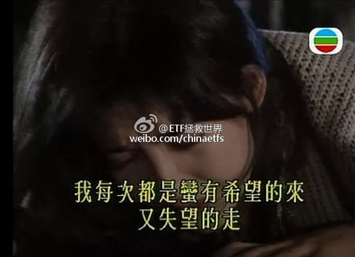
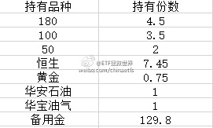
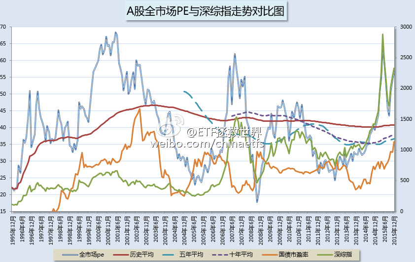
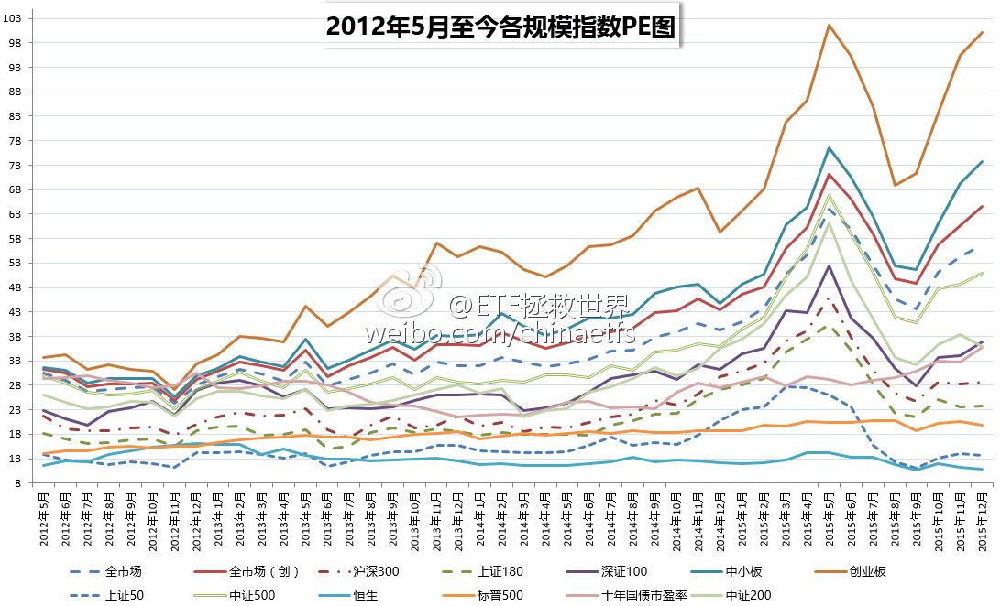
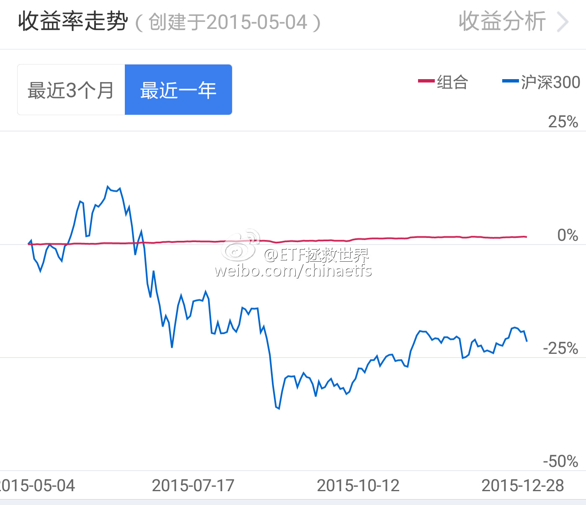

## 2015-12-03 09:04

钱，在很多人眼里看得比天还重，然而有些人并不这么认为。不要以自己的思维去揣度别人。实际上，我也不支持给孩子留过多的财产。你以为是对他好，实际上大概率是害了他。

## 2015-12-08 14:56

每天看着A股的起起伏伏，总能感觉到一丝秋意。 说真的，现在这个时点，几千万人的痛苦并未真正开始，然而，他们还活在梦中。 ​​​

## 2015-12-11 07:30

刚才在电梯里，听到大佬的马仔在打电话： “……琛哥说，上面逼得他很紧……谁帐户资产增加了，谁就是内鬼……总之你要记住，如果有人经历了股灾，却没有赔钱，那么，他可能就是下一个……” ​​​

## 2015-12-11 10:59

不要怕，不会一路暴跌。大概率是让你欲走还留欲罢还休，都跑了还得了。明明感觉每天没怎么跌，一段时间打开账户后缩水一大半。要我说，崩盘暴跌一点都不可怕，很容易就暴涨拉回。温水煮青蛙才是绝大多数人的噩梦。当然，他们很久以后才会明白过来。

> @ETF拯救世界
> [个人非常不认可有些人所谓的“股灾3.0”的说法。主要原因在于一些权重股或者二线蓝筹的估值情况与5、6月份非常不同。想让他们再连续跌停难度很大。也就是说，指数方面不会连续出现暴跌。大多数股票应该是以...](https://weibo.com/p/1001603914823187475011)​​​

## 2015-12-11 14:30

“快跑啊，里面在打人啊” 咚咚咚…… “别跑啦，里面在发钱，跑得快的还有美女送啊” 咚咚咚……“快回去啊，跑得快的那几个被打成猪头啦” 咚咚咚……“又发钱啦！！！” …… “去你大爷的，打死他” 不是喜剧，不是悲剧。是一出荒诞剧。 ​​​

## 2015-12-21 13:03

他凭一己之力，把一个市值数千亿上市公司的董事长从雪山上、哈佛中、三线小明星身边，拉回办公室，开始为公司前途奔波；他让资本市场价值投资之火重新燃烧，让那些不重视公司市值的蓝筹股大股东不安。你可以不喜欢他，但他是最励志的卖菜哥。(对老百姓有好处的事，就是我们要做的——他如是说。) ​​​

## 2015-12-23 11:40

12月22日收盘进入过去十年估值最高10%区域的指数是全市场PE、中小板PE、创业板PE、全指医药PE、全指信息PE。

一个指数的估值是否进入过去十年最高10%区域，具有非常非常重要的意义。通常情况下，某个指数进入过去十年最高10%区域，就是本人清仓区域。以今年为例，医药、消费、沪深300、深证100、创业都是在五月进入该区域；环保、中小、全市场是四月进入该区域。一旦持有的指数进入这个死亡区域，速速离开是上策。

全市场PE过去十年最高的月份分别是（时间顺序）：

2007.4
2007.5
2007.7
2007.8
2007.9
2007.12
2008.2
2015.4
2015.5
2015.6
2015.11
2015.12

需要关注的是全市场PB数据。距离十年最高10%区域还有一步之遥。

现在大指数估值不算极度高估。尤其50，低于五年、十年平均。恒生则更低。

至于说看全市场PE到底有用没有用？请看历史吧：

//xueqiu.com/4776750571/56918002

## 2015-12-24 10:30

大宵，你再这样以后会有人跳楼的。

## 2015-12-24 10:42

据说，长得帅的都拿着利润跑了。长得丑的已经准备开始骂zjh了。 ​​​

## 2015-12-30 09:36

本月卖出一份、买入一份、补入一份  ​​​

写在前面，重要：

朋友们，开始浏览本月ETF计划前，请仔细阅读以下两点：

1、本计划绝非任何形式的投资建议或是投资指导。

在这里，仅仅是将本人十年前开始，一些朋友五年前开始进行的一个投资指数的计划公之于众，我们会在这里如实记录我们的投资历程。

如果这个计划能帮助您，我们会替您感到高兴，仅此而已。我们绝不会向您以各种形式收费、分成。如果您因为这个计划而亏损，我们也只能说一声很遗憾。也是仅此而已，我们不会承担任何责任。

2、请任何朋友开始参考这个计划前，要再三考虑自己是否能忍受甚至可能长达3-4年的熊市。

本计划虽然过去12年取得了超过10倍的盈利，但大家要知道，在12年中，真正让利润大幅增长的时间大概只有5-6年的三次大牛市。中国股市是个牛短熊长的市场。我们在超过7年的大熊市中慢慢买入，最终才取得了牛市利润的爆发。你一定要清楚，70%以上的人无法忍耐几年的熊市。所以，确认你自己能忍，再开始参考本计划。

3、未投入的剩余资金可以去买任何你想买的投资品种。只要每个月初用的时候能到位即可。如果某个月会投入5份以上的资金，会提前3天到一周说明。

*鉴于12月31日港股休市半天；1月1日港股、A股休市。1月ETF计划前移至12月30日完成。

2016年1月操作计划如下：

卖出一份：

卖出159901（深100ETF）一份（价格不低于4.67）

买入一份：

买入159920（恒生ETF）一份 （价格不超过1.12）

补入一份：

补入159920（恒生ETF）一份（价格不超过1.12）

如果顺利买入，则持仓状况为：

本月交易说明：

**壹：关于补入**

8月以来，正常情况下应该是顺利买入了3份恒生ETF。表格中其余的4.45份是上一轮计划中遗留的部分。本月可在新购入之外，补入一份。也就是说，对8月之后才看到本计划的朋友，1.12之下可以买入2份。

不断有新朋友要求表格中添加成本价。在这里我再次说明，诸如180和100这样的持仓，是上一轮计划中卖剩下的。它们的成本价早就负到不知道哪里去了，所以确实没有办法列出成本——这些份额，都是我们当年大熊市中以极低的价位一点点买回来，大牛市中又实现了绝大部分收益，所以这个成本价已经没法计算。

如果到了合适的位置，自然会提示可以补入，比如：这个月的恒生。再比如这个月华安石油（160416）到达了10月的补入价位，一份已经补入。

还是那个原则，想看某个月的买卖，就在公众号的菜单中选择当月文章，或者回复数字调取当月的记录。比如2015年8月，输入“1508”即可。支持从第三轮ETF计划的2015年8月开始查询。价格不高于当时的价格都可以买。

**贰：关于估值**

先来看看本月的估值图：

本月A股全市场PE继续狂奔。以月末PE计算，现在是过去十年，也就是120个月第7高的月份。比现在高的，只剩今年的5、6月份与2007年的4个月。

当然，有贵就有便宜：

50、恒生依然低位徘徊，这两只指数PE均低于过去五年、十年平均值10%以上。可以说并不贵。

截止本月末，本计划第三阶段模拟收益：

**叁：关于仓位**

这里说两句貌似有点跑题的。

投资经验不是那么足够的朋友，总是有一个疑问：现在到底应该有多少仓位？

我想说，这个问题对1000个人来说，也许有957种答案。

每个人的资金量、预期收益、风险承受能力、性格完全不同。这就导致了，能够回答这个问题的，只有你自己。

首先，你要问自己几个问题：如果我手上的股票或者指数，跌了40%，我会不会痛苦？如果我手上的股票或者指数，涨了40%，我会不会难过？

你的股票跌了，你会痛苦，就说明你的仓位重了；反之，你的股票涨了，你痛苦，说明你仓位太轻。

好了，现在遵照这两个问题答案，把你的仓位调整到最平衡的位置：也就是说，涨40%和跌40%的时候，都不是那么难过。这时候，就合适了。

有朋友说了，这什么东西？我来炒股你先问我舒服不舒服？

我要说，答对了，朋友。投资，你首先心里要舒服。你不舒服，你慌乱，你兴奋或者痛苦，就很容易犯大错。

面对涨跌，谈笑风生，不仅来自于洞悉一切的高度，也来自于你的持仓。对很多看不懂市场的朋友来说，仓位则更加重要。

停止患得患失，真正地面对自己、认识自己、了解自己，然后调整你的仓位。

但无论如何，本人的建议是，不要轻易空仓或者满仓，不要赌博。

## 2015-12-31 15:46

祝大家身体健康、2016新年快乐；祝大家2016保住本金的前提下，能够赚大钱，发大财。  ​​​

最近在重看狄更斯的《圣诞颂歌》。虽然字面上并不合新年的意思，但在这个时候依然让人看了颇有感触：

大家来到资本市场，当然是为了赚钱。

然而，我想，钱，并不是最重要的东西。

没有了健康，没有了与你分享赚钱快乐的人，赚的再多恐怕也难说幸福。

所以，不论诸位在波澜壮阔的2015是赚是赔，最终还是应该多多关照自己的身体，还是应该多多感谢陪在自己身边的亲朋好友。

另一则，今年赚了，自然应该谢天、谢地、谢人，充满感激之情、常怀敬畏之心，来年更加好好的努力；

如果不幸今年赔了，也不用唉声叹气、怨天尤人。资本市场最不缺的就是机会，能力够了，运气到了，翻本大赚是分分钟的事情，不必过于介怀。几天后就是新的一年、新的交易日，一切都是新的，希望就在前方。

祝大家身体健康、2016新年快乐。

祝大家2016保住本金的前提下，能够赚大钱，发大财。

前路坎坷，但光明永在。

