## 2016-01-04 11:28

现在最头疼的，应该是保监会的BOSS们 ​​​

## 2016-01-04 11:48

这是一盘大棋，很少有人能看懂：熔断机制会大大提高本国居民的劳动生产率——几千万股民看盘的时间竟然会减少几个小时。终于，本国人均劳动生产率由美国的1/12，上升到1/11。利国利民。 ​​​

## 2016-01-04 13:42

大宵，我开微博以来只发了40多篇。其中三篇是转发你的。我再说第三次，你这样搞下去，会有很多小散赔的非常惨，你的书也卖不好的！

## 2016-01-05 08:49

装睡的人你永远叫不醒

> 市场的大神们巳经提示了风险，自己还是要去涉险，罪过呀！@ETF拯救世界 ​​
> 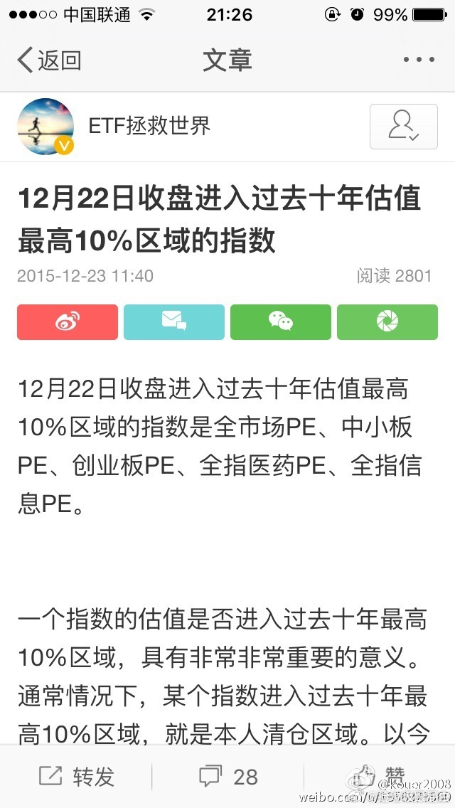

## 2016-01-05 16:56

今日下跌后，过去十年估值最高的10%区域指数没有任何变化。但有一只指数进入过去十年估值最低的10%区域：上证50。过去十年该指数进入最低区域的月份为（时间顺序）：1111、1112、1207、1208、1209、1210、1211、1306、1307、1508、1509、1601。值得注意的是，该指数包含的周期类较多。同时，低不代表涨

> @ETF拯救世界
> [12月22日收盘进入过去十年估值最高10%区域的指数是全市场PE、中小板PE、创业板PE、全指医药PE、全指信息PE。一个指数的估值是否进入过去十年最高10%区域，具有非常非常重要的意义。通常情况下，某个指数进入...](https://weibo.com/p/1001603923178211670263)

## 2016-01-07 10:14

其实最具摧毁力的，是有话语权的人不负责任。 //@ETF拯救世界:大宵，我开微博以来只发了40多篇。其中三篇是转发你的。我再说第三次，你这样搞下去，会有很多小散赔的非常惨，你的书也卖不好的！

## 2016-01-07 16:01

今日重要数据更新：今日大跌后，进入过去十年估值最高10%区域的指数减少为只剩两只：中小板PE、全指信息PE。也就是说，创业板ETF清仓的最佳时机已过！无数的机会摆在那里，不知大家是否珍惜了。

> @ETF拯救世界
> [12月22日收盘进入过去十年估值最高10%区域的指数是全市场PE、中小板PE、创业板PE、全指医药PE、全指信息PE。一个指数的估值是否进入过去十年最高10%区域，具有非常非常重要的意义。通常情况下，某个指数进入...](https://weibo.com/p/1001603923178211670263)

## 2016-01-07 20:42

说实话，深交所的能力和水平非常非常不错。这次，再给深交所点个赞。不过，然并卵。

*-- 可能指熔断，2016年1月4日启用，2016年1月7日触发，当晚决定停用*

## 2016-01-07 21:18

一个月后，噩梦模式开启。

> @ETF拯救世界
> 每天看着A股的起起伏伏，总能感觉到一丝秋意。 说真的，现在这个时点，几千万人的痛苦并未真正开始，然而，他们还活在梦中。 ​​

## 2016-01-11 13:23

时至今日，说什么都晚了。大宵，珍重。

## 2016-01-11 13:55

突然发现这么大的新闻居然是老朋友发的。转发支持一个。

## 2016-01-11 15:04

意思是不是之前90%的人反对计划生育呢……

> @新京报
> 【国家卫计委：中国#超8成人想生二孩#[晕]】全面二孩已开始实行。今日，国家卫生计生委相关负责人表示，根据生育意愿调查，80%以上的群众都是希望生育两个孩子，90%以上都非常支持赞同我们国家的全面两孩政策，全面两孩政策已经基本实现了群众生育意愿和国家生育政策的统一。http://t.cn/R4N2sAE卫计委：1300万黑户大部分已解决 因计生没有落户的很少 ​
> 

## 2016-01-12 17:44

手机7寸的吧？这个好，显脸小。

> @叶檀
> 今天的锵锵造型。。。
> 

## 2016-01-13 08:28

昨天收盘，我们自建估值模型计算的恒生指数估值已经跌入个位数，过去十年比现在低的月份只剩0810到0902的五个月。客观陈述，没有任何投资建议。今天天气不错。 ​​​

## 2016-01-13 15:22

有没有感觉越来越像了

> @ETF拯救世界
> 看图猜猜哪个是A股
> 选取了历史上几个国家估值特别高，第一波股灾后的图形，找找哪个是A股？
> 
> 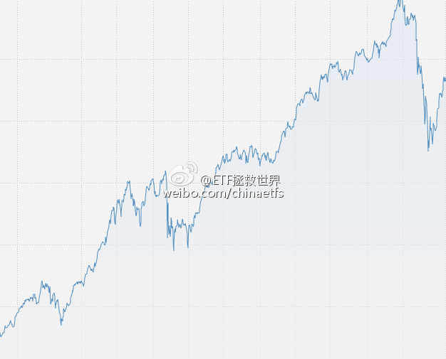
> 
> 
> 
> 
> 并没有那么容易看出来吧。
> 
> 昨天有朋友在文章后面评论，总感觉有股力量在下面托着，好像总也跌不下去。
> 
> 是的，除了伟大zj的力量，更伟大的力量，是人性。一百年来，不管是任何民族的人类，都从未改变。
> 
> 任何国家的股市在高估值的暴跌后，都会有反弹，反弹幅度基本上都到了跌幅的一半或以上。
> 
> 答案揭晓：
> 
> 历史上估值特别高的几次是：
> 
> 1929年美国道琼斯及之后的走势：
> 
> 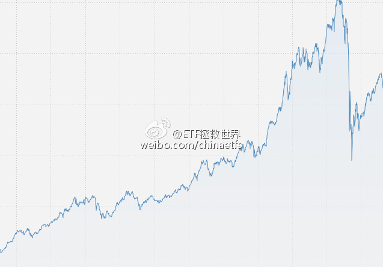
> 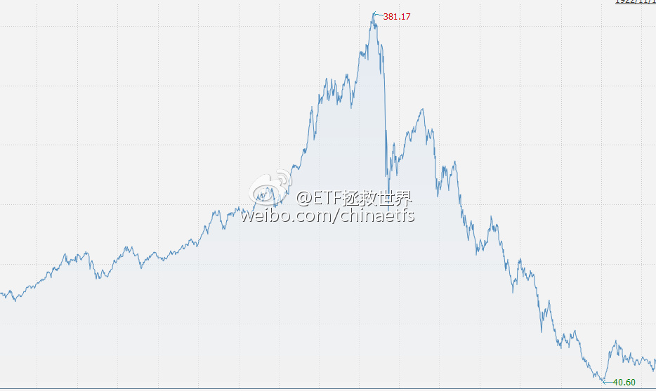
> 
> 1990年日本，及之后的走势
> 
> 
> 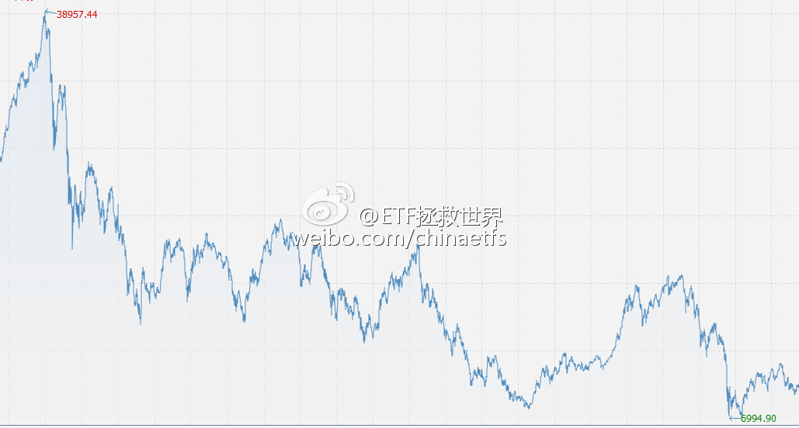
> 
> 2000年纳斯达克：
> 
> 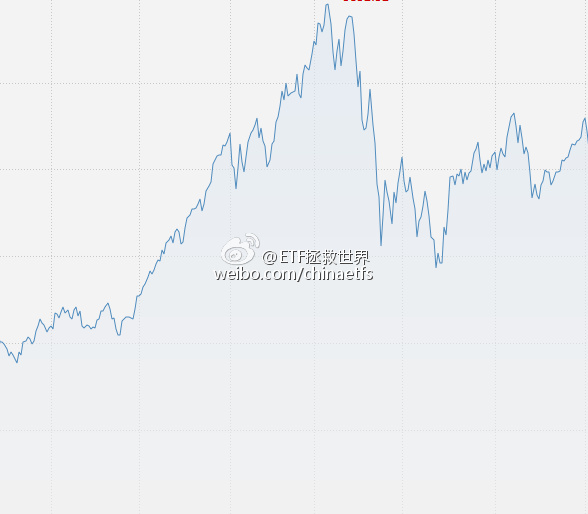
> 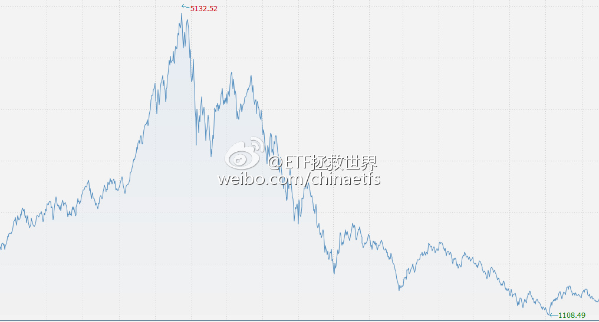
> 
> 2007年上证指数：
> 
> 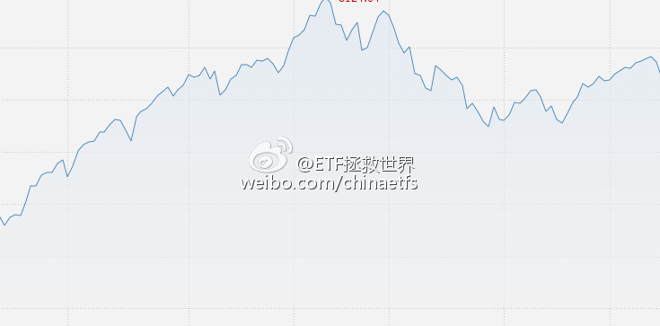
> 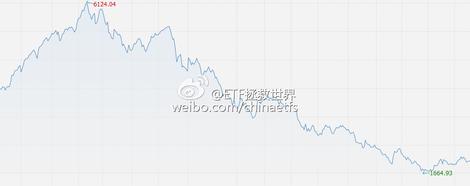
> 
> 需要强调的是，历史绝对不会简单重复。并没有说A股即将暴跌。高还会更高，低还会更低。人类没有预测时点的能力。
> 
> 那么，未来会怎么走？
> 现在的深综指：
> 
> 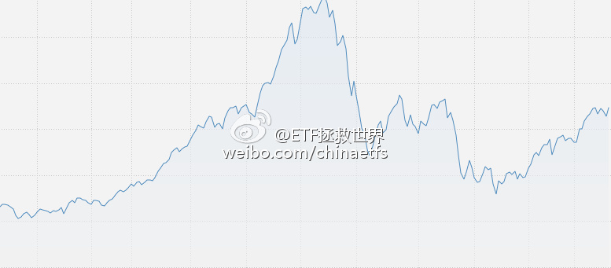

## 2016-01-13 15:51

今日下跌后，进入过去十年估值最高10%区域的指数减少为一只！也就是只剩全指信息一只。也就是说，在2016年1月13日，中小板指数的最佳卖出时机已经过去。一切都晚了。

> @ETF拯救世界
> [12月22日收盘进入过去十年估值最高10%区域的指数是全市场PE、中小板PE、创业板PE、全指医药PE、全指信息PE。一个指数的估值是否进入过去十年最高10%区域，具有非常非常重要的意义。通常情况下，某个指数进入...](https://weibo.com/p/1001603923178211670263)

## 2016-01-15 12:55

回复@沉默的70后:你这么机智你们老师知道吗//@沉默的70后:买啥原油啊，直接进口美国据说不到2块一升的成品油啊。 还节省了炼油污染排放。

## 2016-01-15 13:41

很多朋友现在非常迷茫。能做的不多，贴两张图，供您做个参考。  虽然整体不便宜，大部分股票还是贵，但有些股票真的就别割了，都焦了……毕竟确实不贵。短期情绪扛一扛，未来会很美好。当然，前提是你能分清手里的股票是不是真的好股票。 ​​​
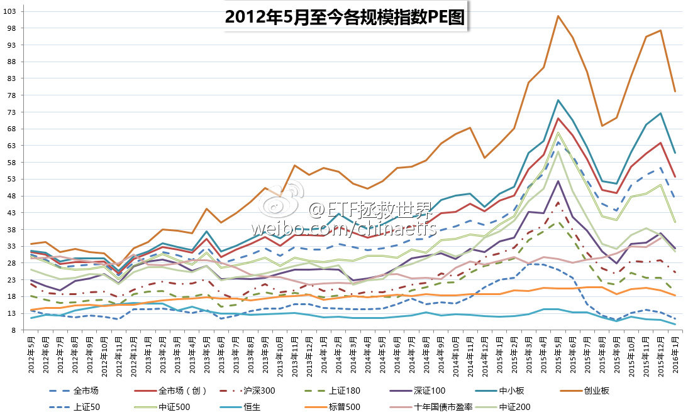 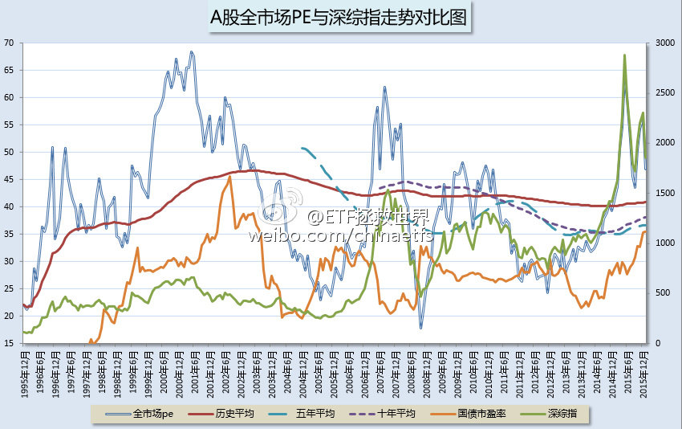

## 2016-01-18 17:06

截止今日收盘，两市2809家公司自由流通市值合计17.13万亿。 //@Newsfeed:没人知道最新的“自由流通市值”吗？注意不是流通市值！

## 2016-01-19 13:11

（文末增加ETF计划的未来）投资这件事，很多人希望找到一个股神，幻想只要跟着他投资，就能无往不利，从此日进斗金资产顺利嘉玲。我想说的是，他们想多了。这个世界，哪里得来的股神？  ​​​

没有股神，只有长跑赢家——兼论ETF计划的未来

投资这件事，很多人希望找到一个股神，幻想只要跟着他投资，就能无往不利，从此日进斗金资产顺利嘉玲。

我想说的是，他们想多了。

这个世界，哪里得来的股神？尤其是你用几个礼拜、几个月，甚至几年的成绩去衡量一个人。

A股跌到现在，很多左侧卖出的价值投资者成了股神——他们没有损失！

然而你不知道的，是他们在上涨时候卖出之后被多少人嘲笑“踏空狗”。

2015年6月之前，无数敢想敢干满仓融资的投资人成了股神——一波牛市赚那么多！

然而现在你看到的，是下跌后爆仓、强平、伤痕累累。

老巴2003年开始买中石油，买了就跌，跌了再买，最后成本1.5套了将近30%买成了二股东。那个时候你会对他作何感想？

2007年老巴且涨且卖，12块清仓中石油。谁知道中石油昂首向上涨到了21。老巴还要被CCTV逼的认错，你又会作何感想？

2015年，中石油4块港币，谁是谁非？

时间才是真正的审判者，然而，大多数人看不到那么远。

这世界没有股神，以前没有，现在没有，以后更不会有。

没有人能如你所愿，每个时点精准踩到，每波反弹吃的精光，每轮下跌毫发无伤。

保守一点的投资者，大熊市固然伤的较轻，大牛市也注定是吃的没那么饱；激进一点的投资者，大牛市当然是发家致富，然而到了大熊市就会过得比较辛苦。

所以，大家都是成年人，都是理性的。不要在某人做得好一点的时候就极力吹捧，也不要在谁某个阶段做的一般就玩命往死里踩。

我们到资本市场，是来赚钱的，不是来打脸的。你把人家的脸打的啪啪作响，回家继续关灯吃面，没什么意思。

所以讨论起投资，如果能够博采众长，对别人有理有据的说法，不管是否与自己观点一致，都仔细听听，耐心想想，择善而为，岂不乐哉？

只一点，对于过于激进的投资者，比如动不动就满仓，动不动就上杠杆的投资者，大多数时间还是应该敬而远之。

毕竟，翻遍世界金融史，真正让投资者死掉的，绝大部分都是缘起杠杆。

长跑这件事，不必追求每一百米都赢对手，能跑到终点，也就赢了。

因为，这场比赛，真正的对手只是你自己而已。

我们的ETF计划，亦是如此。

很多人看了ETF计划过去成绩不错，感到看到了自己投资的光明未来。然而你应该知道，投资这件事，从来就不容易。即使有了正确的方法，有时候过程的艰辛也会让人坚持不下去。

如果减肥只是少吃多动这么简单，为什么能够真正成功的人寥寥无几？

诚然，我们的计划在大盘暴跌30%多的情况下可以说安然无恙，躲过了熊市猛烈的3波下跌。但未来，注定会让很多朋友不那么舒服。

首先，我们的左侧买入，注定是买了就跌。由于会很好的控制仓位，总资产跌幅会很小，最终安全度过熊市。但是，对很多朋友来说，看到手里东西在跌，不管占总资产的多少，也会痛苦万分。他们需要的，是买了就涨，买了就赚。

其次，有没有可能没有买满就开始上涨？我说，有可能。没人是神，能够在最底部把所有现金买进去。我们只能根据科学计算，再加上多年的经验逐渐投入。但如果真的无法在底部满仓，这也是没有办法。

所以，ETF计划的未来当然是光明的，但道路并非像很多朋友想的那么好走。

我只能说，眼光尽量放得远一点。

顺利跑完这场比赛，我们就赢了这场与自己的较量。

## 2016-01-20 10:56

那是不可能的。中国实际居民人均储蓄非常少，应该只有一万多块人民币。同时，30%的财富集中在1%的人手中。根本没有那么多人有30万去换外储。从股市上讲，80%的帐户里都不到10万块钱。

## 2016-01-21 11:29

“请赞赏我”

> @创业家传媒
> 【证监会副主席方星海：熔断不适合A股】今日，证监会副主席方星海在冬季达沃斯活动上接受采访时，承认熔断不适合中国市场。他表示“这不是一个适合中国市场的决策，监管者承认这一点。我们应该为监管者承认错误给予赞赏。”（新浪）http://t.cn/R48Eysy方星海承认熔断不适合A股 ​​​
> 

## 2016-01-21 15:13

最大的利好和利空

对投资来说，最大的利好就是便宜，最大的利空就是贵。

所以，不要在某个品种很便宜的时候再听别人一本正经的胡说八道各种利空，好像它永远也不会起来；也不要在明显很贵的时候听别人忽悠利好，长期持有100年，未来看好100倍。

因为，没有利空，这个品种不会这么低。看起来没那么好，那个东西也不会那么贵。而我们投资赚钱的秘诀，就是在便宜的时候买入，贵的时候卖出。

心里面始终是应该有自己衡量价值的一把尺子。如果别人说什么，你就信什么。那么你的诨名就叫“羊群”，代号是“旅鼠”，俗称叫做“韭菜”。总之，就是高买低卖，贡献利润的那个人。

有了价值标杆，对于涨涨跌跌就会看得很淡。看得淡就会从容，从容就会做出正确选择。

但是，提请你注意的是，千万不要对自己抵抗恐惧和贪婪的能力自视甚高。也许翻阅金融史的时候你会嘲笑那些在历史上泡沫高点杀入，熊市大底卖出的人。你之所以能看不起他们，是因为你自己没有在场。真的到了那些绝大多数人贪婪和恐惧的时候，你能不能做的好一些？这个问题，需要检验。

可惜，人生不是游戏，没有save&load。

从最长的长期看，我们当然应该乐观。所有事情会变得越来越好，如果没有变好，只是时间还没到。

但是，对投资来说，如果你一万年每天都在乐观，那就问题非常大。尤其在A股，在极端时候还在乐观，会对自己伤害很大。所以最好的当然是胸怀光明，谨慎行事。

总而言之，乐极生悲、贵极则贱。任何事情在拐点被看出来之前，其实质已经早早的开始转变。当你明显的感觉到某个东西趋势改变，那其实已经是晚了。

对于公司，对于投资，甚至对于人生来说，莫不如是。

## 2016-01-25 12:59

有没有详细数据放出来？

## 2016-01-25 18:11

补完二级补一级。所以在我们这里，在哪里赌都是有人兜底的。不得不点赞。

> @36氪
> 快讯 | 【上海印发《天使投资风险补偿管理暂行办法》】1月21日下午消息，上海市科学技术委员会、上海市财政局和上海市发展和改革委员会印发了《上海市天使投资风险补偿管理暂行办法》。文件对种子期企业和初创型企业给予规定，详情：http://t.cn/RbQ8EXq互联网资讯,创业资讯 ​​​
> 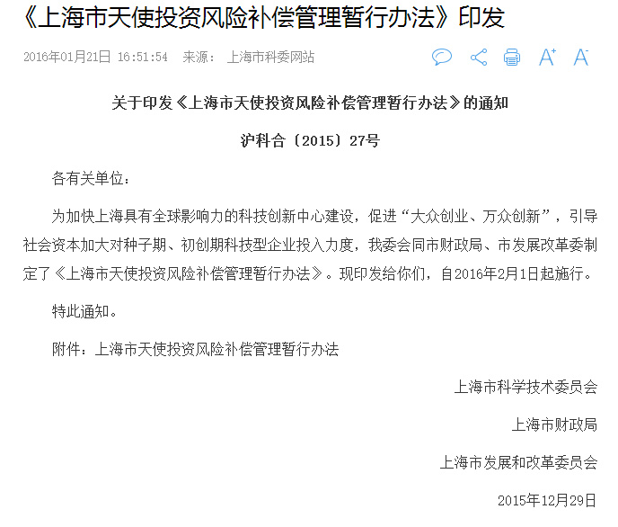 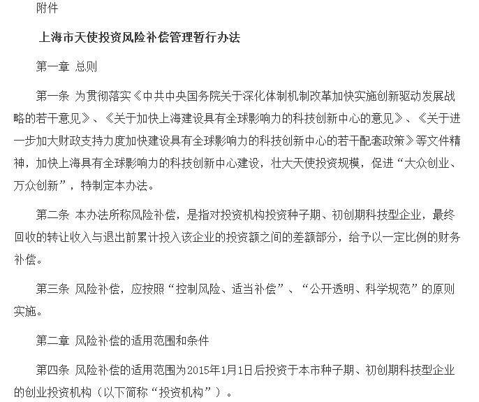 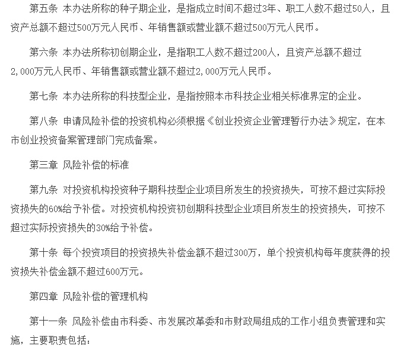 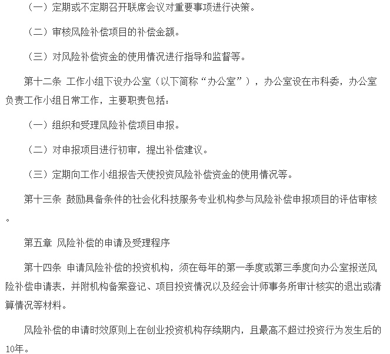 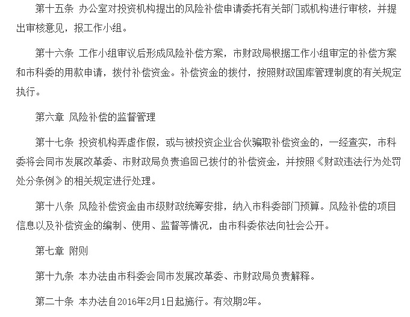

## 2016-01-26 18:10

呵呵。信不信

> @ETF拯救世界
> [选取了历史上几个国家估值特别高，第一波股灾后的图形，找找哪个是A股？ 并没有那么容易看出来吧。昨天有朋友在文章后面评论，总感觉有股力量在下面托着，好像总也跌不下去。是的，除了伟大zj的力量，更伟大...](https://weibo.com/p/1001603911182212817030)

## 2016-01-26 20:36

本月买3补1。文章很重要。  ​​​

2016年2月ETF计划：关于计划的过去和未来

写在前面，重要：

朋友们，开始浏览本月ETF计划前，请仔细阅读以下三点：

1、本计划绝非任何形式的投资建议或是投资指导。

在这里，仅仅是将本人十年前开始，一些朋友五年前开始进行的一个投资指数的计划公之于众，我们会在这里如实记录我们的投资历程。

如果这个计划能帮助您，我们会替您感到高兴，仅此而已。我们绝不会向您以各种形式收费、分成。如果您因为这个计划而亏损，我们也只能说一声很遗憾。也是仅此而已，我们不会承担任何责任。

2、请任何朋友开始参考这个计划前，要再三考虑自己是否能忍受甚至可能长达3-4年的熊市。

本计划虽然过去12年取得了超过10倍的盈利，但大家要知道，在12年中，真正让利润大幅增长的时间大概只有5-6年的三次大牛市。中国股市是个牛短熊长的市场。我们在超过7年的大熊市中慢慢买入，最终才取得了牛市利润的爆发。你一定要清楚，70%以上的人无法忍耐几年的熊市。所以，确认你自己能忍，再开始参考本计划。

3、未投入的剩余资金可以去买任何你想买的投资品种。只要每个月初用的时候能到位即可。如果某个月会投入5份以上的资金，会提前3天到一周说明。

今天，请每位希望继续参考ETF计划的朋友，好好看看后面的文字。一字一句皆泣血而成，认真看看。

2016年2月操作计划如下：

买入3份：

买入恒生ETF（159920）一份（价格不超过0.96）

买入50ETF（510050）一份（价格不超过1.98）

买入养老指数（场内分级母基168001或场外开基000968）一份 （养老产业指数399812不超过7100点）

补入一份：

补入恒生ETF（159920）一份（价格不超过0.96）

如果顺利买入，则持仓状况为：

对于2015年第三轮开始的新朋友，如果顺利买入，则持仓状况是：

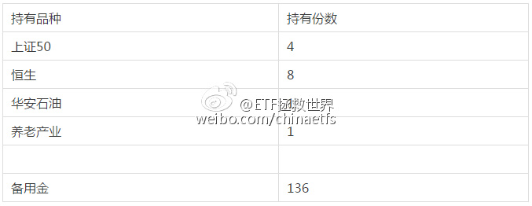

*已进行恒生目标市值策略的朋友可以不必买入本期2份恒生

**没有150份资金，只有每个月结余的朋友，可以不买养老指数，其它两只减半买入

**壹：不必感谢，但请不要抱怨**

2015年6月10日，本公众号正式开通。当月，开始将进行了超过十年的指数投资计划在这里公布。

2015年7月起，有朋友开始参考计划买入。如果你想回看过去每个月的投资计划，请从“1507”开始回复查看。

众所周知，2015年7月开始到今天，A股是绝大多数股民的噩梦。那个时候开始公布的ETF计划至今成绩如何？

我们将资产分为150份，到这个月为止，只动用了14份。其他的资金，如果朋友们买入货币基金（我这里以广发钱袋子和华夏活期通两者的月度平均收益做为基准），那么截止到今天收盘，我们的计划收益是这样的：

货基部分至今盈利1.79%。总持仓比例大致是94.2%；

恒生ETF收益率-12.77%，总持仓比例大致3.4%；

50ETF收益率-11.75%，总持仓比例大致1.8%；

华安石油收益率-11.24%，总持仓比例0.59%。

组合总收益率0.91%。同期上证指数跌幅35.71%。

不知道面对这样的成绩，大家作何感想。

如果我是一个基金经理，为大家设计的投资组合不仅大幅战胜了熊市的大盘，甚至取得了正收益，我想，此处我应该获得的是掌声。

非常可惜，现实中，几千位参考ETF计划投资的朋友，不仅几乎没有人说“干得不错”，相反，甚至会有人会抱怨：为什么我的恒生、50、石油跌了11%？

面对这样的询问，我竟无言以对。

在这样的超级大熊市中，本人竭尽所能，用估值数据、投资模型、资产配置原则，同时应用投资心理学尽量照顾到大多数人的情绪，为ETF计划打造了几乎无法战胜的钢铁防守长城，取得了正收益。如果你还要抱怨某个品种有10%浮亏，请立刻停止参考本计划。

你不理解，这是一个投资组合。

有些人总是会幻想这样的场景：

满仓买入后的第二天，大盘见底，一路高歌猛进翻10倍。清仓，第二天大盘开始暴跌，再回到起点。再次满仓买入，大盘继续开始暴涨……

周而复始。

要我说，这个世界上一定有人能做到，但那个人绝对不是我。请继续去别处寻找那个人。

我能做到的，是在不论多么大的熊市中，尽力保住本金不亏损或者极小幅度亏损的同时，尽可能便宜的收集最多的筹码，在未来的大牛市中赚到我应得的那份利润。

仅此而已。

孔子和耶稣都说过：道不同不相为谋。请还没开始亏损就痛苦万分的朋友立刻离开，因为：

随着我们买入的份数越来越多，未来的浮亏会越来越大。别的不说，就这次买入的养老指数，未来最大跌幅甚至可能会超过30%。你能容忍自己的一份投入浮亏这么多吗？

别说我没警告过你，真正的大熊市，会让人痛不欲生、万念俱灰，现在带着你那颗脆弱的小心脏早早离去，还不晚。

再次强调，我不是你的基金经理，我没有收你一分钱管理费，不会拿你一毛钱提成，这里只是我自己的投资计划，无论结局如何，请勿抱怨。

谢谢。

**贰：一些技术问题**

这个月的一份养老产业基金恐怕会让大家摸不到头脑：到底买什么？

这个问题是这样的：

首先，养老产业从成分股构成以及发展前景来看，是一个非常好的指数。但它的问题在于，场内暂时还没有ETF基金。对应的，是一个分级基金168001以及场外开放式指数基金000968。

分级和开基各有优势。分级可以套利，取得额外收益。开基跟踪更准，同时不用考虑紧急情况下买不到卖不出的问题。

这里，有能力的朋友自然可以去玩分级，经验不够的朋友还是老老实实去场外买000968广发养老。

至于购买渠道，在天天基金、蚂蚁聚宝等三方购买平台，费率是1折，也就是0.12%。在广发官网是4折。请注意，在广发官网购买请不要选C类，因为我们是长线投资。

另外申购000968的时候，请在收盘前申购，申购时养老产业指数399812最好不要超过7100点。

另外，请大家注意的是，各个品种只要价格低于我的买入价格都可以。越低越好，不一定非要明天买，一个月内哪天买都行。

**叁：估值**

今天收盘，大盘估值长这样：

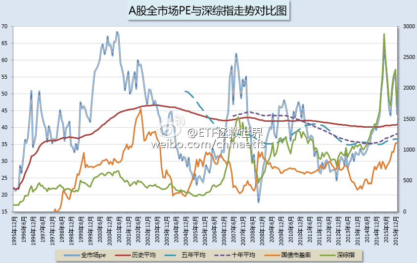

全市场依然高企。所以我们只买4份。为什么买这4份？

因为他们很低了。

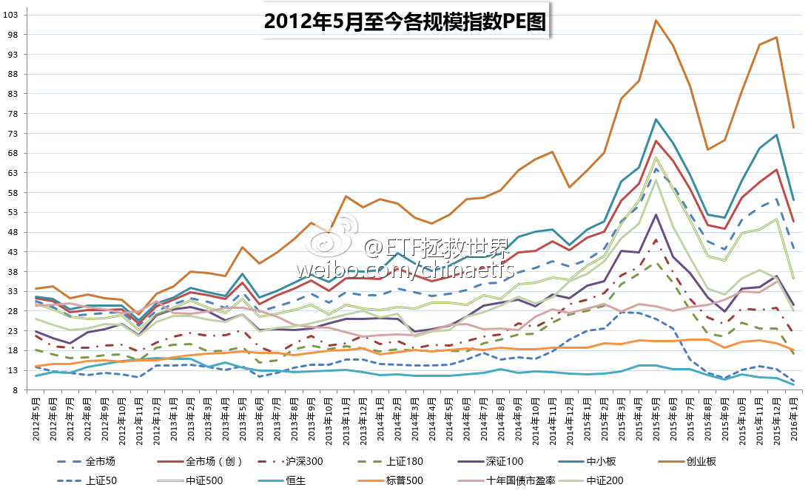

顺便祝福中小和创业股票的持有人。

## 2016-01-27 09:22

我突然有个想法，某天大宵说点位，如果连续几条骂他的评论少于500，那么大底可能就要到了。如果大宵连续五天不说点位，那么大底肯定就到了。 //@ETF拯救世界:大宵，你再这样以后会有人跳楼的。

## 2016-01-27 12:51

非常同意。市场的交给市场//@王福重:这次大跌后，证监会没出声，我要给它点赞👍。望再接再厉。

