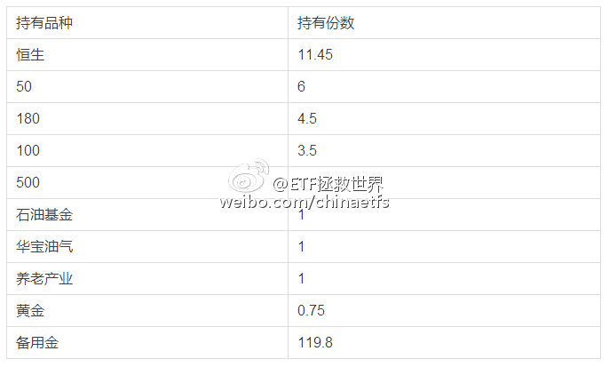
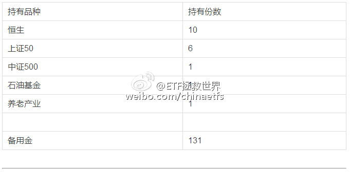
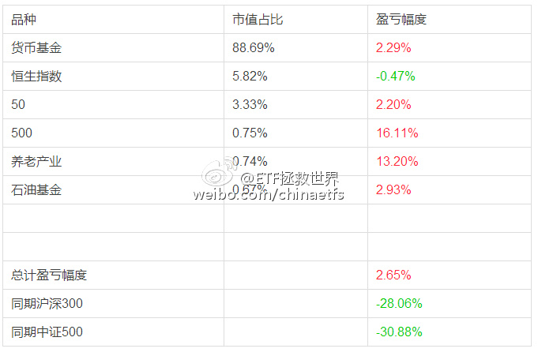
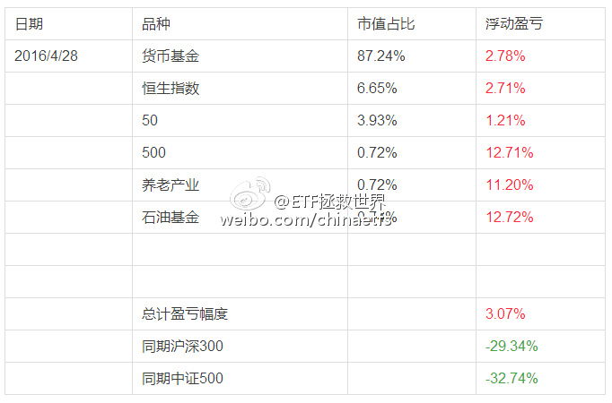
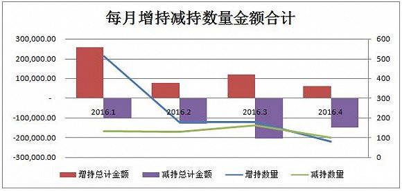
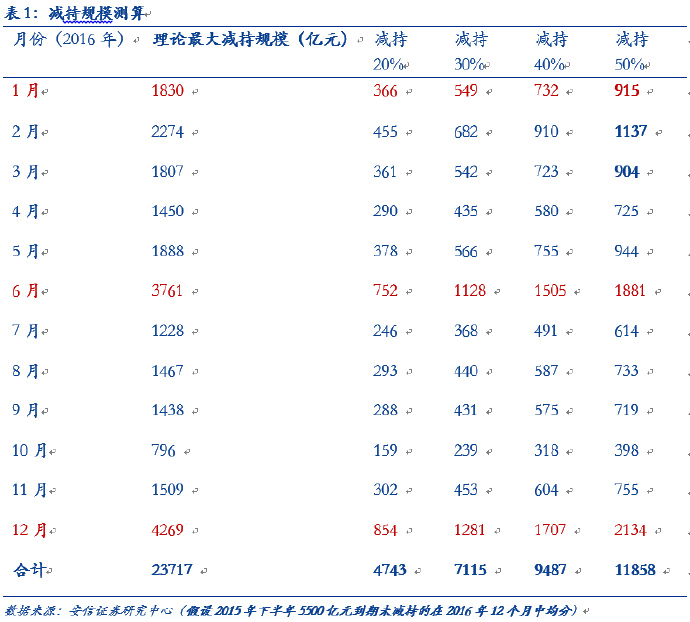
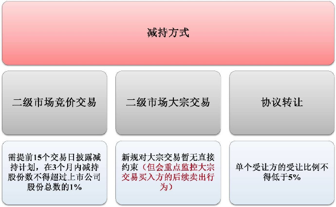

## 2016-04-01 13:25

对不起，微博的老乡们，我把你们给忘了。。第一时间看还是关注公众号吧。。  ​​​

2016年4月ETF计划：喜忧参半、新高、坚持和估值

2016年4月操作计划如下：

买入2份：

买入恒生ETF（159920）一份 （价格不超过1.042）

买入50ETF（510050）一份     （价格不超过2.158）

如果顺利买入，则2010年第二轮开始的老朋友持仓状况为：

对于2015年第三轮开始的新朋友，如果顺利买入，则持仓状况是：

为了新朋友们更加直观的理解第三轮计划自2015年7月1日至今的收益，特意为大家制作了收益表格：

2015年7月至今：

*表格中“货币基金”收益，为闲置资金买入货基收益。以华夏活期通与广发钱袋子的月度收益平均值为基准收益率。本月年化收益率取值2.8%，实际上，很多保本理财产品收益率远超这个数值，我们只取最保守的收益率。

**壹：多数人的喜忧参半**

对于大多数参考本计划的朋友来说，现在这个时点，相信内心是喜忧参半。

喜的是自己居然在中证500本轮调整最低的那天以几乎是最低的价格买到了500etf，养老产业回头看也是几乎最低区域。一个月的时间，两个基金的收益率分别达到了16%以及13%以上。

对于今年新参考计划的朋友来说，也是以远低于去年7月开始买50和恒生的价格买到了这两只etf。相信收益最好的朋友，这四只指基的收益都已经超过13%了。

忧的是什么？我相信很多朋友会后悔不已：为什么只买了那么少？

是啊，为什么这么少？对于2015年新参考计划的朋友来说，买了整整8个月，总仓位才买到了12%，面对这个月A股的反弹，很多朋友开始坐立不安。

然而，时间再往前推一个月，那时候我们买的四只指基，有三只浮亏。之前最多的时候，甚至有浮亏10%以上的时候。那个时候，有几位朋友会想：买少了！

我记得很清楚，1月底股灾3.0跌的所有人灰头土脸，虽然我们的整体账户生扛三次股灾依然是盈利，但因为有单个品种跌幅超过10%，依然无法让所有人满意，会有人留言问我：为什么我买的指基亏损了？当时，我相信大多数人想的，是，为什么买那么多！为什么不空仓？

是啊，仅仅一个多月时间，大多数朋友的心情就已经完全不同。不因为别的，只因为大盘涨了10%而已。

这种情况，本人没有什么可以说的。我可以在养老和500有价值的时候买入，甚至在最低点那个中午打破惯例推送一篇特别文章买入500，但我真的不能做到在那个时候重仓买入，没有别的理由，只是因为：不够便宜。

如果你觉得面对上涨异常难受，说明你的整体仓位对你来说非常不够。请在软件里点击买入，买到你觉得满意为止。

计划的仓位不可能让几千人同时舒服，尽快找到你自己的舒服仓位吧。

计划的仓位，是我们用策略、用数据、用模型尽力做出的最佳配置，适合我和一小部分朋友而已。

**贰：不断新高**

在2010年，上证指数3000多点的时候，我们开始了第二轮的ETF计划。那一轮熊市过去，最低点到过1800多点，而我们的ETF计划建仓完毕后，成本居然做到了2100点以下。

说起来这是个神奇的故事：3000点开始，最低1800，最后成本居然控制到了不到2100。

事情似乎有希望再一次发生。

2015年7月1日，上证指数还在4200点。当它跌到3000点的时候，我们的计划整体在盈利。所有五个持仓品种，除了一个浮亏0.47%外，其它都是盈利的。

那么，我们到底是怎么做到的？

非常简单：估值、仓位。

绝大多数朋友应该根本没有注意一个细节，那就是股灾3.0之前的12月底推送的计划中，我们进行了第三轮计划至今为止唯一一次卖出。卖出一份100etf后，股灾3.0开始。

这两个月几乎最低点建仓养老、500，是巧合吗？当然是巧合。但我说，巧合多了，背后就一定有些什么原因。

原因就是，估值。

朋友们，投资赚钱，其实非常简单：便宜了就买，特别便宜就多买，贵了就卖，特别贵就全都卖了。

回到最初的话题，为什么我们仓位只有十几个点？因为现在别说便宜，就连正常估值都不到。

我们有信心，一定会回到至少正常估值。

买的不贵，才能将成本控制在非常低的水平，才能每次反弹都创新高。就是这么简单。

A股是个黑暗森林。在整个森林的生态圈中，如果我们到不了食物链的更高一级，就要尽量将自己的账户做成坚不可摧的堡垒，没有任何人能从里面轻轻松松的拿走一分钱。这，就是你在这个森林里活下去首先要做到的事情。

不要成为别人的美餐。

**叁：坚持**

这个话题之前专门推送过一篇文章，就不再多说。

但这里还是要提醒：坚持等便宜货很辛苦，坚持持有盈利的东西等着变贵，有时候会更辛苦。

你账面盈利16%的500etf，正是你3%、5%、10%、15%没有卖出获得的奖赏。虽然这份奖赏非常有可能在未来又变成3%甚至浮亏。但请把这个当做一场训练，把自己训练成真正能赚大钱的人。

做波段，做短线，没问题，请开短线策略。这是个长线策略，不要随便卖出。

**肆：估值**

不多解释，很有一些股票需要自求多福。

*最后，有一件事跟大家说一下。去年曾经说过，我们买ETF就要严格控制成本，尤其有些朋友资金少，一份可能就几百几千块，找到低手续费的券商就至关重要。总是有朋友问我哪些券商适合买ETF，前些天有券商找到我，愿意为这个公众号的朋友交易ETF提供很优惠的佣金，尤其适合资金没那么大的朋友。有需要的朋友可以直接在公众号给我留言即可。

## 2016-04-01 19:28

不解释。#运动就是坚持#日行20000步的我已经领取了一枚闪电侠超级勋章，等你来挑战！微博运动 ​​​

## 2016-04-18 13:59

创业板与中小板指数的估值，已经进入了过去十年120个月中，最贵的10%。  ​​​

本周为大家送上的，是一张规模指数估值图。

规模指数与三周前为大家提供的行业估值是不同的。一般来说，规模指数可以理解为通常我们说的“宽基指数”。这些指数是按照成分股的市值、成交量等等划分。

比如说，沪深300你可以简单理解为沪深两市规模最大、流动性最好的300只股票组成的指数。中证500你可以理解为沪深两市除了沪深300以外，规模最大的500只股票组成的指数。

这样，我们统计各个规模指数的估值，就能非常清楚的知道，这个市场发生了什么。

看图。

一目了然：A股是一个规模越大的指数估值越低的市场。最大和最小的指数估值可以相差7倍。

在这里，我不想讨论诸如创业板和中小板高成长是否足以支持高估值，也不想去探讨50、300等成分股是否因为没有成长性所以被压低估值。这并不是我们这篇文章要讨论的问题。我们的读图栏目，只是为了客观陈述。

所有规模指数中，创业板与中小板指数的估值，已经进入了过去十年120个月中，最贵的10%。（创业板是09年10月至今）

最有意思的是创业板估值。除了开板的第二个月2009年11月外，其它最贵的月份都出现在过去十二个月。它们分别是：2009年11月、2015年4月、5月、6月、11月、12月、2016年4月（现在）。

大家可以对照创业板的走势图，看看这些月份后，该指数发生了什么。

中小板方面，历史估值最高的十二个月是：

2007年8、9、12月；2015年4、5、6、7、10、11、12月；2016年3、4月。

最后和大家强调一点，各位一定要理解的问题：

估值，并不能告诉你未来会涨还是会跌，尤其是短期走势。高估或者低估，有时候会持续几个月甚至超过一年。

但是，估值会告诉你哪里安全，哪里危险。个人认为，古语所云，君子不立危墙之下，倒是颇为适合这里的讨论。

那么，我们计算的估值到底有没有用呢？推荐大家看两篇我们公众号的文章。

第一篇是2015年6月15日发布的“投资分级A：宁拿25%收益哭，也不在万点牛市笑”。（第一轮股灾前的最高点当天）

第二篇是2015年8月12日发布的“A股的哈迪斯之顶”（第二轮股灾前几天）

这些文章如实记录了当时的估值以及我们的思路。事后看，感慨万分。它们都可以在首页底部的菜单中找到。

## 2016-04-19 18:20

新鲜的小韭菜涨势喜人，大宵忍不住写下了爱的诗篇:“韭菜馅饺子，好吃。”大宵估值瞬间涨到了12亿。

## 2016-04-25 17:26

很多人以为养老金进股市自己就能解套了。我建议你理智的想想：如果一个市场上，有养老金、国家队、大股东、公募、私募、散户……最不能亏钱的是谁？谁亏钱对国家来说最无所谓？想明白这个，就知道养老金入市对散户是好是坏了。还真把养老金当解放军来解放你了……

## 2016-04-29 09:10

本月买入两份；全面盈利；漫长冬天  ​​​

2016年5月ETF计划：越来越漫长的冬天

朋友们，开始浏览本月ETF计划前，请仔细阅读以下三点：

1、本计划绝非任何形式的投资建议或是投资指导。

在这里，仅仅是将本人十年前开始，一些朋友五年前开始进行的一个投资指数的计划公之于众，我们会在这里如实记录我们的投资历程。

如果这个计划能帮助您，我们会替您感到高兴，仅此而已。我们绝不会向您以各种形式收费、分成。如果您因为这个计划而亏损，我们也只能说一声很遗憾。也是仅此而已，我们不会承担任何责任。

2、请任何朋友开始参考这个计划前，要再三考虑自己是否能忍受甚至可能长达3-4年的熊市。

本计划虽然过去12年取得了超过10倍的盈利，但大家要知道，在12年中，真正让利润大幅增长的时间大概只有5-6年的三次大牛市。中国股市是个牛短熊长的市场。我们在超过7年的大熊市中慢慢买入，最终才取得了牛市利润的爆发。你一定要清楚，70%以上的人无法忍耐几年的熊市。所以，确认你自己能忍，再开始参考本计划。

3、未投入的剩余资金可以去买任何你想买的投资品种。只要每个月初用的时候能到位即可。如果某个月会投入5份以上的资金，会提前3天到一周说明。

4、第三轮ETF计划的每篇推送，可以回复年月数字查看。从“1507”开始。

2016年5月操作计划如下：

买入2份：

买入 中证环保指数 （场外开基、场内分级） 一份 （环保指数000827在1600点左右）

买入 50ETF（510050）一份     （价格不超过2.14）

如果顺利买入，则2010年第二轮开始的老朋友持仓状况为：

对于2015年第三轮开始的新朋友，如果顺利买入，则持仓状况是：

为了新朋友们更加直观的理解第三轮计划自2015年7月1日至今的收益，特意为大家制作了收益表格：

2015年7月至今：

*表格中“货币基金”收益，为闲置资金买入货基收益。以华夏活期通与广发钱袋子的月度收益平均值为基准收益率。本月年化收益率取值2.8%，实际上，很多保本理财产品收益率远超这个数值，我们只取最保守的收益率。

**壹：全面盈利**

2016年4月，第三轮ETF计划进行到第10个月，在同期沪深300指数跌幅29.34%，中证500指数跌幅32.74%的时候，我们的ETF计划持有的所有六个品种全部处在盈利状态，总收益率再创新高。

没错，总收益率只有3.07%。这个数字绝对值非常小。但请注意，我们是在三次股灾，指数下跌30%多的情况下取得这样的成绩。在同期所有2795只公募基金中，这个成绩排在第223位，前7.98%。在我们前面的200多只基金中，有100多只是债基。

上面这些文字的重点，不是说我们做的有多好（其实已经非常好），而是想阐述一个事实：只要有科学的投资系统，辅之以完整的数据支撑，再加上坚定不移的信念支持，那么，就没有任何扛不过去的大熊市。

赔钱，对我们来说，是一件很难的事。

有人又会面带嘲笑的说，熊市不赔钱有什么难的？我买了货基可以天天新高！

是啊，朋友，有什么难的？从2015年7月开始满仓货基这么简单的事情，6、7000万股民，有几个人能做到？如果你能精确的第一时间判断熊市已至，然后清仓，持有货币到现在，已经很牛了好吗？但问题是，你做到了吗？

更何况，我们不只有货基，我们买了五种权益类指数产品，在2900点，全部盈利。

另一些人，对别人要求更高。他们的要求是，在大熊市中持币躲过所有暴跌，然后满仓精准抄到每次反弹的底部，再在大暴跌来临之前清仓持币。在熊市中顺利翻番。做不到就是loser。

我还有什么好说呢？

让我来对你们，参考计划的，有理智的朋友们谈谈我的理念：

首先，熊市不亏钱的意思不是持有的任何品种不亏钱。未来我坚信上面的品种一定会出现亏损。但这根本就不是问题。亏损不怕。只要尽量少亏，牛市到来两周到一个月内盈利即可。记住，有时候熊市中让你痛苦不堪的15%亏损，在牛市来临后，3、4个交易日即可抹平。

其次，我们要竭尽全力找到在熊市中赚钱的东西。比如用少量资金做波段，做与A股相关度极低的低估品种，等等……总之，就是用赚到的钱弥补长线投入亏损的钱。做到在熊市不亏或少亏。

ETF计划，就是长线计划。这个计划会占到我总投资资金的70%。我愿意公布在这里供大家参考。在计划闲置资金用不到的时候，或其它的闲置资金，我自己会做一些波段或者套利等操作。这部分操作我不会公开。当然不是怕大家赚钱，最主要的原因是我有十足的信心ETF计划不会让大家赔钱。但那些波段或者套利并不100%确定。重申我最大的原则：我不愿意任何一个人因我赔一分钱。

所以还请大家谅解。也希望大家可以自己找到一些其它的能够在熊市赚取利润的方法。当然，赚不到也无所谓。

**贰：传家宝**

在这个月的最高点，中证500收益率最高超过22%，而现在跌到只剩12%。那么，为什么在高位我们不卖掉低位再接回来？

亲爱的朋友们，让我告诉你们一个在资本市场赚大钱的秘密：

大钱，必然是重仓+坚定持有才能赚到！

每次赚不了三瓜两枣就急匆匆卖掉，亏了钱就死死拿到亏50%忍痛在底部卖出，那是只有最菜的菜鸟才会干出来的事情。当然，大多数人一辈子在资本市场都会是这样的菜鸟……

我们辛辛苦苦，好不容易以不贵的价格买到了心仪的好东西，就不要随随便便把它卖出。没错，也许你能做个漂亮的波段，多赚了10%。但你相信我，一定要相信我——总有一天，在未来那个波澜壮阔的大牛市，你会在赚了十几个点卖出筹码之后，看着它翻了好几倍，失去这辈子最后一次财务自由的机会而遗憾终生。

一定会发生。

所以，我们一起来进行一次训练。训练自己踏踏实实拿着一个成本不高的好东西，拿到无数疯子用疯狂的价格来抢的时候，微笑着送给他们。拿着丰厚的利润，笑傲人生。

或者，如果永远也不会贵到离谱，不妨就当做传家宝传下去，不亦乐乎？

**叁：关于中证环保**

很不幸，本月买入的中证环保再次没有场内etf。还是那句话，有能力的朋友可以玩场内环保分级，有四只。具体不解释。

没有能力或者不愿意费太多力气的朋友，可以场外买广发环保指数（001064）。具体场外怎么买，公众号回复1602，看看当初养老怎么买的。不多说了。

注意，要在中证环保指数000827收盘1600左右的时候申购。

**肆：估值**

大家还记得4月17日公众号文章“周末读图（2）：中小、创业进入历史最高”吗？谁能想到，第二天就暴跌？

估值有用没有？去首页下方的菜单里，看看本站精选文章。从2015年6月15日那篇开始看。

本月图，不解释。

大庄家的所作所为，会将熊市的时间拉长至少一倍。朋友们，做好长期抗战的准备吧。既然市场无法起到决定性作用，就要付出代价。可悲的是，这个代价要我们每个人的宝贵时间来支付。

悲哀。

## 2016-04-30 21:56

大庄家的一万多亿不知道能扛多久。这边一个月减持1400。

> @AndrewXAndrew
> 据@界面，4月101家企业公布了减持公告，而增持的公司仅82家，减持数量再次超过增持数量；2016年1月持股5%以上大股东不得减持的规定到期后，已经连续三个月净减持，其中4月两市合计减持金额CNY 1400亿。另据安信策略之前测算2016年各月理论最大减持规模，6月达到CNY 3761亿，仅次于12月的CNY 4269亿。 ​​​
>   

