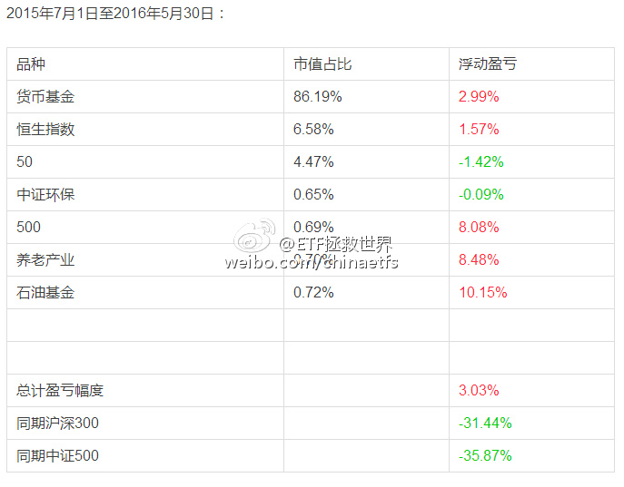

## 2016-05-13 05:14

如果某国是市场经济国家，一定是市场经济的定义出了问题

## 2016-05-17 12:27

办了三年签证，以后每年都会去转转。多看看别人是怎么生活的，很有意义。

> @叶檀
> 日本经济重心转变，不靠贸易靠服务，日本经济改结构。由于原油价格走低、企业拓展海外市场以及访日游客增加3大因素推动，日本2015年度经常项目盈余17.9752万亿日元，顺差额同比翻番，恢复至自2010年度顺差18.2万亿日元的最高水平。其中以中国人为中心的访日游客数，2015年为2135万人，旅游收支1.2万亿日元，均为历史新高。日本经济重心，已从3·11大地震之前依靠产品贸易转型投资和服务。

## 2016-05-18 18:36

这是半年前，当时反弹正high。现在大家再去大宵微博看看，准不准？像写好了剧本一样。//@ETF拯救世界:还是那句话，大宵这个位置强力唱多，未来英名不保是其次，会让很多粉丝赔了大钱才是最大的问题。大宵，珍重。

## 2016-05-19 17:11

李总，截止一季度末，两市2851只个股一共被1亿6千7百1十4万个账户持有。按照每户3个股票计算，也有5300万股民是多头。你哪里会是最后一个？正是几千万多头，支撑了A股这样变态奇葩的估值体系啊。

## 2016-05-31 10:30

2016年6月操作计划如下：买入3份  ​​​

买入3份：

买入 中证环保指数 （场外开基、场内分级） 一份 （环保指数000827收盘在1580点左右）

买入 50ETF（510050）一份     （价格不超过2.08）

买入 300ETF（510300）一份    （价格不超过3.04）

*只有每月结余的朋友依然可以留一半现金等低位。

如果顺利买入，则2010年第二轮开始的老朋友持仓状况为：

对于2015年第三轮开始的新朋友，如果顺利买入，则持仓状况是：

为了新朋友们更加直观的理解第三轮计划自2015年7月1日至今的收益，特意为大家制作了收益表格：

2015年7月1日至2016年5月30日：

*表格中“货币基金”收益，为闲置资金买入货基收益。以华夏活期通与广发钱袋子的月度收益平均值为基准收益率。本月年化收益率取值2.55%，实际上，很多保本理财产品收益率远超这个数值，我们只取最保守的收益率。

**壹：逐渐加大的仓位、风险与收益**

第三轮ETF计划开始至今已经11个月。同期沪深300下跌32%、中证500下跌36%。而我们这样的不做波段的长线计划之所以能够不亏损，完全依靠的是根据估值进行的仓位控制。

熊市中，低仓位能够换来资产的安全。而这份资产的安全有多重要，我想很多朋友打开伤痕累累的帐户自然会有深刻体会。在雪球的组合排名中，我们这样一个4000多点建立的组合，到现在已经战胜了80%多的组合。

然而，长期来看，一个组合想要取得高收益，必须拥有一定数量的权益类资产。很简单的一个例子，我们这次下跌最低点的那天，买入的500etf，一个月内最高涨了25%以上。即使不断下跌到现在，也有8%的收益。这样的收益水平，现金资产无论如何也追不上。

所以，ETF计划在未来想要取得与以往一样的优秀成绩，不仅要做到熊市不亏损，牛市也要做到能跟上。而牛市能跟上的前提，是我们在熊市中要慢慢收集未来能赚钱的好东西。

不可避免的，我们的仓位在慢慢提高。本月投资完毕后，我们的A股权益类资产将上升到将近10%，A股+港股资产将上升到16%左右。仓位提高了，长期收益虽然有所保证，但一定会随之出现的，就是未来资本市场调整时，我们的资产也会随之出现更大的波动。

每位朋友的心理承受能力不同。就像1、2月份的时候，有朋友4%仓位的恒生浮亏10%，总浮亏只有0.4%的时候，就已经无法忍受。相信我，随着仓位的增加，未来也许会出现的浮亏会更大。实在无法接受的朋友，可以完全空仓等待熊市大底。没有任何问题。

毕竟，我们买入的任何指数，短期都有可能下跌30%以上。不是每位朋友都能承受这样的跌幅。

而我能做的，就是竭尽全力依照自己的投资策略、估值数据、资产配置模型、甚至应用金融心理学，让自己和参考计划的朋友们在最冷的寒冬依然有毛毯、火炉和热可可；在金色的秋天，有沉甸甸的稻穗收割。

不以涨喜，不以跌悲。进退自如，尽在掌握。

**贰：第二个小调查**

去年十月，进行了一次小调查。是让朋友们投票，选择自己会投入多少资金到ETF计划。时至今日，再进行一次相同的调查很有必要。

第一个原因，与第一次一样。只有知道大概有多少朋友，多少资金会参考计划，才会知道有哪些品种我们不能选择。几个亿的资金和几百万可以选择的品种完全不同。同时，也需要根据朋友们的具体情况有些不同的说明。比如，没有储蓄的朋友占多大比例，这些问题都比较重要。

第二个原因，希望阶段性的知道有多少朋友已经不再参考计划。我的预计是，到了熊市大底，会有70%以上的朋友已经放弃了。这个数据也比较重要。

所以，还是希望朋友们如实点一下。放心，没人知道你的投票，完全匿名。

**叁：人人都爱浮亏**

有朋友跟我说，自从开始了ETF计划，就像疯了一样：明明有持仓，却希望股市暴跌；

还有朋友说，试着投了几个月，发现市场只要有一个小反弹，之前的浮亏就会全部开始盈利。于是，又后悔之前浮亏的时候没有多买。

没错，朋友们。我想大家都渐渐的开始掌握了投资的秘密——想要在资本市场赚大钱，就尽量将你轻仓浮亏的时间拉得长一些，浮亏的幅度深一些。这样，随着你不断买入摊低成本，未来你就会赚到想象不到的财富。

但是，亲爱的朋友们，这段话要实现，是有前提的：

首先，你不能重仓＋大幅亏损。试想一下，你满仓浮亏50%，是否还有我们这样愉快的好心情？等你辛辛苦苦回本的时候，别人已经赚了100%~

其次，你不能估值高的情况下重仓＋大幅亏损。很有可能，十年二十年无法回本。例子很多，自己想想。

**肆：估值**

本月全市场估值比上个月略降。不过依然远远高于历史、五年、十年平均。一个特点是分化严重，大股票估值普遍可以接受，中小股票依然在天上飞。

未来会怎么走，值得期待。

