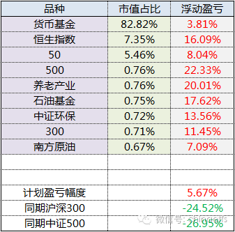
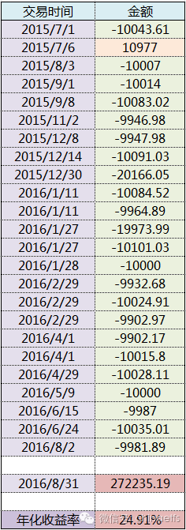
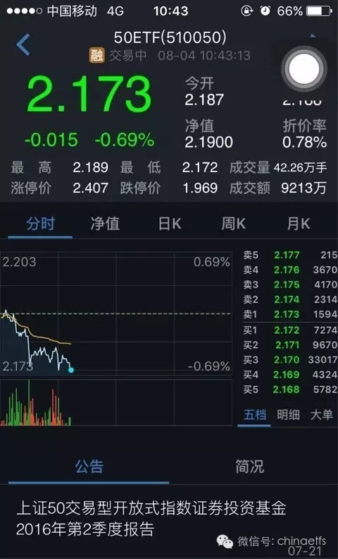
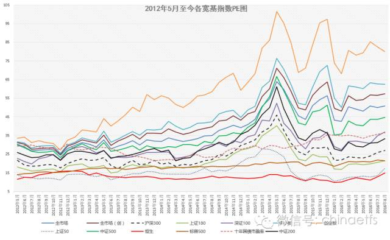
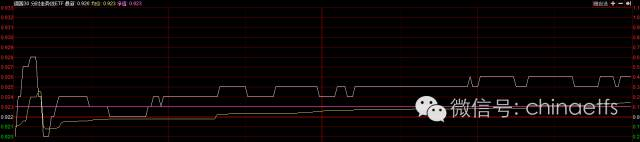
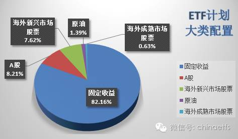
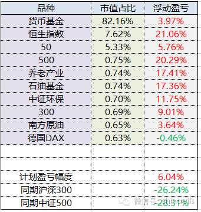
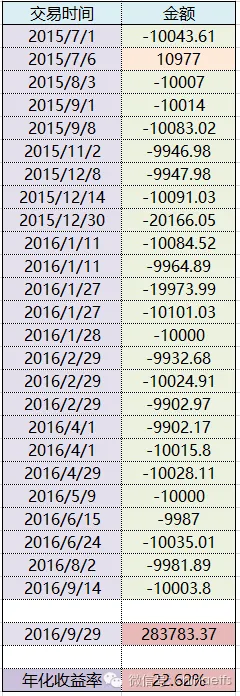
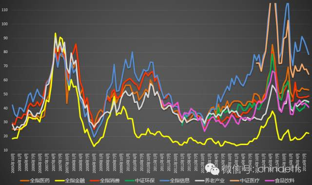

## 2016-09-07 14:06

啊，忘了在微博发9月计划了，微博的乡亲们，对不起了……

 ​​​

2016年9月ETF计划

朋友们，开始浏览本月ETF计划前，请仔细阅读以下几点：

1、本计划绝非任何形式的投资建议或是投资指导。

这里仅仅是将本人十年前开始，一些朋友五年前开始进行的一个投资指数的计划公之于众，我们会在这里如实记录我们的投资历程。

如果这个计划能帮助您，我们会替您感到高兴，仅此而已。我们绝不会向您以各种形式收费、分成。如果您因为这个计划而亏损，我们也只能说一声很遗憾。也是仅此而已，我们不会承担任何责任。

2、请任何朋友开始参考这个计划前，要再三考虑自己是否能忍受甚至可能长达3-4年的熊市。

本计划虽然过去12年取得了超过10倍的盈利，但大家要知道，在12年中，真正让利润大幅增长的时间大概只有5-6年的三次大牛市。中国股市是个牛短熊长的市场。我们在超过7年的大熊市中慢慢买入，最终才取得了牛市利润的爆发。你一定要清楚，70%以上的人无法忍耐几年的熊市。所以，确认你自己能忍，再开始参考本计划。同时，未来会有多少收益我们并不知道。因为我们无法预计未来的市场会怎么走。

3、未投入的剩余资金可以去买任何你想买的投资品种。只要每个月初用的时候能到位即可。如果某个月会投入5份以上的资金，会提前3天到一周说明。

4、第三轮ETF计划的每篇推送，可以回复年月数字查看。从“1507”开始。也可以在公众号主页下方菜单选择“投资计划”栏目查看。

2016年9月操作计划如下：

本月不买不卖，不交易

*本月继续开启双周模式，如有投资机会，每月15日将加推一篇计划文章。

** 到目前为止，还没有买入的往期计划是：

中证环保（001064） 一份 （价格不超1580点、2016年6月计划）

德国30   （513030）一份   （价格不超过0.88、2016年7月计划）

50ETF     （510050）一份  （价格不超过2.17、2016年7月计划）

截至2016年8月31日，2010年开始的第二轮ETF计划持仓状况为：

持有品种	持有份数
恒生	11.45
50	8
180	4.5
100	3.5
中证环保	1
300	1
500	1
石油基金	1
华宝油气	1
养老产业	1
南方原油	1
黄金	0.75

备用金	114.8

同期，2015年开始的第三轮ETF计划持仓状况为：

持有品种	持有份数
恒生	10
上证50	8
中证环保	1
沪深300	1
中证500	1
石油基金	1
南方原油	1
养老产业	1

备用金	126

为了新朋友们更加直观的理解第三轮计划自2015年7月1日至今的收益，特意为大家制作了收益表格：

一：从整体150份资金的角度看：

本月ETF计划继续新高。相对同期沪深300与中证500涨幅继续保持30%以上的相对领先优势。

二：从已投入资金年化收益看：

以上两种计算方法仅做参考。

**壹：日益艰难的买入**

上个月，很多朋友非常开心：终于可以买入3份了。然而时至今日，大多数朋友只买到了南方原油。德国DAX和上证50都因为我们建议的价格比最低价低了几厘而失之交臂。

这是巧合吗？

如果说2、3月份的养老、500买在最低价是技术和运气的巧合。那么上个月的50、300，这个月的dax、50出现的情况就让人不禁有些忧虑。

上个月50、300都在我们建议的价格止跌。300甚至我们建议的价格就是最低点。而这个月，大家眼睁睁的看着在建议的价格上，dax、50的买盘多于其它价位的买盘近十倍。也就是在这个价格上，太多参考计划的朋友一起买，导致大家都没买到。（注意2.17的计划建议上限价格，连同一部分朋友多挂1、2厘，比正常买盘多了600多万买入）

为什么我们要有一个建议的价格？大家可以考虑一下，如果没有这个价格为大家定个上限，各位放开了追着买，导致的结果一定是瞬间将价格冲高，导致无谓的高成本。对于成交量大的ETF还好，对于成交量小的，瞬间被冲击到涨停也毫不奇怪。

那么，是否没有解决的办法了？有的。一个办法是以后我们尽量买入场外指基，这样冲击会小很多。第二个是可以在适度范围内高于参考价格买入或低于参考价格卖出。但这个会不会导致产生冲击成本很难说。

在这里，我想语重心长的跟大家说一些心里话。

我之所以对成本控制的这么严格，是因为我在过去的投资历程中，无数次体验过最低点附近买入的乐趣。当然，定在什么价格买，我自己是有一些技巧，基本可以保证买在大底部或者阶段底部。大家如果翻翻过去计划的各个品种买点，就应该明白。然而，这个技巧在参考计划的朋友越来越多的情况下，已经很难奏效。所以，其实我建议各位可以在一个范围内，大概差不多的情况下就可以操作。比如，不高于我的买入价1%。长期来看，不会有多大的影响。

**贰：第一桶金**

最近这段时间，收到一些朋友的问题：第一桶金到底应该如何赚到？能不能谈谈财富增长的过程？

熟悉我的朋友都知道，我从来不喜欢讨论家庭财富具体数字之类的东西。而且，对于第一桶金也颇不容易定义，如果按照王老板的说法，“先定个小目标，比如一个亿”这个标准来说，我还没有赚到第一桶金呢。

不过，这十几年倒是在资本市场积累了一些财富，在这里，也大言不惭的谈一谈自己的体会吧，毕竟，真的有很多朋友想要通过股市让生活变得富足些，尤其是那些充满梦想而感到现实骨感的年轻人。

再次强调，只是一家之言。在股市积累财富的道路千万条，我只是谈谈自己的看法。这里没有鸡汤，只有可能让你不舒服的事实。

首先是概率。

对不起，我要告诉你的是，大部分，甚至绝大部分人，在股市赚不到第一桶金。这个也不难理解，如果大部分人都赚大钱，这将是多么不合理的一件事。所以，赚大钱的注定只是很小一部分人。在股市赚钱不难（对大部分股民来说赚钱也很难），但赚大钱，确实很难。

其次还是概率。

所以你应该学学概率论。概率在这里会告诉你，如果你能多投入一些本金，那么赚多一点的概率就大一点。同样是希望赚到100万，你拿1万元、10万元、50万元做本金的成功概率就差很多很多。不仅是技术难度，还有心态。所以我的意思是，你最好能尽量多拿一些本金进来，首先就是，努力工作吧。

第三是不亏损。

这个也是数学题。赔30%需要涨50%回本。赔50%需要涨100%回本。不要亏损，至少不要大幅亏损。从1到2，比从0.5到2简单很多很多。前者只需要赚1倍，后者需要你赚3倍。面对同样的牛市，别人1到2赚1倍已经翻番，你从0.5开始赚一倍只是回本而已。

第四是极为重要的：机会来临的时候，敢于下重手

对很多人来说，第三点和第四点可能无法在同一个人身上出现。是啊，极为注重本金安全的人，真的很难像最疯狂的赌徒一样重手满仓甚至上杠杆。

没错，这就是为什么绝大多数人要不然是胸口写个勇字乱打乱杀赔个底掉，要么是小心翼翼结果很多年只是赚了很少一些钱。那些大智大勇平常小心，大机会来临果断勇敢出击的人，凤毛麟角。真正大机会来临的时候，绝大多数人在瑟瑟发抖，哪里有胆子拿着辛辛苦苦保护完好的本金一把梭哈？

所以，对于那些想在证券市场上获得第一桶金的朋友的建议是：在常规的日子里，像保护你的眼球一样保护你的本金。在真正大机会到来的时候，满仓，甚至加杠杆下注。因为，你希望的是在证券市场改变人生，这，几乎是唯一路径了。

当然，懂得这个道理的人，大部分人还是做不到。为什么？因为他们很难知道到底什么才是极大概率的大机会。有时候出击早了，杠杆爆仓。出击晚了，盛宴已经进行了一大半，只等着买单的人出现了。

不过，我始终坚信，并请你相信的是，证券市场是最不缺乏机会的地方。只要你能保护好你的本金，那个奋力一击的机会，随时都有可能出现。在那之前的一年、三年、五年里，你要做的是多攒本金，多磨练自己的技巧、知识和性格，等待那个改变命运的时候到来。

**叁：估值**

我知道，很多朋友看到这个月又是不买不卖很失望。他们觉得拿着现金非常痛苦，总希望把钱投出去心里才踏实。

为了不让这些朋友失望，我将所有可以投资的指数品种，包括国内国外股票商品……研究了很久很久。可惜，我实在无法说服自己违背自己的原则，买入“不值”的品种。不出手则已，出手就要买到好东西。

看看上面的收益表就会明白，买“值”的东西会有回报。回报就是很容易就赚钱。而且，很可能是买了就赚。不仅如此，吃得香，睡得好，夜夜安睡。

在这里，我再说一次。觉得仓位低的朋友，请尽快将仓位调整到“舒服”的位置。标准就是涨50%跌50%你都会毫无感觉，就是舒服了。

大家看上面的估值图，会发现50和恒生的估值涨幅很大，创业板的估值却下降不少。对照K线，你会发现它们的涨跌并没有那么明显。

没错，中报今天披露完毕。“低估”的上证50有一半成分股业绩下降，利润下降的成分股平均利润下降幅度超过40%。平均利润增长只有不到1%。导致50估值飙升。

而创业板利润增长超过20%，导致估值下降明显。

市场先生是疯狂的吗？不，大多数时间，它很理智。

## 2016-09-12 15:21

明晚有可能开车。 ​​​

## 2016-09-12 19:48

哪有的事呢……

## 2016-09-13 21:45

开船了

 ​​​

2016年9月ETF计划（2/2）

朋友们，开始浏览本月ETF计划前，请仔细阅读以下几点：

1、本计划绝非任何形式的投资建议或是投资指导。

这里仅仅是将本人十年前开始，一些朋友五年前开始进行的一个投资指数的计划公之于众，我们会在这里如实记录我们的投资历程。

如果这个计划能帮助您，我们会替您感到高兴，仅此而已。我们绝不会向您以各种形式收费、分成。如果您因为这个计划而亏损，我们也只能说一声很遗憾。也是仅此而已，我们不会承担任何责任。

2、请任何朋友开始参考这个计划前，要再三考虑自己是否能忍受甚至可能长达3-4年的熊市。

本计划虽然过去12年取得了超过10倍的盈利，但大家要知道，在12年中，真正让利润大幅增长的时间大概只有5-6年的三次大牛市。中国股市是个牛短熊长的市场。我们在超过7年的大熊市中慢慢买入，最终才取得了牛市利润的爆发。你一定要清楚，70%以上的人无法忍耐几年的熊市。所以，确认你自己能忍，再开始参考本计划。同时，未来会有多少收益我们并不知道。因为我们无法预计未来的市场会怎么走。

3、未投入的剩余资金可以去买任何你想买的投资品种。只要每个月初用的时候能到位即可。如果某个月会投入5份以上的资金，会提前3天到一周说明。

4、第三轮ETF计划的每篇推送，可以回复年月数字查看。从“1507”开始。也可以在公众号主页下方菜单选择“投资计划”栏目查看。

2016年9月月中操作计划如下：

买入德国DAX（场内513030或场外000614）一份       价格不超过净值±1%

*到目前为止，还没有买入的往期计划是：

中证环保（001064） 一份 （价格不超1580点、2016年6月计划）

德国30   （513030）一份   （价格不超过0.88、2016年8月计划）

50ETF     （510050）一份  （价格不超过2.17、2016年8月计划）

由于是月中计划，不打算说太多。谈几个关键点，请务必仔细看。

**壹：怎么买**

大家应该还记得上个月在我们建议的DAX买入价格0.88上堆积了巨量买单导致大家谁也没买到的事情。这次我们换一种买法，争取让大家都能买到。

这次建议各位在场内的德国DAX（513030） 净值±1%的价格买入即可。比如净值是1，那么0.99-1.01买入都可以，当然，越低越好。

DAX是一个QDII基金，也就是说，在我们A股9:00-15:00开盘期间，它的净值是不变的。

那么， 净值怎么看？

一般看盘软件上都会显示“净值”或者“IOPV”，这个数字就是这只基金的净值。同时，在股价分时图中也会有显示。比如说，在同花顺上它长这样（紫线）：

如果这个还有朋友不会看，请明天9:45后在公众号回复“净值”。我会将净值与建议价格设置自动回复给大家。

如果在我们建议的价格上买单太大，大家还是买不到，那么我们就去申购场连接基金（000614）。这个也很方便，大家之前的环保和养老都已经实战过了。不会的新朋友去翻菜单里的历史文章。

在天天申购的话是0.12%申购费。这个基本上可以保证大家都能买到。但因为是QDII，所以申购价格并不能确定。有可能更贵，有可能更便宜。看大家运气了。

基本就是这样了，操碎了心的感觉有没有？

**贰：为什么是DAX**

为什么在上个月没有成功买入后，我们依然锲而不舍的将价格调高继续买入？

配置不同市场指数的必要性，大家从这次恒生赚钱就可以有所体会。各位始终要记住一件事，我们是来资本市场赚钱的。不能因为我们在中国，就一定把自己局限在A股。何况，A股实在让人无法下手。

这几天，我将A股的历史与实时数据反复研究，始终无法说服自己买入一份任何一只指数。也许未来会大涨，不过没办法，面对数据，我始终过不了自己这一关，无法违背原则下手买入这么贵的东西。所以如果未来A股涨了，别怪我，您现在完全可以自己去加仓到舒服的位置。我是不会在ETF计划中买的。

成熟市场是未来计划中必不可少的一部分配置。我个人非常希望完成的配置是美、德、英、日四大成熟市场布局。未来总体会给成熟市场15%-20%的仓位配置。鉴于美股现在处在历史估值最高位的事实，我选择从德国入手开始布局。虽然DAX和标普500的相关性超过0.94，但从德国自身的情况来看，并未贵的离谱。整体30只成分股估值大致只有17、18倍。另外，汇率也是配置境外指数的重要原因，这个不展开说了。

祝大家都能买到便宜的好东西。顺致各位中秋快乐，与各位千里共婵娟。

## 2016-09-19 07:27

错。爆炒新股不是投资者的责任。在这个平均市盈率50多倍的市场人为将新股市盈率压到20倍上市，怎么可能不爆炒。控制新股首日涨幅，后面怎么可能不用无数涨停推波助澜？

## 2016-09-20 17:24

近期有不少朋友反馈，有人冒充我私信各位粉丝朋友进行各种诈骗活动。请朋友们认清我的ID，发现诸如“ETT拯救世界”之类的冒名顶替者，请立即举报。

99.9999%的情况下，我不会主动私信各位。敬请知悉。

另外想跟冒名顶替者说的是，您用做这些事情的精力干别的，没准早就成功了呢…… ​​​

## 2016-09-29 10:40

十月计划今天中午提前发车。 ​​​

## 2016-09-29 12:42

2016年10月ETF计划：告别猪队友

朋友们，开始浏览本月ETF计划前，请仔细阅读以下几点：

1、本计划绝非任何形式的投资建议或是投资指导。

这里仅仅是将本人十年前开始，一些朋友五年前开始进行的一个投资指数的计划公之于众，我们会在这里如实记录我们的投资历程。

如果这个计划能帮助您，我们会替您感到高兴，仅此而已。我们绝不会向您以各种形式收费、分成。如果您因为这个计划而亏损，我们也只能说一声很遗憾。也是仅此而已，我们不会承担任何责任。

2、请任何朋友开始参考这个计划前，要再三考虑自己是否能忍受甚至可能长达3-4年的熊市。

本计划虽然过去12年取得了超过10倍的盈利，但大家要知道，在12年中，真正让利润大幅增长的时间大概只有5-6年的三次大牛市。中国股市是个牛短熊长的市场。我们在超过7年的大熊市中慢慢买入，最终才取得了牛市利润的爆发。你一定要清楚，70%以上的人无法忍耐几年的熊市。所以，确认你自己能忍，再开始参考本计划。同时，未来会有多少收益我们并不知道。因为我们无法预计未来的市场会怎么走。

3、未投入的剩余资金可以去买任何你想买的投资品种。只要每个月初用的时候能到位即可。如果某个月会投入5份以上的资金，会提前3天到一周说明。

4、第三轮ETF计划的每篇推送，可以回复年月数字查看。从“1507”开始。也可以在公众号主页下方菜单选择“投资计划”栏目查看。

2016年10月第一次操作计划如下：

买入食品饮料（场外160222）一份       对应国证食品饮料指数（399396）收盘价在8000点左右；【该品种预计最大跌幅40%】

补入180ETF（510180）一份  价格不超过2.84；【该品种预计最大跌幅30%】

卖出南方原油（501018）一份（清仓）  场内价格不低于0.93；场外直接赎回

*到目前为止，还没有买入的往期计划是：

中证环保（001064） 一份 （价格不超1580点、2016年6月计划）

德国30   （513030）一份   （价格不超过0.88、2016年8月计划）

50ETF     （510050）一份  （价格不超过2.17、2016年8月计划）

截至2016年9月29日，2010年开始的第二轮ETF计划持仓状况为：

持有品种	持有份数
恒生	11.45
50	8
180	4.5
100	3.5
中证环保	1
300	1
500	1
石油基金	1
华宝油气	1
养老产业	1
南方原油	1
德国DAX	1
黄金	0.75

备用金	113.8

同期，2015年开始的第三轮ETF计划持仓状况为：

持有品种	持有份数
恒生	10
上证50	8
中证环保	1
沪深300	1
中证500	1
石油基金	1
南方原油	1
养老产业	1
德国DAX	1

备用金	125

大类资产配置图：

为了新朋友们更加直观的理解第三轮计划自2015年7月1日至今的收益，特意为大家制作了收益表格：

一：从整体150份资金的角度看：

*上证跌破3000点，ETF计划收益率首次超过6%，继续新高。相对同期沪深300与中证500涨幅继续保持32%以及34%以上的相对领先优势。

**货币基金收益率取华泰证券紫金货币增强与平安证券灵活宝平均收益率。本月年化收益率为3.65%。

二：从已投入资金年化收益看：

以上两种计算方法仅做参考。

**壹：两点说明**

第一，从本月起，所有买入品种会标注预期最大跌幅，请参考的朋友想好再参考。以免真的发生了惊慌失措。

第二，本月的180是补第二轮ETF计划的。第二轮的老朋友不用买，最终第二轮与第三轮持仓会一致。

**贰：猪队友和狼对手**

通常来讲，本人不会投资上市一年以内的指数基金。很简单，建仓期无法及时跟踪指数，也需要足够的时间观察它是否有能力跟踪比较基准。

八月初，我做了一个违反惯例的决定：投资一只上市不久的基金。为什么会打破惯例？当时油价跌破40美元，我意识到这是一个极好的中期建仓点，如果错过，可能较长时间内不会再有。情急之下，翻遍两市已有的石油基金，只有这只是以跟踪WTI和BRENT油价为基准，于是，决定买入。

我相信它能够跟上自己的业绩比较基准，即使会有误差，也乐观的相信不会差太多。

事实证明，我确实太乐观了。

我看对了油价，至今两个月不到反弹接近20%。

但我的猪队友却在原地呆萌的看着目瞪口呆的我。

斩杀过无数狼对手，这次却被猪队友坑了。

再见吧。即使未来油价会继续反弹，猪队友也会涨，我们也暂时就此别过吧。我不想在身上绑个不知道什么时候会爆的炸弹冲锋陷阵。

我们所有持仓品种，我都是用传家宝的标准来衡量买入，轻易不会卖出。这次，真是个例外了。

（有很多人愿意讨论南方原油的持仓，在我看来，它持有的是BNO还是USO并不重要，重要的是一个指数基金就要跟踪业绩比较基准。这两个月来，我每天将WTI和BRENT涨跌幅并考虑汇率因素进行计算，并与该基金进行对比，发现可以说是莫名其妙，一塌糊涂。以最近几个交易日为例：

9月22日，基准上涨1.99%，净值上涨0.96%，跑输1.03%；

9月26日，基准上涨3.26%，净值上涨1.99%，跑输1.27%。

上涨时候跑输可以理解为仓位不够，再看9月27日：

9月27日，基准下跌2.78%，净值下跌2.44%……

上涨时候跟不上，下跌时候完美跟踪。）

**叁：关于食品饮料**

我知道，有朋友要问，为什么1、2月更低的时候没有买？

以后你会经常碰到这样的事情，不要诧异。我们是根据估值而非点位买卖。如果以点位锚定，恐怕投资指数会一路空仓。

当然，食品饮料是比较特殊。因为年初的时候我的估值统计范围并未包括它。另外由于这段时间年报、一季报、半年报三张报表已经披露，该指数业绩增幅还算不错，导致现在它的估值基本比那个时候高10%。虽然那个时候买入更好，现在买也OK。

我们依然希望它继续下跌（从估值和趋势来看，继续跌的概率很大），这样我们可以买的更多。

**肆：送给新朋友几句话**

也许你是因为上面我们收益表格中所有持仓品种都在赚钱而打算参考计划。但我要跟你说的是，我们最希望的是持仓品种继续跌。所以，未来如果某个持仓品种买了就跌，请别惊慌，那正是我们希望看到的。只有那样我们才能赚大钱。如果不理解这点，请不要参考计划。

2月份有人质问我为什么持仓的恒生跌了10%，让我非常心寒。到现在恒生成了我们最赚钱的品种。请真正理解我们的投资方式——持仓浮亏才是最大的利好。买一份即使翻番，你也只能赚0.7%而已。

**伍：估值**

这个月送各位的是各行业指数估值情况。

