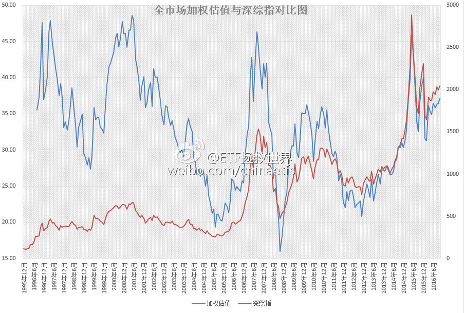

## 2016-10-12 09:33

昨天收盘后，综合外部宏观数据加权的A股全市场估值图。

月末计算首次突破37。有心的朋友应该记得，40（去年12月底）就是危险区域，45（去年5、6月；2007年10月；1997、2001）不跑会被打的亲妈都不认识。

这个位置，比五年平均高26%，比十年平均高21%。处在过去五年最贵的86.6%，过去十年最贵的84.1%。

有人因为上涨欢欣雀跃，而我感到奇怪的是，难道不应该是下跌才应该高兴，能买到便宜货，买到便宜货，长期来看收益才会高吗？

如果是因为满仓，因为上涨感到高兴，看看全市场估值图，能涨个15%，20%？这点收益相比下跌可能带来的损失，值得满仓？

如果真的敢涨20%（全市场类指数），我坚信股灾又会以一种新的形式出现在大家面前。

## 2016-10-13 19:32

“从来”不闯红灯。

> @一手Video
> #被老虎咬伤当事人首发声#【13分钟连线被虎咬伤赵女士②：谁该负责？】“我承认我们有错，作为成年人，对危险辨识不清，但谁都会犯错。“赵女士认为主要责任在园方，动物园在警示游客、救援，以及向游客灌输安全意识方面都存在不足。她称，自己是个守规则的人，从来不闯红灯。http://t.cn/RVcZz9D微辣Video的秒拍视频 ​

## 2016-10-20 12:44

赌一块钱，这个新闻会反转。因为这个说法政治不正确……

## 2016-10-23 20:46

……

> @蓝鲸新闻
> 【三星爆炸门还没完！Note7起火原因尚未查明，S7又爆炸了】23日讯，一位在美国某运营商工作的读者爆料称，有顾客拿着台爆炸燃损的三星Galaxy S7 edge手机来店里抱怨求偿。这名用户称，手机收到两周，是自己将换新版的Note 7退回之后更换的，但没想到却发生了爆炸事故。  ​​​
> 
> 三星再现爆炸门：Note7起火原因尚未查明，S7 edge又爆炸
> 据手机科技网站Phone Arena报道， 一位在美国某运营商工作的读者爆料称，有顾客拿着台爆炸燃损的三星Galaxy S7 edge手机来店里抱怨求偿。
> 这名用户称，手机收到两周，是自己将换新版的Note 7退回之后更换的，但没想到却发生了爆炸事故。报道称，这部S7 edge爆炸前曾用原装充电器彻夜充电。
> 值得一提的是，这并不是三星S7 Edge第一次发生爆炸事故，上周美国俄亥俄州的一名用户起诉了三星，原因是S7 Edge在其口袋中发生了爆炸，导致其严重烧伤；还有上个月也有一部三星S7 Edge在通宵充电时发生了爆炸，充电时使用的也是原装充电器。
> 出于安全考虑，三星已经宣布永久终止Galaxy Note 7的生产和销售，并在全世界内开始了大规模的召回。 但是据美联社报道称，三星日前动员数百名员工全力以赴查明Note 7手机起火原因，并进行了多种变数的模拟实验，但由于实验均未能重现起火时的情况，因此查明起火原因还尚需时日。
> 在Note 7召回销毁后，S7/S7 edge成了三星为数不多的主力旗舰产品，但就目前的情况来看，已经销售超过半年的S7 edge并没有存在类似普遍的电池问题，事情进展还需进一步观察。

## 2016-10-31 07:29

彩礼这种东西，是典型的农业社会特征。没有社会化养老，也没有儿子在身边的家庭式养老，就必须有这样一笔养老金回馈。解决方法只能是现代化的社会养老。

> @i商周
> 【人民日报：天价彩礼成农民小康路上的一大拦路虎】这些年农村结婚彩礼不断加码，有互相攀比因素，更多是观念陈旧，认为嫁出去的女儿“泼出去的水”，养了20年，彩礼是回报。天价彩礼成农民小康路上的一大拦路虎，挑战公序良俗，恶化农村社会风气，加剧家庭矛盾，影响农村稳定。（人民日报） ​​​

