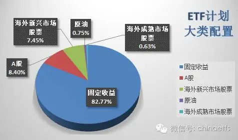
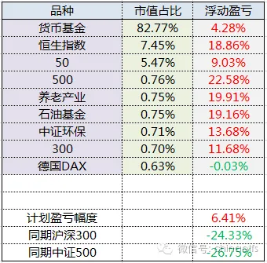
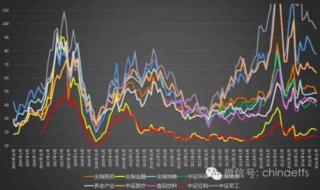
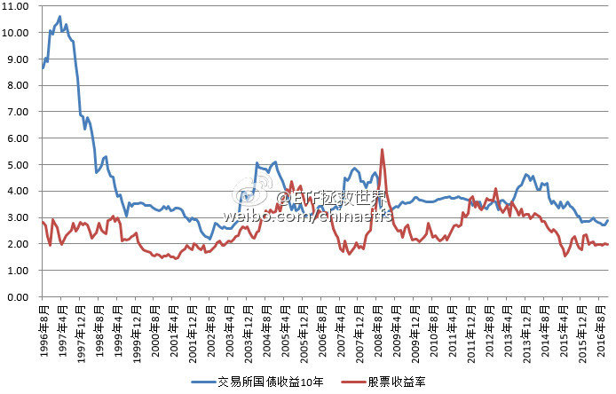
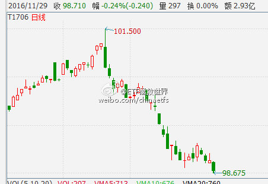
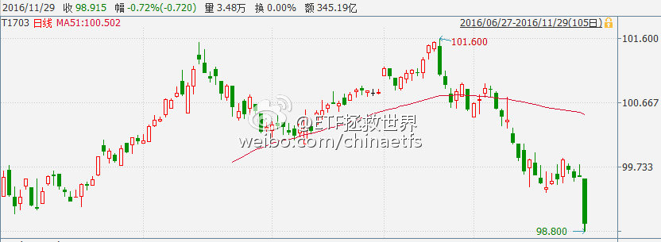
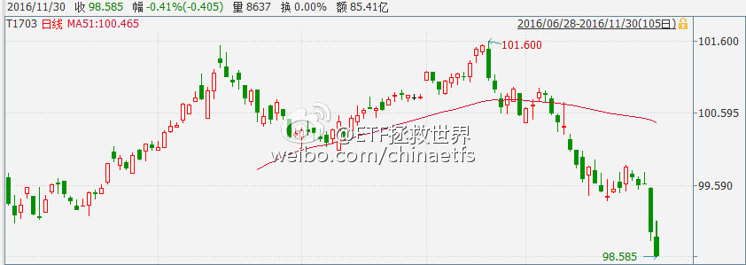
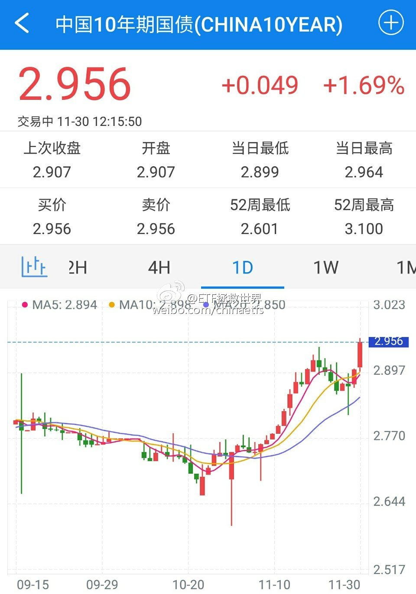

## 2016-11-01 13:13

2016年11月ETF计划：买入一份

朋友们，开始浏览本月ETF计划前，请仔细阅读以下几点：

1、本计划绝非任何形式的投资建议或是投资指导。

这里仅仅是将本人十年前开始，一些朋友五年前开始进行的一个投资指数的计划公之于众，我们会在这里如实记录我们的投资历程。

如果这个计划能帮助您，我们会替您感到高兴，仅此而已。我们绝不会向您以各种形式收费、分成。如果您因为这个计划而亏损，我们也只能说一声很遗憾。也是仅此而已，我们不会承担任何责任。

2、请任何朋友开始参考这个计划前，要再三考虑自己是否能忍受甚至可能长达3-4年的熊市。

本计划虽然过去12年取得了超过10倍的盈利，但大家要知道，在12年中，真正让利润大幅增长的时间大概只有5-6年的三次大牛市。中国股市是个牛短熊长的市场。我们在超过7年的大熊市中慢慢买入，最终才取得了牛市利润的爆发。你一定要清楚，70%以上的人无法忍耐几年的熊市。所以，确认你自己能忍，再开始参考本计划。同时，未来会有多少收益我们并不知道。因为我们无法预计未来的市场会怎么走。

3、未投入的剩余资金可以去买任何你想买的投资品种。只要每个月初用的时候能到位即可。如果某个月会投入5份以上的资金，会提前3天到一周说明。

4、第三轮ETF计划的每篇推送，可以回复年月数字查看。从“1507”开始。也可以在公众号主页下方菜单选择“投资计划”栏目查看。

2016年11月第一次操作计划如下：

买入中证环保（场外001064）一份     11月1日申购。之后再申购，环保指数（000827）不超过11月1日收盘点位【该品种预计最大跌幅50%】

（关于场外申购：  五分钟学会没有ETF如何投资指数 ）

*到目前为止，还没有买入的往期计划是：

中证环保（001064） 一份 （对应中证环保指数000827不超过1580点、2016年6月计划）

德国30   （513030）一份   （价格不超过0.88、2016年8月计划）

50ETF     （510050）一份  （价格不超过2.17、2016年8月计划）

食品饮料  （160222）一份 （对应国证食品饮料399396不超过8000点、2016年10月计划）

180ETF   （510180）一份  （价格不超过2.84,、2016年10月计划）

截至2016年10月31日，2010年开始的第二轮ETF计划持仓状况为：

持有品种	持有份数
恒生	11.45
50	8
180	4.5
100	3.5
中证环保	1
300	1
500	1
石油基金	1
华宝油气	1
养老产业	1
德国DAX	1
黄金	0.75

备用金	114.8

同期，2015年开始的第三轮ETF计划持仓状况为：

持有品种	持有份数
恒生	10
上证50	8
中证环保	1
沪深300	1
中证500	1
石油基金	1
养老产业	1
德国DAX	1

备用金	126

大类资产配置图：

为了新朋友们更加直观的理解第三轮计划自2015年7月1日至今的收益，特意为大家制作了收益表格：

*ETF计划收益率继续新高。相对同期沪深300与中证500涨幅继续保持30%以及32%以上的相对领先优势。

**货币基金收益率取华泰证券紫金货币增强与平安证券灵活宝平均收益率。本月年化收益率为3.7%。

壹：场外申购的买入点位

这篇文章推送的很晚，相信到达各位手机的时间已经过了午夜。主要原因是今天正好是三季报披露完毕，大量数据需要汇总、计算、观察和总结。各位等的心急，我这里也是一直在努力工作，还请谅解。没有特殊情况，每个月首个交易日开盘前计划文章一定会推送，以后不必着急。

从这个月起，计划再次改变买入方式——以后场内的ETF我会有个买入价格，场外的不会再规定点位，只要推送，参考计划的朋友在接下来的第一个交易日直接申购即可。

之所以做这样的改变，是因为上个月推送的国证食品我们再次没有买到。本月该指数上涨超过6%，除了煤炭指数，食品饮料是这个月涨幅最大的行业指数。这样的事情一再发生，让本人实在已经无法接受。

第三轮计划最开始推送的时候，并没有一个限定价格。造成的结果是交易日场内ETF价格在开盘的时候被短期冲击的很高，追高买入的朋友成本无谓高了很多。另外，这样会有道德问题。比如，会不会有人交易日前低价买入某只ETF，等着交易日各位将价格买的很高获利卖出？在我这里，绝不允许这样的事情发生。所以，我一定要写明一个比之前交易日收盘价低的限定价格，避免瓜前李下。

虽然也发生过好几次眼看着就要到限定价位，结果由于各位挂的买单太多，所以谁也无法成交的情况发生，但总体上还算顺利。毕竟我们买的是ETF，不是股票。除非买入价正好是反转点，否则大多数情况还是能买到。

但场外指基其实是不必规定点位。因为这个不会有什么技术、道德问题发生。所以今后我们申购场外开基的时候，不再有建议点位。直接就在下一个交易日申购即可。之后再想申购的朋友，可以参考当天的收盘点位。

贰：猪队友涨了

上个月，我们卖出了持有两个月的猪队友。卖出后它表现的不错，随着油价上涨又继续飞了一会。回头看这次操作，我们错了吗？

我的答案是，当然没错。

8月初，我们精准的抓住了上一波油价下跌的最低点，在40美元以下建仓。这里跟大家透露一下，其实对于长线油价，不到60我是不打算出的。比如我们持有了将近一年的华安石油基金，浮盈接近20%，我平常连看都不看，国际油价60以前也不会将ETF计划中的部分卖掉。

所以，我们卖出，不是因为不看好油价。卖出的原因很简单：我们一定要持有能跟踪基准的品种。

各位有没有想过，为什么我们的ETF计划绝大部分品种是指数基金？

答案很简单，我们要能保证手里的品种完美执行我们的战略意图。你我就像运筹帷幄之中的三军主帅，派出去的领兵大将一定要能够完全领会并执行我们的命令。想象一下，手里的品种该涨不涨，该跌不跌，那你判断对了行情，做好了部署，又有何用？

对于各个指数的买卖，我们有各种标准。比如指数的估值、成长性、历史表现……而对于指数对应的指数基金，我们最大的要求是：尽可能完美的跟踪指数走势。

如果做不到这一点，告别，就是我们唯一要做的事了。

叁：继续新高之后，是越来越厚的安全垫

ETF计划不是一个“定投”计划，它是经典的资产配置原理和本人设计的一套交易模型相结合进行的一个资产配置实践。

到现在为止，这个组合在不断的创出新高。第三轮计划从2015年7月开始，持续领先同期的300、500指数超过30%。与此同时，本组合的权益品种在不断增加。也就是说，我们尽量做到的，是在不增加风险的情况下，追求未来收益的最大化。

随着这个组合积累的安全垫越来越厚，未来出现本金大幅损失的可能性越来越低。通俗地讲，经过整个资产配置的设计，各位现阶段买入的任何品种，都可以做到即使下跌50%也不会对整个组合造成实质性的伤害。到底这样的效果是如何实现的，相信时间长了，各位自然会有一些体会。

我们不预测未来涨跌，我们要做的，就是做好资产配置，让自己的资产不断新高、新高、继续新高。即使短期会有回撤，也是为了未来更快、更高的起跳做的下蹲准备而已。

肆：估值

照例送给大家的是本月行业估值图。A股上市公司三季报情况非常好，尤其是有些行业，继续两位数以上的业绩增长。维持指数不跌的情况下，估值继续回落。

未来，时间还是空间？

## 2016-11-02 09:08

回复@上头云:首先三季报不错，导致整体估值降低一些。其次，计划的买卖要考虑的因素非常多。这是一个资产配置的问题，展开讲要说非常多。简单的说，这个位置，在不断新高，安全垫越来越厚的计划中，买0.6%仓位，是没问题的。

> @上头云:E大 请教一下 你之前说过现在估值处于历史高位 为何你还是建仓了？参考你10月12号9点的微博

## 2016-11-15 17:23

大家晚上好。又到了月中，因为近期市场没有特殊的买卖机会出现，所以这周没有操作。目前计划整体收益率继续新高，达到6.69%，领先同期沪深300和中证500超过25%，所有持仓品种都是盈利状态。 祝各位资产继续不断增长，今天下班不堵车，月底见。（公众号误发了……） ​​​

## 2016-11-18 10:47

仔细看这张图，有几点需要注意。

在资金极度泛滥的时候，会出现股债双牛。比如2002年之前，比如这两年；

在资金比较匮乏的时候，会出现股债双杀。比如2005，比如2011。

一般情况下，则会股债跷跷板。历史上三次股票收益率大于债券收益率的时候是2005、2008年底和2012年底。这就是三次A股大底，是财富爆发的起点。

现在无疑是资金泛滥，任何品种的未来收益率都很低。做投资最好不要近因，觉得最近发生的事情未来会一直发生。

股票收益率历史在2-4之间波动，债券是3-5。现在基本都在下沿。只是说一般情况，有几次比较特殊可以从图上看出来。分别是2008年底的股票，和2002的债券。

## 2016-11-23 10:04

永远无法猜中人类的底线……

## 2016-11-27 20:53

周日问答（一）：飞翔吧少年——如何开始投资之路

写在前面：关于周日问答

这几年，因为会在网上发表一些投资看法，很荣幸的，被一些朋友关注。

同时，不少朋友会通过各种渠道，提出各种各样的投资问题。一开始，会一个个详细解答。然而越到后来，随着问题越来越多（近一年就至少有上千条问题），范围也越来越大，回答每位朋友的问题就力不从心。

思考良久，决定在公众号单开一个“周日问答”栏目。今日起，只要周日有些闲暇时间，就会挑出最典型的问题来回答，希望能给有类似困惑的朋友一些自己的思考。问题也许是在各种渠道回答过，但在公众号上的会重新整理，力争答得更加完整。

然而，各位也不必期待每周日都会有。毕竟这公众号，是随性的、自然的、宁缺毋滥的，是那些每日更新的财经类公众号中的一股清流……

Q1：你好E大，首先感谢你的各种分享。我是一名刚毕业的学生。想跟你的ETF计划进行理财投资，不过我目前的收入水平只能每月投入500元，计划两年结婚，结婚时家里可能会给一笔钱大概20万的样子，这笔钱短期也不会拿出来用，算是自由支配的初始资金。

请您指导下，我前期这种小额的投入慢慢跟你公众号的计划有价值么，还是去投一些其他的基金定投？若可以跟你的计划，我是否应该陆续把第三轮之前的购入一些，还是直接跟着就可以了？

（by @风的遗迹 from 雪球）

壹：两道数学题

首先，我非常愿意和各位朋友来一起计算一道数学题：

每个月投入500块，年化10%，40年后是多少钱？

答案很简单：319万。（年化13%是818万；年化15%是1570万；年化20%是8509万。所以你应该知道年化20%多么难。）

看起来虽然不少，但那是40年后。而现实的情况是，两年后，你回头看，会发现现在每个月500块的投资，最终受益会很少，并不会实质性改变你的财务状况。无论你是参考计划，还是定投别的东西。

很简单，每年只有6000块，十倍也只有六万。

但是，也是必须的，你一定要投资，哪怕只有500。你有这个意识，特别好。投资这件事，开始的越早，未来收益会越大。这里需要再来一道数学题：

前面那道数学题，如果投资年限从40年变成30年，则10%、13%、15%、20%的最终金额将骤降至：

114万、221万、350万、1168万。

小结：刚毕业就有投资意识非常好，越早越好。多十年，少十年最后的差距非常非常巨大。

贰：两年时间，任意飞翔吧少年

为什么说两年时间，每个月投入500，即使少，也要开始？这是因为你一定要自己试试。小马过河，谁说了都不算，自己要试试。经验，能力，没人能给。

在这里，最重要的，我想说的是，给你，也给所有刚开始投资的朋友一个建议：

如果你刚开始投资，不要局限自己。尝试所有你认为自己可以做得好的投资方式，没错，我说的是所有。

投资和结婚不一样，想找到最适合你的先生或太太，你不能与所有性格的男人或女人都谈一场恋爱，而投资你可以。什么风格都试试，不要怕。甚至，不要听巴菲特说普通人只应该买指数基金，也不用非要定投，价值投资、追热点、打板、做趋势、套利……什么都可以，不要局限自己。只要你觉得自己可以做好，就去做。

只要注意一点，不要拿2年以后的20万试。就用你每个月的500块试。

如果你是个有悟性的人，两年时间，已经足够。在这两年里，你会经历赚钱的喜悦和亏损的痛苦。试的多了，你会明白，到底哪种方式才能让你心情愉快的达到自己的投资目标。不试，你永远不知道自己有什么样的天赋。

有天赋，有能力，有兴趣，就好好发展自己找到的那条适合自己的路。同时，在这两年里，你也可以观察到计划，或者其它方式，到底是什么结果。

这里有两点需要注意：

第一，绝大多数人在每个领域的天赋其实都差不多，极少数人会天赋异禀，但绝大多数以为自己有天赋的人其实是被自己骗了；

第二，虽然每个人适合的另一半都不同，但有些人注定适合绝大多数人的需求，比如性格温和、善解人意、知书达理、有责任感、有礼貌、颜值高、身材好……而另一些人就只适合很少一部分人。当你试过了，也许发现自己就是绝大多数人，自己的需求与适合的，也与绝大多数人一样。

当你了解了自己，试过了各种投资方式，就不要再浪费时间在不擅长的方式上。时间对投资来说很重要，还记得吗？

在错误的路上走得太久，你会付出很大的代价。绝大多数人的错误，在于重复昨天的做法，希望明天有不一样的结果。

两年后，当20万拿到手里的时候，你已经不用问任何人，该怎么分配它们。

Good  Luck,期待两年后你的消息。

## 2016-11-28 18:22

以后会在这里多说一些投资的事情，还请各位关注的朋友不要觉得呱噪  ​​​

## 2016-11-29 09:20

发布了头条文章：《心平气和的说几句》  ​​​

​​​有人说，为了这么点小事，是不是太敏感了？

我们一起设想一个场景：

你在商场买了一件商品，拿到手后发现各种不好用，跟当初厂家宣传的差距很大。这时候，商场把厂家请过来搞促销，你凑过去问厂家：“请问，为什么这个产品和宣传的不一样？我很看好你们的产品，能不能稍微解释一下？谢谢”。

厂家代表看了你一眼，说，等两分钟我去问问。​你等了一晚上，没人理你。第二天你再看，厂家撤摊跑了！

这倒无所谓。人家是厂家，你一个小小用户，不把你放在眼里很正常。然而——

商场开大会，请了很多业界人士，欢乐融融，共聚一堂。商场老板发言说：“哎呀，我们的有些用户，素质需要提高啊。挺好的产品，干嘛随便愤怒的指责厂家。没有风度，气跑了促销的厂家。”

请问，这时候的你会不会一脸懵逼？

这时候，你会不会想到，厂家和商场坐在一起畅谈商业未来的时候，是怎么鄙视你这个不识相的顾客的？

一直以来，很喜欢看历史书。人生走过三十多年，也总算是见过、经历过一些事情。见得多了，总算明白一个道理：所有的相遇，都是为了最终的离别。万事万物诞生在这个世界上，最后也逃不过消失的结局。

人这一生，无非也是如此。起于微时，经历成功，最终逃不过泯然众人。所以无论在何时何地，都提醒自己，所有繁华都是一梦，保持谦虚，永远不要忘了自己是谁，不要把自己看得太高，方能始终。这是做人的态度，也当然是做投资的态度。

所以，没有什么是不能失去的，因为，真到了应该失去的时候，你哪有力量改变？以平常心看待所有，相遇相知是缘分，挥一挥衣袖何尝不是？时间是最好的魔术师，时间久了，也就惯了。

​当然还是会回去发言。因为还有那么多朋友希望看到我的文字。只是需要休息一段时间再去，话太多了，安静一下也好。

至于说消失，这件事我做不出来。责任感这件事对我来说非常重要。既然开始了，就一定要有个结局。拿计划来说，在至少翻番之前，绝不会结束。当然，这些网站也会经历生老病死，所以，会在几个网站同步，谁倒了我们都不倒。

谢谢各位。

## 2016-11-29 09:48

本月至今，两市重要股东净减持已经超过340亿（除万科中建）。390家，416亿。

两融方面，融资额增加560亿。杠杆赌徒继续接盘中。 ​​​

## 2016-11-29 09:52

国债期货。不要持有高杠杆债基，切切。 ​​​

## 2016-11-29 10:42

今天，ETF计划中买的最多的A股ETF： 50在除权后依然上涨1%（过几天分红可以到账）。与此同时，继续有1700只股票下跌。

重仓持有下跌股票，和轻仓持有上涨的ETF，哪个好一点呢……

记住这样的时刻。下一轮牛市，绝对不要允许自己“赚了指数不赚钱”。非常重要。 ​​​

## 2016-11-29 14:32

微博的朋友们，再说一次，微博有很多骗子会将我的昵称“ETF拯救世界”稍作修改，然后主动私信大家进行行骗。比如“ETT拯救世界”、“-ETF拯救世界”之类的。99.99%的情况我不会主动私信大家，如果大家收到了，可以点一下对方的头像看看粉丝数什么的对不对。

请大家一旦发现骗子马上举报不要犹豫！ ​​​

## 2016-11-29 14:40

今天只有不到10%的股票跑赢50。

不解释 ​​​

## 2016-11-29 15:02

债券是崩了。注意一个月前我发这篇东西的时候，债券的点位。

呵呵……

ETF拯救世界:  ​​​

## 2016-11-30 09:42

国债期货不解释…… ​​​

## 2016-11-30 12:21

给力 ​​​

## 2016-11-30 14:50

开车了啊 ​​​

