## 2016-12-01 09:04

各位早上好。祝各位未来资产像委内瑞拉指数一样，十年时间从18点涨到33000点。（18万变3.3亿） （而且还不通胀） ​​​
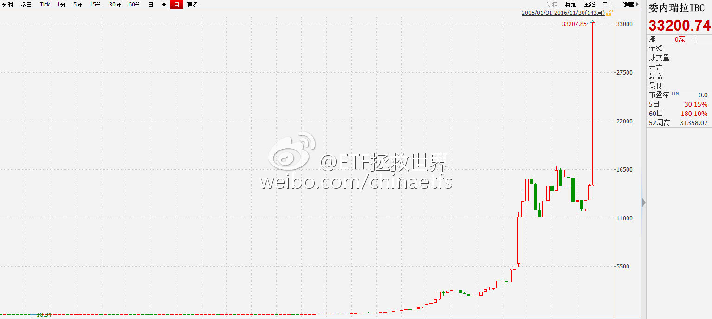

## 2016-12-01 10:14

一个有趣的现象是，很多大神在距离年底还有一个月的时候就开始晒收益。

有时候，这种现象值得警惕。这说明什么？说明大多数人开始赚钱了。 ​​​

## 2016-12-01 11:27

钱越来越紧，大盘股依然涨。

融资余额一个月增加700多亿。  ​​​
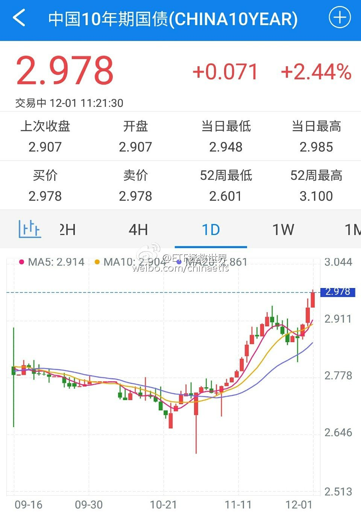

## 2016-12-01 12:35

午饭这样吃会不会长寿(s7不爆炸的前提下)  ​​​
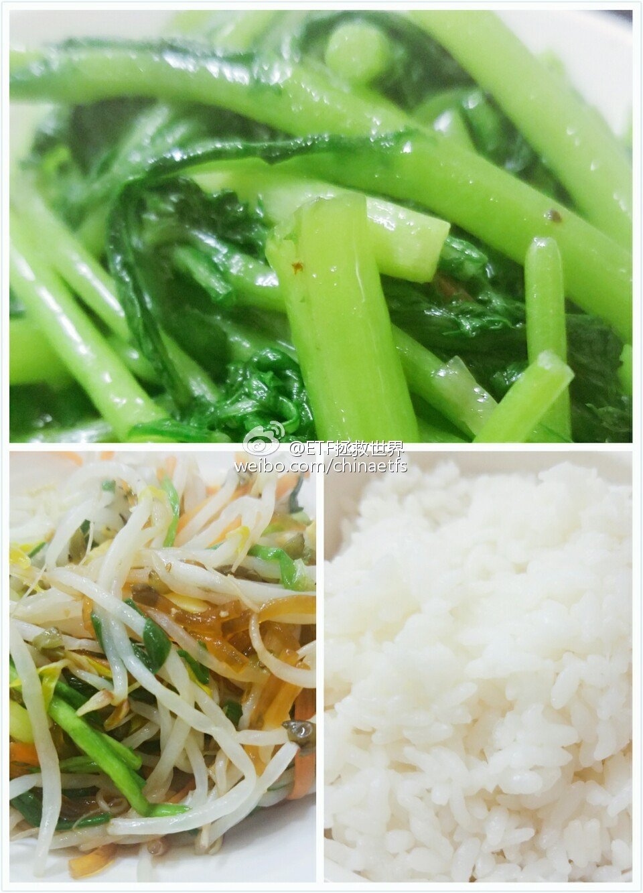

## 2016-12-02 09:04

整个11月重要股东净减持290亿（除万科、中建）。减持395家，367亿。1-11月净减持1473亿（除万科中建）。减持1090家，2436亿。

11月速度明显加快。 ​​​

## 2016-12-02 10:23

怎么讲，可以说是一个风向标——当每个人都得意洋洋的吹嘘自己业绩的时候，就要小心点了。

> @ETF拯救世界
> 一个有趣的现象是，很多大神在距离年底还有一个月的时候就开始晒收益。
> 
> 有时候，这种现象值得警惕。这说明什么？说明大多数人开始赚钱了。 ​​​

## 2016-12-02 11:30

观察这个市场，中短期最好的角度有两个。一个是资金，一个是人性。百试不爽。除了对长期称重机——估值的研究，我特别喜欢研究这两个层面的东西。尤其是人性。仔细观察每个人的发言，不管是“大v”还是群众，从理性的角度分析、判断，发言背后隐藏的内容和心理，其乐无穷。

> @ETF拯救世界
> 一个有趣的现象是，很多大神在距离年底还有一个月的时候就开始晒收益。
> 
> 有时候，这种现象值得警惕。这说明什么？说明大多数人开始赚钱了。 ​​​

## 2016-12-02 13:26

今天中午连豆芽都没了。健身房一小时回来，只能吃这个。 ​​​
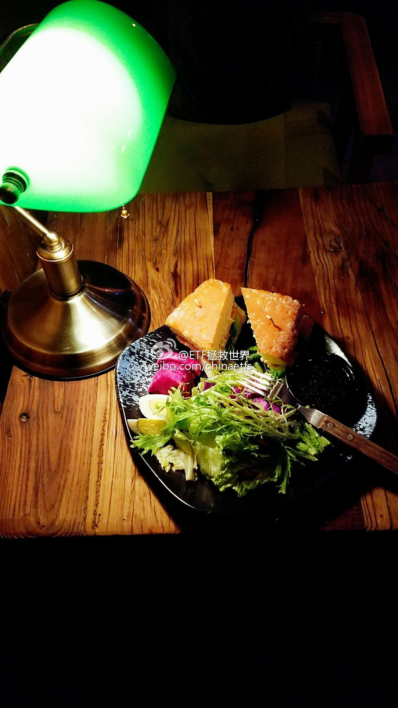 

## 2016-12-02 14:17

GJD的最大危害，是让很多人错以为自己能力很高。其实，如果不是GJD，他们早就爆仓了。

GJD的存在，让他们受的伤不那么深，又或者还能赚点钱。结果，他们会因为自信，投入更多，用以前的方法去投资。

结果……正常的市场，是应该让没有能力的投资者尽早离开，而不是当这些人亏了想要走的时候，发个红包，拉着他们的胳膊：“老乡，再来一把嘛。”

当然，如果赌场确实是想把老乡兜里的钱掏出来解决自己的问题，那就无可厚非了。

## 2016-12-02 15:28

机会就是跌出来的。 ​​​
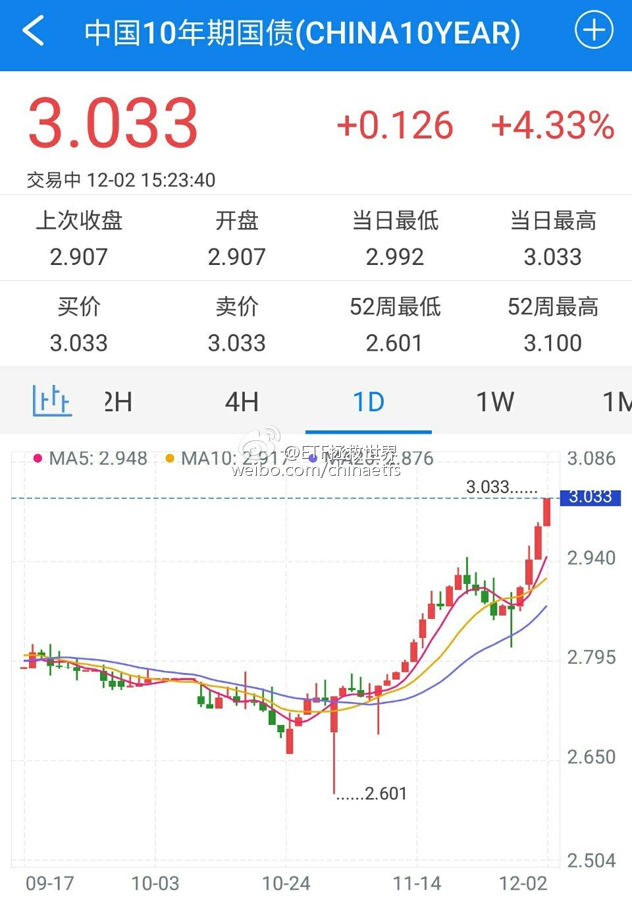

## 2016-12-03 16:18

回复@李大霄:天晴了？大宵的意思难道是之前……//@李大霄:天晴了……

## 2016-12-03 19:50

呵呵，运气

> @Redneck4sevens
> 短期来看，再次买在了最低，神预测的修大@ETF拯救世界 ​​​
> 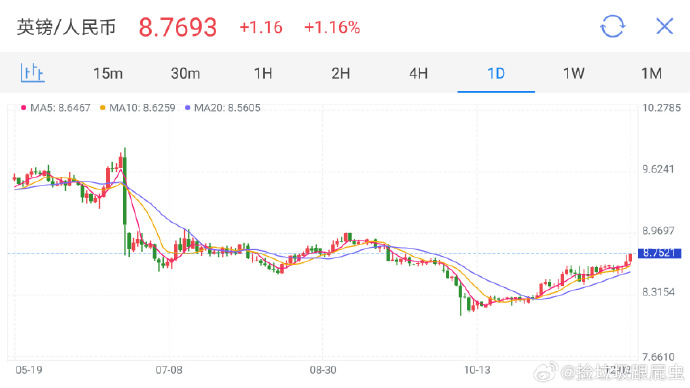

## 2016-12-04 12:27

回复@竹林清风01:投资不敢不谦虚。什么时候觉得自己牛了，就一定会被市场教育//@竹林清风01:E大谦虚了，一次两次是运气，经常这样就不是了//@ETF拯救世界:呵呵，运气

> @Redneck4sevens
> 短期来看，再次买在了最低，神预测的修大@ETF拯救世界 ​​​

## 2016-12-05 09:38

一次次的事实证明，很多人认为自己投资能力牛逼的时候，就是快出事的时候了。与各位共勉。

> @ETF拯救世界
> 一个有趣的现象是，很多大神在距离年底还有一个月的时候就开始晒收益。
> 
> 有时候，这种现象值得警惕。这说明什么？说明大多数人开始赚钱了。 ​​​

## 2016-12-05 13:54

再次提醒所有投资A股的朋友，利率是对股市走势影响非常非常重要的一个因素。

不仅指央行的基准利率，也包括各种无风险利率水平、债券利率水平等。

一定要关注。 ​​​

## 2016-12-06 09:28

分享图片 国债期货。 ​​​
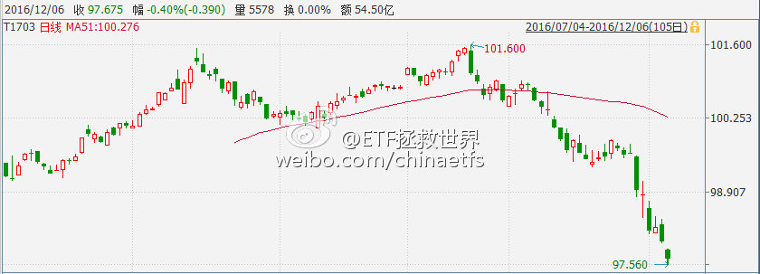

## 2016-12-06 10:04

呵呵，看看10月份的收益率，几乎到了历史最低附近了。难道现在这样不是正常的嘛 //@蓝鲸财经记者工作平台:一业内人士告诉小鲸：“好多不是回到解放前的问题了，加杠杆的已经处于亏损中，而且很多债没有流动性，最近最恐慌的是信用债。”

> @蓝鲸新闻
> 【鲸观察】@椒图炼丹炉：债券交易员浸淫在牛市氛围中一整年，正畅想今年的年终奖大礼包有多鼓呢，结果年底来这么一出，一下回到解放前[汗] ​​​
> 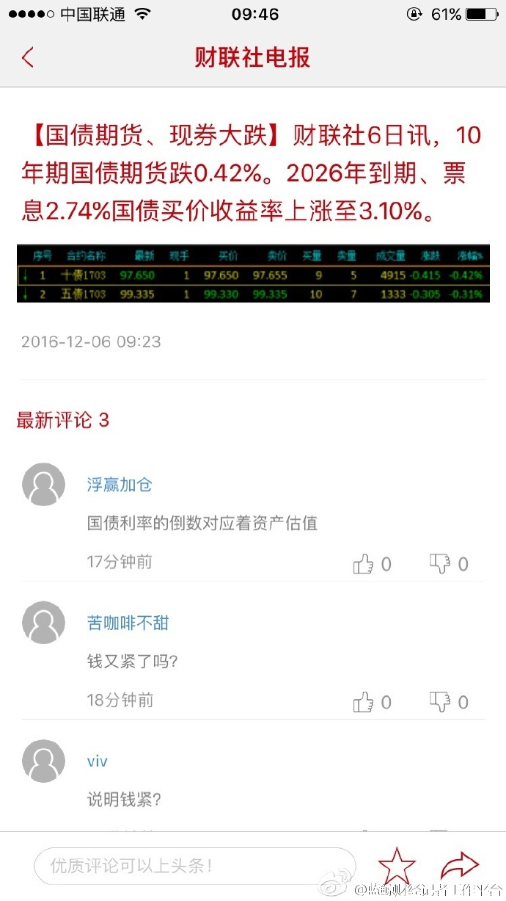

## 2016-12-09 09:31

$华宝油气(SZ162411)$ $石油基金(SZ160416)$ 看着手里卖得只剩下不到5%的两个油基，对自己说，几个策略需要继续优化……继续努力吧。 ​​​

## 2016-12-11 11:15

你忘了我发过？这张图是定增解禁日期 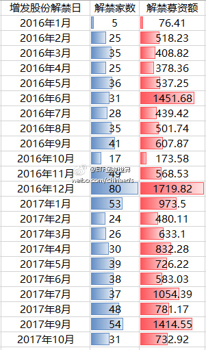 //@电疗哥-泥踩:难怪某票今年业绩大增呢，懂了。[囧]哪位数据大咖，可以做一个月度解禁市值曲线图出来，也好对比一下。貌似以前有个地方可以查，忘记在哪儿了。

## 2016-12-12 11:30

啊多么痛的领悟！

> @ETF拯救世界
> 一个有趣的现象是，很多大神在距离年底还有一个月的时候就开始晒收益。
> 
> 有时候，这种现象值得警惕。这说明什么？说明大多数人开始赚钱了。 ​​​

## 2016-12-12 17:47

回复@victoryhf:不会了。今年1月，有人在公众号质疑我，为什么恒生跌了10%。当时搞得我压力很大，所以1、2月本该加仓几个品种都没加。看着现在恒生赚20多个点，很不舒服，本来计划的朋友可以赚远比这个更多。从那以后，没有任何人能给我压力了。这是我自己的计划，一切按照应有的节奏进行。

> @ETF拯救世界
> 一个有趣的现象是，很多大神在距离年底还有一个月的时候就开始晒收益。
> 
> 有时候，这种现象值得警惕。这说明什么？说明大多数人开始赚钱了。

## 2016-12-15 08:36

微博的乡亲们，又把你们忘了！开车！

 ​​​

2016年12月ETF计划(2)：卖出一份、买入两份

朋友们，开始浏览本月ETF计划前，请仔细阅读以下几点：

1、本计划绝非任何形式的投资建议或是投资指导。

这里仅仅是将本人十年前开始，一些朋友五年前开始进行的一个投资指数的计划公之于众，我们会在这里如实记录我们的投资历程。

如果这个计划能帮助您，我们会替您感到高兴，仅此而已。我们绝不会向您以各种形式收费、分成。如果您因为这个计划而亏损，我们也只能说一声很遗憾。也是仅此而已，我们不会承担任何责任。

2、请任何朋友开始参考这个计划前，要再三考虑自己是否能忍受甚至可能长达3-4年的熊市。

本计划虽然过去12年取得了超过10倍的盈利，但大家要知道，在12年中，真正让利润大幅增长的时间大概只有5-6年的三次大牛市。中国股市是个牛短熊长的市场。我们在超过7年的大熊市中慢慢买入，最终才取得了牛市利润的爆发。你一定要清楚，70%以上的人无法忍耐几年的熊市。所以，确认你自己能忍，再开始参考本计划。同时，未来会有多少收益我们并不知道。因为我们无法预计未来的市场会怎么走。

3、未投入的剩余资金可以去买任何你想买的投资品种。只要每个月初用的时候能到位即可。如果某个月会投入5份以上的资金，会提前3天到一周说明。

4、第三轮ETF计划的每篇推送，可以回复年月数字查看。从“1507”开始。也可以在公众号主页下方菜单选择“投资计划”栏目查看。

2016年12月第二次操作计划如下：

卖出50ETF（510050）一份    

买入广发医药（场内159938（价格不超过实时净值）或场外001180）一份

买入富国中证红利（场外100032）一份

*到目前为止，还没有买入的往期计划是：

中证环保（001064） 一份 （对应中证环保指数000827不超过1580点、2016年6月计划）

德国30   （513030）一份   （价格不超过0.88、2016年8月计划）

50ETF     （510050）一份  （价格不超过2.17、2016年8月计划）

食品饮料  （160222）一份 （对应国证食品饮料399396不超过8000点、2016年10月计划）

180ETF   （510180）一份  （价格不超过2.84、2016年10月计划）

为了新朋友们更加直观的理解第三轮计划自2015年7月1日至今的收益，特意为大家制作了收益表格：

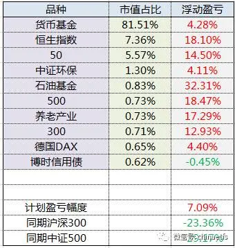

*ETF计划收益率相对同期沪深300与中证500涨幅继续保持30%以及36%以上的相对领先优势。

**货币基金收益率取华泰证券紫金货币增强与平安证券灵活宝平均收益率。本月年化收益率为3.75%。

壹：关于本月交易

首先是买入医药指数。

当然是优先场内买入。代码是159938。

场内的优点很多，费率便宜，交易便捷等。所以首先考虑在交易所买入159938。各位可能注意到该指数基金成交量很少，也许会担心流动性问题。其实流动性有没有问题不能只看成交量。最关键的，是在买卖队列中是否有连续报价。

比如说，一个品种成交价格为1。在卖1、卖2，有大量的1.01、1.02的卖单。在买1、买2，有大量的0.99、0.98的买单。这时候，只是没有人主动买卖而已，只要你想交易，有足够的买卖盘支撑，这样的情况就没有问题。有问题的是什么样的情况？是成交价格1，卖1是1.03、卖2是1.07，而且每笔挂单只有几手。这种情况，就完全不用考虑。流动性堪忧。

所以明天我们可以看159938是否在实时净值附近有足够的卖单。比如实时净值是1.263，如果在这个价格附近有大量卖单，我们就可以轻松买入。比如你现在去看它的买卖队列，有几万手的卖盘挂单，这样你买入就没有问题。

那么，以什么价格交易？还是之前说的，实时净值。基本每个软件都会有，有的软件叫做“净值”，有的软件叫做“IOPV”，有的叫做实时净值。都是一个东西，这个是交易所实时预估的该品种净值。（例如同花顺软件在分时行情中以紫色线条表示）只要我们的交易价格不高于这个价格，就没有问题。所以场内交易的朋友，不要着急开盘买入。等一等，价格稳定在实时净值附近即可买入。

如果有朋友不愿意考虑太多，或者弄不清楚实时净值，就申购场外连接基金即可。代码是001180。在三方机构申购费率较低，1折。注意这次不要买C类份额，因为这个C类虽然没有申购赎回费用，但是会收销售服务费。C比较适合短期操作的朋友，我们这样的长线投资，场外的话还是1折申购费在第三方买入001180。

其次是卖出50ETF，申购场外富国中证红利（100032）。

因为场外的红利是以收盘价申购，所以我建议各位50在收盘前20分钟内卖出。因为这样不会出现你低位卖出50高位接回红利的现象。当然，如果你水平高，可以判断出明天收盘大跌，也可以早盘卖50，尾盘接回红利。我没这个水平，所以最稳妥的，尾盘卖50换红利。

没有50的朋友，直接申购红利即可。

另外要说的，是卖出的时候连同该份的利润一起卖出。用你持有的股数/你买入的份数=你的一份持仓股数，然后卖出这个股数。

贰：关于亏损

很多朋友看着上面的表格，会觉得哇好棒，去年7月开始，三轮股灾生扛下来，买入9个品种只有一个亏了0.44%，于是信心百倍参考买入。

我要告诉你的，是请放弃你的幻想。没有人能做到任何时候持有任何品种都100%盈利。我们还有80%的资金没有买入，我们需要的是持仓品种亏损，亏损越多越好。亏得越多，我们80%的筹码才能捡到金子，在未来才能赚大钱。

再说一次，本月买入的医药和红利，极有可能买入就亏，亏个60%是正常现象。所以你考虑好再买，不要买了跌了一点吃不下饭。虽然这次买入加起来只有总仓位的1.6%。（如果是50换仓，加仓只有0.65%）。

为什么有可能亏还要买？长期关注我的朋友自然懂。不懂的朋友，我只说三点：

第一，这个价位买入这两个产品，从超长期来看，不会亏，而且收益会不错。

第二，按照我计算的估值，这两个品种已经有了投资价值。我认为买入1%并没有什么问题。

第三，投资是概率的智力游戏。不是猜大小的豪赌。我不猜明天、下个月会涨会跌，我只根据长期涨跌概率买入合适的品种。

我可以帮助你。比如月初我们不买权益类品种，躲过暴跌（如果买了股票类指数，就不是跌0.4%了，会是4%起），现在从容买入。然而，几年后，回头看，真正能帮助你的，只有你自己。

记住，不管你有1万还是1000万，你的每一块钱都是你的一个士兵。你要做的，是带领他们绕过敌人设下的重重陷阱，集中优势兵力，在敌人最脆弱的时候一击必胜，取得整场战争的胜利。

不要做一个无能的指挥官，让你忠诚的士兵为你的错误决策伤亡惨重。

珍惜每一块钱，审时度势、运筹帷幄的同时，不要畏首畏尾，坚定、乐观，即使未来会出现无法想象的极寒，也不用怕。只要你做好了物质、心理准备，过后看，一切看起来扛不过去的困难，无非笑谈而已。

月中，不多写。很多话等到月底再说吧。

祝各位投资顺利。

## 2016-12-19 08:11

好好注意一下最右边双向两车道的路口。左转的车在路口是如何自觉让出直行通道的。这份素质根本就不是道路规划能够解决的问题。

## 2016-12-20 08:40

刚看了一下账户，昨天赎回的理财都到账了，今天准备开干。各位预测一下各期逆回购今天能到多少？ ​​​

## 2016-12-20 14:26

今天的现金管理操作

做7天、14天，目的是锁定7天和14天的收益。14天可能错过年底的超高收益，但确定有半个月的7%左右。7天锁定了一周的收益，还有可能吃到年底的高收益。

毕竟不知道央妈会不会放水救市，所以先锁定。

讲真，7%年化已经秒杀几乎所有银行理财了，很满意。

短期1天和2天，则是为了保证每天账户里都有可用资金，如果出现什么突然的机会，可以有钱可用。谁都不知道明天会发生什么，随时做好准备才是王道。

不分成两份做每天的货基套，是因为货基规模越套越小，不知道哪天会有什么问题，所以再留一手。

总而言之，就一个原则：抓住所有可能出现的机会，同时，即使所有人都会死，我们也要最后一个倒下。
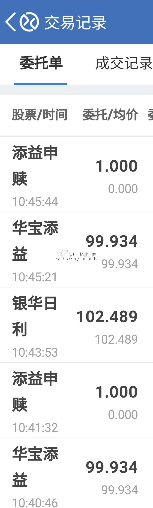 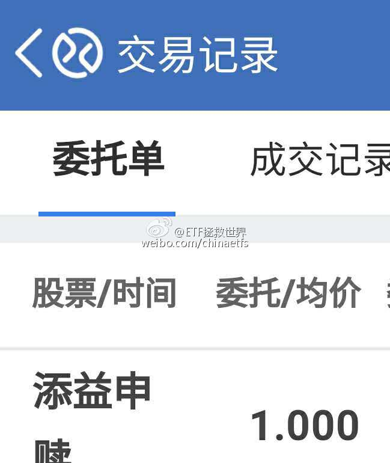 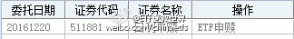 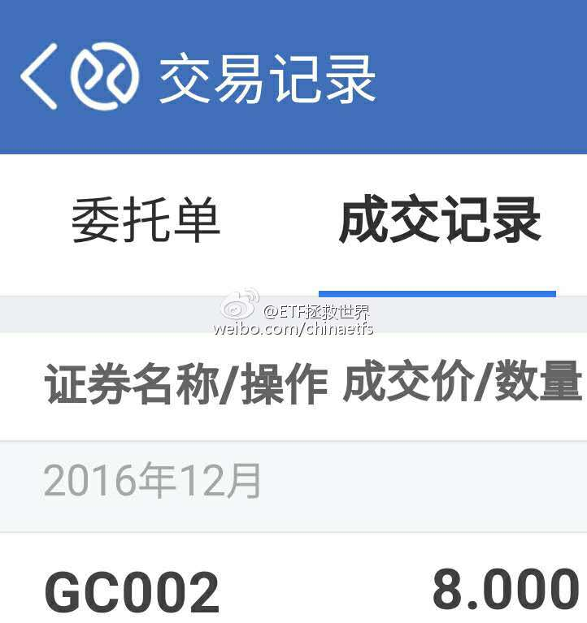 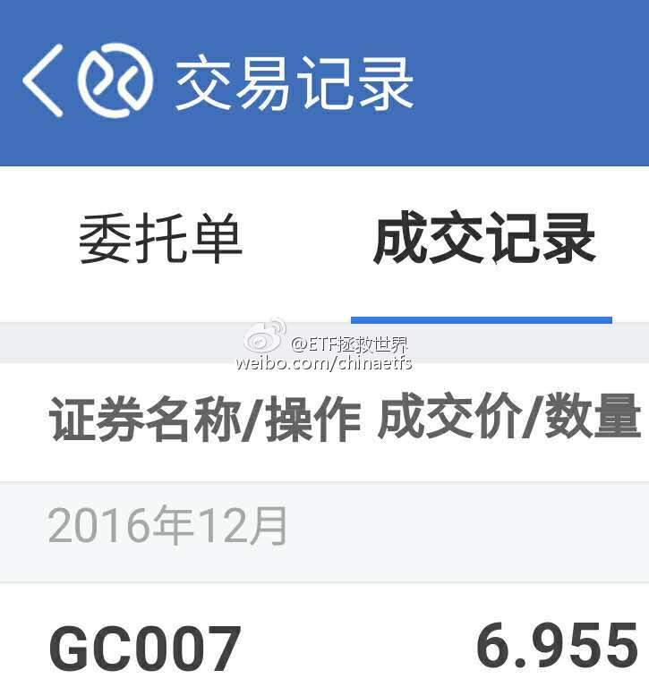  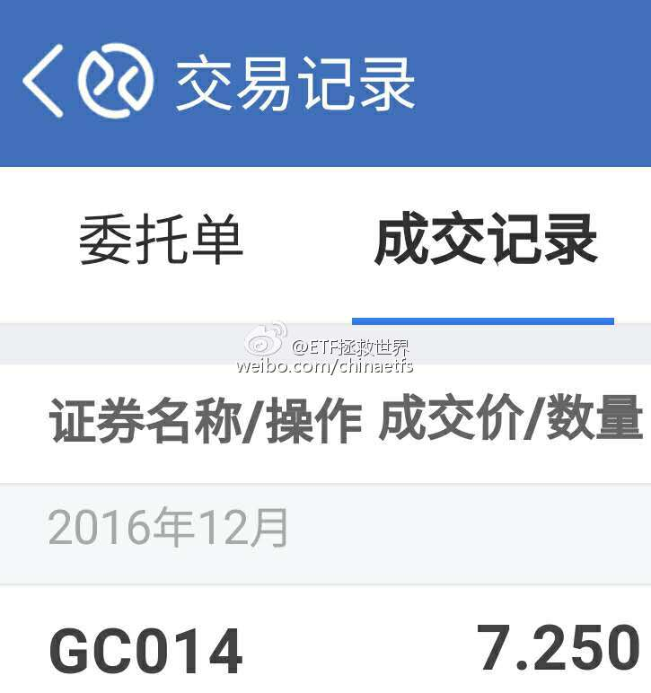 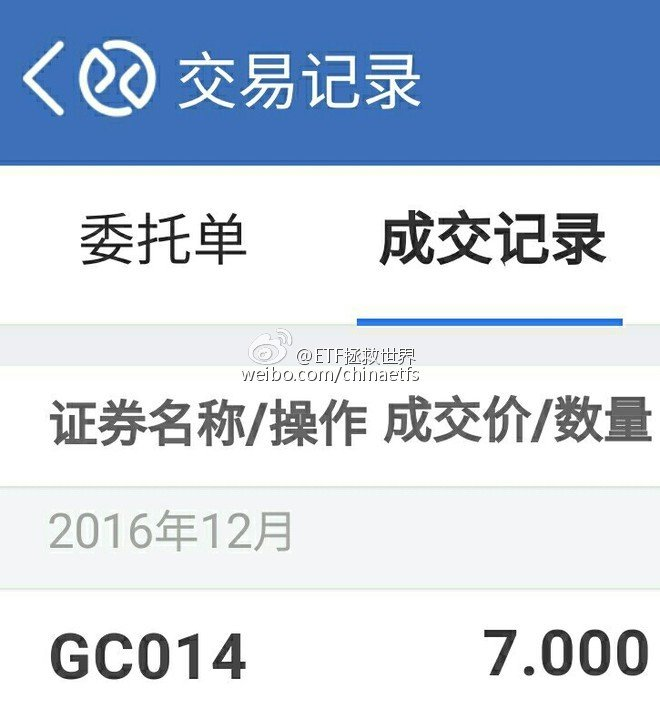

## 2016-12-21 09:00

国海这件事，它扛不扛并不是关键。扛不扛都是短期的问题，中长期有两个问题要考虑：

第一，是国海事件引发债市下跌，还是债市下跌引发国海事件？这个因果关系不能乱。如果说解决了国海事件，就会解决债市以及整个金融市场的问题，恐怕不是这个逻辑。

第二，这件事会不会导致监管趋严，会不会导致机构不愿意再像之前这么玩？单纯的认为解决了这件事，还会回到以前的老路上，这个思路有没有问题？

短期不说，中长期还要观察啊。

*国海事件：前员工以国海名义与超过 20 家机构签订了代持，债市下跌，国海试图撇清关系，引发信任危机，债市更加下跌*

## 2016-12-21 19:56

## 2016-12-22 13:37

//@电疗哥-泥踩:“券商中国记者调查发现，京金联自今年7月份开始出现兑付危机，保守估计目前涉及已到期产品无法兑付的本息金额已高达10亿元以上。”——咋回事儿？

## 2016-12-23 01:02

根据历史经验，券商说2800-3600，就一定会低于2800或者高于3600。2017，拭目以待

> @新浪证券
> 【2017年券商投资策略会大全：中信等18家券商预测行情】“2017年度投资策略会”已接近尾声，涨跌策略预测、板块配置、个股推荐等成为年度投资策略报告的重头戏。这18家券商已经立字为据，来年这一天，让行情说话，看看哪家券商才是真言。http://t.cn/RICDWjo2017年券商投资策略会大全 ​​​

## 2016-12-23 14:20

在这个市场上，你想取得一般人无法得到的收益，就要做一些别人做不到的事。

你可以比别人更狠，上更高的杠杆；你也可以比别人更有耐心，一定要等到最佳击球区才挥棒。

不然，你的信息、智力、资源、知识、努力程度跟大多数人一模一样，凭什么别人赔钱你赚钱呢？

凭你身材好吗。 ​​​

## 2016-12-26 09:00

老公：终于盼到这一天了 //@电疗哥-泥踩:丢掉老公，重燃性福！ //@庄雅婷:  //@Justin-GG:翻译一下左下角补刀：有时间瞎叨逼你咋不赶紧动手！

> @Justin-GG
> 以提案各种家庭收纳技巧，以及提倡“断舍离”而深入主妇人心的杂志《croissant》发表了今年读者问卷调查结果————最想丢掉的是：老公[微笑] ​​​
> 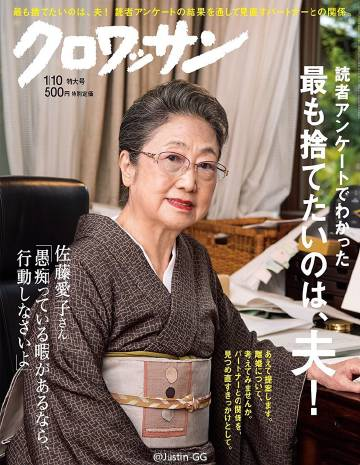

## 2016-12-26 10:41

太神奇了！

> @ETF拯救世界
> 一个有趣的现象是，很多大神在距离年底还有一个月的时候就开始晒收益。
> 
> 有时候，这种现象值得警惕。这说明什么？说明大多数人开始赚钱了。 ​​​

## 2016-12-26 10:53

主要是不喜欢赔钱啊

## 2016-12-27 12:20

发布了头条文章：《2016，继续感恩》

是不是要写这份总结，一直没有确认。两个问题：一个是总结这个东西，终究是要写给自己，还是写给别人看。另一个，是写了出来别人看到，会有无数解读。好的坏的，置之不理固然可以，但要想清净就有些困难。去年就是个教训。

然而终于决定写下来一些体会。主要是给自己看，各位朋友如果有缘看到，怎样的评论我都不会太在意——尽量吧。

一）关于收益率

依惯例，通常要说说一年的收益率。今年的金融资产投资收益率，在12%左右，最大回撤幅度在0.8x%。

您别笑，这就是我不愿意公开总结的原因。一个没有什么投资天分的人，战战兢兢赚了一点收益，还要无情的把自己可怜的收益剖析在大家面前，比正午12点从西单图书大厦裸奔到东方新天地还要难一些。不嫌弃的话，您就凑合看吧。

这12%，不包括打新的收益。配了点市值，中了4签，然而对总收益率并没什么太大的提升。加上我认为打新收益率完全是与彩票中奖捡钱无异，没法体现真正的投资水平，所以并未计算在内。如果硬要加上，大概能多1-2%吧。

分解一下，大致是这样的：

最大收益来源来自华宝油气+石油基金。二、三月仓位最重的时候，曾经超过25%。由于是用网格做波段+套利+利润长持的策略，所以这两个基金今年从最低点上来翻番，本人也只赚到了4.x%而已。很惭愧。天天说，才赚了总资产的4.x%，太能忽悠了！

第二大收益来源是恒生ETF。总仓位维持在十几个点。大部分仓位是1、2月建立，总贡献大概是接近2%。策略是定期不定额买入，定期平衡，波段。

然后是A股。首先是2月做了一波波段。就是我那几天经常说的先锋部队“抢粮食”。用了十几个点的仓位，赚了大概一个多点。然后是与ETF计划大致相同的布局各类指数基金，仓位比计划稍高一些，收益率占总资金的2%左右。还有就是配置一部分打新门票有些收益。加起来一共大概是3.x%。

基本上就是这样。其它的，白银之前的利润现在由于价格下跌，基本已经被抹平，只是略有盈余。外汇部分，持有十几个点的美元、英镑、日元大致赚了总资产的不到1%。

其它的就是现金管理。这部分赚到了总资产的接近2.x%。

以上分解计算，都是大致收益。账户分的太散，没法太精确。大致不会错。

二）成与败

一年过去，回头看，对自己的投资大体满意。最骄傲的，当然是在前两次股灾全身而退的基础上，再次安全躲过第三轮熔断，全年资产连续最大回撤幅度只有0.8x%。不黑不吹，非常满意。不多说。

去年的总结中，主要讨论了在A股以及分级A大战中的情况。今年的投资就彻底百花齐放。A股、港股、石油、贵金属、外汇……值得庆幸的是，居然每个大类资产都在赚钱。虽然每一类配置的不多，赚的不多，但各项汇总后，总收益率依然让自己比较满意。

最不满意的，应该是策略应用方面有些问题。尤其是在石油类资产上，主要采用了网格波段的投资策略，在价格翻番的情况下，没有吃的太饱。虽然也做了套利，以及将每一格的利润牢牢拿住长期持有，依然无法掩盖主要问题。

诚然，油价并不容易估值，年初一片看衰原油，看衰油气开采公司的论调中，能坚定投资已然不易，但没有深入思考，多配置一些长持仓位一定是个错误。已经着手在研究新的投资策略，看看如何在这种不容易估值，但明显已经不贵的品种上赚得更多。

很多人认为，在A股只赚总资金的3个多点是不是太少了。我个人对这个倒并没什么遗憾。能不能做得更好？以我对资本市场的认识和自己的能力来说，也许再努努力，还可以再多赚一个两个点，但本人真的并不是太过在意。

为什么？让我用2015年总结结尾的一段话做个回答：

“实力还是运气？诚惶诚恐，如履薄冰

在巴菲特几十年的投资经验中，收益率没有一年超过50%。他的成功，完全靠的是几十年中只有3年亏损。虽然本人也做到了过去10年没有任何一个年度亏损，但面对2014和2015年这样的收益率，说实话，一个字，害怕。

害怕什么？

害怕的是，我真的有这个能力，两年赚167%吗？

这是能力还是运气？

冥思苦想，得出的结论是：至少，有一半是运气。

这份运气，是2014年重仓大指数，结果年末大幅被拉升的运气；

这份运气，是2015年7月满仓分级A，没有发生拒赎的运气……

德不配位，必有灾殃。

在2016年，本人将更加小心，更加谨慎，绝不让任何人从我兜里把已经赚到的钱再掏走！”

您看，我真的做到了2015年底对自己的承诺，没有让任何人从我的口袋里，从任何一个市场上的任何一个品种中掏走任何一分钱。不仅如此，居然还赚了12%，您说我还能要求更多吗？

三）过去、现在以及未来

2016年，是本人进入A股投资的第14个年头（02年开始买基金，03年开始买股票），也很幸运的，是连续第11年没有亏损的年度。没什么好说的，感恩。

对于一个自认天赋一般的人来说，在这个绞肉机一样的市场上，安全的度过了11个春夏秋冬的同时，积累了入市的时候未曾想过的财富，除了感恩，确实没什么其它好讲。

然而这个不亏损的记录越长，财富积累的越多，本人的内心就越惶恐。随着时间的增加，复利的增长，现在的30%亏损，几乎就相当于过去7、8年的所有积累。未来，会不会碰上黑天鹅？有没有什么是我应该考虑到，而没有在意的危机正在酝酿？一切的未来，都是未知。别无他法，唯有更加谨慎前行。

四）感谢

这一两年的投资本身，其实与之前并没有太大不同。然而投资之外，就真的有了一些变化。关注到我的朋友，好像越来越多。相信我以及愿意参考ETF计划投资的朋友也日益增加。

对这些朋友，要说一声谢谢。不仅是谢谢关注，也要谢谢各位逢年过节的问候；要谢谢其中一些朋友在年初小儿生病时候的真诚祝福；要谢谢很多朋友跟我要地址，希望送一些家乡的土特产或者一些特别的礼物给我；更要谢谢很多朋友的信任。

有时候并不能一一回复，但各位在各个平台的留言我都看到。在这里不想讲太多煽情的话，总而言之：

谢谢。

在可预见的未来，依然会在投资这条路上走下去。不断学习，不断成长。也会继续在这个虚拟世界中如实记录自己的每一步，让它变成自己真实的历史。

2016，我很怀念它；

2017，我们来继续赚钱了。

2014-2016年收益率走势图：（不是对数图，所以12%也会显得很多。这个很有意思：只要你一直在增长，现在的12%和之前的12%就完全不是一个量级）

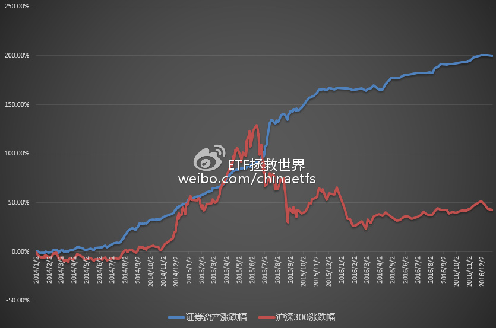

2015年总结时空门：

https://xueqiu.com/4776750571/62402064

（写了这么多，你真的不想评论一下？啊？说的就是你别看别人！）

## 2016-12-30 08:54

微博的乡亲们，这次没忘了你们~最好还是关注公众号（chinaetfs），最快。

 ​​​

2017年1月ETF计划：买入一份

朋友们，开始浏览本月ETF计划前，请仔细阅读以下几点：

1、本计划绝非任何形式的投资建议或是投资指导。

这里仅仅是将本人十年前开始，一些朋友五年前开始进行的一个投资指数的计划公之于众，我们会在这里如实记录我们的投资历程。

如果这个计划能帮助您，我们会替您感到高兴，仅此而已。我们绝不会向您以各种形式收费、分成。如果您因为这个计划而亏损，我们也只能说一声很遗憾。也是仅此而已，我们不会承担任何责任。

2、请任何朋友开始参考这个计划前，要再三考虑自己是否能忍受甚至可能长达3-4年的熊市。

本计划虽然过去12年取得了超过10倍的盈利，但大家要知道，在12年中，真正让利润大幅增长的时间大概只有5-6年的三次大牛市。中国股市是个牛短熊长的市场。我们在超过7年的大熊市中慢慢买入，最终才取得了牛市利润的爆发。你一定要清楚，70%以上的人无法忍耐几年的熊市。所以，确认你自己能忍，再开始参考本计划。同时，未来会有多少收益我们并不知道。因为我们无法预计未来的市场会怎么走。

3、未投入的剩余资金可以去买任何你想买的投资品种。只要每个月初用的时候能到位即可。如果某个月会投入5份以上的资金，会提前3天到一周说明。

4、第三轮ETF计划的每篇推送，可以回复年月数字查看。从“1507”开始。也可以在公众号主页下方菜单选择“投资计划”栏目查看。

2017年1月操作计划如下：

买入富国中证红利（场外100032）一份

*到目前为止，还没有买入的往期计划是：

中证环保（001064） 一份 （对应中证环保指数000827不超过1580点、2016年6月计划）

德国30   （513030）一份   （价格不超过0.88、2016年8月计划）

50ETF     （510050）一份  （价格不超过2.117（分红调整价格）、2016年8月计划）

食品饮料  （160222）一份 （对应国证食品饮料399396不超过8000点、2016年10月计划）

180ETF   （510180）一份  （价格不超过2.84、2016年10月计划）

截至2016年12月29日，2010年开始的第二轮ETF计划（2015年减仓后）持仓状况为：

持有品种	持有份数
恒生	11.45
50	7
180	4.5
100	3.5
中证环保	2
300	1
500	1
石油基金	1
华宝油气	1
养老产业	1
德国DAX	1
中证红利	1
全指医药	1
博时债券	1
黄金	0.75

备用金	111.8

同期，2015年开始的第三轮ETF计划持仓状况为：

持有品种	持有份数
恒生	10
上证50	7
中证环保	2
沪深300	1
中证500	1
石油基金	1
养老产业	1
德国DAX	1
中证红利	1
博时债券	1
全指医药	1

备用金	123

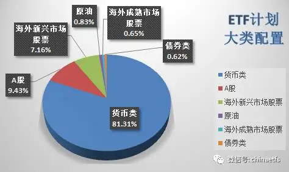

为了新朋友们更加直观的理解第三轮计划自2015年7月1日至今的收益，特意为大家制作了收益表格：

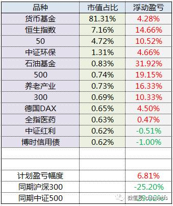

*ETF计划收益率相对同期沪深300与中证500涨幅继续保持32%以及36%以上的相对领先优势。

**货币基金收益率取国债逆回购、华泰证券紫金货币增强与平安证券灵活宝平均收益率。本月年化收益率为4%。

壹：2016

2016年就快过去。

这一年我们每个人都经历了很多。悲欢离合，浮生若梦。相信各位回想起这一年，都会有很多感慨。同样，我们的ETF计划也是如此。我们的计划经历了市场大涨大跌、大悲大喜的考验，依然顽强的一路向上。如果你在股票市场受到了伤害，相信这样的计划会给你希望。

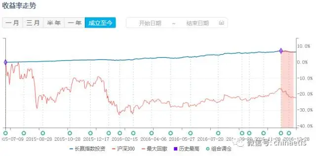

没有什么下跌可以伤害我们。这一点，本人很有信心。控制风险这件事，于我来说从来就不是一个问题——自认还算比较谦虚的我，对这点却从来不掩饰自信。

如果你的敌人，是一支军队、一支球队，或是一个投资组合，它是没有防守弱点的。无论你从哪个方向进攻，它都没有破绽，都不会轻易让你进攻得手，相信你会非常头疼。我自信的是，ETF计划就是这样一个坚如磐石的组合。

如果一个组合，想要不败，很简单：满仓货币基金即可。然而，我们的计划并非如此。

大家看看上面的表格：我们已经不知不觉买了十一个品种。我们有A股、港股、原油、德股、债券……无论市场怎么震荡，我们的十一个品种中，除了这个月建仓的两只分别有1%和0.51%的浮亏，其它所有品种都在盈利。

不要忘记，同期沪深300跌了25%，中证500跌了29%。

悄悄的，我们的权益仓位已经上升到了20%。然而，这并没有明显增加整个组合的风险度——本月沪深300跌幅6.8%，恒生指数跌幅4.4%，我们的组合，净值下跌0.7%。

巴菲特说，投资有两条原则，第一：不要亏损；第二：记住第一条。

曾国藩说，结硬寨，打呆仗。

……

没人能打败我们，胜利还会远吗？

贰：2017

与2015年底对2016不抱希望不同，今天本人对2017年倒是有些希望。这份希望并不是希望A股能够涨多少，我们可以赚多少钱。我对2017年的预期，是我们可以有机会建立一些大的仓位，为未来的爆发多撒一些种子。

不败，不是我们的目的。不败只是取得胜利的手段。不亏钱，也不是我们来投资的目标，不亏钱只是为赚大钱打下良好的基础。

在这个即将踏入2017年的时候，我要对朋友们说：

真正能在股市赚钱的人，从来都是少数。技术、经验、策略、体系……从来都不重要。最重要的是你的性格，你的意志和你的思维模式。

“别人贪婪的时候我恐惧，别人恐惧的时候我贪婪”。这句话，相信你听过无数次，也一定认为自己就是那个与众不同的投资天才。但是，朋友：

当真正的黑夜来临的时候，大多数人内心的恐惧、怀疑，不仅不会让他们谈笑自如的大量买入，相反，会让他们深深的陷入无边的绝望，只想保住还剩下的一点本金，只想赶紧卖出，永远不再踏入这个地狱。

到底未来会发生什么，会让大多数人放弃希望，我并不知道。我只知道，历史一次次的重复。当大多数人瑟瑟发抖的时候，你是否能坚定的点击“买入”按钮，才是决定你未来五年、十年财富状况的关键时刻。

2017年的计划，将在尽量不发生大幅回撤的前提下，增加攻击性。如果有亏损，正是我们求之不得的。我们现在买的每一分钱，都有可能发生亏损。这一点，希望你也有所准备。

2017年，您依然可以参考计划，当做一个长线基本盘，然后去做任何您想做的投资。如果不想做其他投资，只是参考计划，我想，也并无不可。

叁：估值

本月，送大家的是A股行业估值图。

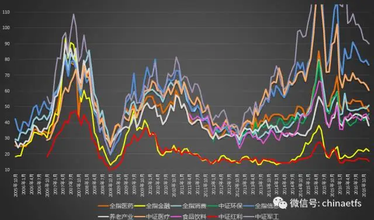

肆：祝大家2017资产嘉玲

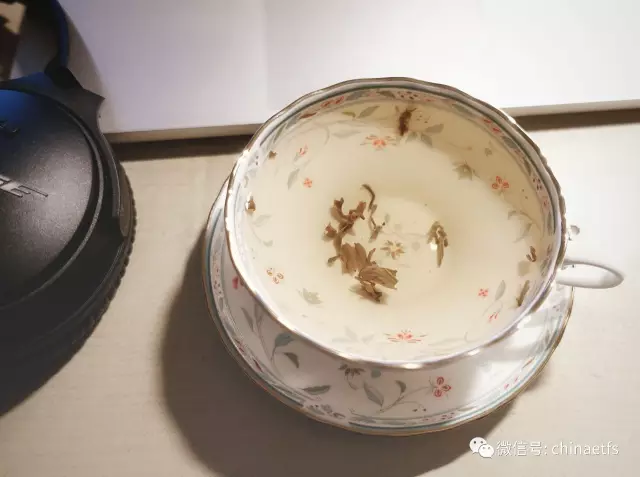

每个月，就是这样，一杯茶、一副耳机、一台电脑和一首歌陪着我为大家写下这些文字。希望在2017能继续每个月写些东西，记录下这段历史。

也祝大家新的一年资产+0，我们2017见。

## 2016-12-30 14:10

图片评论  哎………………………… 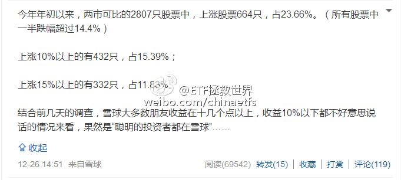

