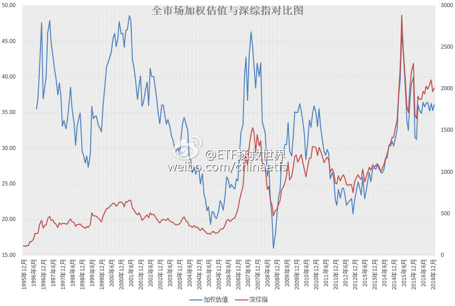
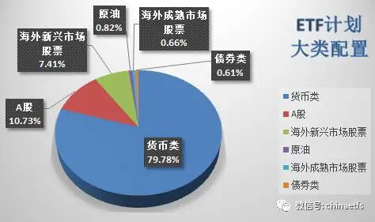
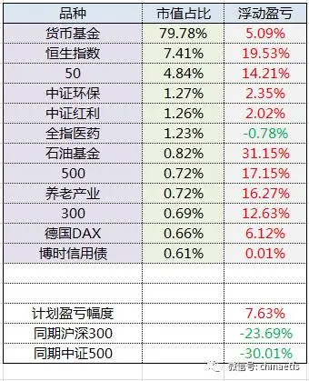
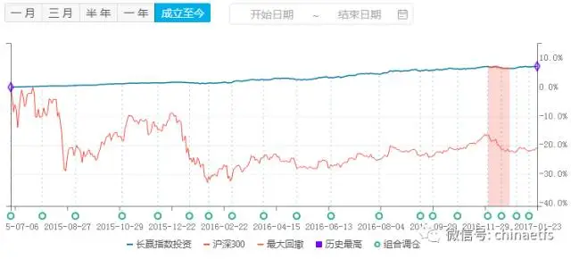
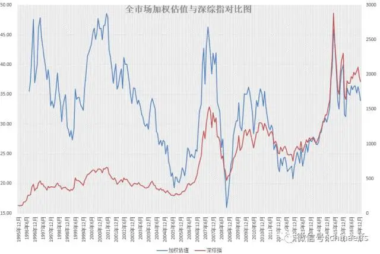
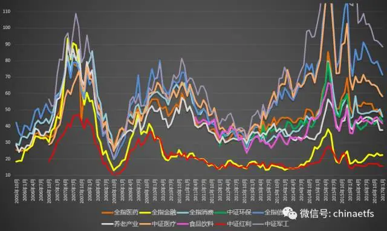

## 2017-01-01 00:57

朋友们，新年快乐。这一年，一切都会更好。 ​​​

## 2017-01-06 10:38

微博独家福利  别的地方不发。 ​​​

## 2017-01-06 14:47

能不能请协和的真专家说清楚，雾霾和PM2.5，到底对人体，尤其是孩子有什么伤害？还是说没有伤害？不能光辟谣不普及知识啊。

> @北京协和医院
> #微博辟谣#这两天，“协和某大夫”关于雾霾的说法在微博和微信圈传疯了，感谢网友们对“协和医生说什么都是对”的认可，不过我们还是来听听真名真姓的协和专家怎么说[酷]——
> 呼吸内科的田欣伦副教授表示，“吸入身体和肺里的雾霾永远排不出去”的说法是没有科学依据的，目前的研究表明，雾霾对慢性呼吸道病人有确切影响，建议:1.在雾霾天减少室外活动；2.外出时佩戴具有防护功能的口罩；3.减少高强度的运动；4.在室内安装空气净化器或新风系统。
>  “因为儿童气管短，所以呼入肺里的雾霾比大人多”、“200元的能换滤片的口罩效果更好”，真的是这样吗？儿科万伟琳副教授表示，儿童与成人的肺结构相似，且肺活量低于成人，所以不存在吸入粉尘多于成人的说法。口罩的防护能力并不取决于价格，而是与其质量、密封程度、阻挡PM2.5力度有关。万大夫的建议是:1.幼儿的雾霾防护以隔离、保护为主，在雾霾天气尽量减少儿童的外出；2.在室内安装空气净化器来保持空气的清新。@健康中国 @首都健康 @北京12320在聆听

## 2017-01-12 13:37

未来几年，某个时间段，很多很多人可能会体会到的一种绝望是：

满地黄金钻石，没钱买了。 ​​​

## 2017-01-12 15:10

回复@行者-EnglishBreaker:这么说吧。去年重要股东减持大概在2500亿，新股发行后，连续打板接盘的资金得上千亿吧。然后是印花税、券商佣金。最重要的是定增减持。这几年定增大概超过2万亿。2015年光上半年重要股东减持就超过5000亿。你算一算，需要多少股民的小账户才能填满这些资金？

> @ETF拯救世界
> 未来几年，某个时间段，很多很多人可能会体会到的一种绝望是：
> 
> 满地黄金钻石，没钱买了。 ​​​

## 2017-01-13 14:03

2017年第二发已经开车了。 ​​​

## 2017-01-16 09:38

贴估值图这个动作，是不是太狠了……

## 2017-01-16 15:52

预先通知一下，如果24、25日不比现在高，可以准备4-5份资金。 ​​​

## 2017-01-17 13:21

瞧这意思，要准备十份？

> @ETF拯救世界
> 预先通知一下，如果24、25日不比现在高，可以准备4-5份资金。 ​​​

## 2017-01-18 15:53

今天，创业板即将跌入历史最贵的60%区域。什么节奏？幸福来得如此突然。全市场等权/外部数据加权全部达到2016年2月以来最低。幸福哭了。

2017，我感觉有戏。 ​​​

## 2017-01-25 09:25

微博的乡亲们，开车了。

2017年2月ETF计划：买入两份

朋友们，开始浏览本月ETF计划前，请仔细阅读以下几点：

1、本计划绝非任何形式的投资建议或是投资指导。

这里仅仅是将本人十年前开始，一些朋友五年前开始进行的一个投资指数的计划公之于众，我们会在这里如实记录我们的投资历程。

如果这个计划能帮助您，我们会替您感到高兴，仅此而已。我们绝不会向您以各种形式收费、分成。如果您因为这个计划而亏损，我们也只能说一声很遗憾。也是仅此而已，我们不会承担任何责任。

2、请任何朋友开始参考这个计划前，要再三考虑自己是否能忍受甚至可能长达3-4年的熊市。

本计划虽然过去12年取得了超过10倍的盈利，但大家要知道，在12年中，真正让利润大幅增长的时间大概只有5-6年的三次大牛市。中国股市是个牛短熊长的市场。我们在超过7年的大熊市中慢慢买入，最终才取得了牛市利润的爆发。你一定要清楚，70%以上的人无法忍耐几年的熊市。所以，确认你自己能忍，再开始参考本计划。同时，未来会有多少收益我们并不知道。因为我们无法预计未来的市场会怎么走。

3、未投入的剩余资金可以去买任何你想买的投资品种。只要每个月初用的时候能到位即可。如果某个月会投入5份以上的资金，会提前3天到一周说明。

4、第三轮ETF计划的每篇推送，可以回复年月数字查看。从“1507”开始。也可以在公众号主页下方菜单选择“投资计划”栏目查看。

请各位朋友看完操作计划，一定要看下面的文字。

2017年2月操作计划如下：

买入富国中证红利（场外100032）一份 （该品种预计最大跌幅41%）

买入广发养老（场外000968）一份 （该品种预计最大跌幅38%）

1月25日交易。当日之后交易，对应指数收盘价不高于当日。

*到目前为止，还没有买入的往期计划是：

中证环保（001064） 一份 （对应中证环保指数000827不超过1580点、2016年6月计划）

德国30   （513030）一份   （价格不超过0.88、2016年8月计划）

50ETF     （510050）一份  （价格不超过2.117（分红调整价格）、2016年8月计划）

食品饮料  （160222）一份 （对应国证食品饮料399396不超过8000点、2016年10月计划）

180ETF   （510180）一份  （价格不超过2.84、2016年10月计划）

截至2017年1月24日，2010年开始的第二轮ETF计划（2015年减仓后）持仓状况为：

持有品种	持有份数
恒生	11.45
50	7
180	4.5
100	3.5
中证环保	2
中证红利	2
全指医药	2
300	1
500	1
石油基金	1
华宝油气	1
养老产业	1
德国DAX	1
博时债券	1
黄金	0.75

备用金	109.8

同期，2015年开始的第三轮ETF计划持仓状况为：

持有品种	持有份数
恒生	10
上证50	7
中证环保	2
中证红利	2
全指医药	2
沪深300	1
中证500	1
石油基金	1
养老产业	1
德国DAX	1
博时债券	1

备用金	121

为了新朋友们更加直观的理解第三轮计划自2015年7月1日至今的收益，特意为大家制作了收益表格：

*时隔一个月，ETF计划继续新高。收益率相对同期沪深300与中证500涨幅继续保持31%以及37%以上的相对领先优势。

**货币基金收益率取国债逆回购、华泰证券紫金货币增强与平安证券灵活宝平均收益率。本月年化收益率为4.3%。

壹：一些技术细节

有一些技术细节，统一说一下。一个一个回复真的有点累。同时，也希望大家看计划文章的时候，能稍微稍微仔细一些。因为你问我相关问题，我不回答，会没有礼貌。回答，其实历史文章里都有答案。所以，有任何问题，去翻历史文章。自己真金白银的投入，多做点功课，也是应该的。

第一：表格中的收益率。

所有的权益类品种收益率都是历次买入的平均收益率。有朋友问，我去年底买的环保是浮亏，怎么表格中是盈利？是的，因为我们之前买过一次，两次平均成本低于现价，所以是盈利。我真的没法帮所有朋友统计你的盈利和亏损，大家开始的时间不同，还请谅解。有些朋友的盈利会比表格中多，也是一个道理。

第二：分红

时近年底，大量指数基金开始分红。我们的50、红利、300都已经先后分红。有的分得多，有的分的少。我计算分红全部采用摊薄成本法。比如你持有的基金成本1元，分红0.05，分红后，我会将成本改为0.95。这样，方便与净值比较盈亏，相信大多数朋友能理解这个做法。如果你的软件显示与表格中相差较多，希望你能去购买机构查询分红情况。

第三：没有积蓄的朋友

只有每个月收入投入，没有150份积蓄的朋友，据之前调查，有20%左右。这些朋友还是建议留一半资金，以备以后抄底。另一半资金可以参考计划。

未来什么时候可以当月资金全部投入计划，或者更进一步，何时可以将过去的积蓄加倍投入计划，我都会明确说明。

再细化的，比如当月投入的资金如何在几份中分配，我恐怕就真的没法为你量身定制了。其实无论场内还是场外，起始买入的资金都可以很小。场内手续费0.1元起；场外起投是100元，1折手续费。

贰：给新朋友

白驹过隙，第三轮ETF计划已经开始一年多。这一年多虽然资本市场经历了风风雨雨，但正如上面的走势图所显示，我们的计划一路上扬，风雨无阻。

对于2016年前就相伴而行的老朋友来说，我并没什么担心。因为你们都经历过50和恒生的大跌。我担心的，是最近一年刚开始参考计划的朋友。

很多朋友，看到上面表格中11个品种，只有一个浮亏不到1%，就觉得跟着计划一定能赚钱。这样的想法，很危险。

这份计划，是我自己的投资计划，把它放在我自己的公众号上，仅此而已。它绝不是给任何人的投资建议、投资指导。如果你喜欢，希望参考，那么我非常荣幸，我也当然不会因为你参考计划向你收费。过去、现在、以后，都一定确定肯定不会。

不过，也希望你真的明白，我不是你的基金经理，也不是你的投资顾问，没有拿你的提成或者管理费。如果未来有一天计划出现亏损，那是我水平不够所致。我的大多数资产都会放在计划上，所以，一定不是我不努力去做好它。

我的意思是，如果未来结果不够好，希望不要埋怨我。

我本人，并不奢望任何人在因为计划赚钱的时候还记得我。只是希望，万一赔钱了，不要向正在努力开车拉着很多人找寻光明之路的司机脸上吐口水。 

另外，一定要理解的一点是，我们希望手里的品种跌。说起来匪夷所思，但这正是我们真实的愿望。我们所有的品种都是买入大概率跌，这点，一定要做好准备。

最后，需要说明的是。我本人不会在计划公布前买入对应品种。会和大家一起买。场内基金会一如既往地规定一个不高于前一交易日收盘价的价格。这一切，都是为了避免瓜前李下，为了避免道德风险。虽然过去有几次因为买的人太多，我自己没有买到本来可以买到的品种，少赚了不少。但我没有什么遗憾，也不会有什么抱怨，而是会一如既往的和大家一起买。

叁：新年快乐

马上过年了，一年一年，日子过得很快。每个人新年都会有一些新的愿望，对生活的新梦想，无论是财富、健康、感情亦或是事业。

财富当然是非常重要的，这世界上，大多数问题，其实都可以用金钱解决。所以，我们才会在追求财富的道路上相遇。

相遇就是缘。在农历新的一年，我也希望能继续用自己的数据、模型、策略，以及这么多年的经验，继续完善ETF计划，帮助各位朋友实现自己的财富梦想。

虽然很难，但我们一直在路上。

在这里，祝各位及各位的家人，身体健康、鸡年大吉、恭喜发财！

肆：估值

过年高兴，送各位两张估值图。价值回归，依然路漫漫。

## 2017-01-26 10:03

各位朋友，大家过年好！

提前给大家拜个年，祝各位新年身体健康、财源广进、万事如意！ 

然而，几句祝福并不是发这条消息的主要目的。我主要是想说，明天咱们发！红！包！ 

明天，也就是大年三十下午17:08，公众号会推送一张红包口令图片（推送后也会在微博贴出，不过看微博可能就慢一点）。大家准备好支付宝就可以去领红包了。999个，先到先得。

主要是为了图个吉利，祝各位新的一年资产嘉玲！

