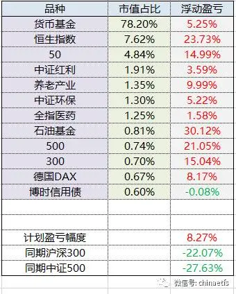
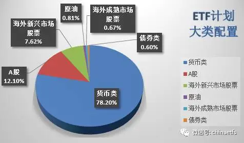
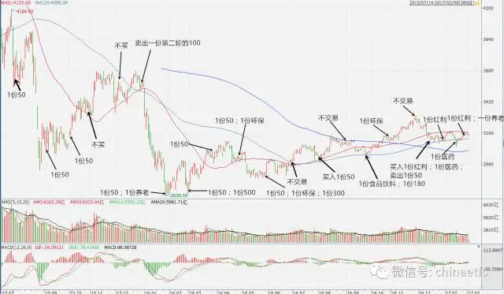
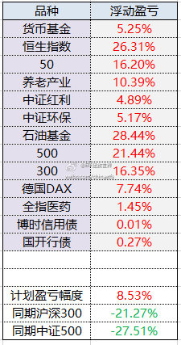
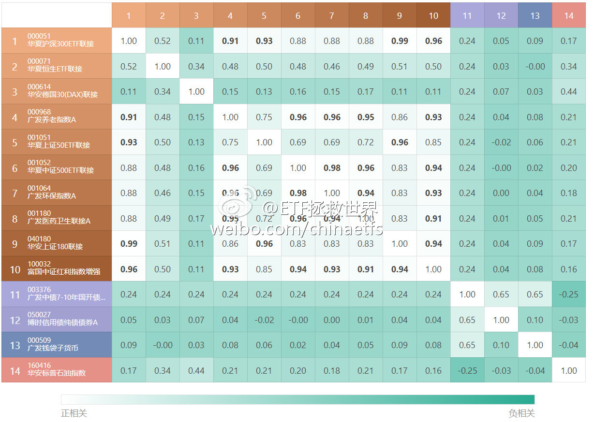
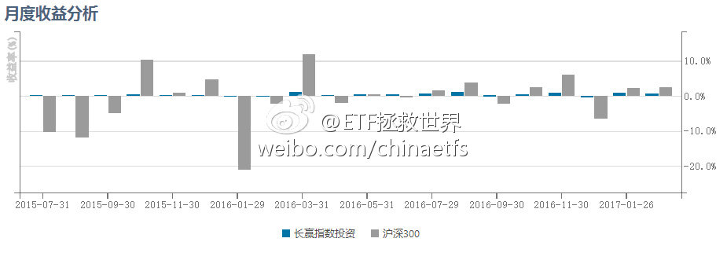
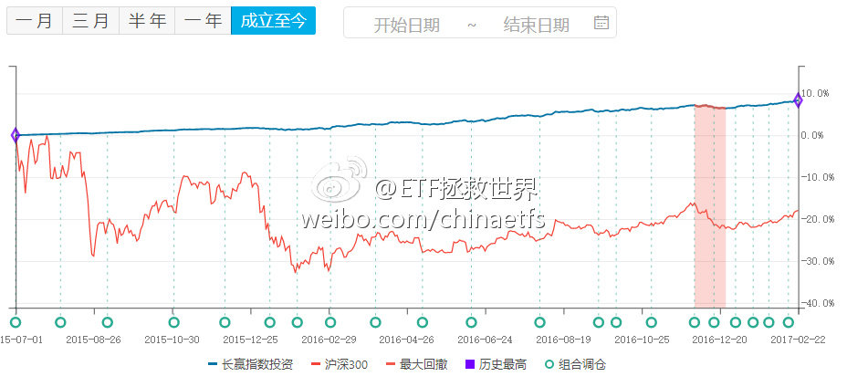
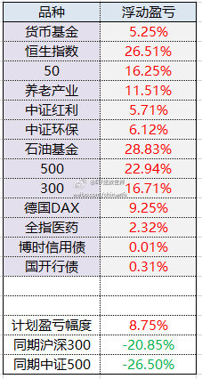
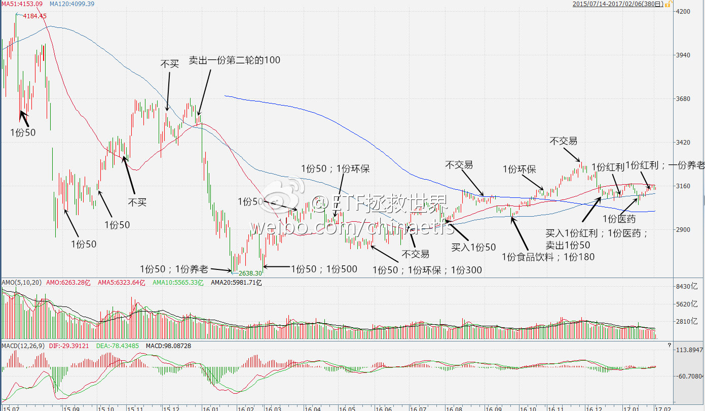
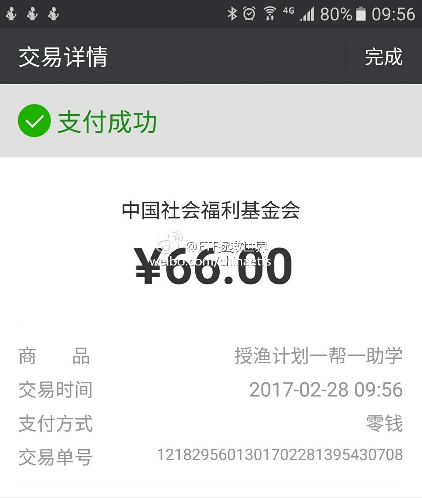

## 2017-02-07 11:36

看他的样子平平无奇……

> @金融界网
> 为什么有钱人都爱扯蛋，撒贝宁对马云做出了一个我想做的表情，这个表情我给满分。分享图片 ​​​
> 

## 2017-02-15 10:07

乡亲们，开车了。

2017年2月ETF计划(2/2）：买入一份

朋友们，开始浏览本月ETF计划前，请仔细阅读以下几点：

1、本计划绝非任何形式的投资建议或是投资指导。

这里仅仅是将本人十年前开始，一些朋友五年前开始进行的一个投资指数的计划如实记录在这里。

如果这个计划能帮助您，我们会替您感到高兴，仅此而已。我们绝不会向您以各种形式收费、分成。如果您因为这个计划而亏损，我们也只能说一声很遗憾。也是仅此而已，我们不会承担任何责任。

2、请任何朋友开始参考这个计划前，要再三考虑自己是否能忍受甚至可能长达3-4年的熊市。

本计划虽然过去12年取得了超过10倍的盈利，但大家要知道，在12年中，真正让利润大幅增长的时间大概只有5-6年的三次大牛市。中国股市是个牛短熊长的市场。我们在超过7年的大熊市中慢慢买入，最终才取得了牛市利润的爆发。你一定要清楚，70%以上的人无法忍耐几年的熊市。所以，确认你自己能忍，再开始参考本计划。同时，未来会有多少收益我们并不知道。因为我们无法预计未来的市场会怎么走。

3、未投入的剩余资金可以去买任何你想买的投资品种。只要每个月初用的时候能到位即可。如果某个月会投入5份以上的资金，会提前3天到一周说明。

4、第三轮ETF计划的每篇推送，可以回复年月数字查看。从“1507”开始。也可以在公众号主页下方菜单选择“投资计划”栏目查看。

2017年2月第二次操作计划如下

买入：广发7-10年国开债指数A（场外003376）一份 

（该品种预计最大跌幅30%）

到目前为止，还没有买入的往期计划是

中证环保（001064） 一份 （对应中证环保指数000827不超过1580点、2016年6月计划）

德国30   （513030）一份   （价格不超过0.88、2016年8月计划）

50ETF     （510050）一份  （价格不超过2.117（分红调整价格）、2016年8月计划）

食品饮料  （160222）一份 （对应国证食品饮料399396不超过8000点、2016年10月计划）

180ETF   （510180）一份  （价格不超过2.84、2016年10月计划）

资产配置&收益率

计划收益率继续新高，首次超过8%。领先沪深300与中证500超过30%、35%。全部权益类品种继续保持盈利。

壹：又是债券

2016年12月初，回头看，那是一个阶段性暴跌之前的位置。那天，我们没有买入任何权益类品种，而是买了一份博时信用债。两个月后的今天，我们再买一份债券。

很多朋友会很疑惑，为什么看起来像是进入加息周期了，债市面临极大的不确定性，怎么我们还要继续买债券？

原因在12月计划中已经写得很清楚了。不过现在的情况与当时又有所不同。

第一个是十年期国债收益率已经从当时的2.9x%继续上升，升至3.4x%。也就是说，债券继续跌了2个月。当然，我们持有的博时信用债基本没跌，这也是当初为什么会选它的原因——在下跌市中，它会跌的较少。国债价格下降、收益率上升，没道理不继续买入。

第二个，是这次我们买的品种将对利率变化更加敏感。也就是说，如果利率水平继续上升，博时债有可能跌，也有可能不跌。而这次买的广发国开行债基，一定会跌。信用债和利率债表现会有所分化。

然而对于一个成熟的资产组合来说，债券是必不可少的存在。即使明天买完，我们的债券持仓也只有1.3%而已，债市涨跌都不会有什么影响，这个仓位还远远不够。未来债券配置在我们的计划中应该有机会做到20%-30%。不急，慢慢买。

现在3.5%左右的十年期国债，在历史上是什么位置？五年历史来看，基本在55%百分位左右。十年历史看基本在历史65%百分位左右。也就是说，已经接近历史平均。在这个位置配置一个多点的债券，不用有任何负担。

贰：平和

ETF计划持仓权益类品种继续保持全部盈利的状态；恒生ETF不断新高；计划总收益率不断上升……虽然如此，我相信很多朋友内心依然煎熬不已。

有朋友因为自己仓位不够而煎熬。没错，看看网络和媒体，是不是大牛市来了的声音再次多了起来？听得多了，心里又开始慌乱——仓位低，牛市吃不饱，赚不到大钱怎么办？

有朋友因为浮盈越来越多而煎熬。不卖的话，坐了电梯怎么办？赚的时候不卖，跌回去亏了怎么办？

……

做为一个在资本市场赚了一点钱的老司机，给你的忠告也很简单：

平和。

真正让心沉稳下来。

在A股赚钱，说难，你看，其实也不难。2015年7月第一次股灾以来，我们买了十几个品种全是盈利的。最多的赚到将近30%，看起来，赚钱好像也不难。

说不难，几千万投资者真的是不停的在把钱往里面扔。一轮、两轮，很多人的财富被消灭，被他人（包括我们）赚走。

除了理论、策略、数据、知识外，其实能否赚钱最重要的一点，是心态。我们踏踏实实，耐心的等待好价格出现。轻轻松松的出手买入，然后看着买入的东西开始盈利，越来越多的盈利——这样不好吗？

（全部盈利的原因是不追涨，只抄底）

听别人一忽悠，着急买入，跌下来又心浮气躁挥泪斩仓。再忽悠，再买，再割肉……这样的日子，你真的愿意过？

你买的够低，才能拿得住。因为你知道你很难亏损。一旦真的由盈转亏，你应该大喜过望：真正改变人生的机会来了！继续买买买！

记住，我们的目标，是五倍、十倍、二十倍。当你因为盈利10%、20%、30%就卖掉好不容易买到的珍贵种子的时候，你，这辈子，也不可能赚大钱了。

人弃我取，牢牢持有。等到别人疯狂追逐的时候，再卖给他们。

叁：节日快乐

今天正好是一年一度的“情人节”。其实想一想，投资这件事，和感情竟有些相似。

暂时还没有得到幸福的朋友，不用着急。其实只是缘分未到。缘这一字，非常奇妙。那个正确的人，可能就在明天，甚至下一秒钟就会出现在你的面前。在TA出现之前，我们要做的，就是不断提升自己，让自己配得上未来的那个让我们心动的人。投资也是如此。缘分未到，不必着急。耐心等待，多积累本金。缘分来了，果断出手，赚钱不就是自然而然？

得到幸福的朋友，应该珍惜，感情需要经营。投资也是如此，好好珍惜手中珍贵的筹码，不轻易放弃，才能达到理想的目标。

祝各位幸福。

## 2017-02-19 20:13

谁能想到，我胡汉三又回来了！

这次待半年，全是微博独家了这次…… ​​​

## 2017-02-20 09:38

发布了头条文章：《一些小感悟（一）》  ​​​

​​​2017年，第八周，第51天，2月20日。

平淡的生活中，除了看书，是没有机会有什么进步。然而每当生活有一些波澜，就会让你通过各类形形色色“人”的表现，让你学得更快，学得更多。

真实的社会太大，怎么观察都是管中窥豹。然而在网络社区，尤其是一个相对封闭，更类似于现实中村庄、小镇之类好像“熟人社会”的网络社区，则可以让你飞快成长，认清这个社会的很多面。

也许我们不知道跟什么样的人交往，但一定要很明确离什么样的人远一些。很多时候，人的能力非常重要，但更重要的，是一个人的品格。

最近的几点感悟是：喝酒撒酒疯的人不可交，因为在醉酒情况下，最能反映一个人的真实内在；无中生有搬弄是非的人不可交；无事称兄道弟，有事鸟兽散再来踩一脚的人不可交。

从我的本性来讲，天性淡泊，不喜欢吵吵嚷嚷热热闹闹。在雪球玩了近两年，居然有了11万多关注者，据说在所有用户中关注量已经排到了30多位。这件事让我特别不舒服。当关注者超过十万的时候，我就已经有些想要暂停更新。因为对我来说，关注者增加的太快，并非什么好事。

有些人特别喜欢多一些人关注，我则不同。less is more。探讨投资，交朋友这件事，不需要那么多人。

雪球就像一个村庄或小镇的存在。关注者多了，是是非非，无穷无尽，这些东西都让我特别讨厌。这些是非并不是你可以拒绝或者不理会就万事大吉的，这句话，没有经历过的朋友，是不会理解真正含义。

而微博更像一个国际大都市。在这里你可以跟一些朋友谈天说地，然而因为微博太大，话题和人都太多，很难凭空生出很多是非。这样的氛围让我舒服得多。

我没很多朋友想得那么脆弱，当然也不可能为了那样一些小事生气。所有的波澜都是命中注定，不同的是，你要用什么态度去对待它，又能从中学到什么，能否成长得更快。暂时离开，是希望换个环境，人生苦短，好玩才是最重要的。

（头条文章居然还要放张图片做封面才行，没有合适的，电脑里随手搜一个放上来吧……）

## 2017-02-20 09:56

恒生ETF本人将继续坚定持有（极小仓位做动态平衡）。

在一个上涨趋势中，正常人根本没法预计到底会涨到哪里。所以这种并非极端高估的地方，咱们能做的只能是持有手中极度便宜的筹码，适当做些动态平衡。

正常情况下，长远看，指数一定是不断新高。相比于坐电梯可能带来的波动风险，更大的风险，是随便下车导致失去真正的利润。

想要成功投资，一项特别重要的技能，就是在盈利的时候死死拿住手中的筹码。

## 2017-02-20 10:23

回复@Simon_Mia:个人认为你首先要抛弃的是“预测”的想法。我个人浅见，投资不能预测，只能靠概率下注。赢得概率低不下注，赢的概率高下重注。我的投资系统里，是随着“估值”的下降，就会认为买入赢的概率比较高，会逐渐加大买入力度。所以你的问题我总结，应该是估值越低，加仓力度越大。

> @波士顿奶龙:E大 怎么能大概预测什么时候是低点适合加仓呢？

## 2017-02-20 10:35

回复@四维:这个根本原因还是你没有对公司正确估值，不知道值多少钱，所以拿不住。这也是投资个股特别难的一个原因。你很难判断一家公司到底什么时候便宜，什么时候贵。所以我们另辟蹊径，研究指数估值。于是，世界瞬间明亮起来了。

## 2017-02-20 10:40

回复@mydxkl:个股代表的是背后的公司。每一家公司都在经历不同的成长阶段，出生，快速成长，稳定，衰退……每一个阶段的估值都不应该相同。再加上不同行业的估值也不同，还有公司产品、管理层、科技发展……对个股估值真的特别特别难。难度远超一般人的想象。所以投资个股，如果是看估值最好一眼看胖瘦

## 2017-02-20 13:59

看了一下，现在的重要股东减持真的比前几个月少很多了。

2月至今，只有40亿左右的净减持。

减持是109家，80亿。客观的说，跟以前比，不多。看了眼去年11月，前20天减持家数321家，减持金额210亿。

所以价格降下来了，重要股东减持冲动才会减少。而不是用各种手段去限制。

越高估，跑得越快~慢慢的股票和资金平衡了，才会见底。

## 2017-02-20 14:10

提醒各位，逆回购价格起来了。 ​​​

## 2017-02-20 15:18

计划继续新高。

持仓品种中，持仓量前三的恒生新高，50和红利即将新高。其他品种距离新高还比较远。

唯一的问题是仓位较低，但模型给出的仓位就是这么多，只能严格执行。觉得自己仓位低的朋友，就像一直说的一样，完全可以把计划中的货基仓位换成任何想持有的品种~ ​​​

## 2017-02-20 16:29

回复@非衣海王山而:赶紧举报。。这种太多了。以后哪位朋友碰到这种冒牌货就赶紧举报啊。 //@非衣海王山而:微博有个：ETF拯救世界i  和  ETF-拯救世界-  不是你的小号吧？好像在骗人，E大赶紧管管。

## 2017-02-21 09:01

图一：截至目前，计划持仓品种的相关性分析。

图二：第三轮开始的20个月以来，18个月取得正收益。 ​​​
 

## 2017-02-21 10:23

A股现在已经有3100多只股票了。在可预见的2-3年内，恐怕总量有可能突破4000只。

再过几年，5000只股票也许不是梦。

这样，炒股票的人也许会面临从未碰到过的危险：你买的股票，有可能十年、二十年都不涨。

A股之所以长年高估，就是因为钱多，自由流通的股票太少。随着IPO解禁，定增解禁，IPO上市，大量筹码被释放出来。这样，以前那种只要牛市来了，就一定鸡犬升天的日子恐怕就很难重现。以前那种只要买了股票，股票再烂。死死拿着，总有一天会回本的事情恐怕也不容易发生。

未来很有可能出现大牛市中，你的股票不涨。也有可能震荡市中，你的股票大跌。比如最近这两个月，指数红红火火的涨，很多人持有的股票基本上毫无动静，甚至还在跌。

所以未来的股票投资会越来越专业。随便买股票炒作的很多人会被真正的消灭。指数投资恐怕是大多数人最优的选择。

## 2017-02-21 14:38

今天 养老产业399812 接过50红利的大旗继续领涨。

我本人非常喜欢这个指数。它是一个“消费+医药+娱乐”的NB指数，代表未来发展的方向。更何况，它是我最喜欢的等权编制。这样，平安人寿这样的大家伙就无法让它步履蹒跚了。 ​​​

## 2017-02-22 08:57

昨天跟一个做期货的朋友聊天。

哥们开奔驰，拉顺风车（[喵喵][doge]），已婚。有一天拉到一个从上海来北京也不知道出差还是玩的姑娘。

然后就情投意合了，Hotel California，此处略去500字。

姑娘说，好喜欢你，你离婚我就跟你在一起。

哥们感觉爱情呼叫转移到自己这里了，马上回家跟发妻离婚。然后再联系上海姑娘联系不到了。

最后也不知怎么去上海还是给找到了，姑娘说，哎呀不好意思我已经结婚啦。不想跟老公离婚。

哥们灰溜溜的回来，再去找前妻。前妻说不好意思，不要联系我了，已经有人在追我了。

我听完就一个感觉，顺风车真是个害人精一刚！[doge]

## 2017-02-22 09:22

回复@奥斯特洛夫大柴夫斯基:德国那边已经新高了。513030还有点折价。计划里的品种基本上都在走向新高的路上 //@奥斯特洛夫大柴夫斯基:德国30  今天高开...............................牛逼

## 2017-02-22 11:13

讲真，为了一点信用卡积分，和“低价”租房就把特首关20个月，还真是有点震惊的……

## 2017-02-23 09:14

小时候都听过“龟兔赛跑”的故事。长大了，很多人就忘了。

无论市场怎么波动、如何暴跌，净值曲线一路向上。找到机会果断出击，买了就要赢，就要赚。

当然了，现在的这点收益率，并不是我们追求的。时候未到而已。

三年不鸣，不鸣则已，一鸣惊人。

爆发式的增长，你我终究会看到。 ​​​
 

## 2017-02-23 10:04

回复@小国诸侯:感觉错误。是因为来微博，关注的人少了十万，说话自由，放飞自我了。 //@小国诸侯:E大最近话多了，怎么我觉得你内心不平静了

## 2017-02-23 11:05

回复@领悟ing_皮妹儿:证券B，分级基金里面的激进子基金。长期持有必死无疑。正常市场情况下，最多6、7年死一次。碰上大牛市上折后死的更快。下折是净值跌到0.25就要4份合并成1份，然后从1块钱继续跌，跌倒0.25再合一次。长期看，死无葬身之地。优势是牛市涨得好，自带1-5倍杠杆。咱们买的没这这个问题

> @我是一个有内涵的昵称:老大，昨天我有个同事和我闲聊，聊到投资，说到我正在买德国30，她情绪比较激动，说她早几年花5万买了证券B，后来下折到0.1元。请问啥叫下折？是不是只有B才有这种说法？

## 2017-02-23 13:16

$159938 广发医药  你终于舍得动动了，孽障。 ​​​

## 2017-02-23 13:28

回复@上头云:不是。我已经说过无数次了，每个人的仓位都一定要设计到“涨跌都舒服”的程度。因为每个人情况不同，我不可能给大家设计仓位。但是各位朋友自己应该知道，什么仓位是自己“涨跌都舒服”的。我自己的仓位很舒服，所以我涨跌都高兴。不高兴的只有一种情况，每天心电图一样的走势。

> @上头云:E大 你不是希望这些品种往下跌么 为啥看起来如此高兴捏

## 2017-02-23 13:39

为什么总能买到阶段底，看起来真是个谜。

注意医药的买入点 ​​​

## 2017-02-24 09:49

$全指医药 sh000991$   1月16日买入计划的朋友，可以说是股神了。 ​​​

## 2017-02-24 10:11

养老和医药这种，未来两个月非常关键。因为年报+季报披露了。能不能多买点，就看未来这两个月。今天养老继续给力。2月计划买入品种。

## 2017-02-27 10:05

如果是投资类的音频栏目，各位最想听的是哪方面的内容？ ​​​

## 2017-02-27 15:48

很多朋友关心这个月能不能开车。其实我也很关心，不过得看明天收盘后的估值，然后放入模型，再看能不能开。

如果不弄清楚车况路况，闭着眼睛开，很容易翻车。

毕竟开车也要遵守基本投资法丫。

从今天的情况看，可开可不开，边缘状态吧。 ​​​

## 2017-02-28 09:23

我回答了@穿越30年 的问题，问题价值￥49.00，欢迎大家围观~如果提问人可以拿回大部分费用，以后就继续回答……  ​​​

## 2017-02-28 09:49

回复@Yanb丶:提问的朋友能挣钱，这就最好了。我特别希望提问的朋友能挣钱，这样大家就会想一些真正的好问题来提问。有了好问题才会有好回答，围观的朋友也会真的受益。 //@Yanb丶:估计还能提问题的赚钱。。。

## 2017-02-28 09:59

一个问题，完美闭环，皆大欢喜。各位看了分享，积了善缘。 ​​​

## 2017-02-28 10:42

如果不大跌，就别跌。否则这车可开可不开弄得很尴尬。 ​​​

## 2017-02-28 15:27

恒生估值已经到了2013年2月以来最高。

这个情况持有是没问题的，但现在还在忽悠别人去买港股的人，不厚道。 ​​​

## 2017-02-28 17:06

回复@Ponder735:早上开的问答，现在有21个问题。我想了想，以后最多每两天回答一个问题。主要是替朋友们的钱袋子着想……毕竟1块钱…… //@Ponder735:E大就回答一个吗，看来我要的答案又没有了

