## 2017-03-01 10:36

休息一次，不开车。

2017年3月ETF计划

朋友们，开始浏览本月ETF计划前，请仔细阅读以下几点：

1、本计划绝非任何形式的投资建议或是投资指导。

这里仅仅是将本人十年前开始，一些朋友五年前开始进行的一个投资指数的计划如实记录在这里。

如果这个计划能帮助您，我们会替您感到高兴，仅此而已。我们绝不会向您以各种形式收费、分成。如果您因为这个计划而亏损，我们也只能说一声很遗憾。也是仅此而已，我们不会承担任何责任。

2、请任何朋友开始参考这个计划前，要再三考虑自己是否能忍受甚至可能长达3-4年的熊市。

本计划虽然过去12年取得了超过10倍的盈利，但大家要知道，在12年中，真正让利润大幅增长的时间大概只有5-6年的三次大牛市。中国股市是个牛短熊长的市场。我们在超过7年的大熊市中慢慢买入，最终才取得了牛市利润的爆发。你一定要清楚，70%以上的人无法忍耐几年的熊市。所以，确认你自己能忍，再开始参考本计划。同时，未来会有多少收益我们并不知道。因为我们无法预计未来的市场会怎么走。

3、未投入的剩余资金可以去买任何你想买的投资品种。只要每个月初用的时候能到位即可。如果某个月会投入5份以上的资金，会提前3天到一周说明。

4、第三轮ETF计划的每篇推送，可以回复年月数字查看。从“1507”开始。也可以在公众号主页下方菜单选择“投资计划”栏目查看。

2017年3月第一次操作计划

本月初暂停交易一次

到目前为止，还没有买入的往期计划

中证环保（001064） 一份 （对应中证环保指数000827不超过1580点、2016年6月计划）

德国30   （513030）一份   （价格不超过0.88、2016年8月计划）

50ETF     （510050）一份  （价格不超过2.117（分红调整价格）、2016年8月计划）

食品饮料  （160222）一份 （对应国证食品饮料399396不超过8000点、2016年10月计划）

180ETF   （510180）一份  （价格不超过2.84、2016年10月计划）

资产配置&收益率

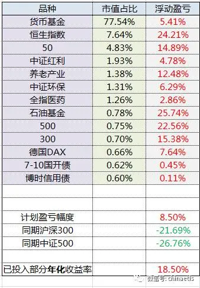
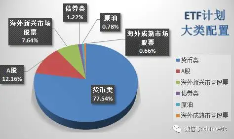
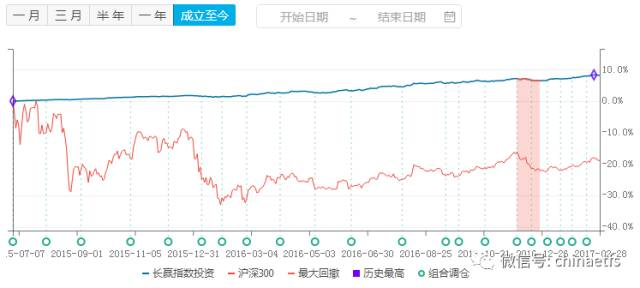

计划收益率继续新高，继续保持对各个指数的领先优势。

壹：关于“已投入年化收益率”

简单说两句前面收益率表格中新增加的这个数据。

也很简单，就是看看我们已经投入的部分投资效果如何。到现在为止投入的20%多仓位，年化收益率大概在18.5%。一年多的数据还是不够长，所以这个数据看看就好。如果要客观评判，需要更长时间的数据积累。

贰：关于“不交易”

就像曾经几次计划一个月投入三份以上一样，本次我们选择了“不交易”。所以你看，我们不是个“定投”计划。定时，不定额。

要说明的是，这里的不交易，只针对仓位控制与计划差不多的朋友。如果是这几个月刚开始参考计划的朋友，A股仓位比上面饼图中的A股仓位低很多，其实也可以投。投什么？可以投红利。之前我们说的富国红利也可以（场外），新上市的标普红利基金也可以（场内，501029）。

场外的富国没问题，不用多叮嘱。如果你买场内的红利基金一定要注意：由于这次属于仓位低的朋友自己补，所以我不知道有多少人会买。根据之前的经验，如果计划正式推一份的话，会有1000万以上的资金购买。红利基金今天的成交量只有700多万。也就是说，如果太多人去抢，很可能瞬间将价格拉高。需要一再强调的是，千万不要挂高价去抢。没必要，没意义，完全是白白增加自己的成本。这是一个LOF基金，可以参考净值，在净值附近购买。如果价格始终比净值高0.5%以上，就不要买了，去场外申购富国吧。申购费才0.15%。

如果不知道怎么算净值，可以去查查LOF净值计算。实在弄不清，也是去申购富国。

为什么本次计划选择了“不交易”？这个不是我主观判断的。而是将各种数据放入计划投资模型得出的结论。主要原因是仓位的问题。现在计划的A股仓位是12.16%。这个仓位在这个估值状况下，在模型中判断是合适的。我们判断比较合适的A股仓位，应该是从保守到正常到激进的配置应该是10%-15%-20%左右。目前计划仓位在保守到正常之间，合适、舒服。

当然，我的舒服未必是你的舒服。每个人情况不同。如果你始终觉得仓位低，可以加到15%甚至20%。都OK。以后我争取每次计划文章里面都给出保守-激进的仓位配置判断。

最后要说的是，很多朋友手里的品种，可能是投资以来盈利品种拿的时间最长的一次了。没错，你之所以拿得住，一方面是相信计划。一方面，是因为成本低，你就会很放心，不怕由盈转亏，不怕坐电梯。仔细想想，其实这是非常非常重要的一件事。我来告诉你一件你也许从来没有意识到的问题：

当你买的够低，你就不应该着急逃顶。因为即使你不逃顶，超长期来看，你的收益率也会特别特别好。然而你如果频繁逃顶，反而会少赚很多。当你不再追求逃顶，投资就瞬间变得特别舒服、自然。所以我们的计划品种，到现在只卖出过一次猪队友，只有一次50换红利。因为我知道，轻易不要卖，真正的大利润在未来等着咱们。

而这一切的根源，就是买的不贵。这，是一切成功投资的开始。

不交易，有时候很重要。无论对于买还是卖来说，都是如此。

叁：关于“交易”

非常有意思的事情一再发生，有时候我自己都会觉得莫名其妙、匪夷所思。就拿今年的几次操作来说：

比如1月初的中证红利，各位自己可以看看买入当天K线所在位置——妥妥的阶段底；

比如1月中我们买入的全指医药，很多朋友由于晚一天申购，再次买在了阶段大底，那是最便宜的一天；

比如2月初的养老，买入后也是涨势凌厉不断上涨；

再比如2月中我们买的7-10年广发债，当天居然又是最低价格。买入后就涨了起来……

大家有空可以翻翻之前的计划文章，再对比各品种K线图，就会发现，这样的事情不是一次两次，不是三次四次，而是不断发生。

各位还可以看看，有几次我们没有买入权益品种，甚至卖出后，发生了什么？

我们所有买入的品种，都是盈利的。甚至除了一次交易，所有买入动作都是盈利的。说到这个，你猜我是什么心情？

不好意思，各位朋友，您可能猜错了。我不是自豪，而是很担心。

我知道很多朋友参考计划，一开始投入很少，结果发现怎么买都赚钱，什么时候参考都赚钱，买什么都赚钱，于是信心大增，增加投入……我担心的，正是这些没有经历过浮亏的朋友。

各位，我再次提醒：我们买的任何品种都有可能大幅甚至巨幅下跌，一定要做好心理和物质的双重准备。

肆：估值

送大家一张最新的全市场外部数据加权估值图。估值还是很高，不过我告诉大家一个好消息，我预计，未来的两个月，也就是3-4月，由于年报和一季报的披露，市场估值会大幅下降。我相信未来两个月会有不少买入机会，前提是，不暴涨。

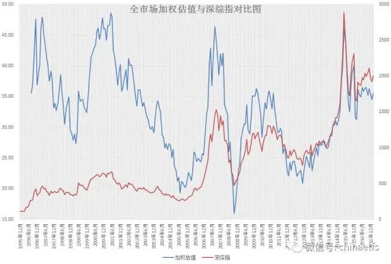

最后说两件事：

第一个是最近经常会在微博跟朋友们互动，地址是：http://weibo.com/chinaetfs 欢迎也玩微博的朋友关注。

第二个是之前说过，如果是场内交易，资金少的朋友手续费的问题就很重要。建议开一个交易场内基金没有5块钱门槛的券商。否则如果你买1000块ETF或者LOF，5块手续费，太高了。如果找不到，可以在本公众号回复“开户”。基金交易一毛起。

祝各位投资顺利，咱们月中见。

## 2017-03-02 08:42

后台有26个问答问题，只能选一个，有几个问题真的都不错，选哪个好纠结！ ​​​

## 2017-03-02 09:42

我回答了@Ellison_du 的问题，问题价值￥49.00。全文共1945字。哥们，希望你能把提问的钱赚回来，如果能跟上一个哥们一样赚200多就更好了！上帝保佑你！  ​​​

## 2017-03-02 09:46

$159920 恒生ETF
$513030 德国DAX

又快新高了。资产配置，朋友们，敲黑板。 ​​​

## 2017-03-02 10:23

好了，回答了两个问题，新鲜劲过去了。

以后除非有特别好的问题，不回答了。

继续加善缘。 ​​​
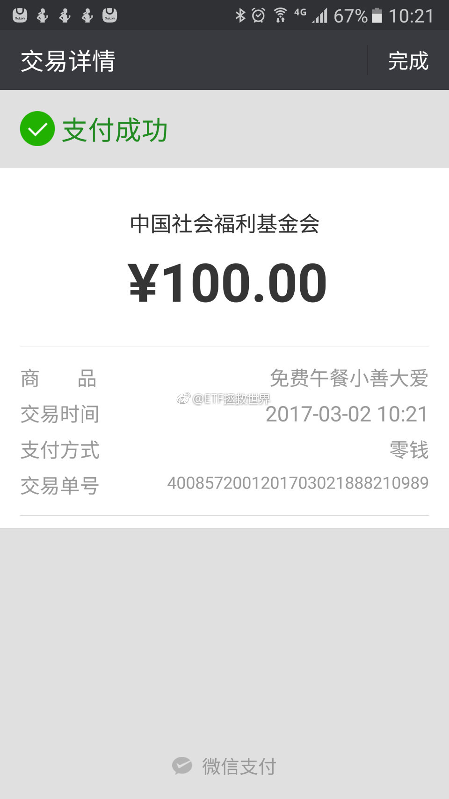

## 2017-03-02 10:38

回复@手机用户2503440233:分成两部分。一个分成150份，一个按照每个月投入。把自己想象成两个人就行了。

## 2017-03-02 12:50

午饭吃什么？ ​​​

## 2017-03-02 14:32

“不买就跌”的魔咒又要应验了吗……

不过这次应该不会跌。毕竟要开会…… ​​​
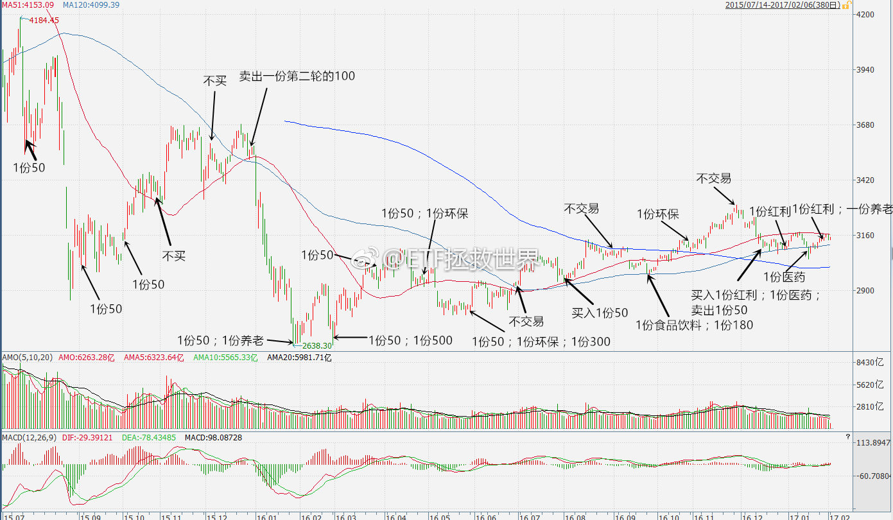

## 2017-03-02 14:46

之前在雪球看到某位私募大师说，特别喜欢Sun hb，Jia yt这样的人。敢闯，敢干。有梦想，胆子大。

但是不知道为什么，我就特别害怕这种人。起风的时候玩命加杠杆融资干“大事”，然后就出问题。然后再来一轮……类似的还有Heng d，Yao zh……

我特别喜欢扎克伯格、巴菲特、比尔盖茨这种企业家，还有类似于李安这种艺术家。内敛、沉静，稳中求进，不断进取。

有一个之前疯狂，之后稳进的例子，是SHI yz。聪明，知道从教训中学到东西。

不死才能赢啊。所谓“富贵险中求”，并不是我的菜。

## 2017-03-02 15:27

历史上A股整体收益率徘徊在2附近或以下的时间，最长的是2000年3月-2002年10月。也就2年半。之后就是茫茫阴跌到2005，1000点，股票收益率变得极高。

这一次从2015年4月到现在，也快两年了。这么高估值，维持这么长时间，在A股历史上极为罕见，有希望突破之前的记录。

现在债券收益率已经向正常回归，股票还要这样高估下去？真的要用十年时间，“时间换空间”？
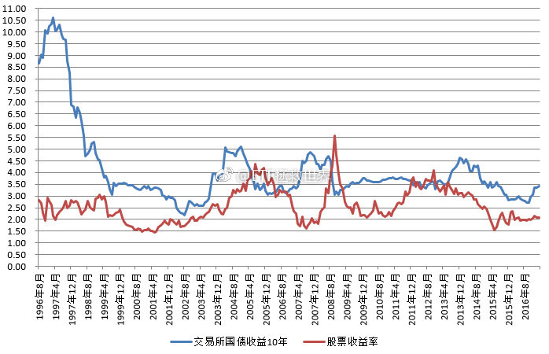

## 2017-03-02 16:00

数据出来了。只要这两个礼拜某指数不涨，月中开车。确认了。 ​​​

## 2017-03-03 09:31

计划不开车就是这个结果。我也很无奈呀。

## 2017-03-03 09:32

毛估估薯片中午要停牌 ​​​

## 2017-03-03 09:41

我自己都害怕了！不能每次都这么灵啊。好吧，这样，如果跌得够猛，下周加车…… //@ETF拯救世界:计划不开车就是这个结果。我也很无奈呀。

## 2017-03-03 09:51

回复@小狗上马路:不是。是择估值。举个例子吧。你太太想买个爱马仕的包，到商场一看，不打折，转身走了。第二天听说打折了，你贤惠的太太说，嗯，那就等折扣再高一点就去买一个。——你太太并没有在择时，而是择价值而已。 //@小狗上马路:E哥，这算择时么？虽然开车很高兴

## 2017-03-03 10:56

不让买我们就不买了。 //@ETF拯救世界:我自己都害怕了！不能每次都这么灵啊。好吧，这样，如果跌得够猛，下周加车…… //@ETF拯救世界:计划不开车就是这个结果。我也很无奈呀。

## 2017-03-03 13:30

@GEM鄧紫棋《泡沫》 泡沫-GEM鄧紫棋  

好听。 ​​​

## 2017-03-03 19:41

现在德国车是不是还暂时安全，懂的说说。 ​​​

## 2017-03-08 17:19

工作不是很开心，但是待遇很不错。你会怎么办？

几天没说话，让很多朋友担心了。我没事，就是累。 ​​​

## 2017-03-09 05:54

​​​
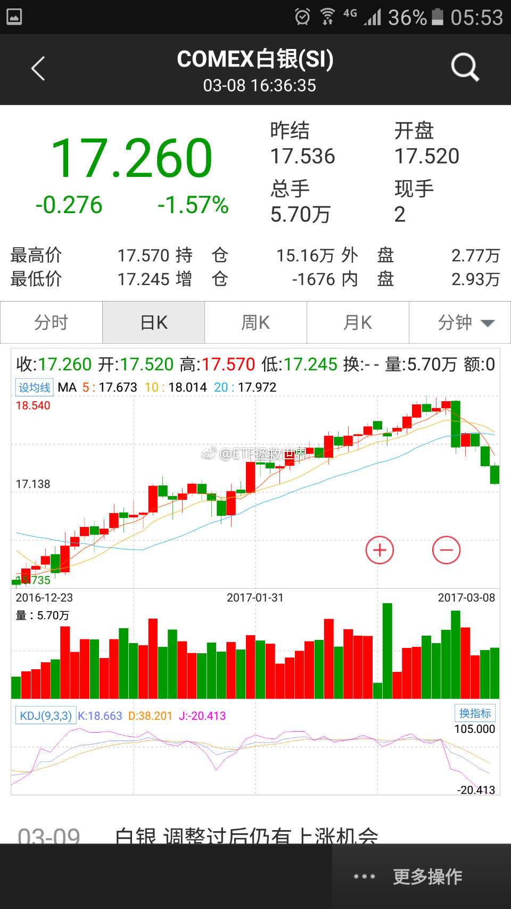 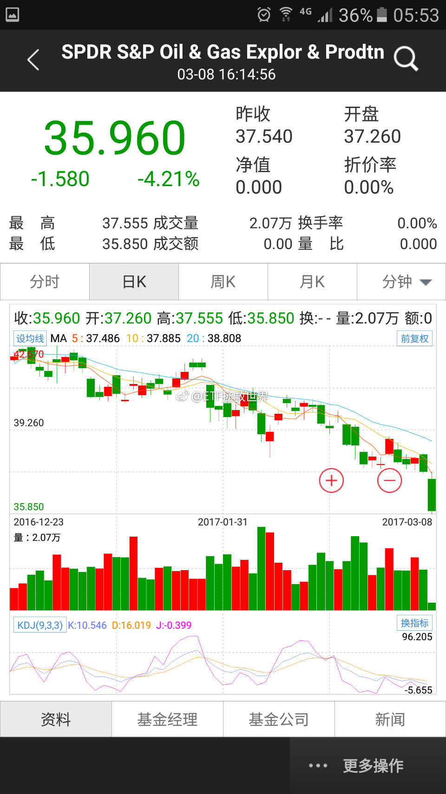

## 2017-03-09 10:55

维稳，不允许正常波动，市场长时间处于高估状态，后果就是市场不具备正常的抗风险能力，有可能在某天轰然倒塌。

反脆弱。 ​​​

## 2017-03-09 12:45

特别喜欢这首歌。不知道还能喜欢多久  ​​​

## 2017-03-09 16:12

给力。什么时候过3.5！群众都在盼望着！ ​​​
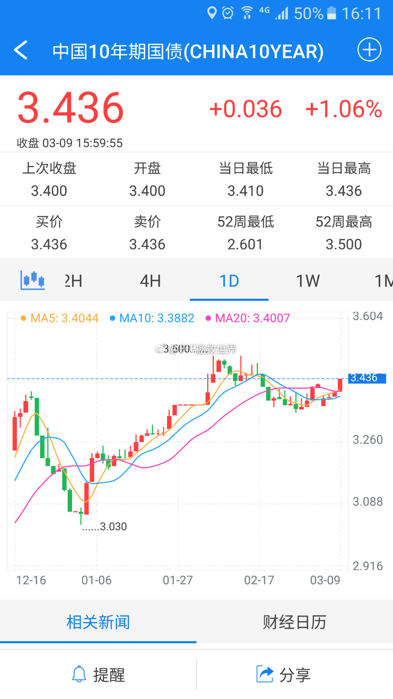

## 2017-03-10 08:29

共享单车的目标客户群体腿长是多少？

怎么我觉得骑这个比跑步还累213.64%。 ​​​

## 2017-03-10 08:51

美十年期国债收益率升破2.6就一片哀嚎……

实际上过去二十年美十年期国债收益率走势是这样的……

嘿嘿…… ​​​
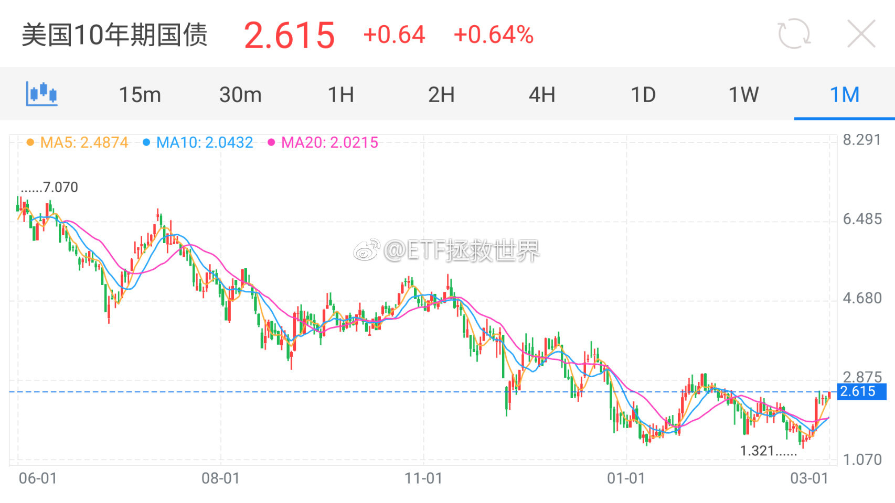

## 2017-03-10 14:37

很多金融市场的存在，客观讲，会有两个作用。一个是加杠杆，一个是加大贫富差距。

如果你投身到某个市场，希望在里面赚钱，能否越来越富先不要想，你要做的第一件事是绝对不要让别人把钱从你身上赚走，完成他的财富大爆炸。

有些财富转移是一对一式的。比如有人加杠杆贷款，几十万一平米从别人手上买房。这就是将攒了几辈子的钱+银行的钱转移给另一个人。

有些财富转移是多对一的。比如上市公司老板减持，把股份卖给无数投资者，如果股票估值很高，未来跌的七荤八素，那么这些人的财富就顺利转移到一个人的手上。

还是那句话，能赚多少先放一放。一定别做贫富差距越来越大中的那个“贫”，那个输血者，还是比较重要。

下一步，再想办法在市场上向“富”的那个群体移动吧。

## 2017-03-10 19:21

谢谢各位！听了大家的，试了可以调节座位的那种！厉害了，骑上去感觉自己是阿姆斯特朗在骑环法！这么有用的信息，无以为报了各位，只好以身相许了！

> @ETF拯救世界
> 共享单车的目标客户群体腿长是多少？
> 
> 怎么我觉得骑这个比跑步还累213.64%。 ​​​

## 2017-03-13 09:41

月初没开车，再次躲过了半个月的下跌。那么问题来了，又到月中，开不开车？

## 2017-03-14 15:32

回复@牛人我是熊大006:太忙了最近。准备这两周就来一发试试。关键是第一次说什么很重要啊。//@牛人我是熊大006:回复@ETF拯救世界:这个节目准备的怎样了？如果太忙，需要处理音频，我可以最近重新捡起来练练。期待

> @ETF拯救世界
> 如果是投资类的音频栏目，各位最想听的是哪方面的内容？ ​​​

## 2017-03-14 21:13

北京的房子可能真的是疯了。继去年同事900多万买了一套学区房后，这周又知道有四位同事都买了学区房，单价10万+。

非常有意思，能经历这样一个时代，见证奇迹，深感荣幸。 ​​​

## 2017-03-15 09:36

散会了是不是还要撑啊。

哦，下半年还有一个会…… ​​​

## 2017-03-15 10:45

回复@勤奋的兔子ETF:不是。我这个图和崩盘的关系，其实是出太阳和公鸡司晨的关系。不是因为公鸡打鸣太阳升起，而是因为太阳要升起公鸡才打鸣。所以崩盘前我才会顺势发个图加个小砝码祝它一臂之力……不能什么时候都发…… //@勤奋的兔子ETF:E大发个估值图，管它是国家队还是两会，都得趴下

## 2017-03-15 11:54

关于增强指基，分析一些数据，得出一些结论。我回答了@穿越30年 的问题，问题价值￥79.00，大家快来花1元围观~  ​​​

## 2017-03-15 13:50

很多人都觉得自己很重要，很多人关注自己。其实可能是想多了，也许根本没几个人在意你生活的是好是坏。

毕竟，大家都挺忙的。 ​​​

## 2017-03-15 13:51

如果有一年时间可以不用工作。你最想干的事情是什么？

说出你的想法。 ​​​

## 2017-03-15 14:52

不知不觉昨天又新高了 ​​​
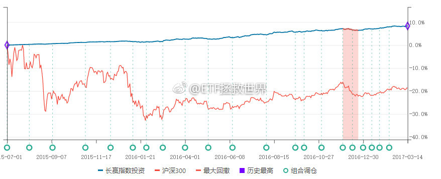

## 2017-03-16 06:14

这个问题回答的值了。也有围观问题的各位朋友一份，转发。

## 2017-03-16 09:31

$159920 恒生ETF

任何低成本买入的好东西都要坚定持有不轻易卖出。重要的事情不停的说。

等好价格买入，这个很难做到，很多人等不了。

等好价格卖出，这个更难。看见盈利就想卖出，什么时候克服这个心态，才有赚大钱的希望。 ​​​

## 2017-03-16 09:54

央行上调MLF和逆回购操作利率10个基点 ​​​

## 2017-03-16 13:55

无论买多少品种，怎么买都不亏损是特别痛苦的事情。

2015年7月4300到现在： ​​​
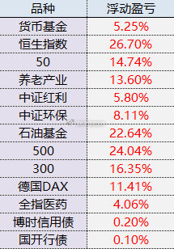

## 2017-03-16 14:20

乡亲们，逆回购，注意了。

如果是我，我会买7天的。 ​​​

## 2017-03-17 08:30

早上吃什么？

我的 ​​​
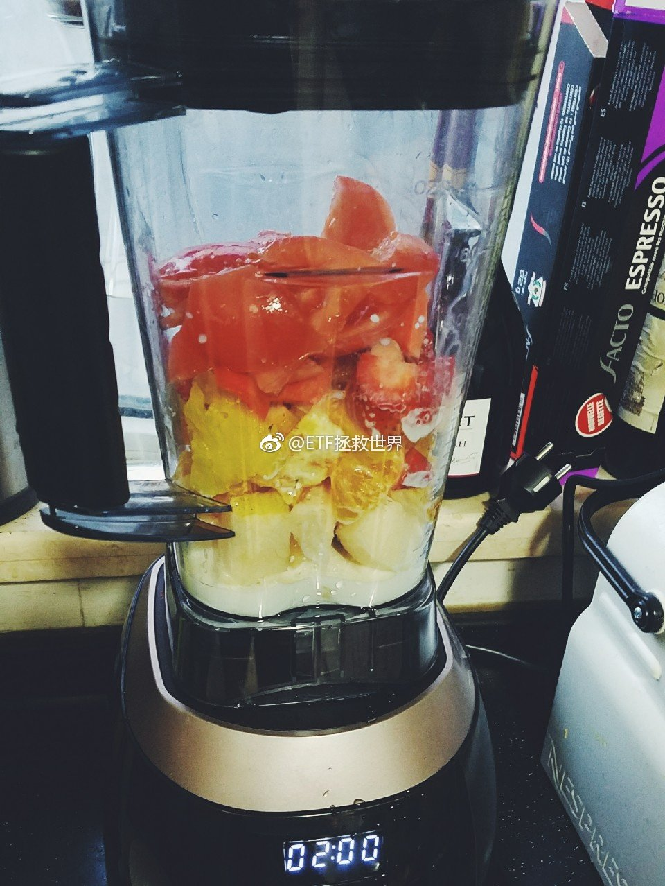

## 2017-03-17 10:32

就一个希望，拘留几天，然后记入诚信档案，不能贷款，求学求职的时候用人单位都能知道。既然约束不了自己，就让社会帮你约束。

## 2017-03-17 11:18

尽量让你的组合，投资账户，拥有反脆弱性。

也就是说，下跌、大跌、暴跌，你的账户也会受伤，但是就像打不死的小强一样，从下跌中居然能够获得成长，力量能够增强，当市场回到下跌前位置的时候，你的帐户奇迹般的比当初多了很多钱和很多筹码。

每一次下跌都是如此。受伤——成长——更加强大。

不要怕受伤。不是要想办法不挨打，而是要想办法不会一击即溃，一打就死。有些账户和组合，基本上一个两个三个暴跌后，这辈子恐怕都没法翻身了。

打不死，然后变得更强。别人哭的时候你在高兴的买，别人好不容易回本的时候你已经赚了很多。长期做到这样，就是极好的。

## 2017-03-17 11:33

今天逆回购14天、28天已经到了4以上，还是不错的。 ​​​

## 2017-03-17 13:42

回复@江南锄大地咯:7、14天过5了。朋友们。 //@江南锄大地咯:卖早了😂😂😂现在继续飙升

> @ETF拯救世界
> 今天逆回购14天、28天已经到了4以上，还是不错的。 ​​​

## 2017-03-17 14:15

回复@小狗上马路:图还没上，急什么…… //@小狗上马路:E哥发了个帖子让均值回归，立马跌了...............

## 2017-03-17 14:18

一定要重视利率水平对各个投资品种的重要性。这个重要性怎么强调都不为过。

资金是聪明的，一定会从低收益率流向高收益率。

当然，这也是个累积的过程。不能说一两次实质性加息就会马上影响什么。但这就像吃包子，前六个吃完没感觉，第七个吃完撑了。你不能说前六个没用。

量变到质变。 ​​​

## 2017-03-17 14:50

震惊，GJD竟然没有出手。 ​​​

## 2017-03-18 10:44

妻子:感谢ZF

## 2017-03-18 13:10

……“在一旁大哭的女孩拿起 女司机 的手机，给妈妈打电话，电话里女孩妈妈听说女儿剐蹭的是奔驰车后，一直不愿露面，直到交警过来与她通话，她才同意赶来处理。”

## 2017-03-19 22:12

交易中如何才能不再患得患失？能力、自信和舒服。我回答了 @辣根王子 的问题，问题价值￥79.00，大家快来花1元围观~  ​​​

## 2017-03-20 10:24

$159920 恒生ETF

继续新高。

估值依然处在模糊区域。所以坚定持有。 ​​​

## 2017-03-20 11:15

$513030 德国DAX

新高。模糊区域，继续持有。 ​​​

## 2017-03-20 13:36

判断题：今天GJD会不会出手。（20分） ​​​

## 2017-03-20 17:48

恒生第一大权重股。讲真，买恒生很大原因就是有腾讯这样的企业在里面。

## 2017-03-20 19:43

> @买买提X
> 水木清华的谣言？ ​​​
> 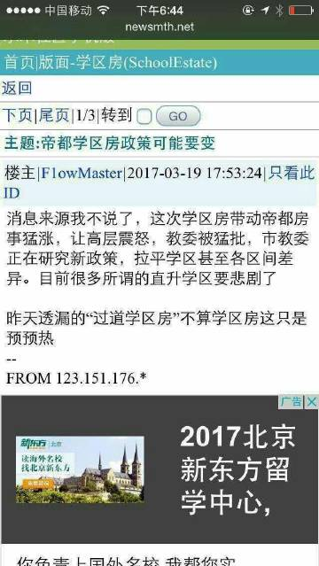

## 2017-03-21 07:43

继续新高。

不跌我就每天不停新高。跌了我们就买，下次涨得更高。

说白了就是这么回事。

已买入部分年化19%。 ​​​
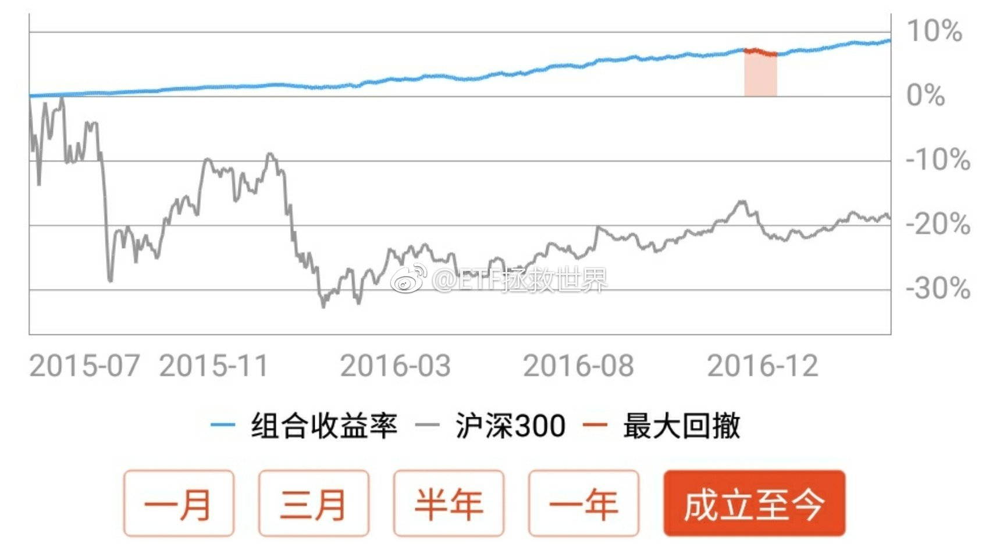

## 2017-03-21 08:02

回复@奥斯特洛夫大柴夫斯基:当然是没错，但是2015年6月这么想的话现在还在坑里。仓位是概率判断的反映。获胜概率大的时候仓位会迅速增加的，时候未到而已。投资这件事我从来不急，买卖都是如此，所以赚了点钱。你急不急？//@奥斯特洛夫大柴夫斯基:赚钱还是要靠重仓呀

## 2017-03-21 09:31

今天只要央行不出手，逆回购或者其它现金管理工具都有的搞。

朋友们，撸起来了。 ​​​

## 2017-03-21 13:29

我在思考一个问题：

到底每次群众是如何在各个市场被忽悠瘸了套在山顶或者半山腰站岗的？

我想，可能是群众普遍有一种，“如果现在不买，也许一辈子也没希望在这里发财了”，或者“别人都赚了很多钱，我再不买就来不及了”，这种思维吧。

羊群、旅鼠、从众。也许都是深深的焦虑感所造成的。

焦虑，看起来无处不在。

## 2017-03-21 14:07

因为这个地带是我所谓的“模糊地带”，也就是没有到一眼看胖瘦的地方，所以涨跌都真的非常非常非常正常。

不用天天涨了就怕踏空跌了就怕套牢。不是这个路子。

这样，出道题问问自己：涨300点，到3600点会不会难受。难受？加仓到不难受。跌300点，到3000点会不会难受。还难受？减仓到不难受。

就这么简单。

呐，做人呢，最重要是开心。你肚子饿不饿，我煮碗面给你吃？

## 2017-03-21 14:12

回复@2011DALIN:有。相当焦虑。两个层次，一个是不知道怎么炒的时候。买了跌，卖了涨。觉得自己的帐户被庄家监控了，很焦虑。第二个是大概知道怎么做了，但钱比较少的时候。震荡市，没机会。或者始终比较贵。觉得日子一天天过去，在股市赚大钱的梦越来越远。焦虑。  回头看，都是笑谈了。

## 2017-03-21 14:52

周线收盘价来看，$159920 恒生ETF历史新高了。 ​​​

## 2017-03-21 15:54

热腾腾的加权估值新鲜出炉。

今天收盘后的数据，是2015年12月第三轮熔断前以来，按月计算加权估值最高的时候。

大概是36.x。我个人不太相信会升到40以上，那将是另一次灾难的开始。不过，怎么说呢，金融市场的事谁说的准。真到了40以上，等着看热闹就对了。 ​​​
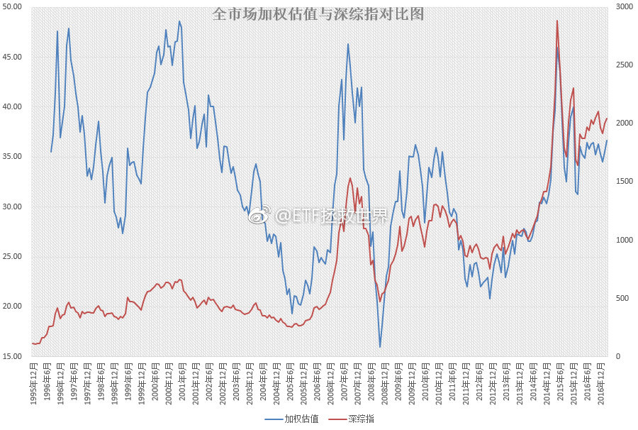

## 2017-03-22 01:00

影响力已经这么大了？ 
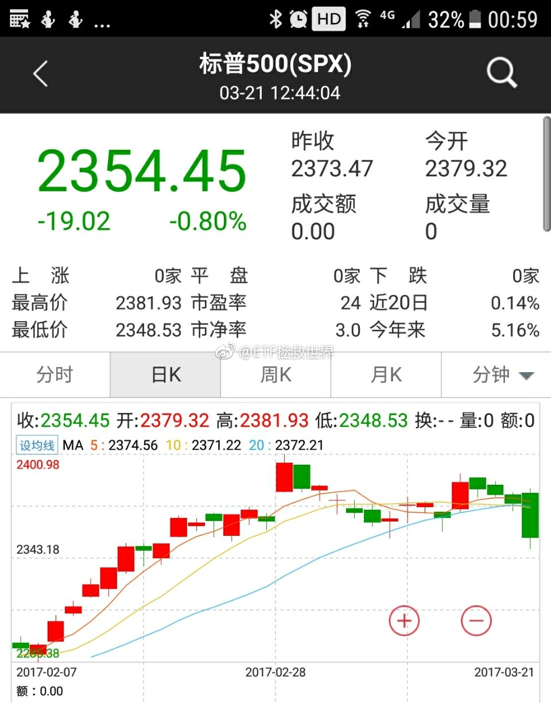

## 2017-03-22 01:16

准备加一点 ​​​
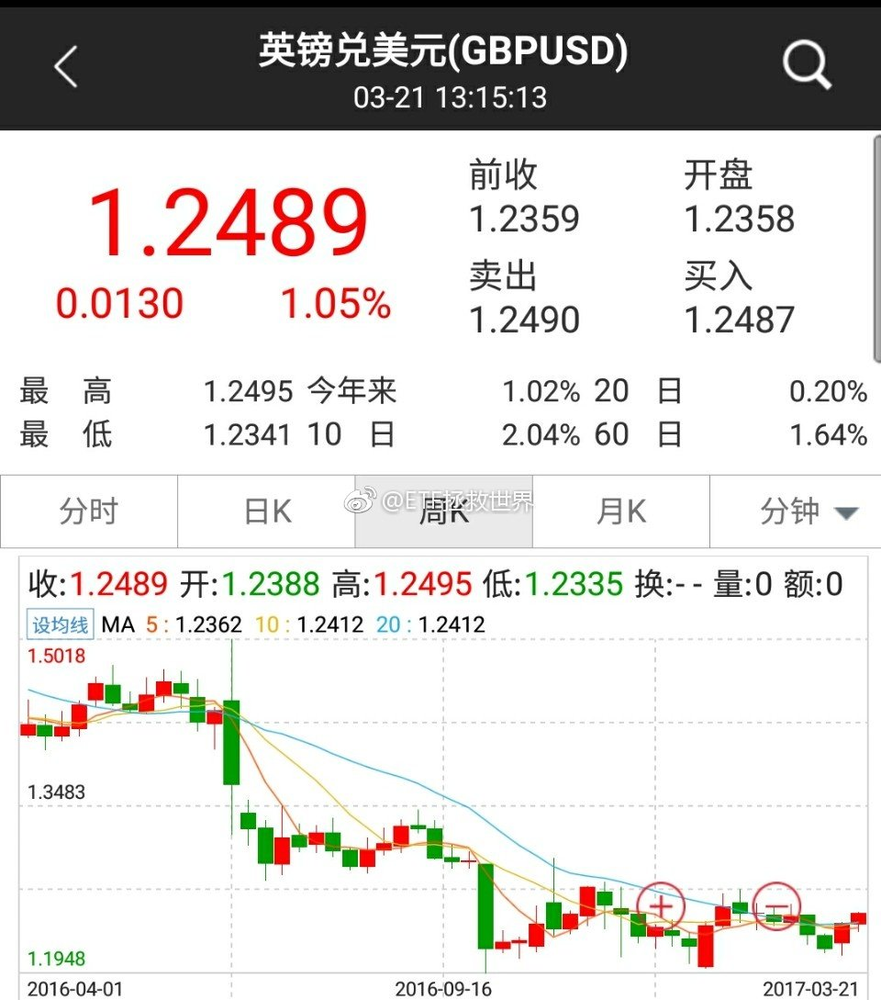

## 2017-03-22 09:32

近期不少人从股灾的坑里爬出来或者爬出来半个身子，突然觉得自己能力是有的，之前资产大幅缩水是偶然的，以前的路子要坚持。

其实，如果没有一万多亿在里面每天帮忙护盘，没有某妈面多了加水水多了还加水帮大家灌水，很多人早就爆仓二十次了。

不过该发生的迟早会发生。

人各有命。 ​​​

## 2017-03-22 09:56

$全指医药 sh000991$ 

 ​​​​ 
关键是不要去追热门，尤其是已经涨了很多，别人赚了很多的热门。而是要买别人不注意的，有利空的东西。然后踏踏实实拿着，等着它变成热门，让别人来追。 ​​​

## 2017-03-22 10:02

一鱼四吃。最近四年在恒生ETF的操作。

其中B是买点，S是卖点。有计划，有网格，有波段，还有长线持仓。每次B S金额都不同。

但基本上买卖点就是这样了。一个品种，吃了四波。赚了不少。 ​​​
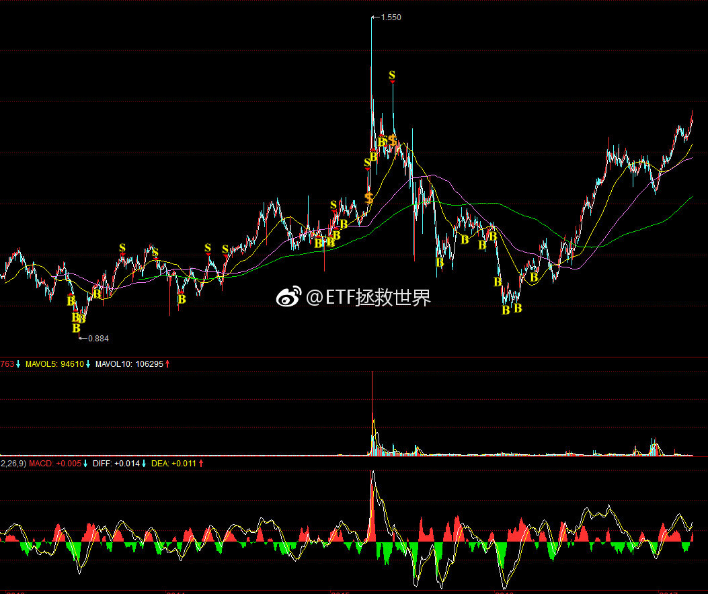

## 2017-03-22 10:27

今天是GJD和估值图的对决吧……

## 2017-03-22 11:07

昨天觉得自己持仓太少，今天觉得自己持仓太多的朋友，举起你的手，让我看到你！ ​​​

## 2017-03-22 14:20

其实我更好奇的是，某队到底在市场中在干什么。当初是说为了防止出现危机，一万多亿砸下去。到现在两年过去，依然不断翻云覆雨。从昨天的图上可以看出，这样长期持续的高估状态几乎从未出现过。未来绝大多数投资者面对的必然是长期收益率很低。简单，粗暴，用钱把任何波动抹平，真心佩服。

## 2017-03-22 16:01

我们已经到了要逐渐缩减资产负债表的时期。

## 2017-03-23 09:48

$全指医药 sh000991$  再回一万点。

2005年1000点起步，05-15年十年最高涨幅高达20倍。中间如果做一些高抛低吸大区间波段则收益更高。指数投资赚的少？如果你永远盯着上证指数，那是没错的。但我们不买上证，只买这样不输给任何明星股的好指数。

现在买的不多，不用着急。再好的指数买高了也不会赚大钱。

还是这个指数，2010年你7000多点买，到现在7年过去了，也只涨了37%。东西好不好很重要，比如医药和上证的区别。买的价格如何同样重要。如果你能接受每年比不上债券的收益率，市场上大把的东西随便你买。但是如果你想要赚得多一些，那就不要急。

心急吃不了热豆腐，还有可能把嘴烫了，甚至患上食道癌。那就悲剧了，对吧。

## 2017-03-23 12:09

NO。都应该投入到加杠杆中去。 //@五花王:结余储蓄和结余现金流每一分都是罪恶的，都应该投入建设事业中去

## 2017-03-23 13:15

$Ｂ股指数 sh000003$    嗯哼。 ​​​

## 2017-03-23 13:24

其实很多人没有意识到，一些市场是处在极其脆弱的、微妙的平衡中。

我们每天接触到的信息很多。大部分，甚至绝大部分是垃圾信息。

筛选有用信息，然后透过它们思考背后的真相，是每个人想要赚钱的投资者需要具备的能力。 ​​​

## 2017-03-23 13:39

今天要第二次对决了。 //@ETF拯救世界:今天是GJD和估值图的对决吧……

## 2017-03-23 14:34

有钱的是大爷，确认了！ //@ETF拯救世界:今天要第二次对决了。 //@ETF拯救世界:今天是GJD和估值图的对决吧……

## 2017-03-24 07:33

洪sir:上游大宗商品库存周期是绝对的领先指标

## 2017-03-24 09:09

有没有人想起2015年6月初现场督察券商查配资去杠杆 //@蓝鲸财经记者工作平台:【鲸滚动】央行称，离婚一年以内房贷申请人，商贷和公积金贷款均按二套房信贷政策执行；商业银行应加强消费贷及其他无抵押信用贷款管理，严禁以消费贷、个人经营性贷款等名义贷出资金用于支付购房首付。

> @蓝鲸新闻
> 【鲸要闻】24日，央行出台关于加强北京地区住房信贷业务风险管理通知，对离婚一年内的贷款人实施差别化住房信贷政策，从严防控信贷风险。 ​​​

## 2017-03-24 10:39

$中证红利 sz399922$   新高。 

$510050 就比较低迷。

前几个月50换红利是正确的选择。 ​​​

## 2017-03-24 11:09

讲真，我自己感觉这回答值1块钱。我回答了 @晴儿小小 的问题，问题价值￥79.00，大家快来花1元围观~  ​​​

## 2017-03-24 11:23

继续捐，都是各位的福报。 ​​​
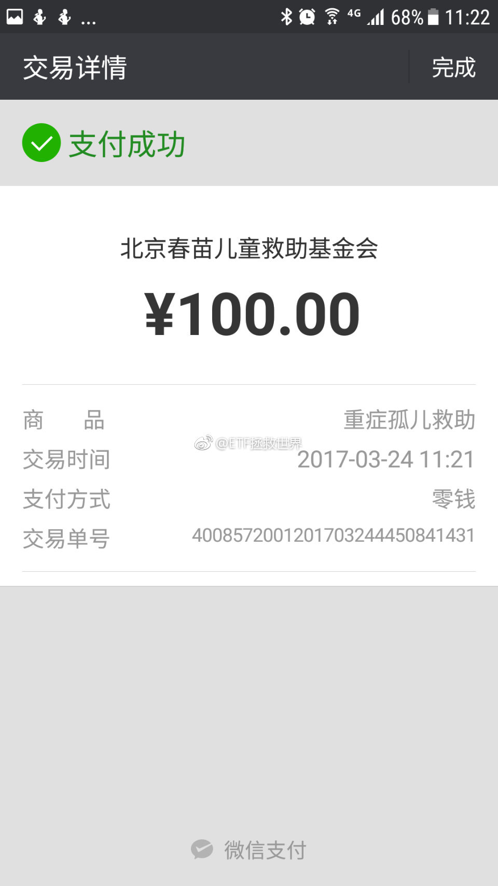

## 2017-03-24 11:36

说几个弹性大的品种，未来熊到姥姥家的时候我们会买，现在NO

1、券商

2、医疗

3、军工

 ​​​

## 2017-03-24 14:57

怎么回事，难道债券也买在最低了 ​​​
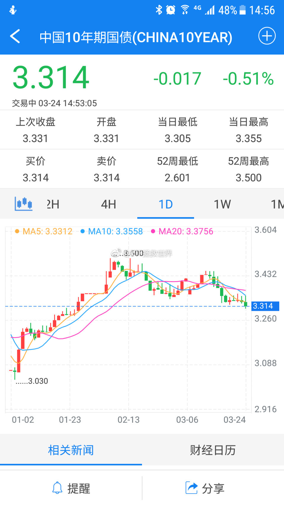

## 2017-03-24 15:34

月末打算买个估计要赔钱的大杀器。买什么什么涨随时受不了。 ​​​
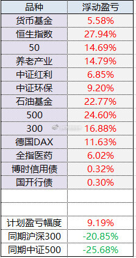

## 2017-03-26 09:14

有意思的问题，我的一些观点。我回答了 @manmanzhu2003 的问题，问题价值￥79.00，大家快来花1元围观~  ​​​

## 2017-03-27 09:56

随便买几只打新股票走成这样是闹哪样。

如果不是自己的规矩是不讨论个股，倒是可以和大家聊聊门票的选择…… ​​​
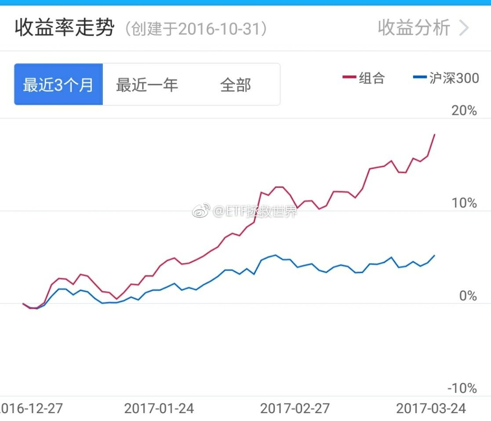

## 2017-03-27 10:53

雪球上那个不择时季调组合，今天买的标普500并非新买入，而是之前溢价过高卖出后重新配置。

这个组合通常情况下是三个季度调整一次，但是个别时候个别品种溢价折价过高会做个波段。比如这次，有十几个点获利空间，为何不做呢。做完了继续踏踏实实持有。

害怕有人认为是新开仓跟着买，特此告知。 ​​​
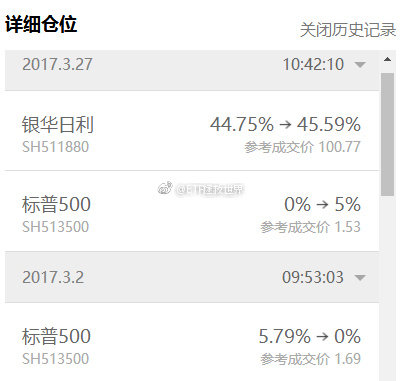

## 2017-03-27 13:48

债券继续涨。 ​​​
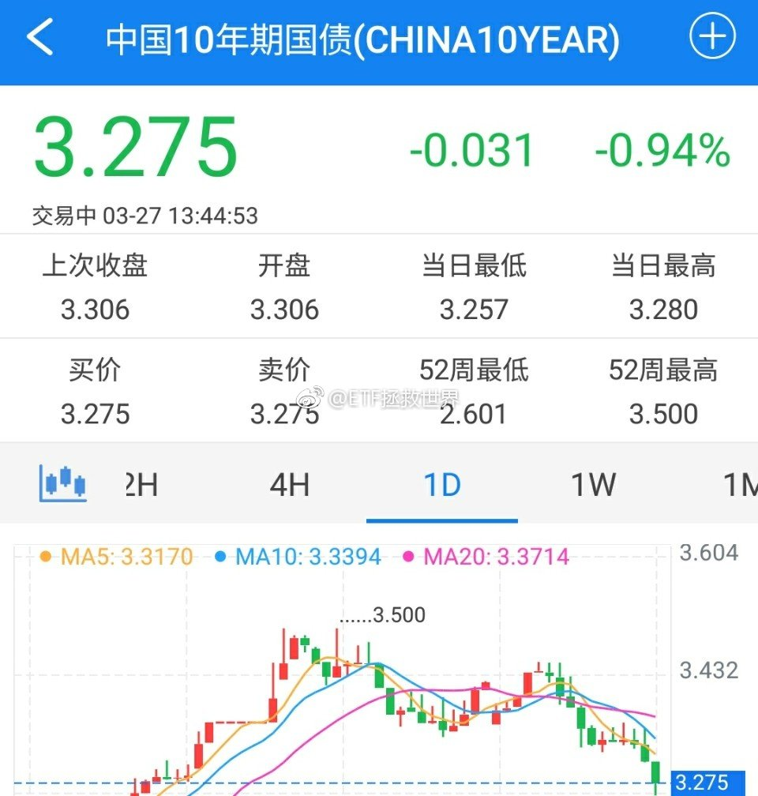

## 2017-03-27 14:21

讲真，我已经有点不相信市场这只无形的手了。

原来有形的手可以做到这样。

但要我放弃原则和信仰，

sorry，

那恐怕是不可能的事。

我又不是咸鱼。 ​​​

## 2017-03-27 14:46

截至今天，有762家公司披露2016年年报。

汇金公司是其中259家公司的十大股东之一；证金是其中92家公司的十大股东之一。

这还不包括各种资管计划持股。

这件事，弄到最后，不管是什么结局，出现什么问题，是不会有责任人的。 ​​​

## 2017-03-27 15:04

如果某天涨跌幅比较大，可能是伙食不太好。闹情绪了。

## 2017-03-28 10:10

7天逆回购过五。包含假期了。不错。 ​​​

## 2017-03-29 06:24

神奇了。这几天想买什么什么涨。

就剩两天了给个面子好吗。 ​​​

## 2017-03-29 09:46

​​​
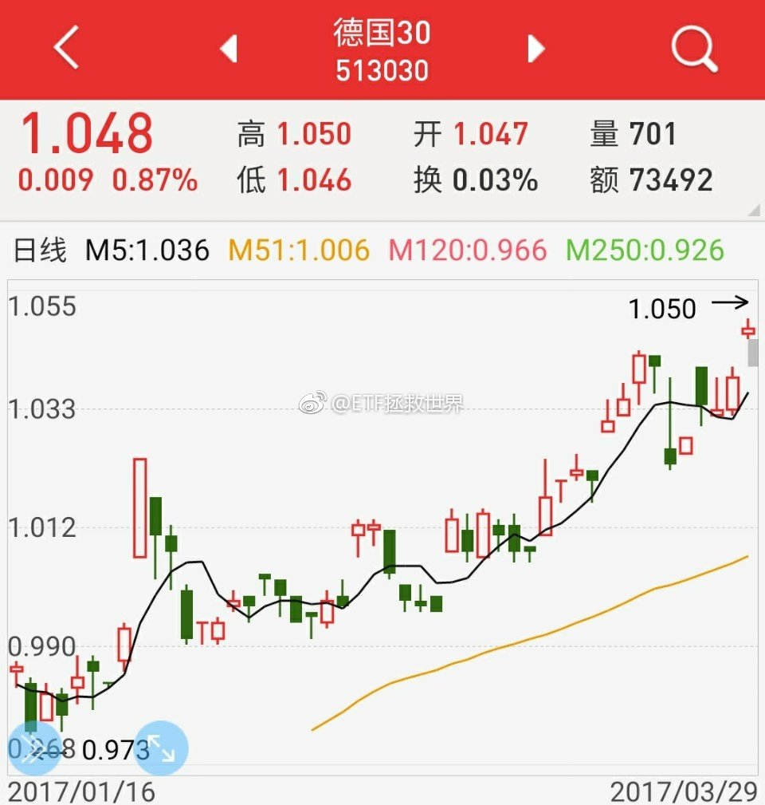

## 2017-03-29 10:00

回复@龙虎半天云:人生啊是否幸福，很大程度是你自己主观决定。  一份也好，两份也好，有没有赚钱？赚钱是不是好事？没有买它的资金，在其他地方有没有赚钱？  另一个，回到过去再来一次，以你当时的能力，你会不会做的更好？不管做了什么决定，自己当时就那个能力，要接受自己。如果有进步空间，好好努力，下次更好。

## 2017-03-29 10:24

人生在世，短短几十年。到底什么是幸福？

总是有一种感觉，就是很多人好像总是非常焦虑，永远对生活不够满意。

高中生也许觉得，上了大学人生就会幸福；大学生觉得，考上研究生会很幸福；研究生会觉得，找个好工作会幸福；找到好工作的人，会觉得找到喜欢的另一半才是幸福；有了满意的bf/gf，会想，在北京三环内买一套房就幸福了；有了房的人，发现自己没有几百万存款还是不幸福……

什么是幸福？对我那三岁的儿子来说，幸福就是我递给他的一块费列罗或者带他去游乐场；对重症监护室的人来说，幸福就是可以没有病痛的吃喝玩乐自由行走；对于大多数炒股的人，把本金还给他们就是最幸福的事……

永远不会仔细认真的想想，“我有什么”，而是不停的问自己“为什么我没有什么”的人，恐怕永远也不会高兴起来。

有些东西，我们买的少了，一路上涨，应该高兴吗？要我说，为什么不？

首先你没赔钱。第二你赚钱了。第三，你买的少，说明你当时就是那个水平。你知道吗，再回去1万次，你还是买的少。对于无法改变的现实，应该用什么心态去对待？

要我说，当然是高高兴兴的接受它。接受这个结果，接受自己，接受现实。

然后，就是努力努力再努力。努力的提高自己，争取下次少一些遗憾。

但是我告诉你，人生充满遗憾。没有人的人生是完美无瑕，你的投资也是这样。你我终将要接受不可能完美的自己。

一步一个脚印，一步一步向上走。看看自己的账户，资产是不是越来越多？如果是，我们有什么理由不高兴呢？

至于资产爆发性的飞跃，我入市已经14年了，也只发生过3次。虽然现在看起来还很远，但我毫不怀疑第四次就在那里等着我。在那之前，高高兴兴的享受生活吧。

因为幸福不是“只要达到某个目标我就会幸福”。相信我，达到那个目标，不幸福的人还是不会幸福。

幸福是一种思维方式，而不是别的什么。

## 2017-03-29 10:35

这个月1-3份。视这几天的情况而定。 ​​​

## 2017-03-29 10:45

鸡汤喝完了是不是该起床了  ​​​

## 2017-03-30 05:12

无话可说，就差两天。 ​​​
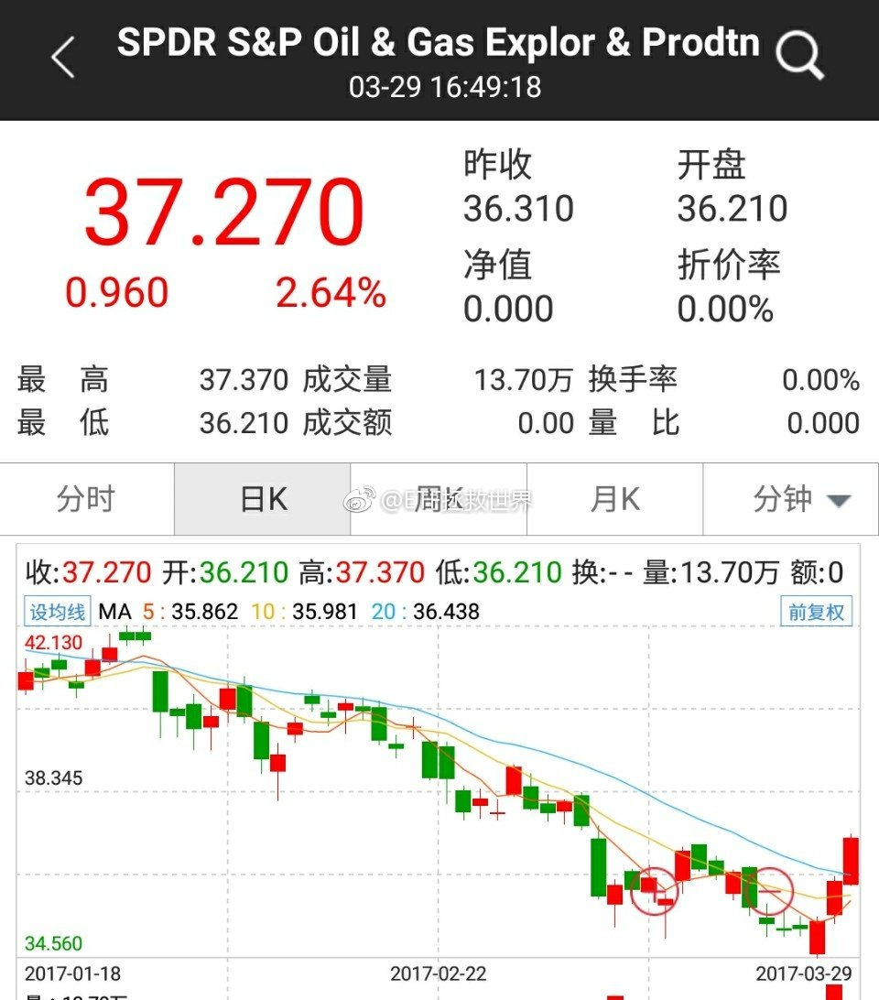

## 2017-03-30 07:20

防不胜防。安全第一。多买三者。//@佐罗_厚恩投资:触目惊心，一定要注意啊！

## 2017-03-30 09:42

现在这种情况，个人认为，对各位来说，最重要的，是不要有过多家庭负债。

一个想法，不一样对。 ​​​

## 2017-03-30 10:12

23的逆回购服不服。谁说现金是垃圾。 ​​​

## 2017-03-30 10:22

今晚开车，求放一马，今天别动手好吗！ ​​​

## 2017-03-30 11:22

做人有信仰总归是好事

> @ETF拯救世界
> 讲真，我已经有点不相信市场这只无形的手了。
> 
> 原来有形的手可以做到这样。
> 
> 但要我放弃原则和信仰，
> 
> sorry，
> 
> 那恐怕是不可能的事。
> 
> 我又不是咸鱼。 ​​​

## 2017-03-30 13:11

这么搞，这是要逼队里的同志发大招啊。 ​​​

## 2017-03-30 14:09

GC002 ，4月5日可用，目前年化6.15啊。 ​​​

## 2017-03-30 14:18

回复@mcz3ynf:你算算到期日，再算算资金能用的时候收益率是多少。假期到期，你的资金用不了，所以不能用现在的价格说话。各位理解没有？所有品种的真实收益率，都要折算到资金可以用的那天。 //@mcz3ynf:回复@ETF拯救世界:明明是9以上好吧

> @ETF拯救世界
> GC002 ，4月5日可用，目前年化6.15啊。

## 2017-03-30 14:24

注意这个时点：2002年。这个年份已经多次出现在我们总结的历史数据中了。那一年和现在相似之处越来越多。

信用债发行低位徘徊，偿债高峰却以悄然来临。Wind资讯统计数据显示，截至目前，今年以来信用债发行规模1.25万亿元，与去年一季度相比，大跌53.7%。受发行规模骤降拖累，今年以来信用债净融资为-214.37亿元，自2002年一季度以来首现单季告负。不仅如此，信用债市场未来6个月到期规模已逾2.8万亿，市场风险不减。

## 2017-03-30 15:05

确认了。

> @ETF拯救世界
> 这个月1-3份。视这几天的情况而定。 ​​​

## 2017-03-31 13:40

回复@侯小猪_Miss差不多:这个可以有。//@侯小猪_Miss差不多:昨天梦见e神了，和粉丝们一起生活，给我们做饭。其中一个粉丝感动的把自己媳妇都送给您了。//@ETF拯救世界:确认了。

## 2017-03-31 14:11

哈哈，超萌的神兽和黑天鹅。

啊，生活！ ​​​
 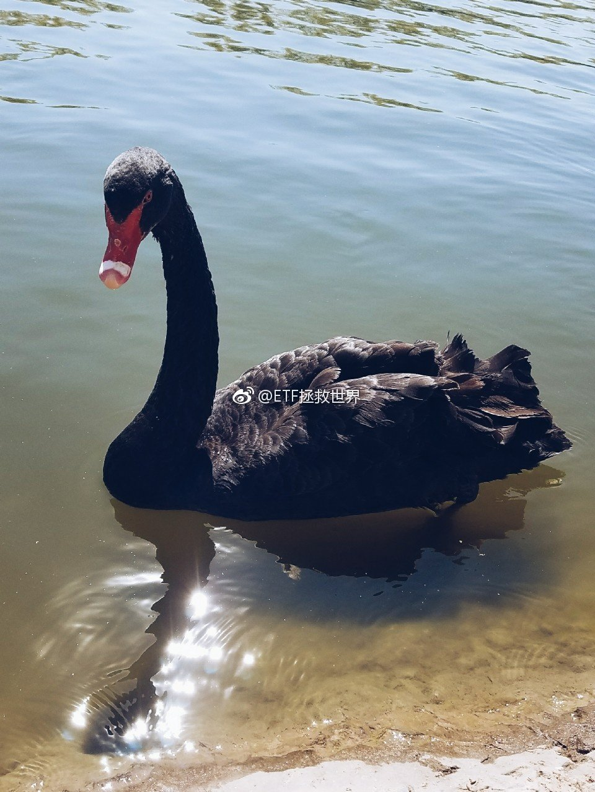

## 2017-03-31 15:43

打新门票彻底疯了 ​​​
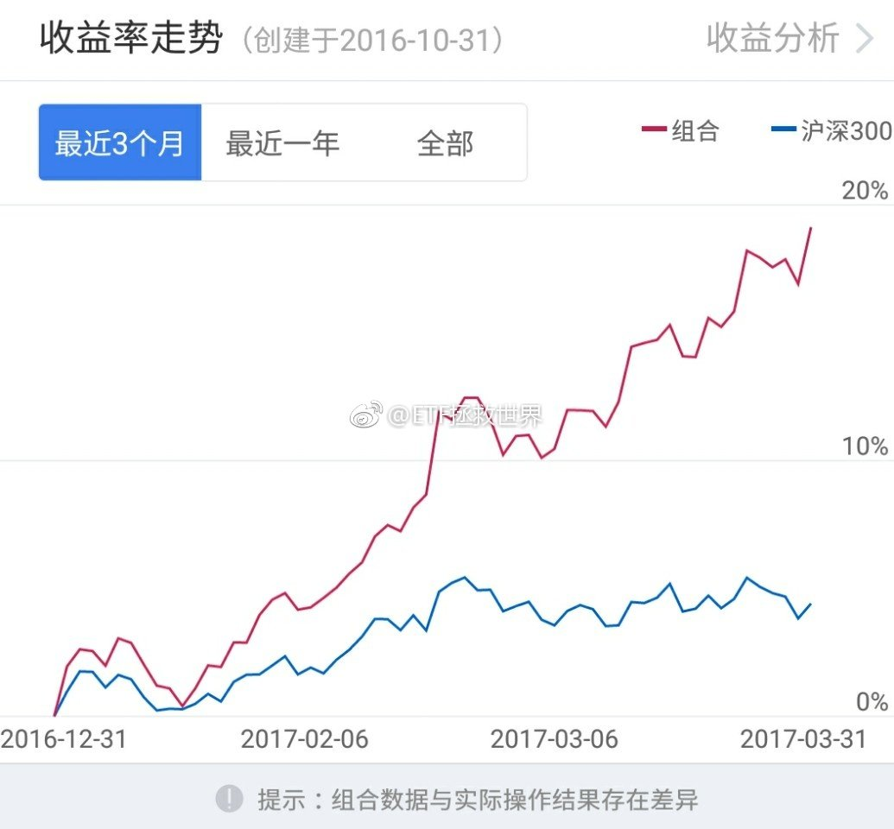

## 2017-03-31 16:11

根据去年三季报选出的打新门票是这些。等权买入。

今年根据一季报的门票持股调整会在四月底准时进行。希望不管中不中新股，门票能继续挣钱。

现在别追这些了啊…… ​​​
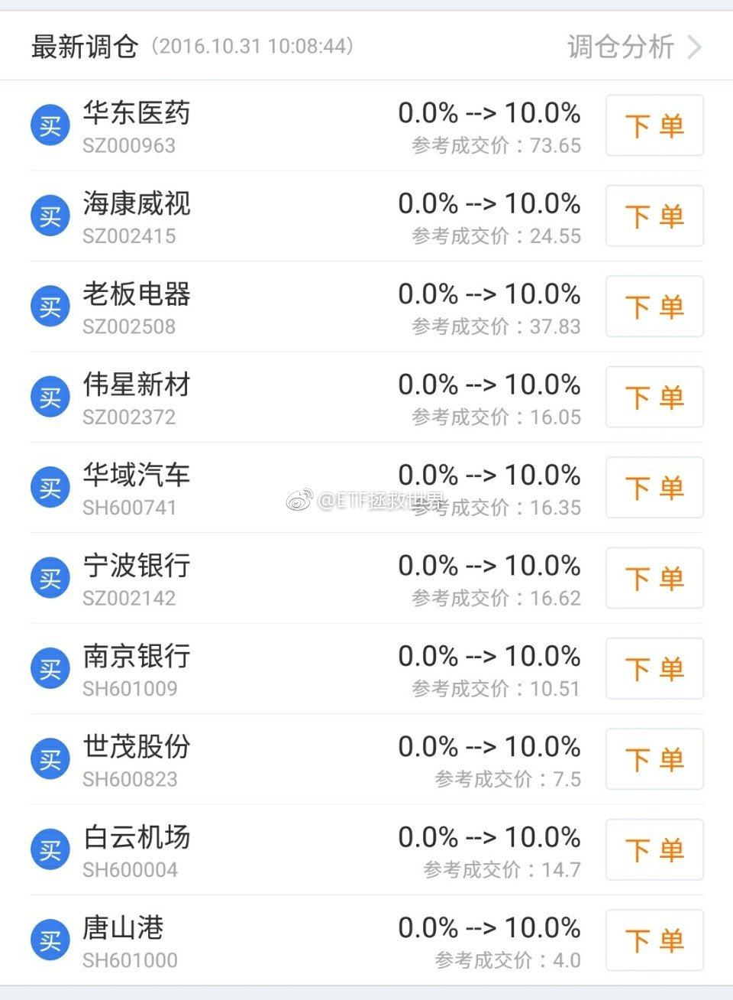

## 2017-03-31 16:46

醉了。三根鹤立鸡群的成交量都是计划发布第二天干出来的。

幸亏一部分朋友是去场外申购，否则不堪设想。

肩上的担子很重呀。 ​​​
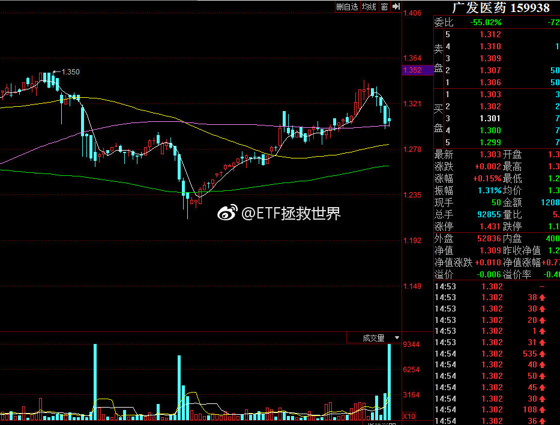

