## 2017-04-01 13:00

谁还没看过可以去看看。

网页链接 ​​​

## 2017-04-04 09:08

​​​

## 2017-04-05 10:23

什么意思。4月挖个坑让咱们计划上了车然后继续涨啊。 ​​​

## 2017-04-06 09:16

新高总是好的。 ​​​
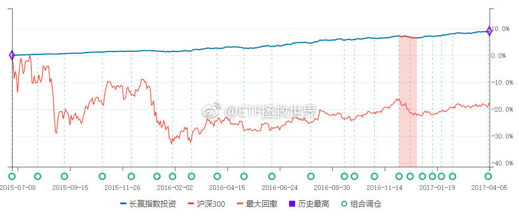 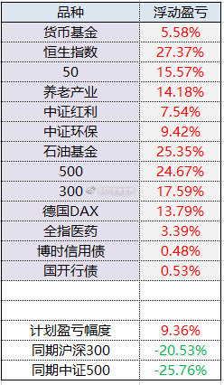

## 2017-04-07 08:40

s7最后一帖……一早上掉地上三次屏终于碎了。

真是有点舍不得。好看好用。各种顺手。

只好先用家里的mate9了。水果8什么时候出啊。 ​​​

## 2017-04-07 08:45

讲真真的很耐摔。摔了十几次终于... ​​​
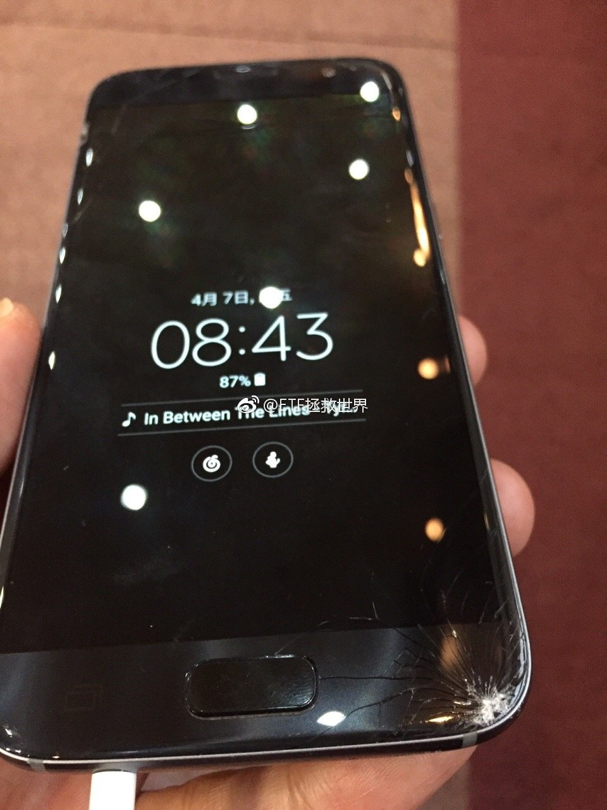 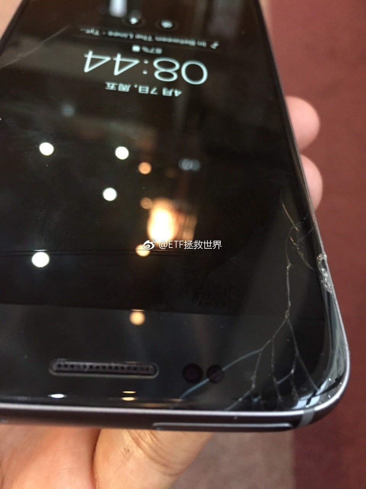

## 2017-04-07 10:09

3000（或者3100）到3300之间用ETF做网格应该是很靠谱的。

GJD信誉保证。跟着GJD有肉吃。 ​​​

## 2017-04-07 10:45

石油黄金已经有所反应了

## 2017-04-07 10:49

回复@用户5747769897:如果做油气网格的，在现价附近有卖出收网的可以先不卖。这种突发事件造成亚洲盘油价上涨，还没有体现在油气的净值中。现在油气的盘面也没有反应出来。所以可以再高一点再收网。//@用户5747769897:又想起了最近挂的0.599的未成交价格。

## 2017-04-07 11:06

打新门票 醉了 ​​​
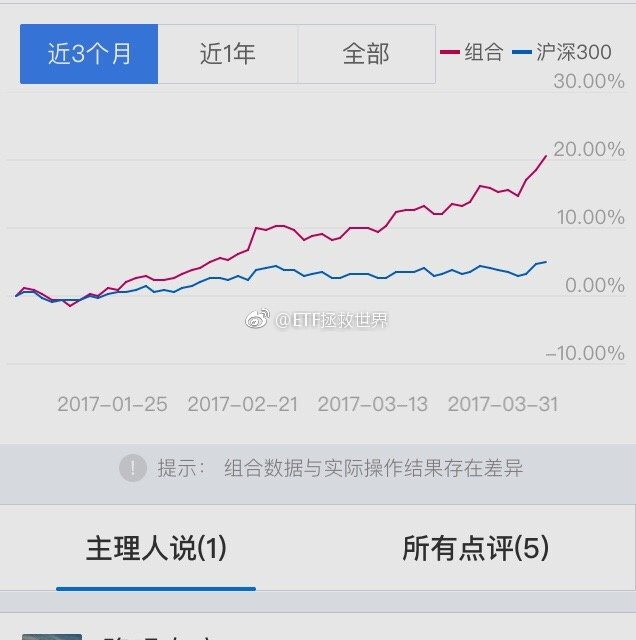

## 2017-04-07 13:32

$中证环保 sh000827$    妹想到 ​​​

## 2017-04-07 17:04

回复@hello_39900:找到适合你自己的路。你可以加大仓位，或者去定投。我的路适合我自己。经过十年三轮牛熊的实践，资产从没有大幅回撤，同时赚到了很多人一辈子也不可能赚到的钱。所以我没有理由改变，依然还会按照我自己的节奏去投资。我不会因为一时的涨跌怀疑自己，很多东西不是每个人都能看懂。

## 2017-04-08 06:13

知道北京多少年没有完成供地计划了吗。听其言观其行吧

## 2017-04-09 15:32

哈哈哈，偶然翻到熔断前一周的微博。谁能想到，zjh不光挨骂，大boss都被干掉了。当时你跑了没有？

## 2017-04-10 10:05

博时信用债又要分红了。望周知。

另外，分完了以后不要再有诸如“为什么我的软件上显示亏损和你的统计不一样”这样的疑问了。

心累。 ​​​

## 2017-04-10 10:24

吃炫迈了 ​​​
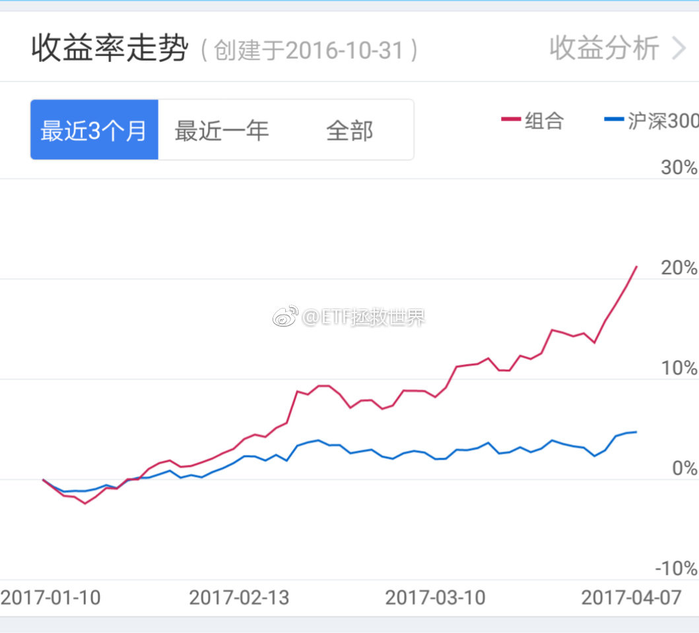

## 2017-04-10 14:27

10号了。 ​​​

## 2017-04-11 10:29

黑天鹅的意思是你想不到的风险。所有人都在说的风险其实不是黑天鹅。

黑天鹅也没那么多，很多年会出一只。但真的出来了就是疯狂屠杀。 ​​​

## 2017-04-11 10:43

十几年的经验来看，每次价值回归的路径都不同，没有一次重样的。

这次会用什么方式回归？

无论用什么方式回归，一定会回归。

没点信仰就别玩股票了。 ​​​

## 2017-04-11 13:28

个人认为3200以上GJD应该不会动手。否则几十个点的空间太小了。一个想法，不一定对。

## 2017-04-11 14:56

图做的好看。

> @ETF九哥
> logging,月初@ETF拯救世界 发了一车，加了广发医药发现excel代码存在问题。今天终于改好了，再发一图。有信仰，才能有未来。 ​​​
> 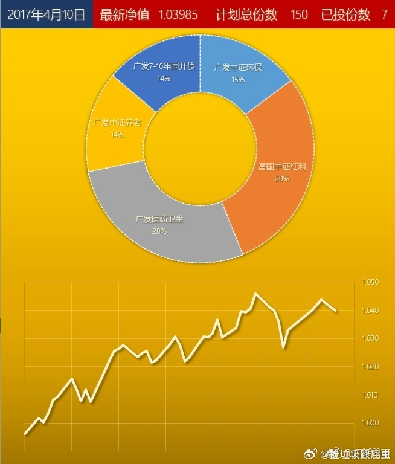

## 2017-04-11 18:36

丁义珍如果被赶下来，电视剧拍五集就够了。上了飞机坐下又被轰下来真是太坑了！

## 2017-04-12 12:26

回复@冰泉流夏:是。这就是所谓的“时间换空间”//@冰泉流夏:昨天看到一篇文章，去年财报出来中证500营收还是利润涨了20%，这样股价不变过两年是不是也可以回归正常估值[捂脸]不太懂这些…

## 2017-04-12 13:43

下午去面试招人，不看盘了。预测一下，收盘涨跌幅不超过0.5%。

欢迎打脸。 ​​​

## 2017-04-12 16:12

打新门票这样，中不中新股都无所谓了……

 ​​​
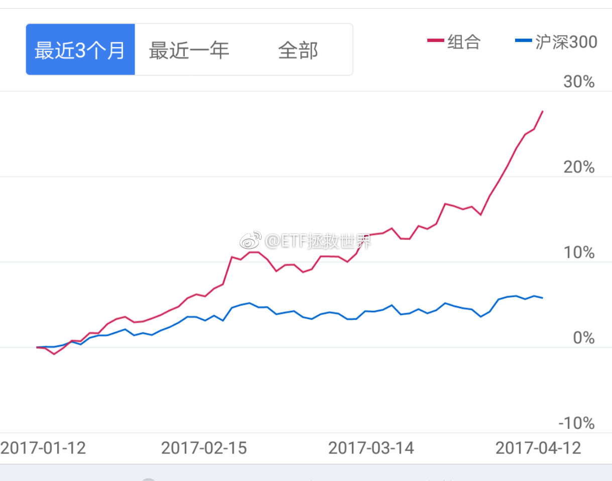

## 2017-04-12 16:18

面试8个人，5个从银行出来的。

银行怎么了！

 ​​​

## 2017-04-12 16:31

今天数据出来了。如果明天不大涨，明晚强行开车。

滴滴~~有搭顺风车的吗！ ​​​

## 2017-04-13 03:52

某机构出完货就特停，是不是太不地道了？还能怎么玩？

## 2017-04-13 10:33

截至今日，有1696家公司披露年报。

其中证金位列十大股东的有220只。汇金资管位列十大股东的有500只。

三季报这两个数字分别是468只和896只。

由于年报还有小一半没有披露，可以看出，GJD依然没有撤退，甚至辗转腾挪可能加仓了。 ​​​

## 2017-04-13 10:50

这会带来两个问题。第一，始终无法价值回归。看估值图就可以知道，2015年以来这样的，长时间全市场高估的情况几乎在历史上没有发生过。一万多亿资金在里面托盘的结果。第二，没法上涨。估值高不容易涨，另外大涨就会带来GJD的打压。所以股民很难赚钱。当然，选好股票可以。问题是，你选的出来吗。

## 2017-04-13 11:15

关于“选股票”的数据。

今年至今，沪深300上涨6%左右。上海上涨5%，深圳4%，创业板下跌2%。

同期，去掉新股，上涨股票1303只，占比44%。涨幅超过沪深300的股票780只，占比26%。

也就是说，随机买股票的话，有74%的机会跑不赢大盘。或者说，有74%炒股的人跑不赢大盘。

一将功成万骨枯。看着别人炒股赚很多（包括一季度上涨超过20%的某门票组合 [doge]），然而自己买了就是表现没那么好——这是大多数人的写照。

有时候，大盘涨了，其实和大多数炒股的人一毛钱关系都没有呢。

## 2017-04-14 09:37

今天你最想对GJD说的一句话是（       ）。（15分） ​​​

## 2017-04-14 10:29

最近骗子越来越多了。我再说一次，我100%不会私信各位谈什么个股。只要出现这种人马上举报！各位认清认证和粉丝数量~

## 2017-04-14 10:30

四月第二次计划，买入一份。差点又把微博的乡亲们忘了。

2017年4月ETF计划（2）：买入1份

朋友们，开始浏览本月ETF计划前，请仔细阅读以下几点：

1、本计划绝非任何形式的投资建议或是投资指导。

这里仅仅是将本人十年前开始，一些朋友五年前开始进行的一个投资指数的计划如实记录在这里。

如果这个计划能帮助您，我们会替您感到高兴，仅此而已。我们绝不会向您以各种形式收费、分成。如果您因为这个计划而亏损，我们也只能说一声很遗憾。也是仅此而已，我们不会承担任何责任。

2、请任何朋友开始参考这个计划前，要再三考虑自己是否能忍受甚至可能长达3-4年的熊市。

本计划虽然过去12年取得了超过10倍的盈利，但大家要知道，在12年中，真正让利润大幅增长的时间大概只有5-6年的三次大牛市。中国股市是个牛短熊长的市场。我们在超过7年的大熊市中慢慢买入，最终才取得了牛市利润的爆发。你一定要清楚，70%以上的人无法忍耐几年的熊市。所以，确认你自己能忍，再开始参考本计划。同时，未来会有多少收益我们并不知道。因为我们无法预计未来的市场会怎么走。

3、未投入的剩余资金可以去买任何你想买的投资品种。只要每个月初用的时候能到位即可。如果某个月会投入5份以上的资金，会提前3天到一周说明。

4、第三轮ETF计划的每篇推送，可以回复年月数字查看。从“1507”开始。也可以在公众号主页下方菜单选择“投资计划”栏目查看。

2017年4月第二次操作计划

买入养老产业一份（场外000968） （该品种预计最大跌幅35%）

到目前为止，还没有买入的往期计划

中证环保（001064） 一份 （对应中证环保指数000827不超过1580点、2016年6月计划）

德国30   （513030）一份   （价格不超过0.88、2016年8月计划）

50ETF     （510050）一份  （价格不超过2.117（分红调整价格）、2016年8月计划）

食品饮料  （160222）一份 （对应国证食品饮料399396不超过8000点、2016年10月计划）

180ETF   （510180）一份  （价格不超过2.84、2016年10月计划）

华宝油气（162411）一份（价格不超过0.61 2017年4月计划）

已买入份数

2010年开始的第二轮：

持有品种	持有份数
恒生	11.45
50	7
180	4.5
100	3.5
中证红利	3
全指医药	3
养老产业	2
中证环保	2
300	1
500	1
石油基金	1
7-10国开债	1
华宝油气	1
德国DAX	1
博时债券	1
黄金	0.75

备用金	105.8

2015年开始的第三轮

持有品种	持有份数
恒生	10
上证50	7
全指医药	3
中证红利	3
中证环保	2
养老产业	2
沪深300	1
中证500	1
石油基金	1
德国DAX	1
博时债券	1
7-10国开债	1

备用金	117

资产配置&收益率

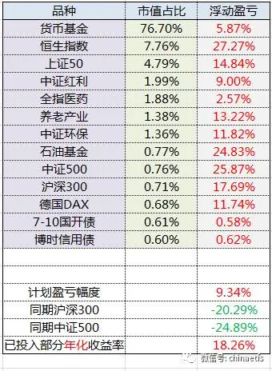
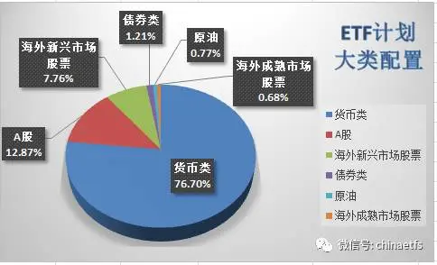

继续保持全部品种盈利，好烦。

已投入部分年化收益率上升至18.26%。

时间紧急，不多说了

月中开车，风高路滑，不打算说太多，简单聊五毛钱的。

本月博时债再次分红。分的不多，好歹是现金流。当然还是选现金分红。除非我特别发送修改分红方式的信息，否则都是默认现金分红。

现金分红和再投资有何区别？有人认为从长期复利来看应该是永远选再投资。我当然有不同看法。具体不展开讲，各位考虑一下，同一个指数，比如全指医药，在2012年4000多点估值30倍，与3年后2015年15000多点估值96倍的时候都进行分红，我们选择的分红方式是否应该有所不同？想明白了，就大概就能理解我的意思。不展开。

再有一个，请大家理解一件事。那就是我们买入的品种不是我们看好会短期拉升的品种。我们看的是3年、5年、10年甚至50年后它们能带给我们什么。

我们带着未来的视角，布局当下的棋子。所以我们买的品种，一定是目前表现不好的。目前不好，才有可能便宜，才有可能赚钱，赚大钱。不信，你现在去追个军工试试拿几年看是什么结果。

所谓的锄强扶弱。

我个人认为这是投资的“正道”——正所谓雪中送炭君子少，锦上添花小人多。

我们买了不受欢迎，没人要，相对便宜的品种，未来才有可能在别人不顾一切来追的时候高价卖给他们——比如这个月的中证环保。现在我们买医药、养老，这样一年两年都没有上涨的品种，到底意欲何为？

未来有一天你终将明白。就像你今天明白我们一年前为什么买环保一样。

最后跟大家预告一下，本月底下月初的车要晚几天开。因为老司机过几天要去欧洲开车了，5月初才回来。祝我自己一路平安，也祝各位投资顺利。

暂时先说这么多，想起来什么在微博说吧。

http://weibo.com/chinaetfs

## 2017-04-14 10:59

好问题才有好回答啊。我回答了 @用户oixkqdt7wt 的问题，问题价值￥88.00，大家快来花1元围观~  ​​​

## 2017-04-14 11:15

配置银行股打新的朋友已经在骂人了吧……

$民生银行 sh600016$ ​​​

## 2017-04-14 13:27

今天跌这么多，尾盘一定会动手了。sigh。有人做庄真的太难玩了。

## 2017-04-14 14:54

Wonderful songs《Asher Book - Here With You》 Asher Book - Here With You 

 ​​​

## 2017-04-14 15:39

今天估值出来了。感动一刚。 ​​​

## 2017-04-15 05:39

回复@大师别冲动:当时我买了15万上汽赚到75万算失败吗。当时博客全程直播。他说银行我就跟他说银行啊。//@大师别冲动:回复@ETF拯救世界:09年那种行情，一倍是失败的好吧

## 2017-04-17 08:54

幼儿园英语外教居然是印度人。

可以说是诈骗了吧。

 ​​​

## 2017-04-17 09:36

占小便宜吃大亏。

一条生活经验，不一定对。 ​​​

## 2017-04-17 09:43

一般早盘GJD不动手的原因……

收盘跌幅不会超过1%！赌一块钱。 ​​​
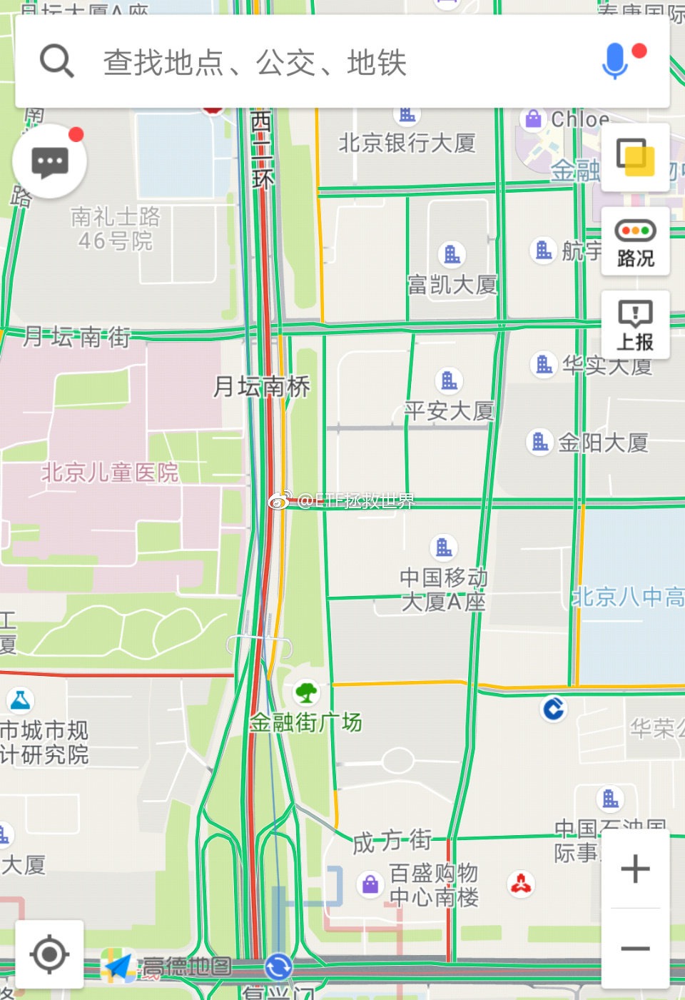

## 2017-04-17 09:50

各位，这里有个观点：

全市场不敢说，现在一万多亿GJD在里面拼命护盘，所以我不敢说。

但是某些板块如果有机会下跌20%-30%以上，那么我们未来十年在A股较好的收益率就可以保证了。（如果用时间杀空间，也不用20%以上，但时间要好几年）

下跌永远是机会。所有人都知道这点，但为什么只有少数人能抓住下跌的机会？

很简单。

那些抓不住下跌机会的人，要不然就是底部害怕了，要不然就是底部没钱了。

所以抓住底部机会的人，能力、勇气、视野，缺一不可。

在所有炒股的人里面，这样的人可以说是极少数。

## 2017-04-17 10:00

$养老产业 sz399812$   红了，什么鬼 ​​​

## 2017-04-17 10:52

问自己一个问题，测试一下自己的投资心理成熟度：

如果现在到月底，月中买的养老产业下跌5%，你会不会觉得自己月中高高兴兴买入该指数是一个sb行为，很后悔。

同样到月底，养老指数上涨5%，你会不会觉得自己买太少了是sb行为，很后悔。

每个人都问问自己，看看自己是否成熟。 ​​​

## 2017-04-17 11:31

今天计划跌幅应该不超过0.2%。而两市指数跌幅在1.x%以上。

个股不用说了，接近100只跌停，400多只跌幅在5%以上，一半跌幅超过2%。

指数投资与风险控制的意义，可能很多朋友要5-10年以后才能真的理解。 ​​​

## 2017-04-17 11:36

哈哈，我打算试试。薅某队羊毛。

## 2017-04-17 13:20

小股票这周如果起不来，基本趋势就完全歇菜了。

如果这样，等了两年，小股票的坑，我们准备开始慢慢填了。

 ​​​

## 2017-04-17 13:47

回复@最累的时候已过去:你看看中证1000。$中证1000 sh000852$  可以这么说，24个月以来，玩小股票的80%以上的人都埋在坑里一直没爬出来。//@最累的时候已过去:中小创的坑才刚开挖，还没埋进去多少人，不急着填

## 2017-04-17 14:05

转需//@硬核黄桃:it出轨是大保健么。。//@泼墨C: 羡慕全职妈妈的生活！//@京鲁蔡: 金融狗为码农背锅多年，终于得以翻身了

## 2017-04-17 14:21

为什么很多人投资总是会有一种深深的“焦虑感”？永远怕“踏空”，害怕被资本市场财富的快车抛下。

很大原因，是因为在社交媒体上，看到太多“成功”的案例。似乎所有人，除了自己，都在赚钱，赚大钱。

其实事实未必如此。

一个原因是，大多数，或者绝大多数人会选出自己赚的比较多的品种拿出来说。赔钱的那部分不会说。

第二个原因，是说话的人大多数都是赚钱的，更多的赔钱的人不说话。

这样，就造成了一种虚假繁荣和一种压迫力，使得每个人都觉得，“别人都在大赚，我不赶紧多买点就完蛋了”。

在雪球我有几个组合，收益率和排名百分位是这样的：

收益率1.0066%的组合战胜了65%的人。也就是说，65%的人2014年至今是赔钱的。

2.33%的组合战胜了70%的人。也就是说，70%的人炒股不如去买余额宝。

7.45%的组合战胜了75%的人。也就是说，75%的人辛辛苦苦最后和买余额宝差不多。

10.88%的组合战胜了80%的人。这些人辛辛苦苦3年，终于战胜了余额宝。

24.42%和50.13%的组合战胜了95%的人。也就是说，真正赚大钱的人，有5%。

相信各位如果有交易软件提供排名数据，也应该差不多。

（注意，我所有的组合建立时间都是在2015年6月股灾开始之后。）

焦虑什么呢？这个市场上，75%的人连余额宝都战胜不了，你真有那么害怕踏空？

## 2017-04-17 15:01

完成任务，收工。有钱，任性。

## 2017-04-17 15:45

今天的估值相当给力。这样跌几天，弄不好要加车啊。 ​​​

## 2017-04-17 16:39

回复@义无反顾:会。一个平衡的自然环境中，突然出现了一个庞然大物，生态改变了。空间、时间发生了不同以往的紊乱。那么想要在新环境下生存下去，就要想办法适应环境。不断调整、不断适应，才能活得长久。当然，基本原则不会放弃，否则就没有了生存的基础。

> @东风夜放花千树2:问一下，在你加车决策中，或多或少会受到“一万多亿GJD在里面拼命护盘”这个统计结果的影响吗？

## 2017-04-18 08:26

昨天计划净值下跌0.02%，20%多仓位……风控的意义。

## 2017-04-18 10:00

$兴业银行 sh601166$   $民生银行 sh600016$   又堵车了？每天这么玩有意思没有啊。

## 2017-04-18 10:49

月中买的 $养老产业 sz399812$  又开始赚钱了…… ​​​

## 2017-04-18 12:01

可能要停牌了

## 2017-04-18 13:37

刚有个朋友跟我说，房子卖早了，少赚了一波，求安慰。又问我，如果是我，会不会懊恼？

我想了想，感觉自己应该会觉得有点可惜，少赚了一些钱。但不会懊恼。

就像股票一样。高的地方没有卖，低的地方没有买。很多曾经“关注”过的股票，品种，没买，然后火箭一样上涨。会不会懊恼？

并不会。

因为那就是自己的水平。人生中任何的决定，都是自己各种能力和水平的体现。没有必要懊恼自己水平太低，那就是你，要接受他。

然后，当然是总结到底为什么会做错，下次如果有类似的事情，怎么才能做得更好。

每一件事，每一个人，都让咱们学到很多。日积月累，能力、水平，也就上去了。

投资也好，其它事情也好，无非都是如此。

我喜欢金融投资的一个原因，是因为它的机会真的太多了。几乎每天都有各种各样的机会出现。你错过了一个，两个，十个，一百个小机会，毫无问题。大牛市你错过一个，两个，也没事。我一向认为我们这一生，至少应该能经历4-5次牛市。抓住一两次，也就改变命运了。

没人能抓住每个机会。其实有些所谓的“机会”，你抓不住，丝毫不影响你的收益，你的人生。

另外一个，关于金钱。我隐隐的有一种想法，并不确实。我认为每个人都应该是有个关于财富的极限，每人不同。

有时候拥有的金钱，可能并非越多越好。某些情况下，钱太多，是麻烦。

总而言之，尽人力，听天命。接受不完美的自己，不完美的投资，不完美的人生。无论成功还是失败，那就是自己的水平。想要以后少一些后悔，就想想怎么做得更好吧。

每一个失败，都是人生的礼物。

## 2017-04-18 14:06

竞猜：两点半，他来不来。他的爱，还在不在？//@ETF拯救世界:$兴业银行 sh601166$   $民生银行 sh600016$   又堵车了？每天这么玩有意思没有啊。

## 2017-04-18 14:33

如果有个平行宇宙，在那个宇宙中，参考计划的朋友自己炒股。

那你现在看到那边的自己，可能会很有意思。可能赚更多，也可能悲剧了。

所以我鼓励朋友们可以参考计划的同时自己炒股。挖掘自己的天分。不要束缚自己。 ​​​

## 2017-04-18 16:36

今天数据出来了。想加车，怎么办，谁来劝劝我。 ​​​

## 2017-04-19 08:49

回复@Leo老雷:也不能说绝大多数吧。大多数走不到最后是肯定的。不是主观不想走到最后，而是走的过程中不断产生“怀疑”。比如仓位不高的时候突然大涨，比如后期仓位很重的时候依然不断跌。大多数人幻想的一路轻仓最后超级大底一把梭哈满仓然后就是赚大钱的事情大概率不会发生。成功的投资注定是反人性

> @Leo老雷:看粉丝的这个人声鼎沸、群情激昂的情况，梭哈的时候还早。E兄说了绝大多数人坚持不到最后的。

## 2017-04-19 09:18

没脸见人，好几天没新高了。

人生没有希望了一刚。 ​​​
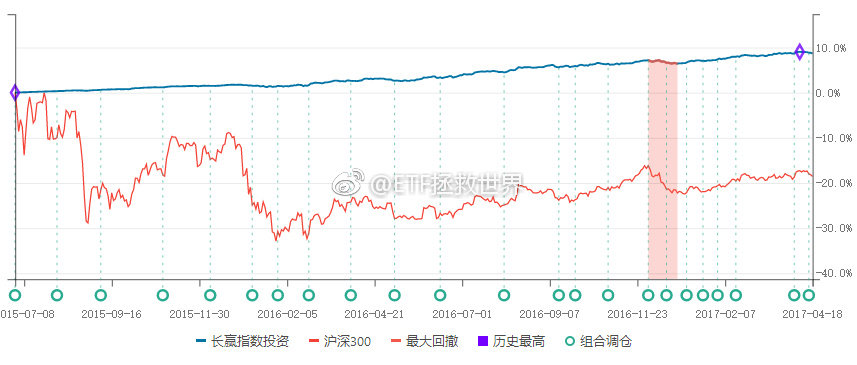

## 2017-04-19 09:32

竞猜，几点上班。时间最接近的赢。有大礼包。 ​​​

## 2017-04-19 09:41

$162411  油气4月计划别忘了。 ​​​

## 2017-04-19 09:48

回头再看发帖时间，对照K线。尤其是中小、创业、1000的k线。2015年以来的估值图神迹在继续……

## 2017-04-19 09:54

回复@用户5178306551:我发这条微博之前只有3万手……//@用户5178306551:21W手怎么买

## 2017-04-19 10:15

我想大概谈谈对市场的一些看法。

最近这段时间，中小创跌幅巨大，大多数，70-80%的股票不断下跌。而一些明星股则不断上涨，这是价值回归么。

我不这么看。

这是熊市某个阶段的一个特征。客观因素是资金少，只能在局部制造热点，公募也好私募也好，大家抱团取暖做几个品种而已。

对，有些股票确实是好股票。但再有价值的股票一个月涨30%，半年涨50%之后，也没那么好了。就像前几年小股票涨，有人会找理由说成长性高一样，现在价值股涨，有人又会说价值回归。

只是找一个炒作由头而已。

各位可以跟着炒，但心里一定要清楚是怎么回事。

当然了，我说的是中短期。长期一定是价值才是王道，这个不多说。

没错，熊市某个阶段就是会这样。看有些股票你会觉得是大牛市，看有些股票觉得是超级大熊。历史上每次都是如此，注意观察和总结的人不会感到奇怪。

说这么多，我是想说，战战兢兢，如履薄冰吧。你永远不知道下一个坑什么时候，在哪里出现。

## 2017-04-19 10:30

计划最终能赚多少我说不好，因为要看未来怎么走。

但有一件事我从2015年7月开始就很有信心，那就是没有一个人会死。无论风浪有多大，无论怎么血流成河。

如果所有人都一定要死，我们也会是最后一批倒下的。经过那么多年，那么多次的严冬，我有这个信心。

这也是我敢于公布这份投资计划的原因。 ​​​

## 2017-04-19 11:11

$中证1000 sh000852$   看了看k线，鬼知道这两年中小股票经历了什么……

别急，快了。我们来接盘。 ​​​

## 2017-04-19 13:25

一万多亿GJD最大的问题是什么？是由于托市，造成了本来应该在2015年明白自己炒股水平不怎么样的人觉得自己是股神。

他们会觉得自己之前的投资策略没错。本来应该建立起来的风险意识完全被忽略。

当然，最后只能是白白浪费了几年时间，还会比当时痛痛快快跌到位的话赔的更多。 ​​​

## 2017-04-19 14:41

13:40。请最接近的朋友在自己评论下面@ 我。说送就送。

## 2017-04-20 05:18

昨天场外申购油气的厉害了 ​​​
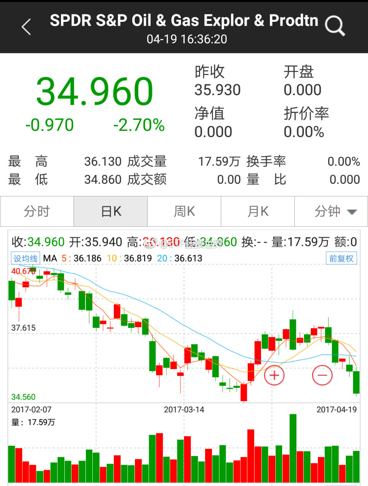

## 2017-04-20 09:16

今日华宝油气预估净值0.599，场内交易的朋友可以以这个为参考。

## 2017-04-20 09:55

朋友们投资要记住这几个字：人弃我取，人取我予。

风水轮流转。

现在不断新高豪气冲天的，还去追，未来给你赚大钱的机会就不多；

现在跌跌不休没人待见的，才是未来的金矿所在。

节奏，注意节奏。 ​​​

## 2017-04-20 10:07

一年多过去了，第三轮计划资产搭配的雏形终于有点样子了。接下来就是不断的加加减减。品种还差一个贵金属，海外还差一个美股，也基本就全了。

太难了。买点不贵的东西太难了！ ​​​

## 2017-04-20 10:33

我建议朋友们有空的时候可以去看看A股的历史。不用太久，就从2000年开始看。

尤其是2002以后，A股是如何走的，每个阶段都发生了什么。

看到2003-2004，你会发现跟现在蜜汁相似，非常眼熟。“五朵金花”。

再往后看，看到2005。这里就是最关键了。看看2005之后，什么板块，什么股票在那样的史无前例大牛市中涨得最多。两年的上涨中，板块是如何轮动的。在牛市开始、中间、结束的各个阶段，都是什么股票在轮流飙涨。以及在牛市中，是什么股票根本就不涨。

历史不会每次都相同，但有些规律不会变。比如周期股票、消费医药、金融、科技、大小盘……在各个阶段的表现。

再有时间，可以看看美股的历史。

早点做些准备，相信几年后你会受益匪浅。

## 2017-04-20 10:47

$全指医药 sh000991$     不出所料。 ​​​

## 2017-04-20 11:02

计划三月高位没买，四月买的三个品种到现在这一刻都没有亏损。可以说完美避开这波下跌。

再往前看，所有“不买”的月份之后都是大跌。所以以后哪个月计划“不买”，就得留点神……

有点艺术的感觉没有。 ​​​​
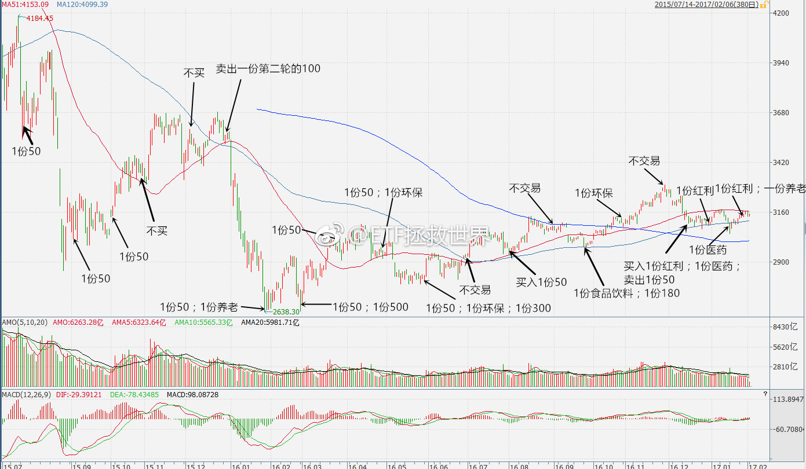

## 2017-04-20 11:15

就像A股上一轮牛市其实从2012年11月就开始了而不是大多数认为的2014年三季度开始一样，现在的指数也根本不能代表A股的性质。

今天上证下跌0.13%，深成上涨0.21%。其实，现在上涨的家数是900家，下跌的家数却有2000多家。

有很多类似的误区，各位要知道怎么甄别。指数没跌，很多朋友手里的股票已经跌的不成样子。就像之前指数没涨，很多人已经赚翻了一样。

很多东西，需要深入的看一看，想一想，才会离真相更近一步。否则只能被收割。

## 2017-04-20 13:34

白马：你追不追？不追？我继续涨给你看。还不追？我继续涨。追啦？duang，归你了！

> @投鱼问道
> 【重要规律】多年悟出的A股16字：抱团取暖、敌进我退、广场赌博、击鼓传花
> 【抱团取暖】：公募等有最低持仓80%左右的要求，股市再跌也不能清仓，不得不找一些股抱团取暖，即使不涨，也不能跌，典型如白马股，茅台等，每逢股市弱势，总有一些股很坚挺，就是公募抱团在自己玩。
> 【敌进我退】：是指游资和私募为了赚钱养家，做年度业绩，一般都要制造些行情，一般选择大股东减持不了的，盘子小的，供需关系好的，在股市下行趋势不明显时，会更容易操作。典型如12年后中小创，次新股等。行情再差，都会试图制造机会。
> 【广场赌博】：这指的是一种玩法，就是一群人在广场晒太阳，有人拿来赌具，吆喝一声玩两把，然后大家都聚集过来，这就是局部行情。有人玩麻将，有人赌骰子，这就是不同的题材。
> 【击鼓传花】：既然来玩了，吆喝声越大越好，话题要热门，故事越越完美越好，启动追入，不怕追涨，大家一起玩击鼓传花，最近的新疆题材就类似，大行情好时花传的更远。虽然大部分都知道这些都是闹着玩的，但这不重要，有人来玩即可，愿赌服输。

## 2017-04-20 13:52

最近话比较多，因为有些事只有在这时候说才有用，有些朋友才能听懂。比如下面这句：

买的稍微高点，你还有钱，想多买，摊低成本，没错。这也是我们计划的精髓之一。

但你要注意，不要0.62买的，0.6就要补仓摊低。你这样买，扛不过熊市。因为你爸爸不是李嘉诚，你也不是央行印钞机。你没那么多钱补。

真正的熊市有多冷，很多朋友根本不知道。所以我的意思是，买高一点，无所谓。你的一份才0.6%仓位。有补的时候，但不是跌2%就补。

有朋友不理解，为什么我们调整仓位要定时。这是因为跌一点就补，没那么多钱扛过熊市，很可能熊市初期钱就补没了。你想想之前自己炒股套死的是不是都这种情况。同样，涨的时候我们也定时卖。为什么，因为牛市涨一点就卖，你的股票也扛不过牛市，随便就卖光了。

一句话，补仓没问题，别在意那1、2个点的下跌。我透露一下，我自己门票股的补仓价位是下跌30%、60%、90%的时候。指数基金则根据模型进行补仓。仅做参考。

## 2017-04-20 14:08

截至昨日收盘，年初至今有2020只股票下跌，占比67.63%。

跌幅超过10%的股票有1135只，占比38%。

上涨超过10%股票有407只，占比13.63%。

中位数是下跌5.99%。好一个“慢牛”。 ​​​

## 2017-04-20 15:31

创业板估值已经回到2014年10月。沧海桑田，2年半过去，一个轮回。

继续吧。前路依然漫漫。 ​​​

## 2017-04-20 20:09

再撑一周，月末那次计划四份以上不是梦。

估计一次就把那些整天担心踏空的朋友病都治好了。 ​​​

## 2017-04-20 22:29

​​​
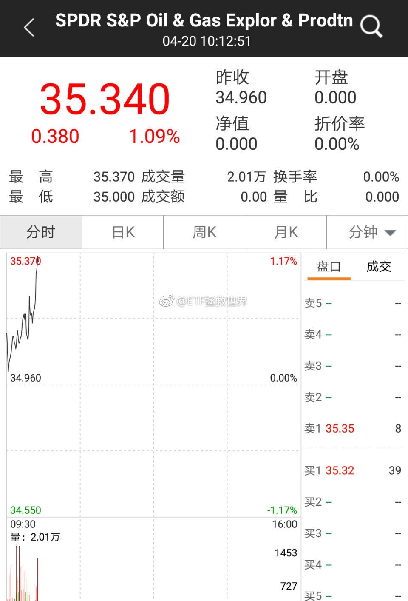

## 2017-04-21 09:11

还有五个交易日，周四晚开车。其实你仔细想想，有什么所谓啊。涨多了咱们就少买点，跌多了就多买点。是你的就是你的，跑不掉。不是你的你非去抓，结局很可能是→

## 2017-04-21 13:15

最重要的是，保持敬畏之心。

市场先生虽然时而狂躁时而畏惧，要敬畏他。时时刻刻小心翼翼，如履薄冰。

觉得自己最NB，大杀四方，通吃天下，倒霉的日子也就不远了。

人无百日好，花无百日红。得意之时更要谦虚一些。

方能长赢。 ​​​

## 2017-04-21 13:30

很多朋友的问题其实是看的太近。

“你这么少仓位，这两个月涨了5%你没赚到吧。牛市来啦。你踏空啦”

或者

“你买这么多4不4傻。中国股市再也好不了了，金融危机来了！股市崩盘了！以后没人炒股了！你看看跌了多少了！”

主要原因就是看得近。

看得近的原因是站得比较低。当然，还有一种可能是眼镜该重新配了。

尽量站得高一点，好好的看清这个市场在发生什么。现在的涨跌是否合理，应该随波逐流还是坚持自己。

不要用表面的东西，或者是短期的现实来判断未来。

站在未来的视角来看现在，比用现在的视角推未来要好得多。

## 2017-04-21 13:51

再说一个，未来几年，甚至十年真正能赚大钱的东西，不是现在频创新高的那些“白马”。

而是目前正在阴跌暴跌跌跌不休的东西里面。也许还没到位，还不够便宜，但是就在里面。

一个想法，不一定对。 ​​​

## 2017-04-21 14:29

回复@青兔眼迷离:没有了。以后也不会有了。有不同声音的都被我拉黑了。来微博几个月，已经拉黑5个人了。//@青兔眼迷离:虽然百分之百的赞同，还是希望评论里有不一样的声音

## 2017-04-21 15:16

建行纸黄金纸白银可以挂单30天，而且现在貌似点差有优惠。做贵金属的可以考虑。

白银不要玩场内的161226，损耗太高。 黄金用518880倒是可以。 ​​​

## 2017-04-21 16:06

4份应该没问题，除非下周前四天会大涨。如果继续大跌，5份以上也有可能。总之下周开始先准备周五用的4份资金是合适的。

## 2017-04-24 08:40

还有四个交易日一刚！ ​​​

## 2017-04-24 09:32

很多朋友第一次体会到其他人在哭自己在准备买入的感觉。

怎么讲，这就是投资。 ​​​

## 2017-04-24 09:35

有意思的是，今天计划净值依然不会少多少。

$159920   $513030  $162411

资产配置。 ​​​

## 2017-04-24 09:38

再次更新：如果有暴跌，随时会开车。//@ETF拯救世界:4份应该没问题，除非下周前四天会大涨。如果继续大跌，5份以上也有可能。总之下周开始先准备周五用的4份资金是合适的。

## 2017-04-24 09:46

该发生的一定会发生。这不是因为什么人说了什么。

就像每天日出日落，就像每年春夏秋冬。

掌握了日夜更替四季轮换的规律，就不会因为不见五指的黑夜和寒冷的凛冬心生恐惧。

你就会知道，凛冬虽至，终有一日盛夏要回来。你也会知道，盛夏虽好，也要为凛冬准备粮食才能扛得过去。

只看眼前，觉得盛夏会持续一生，或者寒冷的冬夜再也不过去的人，都会被消灭。

## 2017-04-24 10:42

如果我们的投资体系（仅指计划这个策略）是一个军队或者一支球队，那么你能想到的，它的防守体系中的破绽是什么？

在这个防守体系中，有可能会出什么问题导致这场战争或者这场比赛我们会输？ ​​​

## 2017-04-24 11:12

说点不开心的让你们开心一下：

去年7月我买的20多只门票股中，有两只已经跌了30%，今天补仓了。

这两只赔了总资产的0.15%了。

[doge]

别只看买的大部分都是大赚的，那些赔钱的只是你不知道而已。[doge]

最重要的，不是会不会受伤。所有人都会受伤。关键是，受的伤是不是致命的。以及，伤好了之后会不会更加强大。
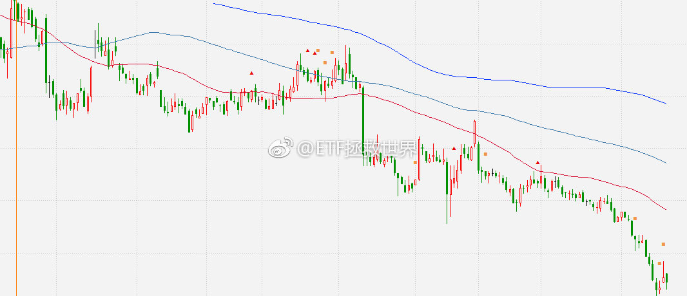 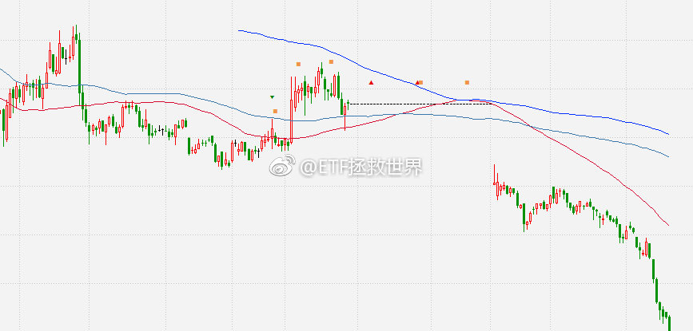

## 2017-04-24 11:22

大家一定要记住这个问题。若干时间以后，我会把这条微博挖出来。“估值体系”没有用了，是大多数朋友的疑虑。没错，到了体系告诉我们“这已经是大底”的时候，会有更多的人这么想。这也是大多数人不敢大手笔买入的原因。“这次不一样”。

## 2017-04-24 11:37

深成B会不会跌到1毛。一个问题。 ​​​

## 2017-04-24 11:48

准备极小仓位试试。相信GJD。相信D。

## 2017-04-24 13:32

$513030  闹哪样 ​​​

## 2017-04-24 13:34

什么值得买和三只松鼠居然要上创业板了。

不讨论这两家公司好不好，这个节奏，我感觉未来创业板有希望了，长期来看。 ​​​

## 2017-04-24 14:01

全面给力。

现金是垃圾？ ​​​
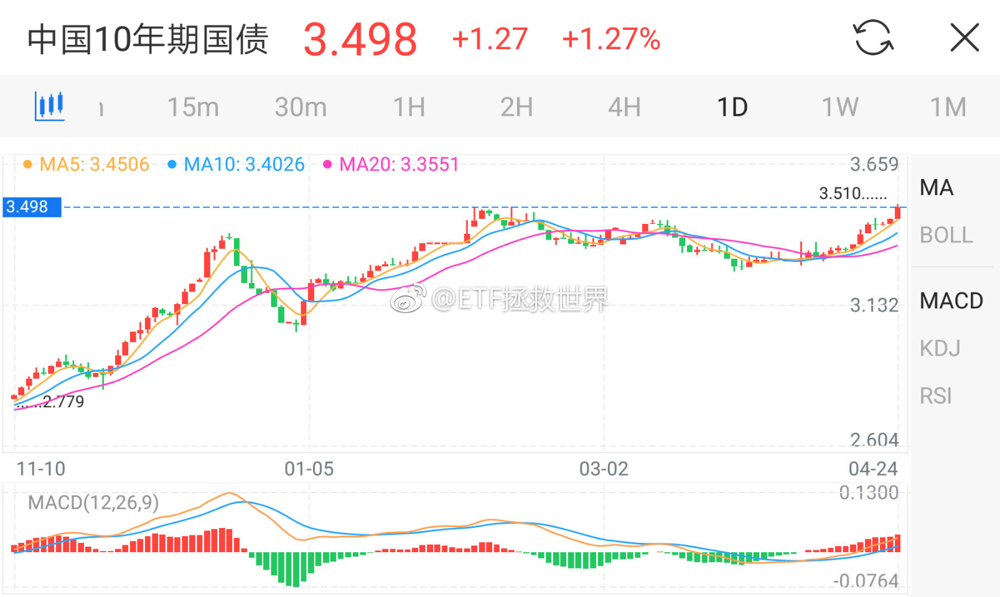

## 2017-04-24 14:22

好孩子。

> @ETF拯救世界
> $513030  闹哪样 ​​​

## 2017-04-24 14:43

操盘手看着你们这些想薅羊毛的散户露出蜜汁微笑

> @阿信gg
> gjd旷班今天@ETF拯救世界 ​​​

## 2017-04-24 14:54

今天的估值将会特别NB。一个预感，不一定对。 ​​​

## 2017-04-25 09:49

真的开始价值回归了。

百感交集。

有信念，太重要。 ​​​

## 2017-04-25 10:38

$159920  又快新高了 ​​​

## 2017-04-25 15:40

今天医药估值再创三年新低。

如果医药有机会进入历史最低区域，我说句话，负责任的讲：

在这个品种上，未来某个时间点，我们赚到15%-20%以上的年化收益是极大概率的事情。

就看是不是有这个运气了。 ​​​

## 2017-04-25 18:07

回复@请输入昵称_昵称:高弹性的以后多着呢。信息、证券、军工。你还怕没有赚大钱的品种？医药是长线品种。提供长期稳定高收益的。别急，好戏在后头。

> @朱朱30394:医药快跌请你快跌[嘻嘻][嘻嘻]。假如如果医药跌入最低区域，其他指数没有，有没有可能会增加医药指数在总资产配置的百分比。

## 2017-04-25 22:49

未来计划的轨迹是这样的:

熊市收集便宜筹码。争取在最黑暗的时候拿到足够的筹码，同时不亏损。如果无法避免亏损，尽量将亏损维持在15%以内。

然后在牛市中资产飞跃，收割。

继续新一轮收集筹码。

所以在每轮熊市底部，收益率注定不会好看。我无法想象熊市底部做到不亏损的同时收益率高还能拿到足够筹码。买股票可能买到逆势牛股，买指数基金不可能。

就这么简单。真要讨论收益率，一轮牛熊之后再来说吧。
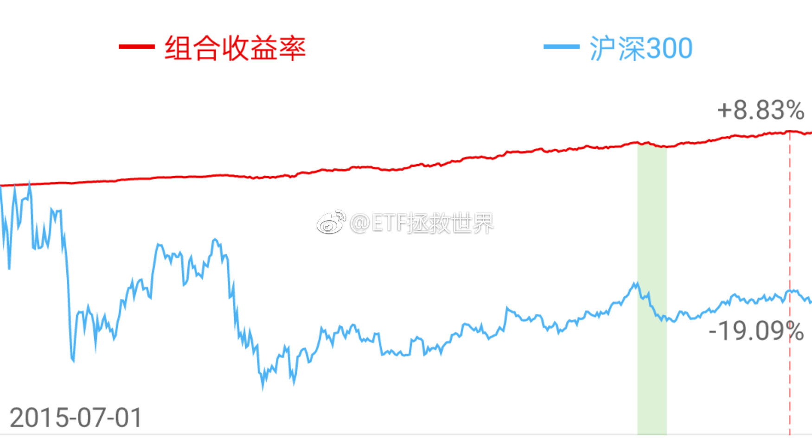

## 2017-04-26 06:22

各位又买在阶段最低，一厘都不差

 ​​​
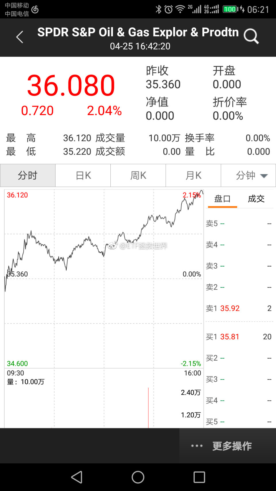

## 2017-04-26 09:50

说出来你可能不信，我越来越喜欢创业板了。再来一波进场捡筹码。 ​​​

## 2017-04-26 10:00

参照纳斯达克，大致在2030前后吧，创业板回到4000点没问题。然后2030-2040创业板会有一个比较好的收益率。所以从买入到2030，收益率是多少取决于你的买入价格。比如现在买，13年后回到4000，赚一倍，复利大概5.x%。买得越低，年化会越高一点。

> @ETF拯救世界
> 说出来你可能不信，我越来越喜欢创业板了。再来一波进场捡筹码。 ​​​

## 2017-04-26 10:14

接上条，做个小数学游戏。

如果2030年4月26日，创业板可以回到4000点。那么是这样的：

你

2017年4月26日1812点买入，到那时年化收益率是6.28%；

2017年5月26日1700点买入，则年化上升到6.84%；

如果在2017年底，1500点买入，则年化就有8.28%。

如果年底不知道发生什么黑天鹅居然跌到了1000点，那么年化可以到11.9%。

没错，上面所有数据都是假设。尤其是2030年回到4000点这个，是比较不靠谱的假设。

但我想各位应该明白两件事。

第一，15年回到高位，不是不可能发生的事。历史上无数次发生过。何况你知道，2015年创业板市盈率超过了100倍。用15年消化，不是不可能。既然可能发生，做决定的时候就要考虑进去。

第二，买得越低，收益率才可能越高。买早了，买贵了，也就只能拿到很垃圾的收益率。当然，如果碰上了再一次的疯狂牛市，收益率高点也有可能。但万一没有呢。

## 2017-04-26 10:47

提前发车是不是非常精确。你们感受一下。 ​​​

## 2017-04-26 11:17

是不是要打脸了！怎么办，是不是要开始骂641了！是直接骂还是要走什么程序？没骂过，求带！

> @ETF拯救世界
> 提前发车是不是非常精确。你们感受一下。 ​​​

## 2017-04-26 11:24

根据我的几个中期趋势技术判断模型，几个小指数于上周，几个稍大的指数于本周相继进入下跌趋势。

当然，技术始终只是一种辅助手段。投资不能靠k线和技术图形指标。辅助一下而已。

技术破位的意思，也只是说下跌的概率会比较大，而已。 ​​​

## 2017-04-26 15:45

一季报业绩超密集披露。估值变化太大了。

近期极有可能加车。一两份就够了。 ​​​

## 2017-04-27 08:02

出门了没？ ​​​

## 2017-04-27 08:27

​​​
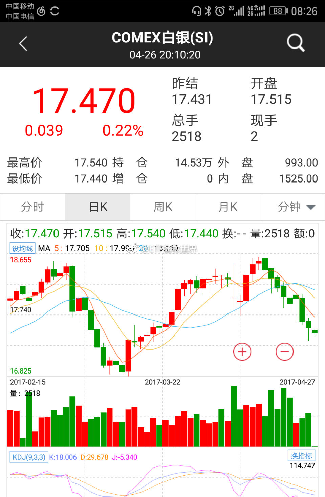

## 2017-04-27 09:26

一年内底部可见。钦定了。 ​​​

## 2017-04-27 09:31

2016年1月27日，大盘收于2735点。现在是3131点，上涨14.48%。

同期下跌股票1027只，占比37%。

跌幅最大的股票跌了75%。

股票中位数上涨8%。

真相。 ​​​

## 2017-04-27 09:42

“现金是空气。”

体会更深了吧。 ​​​​

道理说再多有时候是没用的，经历过一次，才懂。 ​​​

## 2017-04-27 09:47

$中证1000 sh000852$   这两年，是小盘股的梦魇时分。

太惨了。

别急，我们是援军，在路上（慢慢走）。 ​​​

## 2017-04-27 09:57

潜水雪球，看到方老板每天买10万指数基金。各位可以用这个实例观摩一下熊市中过于频繁买入的后果。

慢慢体会一下“定期”交易的奥妙所在。 ​​​

## 2017-04-27 10:03

回复@金玉满堂彩红:我想中午开怎么破。//@金玉满堂彩红:今天这情况，晚上要加开了吧

## 2017-04-27 10:33

很多人看到的是指数下跌和股票崩盘。

sorry，我看到的是未来年化收益率一个点一个点往上蹦。

金融投资风险很大，对眼前一片迷雾的人来说。 ​​​

## 2017-04-27 10:49

回复@kuya55:我们不是抄底，不是这个思路。是根据概率计算仓位配置。现在计划仓位只有13个点，对于现在的概率来说太低了。要尽快加到合适的位置。//@kuya55:E大，因为买的是指数其实也就多跌一两个点，现在就加买是不是有点急了。 还是咱们这次150份的仓位还不够重呢

## 2017-04-27 10:55

……从2007年的沙黾农开始，我就有一个坚定的信念：在金融市场上，杀伤力最大的是大v。一次次验证。

> @ETF拯救世界
> 深成B会不会跌到1毛。一个问题。 ​​​

## 2017-04-27 13:26

GJD的心理底线是3100，确认了。连续第二次暴跌跌破拉回。

## 2017-04-27 14:44

不让买就不买了。散了啊。 ​​​

## 2017-04-27 15:07

回复@小狗上马路:老司机：提前开车又对了。（明天不要打脸）//@小狗上马路:我们定投的三份，今天都盈利了哇

## 2017-04-27 21:33

其实我的计划没必要和任何人解释。

三月没买，四月买了两份A股，五月买四份。三个月加起来一共买了六份，不到4%。

总A股仓位才15%。

不解释。每个人的情况本来就不同。买自己想买的东西就行了。 ​​​

## 2017-04-28 06:05

继续新高。

熊市，震荡市，不亏损少亏损的情况下，尽量多的收集筹码。

这句话说来简单，做起来并不容易。

早了，大幅亏损。晚了，望牛兴叹。

时间，空间的艺术。

继续保持买入的所有权益品种盈利。仓位继续增长，未来的盛宴不会缺席。

未来的回撤会更大，不在乎。到这个市场上来玩，不是为了保本的。
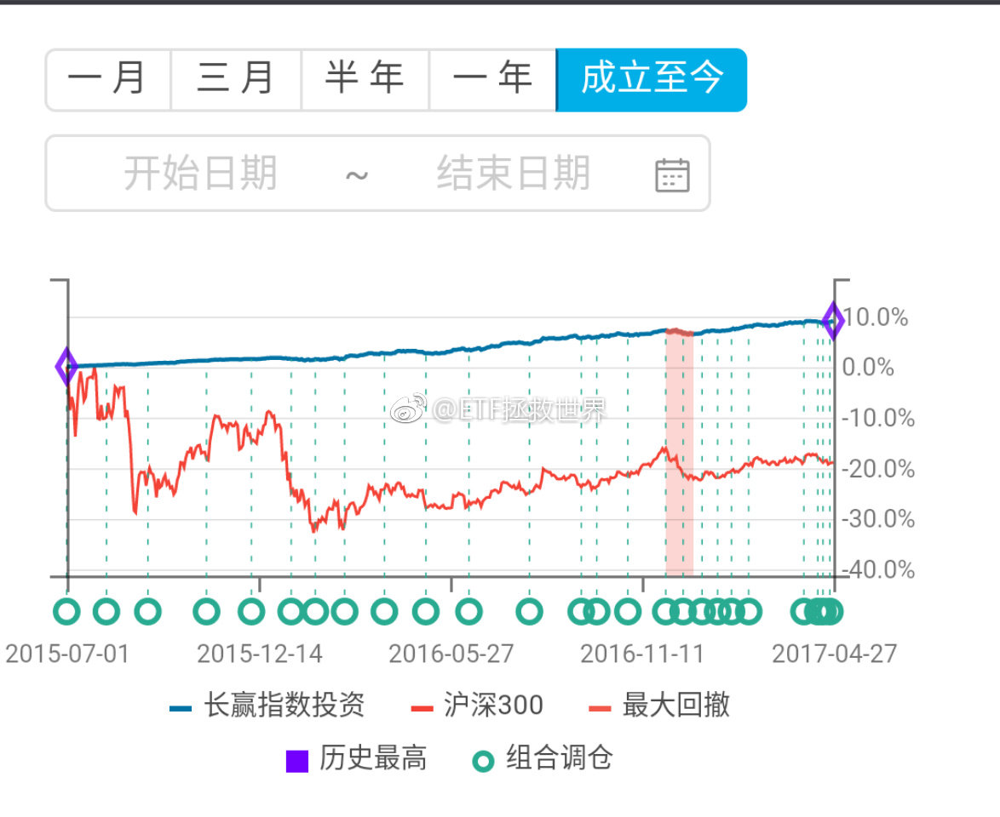

## 2017-04-28 10:30

为什么要这样对我。为什么。 

没天理了。 ​​​
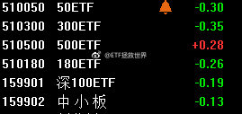

## 2017-04-28 10:43

继续打预防针：

随着仓位逐渐加大，未来如果出现各种预料之中，预料之外的下跌，市值会减少。只要记住两件事。

你手里的东西，是指数。公司可能由好变坏，由坏退市，指数不会。中国最好的几百家公司都在你的手中，无论怎么跌，不用怕。

第二是，我们的投资方式，会把成本控制在非常低的水平。一定不会是最低，但大概率是在一个极低的区域。所以大概率会赚钱，而且应该会赚不少。无论怎么跌，记住这点。

不会死，大概率赚。记住这两条，无论多冷的冬天你都能熬过来。

当然，大多数人熬不过去。

## 2017-04-28 11:37

$恒生指数 hkHSI$  居然默默的新高了。 ​​​

## 2017-04-28 13:39

发布了头条文章：《500开车+500历史收益率更新》  ​​​

这个样子应该不会翻盘了，500开车。这几次买入后，因为年报季报带来的业绩冲击导致的稍大规模调仓也就结束了。预计继续回到小步慢跑的节奏——如果价格不会大幅下跌的话。

来，跟各位一起更新一下500在不同估值买入到现在为止的收益率。

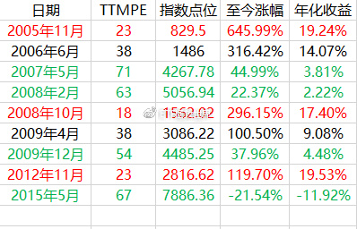

几点说明：

绿色是四次估值极高的时候买入到现在的收益率/年化收益率。可以看出，都不超过5%。甚至有2%、3%，甚至年化收益是负的。真的不如余额宝。所谓“股票是最好的投资品种”这种话，大多数时候是对的。但你如果买贵了，恐怕几十年都没有好收益。

红色是几次估值极低时候买入。自己看收益率吧。要说明的是，这些接近20%的年化收益率，是在现在这个已经跌了很多的情况下实现的。你猜猜2015年最高的时候，这些底部买入的部分年化收益率是多少？大胆的猜。

黑色是估值均值的时候买入到现在。可以看出，也有10-14%的年化。

所以，你可以大概设想一下，未来你如果能在均值到极低区域布局，那么未来不说极度高估，就是再回到历史均值，你也有10%-20%的年化收益率没有问题。

那么，现在的估值是多少？

38。这也是我们再次开始买500的原因。​​​​

## 2017-04-28 15:07

回复@黄晨在新浪:2012年估值最低时候买入，到2015年估值最高的时候，年化收益率74%。注意，是年化。当然，这种收益率没人回从头吃到尾。只是一个理论上可以赚到的钱而已。//@黄晨在新浪:奇怪，没有人猜底部买入的部分在15年高点的年化收益率？我猜50%

## 2017-04-28 16:54

回复@rapuzal2016:建议你看看我2012年11月和2015年5月的文章。你会发现，并不是回头看，而是一直在向前看。//@rapuzal2016:回头看处处是黄金，底部顶部一目了然，往前呢？

