## 2017-06-01 08:52

今天不聊了。病了，发烧。

 ​​​

## 2017-06-01 16:20

-“兄弟，喝水不？”

-痛苦的摇摇头

-“吃水果不？”

-继续摇头

-“今天小股票暴跌了！”

-“哎……身体不舒服，高兴不起来”

-“呦，刚过去那小护士真漂亮啊”

-“扶，扶我起来看看！”

……

今天，正式进入建仓区域。漫漫征途，走完一半了。 ​​​

## 2017-06-02 08:42

人间奇迹！39°高烧一天痊愈！全靠各位的祝福加持！感恩！比心！ ​​​
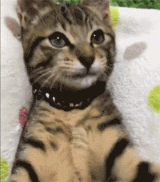

## 2017-06-02 09:04

昨天没有新高。哼！ 

送各位一张外部数据加权估值图。从历史经验看，本月，最迟下月，可能有一次级别比较大的反弹。当然，反弹之后…… ​​​
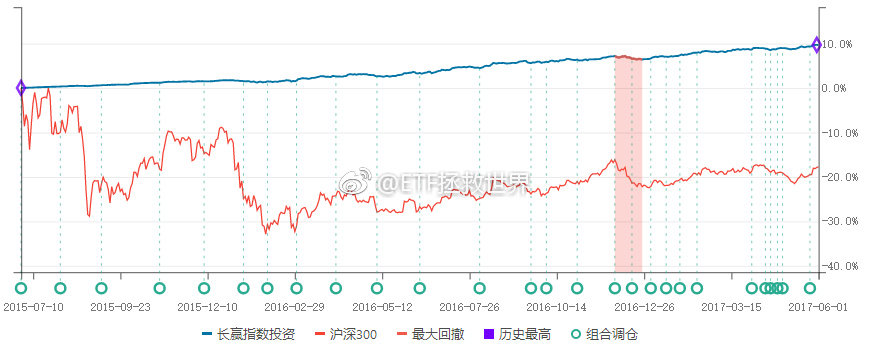 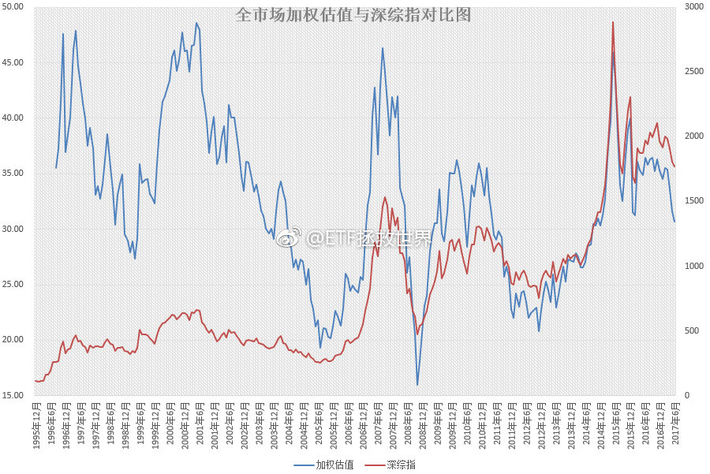

## 2017-06-02 10:39

这样每天一两个点的跌，恐怕等不到15号了 ​​​

## 2017-06-05 09:40

资本市场是一套非常复杂的系统。不能简单的以线性思维去理解。

减少，甚至暂停IPO会否让A股转牛？也许有人会这么认为。但事实上，恐怕有很多人会因为无新可打而撕票，导致股票价格更加快速的下行。

A股市场的平衡是非常微妙的，是各种因素交织在一起产生的结果。任何一根稻草都有可能压垮这份平衡。 ​​​

## 2017-06-05 10:33

今天组合中的50、红利、恒生等下跌。但是最近布局的500、养老等上涨。虽然权重还不够高，无法抵消大股票下跌带来的影响，但能减小跌幅。

这就是配置的作用。大类配置之内的小类配置。即使是A股内部，大股票、小股票的走势差别通常都会非常非常大。做好配置，可以保证组合波动性降低，同时取得更好的收益。

相信全部布局完成后，真正的威力才会发挥出来。

## 2017-06-05 15:44

聊聊你人生中最大的乐趣是什么吧。最好是个什么具体的事情，聊聊为什么这件事有意思。

如果最大的乐趣是特别隐私不能说的，就说说排名第二的……

有时候也会觉得人生还挺乏味的。 ​​​

## 2017-06-06 06:33

23号买完债券以后，连涨7天了  ​​​
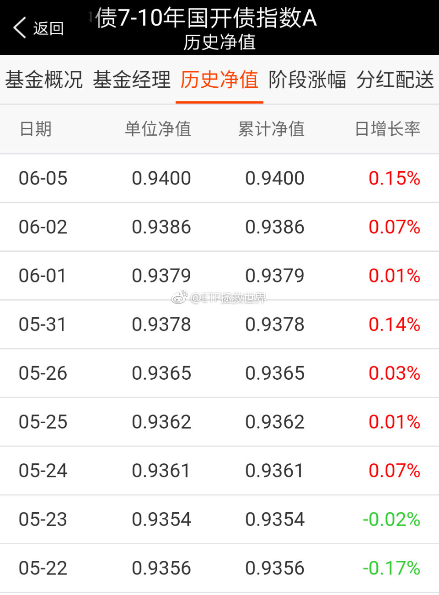

## 2017-06-06 09:54

回复@Mr_L0ne:在我的投资体系中，没有割肉这个环节。所有投资必须赢利。为了实现这个目标，就要围绕它设计所有策略。另外，做所有投资之前，第一步一定是压力测试。测试最坏的情况下自己能否承受，无论是心理还是资金。所以每次计划中，紧跟着品种的一定是一个括号（最大下跌幅度xx%）。

## 2017-06-06 17:55

槽点很多，A股市场的水深不见底啊。

## 2017-06-07 06:47

继续，不要停…… ​​​
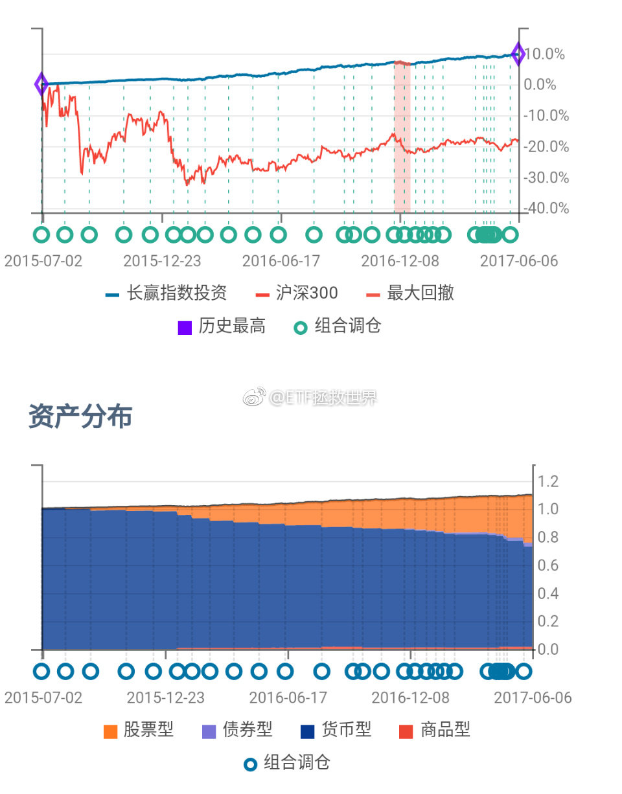

## 2017-06-07 09:30

历史的角度看，今天容易暴跌。看看这次灵不灵。 ​​​

## 2017-06-07 10:08

接下来的一年我希望……我回答了 @蔚蓝不是薇蓝 的问题，问题价值￥88.00，大家快来花1元围观~  ​​​

## 2017-06-07 10:14

既然这样的话，月中应该就不买了。回头再看看六月第一次买六份，感受一下……节奏。

> @ETF拯救世界
> 这样每天一两个点的跌，恐怕等不到15号了 ​​​

## 2017-06-07 10:28

回复@JUNSOO寻:套路很深。只看了开头的朋友再看一遍吧……//@JUNSOO寻:回复@ETF拯救世界:真的只看了开头，没有看到空白下面的“认真”回答

## 2017-06-07 10:54

$510500 

$养老产业 sz399812$    

$159938  

未来某一天你会在这些品种上赚多少，现在大多数人根本意识不到。 ​​​

## 2017-06-07 11:31

回复@litterwitch:错在自己和错在他人，这不仅是思维方式的转变，更是未来会做得如何的关键。错在他人，就是自己没错，所以永远不会进步。错在自己和策略，就有查漏补缺的可能，未来只会越来越好。没有完美的世界，我们要思考的应该是怎么在这个不完美的世界做好自己该做的，赚到该赚的。

## 2017-06-07 13:13

不知道是不是就是这波。  高度的话，指数幅度不知道，全市场估值可能有10%的空间

## 2017-06-07 13:38

今天500涨幅超过2%，50不到1%。印证了之前说的：小股票不是不行了，只是市场偏好现在不在小股票而已。5、6月我们开始加仓500，未来还会买创业。我坚信下一轮一定还是小股票涨得好，而且会比大股票涨得好很多。千万不要相信那些什么涨得好就吹什么的人……只有那些下跌的才是未来的金矿。

## 2017-06-07 14:52

看完这个的感觉，没想指责那些路人和肇事司机。只是想了好几遍，如果是自己过这样的马路；如果自己是两辆车的司机；如果自己过路看到这样的事，该怎么办。

## 2017-06-07 15:31

今年魔咒正式破解了！

## 2017-06-08 07:25

就喜欢波动这么大的你

> @见闻实时新闻
> 【美油收盘重挫逾5%，EIA原油和汽油意外大增后布油勉强守住半年收盘低点48美元关口】WTI 7月原油期货收跌2.47美元或5.1%，报45.72美元/桶，创5月4日以来收盘新低。8月布原收跌2.06美元或4.11%，报48.06美元/桶，创2016年11月后期以来收盘新低。(华尔街见闻7x24直播 不止是快) http://t.cn/R64lHNR实时快讯 ​​​
> 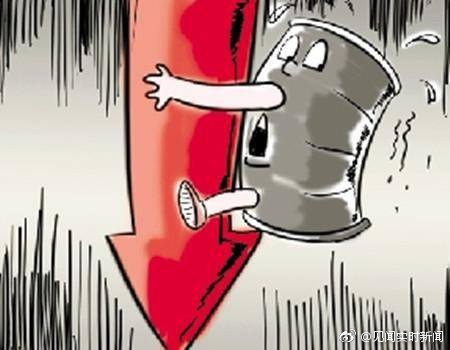  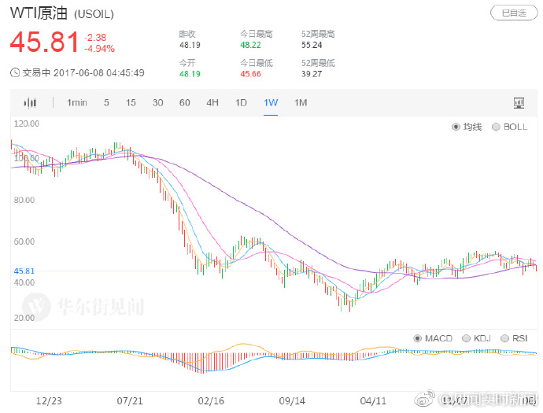

## 2017-06-08 09:48

一个反弹，咱们的$养老产业 sz399812$    基金净值已经创出一年半新高了。

也就是说，过去我们买入的所有动作都是盈利的。

祝各位赚钱快乐。 ​​​

## 2017-06-08 10:00

从现在开始，我给自己立个规矩，也通知一下各位。

ETF计划这个组合：

第一，是我自己的投资组合，买卖的时候公开一下而已，不是给谁的投资建议，更不是要带谁投资。感兴趣的朋友可以参考，赚了你不用给我提成，赔了也别BB。

第二，我再说一次，这是个组合。一个组合的构建一定是有各种考虑。我能保证的是我这个组合熊市不会大幅亏损，最好是不亏。牛市尽量跟上指数。我没有能力保证十几二十个品种每一秒钟都盈利。

第三，如果某个品种有浮亏，不要来我这里埋怨。你自己参考的晚了，你自己买多了买贵了，我管不了。我只能从整个组合的角度考虑问题。去年我们在恒生吃得少了，就是因为16年初有些人来我这里埋怨恒生为什么浮亏了，弄得我压力很大，不再公开加仓。从现在开始，谁再来不顾整个组合不停新高的事实，来埋怨我某个品种下跌了，我一律微博+公众号+雪球全面拉黑。我不能让你影响我的判断和心情。

今天说的比较不客气，有冒犯的地方您多担待。有不舒服的朋友尽快自己取关我，免得大家都尴尬。

## 2017-06-08 10:50

$全指医药 sh000991$  

30年后大家买药的钱就靠它了。

目前有4%。希望配到8%-10%。 ​​​

## 2017-06-08 11:04

回复@天影198:不是抄错了。这个例子应该是：高考的时候抄旁边卷子考上985了，结果埋怨对方：你的英语怎么没考好？总分高有什么用，单科差了！

## 2017-06-08 11:14

投资要布局的，应该是以后的钻石黄金，而不是现在的。

比如2016年初的50和恒生，比如近期我们一直买买买的医药和养老。

有些行为可能看起来很奇怪，为什么要买一堆不涨的垃圾。涨得那么好的，所有人都说还要涨很多的好东西我们为什么不追？

对，不追。我们要做的是等别人追的时候卖给他们。 ​​​

## 2017-06-08 11:22

“指数涨得慢”是特别特别匪夷所思的一句话。

就不说300、500这样的宽基了，牛市至少有70%的人跟不上。就说今天医药，两市超过全指医药涨幅的股票只有694，占比23.65%。

绝大多数人哪里来的自信说指数涨幅跟不上自己选的股票的？少部分天才当然例外了~ ​​​

## 2017-06-08 14:29

今天股票上涨下跌家数是1:2

然而，组合又要新高了，好无聊。

昨天的养老基金之后，今天的红利也应该快买入后新高了。恒生因为汇率问题这几天差了点没有新高，没事。

当然，还在收集筹码阶段，涨不涨的无所谓。不过赚钱，帐户刷新高总是好事啊。 ​​​

## 2017-06-08 14:57

回复@栖凤林学园:其实你说的就是之前几轮计划熊转牛那几天的状态。这个情况怎么说呢，没有经历过的人很难懂。现在仓位低，无论是浮亏还是迅速开始盈利都不那么明显。某一天绝大多数人才会真的懂——你很难和一个**描述**的感觉……

## 2017-06-08 15:55

目前的情况就尴尬了。

一个是zjh大量IPO导致下跌的说法恐怕要坐实了：减少几家iPO居然大反弹！

二个是韩经济学家的资本市场野生国师地位恐怕要坐实了。另一个，头衔还要加上为民请命的大侠。将来发动群众的能力不容小觑。

未来更有趣了！ ​​​

## 2017-06-09 09:42

辛辛苦苦低价买的东西，不要因为上涨了一点就轻易卖掉。

——《旧约.长赢启示录第九章》 ​​​

## 2017-06-09 09:49

如果把计划的恒生+50+医药+养老+红利这几个权重最高的品种单列出来看，你肯定想不到今天有将近2000只股票是下跌的。。。 ​​​

## 2017-06-09 09:58

50、红利、养老基金继续新高。 ​​​

## 2017-06-09 10:07

有一个也是比较大概率的经验，随便说说。

那就是如果某个品种创了52周新高，不要着急卖。大概率后面会发生让你很惊喜的事情。

当然了，大概率不代表必然发生。只是概率大一点而已。 ​​​

## 2017-06-09 14:49

500也一言不合就起飞啊。都表现不错。反弹继续ing。

## 2017-06-09 14:53

回复@北溟有鱼-1997:去年初咱们买了500，飞了一年，还不是跌回来继续让咱们买？该是你的就是你的，跑不了。不是你的，着急也没用。//@北溟有鱼-1997:真不愿意500飞，再等点吧。E大路子接受，就是想跌//@ETF拯救世界:500也一言不合就起飞啊。都表现不错。反弹继续ing。

## 2017-06-12 09:56

发布了头条文章：《今天各大成分股调整样本股，对我们影响较大的有》  ​​​

调入养老的有：

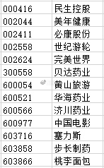

调出的是：

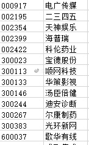

调入全指医药的是

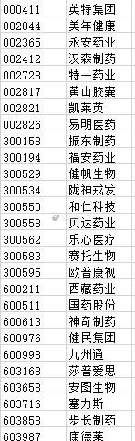

调出的是：

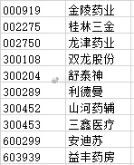

红利指数本次不调整，12月调。

## 2017-06-12 10:06

回复@LSWIYY:归属消费电子、休闲用品、酒店旅游、教育、文化传媒、药品零售、乳品、家庭用品、医药卫生、人寿保险、互联网软件等行业的股票纳入养老产业。//@LSWIYY:我好像看到了一些意想不到的公司…好奇原来这些公司划分到养老指数的依据是什么……

## 2017-06-12 10:11

这一网等的时间那是相当长了…… ​​​
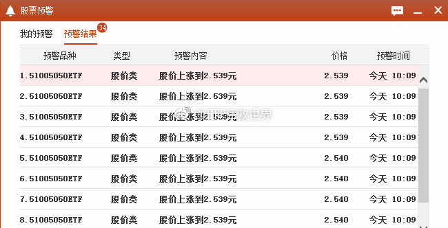

## 2017-06-12 11:19

醉了，敢情拉上去就是让我的网格最高点卖出呢……

## 2017-06-13 07:57

回复@许小敏2013:很正常。我买的所有品种都要赚钱。这是最基本的要求。//@许小敏2013:债券盈利了🙏//@ETF拯救世界:醉了，敢情拉上去就是让我的网格最高点卖出呢……

## 2017-06-13 08:49

计划目前买过15个品种，两只浮亏。一个4%的建信500，一个7%的华宝油气。这两个品种仓位非常低，加起来只有1.2%。

目前基本上布局已经比较完整了。大、中市值的A股，好的行业，港股，德国，债券，原油都有所布局。当然仓位还没有配置完毕。

其实在金融市场想要亏损，是挺难的一件事。是吧。 ​​​

## 2017-06-13 13:40

有朋友经常说，嗯，投资方式不错，只是不适合本金少的。

听起来好像是本金少就容易赚快钱、大钱一样。

其实就我的感受，越有钱的人，金融投资的时候越不“着急”。而越不着急的人，通常赚大钱的概率反而更大。比如浮亏了不着急在底部止损，比如浮盈了不着急在上升过程中落袋为安。

那么本金少怎么办？我想说的是，如果太少了，想在证券市场实现一百倍一千倍的逆袭，我不是说不可能，那可能性太小了。比如你只有几万块，想用这几万块赚到1000万，真的很难。

我觉得吧，现实一点，还是先去提高正向现金流。本金多了，加上正确的金融投资方式，市值越来越多，雪球越滚越大，这样的路径更容易一些。

## 2017-06-13 14:13

中证500ETF第一次买入是2016年2月29日。第二次是2017年5月23日。

感受一下…… ​​​

## 2017-06-14 09:16

后台有11个没有回答的付费提问。其中4个与房地产有关。

说明什么。 ​​​

## 2017-06-14 10:44

在证券市场投资，我个人认为，要有个经常性的逆向反思。这是我自己提出的一个概念，名字也没想好，就先这么叫。

也就是说，你观察历史就知道，没人能够长期的辉煌，在资本市场。比如说在牛市NB的，熊市中就会特别惨。熊市中特别稳的，牛市中很难赚很多。

这就是所谓的盈亏同源。

因为成功会带来惯性思维，认为自己的方式特别好，继续下去还能继续赚大钱。但实际上，总是你特别NB那不科学。

所以我的想法就是，如果某个阶段你做的特别好，比别人都好很多，那么就应该适时的转变一下风格。一方面是能量守恒，不要所有的好都让你一个人占了。另一方面是锄强扶弱，多空双方哪边太弱了你就去帮帮它，长期看总有好处。

再进一步，我个人认为，投资成绩在每个阶段都保持在前80%-90%的地方就是最好的。不要做最牛的，也不要做差的。始终保持在前20%或者25%甚至30%。这样就很棒。关键是长期保持下去，不要大起大落。

最后的大赢家很可能就是你。优秀，但不足以锋芒毕露。长者教育我们说：闷声发大财。也许就是这意思了。

## 2017-06-14 13:49

15号将至，又挖坑。好烦。

就烦这种不知道是送钱还是送命的坑。 ​​​

## 2017-06-14 17:46

今天下午看到且慢上了一个新功能，叫做计划的“补仓提醒”。

简单来说，这个功能解决了很多参考计划朋友的一个痛点，就是看到计划的时间比较晚，之前的到底该不该补，什么时候补，多少钱补，完全不知道。如果盲目追高，那就完全背离了我们的投资理念。

然后很多朋友来问我，我是真的没有精力去计算之前每次发车的价格，然后还要换算成累计净值（因为基金会分红、分拆、合并），然后再跟各位交流。

且慢之前也并没有跟我说在开发这个功能，中午跟我说了一句，现在我看到这个，觉得很好。对不少朋友来说应该是有用的，有需要的朋友可以试试。

我感觉这是一个用心在做产品的团队。话不多说，说多了成广告了。

一个字，这个功能，非常好。

## 2017-06-15 10:02

今天一个人看着我的身份证说，怎么岁月在你脸上没有留下痕迹啊。

如果不是因为对方是男的，我就误会了。 ​​​

## 2017-06-15 10:26

小确幸……

## 2017-06-15 11:06

利率是影响资产价格最重要的因素之一。 ​​​

## 2017-06-15 11:16

今天创业板（+1.8%），50（-0.6%）。大也好，小也好，我坚信没有不好的品种，只有不好的价格。“小股票不行了”就是扯淡。就像2013、2014年小股票走牛一年半后大股票纹丝不动一样，那时候的大股票也不是不行了，只是在等时机而已。

## 2017-06-15 11:23

其实行业值得关注的就那么几大类：

消费（必要、可选）、医药、能源、信息、金融。

面对不同的经济周期，可以在不同的行业上进行重点切换。

包括大盘股、小盘股，在不同周期也有不同的表现。

不要在品种上涨的时候吹得天花乱坠，也不要在什么品种跌的很多的时候再踩上几脚。

锦上添花易，雪中送炭难。你如果能做到雪中送炭，某天那个品种发达了，就会给你意想不到的回报。

## 2017-06-15 20:40

每日打卡 ​​​

## 2017-06-16 09:29

哈哈哈哈哈，看今天的新闻了吗。深交所说四月底开始大资金开始买小股票了。最近小股票开始涨，这种新闻就多了。涨之前干嘛去了。大多数人永远是被舆论引导着接盘的。

## 2017-06-16 21:30

每日打卡 (2)

这图不是我！

今天一边看黄磊的深夜食堂一边完成的。作为一个看了几季日版深夜食堂的观众，怎么港，黄磊这版翻拍得确实很一般。 ​​​

## 2017-06-17 21:49

每日打卡(3)

今天练有氧。试了试keep的跑步训练课程，快慢交替，所以整体速度很慢。

能不能坚持打卡一年？ ​​​
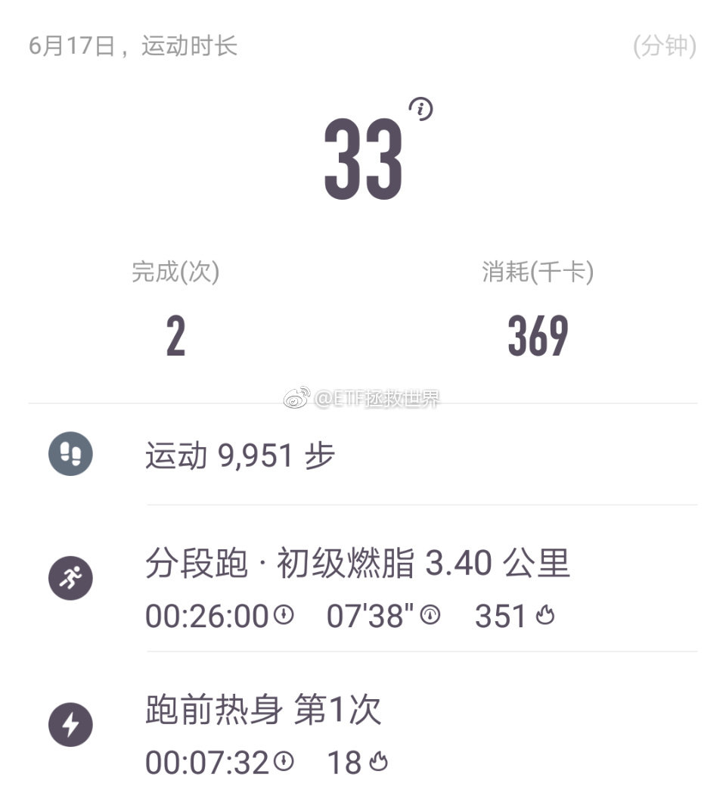

## 2017-06-18 17:58

每日打卡(4)

这个运动量太大了 ​​​
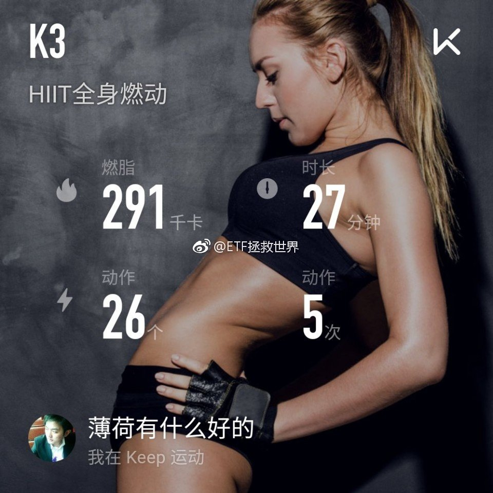

## 2017-06-19 09:51

0602最低点那天发的微博，从那天起反弹到今天半个多月了。一切都在按照剧本走。高度的话，是估值升十几个点，长度呢？按照之前的概率，应该不会在6月结束的。结束在七月或者八月吧。这不是预测，是通过观察历史得出的一点猜测而已。

## 2017-06-19 11:46

500才是坠吼的，以后你们就知道了！ ​​​

## 2017-06-19 13:18

根据历史，做一些中短期的猜测，并不是为了指导投资。

而是对未来可能出现的情况做个预判，有个准备。

有些事情真的发生了，就不会惊慌失措。

当然，真的用来指导投资，也不是不行。不过更要根据概率来下注。中短期的概率，可就并不那么一定很准确了。 ​​​

## 2017-06-19 14:53

今天能不能新高是个谜，拭目以待吧。 ​​​

## 2017-06-19 16:02

回复@独自消遣的圆稻糕:过气了！怎么办，是不是要搞点大新闻出来了。//@独自消遣的圆稻糕:E大微博最近的评论数量好少，以前都七八十，现在才二三十

## 2017-06-19 20:31

每日打卡(5)

继续练胸。

看到评论里不少朋友也开始锻炼了，很好。看看咱们谁坚持的时间长。

 ​​​

## 2017-06-20 09:28

回复@zoey__小白:“还没红就过气”，扎心了。 查看图片 //@zoey__小白:在E大的调教下大家可能都更淡定了吧 但是为了拯救还没红就过气的E大必须要冒泡 查看图片 //@ETF拯救世界:回复@独自消遣的圆稻糕:过气了！怎么办，是不是要搞点大新闻出来了。

## 2017-06-20 09:31

$159920  新高。 ​​​

## 2017-06-20 09:36

呵呵。

> @ETF拯救世界
> 500才是坠吼的，以后你们就知道了！ ​​​

## 2017-06-20 09:54

回复@老猪穿裤衩:关于杠杆，我提个思路。随着价格的下跌，估值的下降，指数基金仓位应该越来越高。继续下降，则可以加杠杆。比如H ETF换成HB，比如融资买入。指数反弹后，估值上升，则将杠杆卸掉。比如HB换HETF，比如卖掉融资品种。当然，具体操作起来是高难度动作，一两句说不清。

> @老猪穿裤衩:没跟159920，重仓H股B的心里滴血，差别大，特别3月之后，和E大差别大呀。。

## 2017-06-20 10:30

谁能想到，日经225年度收盘价20年新高了。我大概估了一下，如果按照估值避开90年代泡沫投资该指数，到今天能赚不少。

无数的例子都证明了一件事： ​​​

## 2017-06-20 21:18

每日打卡(6)

今天腹肌。感觉量有点小，一会再加一组别的。

加油各位。 ​​​

## 2017-06-20 21:46

每日打卡(6)2

说到做到。

没有新高的日子必须加练啊。 ​​​

## 2017-06-20 23:05

现在应该高兴还是害怕？

问问自己。

如果高兴，再问问自己，有没有做好最坏的准备。 ​​​
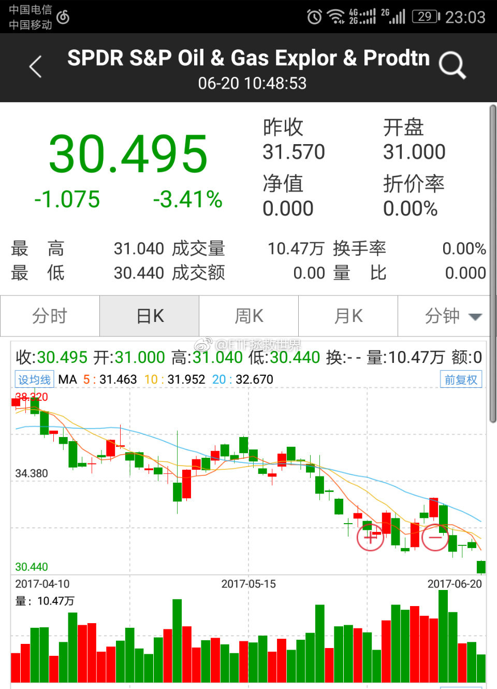

## 2017-06-21 09:07

“未来可能会将大约450只大盘股和中盘股股票纳入MSCI指数”。中证500是坠吼的，还记不记得？//@蓝鲸财经记者工作平台:【鲸滚动】6月21日讯，MSCI明晟表示，未来可能会将大约450只大盘股和中盘股股票纳入MSCI指数。

> @蓝鲸新闻
> 鲸播报：这222只A股成功纳入MSCI，百亿美元驰援。(澎湃) ​​​
> 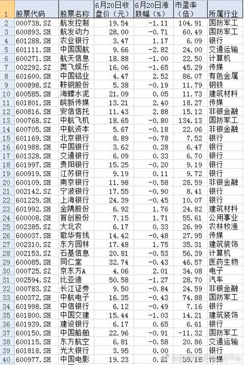 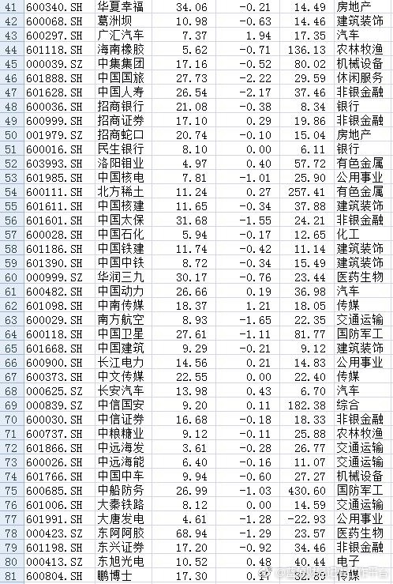 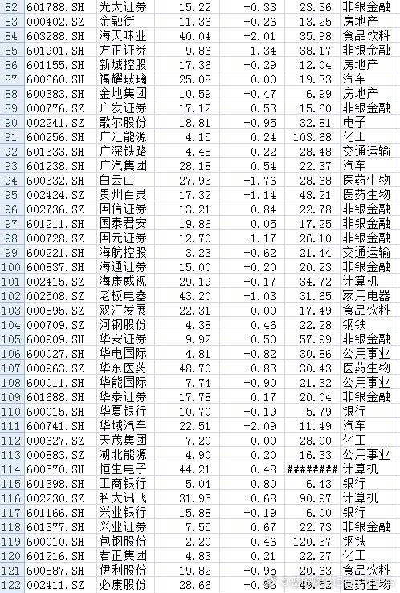
> 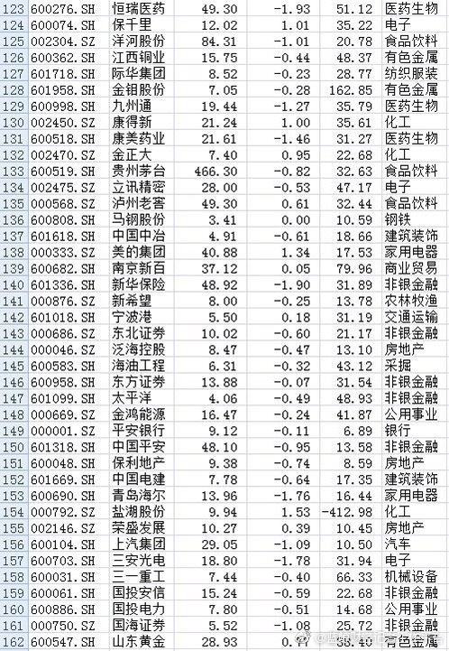 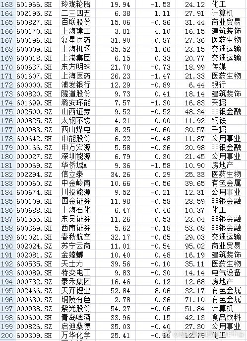 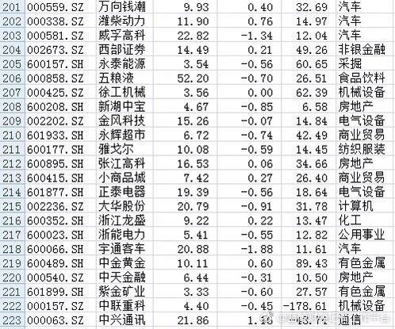

## 2017-06-21 09:18

你知不知道什么时候持仓的品种下跌你会毫无感觉？

是你已经知道它有多少概率下跌，然后一直等着它的发生。

下跌怎么会是风险呢。没有下跌，超额利润无从谈起。

当然，最关键的，是你点击买入的时候，想得更多的是未来有多好，还是未来会有多坏。 ​​​
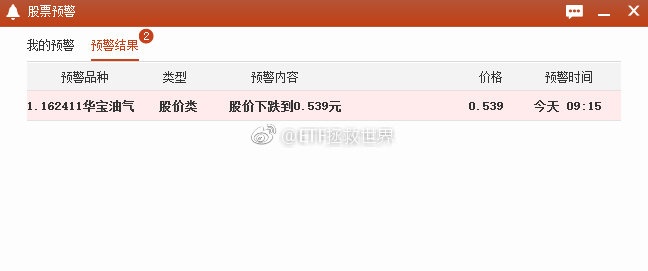

## 2017-06-21 09:48

回复@furiming:溢价一个多点你套利要亏死的。//@furiming:回复@kettle798:去场外申购，场内卖出套利

## 2017-06-21 10:26

上次咱们买了国开债指数后，18个交易日涨了15个交易日。

买的那天是最低点。  ​​​

## 2017-06-21 10:57

回复@跟风借势:这个确实判断不了。油价2012年见顶120美元，现在跌了5年跌到40出头。再跌5年也有可能，因为大类资产的涨跌周期都很长。但是没有牛市不代表没有机会。短期走势是没法预测，没有坏的品种，只有坏的价格和策略。

## 2017-06-21 11:08

回复@徐L鑫:溢价不代表韭菜多。很多时候你没有发现吗，虽然溢价3.x%，但你如果真的敢去套利，晚上很可能一个大涨就把你埋进去了。不要小看市场，市场作为一个整体，要比绝大多数个人要聪明。要敬畏市场。市场先生虽然会疯狂，但大多数时间，它比你我都聪明。所以老巴说了13次：买指数基金。

## 2017-06-21 14:59

医药反弹新高。除了恒生有点掉链子，都挺好。 ​​​

## 2017-06-21 15:12

非常非常有意思。从6月2日起，我就从历史估值数据的角度跟大家探讨，这里恐怕会有一次反弹。指数涨幅不知道，估值涨幅在10%左右。当时等权估值39.x，我判断到43-44是历史大概率。时间的话，一两个月的长度应该是有的。

这一切都来源于历史数据。

即使这些观点重复了好几次，看起来不少朋友面对真正到来的反弹又开始坐立不安了。我一直在讲的是，请确保你的仓位“舒服”。当然如何确定仓位有一些数理上的技巧，但对于交易者来说，你的心理状态更加重要。

即使知道反弹大概率会来，也知道高度不会太低，很多朋友依然在反弹的时候难受。这就暴露了做为一个投资者相对来说不成熟的一面。

弱市中反弹的最后接盘者，通常来说会是这些朋友。难受到最后，就会下决心买入。然后反弹结束，被套的人终于换掉了一批。世界和平了。

## 2017-06-21 18:08

今天晚上出去跑步会不会被冲走

😱 ​​​

## 2017-06-21 22:56

每日打卡(7)

传说中会有大雨的日子，怂在家里hiit了。

最难的一个训练项目。

坚持。

自由的身体，自由的精神，自由的财富。缺一不可。

身体，是最重要的。 ​​​

## 2017-06-22 09:59

近2000只股票下跌，好几只大指数52周新高了

“指数涨得慢” ​​​

## 2017-06-22 10:13

计划开始建仓后，恒生指数（黑色）与恒生ETF（159920）和H股指数（紫色）的对比走势。

如果是2016年初开始参考计划的朋友，买入的159920收益率已经有45%-50%了。最差的也应该有35%以上了。 ​​​
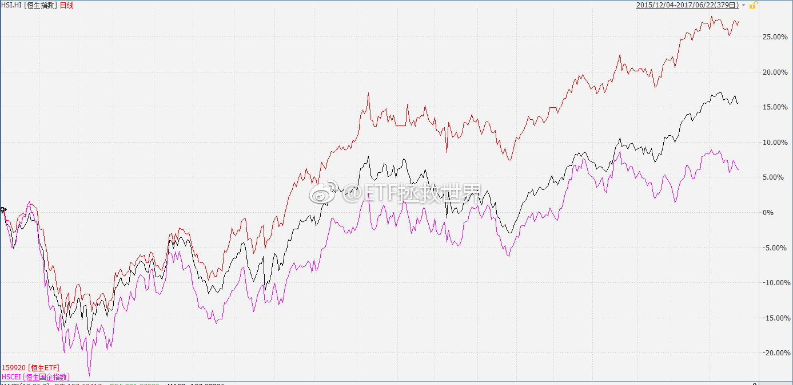

## 2017-06-22 10:46

说起恒生的这个收益率，不是为了别的，主要是需要回头反思。无论一项投资成与败，都需要回头反思，这一步非常重要。

反思的第一点就是，分批投入的时候，第一笔买入价格并非特别严格一定要严重低估。我们的恒生第一笔事后看并不特别便宜，股灾3.0的时候第一笔买入浮亏可能超过10%。但这个你回头看重要吗，一点都不重要。

第二点是，低估甚至严重低估的时候要心如止水的按照计划买入，加码买入。虽然你买的已经亏了，但要更大力的买入。怕什么？不要怕。你买的是指数，指数不会死。记住这一点。

第三点：越是别人唱空的东西，机会可能越大。港股边缘化的声音犹在耳边，我们已经赚了40%。投资这东西不是少数服从多数，事实是大多数人到了金融市场智商就趋近于0或者负数。别人说什么不重要，坚持正确的原则。

第四点：持有。坚定持有。低估就买，然后就持有。任何大的利润都是要持有。今天买明天涨50%这种事情发生的概率小于1%。只有持有才有大利润。很多朋友亏损的时候可以持有20年，赚钱了就1天都拿不住。这样可以说与赚大钱基本上绝缘了。

反人性。真要总结，就这三个字。思维模式与大众一样，就注定会跟大众一样来市场上做散财童子。

## 2017-06-22 10:53

看不见这条？

## 2017-06-22 10:55

呵呵，你们看不到这条吗。哪个关键词被碰到了。 ​​​
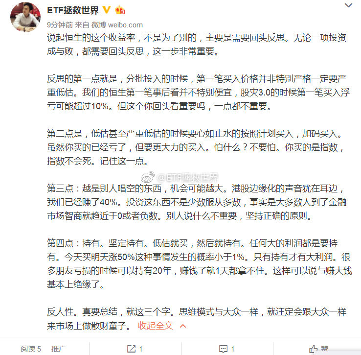

## 2017-06-22 13:56

虽然有2100只股票在下跌，但咱们今天继续新高应该没问题了。 ​​​

## 2017-06-22 14:28

回复@淼淼人参:非常黑。//@淼淼人参:黑天鹅太多了，还是指数最好

## 2017-06-22 14:37

话说早了一刚。

## 2017-06-22 14:40

我觉得现阶段我存在的最大意义，是让很多朋友涨了高兴，跌了更高兴。

在A股怎么都特幸福，可以说花多少钱都买不来啊…… ​​​

## 2017-06-22 15:08

回复@时间把对方都给遗忘了://@时间把对方都给遗忘了:怎么不是英大证券首席

## 2017-06-22 15:47

如果这样跌几天，月末必然发车。决不食言。 ​​​

## 2017-06-22 20:43

每日打卡(8)

不知不觉坚持一周了。

努力！奋斗！ ​​​

## 2017-06-23 09:31

1、无风不起浪

2、上次没事不代表这次也没事。“上次跪了结果又涨很多”。没错，但是也许下次跪了就得趴下了。套路就是这么深，防不胜防。 ​​​

## 2017-06-23 09:39

还有一周就开始挖坑？每次都这样我真的会不好意思了啊。

## 2017-06-23 09:47

特别不理解的是：

某股票去年底22元。最高涨到33。一个大利空跌到31，纷纷去抢：“挖坑了快抢啊。大好的投资机会”。

过去几个月22-31之间比现在便宜多了你怎么不去买呢？因为到过33，所以31就是特别有价值了？ ​​​

## 2017-06-23 09:58

不停的有朋友问我，加不加油气加不加油气。我以为跌了多少呢，打开计划帐户一看……

这张图是我自己计划场内买入的部分。油气这不刚12%吗，这点就沉不住气了？场内场外加起来买了快20个品种了，只有一个仓位0.6%的才跌了12%有什么好怕的啊。

别催我，也别问。我有自己的节奏。 ​​​
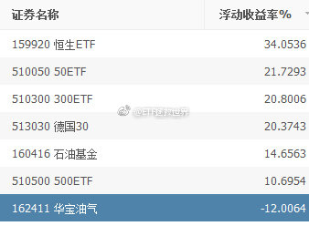

## 2017-06-23 10:18

关于补仓，再说两条应该对很多朋友有用的吧。

第一个是买入品种浮亏，补仓区间不要太小。尤其是重仓补，不要跌个百分之几就补，最后会很麻烦。你不差那几个点的成本，如果真能涨起来，少赚不了多少。要补就把区间拉大，能真的有效降低成本，还安全。

对于一些不能确定估值的，或者个股，我自己的补仓区间是30%、60%、90%。也就是跌到原价70%、40%、10%的时候才会补。

第二个，根据资产配置的原则，我自己在单个品种上的仓位不会超过30%。一个经验。

## 2017-06-23 11:23

下跌不会死人，反弹才会。 ​​​

## 2017-06-23 11:27

回复@蓝图806:不对啊，剧本上至少应该是下个月啊。什么情况，演员开始自己发挥了！导演不答应。//@蓝图806:瀑布的感觉......

## 2017-06-23 11:31

15号不买入，相信现在不会有人有意见了吧。

很多事也许你当时不知道为什么，但终有一天会知道的。别急。 ​​​

## 2017-06-23 11:46

哈哈哈哈……你的钱都被谁赚走了系列。

## 2017-06-23 13:06

//@ETF拯救世界:还有一周就开始挖坑？每次都这样我真的会不好意思了啊。

## 2017-06-23 22:26

每日打卡(9)

新高的日子就练一组吧。 ​​​
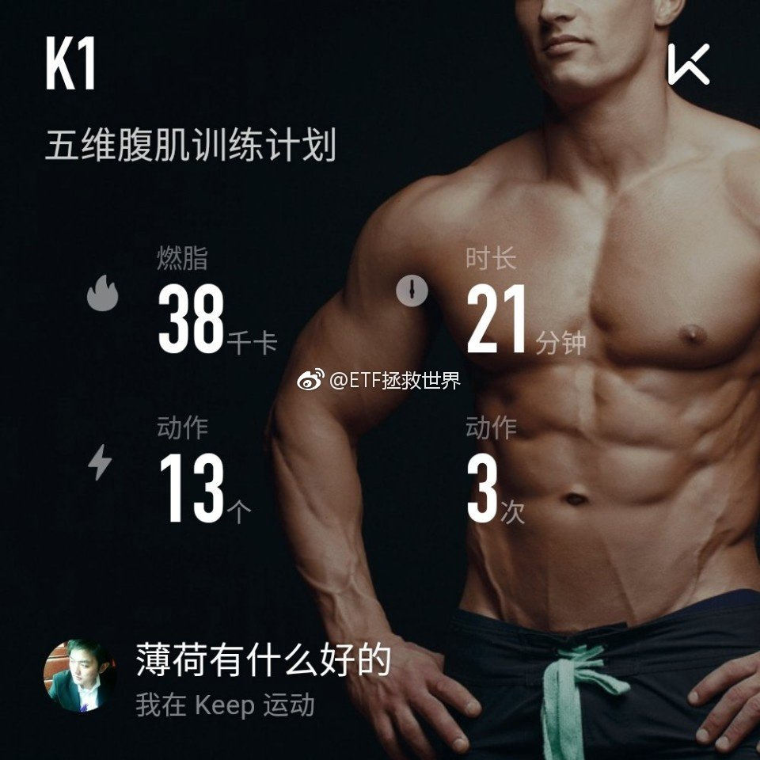

## 2017-06-25 23:24

每日打卡(11)

六月二日在京东买的书终于到了。

今天一直在看白话版的二十四史。不知不觉一看表居然23点了。赶紧再练一组胸。

说好了每天坚持，差一天，一时，一秒都不算数。

多看点历史总是好的。 ​​​

## 2017-06-26 09:13

校园霸凌全世界各个国家都有。但帝都学校能到这样的程度确实再次超越我的想象。难道法律真的无法制裁这样的小人渣吗？ @平安北京

> @爱吃慕斯吗
> #延庆二中霸凌事件# 主要事情经过：昨晚延庆人朋友圈微信群曝光出一个一分多钟的视频，视频中一个身穿延庆二中校服的男生蹲在学校厕所坑位旁，视频中传出欺凌者逼迫他吃坑中粪便的声音，男生不从，他们先是在言语上进行威胁，其中一位欺凌者说“你连尿都喝过了”，可见，这已经不是这位男生第一次受凌辱了。之后，他们用一些器具击打他的身体，最终逼迫他吃了粪便。现在了解到的情况就是这位男生身有残疾，走路不方便。欺凌者共五人，均为延庆二中初二年级学生。希望大家关注一下，让校园霸凌早日远离孩子们。@北京市教委 @一牛-北京教育关注 @北京人北京事儿 @北京教育播报 @文明北京 @北京发布

## 2017-06-26 10:04

呵呵，按照剧本演的演员才是好演员。//@ETF拯救世界:回复@蓝图806:不对啊，剧本上至少应该是下个月啊。什么情况，演员开始自己发挥了！导演不答应。//@蓝图806:瀑布的感觉......

## 2017-06-26 14:28

无论涨跌周四都会发车。不同的是会发不同的车而已。 ​​​

## 2017-06-26 14:46

分享图片 ​​​

## 2017-06-26 14:48

$510500  未来将是最好的。就像今天一样。 ​​​

## 2017-06-26 15:47

家长成年没有？为什么不能连坐。

> @平安北京延庆
> [话筒] ​​​
> 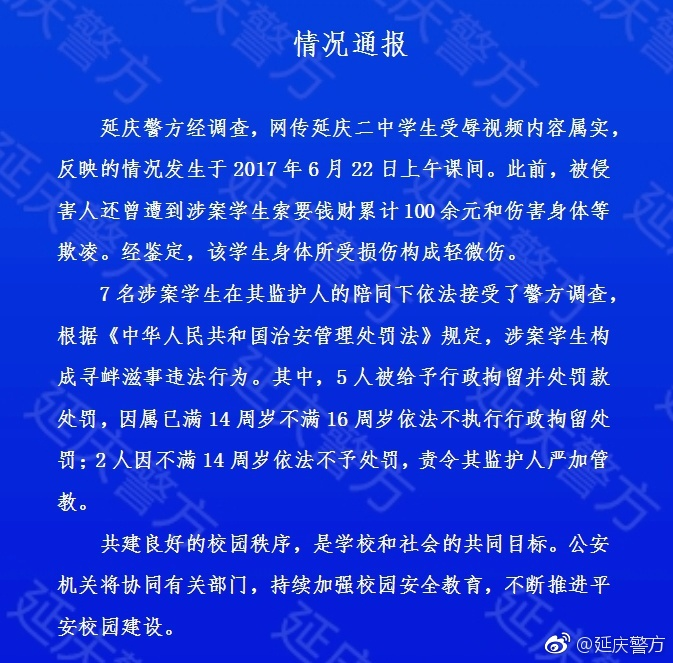

## 2017-06-26 23:20

每日打卡(12)

又翻了一遍万历十五年才开始锻炼，又晚了。 ​​​
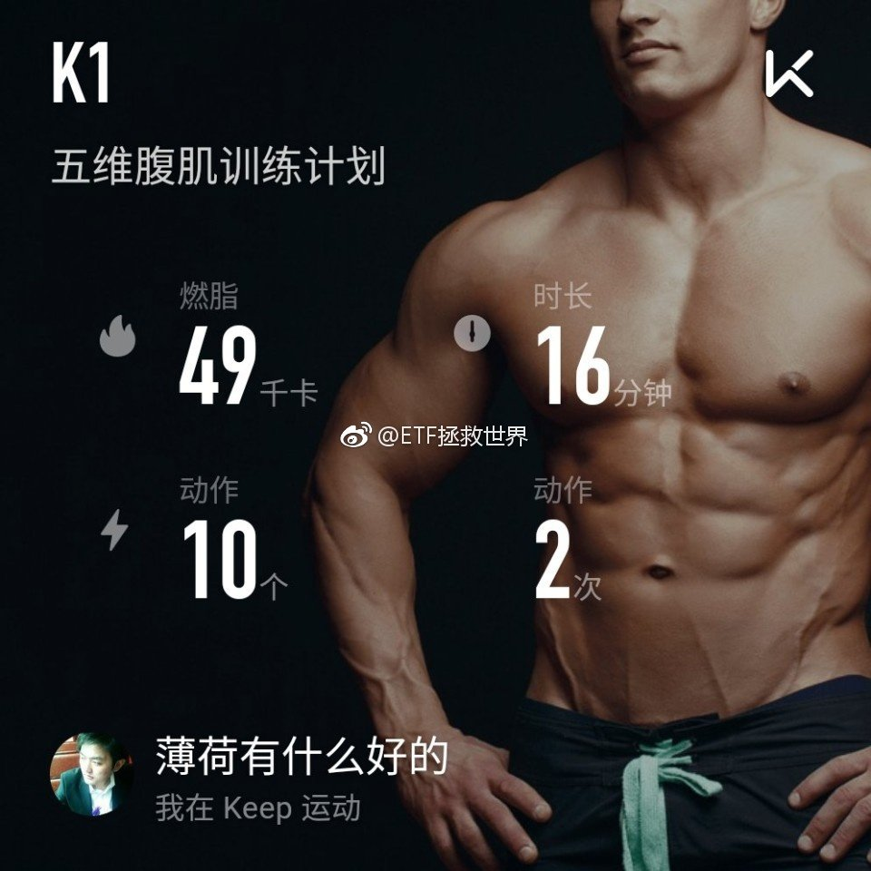 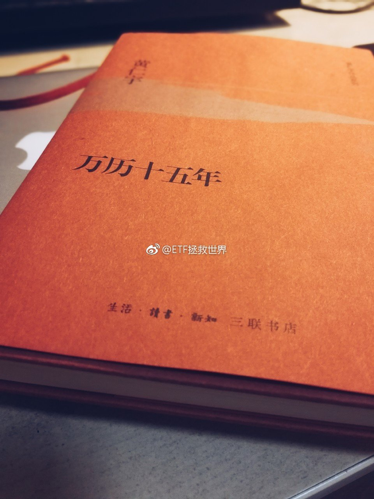

## 2017-06-27 09:39

$159938 折价一个点，废柴。 ​​​

## 2017-06-27 09:51

打算卖出的跌，打算买入的涨。是不是逗我呢。就这么几天都控制不住你记几了。

## 2017-06-27 09:55

今天持仓品种盈利绝对额新高的：恒生、养老、红利、医药、500。

不要随意卖掉手里的好东西。这句话重要到每天说可以说一辈子。 ​​​

## 2017-06-27 10:19

医药养老终于起来了。

你有没有发现一个问题，那就是我们买入的东西，从来都绝对不会是市场的热点。甚至是被市场遗弃的“垃圾”。

有意思的是，几个月后，它就会变成被追捧的好东西。

我们买了50、恒生、180、300几个月后，他们才开始显露王者之风。同样的，我们现在买的东西，不要急，早晚会爆发。

低位悄悄的收集筹码等待拉升，听起来像“大资金”做的事，还是“散户”做的事？

## 2017-06-27 15:19

垃圾券商14:59打电话说申购200万某货基持有十天就给补贴2000块钱。我听明白了一看表15:01了。

这种事情不知道就算了，知道了但是薅不到就特别气愤。辣鸡！

1/3的S8没了！  ​​​

## 2017-06-27 17:26

回复@做而论道725:记不记得巴菲特在香港请盖茨吃饭，从兜里掏出麦当劳打折券的故事。还有我给你们推荐的《邻家》里面，那些资产超过600万美元的富豪，为了200美元的回报，坐那回答半天问题。我可以拿比羊毛多不少的钱帮助山里的孩子，但也会非常懊悔没把握住这样薅羊毛的机会。很难解释。。。

## 2017-06-27 17:57

人生赢家系列:

我那个有六套房的邻居，大女儿刚被北大元培预录取了。 ​​​

## 2017-06-27 20:34

回复@V坚持W到底V:太棒了。向你们致敬。有什么可以帮忙的还可以联系我。//@V坚持W到底V:@ETF拯救世界  E大 我和小伙伴资助的9位高三贫困学子都考上本科了 3位一本6位二本 通知您一声 您去年也捐书过 广西横县的

## 2017-06-28 07:57

Something Just Like This 

猫宁 ​​​

## 2017-06-28 09:37

计划：算了这个月不买了涨这么多。
大盘：来嘛别走嘛我跌一跌。

计划：好吧，终于跌了我准备来一发。
大盘：呵呵我又涨了你咬我啊。

计划：…… ​​​

## 2017-06-28 14:17

今天在雪球看到一个晒半年收益的帖子。评论点赞前几名都是30%以上的收益，还有100%的。

我看了一下数据，除掉新股，年初以来涨幅在30%以上的股票是145只，占比4.85%。上涨的股票是733只，占比是24.54%。

基本上按照常理来说，如果能取得30%以上的收益，就是战胜95%的人。如果能取得正收益，就是战胜75%的人。

所以说“聪明的投资者都在雪球”还真是没错，没人赔钱，大家都在赚钱呢。

## 2017-06-28 14:19

对了，还有2个数据，一半股票的跌幅超过12%。有33%的股票跌幅超过20%。

## 2017-06-28 14:28

今年上半年A股个行情，在我心目中10%-15%收益率应该是最厉害的。

8%-10%是比较出色。

5%-8%是干得不错。

低于5%，高于15%我并不喜欢。

关键要结合历史收益率曲线。大起大落没有意义。去年满仓满融配40%，今年继续满仓满融赚30%还没回本呢。稳中求进，把财富一点点装进自己的口袋。弱市收集筹码的时候赚一些，牛市乘风飞扬才是我心目中最好的模式。

弱市不要赚太多，否则以后大概率出问题。

## 2017-06-28 21:20

每日打卡(14)

两周了，现在做这组轻松多了。

坚持。 ​​​
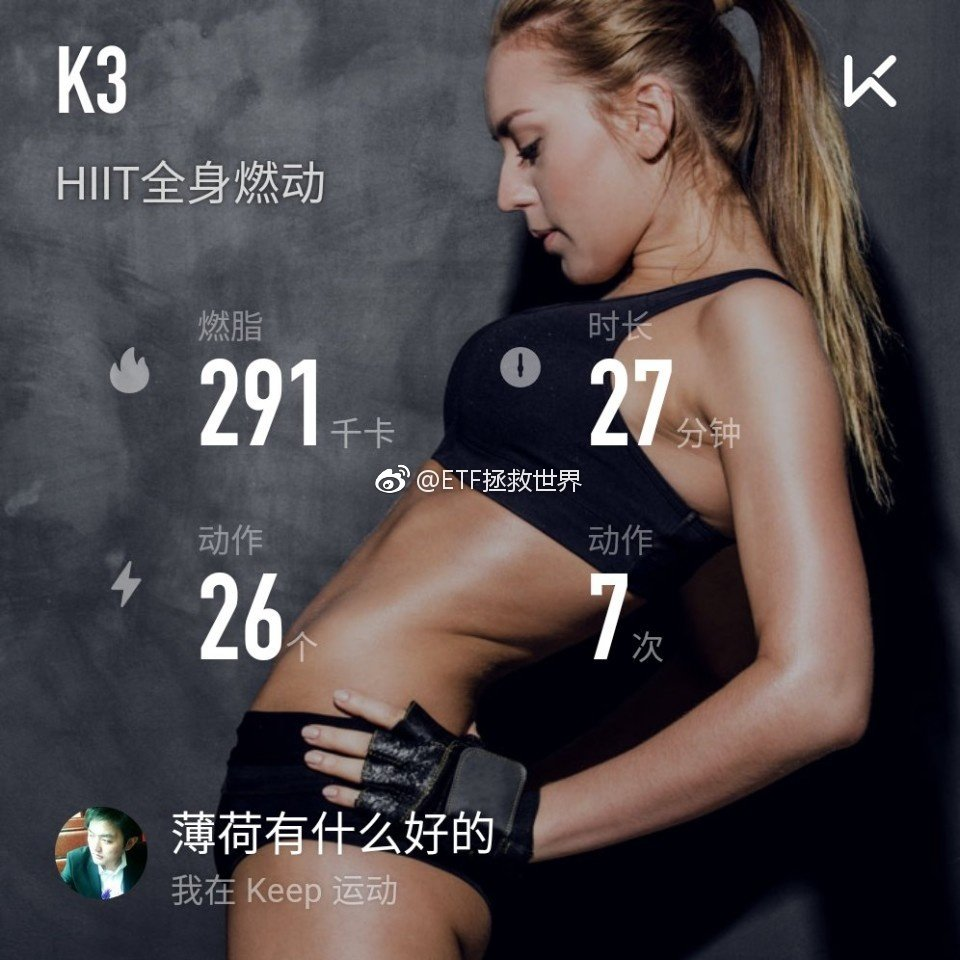

## 2017-06-29 08:26

昨天是不是哪个富婆给我做广告了。怎么公众号单日新关注人数比平时多了一倍。 ​​​

## 2017-06-29 09:00

上半年门票没中几只，选的门票股倒是涨了30%。扎心了老铁。 ​​​
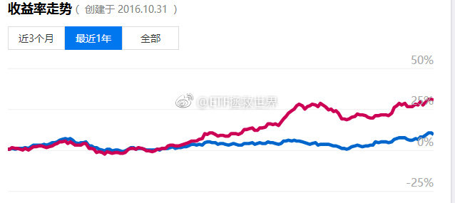

## 2017-06-29 09:54

回复@不愿做韭菜的小散:昨天说的是整体收益率啊。我的股票仓位只有十几个点，也就是说上半年股票对整体收益率贡献也就3点多。//@不愿做韭菜的小散:昨天说炒a挣10%.是厉害的，今天说自己挣30%.套路啊

## 2017-06-29 10:46

无论是公募也好，私募也好。每次都是上一个阶段表现最好的有大量资金去申购。

这些资金到底是怎么想的。是不是觉得会一直好下去？

买主动基金我给个建议：

观察3-5年，无论牛熊，每个阶段都在前1/4的，多买几个。 ​​​

## 2017-06-29 11:48

晚上要开车的品种涨了1%。你能体会我的feel吗。

是不是在逗我。 ​​​

## 2017-06-29 17:21

回复@欧特熊-:不会//@欧特熊-:你不会早一两天开车吗？

## 2017-06-29 18:57

嘀嘀 ​​​

## 2017-06-29 22:55

奶一口 ​​​
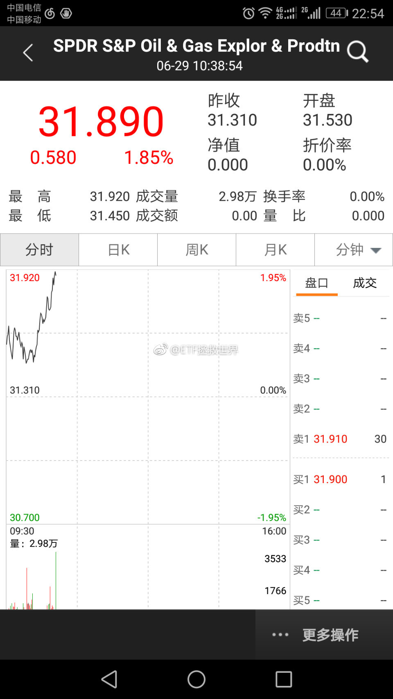

## 2017-06-30 11:30

消失了一上午，奥森跑步去了…… ​​​
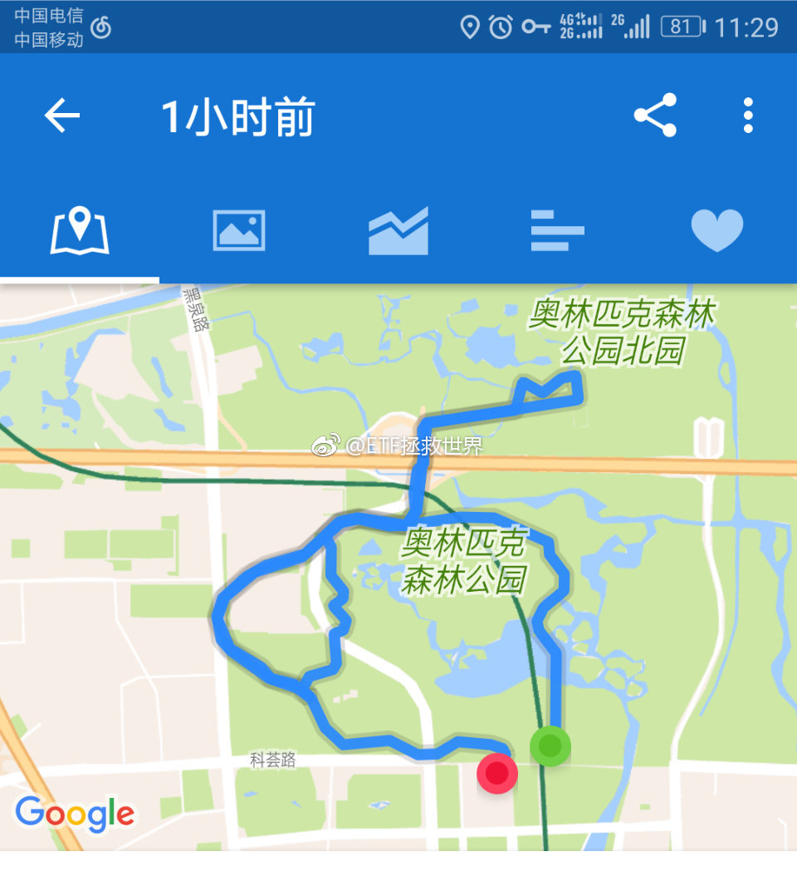

## 2017-06-30 13:43

$创业板指 sz399006$  是不是搞事情，要红？ ​​​

## 2017-06-30 13:46

今天布局完成后，以后A股任何板块，我是说任何，上涨，我们的组合都会受益。

这是相当惬意的一件事。 ​​​

## 2017-06-30 13:52

2015年8月，我在雪球写过一篇文章。里面有一段写过我自己最喜欢的几个指数。今天，终于布局完成了大部分。

真难啊，整整两年。

接下来就是择机加仓，择机把没有的继续补上。

非常舒服，你舒服不舒服？

-----------------------

3、我的知己们

我也有投资股票，但从不会在雪球谈论。做为一家公司，随时会出现意想不到的黑天鹅，我希望对自己说的每一句话负责。但我很愿意谈谈我的六位指数知己。

我的三位红颜知己

医药指数：秀外慧中，大家闺秀，心地善良，救死扶伤。这是我最爱的一位姑娘，如果不是今年6月它被土豪拉到了90倍的PE，我实在不想让她走。某一天，我会把最多的资产留给她。

消费指数：小家碧玉。大家生活每天都离不开她。喜欢。

信息指数：年方二八，朝气蓬勃，聪明伶俐。她的能力是所有行业中最有机会进入世界一流的。他日不再如此高估，必收。

三位知己，能共度一生。

我的三位好友

上证50：大哥、霸气、有钱有势、价格平易敬人。但由于近些年大哥大部分资产进了金融这样的高杠杆行业，不免让人替他捏一把汗。

中证500：年富力强，中流砥柱！私交最好的一位知己，可以共患难，同荣华。除了医药妹子，最多的资产会给他。

创业板：聪明的小朋友，非常有前途。可惜，太年轻，经常头脑发热，不够冷静。但是年轻人，可以理解。等他冷静下来，也会给他点天使投资让他海阔天空，鹰击长空。

虽是知己，但我深知，他们富贵之时，我愿静静离开，在远处深深为他们祝福。有朝一日他们落魄街头，我愿分陋室一间、米粥一碗，助他们度过黑暗，共赴下一次辉煌。

作者：ETF拯救世界
链接：http://t.cn/RqikDLU
来源：雪球
著作权归作者所有。商业转载请联系作者获得授权，非商业转载请注明出处。

## 2017-06-30 13:53

醉了！为什么！

> @ETF拯救世界
> $创业板指 sz399006$  是不是搞事情，要红？ ​​​

## 2017-06-30 14:01

宽基里面除了我们的500，涨幅第一。绝望了。//@ETF拯救世界:醉了！为什么！

## 2017-06-30 14:42

超过500了。//@ETF拯救世界:宽基里面除了我们的500，涨幅第一。绝望了。//@ETF拯救世界:醉了！为什么！

## 2017-06-30 14:56

今天沪深300下跌，但是我们这几个月持续布局的医药 养老 500etf新高。

好节奏的要点就是提前量。在市场没有热炒之前先慢慢布局进去。

我们不追热点，因为热点我们已经买过了。

我们买的，永远是下一个热点。等着别人来抬轿。 ​​​

