## 2017-08-01 09:38

每天新高并不新鲜。问题是我们买了一堆接近几年新低，或者是根本没涨的东西，同时还在每天新高，这就有意思了。 ​​​

## 2017-08-01 10:24

回复@益盟1898:我从2010年开始在博客公开我的投资计划，7年后，也就是这几个月推荐朋友可以关注且慢，这样补仓什么的会比较方便。我是想请问你一句，我骗你什么了？你注册了好几个微博号不停的发这个，想说明什么？来，说出你的想法。你说的有道理的话，我会立即停止公布计划，自己玩。好吗？

## 2017-08-01 10:28

回复@北溟有鱼-1997:已经拉黑了。注册了新号继续来刷。没办法。我这个人最怕烦，雪球烦我就躲到微博，微博烦我就不再刷微博。什么时候微信烦我就关微信号。不知道这样的话，这位朋友是不是可以满意？//@北溟有鱼-1997:E大，直接拉黑之，这种鸟人，不搭理

## 2017-08-01 10:37

回复@白宇:我刚搜了益盟。原来是卖炒股软件的。这就明白了。我不评论了。//@白宇:益盟的名字啊，故意来热度的，E大你回复他就上当了啊

## 2017-08-01 10:48

回复@zq2204686:成功了？我估计这里99%的朋友这辈子也不会用它们的任何东西了吧。//@zq2204686:他成功了，我今天知道有益盟这个东西了//@ETF拯救世界:回复@白宇:我刚搜了益盟。原来是卖炒股软件的。这就明白了。我不评论了。//@白宇:益盟的名字啊，故意来热度的，E大你回复他就上当了啊

## 2017-08-01 11:07

没事了没事了，知道是专业喷子就ok了，呐，做人呢，开心最重要。要不要我煮碗面给你吃？

打开账户看看，又新高了。多开心！ ​​​

## 2017-08-01 11:10

回复@龙飞1807576:我就不喜欢吵架啊。怎么办。回去就得吵。你不跟别人吵，别人也要找你吵。烦死我了。

## 2017-08-01 13:30

也就是说，0.1%的人群占据了30%的财富？

## 2017-08-01 14:20

总看到有人说，满仓了满仓了，赚多少多少。其实呢，他没说的是股票账户之外还有多少钱。

想起前一段方丈每天买10万人民币沪深300，很多人感觉砸锅卖铁抄底。然后前几天说要弄个私募，自己投1000万美元。也就是说，人家至少还有1000万美元现金的。

刚看了那个财富报告，高净值富人现在大概有15%的可投资资产在股市。2015年最高，也只有25%。人家也说，满仓了。结果其实是15%。

我自己呢，95%的可投资资产都在金融市场。说加仓1%也好，5%也好，就基本是所有身家的1%和5%。不玩虚的。当然要小心翼翼，如果真要大幅回撤，不知道多少年的血汗钱就没了。

## 2017-08-01 21:22

每日打卡(45)

今天情绪不高。再来个激烈的出出汗。

最近在研究马斯洛需求。自我实现是什么意思。好像感觉自己没追求了。 ​​​
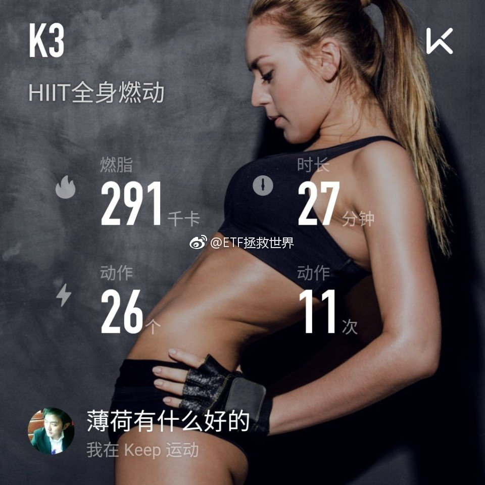

## 2017-08-02 09:06

世界上真的很少有C罗这么拼的球员。真的很拼。从小拼到现在。楷模。//@屈宏斌:C 罗都这么拼，中国球员们还不赶紧苦练?

> @C罗吧官方微博
> #C罗# 更新：Hard work and dedication. 🏃💦🇵🇹 ​​​
> 

## 2017-08-02 09:23

已投入部分年化收益率超过19%。

交易过的17个品种浮亏3个，一个浮亏0.5 一个4% 一个8%

第一轮股灾开始，最大回撤0.7%。

控制风险，一路稳进，必成大业。 ​​​
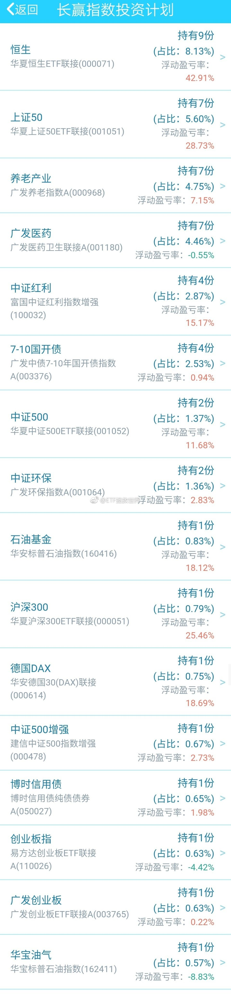

## 2017-08-02 09:52

技术不难实现，我家扫地机器人就能自己找电源充电。。问题是，这个充电线造型太酷了，好像在看科幻电影啊。

> @蓝鲸TMT
> 【特斯拉的无人充电新技术】Model S充电器，可自动寻找充电孔充电，完全无人化....看看，未来加油、充电的岗位都可能要失业了http://t.cn/RKF20vn秒拍视频 ​​​

## 2017-08-02 09:57

回复@我是一个圆豆包:他们的估值应该是直接wind拿的吧，和我计算的差异很大。大致看看应该问题不大。//@我是一个圆豆包:E大～对且慢推出的每日估值怎么看呀～可以作为计划外投资的参考吗

## 2017-08-02 09:59

回复@victoryhf:嗯。观察记录你自己的心态。到了最慌乱要挤着上车的时候，基本就到时间了。//@victoryhf:这两天，涨的发慌

## 2017-08-02 10:19

这次网格谁做了？2轮了，大肉啊。

## 2017-08-02 10:20

发帖后的5.11最低点是3016，今天最高是3300。GJD操盘技术可以说相当精准了。关键是，咱们提前预判到了……//@ETF拯救世界:这次网格谁做了？2轮了，大肉啊。

## 2017-08-02 13:51

2015年11月，有人在雪球发了一个“荒岛10年”的帖子。意思是如果让你去一个荒岛10年，你愿意买哪些股票。

然后，我发了这样一个帖子。

[ETF拯救世界: 荒岛n0年 别说10年了，20年也没问题，n0年也没问题。我会这样做：1、首先，我会要求给我两年时间配置。因为现在有的标的太高，回到... - 雪球](http://t.cn/R9xgd4Z)

其中关键的地方在这两段：

“1、首先，我会要求给我两年时间配置。因为现在有的标的太高，回到正常价格我才放心。否则投个好多年结果不赚钱那是很悲催的。两年时间足够，一定能便宜下去。

2、我会这样配置：

上证50：现估值；
中证500：估值降至30-35；
全指医药或500医药：估值降至30-37；
养老产业：30-35；
美标普：14-16
德dax：与美同时
港恒生：现估值
黄金：400-700美元/盎司。

具体配置要到时候看。本来想加信息，但我没信心它两年内会回到正常。

”

一晃两年时间快过去了，上证50和恒生由于当时的估值就符合要求，所以买了到现在都涨了不少。然而再看当时说的，要等跌到合适的500、医药、养老，果然基本上都没涨甚至一直跌。

但有趣的事情是，由于他们一直跌，都已经即将达到，甚至回到当初的预计买入区间了。

我想说的是这个：

如果两年前我判断的，“现估值”可以买入的50和恒生是正确的——因为两年时间涨了很多。那么，当这几个品种跌入我当时预计的区间，买入，两年后会怎样？

我也不知道，但我预感应该会有很不错的结果。目前养老刚刚达标，医药和500还差一点。

花絮是美股和DAX。真是没机会买入啊。

## 2017-08-02 13:58

好吧，又确认了一下昨天的数据，养老也没达标，也是差一点……各个指数达到建仓区间的上沿其实就可以建仓。不过大肉还是在下沿附近吃。你看50和恒生，后来也是又跌了十几个点才止跌，肉才叫大。所以，各个品种如果能到30左右，咱们下一轮爆发就基本没问题了。

## 2017-08-02 14:11

投资这件事吧，谁也不可能永远做的特别好。区别是有些人对的次数多一点，有些人少一点，有些人没对过。

关键一点，在于你对目前的状况有个清晰的认识，对未来的发展有个模糊的判断。认识和判断大体上不错，那长期看就不会错。

比如有些东西目前涨的凶，有些跌的猛。你就得知道大致上是否合理。涨跌的合理区间是大致什么范围。有个合理区间，也要知道有机会超过合理区间到不合理区间。到了不合理区间最终的结果又会是什么。

话说的比较乱，可能要好好思考一下。

举例来说吧，之前我说恒生指数在我的认知区间，29500-30000点就是认知极限了。超过这个极限就属于我不太懂的范围。那么超过了呢？我会非常平静啊。因为小概率也是概率，不会惊慌失措问自己是不是错了。而且我知道，过了自己的认知极限，越高恐怕越危险。跳的越高，摔得越狠。有多狠我并不知道，那属于精确未来的认知了。我只能模糊未知，会比较惨。

这是思维的角度认清现在和未来。然而怎么指导操作，就又是另一回事。一口气说不完了。

但有一个，人的认知是有限，不可能永远对，所以需要一些原则、系统、策略来管理自己的投资。不能太主观。这其实是认知和操作的主要关键点。

## 2017-08-02 16:01

回复@四只-小熊:20？低于35我会把医药仓位配置到预计最大的80%。谢谢！要笑醒了！//@四只-小熊:广发医药看了下，pe基本都还比较高吧。低于20的几乎没有。是不是离底部还很远，谢谢

## 2017-08-02 17:23

这就是A股的未来。大概是10-15年以后吧。

## 2017-08-02 17:52

哈哈哈哈//@月半月巴白勺木兆://@猪蹄蹄小朋友:回复@郝瑞:真·上等人，副处级以上，潘家园SVIP，中华只抽白盒的，写字台右手边抽屉里有三万多块钱超市卡。微信签名档：上善若水，厚德载物。//@郝瑞:那听民乐的呢

## 2017-08-02 18:08

回复@Holzpuppe:特别正确。布局完成后，阳光沙滩享受人生或者积极进取打拼事业，几个月看看账户。对于绝大多数普通人，是最吼的投资路径。

## 2017-08-02 21:53

每日打卡(46)

简单做一组，相当于休息了 ​​​

## 2017-08-03 09:59

$创业板指 sz399006$  总是蠢蠢欲动。 ​​​

## 2017-08-03 10:34

投资不要带成见。

创业板跌得多了，就不是垃圾。跌得再多一点，就是金子。再跌，就是真正的钻石。

永远把成本控制在最低价的10%-15%之内，谁也杀不死你。相反，财富会滚滚而来。

低买，高卖。简简单单的四个字，过去，现在，将来，永远都会是做生意和投资的奥义。

可惜，大多数人，真的参不透。 ​​​

## 2017-08-03 10:45

回复@木木不哭木木:最爱。我最近几乎每天都在买，已经买到了总资产的5%。这对我来说已经是很不小的一个仓位了。再跌，就会进入低估区域。买入的力度会加大。//@木木不哭木木:医药最近在调整，挺好的，给我们慢慢买入的机会。

## 2017-08-03 10:50

果然创50还是比创指弹性大。未来，它在我们的计划中。 ​​​

## 2017-08-03 10:58

回复@zq2204686:计划也有四个多点医药了啊！我金融资产70%做计划。//@zq2204686:回复@ETF拯救世界:您说的是计划外的吗？敢问您计划外资金占总资金多少比例？

## 2017-08-03 11:01

回复@做而论道725:我金融资产95%在资本市场，其它5%要留着急用。资本市场的70%放在计划里。看东西要看清楚，记牢，不能瞎记，更不能乱讲。//@做而论道725:益达你95%不是都在计划里了么？每天都买没啥资金了吧。。

## 2017-08-03 11:22

回复@立方根2013:我会把我认为最稳妥最安全的投资公布出来供有缘人参考。至于剩下的，不一定适合所有人，也不一定能那么稳妥的赚钱。所以我不会说。//@立方根2013:好奇另外25%不知道怎么安排的?

## 2017-08-03 13:24

有没有人投资的时候，涨的时候觉得没有满仓赚的少，跌的时候觉得拿的太多没法在低位补仓又赚少了。 ​​​

## 2017-08-03 13:41

现在的情况，怎么说，各位，真的很舒服。你可能不理解。

真的一天比一天好。可以说现在是2015年以来最好的时候。为什么，看看中证1000或者创业板就知道了。

除了那2、300只“蓝筹”，绝大部分股票大幅度回归价值。虽然现在只回归了一半，但几乎每周，每个月都在继续回归。

什么意思呢。

意思是，真正收集筹码的时候其实已经来了。这个过程也许还要几个月，甚至一年，最长甚至有可能两年。但你应该知道，这个时候已经来了。

买了，套了，几个月，一两年。没事。真的。还是那句话，真正大牛市来了，一周，两周，开始赚钱。只要把成本控制住。

不要有那种，早知道套这么久，还不如先去存银行，涨起来了再来买，这种想法。

这种想法就是牛市接盘侠的想法。

资本市场是三年不开张，开张吃三年的游戏。它可以用几个月的时间，给你十年二十年的银行利息。

总之就是，舒服。保持舒服的感觉。

## 2017-08-05 21:05

每日打卡 (47)

再次出发。落下的两天尽快补上。 ​​​

## 2017-08-06 10:59

每日打卡（48）

开始还债。 ​​​
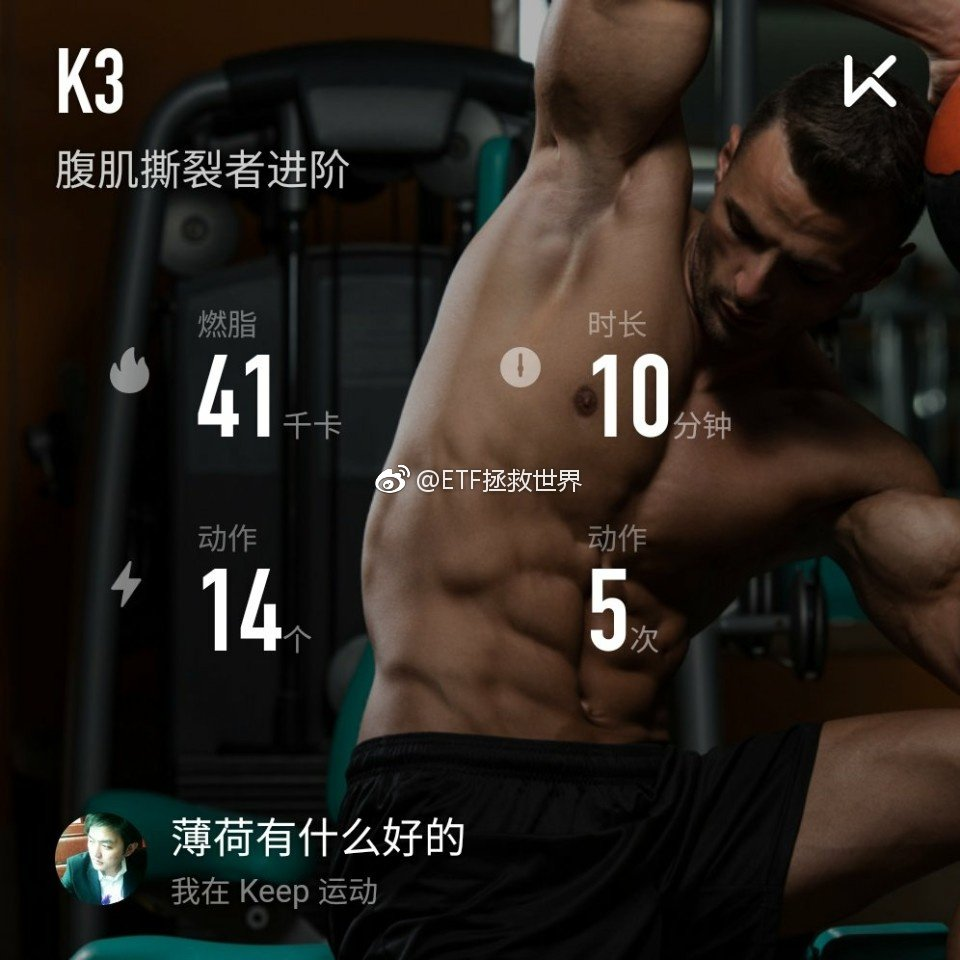

## 2017-08-06 22:35

每日打卡(49)

搞定，睡觉。 ​​​
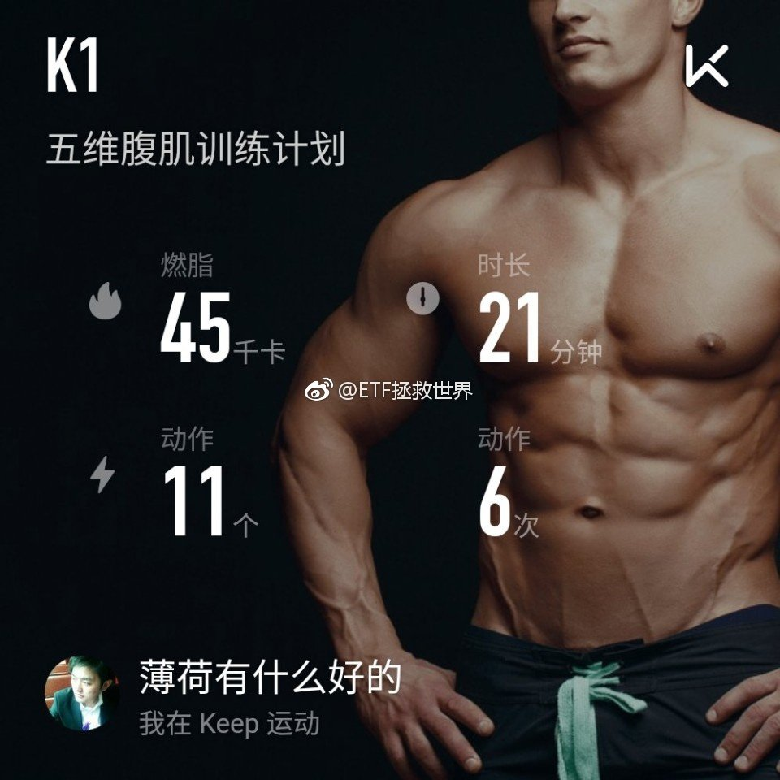

## 2017-08-07 10:59

简单。保持90cm以下腰围；BMI小于18；头发出门前洗干净弄整齐（如果还有）；不戴金链子，不穿船鞋，不穿紧身衣（即使身材特好），尽量不穿短袖衬衣。这是外在，至于内在气质的话，多看书不知道还来不来得及。

## 2017-08-07 11:08

嗯嗯，那就修改一下：体脂率不高于18。短袖衬衣的话，不要穿这种……总之短袖衬衣一言难尽。 
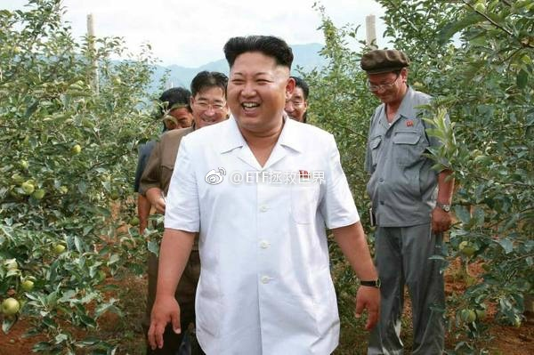

## 2017-08-07 11:18

很多朋友疑惑的短袖衬衣，我想下面这张图包含了很多内容，可以研究一下。。

穿对了还ok，穿不好真的有问题。当然，省 部 级以上领导除外。 ​​​

## 2017-08-07 22:26

每日打卡(50)

坚持也没那么难。一个是为了健康。应该是为了不那么油腻。 ​​​
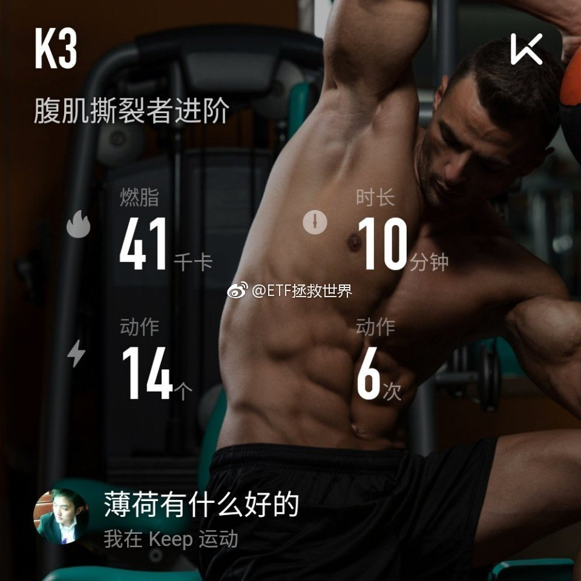

## 2017-08-08 09:16

坚持是有效的。 ​​​
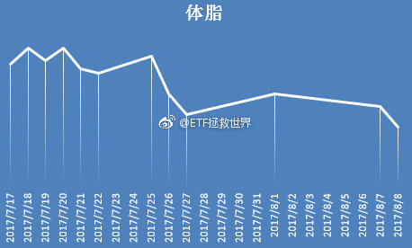

## 2017-08-08 09:34

其实我感觉吧，普通男性，体脂，15-20就够了。要求高点的，12-20。

其实长期投资收益率也一样。几十年的周期来看，有12%就很好了。15%-20%基本就是神级操作。 ​​​
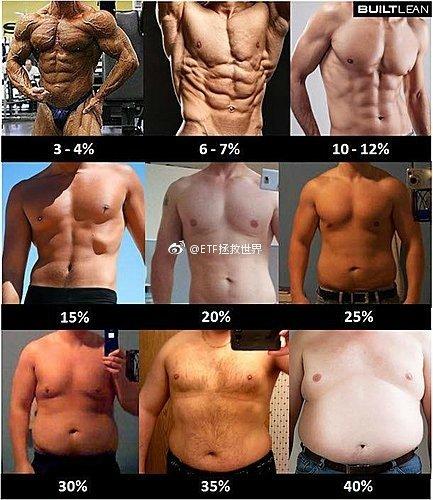

## 2017-08-08 10:08

回复@关键时刻屌无力:是的，不建议炒股，买房靠谱。毕竟房价永远涨。另外问一句，您那7成贷款是无息的吗？//@关键时刻屌无力:新来的，问个问题，每年要求12%收益率那直接全投资房产不就好了，3成首付每年涨4%就够了，房子每年涨4％应该很简单吧还省时省力。

## 2017-08-08 10:44

$创业板指 sz399006$   奶一下。不要涨。刚买了2份。 ​​​

## 2017-08-08 10:55

重申一下关于未来的几个小观点：

第一，对于大多数股票来说，下跌只是走了一半而已。也可能是60%。总之还有至少一小半没跌完，要继续跌。

第二，债券会先于股票见底。目测债券也还有一定的跌幅。如果十年国债能到4，会大量买入。几个月后会换入股票。

未来会有人特别痛苦，套的痛不欲生。更远的未来，会有人欣喜若狂。那是个超级大牛市。不过与以前不同的是，很多股票根本就不会涨。或者，只涨一点，完全跟不上指数。

## 2017-08-08 11:20

是不是失败了。

> @ETF拯救世界
> $创业板指 sz399006$   奶一下。不要涨。刚买了2份。 ​​​

## 2017-08-08 11:21

$温氏股份 sz300498$   万万没想到，通胀预期下，被嫌弃的创业板第一重仓股温氏爆发了…… ​​​

## 2017-08-08 11:53

回复@天狼星爱吐槽:你有没有把一些“黑天鹅”类的突发事件放进未来推演中？未来其实是相当模糊的，无论是“GJD”还是黑天鹅。但我感觉，可能会发生一些GJD也撑不住的事，导致迅速价值回归。瞎猜的。

> @天狼星爱吐槽:E大您好，从纯市场的角度看我认同您的观点，但现在国家队在场可能导致极端的低估很难出现，会不会以拉长调整时间横盘很久的模式度过熊市。

## 2017-08-08 13:37

50赚钱也就算了，创业板也赚钱了。谁能想到。节奏。

## 2017-08-08 13:42

一条小鱼 ​​​
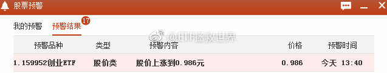

## 2017-08-08 15:10

门票盘/计划盘 一起新高。说到最后，不停的赚钱/市值新高才是最终目标。结合极低的回撤幅度，就更完美了。 ​​​

## 2017-08-08 15:50

​​​
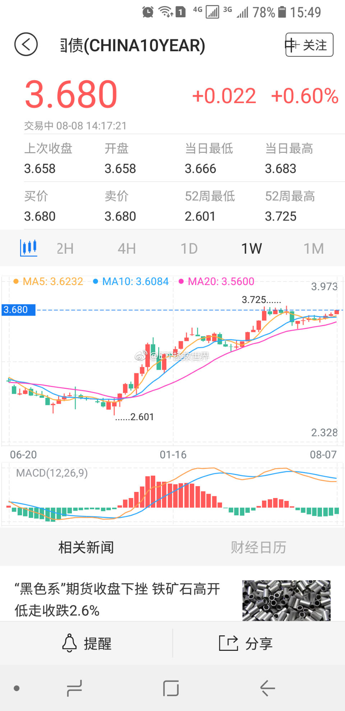

## 2017-08-08 21:21

每日打卡(51)

今天做两组，债还完了。坚持。 ​​​
 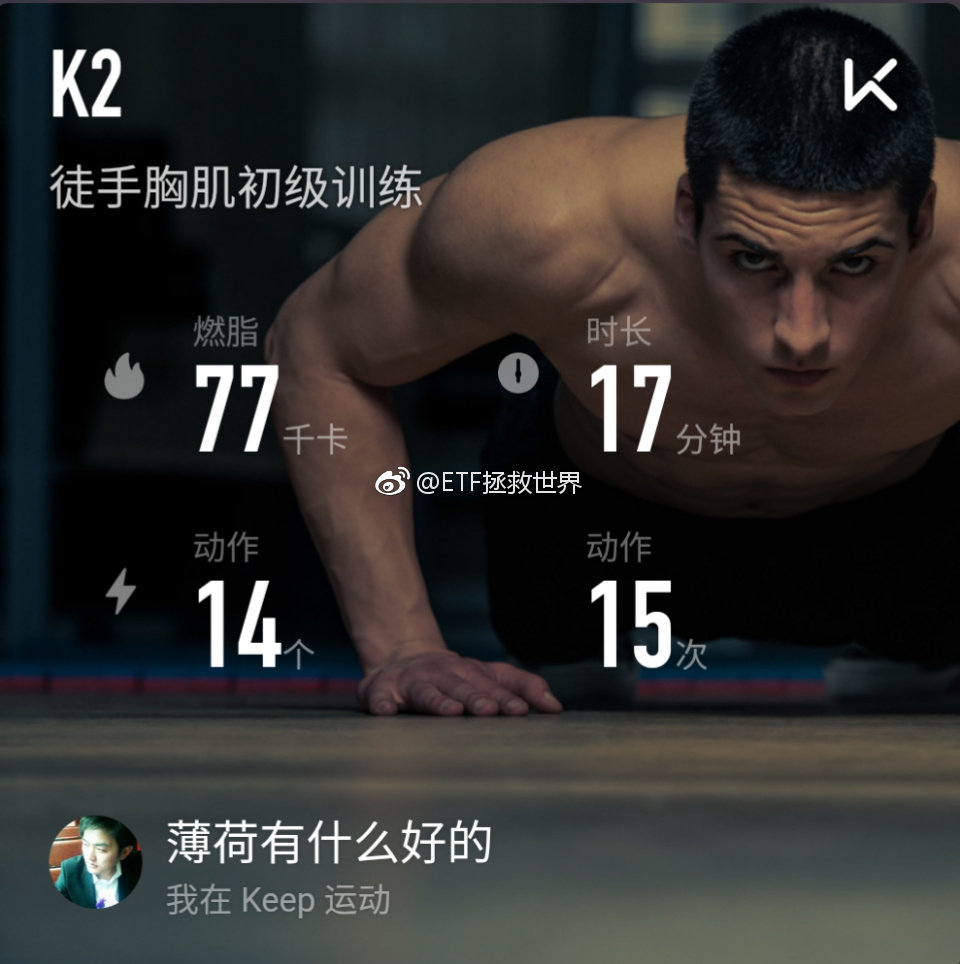

## 2017-08-08 21:24

回复@江湖人称再议哥:还是不要给这样的预期。碰上债券牛市一年17%可以，万一很久没有呢。还是不要有太高预期，基础配置就可以。//@江湖人称再议哥:回复@DX_XDZz:14年17%左右 15年10%左右 国开债指数 好像记得是这样

> @白日梦想喵x:跟着E大在买，但是不知道这个国开债指数，预期收益率可以达到多高呢？

## 2017-08-09 05:22

回复@俪俪LilyYan:一定要保重！也希望在四川的朋友们都平安！

## 2017-08-09 08:57

回球球了。

微博也会继续和大家一起玩~放心各位~ ​​​

## 2017-08-09 09:56

回复@野狗菜:3%是债息。但是你要注意，债券的价格会变化的。所以2016年下半年买入债基的很多人现在都亏了不少，为什么，价格下跌了。同理，当价格上涨的时候，债息+价格收益，这个赚多少都有可能。710国开债08年涨11%；14年涨14%就是这个道理。

## 2017-08-09 10:00

憋说话，用心去感受。医药长期低迷是不可能的。//@ETF拯救世界:回复@木木不哭木木:最爱。我最近几乎每天都在买，已经买到了总资产的5%。这对我来说已经是很不小的一个仓位了。再跌，就会进入低估区域。买入的力度会加大。//@木木不哭木木:医药最近在调整，挺好的，给我们慢慢买入的机会。

## 2017-08-09 10:16

创业也好，养老也好，医药也好……

最近这几个月我们大力买入的品种，都是为“未来”布局。什么是未来？未来不是明天，下周，下个月。而是明年，三年、五年、甚至十年后。

为明天或者下周布局很简单，买强势就行。但我们不会，我们就买弱的。非常弱，特别弱，超弱的。

即使这么弱，我们持仓也都是盈利的。你说吼不吼？

那么，未来它们开始爆发的时候呢？

## 2017-08-09 11:05

2000多家下跌，又新高了什么鬼 ​​​

## 2017-08-09 11:14

本月中的品种已经有点眉目了。应该是有个新大类品种纳入囊中。 ​​​

## 2017-08-09 11:49

SO?

> @蓝鲸TMT
> 【强生宣布HIV疫苗临床试验结果：志愿者100%产生抗体】强生公司宣布了全球首次HIV疫苗人体临床试验结果，这一多中心、随机、安慰剂对照、双盲的1/2a期临床试验招募了393位健康志愿者，志愿者来自美国、卢旺达、乌干达、南非和泰国，结果显示，志愿者对HIV疫苗耐受性良好，且100%产生了对抗HIV的抗体。 ​​​
> 

## 2017-08-09 13:31

17个品种两个浮亏。浮亏超过5%的只有一个，市值占比0.5%。

怎么办，投资好难。 ​​​​ ​​​

## 2017-08-09 13:42

$159938  目前计划的第二大并列重仓基金。

无论如何，不管发生什么，除非买的时候就是为了做波段，否则不要卖。不要卖。不要卖。

说三遍。 ​​​

## 2017-08-09 13:48

说真的，科学这件事，不要说的太绝对。曾经人们认为地球、太阳是宇宙的中心。世界上没有什么不可能，只能说，以人类目前的科学水平，没有发现地震与地震云有关而已。面对这个世界，大家都应该敬畏和谦虚。

> @中国地震台网速报
> 云，和地震没有关联！！！ ​​​

## 2017-08-09 13:53

回复@小韭菜V:想梭就梭，要梭的漂亮。//@小韭菜V:老大:我想梭哈!

## 2017-08-09 13:58

回复@奥斯特洛夫大柴夫斯基:保守-激进，我的建议仓位是21-48//@奥斯特洛夫大柴夫斯基:现在50%的仓位，继续等，希望能加仓位到150%（个人根据E大做的个性化调整方案）。

## 2017-08-09 14:17

谁还记得一年前的 $国证食品 sz399396$ 

 ​​​

## 2017-08-09 14:26

有些朋友觉得我每天强调心态，强调收益率，强调坚定持有，每天说，说太多，都是废话。

其实，可能是他不知道就是因为我这样，多少朋友的恒生才能坚定拿到50%+。多少朋友才能坚定持有各种盈利品种，才能面对下跌心态平和。

有些事，其实并不那么简单。 ​​​

## 2017-08-09 17:36

最喜欢丁磊。freestyle！用心做事！产品好！不吹NB！清流。//@八大山债人:。。。。 //@钟鸿钧://@子柳:潘老板：我看到门口有人穿西装。 丁老板：那是保安。

> 潘老板：你们平时上班都穿这样呀？
> 丁老板：不然呢？ ​​​
> 

## 2017-08-09 17:42

回复@iloveyounow:网易老板。曾经的中国首富。你看，低调到很多人都不认识。就喜欢低调的实力派！//@iloveyounow:回复@ETF拯救世界:他是做什麼的//@八大山债人:。。。。 //@钟鸿钧://@子柳:潘老板：我看到门口有人穿西装。 丁老板：那是保安。

## 2017-08-09 20:11

讲真，想骂人。为什么。

> @ETF拯救世界
> 本月中的品种已经有点眉目了。应该是有个新大类品种纳入囊中。 ​​​

## 2017-08-09 22:15

每日打卡(52)

今天累，来个轻松的 ​​​

## 2017-08-09 22:44

美股十年最高估值已经持续几个月了。无论崩不崩，从现在算，未来十年收益会很低。

## 2017-08-10 09:35

回复@Tony_RUC:肯定是赚钱了，至少在1%左右。你并不熟悉普通投资者的心态。一个品种浮亏，回本后马上就想卖出，害怕再次浮亏，坐过山车。所以我会在回本的时候提醒：不要卖。//@Tony_RUC:根本没涨，卖啥卖啊，老大………没赚钱啊！

## 2017-08-10 09:40

回复@xeon_xiaohai:没有。同一类别的小类资产总量绝不超过20%。比如50和300是一个小类，医药和养老算一个小类，石油基金和华宝油气算一个//@xeon_xiaohai:E大，每个品种购买的份数有上限吗，如果有的话上限是多少份？

## 2017-08-10 09:54

醉了，除了仓位低的两个，都是红的。

我再说一次，计划里的任何品种，未来，某一天，浮亏十几个点，一点点都不用担心。千万不要随便卖。因为牛市来了，一周两周就分分钟盈利。这话说过很多次，还要再说。 ​​​
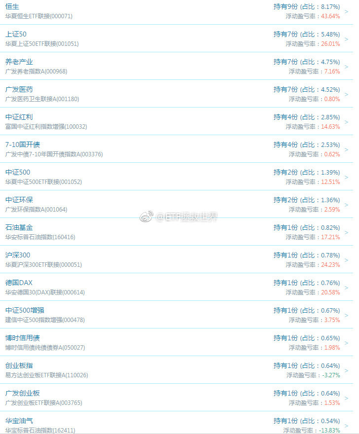

## 2017-08-10 09:57

回复@刘泽瑜31881:有些话我说过不止一次。仓位是适合我的，也是适合一部分朋友的，但不是适合所有朋友的。觉得低的，我买一份可以买两份甚至三份。我不能让所有朋友感到舒服。//@刘泽瑜31881:我觉得现在不是浮亏的问题而是有可能仓位问题！

## 2017-08-10 10:24

一个消息：恒生已经低于我们31号的卖出价格了。

 ​​​

## 2017-08-10 11:21

很多，我不是说所有啊，很多上涨时候觉得仓位低的朋友，三根，或者两根阴线，就会觉得仓位有点高。 ​​​

## 2017-08-10 11:49

不要高兴太早，还有5天。 ​​​

## 2017-08-10 11:56

回复@石头里的虫子:是哦，其实还有2个半工作日。14、15日随机发车//@石头里的虫子:三个工作日。

## 2017-08-10 12:08

你给的价格太高，人家当然要套现。没人买，跌到大股东不愿意套的时候，自然就没人套了，甚至还会增持。维持股市高价格高估值，让股民高位用这些垃圾价格炒来炒去，是解决问题的方法？

> @叶檀
> 参加网易经济学家年会，跟水皮先生辩（交）论（流），不必停止IPO，要应对的是套现
> 

## 2017-08-10 21:02

每日打卡(53)

这组认真做还是有点酸爽的。 ​​​
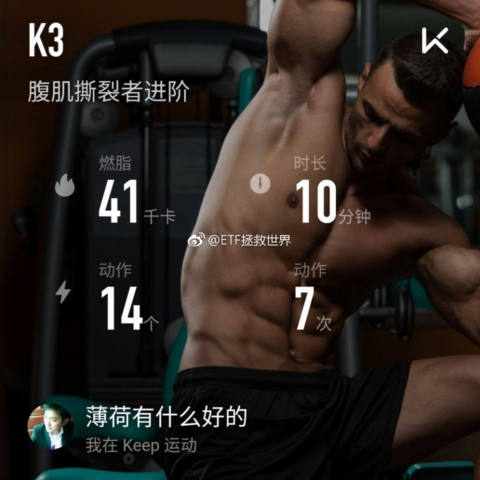

## 2017-08-11 08:07

看热闹的同时，是时候找一些合适的美元资产了

> @和讯网
> 【人民币一周上涨1% 空头踩踏、对冲基金止损离场 】 本周人民币兑美元涨幅已接近1%，连续突破6.72、6.7、6.68、6.66等多个关口，面对人民币汇率如此凌厉的涨势，持有人民币空单的对冲基金再也坐不住了。对冲基金平仓空头头寸止损离场。http://t.cn/R9nHz8q人民币一周上涨1% 空头踩踏、对冲基金止损离场 -基金频道-#和讯网# ​​​

## 2017-08-11 09:26

呵呵哒。//@华尔街见闻APP:香港恒生指数开盘跌1.6%，至27000.43点

> @见闻实时新闻
> 【快讯】香港恒生指数开盘跌1.6%，至27000.43点。http://t.cn/R64lHNR实时快讯 ​​​

## 2017-08-11 10:27

创业和医药红了 ​​​

## 2017-08-11 10:31

什么意思呢。注意，这个月初是卖掉一份恒生，买医药和创业。

## 2017-08-11 10:33

回复@强尼大木覀:“哎我跟你说，我捡了1万块钱”。“高兴个屁啊，你又没捡1000万能买套房。有什么好高兴的？”//@强尼大木覀:就卖了一份，大仓位还是继续持有的啊，为什么跌了这么高兴呢？//@ETF拯救世界:呵呵哒。//@华尔街见闻APP:香港恒生指数开盘跌1.6%，至27000.43点

## 2017-08-11 10:47

回复@纯香芥末:我告诉你未来吧。这也是计划中所有品种的共同未来：拿着的仓位跌下去了，然后再回到下跌的起点，你会发现，神奇的，赚的比跌之前多多了！//@纯香芥末:虽然我跟的晚没买到恒生，也是担心这要跌了不起来，手里还有那么多咋办，只能等以后再来看节奏了，现在还看不懂

## 2017-08-11 11:20

​​​
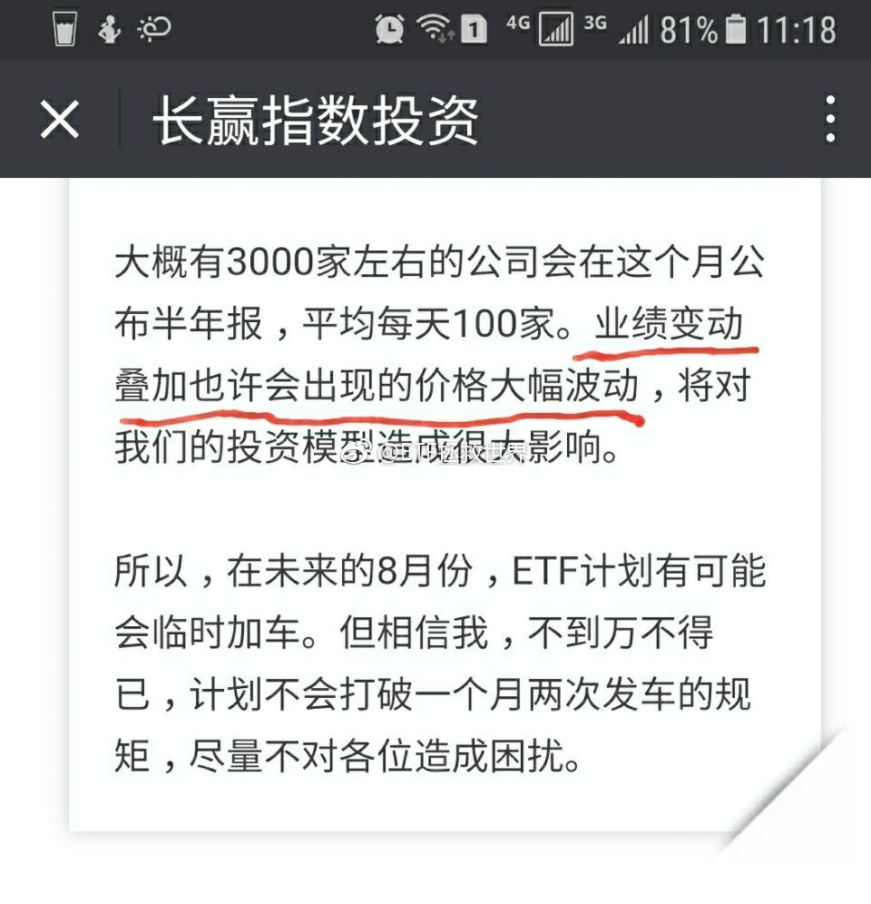

## 2017-08-11 14:38

看了眼即时估值数据，也没有太令人惊喜。

我估计月底的车才是最值得期待的！ ​​​

## 2017-08-11 14:55

如果这个月买十份以上，会不会惊讶。

## 2017-08-11 23:28

每日打卡（54）

周末比较放纵，晚了点。 ​​​

## 2017-08-12 23:56

喝多了。

半个月白练了 ​​​

## 2017-08-13 22:06

每日打卡（55）

还债。两组。 ​​​
 

## 2017-08-14 09:23

回复@俪俪LilyYan:一年喝不了两次。遇到正确的人，可以喝。//@俪俪LilyYan:意外，我以为的EE是烟酒不沾、干干净净的谦谦美男子～～

## 2017-08-14 09:33

只要涨幅可以接受，今晚会先发一车。 ​​​

## 2017-08-14 14:06

表脸//@ETF拯救世界:如果这个月买十份以上，会不会惊讶。

## 2017-08-14 14:12

回复@求财不劫色:因为我们买了//@求财不劫色:益达，创业板今天吃药了吗？//@ETF拯救世界:表脸//@ETF拯救世界:如果这个月买十份以上，会不会惊讶。

## 2017-08-14 22:50

每日打卡（56）

时间不够用 ​​​

## 2017-08-15 09:39

坐山观虎斗 ​​​

## 2017-08-15 09:49

回复@2014不疾而速:我不敢想象，也不希望创业板在这里有大幅度反弹。如果那样，不光没有牛市，还会有更大的灾难发生。//@2014不疾而速:50和创业板，到底谁是新的王者呢

## 2017-08-15 09:59

今天账户又新高了，高兴，送电影票。

也是因为大家这几个月一直在微博和我互动，也很辛苦，哈哈。下面这个是微博的粉丝互动排行榜，我不知道算法是什么，反正就按这个来吧。

送排名第一的朋友两张电影票。请48小时之内和我联系。如果放弃或者不联系就顺延到排行第二的朋友，以此类推。

任何电影都可以，3、4线以上的城市都可以。太小的村镇就不行了应该。

意不意外，开不开心？
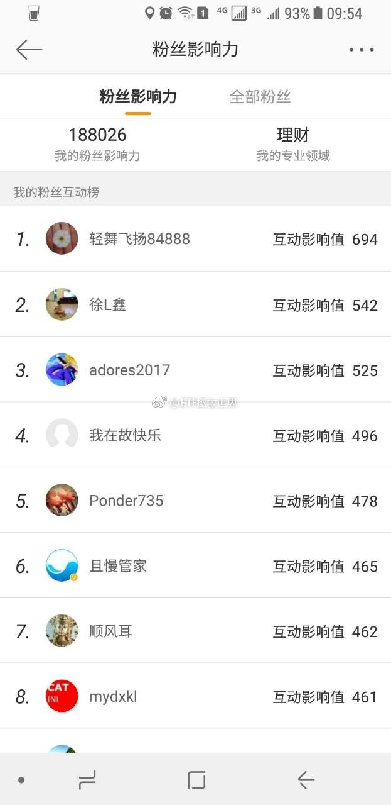

## 2017-08-15 11:00

关于有些朋友不停的说华宝油气与油价走势不符。只说两点，加个图，以后不用再讨论。

第一，油气跟踪的不是油价本身，原油没有办法像黄金ETF一样持有现货，因为它不易保存。解决的办法两个，一个是跟踪期货，比如南方油。但是换期有损耗，我不敢长期持有。第二个是跟踪上游或者全产业链公司，比如xop和油气。

第二，短期看，当然不可能精准的每天对应涨跌幅，毕竟跟踪的不是一个东西。但长期看，70%以上是有的。而且从历史看，xop/油气的弹性更大一些。

图是过去五年xop和油价的对比，黑油，红xop。

油气与xop比，又多了一个汇率的问题。用过的好是双击，用不好是双杀。

但因为持仓的是股票，长期持有怕什么呢。我是不怕的。
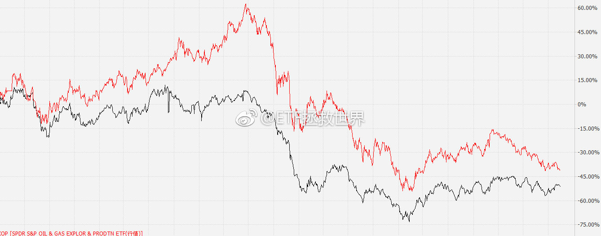

## 2017-08-15 11:07

回复@CZ梦想:油气一路跌下来，总是有人不停的催加仓。催什么呢。你知不知道为什么有些人会在一个品种上赔很多？因为跌一点就加，跌一点就加。本来就买了一点，跌10%就已经加到70%仓位了。结果呢？duang，又跌了70%。翻不了身了。下跌加仓是有节奏的，不要催，该加自然会加。

> @CZ梦想:跌了16%加一份还是不错的[耶]

## 2017-08-15 13:23

自己找吧。 ​​​
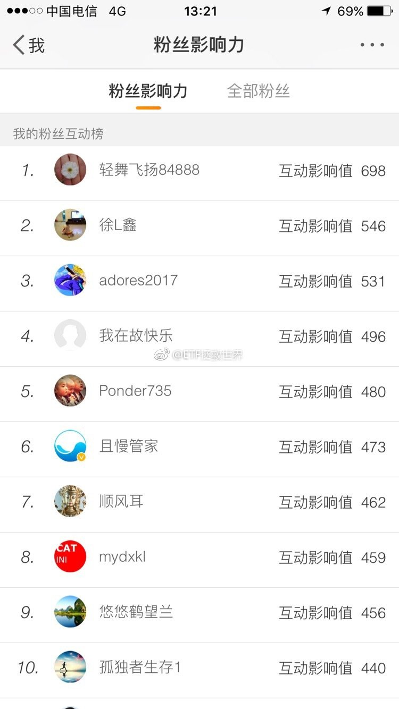 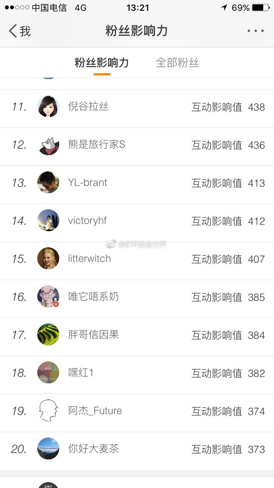 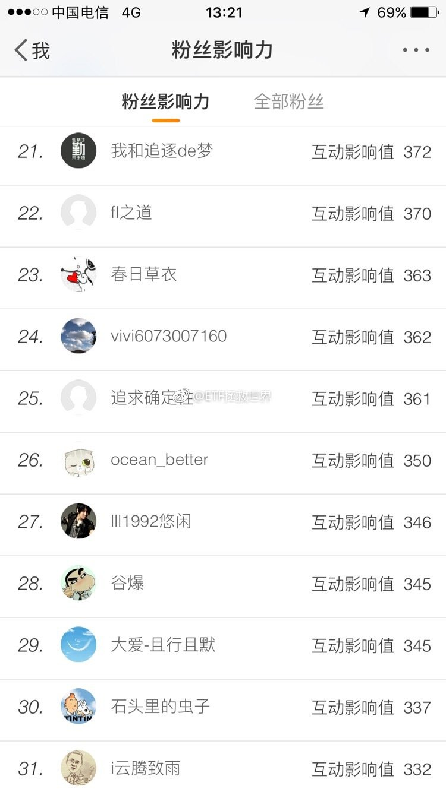 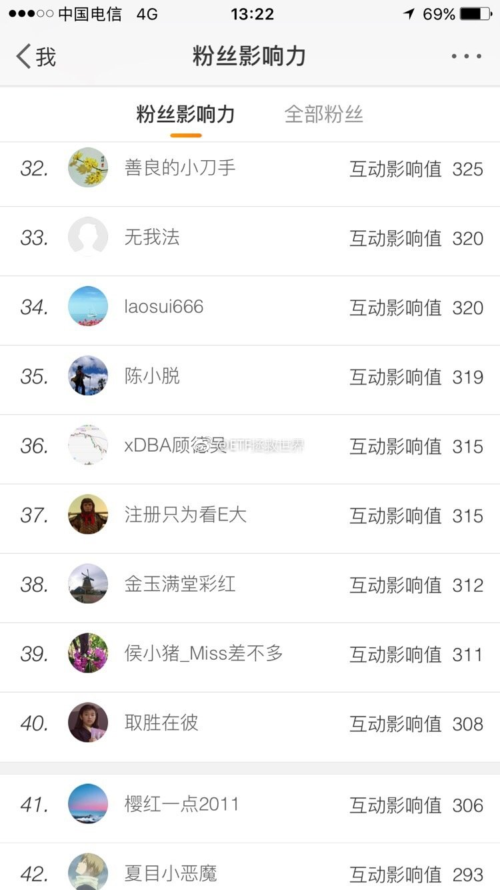 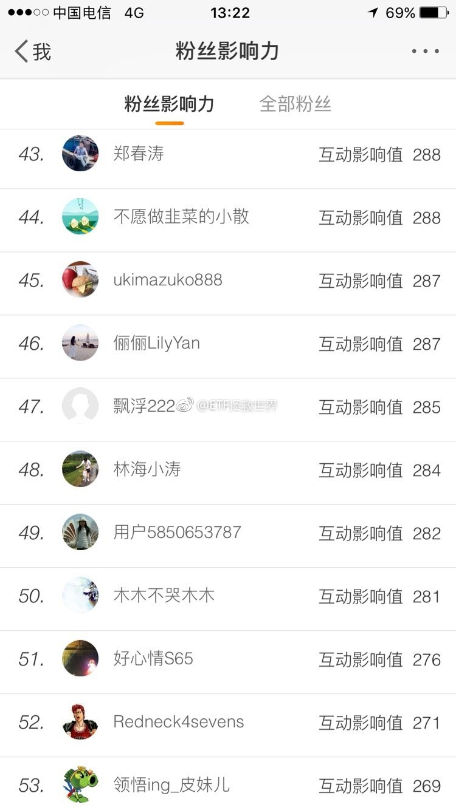 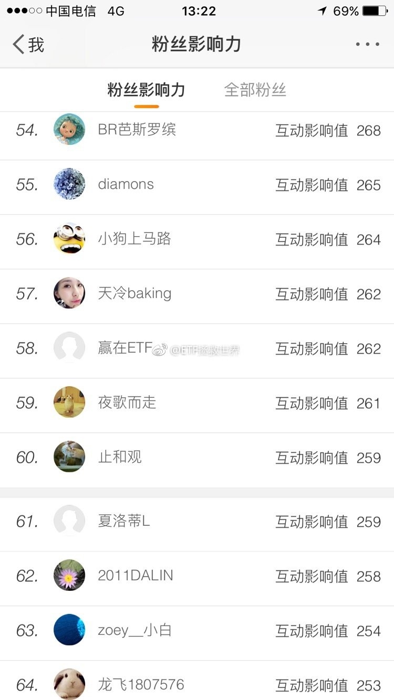 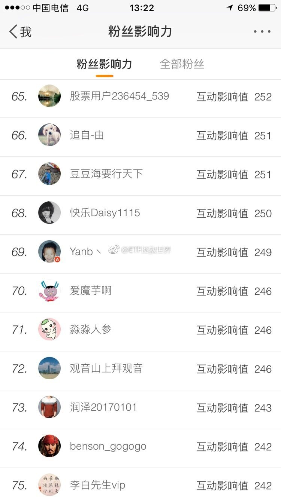 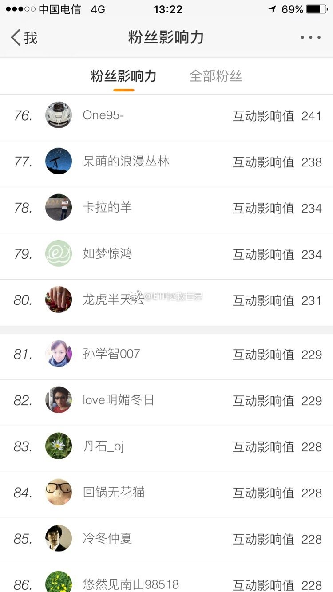 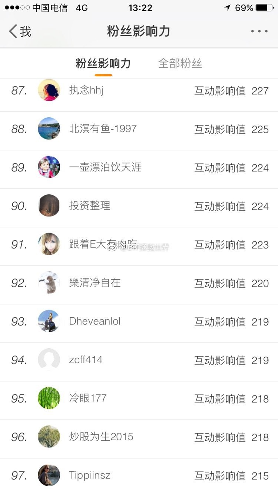

## 2017-08-15 16:29

回复@就爱喝X:过年红包发了好几千，你跟我说没有两张电影票好 //@就爱喝X:比过年的红包好

## 2017-08-15 22:50

每日打卡（57）

今天累，这组相当于休息了。坚持 ​​​

## 2017-08-16 09:49

$创业板指 sz399006$   差不多得了。 ​​​

## 2017-08-16 11:40

遇到瓶颈了。最近吃吃喝喝，锻炼也不够。需要反省了。 ​​​
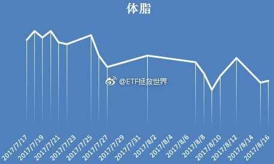

## 2017-08-16 13:44

全都买的指数基金。然而，所有指数都没新高，组合又新高了。

神奇。 ​​​

## 2017-08-16 15:07

今年门票盘36%了。做了那么多年指数，选股技术没有退化 ​​​
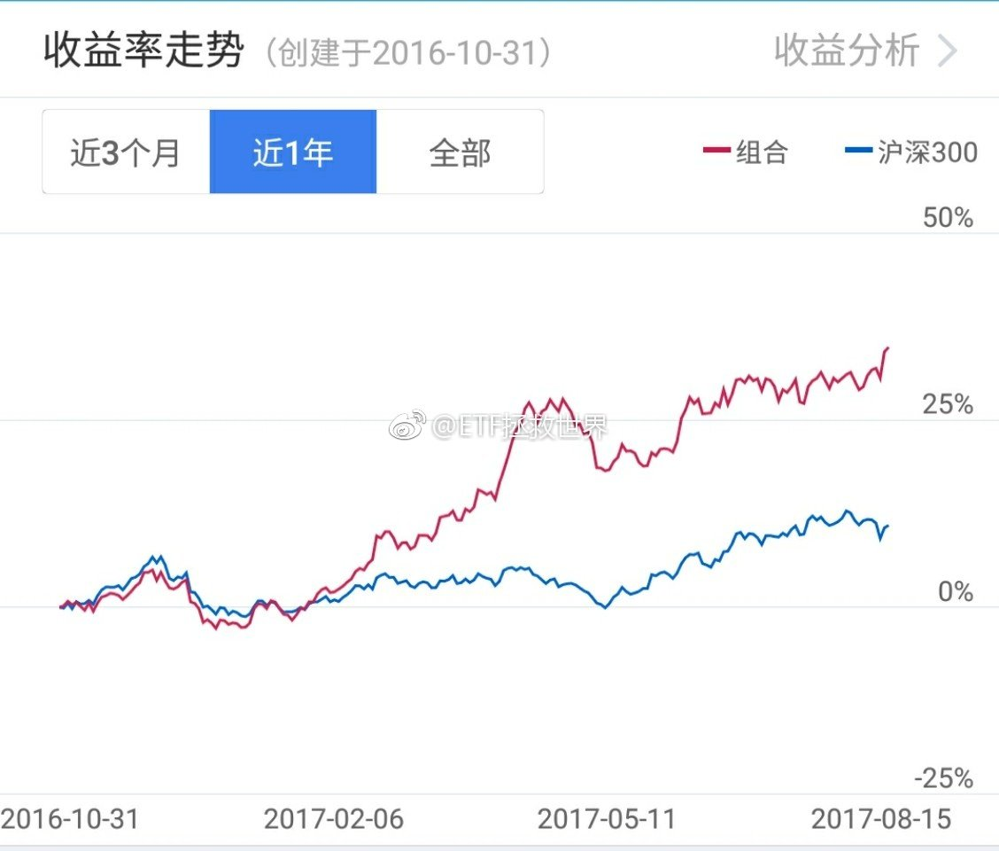

## 2017-08-16 21:18

每日打卡（58）

快两个月了。坚持。 ​​​
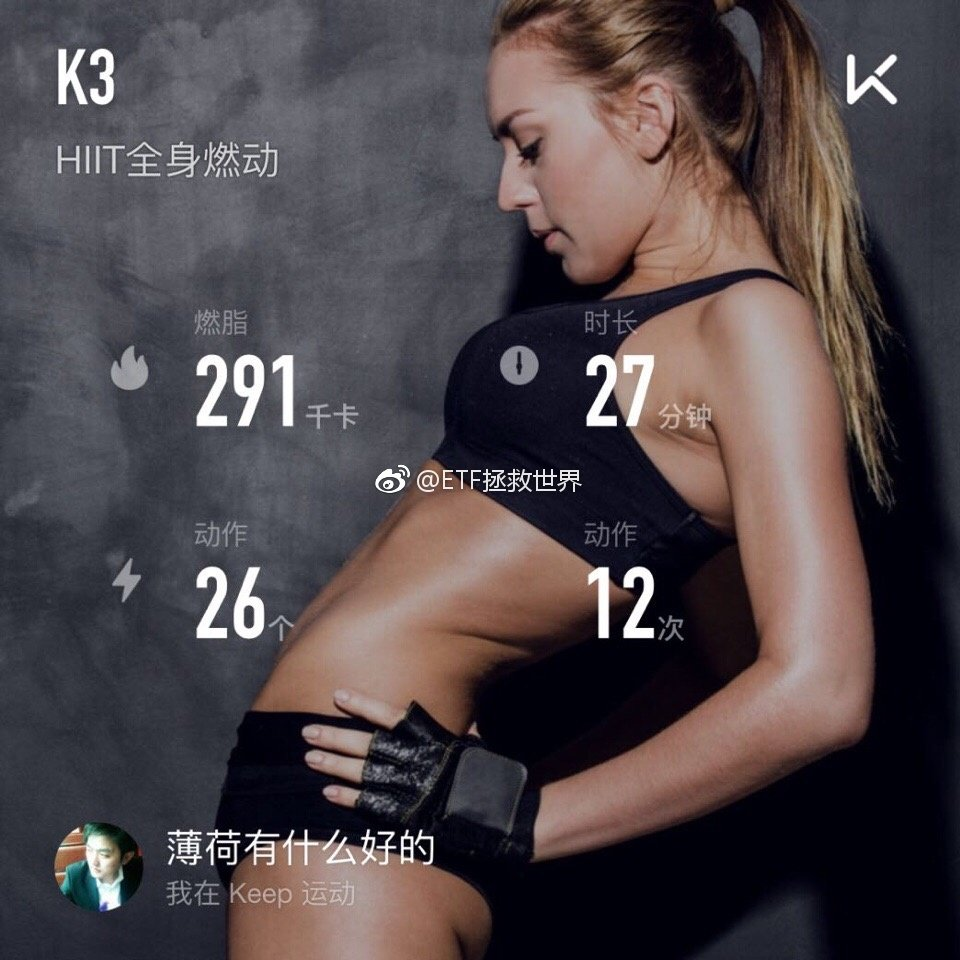

## 2017-08-17 10:10

套利华宝油气要特别注意，2、3个点的空间最好别套。如果是场内申购，申购费就1.2%。晚上随便一涨就吃大亏了。我曾经在有5%空间的时候套了一次，结果晚上涨了6%。可以说相当悲惨了。

——老司机的真实经验。 ​​​

## 2017-08-17 10:15

各位可以注意观察，这个市场上的人有多么有意思。

就拿我们布局的几个品种说，从2015年底开始的恒生和50、一个多月前的创业板，我们第一次买入后都有十几个点的下跌空间。越跌看空的人越多，而且有无数理由看空，听起来真的都非常合理。

然而，几根阳线出来，大多数人空翻多。看好的理由听起来更合理。

油气也是如此，咱们第一次买入后，又是十几个点的下跌了。看空的理由还是很多。放心，若干时间后，几根阳线出来，一切都不同了。

咱们要做的，就是始终把成本控制在最低价格的10-15%。保证几根阳线后就能盈利。

这就是所谓的东方不败秘籍了！

## 2017-08-17 10:35

虽然这两个月在买创业板，但我真的不认为这里会是创业板一个不可错过的超级大底。很难想象在这个位置会有创业板牛市。

我不太相信。 ​​​

## 2017-08-17 11:32

毒奶名不虚传，就问你服不服。

## 2017-08-17 13:31

短短半个月时间，受人追捧的漂亮50黯然神伤，遭人唾弃的创业板强势上行。

各位，雪中送炭这种事，还是要多做才好，会有好报。 ​​​

## 2017-08-17 14:10

发布了头条文章：《重温7、8月计划中关于创业板的两段话》 。重温一下，可能更有感触。  ​​​

​​​7月：壹：创业板

创业板是天使还是魔鬼？

2012年11月底，也就是在我写下那篇见底文章之后，以创业板为代表的中小股票开始了长达两年半的大牛市。

两年半的时间，创业板指从585点涨到了4037点，涨幅接近7倍（创业板综指涨幅更大）。这是一个堪比0607大牛市的巨大涨幅。

那个时候，创业板是天使。

2015年6月起，它变成了魔鬼。还是创业板指，两年后的2017年6月，从4037点跌到了1800点，跌幅超过55%。而且，更可怕的，是这个指数的估值依然在四十多倍，趋势上看，毫无止跌的迹象。

在大白马们熠熠生辉的2017年上半年，创业板指数，创业板股票被继续踏上一万只脚。小股票已经成了永远也没有希望的辣鸡。

不好意思，这个时候，爱捡辣鸡的我们又要出现了。

“漂亮50”在今时今日，再一次成了时髦的词汇。而一年多前我们买入的时候，它们几乎无人问津。目前我们的收益率23%。

港股似乎又成了“全世界最便宜的价值洼地”，同样，一年多前我们越跌越买的时候，它是“毫无希望的边缘化市场”。目前我们收益率35%。

当然，目前的创业板和当时的50、港股不能相提并论。它并没有便宜到那个地步。所以，我们不会给它多少仓位，先买一份顶着先。

未来，创业板反弹也好，继续价值回归下跌50%也好，又或者再来一次莫名其妙的疯牛也好，我们统统笑纳了。

创业板不是天使也不是魔鬼。重要的是，你愿意在它失意的时候去帮助它，还是在它春风得意马蹄轻的时候去追捧它。

至于这次的两个买入品种选择，都可以。159915的优势是流动性好，159952的优势是没有持仓“薯片”，未来薯片开盘暴跌的话，受伤会较轻。

8月： 叁：创业板、涨跌

从创业板在资本市场诞生那天起，关于它的争论就从未停止。

到了现在，买不买创业板，依然是争论不休的一个话题。

本月，ETF计划第一次买入一份创业板。不出意外（去看上个月底的文章），目前，我们买的那份浮亏了。

这太正常。在一个下跌趋势如此明显的品种上，大概率当然会浮亏。不过，很有意思的，我想到了两个真实的案例。

很多朋友是2014、2015年被那轮大牛市卷进了资本市场。那，你现在回想一下，当时是不是有如股神附身，买什么什么涨，每天买的股票就像坐了火箭一样不停的涨？赚快钱是不是很开心？当然了，你也一定不会忘记，后来发生的一切。

又有很多朋友2015年7月开始参考第三轮计划。一开始，我们买的50、恒生，买了就跌，不停的跌。我们开开心心吃着火锅继续买，大跌大买，小跌小买。虽然浮亏了好几个月，但你现在打开自己的账户，或者是抬头看看上面的表格里面恒生和50的浮盈幅度，那么之前浮亏的感受，还会让你痛苦吗？

资本市场，要赚短线快钱并不难——找到一个上升趋势良好的品种，买进去就是了。趋势这个东西，一旦形成，要想改变其实并不容易。所以，你在相对低位买入一个上升趋势好的品种，大概率会赚到快钱。然而我更喜欢的，其实是捡垃圾——捡那些别人不要的，被不停卖出的垃圾。我知道只要我把这些垃圾的成本价控制好，必有一天会有人用黄金甚至钻石的价格把这些“垃圾”买走。

至于别人对我买的东西怎么评论，我真的毫不在意。如果不是大多数人说不好，它的价格也不会是垃圾的价格。听别人的？那我注定将和大多数人一样亏得内衣都没了。

做好最坏的打算，买进别人不看好的“垃圾”。

交易方面，易方达和广发的创业板都可以买。它们的区别是是否持有薯片。易方达的创业板场外联接基金已经调整了该股票的价格，预留了三个跌停，场内ETF159915没有调整价格。如果看不懂这几句，买广发的159952或者场外的003765就ok。该基金未持有薯片的股票。上个月我在且慢是用易方达，本月会再买一份广发，方便各位可以自己选择买哪只。

无论未来买的这一两份创业板如何涨跌，各位，放轻松。投资从来都应该是一件很快乐的事。

## 2017-08-17 22:04

每日打卡（59）

天气凉快，慢慢跑五公里，出点汗很舒服。

很多事情都是在跑步时想清楚想明白的。跑步的时候是一天之中难得能专心思考的时间。

跑完心情不错。 ​​​
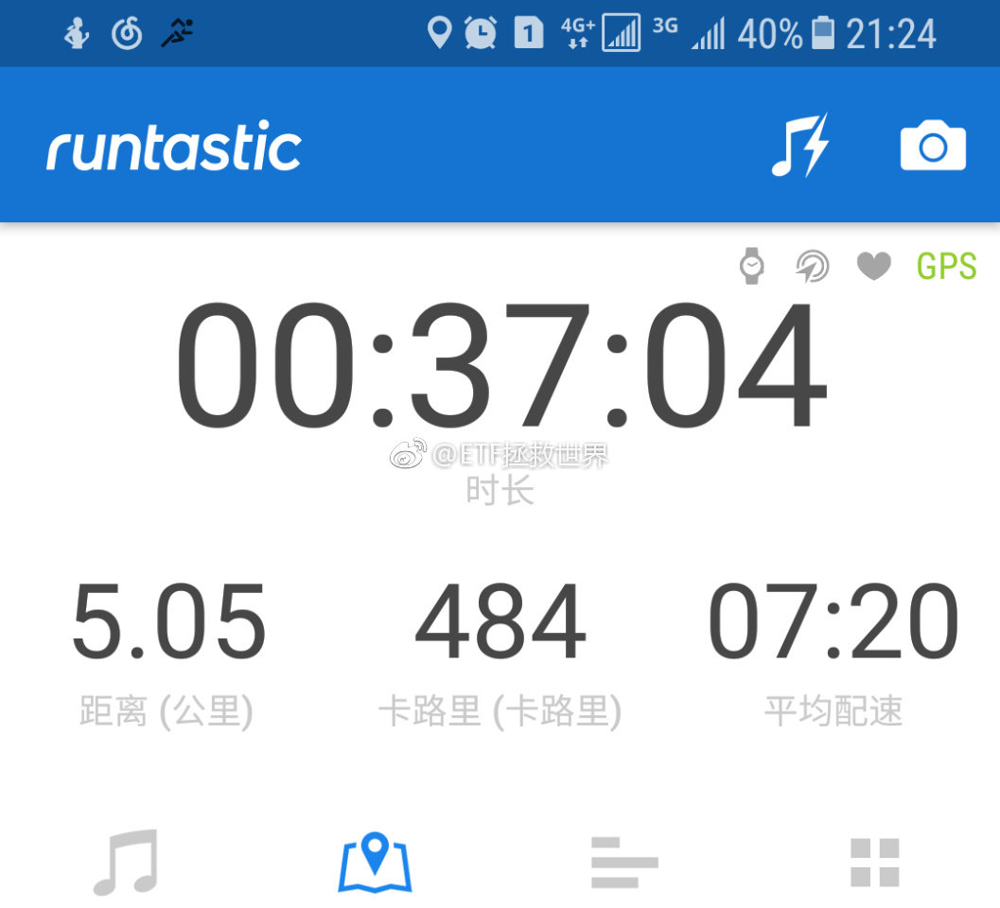 

## 2017-08-17 22:41

港真，是不是瘦了。这60天没白练啊。 ​​​
 

## 2017-08-17 23:01

回复@诸天_星辰:你看看我发的微博。我是三个手机一起用。这个世界上还有没有一点信任了。//@诸天_星辰:乍用苹果手机呢？是本人吗

## 2017-08-18 09:23

全球资产价格高估。很多人赚了钱分不清楚到底是能力还是运气。总有一天现实会让大家都分清。

另外，一定要警惕某段时间表现特别好的。包括品种，包括投资人。很少很少有一直表现特别好的，一段时间特别好，可能预示着灾难要来临。当然，你要真能碰上总是表现特别好的，那真是运气爆棚了。

永远保持在中上，每个阶段都不拔尖，也不落后。总是在高于大多数人的状态下前进，那就是坠吼得。

## 2017-08-18 10:37

未来美国+德国会占到10%或15%。

然而目前的情况，何时能买完还是个未知数。太难了。 ​​​

## 2017-08-18 10:41

谁能想到，如果去年十月买入标普500ETF,持有到现在居然没赚钱。 ​​​

## 2017-08-18 10:59

回复@石头里的虫子:去年12月疯狂溢价你为什么不卖呢//@石头里的虫子:我是2014年买入博时标普500的，虽然赚钱了，但是看上去年化也没有多少。

## 2017-08-18 11:18

个人体会，投资最重要的是确定性。

金融投资当然是不确定的，但是可以通过品种+组合+策略的方式最大限度消除不确定性，提高确定性。

巴菲特说，投资最重要的两点，第一保本，第二看第一条，体现的就是要确定。

杠杆压独赢成了当然发家致富，输了一了百了。一将功成万骨枯，你看到的英雄脚下有无数冤魂。然而群众只看到英雄，也希望自己能做到。当然有可能，但概率是最大的问题。

你确定不亏，就已经战胜了70%的人。这是一个什么样的游戏？

## 2017-08-18 11:25

回复@我在故快乐:去年那种情况，不要有点溢价就着急卖。只要额度受限，疯狂拉升，就拿着。我在雪球有个组合可以看看，当时是12月6日1.8卖出，1.3日1.46接回来。赚了几十个点的差价。碰到大机会就要想办法多赚点。//@我在故快乐:嗯，我的早卖了。

## 2017-08-18 13:46

55%的家庭没有或几乎没有储蓄。  收入前10%的家庭储蓄率为60.6%，其储蓄金额占到了总储蓄额的74.9%。  收入前5%的家庭储蓄率是70%，在总储蓄中占比61.6%。  也就是说，收入最高的5%的家庭，每新增收入10000元就会存上7000元！

## 2017-08-18 13:54

根据刚才那个报告和之前招行的报告，中国5%-10%的人占据了70%的财富应该问题不大了。 ​​​

## 2017-08-18 16:38

回复@俪俪LilyYan:“最近钱全套在股市了，跟人买ETF，全套了。你看，就是这个华宝油气。借5万？家里就剩5000了，拿走吧。先用着。”10%，就当丢了。//@俪俪LilyYan:回复@倪谷拉丝:不借的话，亲戚没得做。借了的话，最后要钱翻脸同样做不来亲戚，而且钱也没了，划不来啊

> @NGLS1212 :有亲戚朋友向你借钱不还怎么破？最近成了追债小能手[允悲]

## 2017-08-18 22:02

每日打卡（60）

累 ​​​

## 2017-08-19 08:30

每日打卡(61)

晚上不知道有没有时间，早上先来一组。神清气爽有没有。 ​​​

## 2017-08-20 19:14

每日打卡（62）

keep改版了。坚持 ​​​
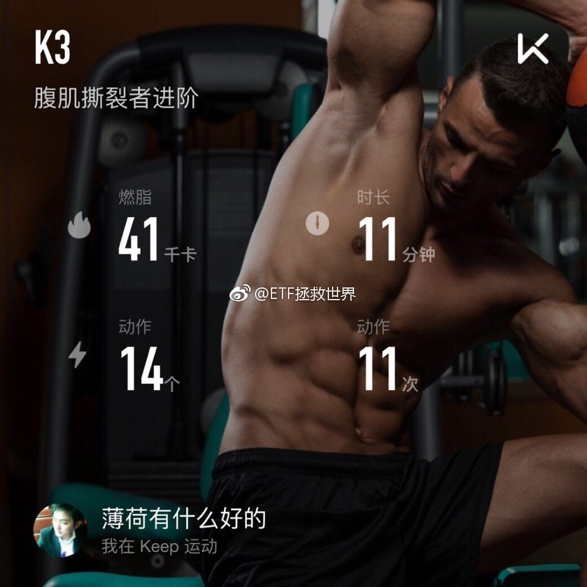

## 2017-08-21 15:19

托大家的福，刚知道什么是中年人的四宝。

保温杯？有时候我出门确实带。不过不是温水，我一直不喜欢喝温水。如果长时间出去玩，我会往保温杯里放不少冰水，或者冰的三得利乌龙茶。如果是长途开车，会带上车载冰箱放冰水……

啤酒肚也还没有。也希望这辈子都别有。

手串？我是不理解为什么会带这个。20左右年轻的时候会带上女朋友送的手链，再大一点戴过卡西欧的飞行员电子表。前几年戴过小米的运动手环和佳明的运动表。现在就戴一块机械表。

茶？一般不喝。喝就是上面说的三得利乌龙茶。方便，不用泡。其它饮料，只喝水和零度可乐。

保健品，现在有时候想起来会吃一片这个……

所以总结一下，是不是还没老！
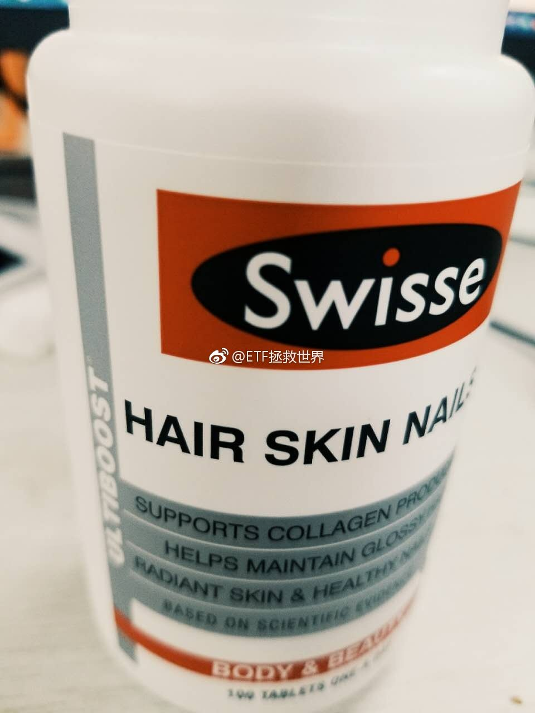

## 2017-08-21 15:42

创业板业绩增长也是醉了。最近涨这么多，估值还降了…… ​​​

## 2017-08-21 16:47

北京不少离婚是因为房子，买、卖。办完了就复婚了……

> @数据分析研究者
> 【从上海人为买房急离婚看房价与离婚率之间的关系 】8月29日，上海徐汇区民政局离婚登记处被前来办理离婚的市民挤爆，离婚的人群从早上7点多开始在此排队。下午4时，本该16:30才下班的离婚登记处采取了临时“封闭”措施。这一切缘于上海地产将于近期展开新一轮调控的传闻。于传闻发酵多日之后，今日下午，上海市住建委表示，关于近期社会上有关购房信贷新政的传言，市住建委明确表示，没有研究过此类政策。14/6/18观点：据报道，去年全国350万对夫妻离婚，离婚率连续10年递增去年全国350万对夫妻离婚。离婚是件痛苦事，应与自研痛苦指数有关系，然而结果是两者相关性很差，但按分期看看非常不一样。总体看，房价上涨对离婚数增加有不错解释效果。房价下行有利于离婚数下降，也社会和谐稳定有好处。此外，14/12/25观点：宁波离婚率降一成复婚率超三成 或因限购取消，网页链接。据宁波统计局数据，全市准予离婚数去年为16414对。通过1990-2013年间简单分析可知，离婚数与全国商品房均价和宁波的房地产投资额以及占固定资产投资、GDP比重间的相关性分别为0.99、0.93、0.67和0.7。
> 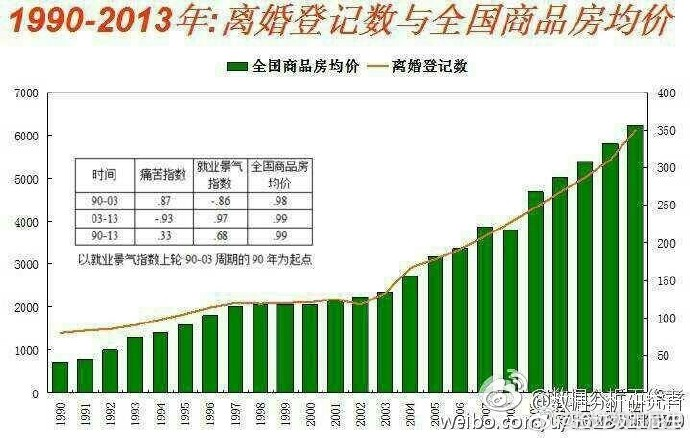
> 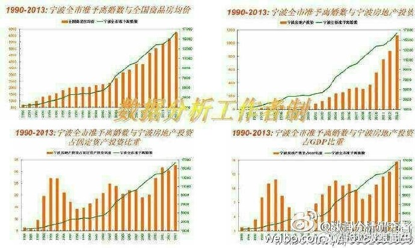

## 2017-08-21 17:06

回复@俪俪LilyYan:这话也不对了。2万多甚至可以买到欧米茄了，当然要在国外买。好歹也算是个一等二类的牌子了。//@俪俪LilyYan:回复@kaka涛:一两万只能考虑石英表

## 2017-08-22 09:09

组合中第一权重的恒生、50，以及后面的红利、300这些这几个月的强势指数，并没有新高；

医药、养老、创业这些这几个月弱势或者平衡的，刚刚从阶段底部区域开始反弹；

油气甚至还在新低；

然而，昨天组合又双叒叕新高了。

且慢统计，95%以上跟车的朋友都盈利了。（另外5%怎么会不盈利的……）

这难道不是很有意思的事情吗。

强势也好，弱势也好，低价筹码慢慢的在手里面越来越多。不追涨，只买跌，然而18个品种却只有一个浮亏。不亏损的情况下，筹码多了。

还有60%的资金？你急吗？我不急。

钱多的朋友不用说，绝大部分也不急。钱少的朋友更不应该急，钱少，翻10倍也解决不了大问题。应该多积攒一些本金，未来资产爆发的时候才会更有力。

## 2017-08-22 09:18

回复@鄧哈哈要举高高:chinaetfs 。用过都说好。//@鄧哈哈要举高高:E大能发下微信公众号么？

## 2017-08-22 09:30

回复@阿尔法和欧米迦:盼着低估，这个没错。谁都希望抄到大底。但你要知道，客观世界可不是按照我们的意愿运行的。我们要去主动的适应这个客观的世界，而不是等着世界来迎合我们。所以我们要有自己的坚持，同时要灵活的应变。做好发生各种情况的准备，并根据变化，计算各种可能发生的概率，根据概率下注

> @阿尔法和欧米迦:咋不急啊 盼着低估买个大大的仓位

## 2017-08-22 09:42

现在还在喊港股有极大投资价值的都是坏人。 ​​​

## 2017-08-22 09:46

回复@小白兔的照妖镜:腾讯TTM PE已经50倍了，比创业板还高。还怎么靠。。//@小白兔的照妖镜:E大，你说港股和大佬A会不会估值靠拢？

## 2017-08-22 09:50

还是那个观点，恒生29500以上会继续减。

## 2017-08-22 09:52

回复@孤独者生存1:转需。//@孤独者生存1:E哥，今天的逆回购，7天和14天的到4.7了。

## 2017-08-22 09:53

回复@求财不劫色:放过它！医药还是个孩子！//@求财不劫色:什么时候医药才能减呢？//@ETF拯救世界:还是那个观点，恒生29500以上会继续减。

## 2017-08-22 09:56

说正经的吧。以目前的情况，医药满仓点位是7000，减仓区域是12000-13000。这几个数字每年增加500-1000点。//@ETF拯救世界:回复@求财不劫色:放过它！医药还是个孩子！//@求财不劫色:什么时候医药才能减呢？//@ETF拯救世界:还是那个观点，恒生29500以上会继续减。

## 2017-08-22 10:10

回复@石头里的虫子:“5~10年不用的资金，可以忍受较大回撤”。如果这个条件成立，没有什么股票组合是不行的。试问在座的各位，能忍受整体资金回撤30%以上的，好几年不回本的有几位。

## 2017-08-22 11:13

不错。下一步应该是积极参与到混改中来，助国企解困一臂之力。

> @蓝鲸新闻
> 【鲸播报：宗庆后称民企是从严治党受益者 500员工递入党申请书】8月22日讯，宗庆后表示，企业和政府关系更“清”了。不少民营企业不再把精力花在做好与政府部门的“公关工作”，搞吃吃喝喝，搞迎来送往上。如今，企业党组织向心力日益凸显，年轻人向党组织靠拢的热情也不断被激发出来。 ​​​
> 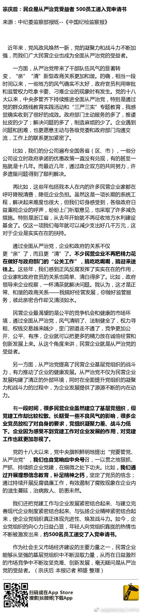

## 2017-08-22 21:38

每日打卡（63）

昨天有事没练。这几天就补上。 ​​​
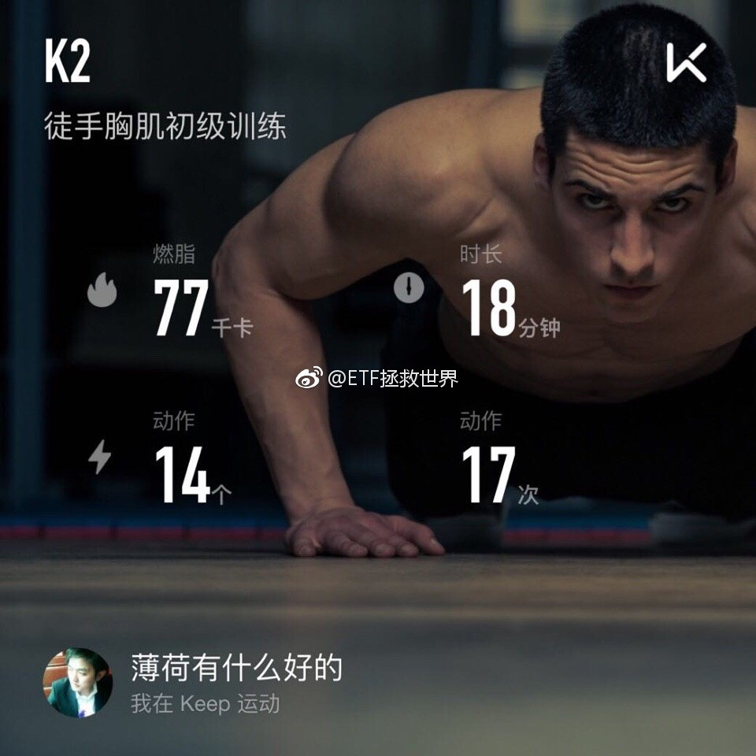

## 2017-08-23 08:33

又那什么了。 ​​​

## 2017-08-23 09:49

创业板至今披露的中报，业绩真是不错啊。4不4还得买 ​​​

## 2017-08-23 10:02

回复@Constance康斯坦丝:真正的smart money，从不扯淡，就是干。

> @攸宁陶陶:养老金也来买中小板和创业板了：“九阳股份、正海磁材8月18日晚间发布的2017年半年报显示，基本养老保险基金八零二组合二季度买入九阳股份286.7万股，占流通股的0.37%；买入正海磁材392.9万股，占流通股的0.53%。由此，养老金首次现身A股市场”。

## 2017-08-23 10:17

回复@股市少先队员:最近10-15年，看不到15倍的创业板。20倍都很难见到。//@股市少先队员:方丈说十倍十五倍市盈率才定投创业板，算不算原教旨夹头，e大则么看？//@ETF拯救世界:回复@Constance康斯坦丝:真正的smart money，从不扯淡，就是干。

## 2017-08-23 10:21

回复@猪的钉耙:昨天纳斯达克26。腾讯50。阿里60。特斯拉亏损。凭什么给国内创业板10-15倍？拍脑袋可不行啊。//@猪的钉耙:回复@股市少先队员:美股小盘股都有20倍估值//@ETF拯救世界:回复@Constance康斯坦丝:真正的smart money，从不扯淡，就是干。

## 2017-08-23 10:23

我表个态。创业板我自己计算的估值到25倍就打满它的仓位。最多可以给到10%-15%。如果到20倍就给到20%。

那时候可能是金融危机又来了。 ​​​

## 2017-08-23 10:26

回复@edinlu:历史最低32。//@edinlu:创业历史上从没到过25倍吧？

## 2017-08-23 11:01

还有一周，要不要奶一下？ ​​​

## 2017-08-23 11:05

来一个：这样跌几天，我们月末就买（）份

## 2017-08-23 14:09

可以说百发百中了。//@ETF拯救世界:来一个：这样跌几天，我们月末就买（）份

## 2017-08-23 14:39

操盘功力神出鬼没。这股市绝了。

## 2017-08-24 10:01

想说点什么。但是理智告诉我不能说。 ​​​

## 2017-08-24 11:20

确认了。 ​​​

## 2017-08-24 11:23

可以说相当贴切了。//@挖龙脉的鹿鼎公://@晓雨闻铃: 回复@沉甸甸的人://@沉甸甸的人:这段子太他妈绝了//@晓雨闻铃:和A股救市差不多？

> @北京人不知道的北京事儿
> 【小猪火场中获救 半年后被主人做成香肠送给消防员】今年2月，英国威尔特郡一农场发生火灾，农场内2头母猪、18头小猪仔被消防员救出。不过，侥幸逃生的小猪们完全没有料到自己的命运——半年后被主人做成香肠，送给当时救援的消防员以示感谢。消防员们表示，香肠“味道好极了”。 ​​​
> 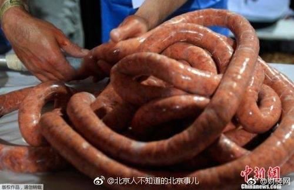 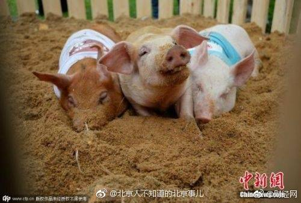

## 2017-08-24 13:56

成长跑赢价值，价值跑赢成长，都是阶段性的。与经济周期也有关系。有空研究研究这个，会发现也很有意思。

## 2017-08-24 14:10

讲真，这两年，2015年7月以后这一轮买入，由于有大家都知道的因素，真的特别难。

不过我坚信，不买贵的东西，是对自己财富的负责，也是取得长期良好收益率的基础。

不知道未来会怎样，但是，做正确的事，结果大概率就不会差。 ​​​

## 2017-08-24 14:17

我不知道这次还能不能回到3000或者3100了。如果又回去了，大概率就是最后一次了。如果不跌破3000或者3100，又起来，就不会再有机会回去了。跌破了，就会有超级大机会。

## 2017-08-24 14:33

讲真，既然这么一个庞然大物在市场里玩，做为微生物的我们，就得想想它到底要干嘛。

把池塘里的大鳄，大鱼小虾和微生物都吃掉吗？当然肯定不是。没有那个必要，而且，还指着这些生物为企业融资，降低企业债务和杠杆贡献力量，都吃了怎么行。

这个庞然大物最大的作用是让市场稳定。或者说，看起来是稳定的。上证指数就是一个很直观表达是否稳定的东西，所以，可以观察，它可以容忍的区间。突破或者跌破这个区间，就会被认为不稳定，就会干预。

同时，也不会容忍其它不稳定因素。比如爆炒某些股票等等。

总之，稳定是目前的第一要务。所以对我们来说，想要收集便宜筹码，并不那么容易。只能见缝插针慢慢买。有些朋友总怕大牛市来了仓位不够。我是认为，大概率来说，恐怕庞然大物不会允许在这个环境下出现牛市。牛市来了，下一轮危机也不会太远了。

那么稳定还要延续多久？已经两年了，也不会太远了。再有1、2年，大部分问题解决了，包括估值高企的问题，下一轮磅礴的大牛市也就开始了。当然，如果出现什么意外，稳定局面被打破，快速下跌，那就用不了1、2年那么久啦。

## 2017-08-24 17:25

回复@hdhsbajicjsiisidjsioajshdic:你大概根本没看懂我在说什么。我们没有买上证，上证也不具代表性，但是操控市场的人只看它。所以我们就观察它。这么说，你懂了吗。//@hdhsbajicjsiisidjsioajshdic:上证指数不具市场代表性和你买的不是上证指数，那就不要拿它来说事了

## 2017-08-24 17:41

太听话了……

## 2017-08-24 20:40

每日打卡（65）

练得很舒服，还欠一天，周末还 ​​​

## 2017-08-25 10:40

再一次3300止步。  一鼓作气再而衰三而竭。  不过，下一次再次回到这里，就没有什么可以阻挡了。

## 2017-08-25 10:45

两融魔咒 ​​​
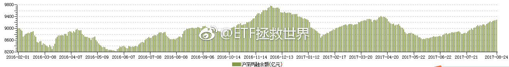

## 2017-08-25 14:07

突破了，就踏踏实实持有手里的东西。像上面微博说的，一个区间不可能长期存在。总有突破的那一天，综合要考虑的是时间、空间和价值的转换。

有朋友问，追不追？

如果是新朋友，以后可以慢慢交流。如果是老朋友，还是请立即取关吧。看我的东西白看啊。

一直在说，持仓要做到“涨跌都舒服”。根据概率，配置手中的资源。我们低位收集了不少东西，踏踏实实等着涨就行了。不要乱动，不要随便卖。

下跌是风险的释放，上涨是风险的累积。但是趋势形成后，不会轻易转变。所以不要频繁的预测趋势转变的节点。不到极端，踏踏实实拿着。用投资策略和体系来指导交易，不要用主观的判断。

继续新高，一颗赛艇啊。

## 2017-08-25 15:26

回复@亚历山大-棕地:哦？那我再推荐一个：《遗愿清单 The Bucket List》。另外，继续送电影票。请上次排名第二的联系我！我记得是 @徐L鑫 ？不过这次只有一张了！//@亚历山大-棕地:E神，你推荐的电影比书更靠谱，夺命金和荒蛮故事都挺好看。

## 2017-08-25 15:39

负责任的说，如果下周几天不会连续大涨，月底会开车。而且不止一辆，不止一辆A股权益类。

今天数据出来，变化不是很大。毕竟暴涨的就是那1、200只，大部分股票都是小涨，叠加业绩增加，月底有的搞。

这一条毒不毒，要看下周几天的走势了。 ​​​

## 2017-08-25 18:27

已经快买成第一重仓etf了

## 2017-08-25 21:18

每日打卡（66）

轻松做完，过周末 ​​​

## 2017-08-26 21:44

每日打卡（67）

今天出去聚会，大吃大喝。回来以后感觉不舒服。吃惯了清淡的东西，吃太荤的就难受。

出去跑一跑，练练腹肌，等于白练。还是得管住嘴啊。 ​​​
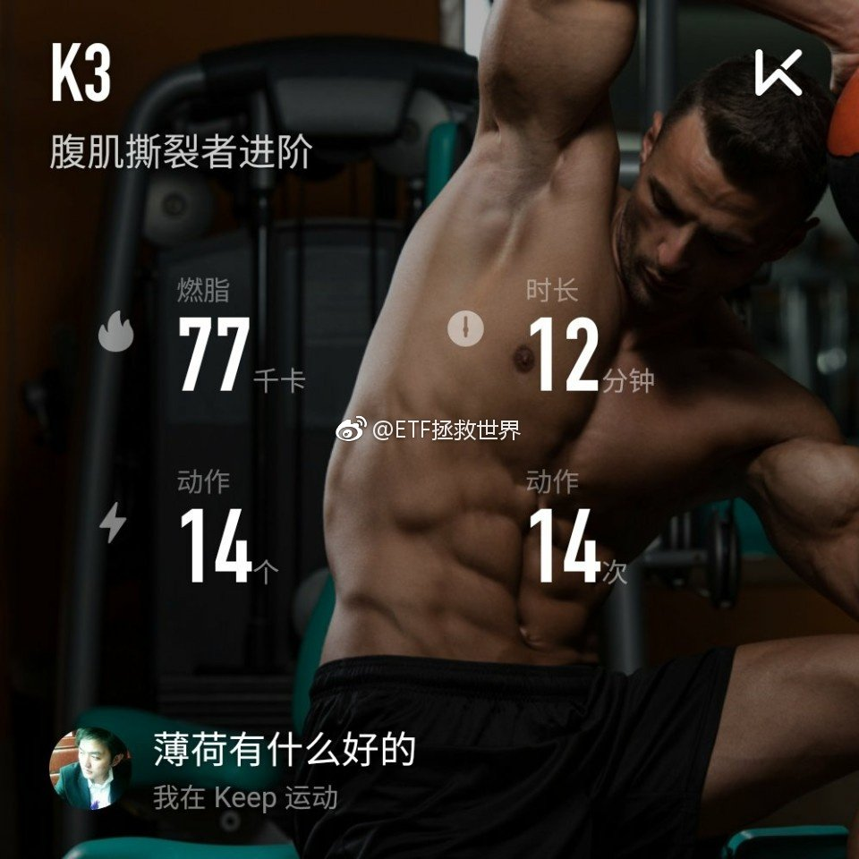 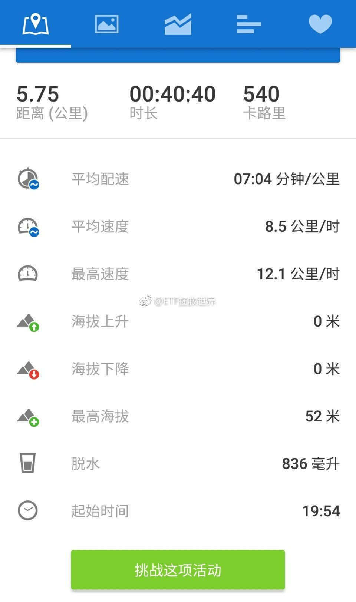

## 2017-08-26 22:10

回复@mydxkl:这样骗子是不是没法复制了//@mydxkl:@ETF拯救世界 头像+1是啥意思

## 2017-08-27 19:50

GJD，棒棒的……救市资金账本:券商第2批资金退出 国家队公募赚374亿  ​​​

>救市资金账本:券商第2批资金退出 国家队公募赚374亿
>
>来源：华夏时报
>
>　　2015年，在国家层面启动的救市举措安排下，券商分别于当年7月和9月将约定的救市资金投入到证金公司设立并管理的专户上；而公募方面则由证金公司出资2000亿元等额购买招商丰庆、南方消费活力、易方达瑞惠、华夏新经济、嘉实新机遇。
>
>　　媒体记者注意到，华泰证券、长江证券、申万宏源、方正证券、招商证券均在2017年中期财报里披露了最新的救市资金动向，截至今年6月30日，2015年9月新增的救市出资已经收回，剩余的账面公允价值仍然有1%多的浮盈。5大救市基金也全部处于盈利状态，自成立以来至今年二季度末，累计浮盈近374亿元，累计收益率为18.72%。
>
>　　而同期（2015年7月7日—2017年6月30日）的上证综指累计涨幅为-14.35%， 深证成指累计涨幅为-7.44%，创业板指累计涨幅为-22.7%。
>
>　　券商第二批救市资金退出
>
>　　2015年救市期间，券商共分两轮出资给证金公司用于统一投资。其中7月6日，首批21家券商将资金一次足额划拨证金公司账户，实际到账额超过1280亿元，用于投资蓝筹股ETF；9月初，50家券商（包括首批21家）继续出资救市，按截至2015年7月31日，净资本的20%出资筹集1000亿元，继续交予证金公司进行权益类证券投资。
>
>　　一直披着神秘面纱的国家队救市资金一举一动都时刻牵引着市场神经，而备受市场关注的救市资金退出动向也在部分券商2017年中期财报中透露。
>
>　　截至8月25日上午，招商证券、方正证券、华泰证券、长江证券、申万宏源均在2017年中期财报中对2015年投入的救市资金盈亏情况进行了披露，只是更为特别的是，这次还披露了救市资金的退出动向。
>
>　　华泰证券2017年半年报数据显示，公司收回44.3964亿元的救市资金。华泰证券分别于2015年7月6日和2015年9月2 日出资100亿元和44.3964亿元，统一交由证金公司进行统一运作和投资管理。值得注意的是，本次华泰证券收回的救市资金恰好是华泰证券第二次增资救市的金额。
>
>　　方正证券半年报信息显示，截至2017年6月30日，方正证券投入证金公司专户的投资成本变为49.1677 亿元。而2015年7月和9月方正证券分别出资49.1677 亿元和17.5054 亿元投入上述专户，这也意味着方正证券于2015年9月增资的第二批救市款已经回笼。
>
>　　长江证券半年报透露，截至今年二季度末，长江证券投入证金公司的专户成本为23.4703亿元，证金公司给的公允价值23.755亿元。而此前的数据是长江证券2015年7月及9月两批次救市出资额分别为23.4703亿元和7.9147亿元。这个数据折算过来，也是长江证券于2015年9月增资救市的金额也已经回笼。根据长江证券给出的公允价值，长江证券救市资金累计浮盈率为1.21%。
>
>　　再来看看申万宏源的数据，公司于2015年7月及9月分别划拨资金63.9亿元和21.6416亿元到证金公司专户进行统一管理及投资运作。截至2017年6月30日，该救市资金的公允价值为64.6754亿元，与首批7月投入的救市金额非常接近。券商投入证金公司的专户资金，是按投资金额比例分担收益与风险的，比照长江证券的救市资金浮盈比例计算，申万宏源第二批投入的救市资金也已经回笼。在此基础上进行测算，申万宏源救市资金累计今年二季度的收益率也是1.21%。而去年末申万宏源救市资金的公允价值则为80.2532亿元，对照85.5416亿元的救市成本，收益率为-6.18%。
>
>　　招商证券半年报的数据显示，截至2017年6月30日，公司投入证金公司专户的公允价值为69.6609亿元，而2015年招商证券于7月及9月两批次投入的救市资金为68.83亿元和24.04亿元共计92.87亿元，如果按照救市资金浮盈率1.21%计算，截至今年二季度末招商证券投入证金专户的成本刚好为68.83亿元，第二批救市成本也已经成功回笼。
>
>　　如果按照上述券商的救市资金动向来看，同时参加了2015年7月以及9月的救市动作的券商（即首批21家券商）第二批增资的救市资金已经安全退出。至于只参加了第二次救市出资的券商救市资金动向仍有待太平洋证券、国海证券、东北证券等上市券商的半年报数据披露。媒体记者致电上述三家券商，均表示不便回答，一切以公布后的半年报数据为准。
>
>　　不过救市资金的退出与浮盈暂不影响券商净利润。“本次投资由中国证券金融股份有限公司专户统一运作，本公司将按投资比例分担投资风险、分享投资收益。该投资在公司资产负债表中计入可供出售金融资产，其公允价值变动损益计入其他综合收益，暂不影响净利润，但影响利润表的其他综合收益项目和资产负债表的净资产项目。”广发证券在今年的投资者交流会上解释称。
>
>　　而方正证券也在半年报中解释称，公司将投入证金公司专户的救市资金计入可供出售金融资产，鉴于其投资目的、投资管理决策模式和处置的特殊性，并结合行业惯例作法，本公司以该项投资公允价值跌幅超过成本的 50%，或者持续下跌时间达 36 个月以上，为确认减值损失的判断标准。一旦确认减值损失，则会影响当期损益。
>
>　　5大救市基金浮盈374亿元
>
>　　在2015年，为了稳定证券市场，除了集结各大券商的力量，证金公司还借助公募基金进行市场操作。当时证金公司斥资2000亿元购买招商丰庆、南方消费活力、易方达瑞惠、华夏新经济、嘉实新机遇，证金分配在每只基金的购买额度均为400亿元，因此被市场称为“国家队基金”。
>
>　　总体来看，截至2017年6月30日，招商丰庆、南方消费活力、易方达瑞惠、华夏新经济、嘉实新机遇5只基金的资产总额为2374.95亿元，相比初始2000.51亿元（其中0.51亿元为各家基金管理人或者基金经理投资款）的投入成本，自成立以来累计浮盈374.44亿元，累计收益率为18.72%。
>
>　　其中易方达瑞惠基金净值最高，截至期末单位基金净值为1.32元，累计浮盈128亿元，招商丰庆期末单位基金净值1.268元，累计浮盈107亿元；南方消费活力单位净值1.2元，累计浮盈80亿元；嘉实新机遇单位净值1.098元，累计浮盈39亿元；华夏新经济单位净值最低，为1.05元，累计浮盈20亿元。
>
>　　从资产配置来看，投资收益不错的易方达瑞惠、招商丰庆权益投资比重均较低，而现金及现金管理类资产比重则比较大，截至2017年6月30日，易方达瑞惠权益投资占比21.23%、买入返售金融资产（也是一种现金管理类资产）39.77%、银行存款及现金38.92%；招商丰庆权益投资占比18.08%、买入返售金融资产69.92%、银行存款及现金11.86%；而华夏新经济权益投资占比则高达72.52%，嘉实新机遇的权益投资占比也达到53.47%，南方消费活力权益投资占比44.36%。
>
>　　对于后市操作，上述5大基金均表示注重长期投资回报，稳健操作。
>
>　　“展望后市，我们认为在当前宏观环境下，A 股市场仍将维持震荡市、结构市的格局。本基金本着价值投资、长期投资的理念和出发点，继续精选个股。”招商丰庆基金经理姚爽在二季度报中表示。
>
>　　南方消费活力基金经理黄俊在二季度报上也表示，南方消费活力将继续维持中性仓位，结构上仍重点配置低估值蓝筹个股。

## 2017-08-27 19:55

哈哈，不好意思，这次只有一张。以后有机会继续给大家送电影票~昨天我也去电影院看了两部。星际特工情节很一般，但是画面真的太炫了。想象力丰富，可以试试imax。极盗车神个人不喜欢，只给2星。

> @徐小包s
> ‌作为第二名，居然也有电影票，我很幸运，也很意外，再次感谢@ETF拯救世界  赠票，建议以后也可以多谈谈投资之外的话题。抛开的爱国主义情怀，《战狼2》确实也是值得一看的。但电影，你永远不知道它为什么会火，为什么会红，天时，地利，人和吧。看完这部电影，让我想起巴菲特说的一句话，"我很幸运。我是出生在美国。"如果出生在贫穷的非洲或者战乱的中东，有可能早死于贫穷，瘟疫，疾病或者是战争。我们应该也感谢自己生在中国，和平的、成长的中国。是她，我们才无忧无虑地投资指数。

## 2017-08-28 09:55

今天 $创业板指 sz399006$  也不错。无论手里的东西涨还是不涨，好好拿着就行了。不要随意卖出做差价。 ​​​

## 2017-08-28 10:23

A股不会出现“慢牛”。因为只要指数有突破，大家就会焦急地问：是不是牛市来了？

如果还在涨，那么在场外探头探脑的人就会冲进去。然后财富效应开始扩散。然后有更多不关心这个市场的人开始进入。

问题的症结在于：如果你知道会有牛市，那你会不会等着慢慢进来？

不会的。绝大多数人会焦急的冲进来，然后，导致快牛疯牛。

最后就是一地鸡毛。

在“牛市”没有到来的时候，慢慢收集的筹码，拿住了，坐稳了。无论未来有没有电梯和过山车，不用管。你只要知道你的成本不高就够了。如果有人激动的花天价来收购你的筹码，就卖给他。否则，踏踏实实的一直拿着就行了。

## 2017-08-28 11:06

虽然买了这个，但讲真，我不信短期有多大空间。如果有，那一定会股灾。

> @ETF拯救世界
> 今天 $创业板指 sz399006$  也不错。无论手里的东西涨还是不涨，好好拿着就行了。不要随意卖出做差价。 ​​​

## 2017-08-28 11:31

从一开始的恒生、50、300，到后来的红利、500、医药养老、创业等等。这一路布局，希望大家感受到的，是逢低买入资产等待别人给你抬轿子的乐趣。而不是别人买完了我们再去追热点。

不停的扫描市场上能监控到的品种，发现出现有价值的就开始买入。这种投资方式，要比不停的追逐热点不停切换，我个人认为，要舒服，而且安全的多。

买下跌的东西，当然总是显得不合时宜。但是，根本不用care别人怎么说，怎么想。所有人都嘲笑你才好呢。

## 2017-08-28 12:32

回复@半生流离醉:跟你说一条十几年的经验。只要一个品种不差，横的越久，涨得越高。最好再横几年//@半生流离醉:这种办法很稳。就是医药还趴在地上。。。

## 2017-08-29 09:18

一大早就收钱怪不好意思的。

 ​​​
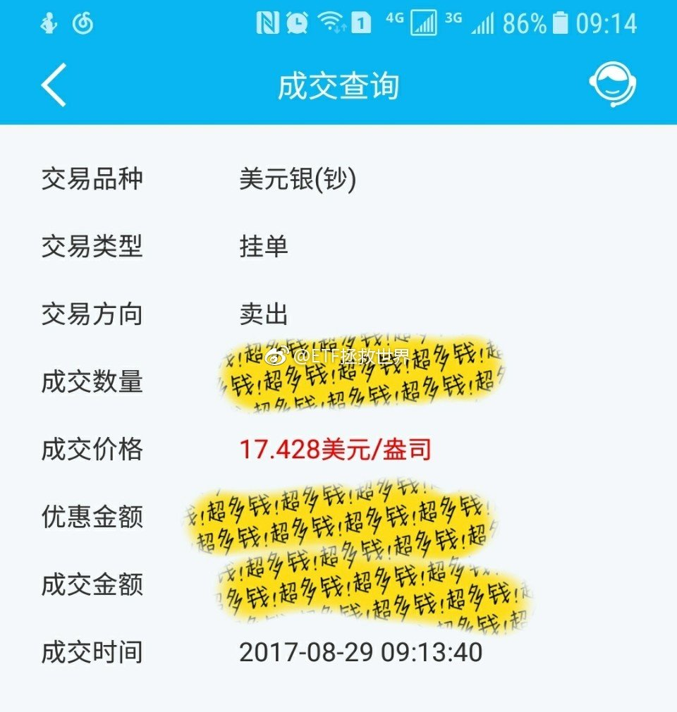

## 2017-08-29 10:49

“他不止一次明确表态，乐视是扎根中国的民族品牌，他是土生土长的中国企业家，他本人永远都是中国人。”其实我认为吧，人的信用很重要。“下周回国”言犹在耳呢。

## 2017-08-29 11:14

回复@梦之彼方2082:有升值就有贬值，很正常。另外，我还有欧元日元英镑。不必担心~//@梦之彼方2082:美元贬值最近挺厉害的

## 2017-08-29 17:17

“身上的味道是喷洒了大量劣质香水”。扎心了。

> @澎湃新闻
> 【南京地铁一“口罩男”以拍照为由强行搂抱女生，已被警方控制】8月28日、29日，有众多网友在微博中称，在南京新街口地下通道，有一位戴口罩的男子，以拍照为由，占女生便宜。更有网友反映此男子身上还有奇怪的味道，闻着有点头晕。8月29日，南京地铁警方回应称，目前该男子已被警方控制，他本人供述抱女孩的目的是在旅途中，希望留个纪念。经初步调查，其身上的味道是喷洒了大量劣质香水。现代快报http://t.cn/RNZ7vTJ南京地铁一“口罩男”以拍照为由强行搂抱女生，已被警方控制 http://mapi/005vnhZYgy1fj0pk6vrm2j30go0l67i1查看图片

## 2017-08-29 20:56

哈哈哈哈哈哈哈哈。太NB了。还有没有王法了……

> @互联网的那点事
> 【贾跃亭姐弟已收回对乐视网全部借款】乐视网上半年年报显示，贾跃亭贾跃芳姐弟之前套现时承诺借给乐视网的无息借款总计74亿，然而最高峰时贾氏姐弟借给乐视网不超过30亿，2016年底，只剩下4亿多，到了2017年6月30日竟已全部抽走。 ​​​

## 2017-08-29 21:54

每日打卡（69）

昨天有事没有锻炼，今天补上。

每天时间真的不够用。几本书一直说看，始终没有时间。很多想做的事也没做。

尽量多做一些事情吧。 ​​​
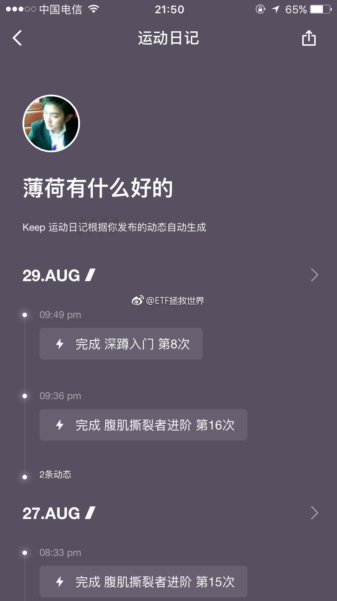

## 2017-08-30 10:23

$创业板指 sz399006$ 又搞事情 ​​​

## 2017-08-30 16:38

回复@XDrX:要看看当初减持的时候说把几十亿免息借给公司5年这个承诺有没有法律效力了。//@XDrX:贾跃亭做的事情没违反王法吧？//@ETF拯救世界:哈哈哈哈哈哈哈哈。太NB了。还有没有王法了……

## 2017-08-30 16:46

回复@守正v出奇:明晚开车。今天有可能推送一篇别的，不确定。//@守正v出奇:e大这是 写完开车稿了吗？ 还是等晚上中报全部披露以后跑下数据在发车？//@ETF拯救世界:回复@XDrX:要看看当初减持的时候说把几十亿免息借给公司5年这个承诺有没有法律效力了。//@XDrX:贾跃亭做的事情没违反王法吧？

## 2017-08-30 22:07

每日打卡（70）

练完睡觉，晚安！ ​​​

## 2017-08-31 09:08

坚持债券会先于股票几个月见底的观点。 ​​​
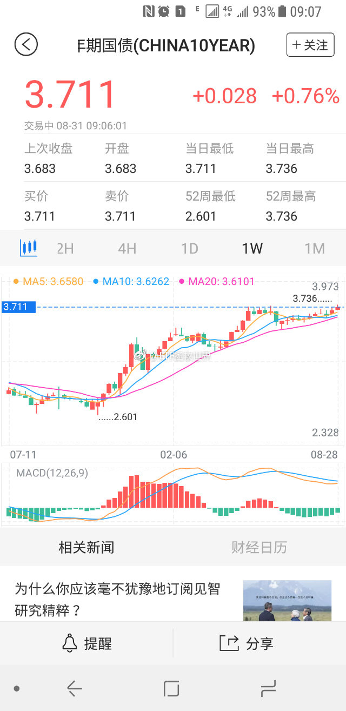

## 2017-08-31 10:34

要不要说点什么 ​​​

## 2017-08-31 13:37

$创业板指 sz399006$ 别人都跌你得瑟什么？ ​​​

## 2017-08-31 15:08

最近有点不顺啊。早上车还蹭了。一个门进去一小条，没露漆，4s报价2000……

外面修理厂钣金靠谱吗。

一定尽快要去拜拜了。好久没去了。 ​​​

## 2017-08-31 15:37

这个写的还是不够震撼。十年前在天涯看过一个描写里面生活的帖子。看完那个我就暗暗发誓，永远也不要犯事儿进去。真的，各位，遵纪守法呀！//@买买提X:伙食不错~

## 2017-08-31 22:32

最后一个浮亏品种。我就静静的看着怎么变成浮盈。 ​​​
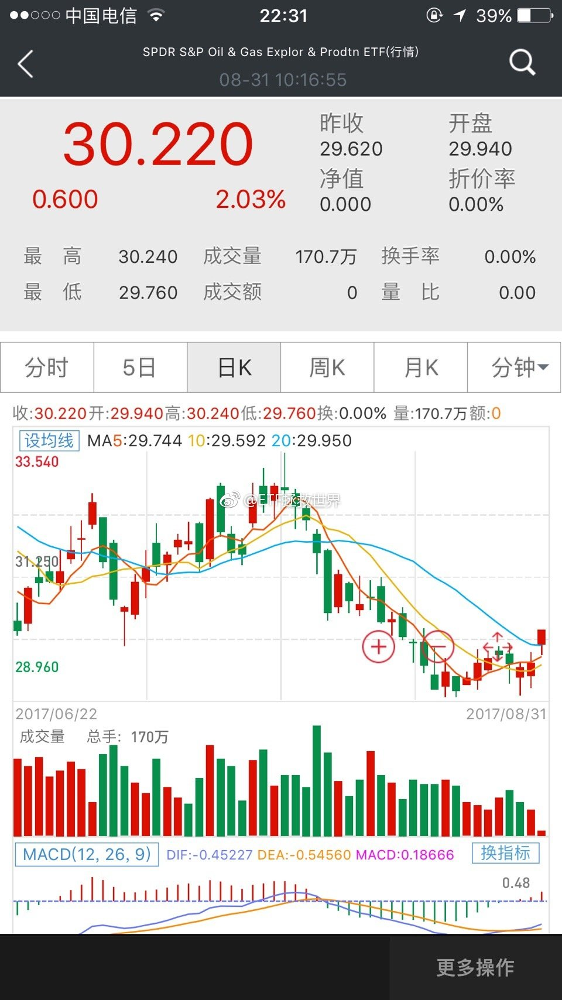

