## 2017-09-01 13:09

今天下跌的股票比上涨的多。谁能想到，$中证500 sz399905$  涨了接近1%。

天妒英才啊！ ​​​

## 2017-09-01 13:28

8月过去了。9月呢，如果还是维持现状或者继续上涨，那么我们在A股几乎不会有什么动作了。

涨涨跌跌，仓位舒服，看戏即可。

至于说，如果有较大幅度下跌的话，那就是另一回事了。 ​​​

## 2017-09-01 13:56

$创业板指 sz399006$   犀利。反弹新高。 ​​​

## 2017-09-01 15:18

回复@理性耐心:讲真，如果是长线持仓，场内品种对我来说只有一个方面有吸引力，那就是可以做两融担保品。如果这个品种做不了担保品，我会优先买场外。毕竟有些品种流动性有问题。以后卖出的时候会怎样，说不好啊。//@理性耐心:回复@Gaius_Chang:我也觉得场外更省心，场内容易动来动去

## 2017-09-01 15:21

回复@MyCaptainLu:其实都差不多。最近有几个B类货基，就是以前大资金才能买的门槛降低了，可以试试。收益率能稍微高点。//@MyCaptainLu:E大，能麻烦推荐个货基么，华宝兴业现金宝如何～谢啦

## 2017-09-01 15:25

回复@谷爆:其实，牛市如果份额少的基金会送大红包。广发医药2015年曾经大幅溢价到3块钱！当然现在不可能了，毕竟咱们大部队进来了……//@谷爆:牛市卖出场内的应该没流到性问题吧？以E神的作风，熊市是不会割肉只会加仓的呀！

## 2017-09-01 15:46

回复@盖盖87:赚钱比赔钱好，是不是？买了比没有强，对不对？做人要学会开心呀。再让你回到当初，你会在一个月前重仓创业板吗。如果不会，就开开心心的接受吧~//@盖盖87:创业板真是猪一样的队友 买了就再也跌不下来了 坑爹 不给加仓机会啊

## 2017-09-02 08:47

没什么意思 ​​​
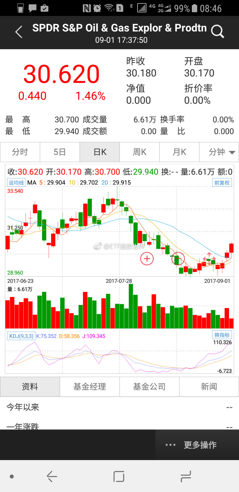

## 2017-09-02 15:03

每日打卡（71）

这是补前两天的。太忙了，真是抽不出时间。今天补上。晚上再做今天的。 ​​​
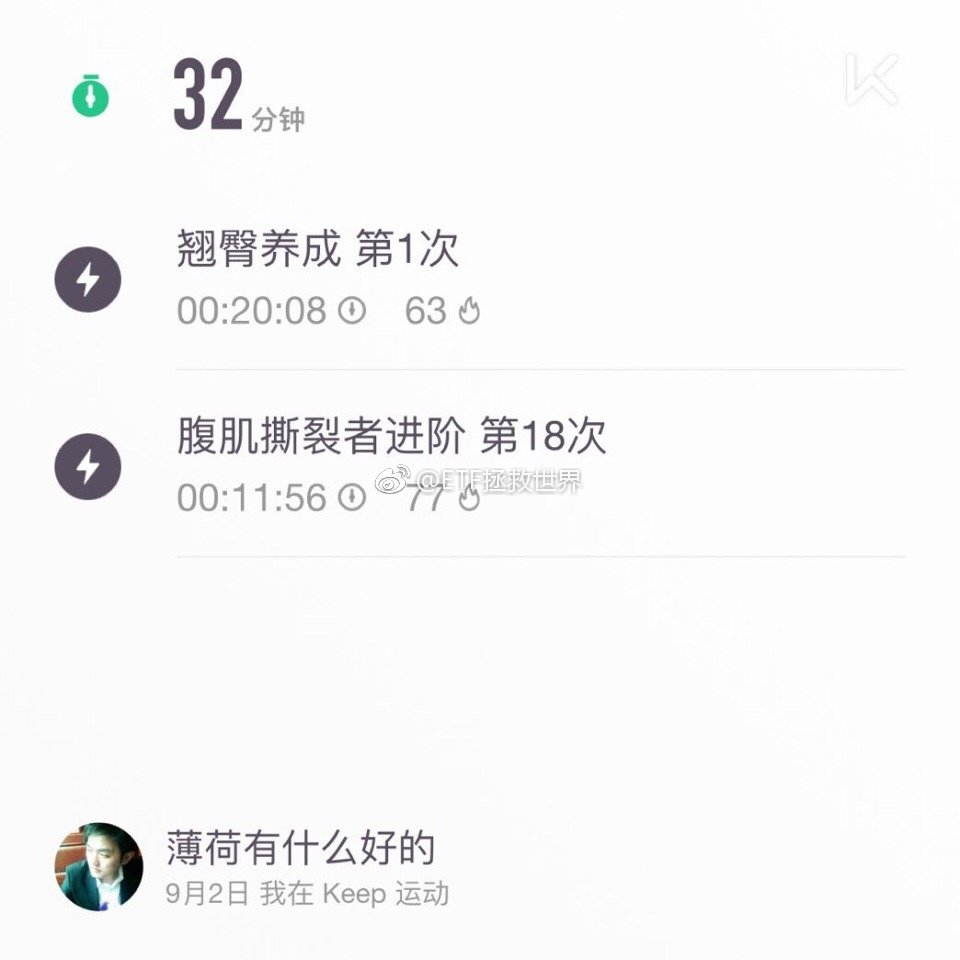

## 2017-09-03 19:42

每日打卡（72）

昨天晚上有事出去没有练，今天补上。

在微博打卡的最大好处，是这么多朋友看着，更能督促自己坚持下去。我相信要不是每天打卡，恐怕无法坚持每天练一次。 ​​​
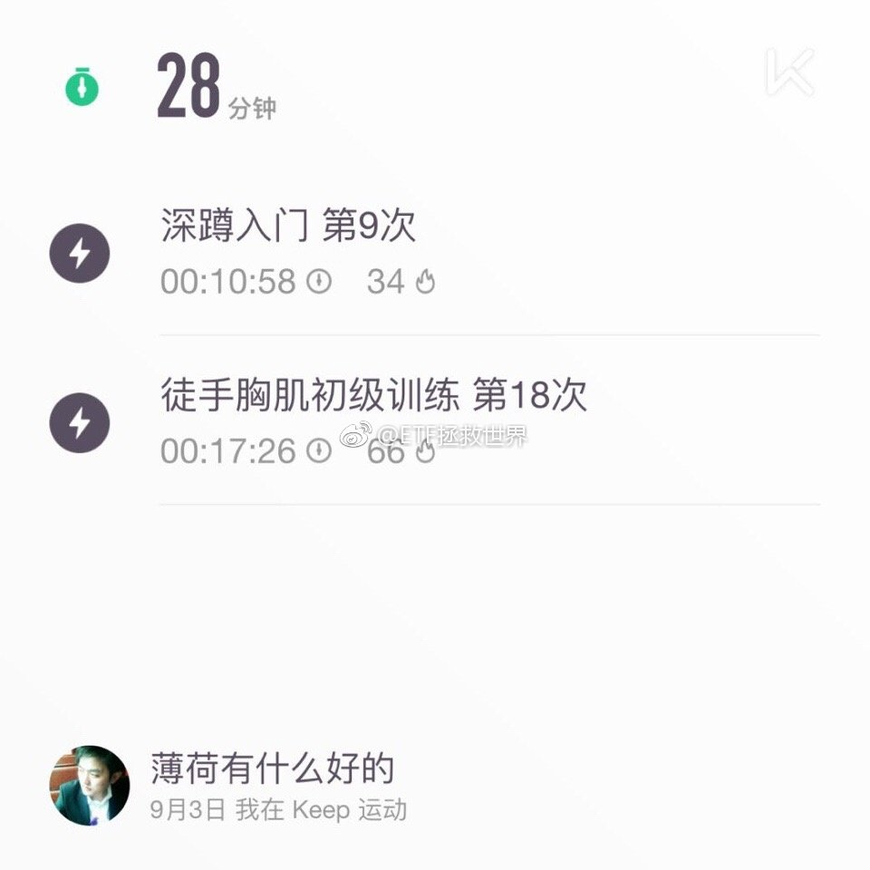

## 2017-09-04 09:43

$中证500 sz399905$  醉了。第一个翻红 ​​​

## 2017-09-04 10:05

几乎所有的指数都是红的，然后跌的股票比涨的多。

太神奇了！ ​​​

## 2017-09-04 10:48

$中证500 sz399905$  已经奶绿了。 $创业板指 sz399006$  要不要来一口。 ​​​

## 2017-09-04 11:02

$中证环保 sh000827$    ​​​

## 2017-09-04 16:12

希望加油干到月中

## 2017-09-04 21:46

每日打卡（73）

还是这个最酸爽 ​​​
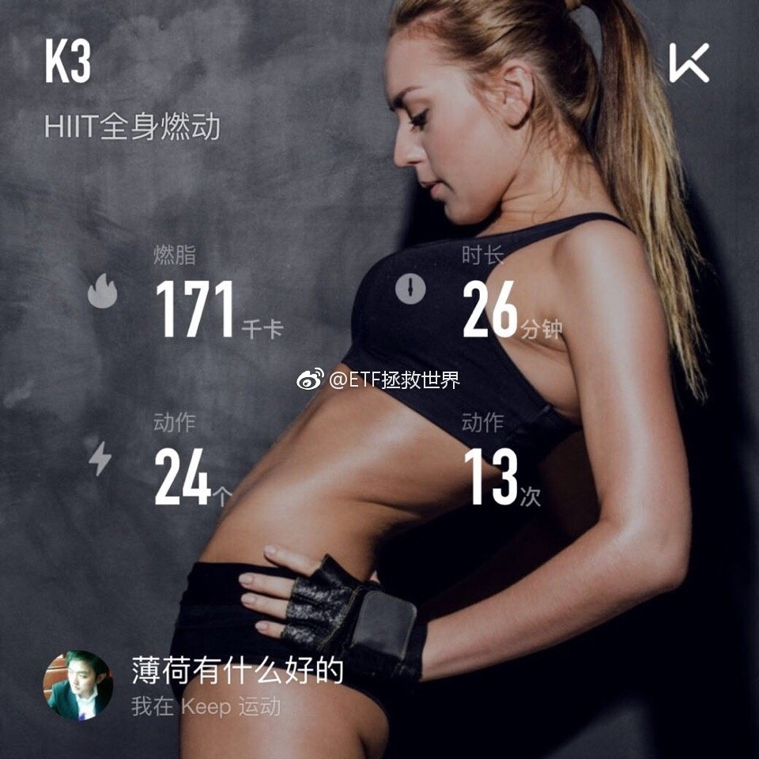

## 2017-09-05 08:52

有人哭的时候就要好好想想有什么机会让未来的自己笑

## 2017-09-05 10:37

不要涨一点就心急火燎大牛一去不回头，跌一点就心惊胆战跌到2000套十年。

轻松一点。高高兴兴把钱赚了不好吗。 ​​​

## 2017-09-05 10:58

现在知道什么叫弱周期了吧。

$全指医药 sh000991$ 

就是人家跌它不跌。当然，人家涨的时候它也不动。

 ​​​

## 2017-09-05 11:42

今天继续吃草。好久没吃了。 ​​​

## 2017-09-05 14:41

这是一个被监控的微博

## 2017-09-05 14:59

回复@马甲5544:我的仓位非常舒服啊。一点都没有害怕踏空害怕浪费子弹的感觉。每天账户新高，不知道多开心啊。//@马甲5544:老大  现在这行情是不是最磨人   不加怕踏空  加了怕浪费子弹 在踏空与空梭间  你选哪个//@ETF拯救世界:这是一个被监控的微博

## 2017-09-05 15:07

干干净净的多好  ​​​
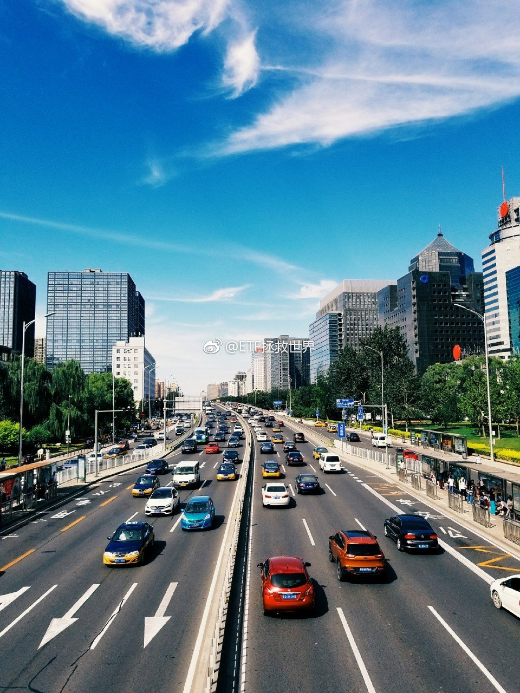

## 2017-09-05 15:20

回复@用户5454135590:好心态源于仓位舒服。仓位舒服源于对概率判断的自信。对概率判断的自信源于历史的成功以及知识。也就是说，没有成功过，没有知识，对未来会怎样完全没有概念，那是不可能有好的心态的。只能人云亦云~//@用户5454135590:请教E大，好的心态是如何练就的

## 2017-09-06 08:59

因为最近有不少事，于公于私，各种事情牵扯精力，今天开始不会再像之前频繁的与各位互动。

还是会发东西，没那么频繁。

每日打卡会不会继续不好说，主要是没有精力了。

人生充满意外。没事的时候总是不满足平淡的日子，有事了又想平安是福。

希望一生平安。 ​​​

## 2017-09-11 10:11

$中证环保 sh000827$   还是不错的。 ​​​

## 2017-09-11 11:26

回复@炒股为生2015:一定发。目标已锁定。//@炒股为生2015:@ETF拯救世界 E大，照这样下去，月中有发车的可能吗？

## 2017-09-11 11:51

坚持不懈的每周一吃草。

绿油油的。 ​​​

## 2017-09-11 12:12

太难吃了。有多难吃？吃到一半哭出来了。剩下的一半扔了。

## 2017-09-11 13:45

怎么还没完了。

> @ETF拯救世界
> $中证环保 sh000827$   还是不错的。 ​​​

## 2017-09-11 14:21

$中证500 sz399905$   一轮下探后，又回到了前期高点。手里的筹码比4月多了三份。所以，中证500的市值又新高了。

怕什么坐电梯？不要怕。涨了好，跌了更好，可以让你多买，然后再次回来的时候，你又新高了。

一个品种是这样，整个账户也是这样。多少年后，指数就算一点都没涨，你的账户也是永远上行的。

艺术。

## 2017-09-11 14:39

一个月前大家都炒蓝筹。你也炒，结果就是一个多月价格没动，50、300。

你另辟蹊径，知道风格总会轮动，价值总会回归，买入不受欢迎的品种，结果就是赚的还不错。

时间、空间。对不同品种在不同的时间布局，闪转腾挪，最终完成终极的资产配置。

路不好走，有人设置了重重路障。但只要每一步都走得不差，最终也没什么能拦得住你到达目的地。

## 2017-09-11 15:02

回复@木木不哭木木:在我的投资体系中，只要买入的是指数产品，就永远不会发生亏损卖出这件事。永远不会。任何指数品种都一定要给它折腾盈利了才算完，铁律。//@木木不哭木木:港真，前些时日环保赔的时候真的是差点卖了，涨回来点就想卖了怕又跌回去，还好心态慢慢转变了

## 2017-09-11 19:25

回复@木车亻:五七年可能不会亏，但是你要考虑一下几年后回头看收益率会不会满意。//@木车亻:e大 请教下 举例比如恒生前后发车十几份了价格也多次不同 是不是长期看比如五年七年每份买入的价格都不会亏损?因为我个人感觉以您的买入基准比平常人严格许多，随便一个节点的发车长期都没啥风险。

## 2017-09-11 21:40

每日打卡（74）

事情还没有解决，但生活还要继续，身体还要锻炼。坚持。 ​​​
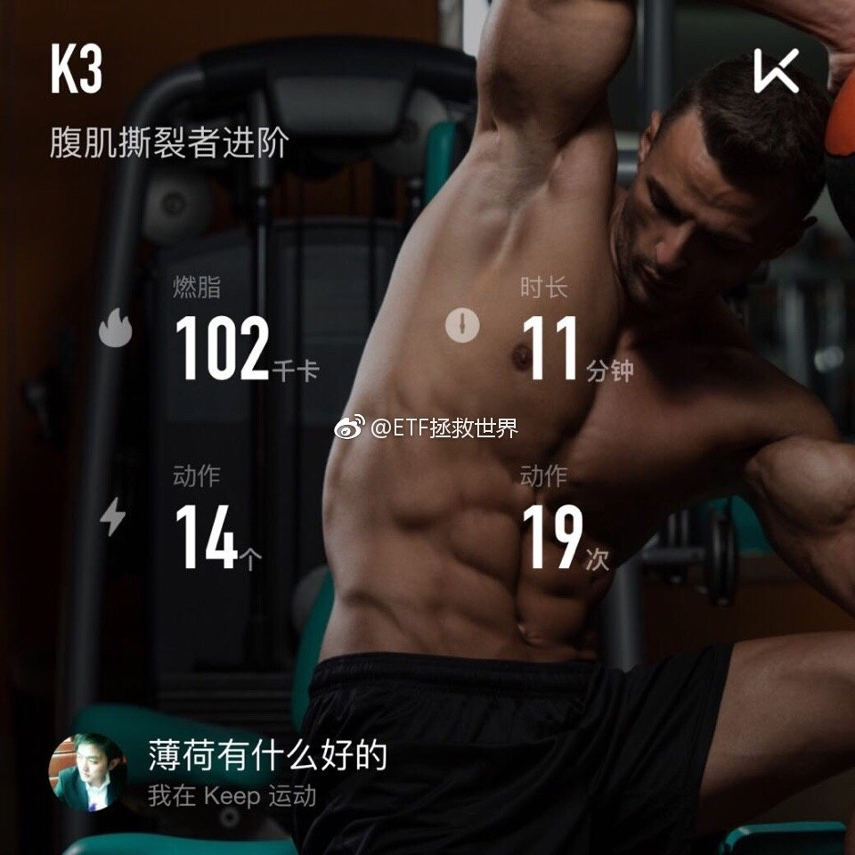

## 2017-09-12 09:38

$中证环保 sh000827$  没有意思。差不多行了。 ​​​

## 2017-09-12 09:45

为什么大多数人投资会赔钱呢。

$格力电器 sz000651$   这么大的牛股，涨这么多，只回调了十几个点，获利筹码只剩38%了。

大多数人就是追，不停的追高，一旦股票或者指数回调，就是赔钱。

好股票还可以，以后会涨回去。很多股票就涨不回去，就套了。

涨回去的好股票，也不一定挣钱。因为可能在回调的时候割肉卖了。

投资这么简单的一件事，其实对大多数人来说，还是挺难赚钱的。

## 2017-09-12 09:51

这个月买的$中证环保 sh000827$ 和$中证500 sz399905$  都不错 ​​​

## 2017-09-12 10:06

看看环保，再回头看月初的这段话，是不是会更有感触？发布了头条文章：《买跌&amp;追涨》  ​​​

（节选自本月计划文章）​

上个月的今天，我们买的创业板在本月涨幅位列所有宽基指数第一位。涨幅超过其它宽基一倍左右，一个月就涨了将近7%。

恭喜各位股神大人。

那么现在你回头再去看上个月，以及上上个月我连续写的两段关于创业板的文字，是不是会更有感触？

我跟你讲，证券市场真的真的是我见过最能反映人性弱点的地方。最妙的在于，你可以利用人性的弱点来赚钱（当然，也可能是被人性控制而赔钱）。

各位，在我的投资世界观中，下跌，永远是风险释放而不是风险累积。上涨，则相反。当然，这是针对我们投资的指数基金这样的几乎永远不会死的品种来讲。个股个债则绝非如此，我们不展开讨论。所以，我再打打预防针，未来我们买入的品种，如果有下跌，甚至是较大幅度的下跌，你应该高兴而非难受。在别人看来也许你像个神经病，但你要知道，“正常人”在A股是赚不到钱的。你只有在思维、在策略、在体系、在行动上与“正常人”不同，才有可能赚钱。很简单，因为70%的“正常人”都在赔钱。

然而，如果你以为我只是买下跌的品种，恐怕又错了。

本月中证500上涨2.7%，中证环保上涨3.4%，有朋友会说，你上个月不买，这个月来追涨，4不4傻啊？

这种说法看起来没错——为什么低位不买高位来追？不合逻辑。但我大概讲讲，你应该就会明白。

我要说的，指数点位这个数字，并不是我们应该看重的东西。投资指数看点位要吃大亏。

举个例子。

1937年，也就是大概80年前，美国道琼斯指数是120点。如果这个时候，一个美国人想买道琼斯指数，结果发现指数比五年前上涨了一倍，最终决定放弃买入。那么80年后，他就失去了一个将近200倍收益的机会。

注意，不要深究细节。比如之后在1941年道指又跌破120点，比如80年200倍收益高不高，比如1937年还没有指数基金。我要讨论的不是这些。

我想说的是，指数到底多少点，不是你该不该投资的关键。3000点还是3300，还是4000，还是5000，根本不重要。重要的是你买的东西贵不贵。

上个月我就说过，8月特别关键。因为有3000家公司要披露半年报。半年报披露后，很多指数就会变得便宜一点。那么10月份公布三季报后，很多指数又会便宜一点。也许7月不能买的，8月能买了。8月不能买的，10月又能买了。谁知道呢，这重要吗，我看，并不重要。重要的是你掏钱买的东西值不值。

如果在2005年，你眼睁睁的看着上证跌到998没买，一两个月后涨到1200，你觉得低位不买涨了20%再买就是傻，那么，你也最终将完全丧失2年后6000点5倍的财富机会。

说这么多，明白了吗？

涨跌根本不重要。重要的是花多少钱，办了多少事。​​​​

## 2017-09-12 10:15

回复@铅笔小小新:现在这样想的人还不够多。再等等。再多一点，就会发生一些有趣的事。//@铅笔小小新:E大，有没有可能真变慢牛了？

## 2017-09-12 10:54

回复@西风将起:两融余额昨天突破9700亿。如果行情还是这样，两周内必然突破10000亿。上次1万亿是2016年1月。叠加多因素，有趣的事不会太远。本人投资从不会因为涨了跌了影响判断，只会根据常识、数据来判断。//@西风将起:看来e大还是不看好这轮啊

## 2017-09-12 11:08

回复@HZ小山1998:2份计划让你担心成这样？2份加起来一共1.3%。浮亏10%就是浮亏0.13%。其它十几个品种的盈利都没法让你舒服点？马上停止参考计划，立即，马上，为你好。//@HZ小山1998:回复@ETF拯救世界:当然跟计划了，不然怎么会投那么少

## 2017-09-12 11:18

做投资，看价格，涨跌，做决定，是最不可靠的。

要看的不是屏幕里软件商红红绿绿的走势，而是背后代表的含义。涨了跌了并不重要，重要的是其他的信息。

否则，你只能看到过去和现在，却看不到未来。

然而未来才是你能否赚钱的关键。即使看不清未来，也要看清现在。真的很重要。记住，现在，不是红红绿绿的涨跌。

## 2017-09-12 13:52

今天这么精彩，你可能没想到2000只股票是下跌的。 ​​​

## 2017-09-13 10:17

来了。就是上次说的，他的减持承诺，将资金无偿借给上市公司是否有法律效力的问题。//@财联社APP:乐视2017年半年报显示，已向贾跃亭归还全部借款。

## 2017-09-13 10:21

重仓满仓的也不用太担心，收盘大概率还会拉回去。毕竟，现在，稳定是第一位。

还有30多天，很多人觉得这30多天是安全的。我倒认为恐怕要打点提前量。大家都那时候跑就跑不掉了。

当然，对咱们的计划来说，这些都是无所谓的事情。只是会影响我们继续建仓的速度而已。 ​​​

## 2017-09-13 10:25

回复@你好大麦茶:我倒是能理解。人家就是来骗一把短线的，现在给你两个选择。第一，几个月可以赚1千万，潇洒自由，可以去找真爱。第二，跟一个自己一点点都不喜欢的男人每天睡在一个床上，看着就难受的那种。未来？现在赚钱的创业公司未来还不一定怎么样。人财两失不是不可能。那么，你选哪条路。

>@老马自奋蹄
> 转：可怕的IT屠妇?! http://t.cn/RpJY1Sm张晓亮deep的微博视频 ​​​

## 2017-09-13 11:53

不过这件事呢，到现在为止一直是单方面的陈述。具体的真实情况，再等等看吧。毕竟到现在另一方一句话都没说。

## 2017-09-13 17:44

今天开始，一切恢复正常。

人善天不欺。

谢谢。 ​​​

## 2017-09-13 22:13

每日打卡（76）

感受肌肉的硬度，拒绝油腻。 ​​​
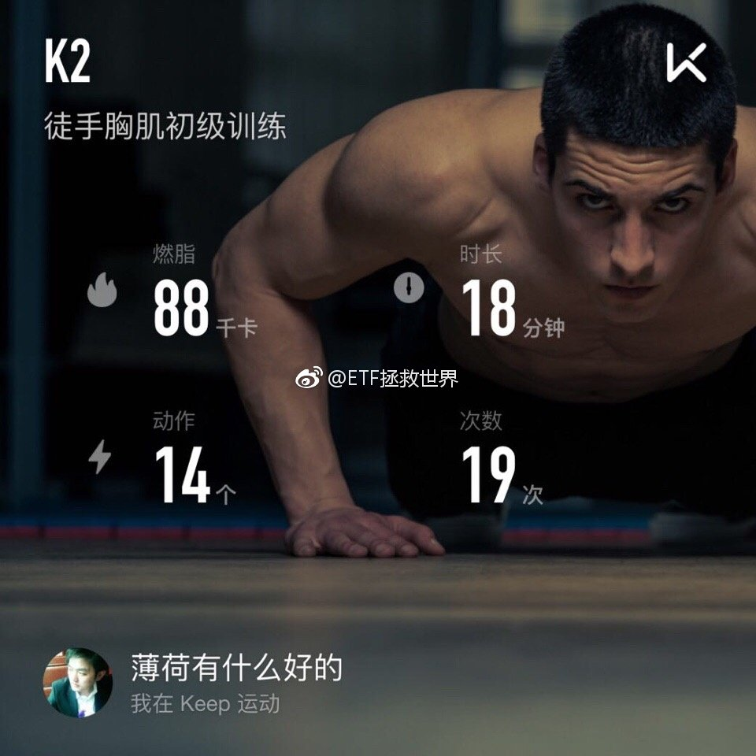

## 2017-09-13 22:37

这两个如果组合起来…… ​​​
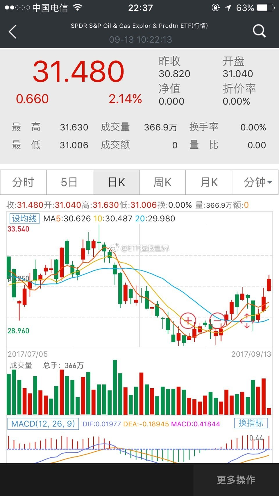 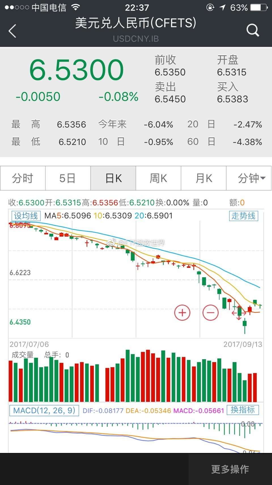

## 2017-09-14 09:02

不急，继续看。所谓“精彩的故事”就是要跌宕起伏，意料之外的桥段不断出现。生活远比文学精彩啊。//@Beck1010:@ETF拯救世界 e大，反转了……

> @教授曰
> 【程序员被前妻翟欣欣逼死事件更多反转：印度官方呼吁打击wephone国际诈骗软件报道曝光】3人小微公司暴利模式：盗窃电信运营商话费；免费打电话，付费修改来电号码，台湾、福建、印度、阿拉伯国际电信诈骗团伙专用软件。忘了去年被福建电信诈骗团伙骗去学费逼迫致死的山东贫苦女大学生徐玉玉了吗？ ​​​

## 2017-09-14 09:49

$中证环保 sh000827$  港真，不错。 ​​​

## 2017-09-14 09:56

回复@用户6314452932:开。//@用户6314452932:老大，今晚开车吗？

## 2017-09-14 11:34

一个经验：

共享单车前面的筐里不要放东西。

一支LAMY，一个记事本。忘了拿了。

就在刚才。

光顾着刷微博扯淡了。

 ​​​

## 2017-09-14 14:06

呵呵哒，别想骗我今晚买a股。图样了！ ​​​

## 2017-09-15 11:22

圣诞节有没有地陪。  ​​​

## 2017-09-15 14:08

没有相对较大的调整，计划不会再加A股了。怎么讲，现在就是鸡肋时间。

## 2017-09-15 15:26

通常来讲，很多投资者有一个心理误区，那就是，看着一个暴涨的品种，不停的告诉自己，哎呀，我之前明明看过这个品种啊，好可惜啊，如果我买了就发财了啊。

其实呢，你看过的品种有几百个。但你只是挑了最牛的那个出来后悔。

更后悔的是，我买过呀，涨了一点就卖了呀，如果我不卖……

是啊，如果。如果每年你都买到最牛的，全球股神就是你了。

时光倒流，事情不会有任何改变。这个钱你没赚到，就是你的能力/运气不够。就这么简单。

最重要的，是清楚的认识自己，看看有哪里可以提高。下次能不能做得更好一些。否则，还是会继续叹息：

哎，我明明看过/买过的呀，怎么涨那么高了，我错过了几个亿呀。

## 2017-09-15 15:52

回复@幸福猪兜仔:我没懂。你明明是进步了，为什么难受？你“彻底参悟”了，那就说明有很大进步。那么下一次你就能赚大钱，哭什么？证券市场是你人生中能遇到的，机会最多的地方。几乎每天每个月每年都有机会。你有能力，还怕没机会？我实在是不理解啊，进步了还难受是为什么。

## 2017-09-15 15:57

回复@爱花的老猫:似乎也不能用“够”来形容。我很喜欢老巴说的“能力圈”概念。每个人注定有自己的能力圈，不能在自己的圈子里天天看着别人的圈子赚钱眼红。90年代纳斯达克疯涨多少倍，老巴一个子儿都没赚到，你说他后悔不后悔，哭不哭？有没有人所有股票都懂，所有大牛都赚到呢？这是一个终极问题。

## 2017-09-15 16:07

回复@灵感源泉--8066:在现在这个时代，钱真的不难找。没钱的，雪球做个收益高回撤小的组合，找机会发个私募，做得好了规模会越来越大，分分钟几个亿可以执掌。然而有能力的人才是真正稀缺的，很多人会高估了自己的能力。钱是聪明的，自然会自己去寻找有能力的人。//@灵感源泉--8066:因为有机会没钱

## 2017-09-15 16:16

回复@nfbbc:很多人管理别人的钱，通常来讲，特点是会更加激进。因为只有赚得多，才能分得多。亏了，又不是自己的钱，无所谓。很多时候讲情怀听起来特别可笑，但确实特别重要。真正的把别人的钱当成自己的，对别人的信任心存感激，用加倍的努力回报信任，确实已经特别难得了。

## 2017-09-15 23:04

每日打卡（77）

这段时间欠了几次打卡，周末会一次补齐。坚持！ ​​​
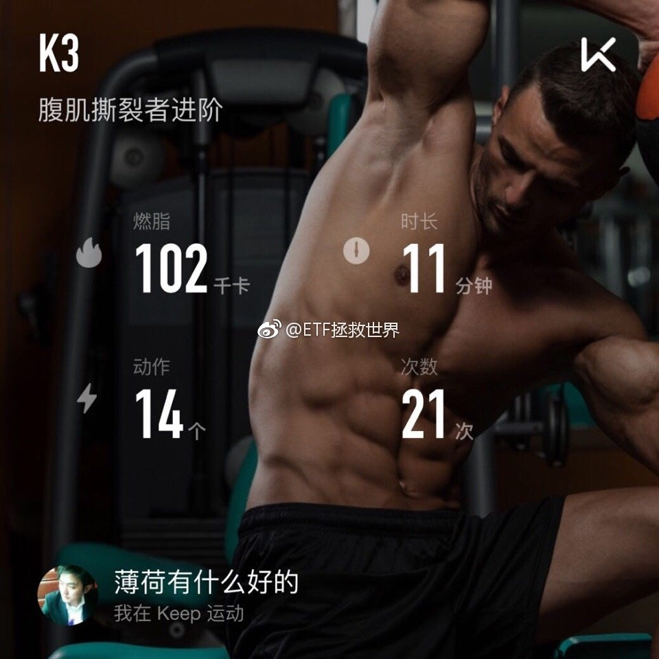

## 2017-09-16 23:04

每日打卡（78）

今天忙了一天，先来两组 ​​​
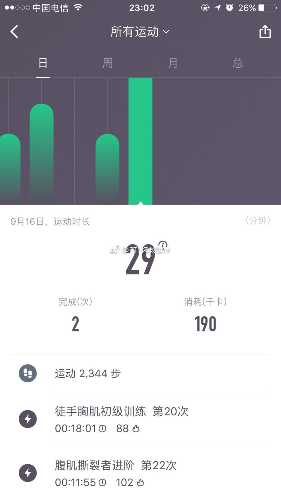

## 2017-09-17 19:29

每日打卡（79）

今天撸三组。继续还债。 ​​​
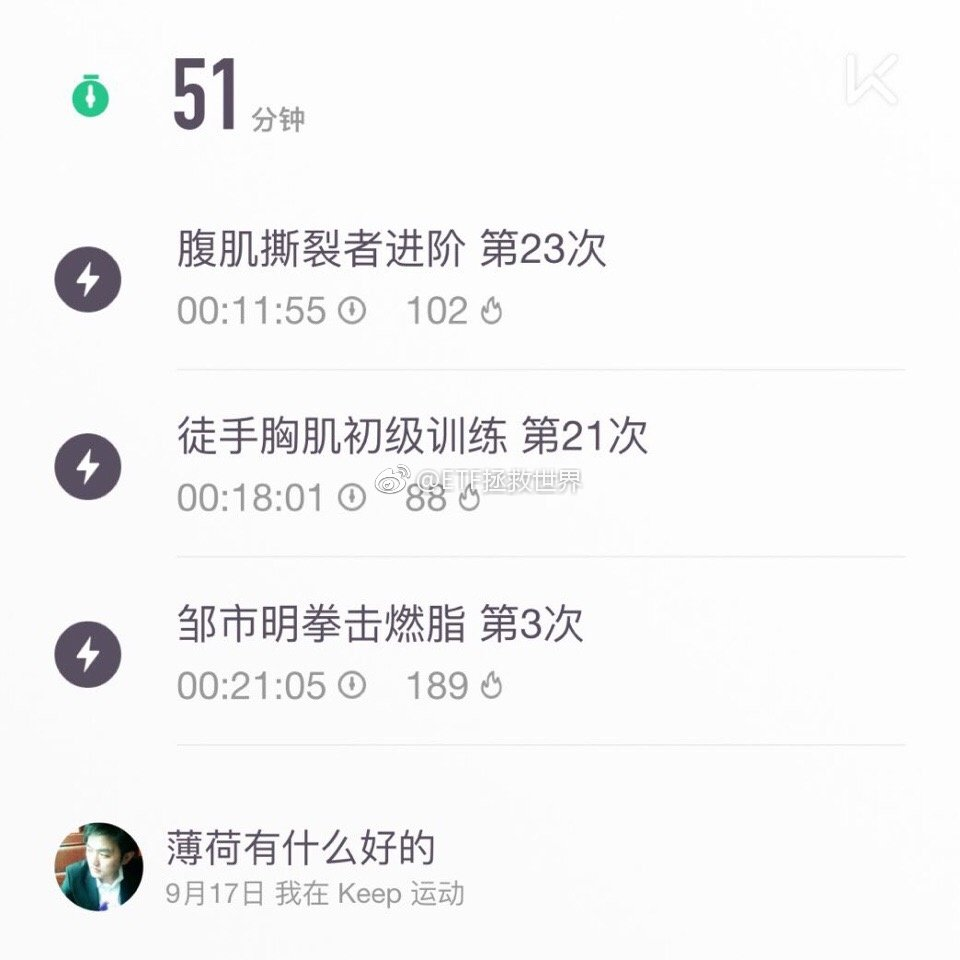

## 2017-09-18 10:22

持仓品种都没有新高，账户继续每天新高ing。

amazing。 ​​​

## 2017-09-18 10:32

我认为，情商是一种同理心。懂得站在对方的角度思考问题的人就是情商高，做出来的事就会让别人舒服。与忽悠之类恐怕不是一回事~

## 2017-09-18 13:18

整件事大概有个脉络了。

女方从事某种职业，通过各种方式认识有钱人，不为结婚，可以短期内赚不少钱。

然后通过网站认识了男方，像之前一样，各种奢侈品各种大额消费。不同的是，这次男方很认真，要结婚。女方感到有些棘手了。

结婚前一天，女方跟男方说自己结过婚，要看离婚协议拿88万。本来想就此吓退男方，谁知道男方非常看重沉没成本——有个细节，男方的同学说他特别喜欢数钱——已经花了这么多了，再加上还挺喜欢女方，一咬牙88万也掏了。终于结婚了。

婚后双方都不满意，女方发现了男方经营方面存在法律方面的漏洞，以此要挟。男方已经骑虎难下，女方继续狮子大开口。最终男方无法承受，一跃而下。

一方赔了金钱性命，一方难免牢狱之灾。悲剧从何而起？

无法评价。

## 2017-09-18 16:10

$恒生指数 hkHSI$  距离下一次再平衡点位，29500越来越近了。

如果到时候美元涨一波就可以说完美了。当然，不涨也没ok啦。 ​​​

## 2017-09-18 22:57

每日打卡（80）

失去才知道珍惜，失而复得是最幸福，好好珍惜已经有的。今天累，做一组简单的。 ​​​

## 2017-09-19 05:22

完美的一天 ​​​
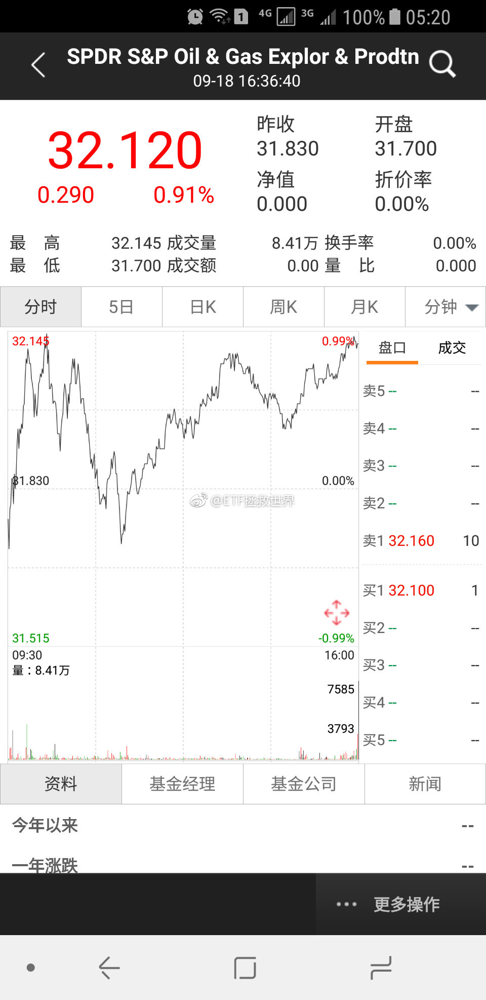 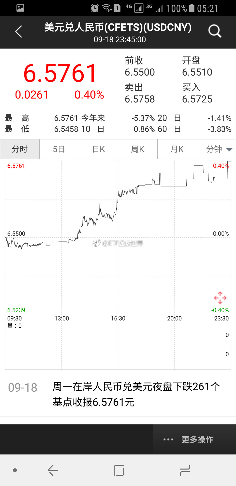 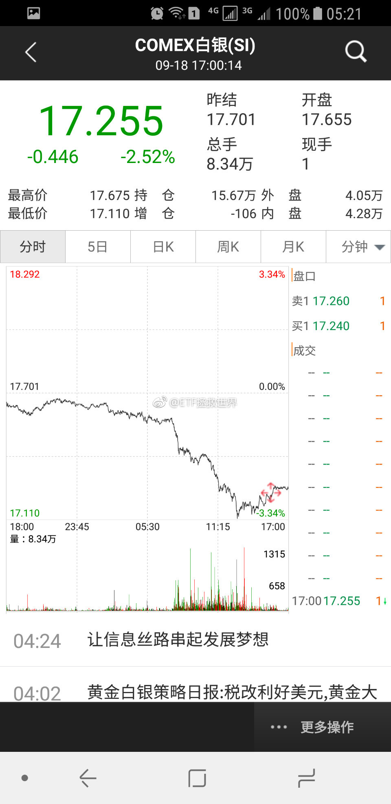

## 2017-09-19 06:40

几周前浮亏15%的油气，现在浮亏3个多点。

我说过很多次，通过各种方法将成本控制好，别说趋势反转，就是一个小反弹也分分钟开始盈利。

任何指数品种，任何，都会做成盈利。绝不允许亏损卖出这样的事情发生。

只有一种可能变成悲剧，就是底部你被吓得不敢买或者卖出了。 ​​​

## 2017-09-19 09:22

回复@化工_达人:场内现在折价1.6%。再加上今天净值又涨1%。如果场内买的时候有点溢价，你算算是不是差不多3个多点。//@化工_达人:我浮亏6.67%，场内买的。3个点不太可能吧

## 2017-09-19 09:45

广发养老的净值已经快回到第三轮熔断前了。计划的几个重仓品种开始蠢蠢欲动。

所以，要买就买表现不好的，然后让手里表现好的去飞，一定是没错。 ​​​

## 2017-09-19 10:13

太毒了！！！

## 2017-09-19 15:05

回复@一小九K:12000亿是我能想到的极限。超过这个，恐怕有点问题了。我相当怀疑管理层会让两融余额到这个数字。//@一小九K:老大，两融余额逼近万亿，是不是风险已经很近了...

## 2017-09-19 21:01

每日打卡（81）

练得很舒服。要加量了吧？ ​​​
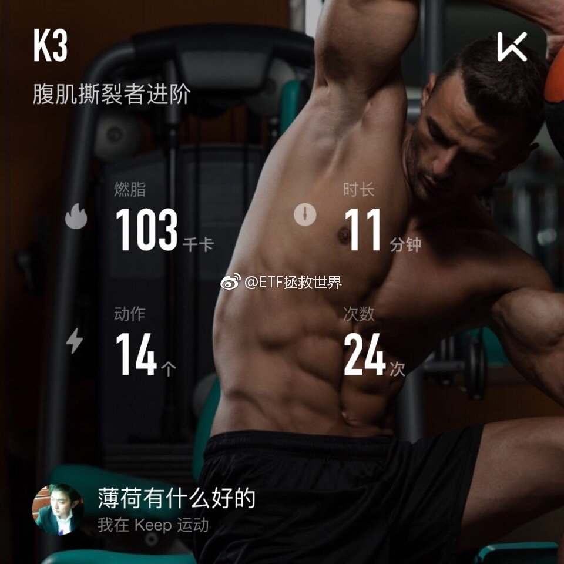

## 2017-09-20 09:17

谢谢。

## 2017-09-20 09:33

这两年计划交易的18个品种，就剩这两个了。

赔钱为什么这么难。为什么。

 ​​​

## 2017-09-20 10:32

回复@夜雨梧桐2010:赔钱和傻是两个范畴的概念好吗。//@夜雨梧桐2010:ee，我来帮你，借点钱给我，我不还，你就赔了......

## 2017-09-20 13:36

其实我特别怀疑是不是有朋友上过当。如果所有朋友都没有上过当，这些骗子注册这么多号，每天这么弄，又没效果，4不4傻啊。

> @ETF小迷妹
> 激动得差点上了高仿的当@ETF拯救世界 ​​​

## 2017-09-20 14:05

有现金的注意一下逆回购了。长短结合。 ​​​

## 2017-09-20 14:12

回复@happymami:如果是目前这样，明确的说，月底不会开A股的车了。//@happymami:大盘跌不下去吗？昨天跌了，今天又涨上来，不知月底还能开车不？

## 2017-09-20 21:51

每日打卡（82）

打算加个每天走一万步的新指标。 ​​​
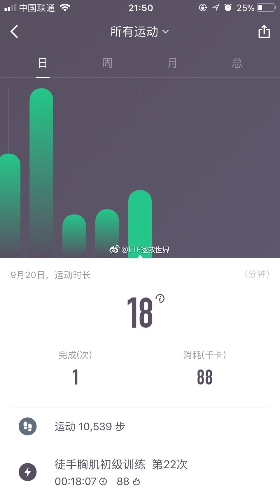

## 2017-09-21 00:04

一口 ​​​
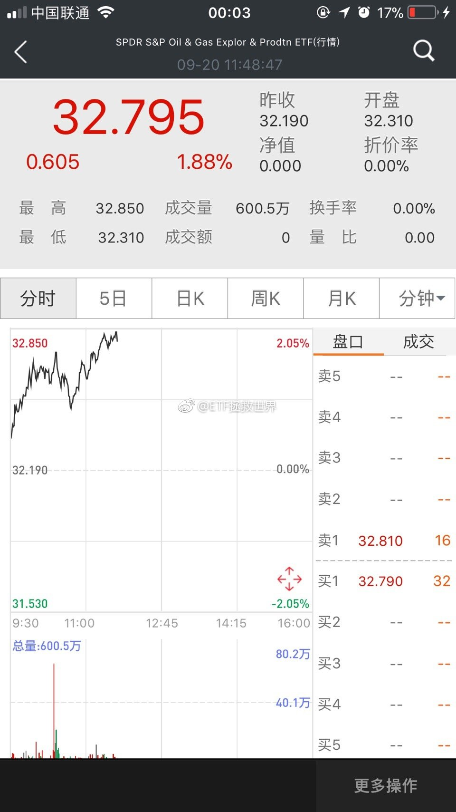

## 2017-09-21 07:45

别人说什么，重要吗。 ​​​
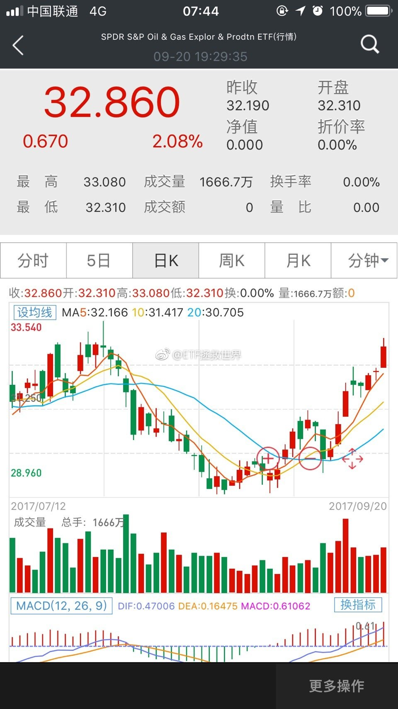

## 2017-09-21 08:43

明年上半年坐这个去趟迪斯尼。

> @澎湃新闻
> 【时速提高至350公里，复兴号京沪间只需4小时28分】9月21日起，“复兴号”动车组即将在京沪高铁提速至350公里时速运行。中国成为世界上高铁商业运营速度最高的国家。澎湃新闻第一时间体验“全球最快”。 http://t.cn/R0z9pdh澎湃新闻的微博直播 . ​​​

## 2017-09-21 08:45

留着这张存单可能会发财

## 2017-09-21 09:05

回复@Beck1010:事实是据说70%炒股的人是赔钱的//@Beck1010:如果买股票的话是不是就已经发了//@ETF拯救世界:留着这张存单可能会发财

## 2017-09-21 09:52

某个品种已经进入瞄准镜了。还有一周。 ​​​

## 2017-09-21 10:11

谁能想到，又新高了。好像A股怎么走和我们的账户关系也不是太大了。

组合，组合。 ​​​

## 2017-09-21 11:24

回复@你好大麦茶:拍卖午餐吧。1400起拍。能不能拍到2万//@你好大麦茶:回复@徐L鑫:组团求偶遇//@ETF拯救世界:明年上半年坐这个去趟迪斯尼。

## 2017-09-21 11:25

$中证红利 sz399922$  组合中的A股指数总算有新高的了 ​​​

## 2017-09-21 11:29

这其实就是国外历次危机中的场景：贷款80%，然后房价跌30%，不仅首付跌没了，欠银行的钱比房子市值还多。最悲惨的是，因为经济不好，失业了。当然，我朝不会出现这样的情况。毕竟房价永远涨。//@挖龙脉的鹿鼎公:杠杆大了，经不起回撤

## 2017-09-21 14:30

回复@bigblue83:爱跌不跌，我不看了。维稳还有一个月，相信依然是波澜不惊。看腻了，爱谁谁，跌也不买。//@bigblue83:如果这样跌一周，又可以搞a了

## 2017-09-21 14:52

拼命死扛，扛到两融余额1.2万亿以上，最终崩的一塌糊涂。谁负责呢，又抓一批？

操盘的恐怕得掂量掂量吧。 ​​​

## 2017-09-21 15:57

​​​
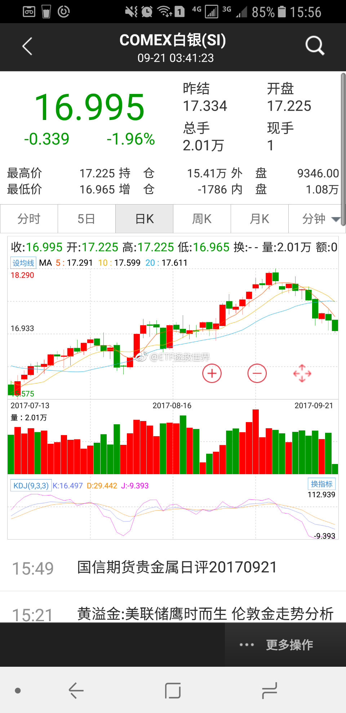

## 2017-09-21 21:28

回复@葫芦岛心灵的旅途:不要长期持有，有损耗//@葫芦岛心灵的旅途:请叫益达，161226跟踪效果如何?

## 2017-09-21 22:27

每日打卡（83）

这几天有点感冒，做点轻松的。 ​​​
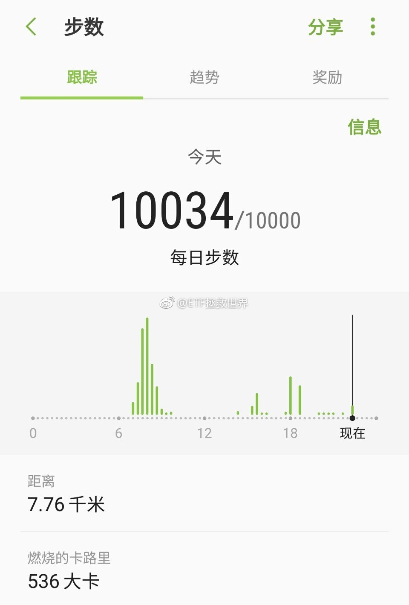 

## 2017-09-22 09:17

刚刚得到的最新消息，2015年7月以来，买的18个品种只剩一个浮亏1%了。

只要系统和策略科学合理，在资本市场挣钱是没什么难度的。

不赔钱只是第一步，想要赚的多，还有曲折的路要走。但是在正确的路上一直走下去，光明也就不远了。 ​​​

## 2017-09-22 09:32

呵呵，跌也不买。看你能跌到哪里。。//@ETF拯救世界:回复@bigblue83:爱跌不跌，我不看了。维稳还有一个月，相信依然是波澜不惊。看腻了，爱谁谁，跌也不买。//@bigblue83:如果这样跌一周，又可以搞a了

## 2017-09-22 09:55

很多事情，对人，对事，都可以灵活处理。不能过于拘泥于某种刻板的教条。

但关键一点，要有比较坚定的世界观。或者说，标准，底线。

投资当然也是如此。买入，持有，卖出，构成了投资的全过程。无论是做哪个动作，最基本的投资世界观和标准不能变。这个标准不应该是涨了还是跌了，也不应该是别人说什么，而应该是自身对于买卖标的有一个基本的价值认识。

涨了看多，跌了看空，像羊群和旅鼠一样跟着大伙跑来跑去，下场大概率不会太好。

## 2017-09-22 09:59

怎么看待互联网上每天扑面而来的信息和新闻？

比较关键的一点是要有独立思考的能力。

新闻和信息，很多时候是假的。另一些时候虽然是真的，然而只是真相的一部分。

有些人的观点不正确，是因为他本身能力有欠缺。然而有些人是故意说一些不正确的观点，也许是为了利益，也许是被逼无奈。

所以独立思考特别重要。看别人说的话，注重论据，忽视结论。结论嘛，自己去下比较好。

## 2017-09-22 10:11

回复@溪南烟树:未雨绸缪。之前已经出过一份。目前大概是8%的仓位。8%是一个关键仓位，在一个组合中，低于8%很难对组合净值产生影响。无论是正面还是负面。综合来看，目前恒生的8%还算是ok。如果能到29500，还会继续卖出。不到的话，持有就ok了。

## 2017-09-22 10:16

回复@安全投资稳健增长:算是今年的失误之一。这个一定要认真反省，升级策略。//@安全投资稳健增长:没有持有互联网相关的指数，会不会有点遗憾？

## 2017-09-22 10:50

回复@文小陈c:放心。纳斯达克，美国消费，美国医疗，标普，全部都在我们的监控范围内。美国未来在我们的组合配置中会有不小的比例。//@文小陈c:美国缩表会影响美股吗？如果美股高位崩盘，那是不是有机会入手美国上市的中国it巨头的指数？

## 2017-09-22 11:15

回复@仰望幸福45134:“次新”是一个概念，不是一个行业、市值或价值构成的指数。概念指数一般来说我们不会投资，但你想玩的话，据我的经验，熊市末期买入熊市中上市的，没有炒过的次新股，会在接下来的牛市中发大财。其它阶段我就不清楚了。

## 2017-09-22 11:52

回复@秦雪晖23333:有啊，都拉黑了啊。//@秦雪晖23333:我总感觉这样不好，没人骂E大，这不真实，老大懂我意思吗

## 2017-09-22 11:53

双卡+微信双开。如果能实现这两个，就不用每天带两个手机了！

## 2017-09-22 12:54

回复@石头里的虫子:骂完了马上打赏999//@石头里的虫子:大家集思广益一下，怎么样才能骂了E大又不被拉黑。//@ETF拯救世界:回复@秦雪晖23333:有啊，都拉黑了啊。//@秦雪晖23333:我总感觉这样不好，没人骂E大，这不真实，老大懂我意思吗

## 2017-09-22 13:21

回复@fouvy:2010年-2015年3、4月，是ETF计划第二轮的持续时间。基本上到了当年4月第二轮的持仓品种就卖的差不多了。到2015年7月开始，第三轮计划正式开始。所以没有2015年初以来这个概念~//@fouvy:2015年年初以来呢...//@ETF拯救世界:回复@石头里的虫子:骂完了马上打赏999

## 2017-09-23 11:11

回复@rose6289707516:其实日本也不小了。在欧洲只比法国稍小，大于英国德国了。日本人做事是太认真了。//@rose6289707516:日本是小，可也有一亿多的人口，更拥挤，还是有没有心管的问题

## 2017-09-23 19:26

这几天感冒没法打卡了。以后补吧。

 ​​​

## 2017-09-24 13:10

转发。希望开车的朋友都引以为戒吧。前车这样并线，就算这次后车让了，以后也总有不让的，还是会出事，弄不好命没了。后车虽然无责，但其实也没必要，踩一脚刹车就完了。别的不说，修车、处理事故就够麻烦，何必给自己找事。要重温《蛮荒故事》啊。

> @北京人不知道的北京事儿
> 昨儿发生的一起交通事故，该怎么定责引起大量网友争论。。。这事儿你怎么看？[思考]http://t.cn/R05LtLf奶罩的微博视频 ​​​

## 2017-09-24 13:33

回复@施大威:你这个太不恰当了。当然，你要把别人上你老婆和踩一脚刹车等同起来，那我也是没什么好说了。你好好想想，这两个是一个性质的事情吗。

## 2017-09-24 13:46

回复@施大威:我遇到这种事，当然也会不爽，但一定会减速让行。我告诉你为什么，因为我不知道撞上去我或者对方会死还是残。就为了教育并线不守规矩的人搭上我的命？不好意思，我的命很值钱，家人还需要我，我还没活够。您愿意您请便。

## 2017-09-25 08:44

列宁同志已经不咳嗽了，他已经不发烧了！ ​​​

## 2017-09-25 09:03

回复@观音山上拜观音:是啊，我也很期待。到现在我都不知道该开哪辆车。//@观音山上拜观音:再休息四天，我们就要飙车了。

## 2017-09-25 09:37

金陵玉树莺声晓，秦淮水榭花开早，谁知道容易冰消！

眼看他起朱楼，眼看他宴宾客，眼看他楼塌了。 ​​​

## 2017-09-25 09:45

$全指医药 sh000991$   弱周期 ​​​

## 2017-09-25 09:54

回复@阿杰_Future:那我念一句清代的唱词，莫非还是五阿哥穿越回来的吗！//@阿杰_Future:与青春有关的日子 的经典桥段, 老大你暴露年龄了噢

## 2017-09-25 10:18

回复@乐悠悠水柔柔:基本是。大家可以申购试试。反正中的机会几乎没有。//@乐悠悠水柔柔:e大，今天雨虹可转债真的是无风险吗？//@ETF拯救世界:回复@阿杰_Future:那我念一句清代的唱词，莫非还是五阿哥穿越回来的吗！

## 2017-09-25 10:21

4不4抱团取暖的标的转到咱们这儿来了。

## 2017-09-25 11:02

申购转债的正确姿势 ​​​
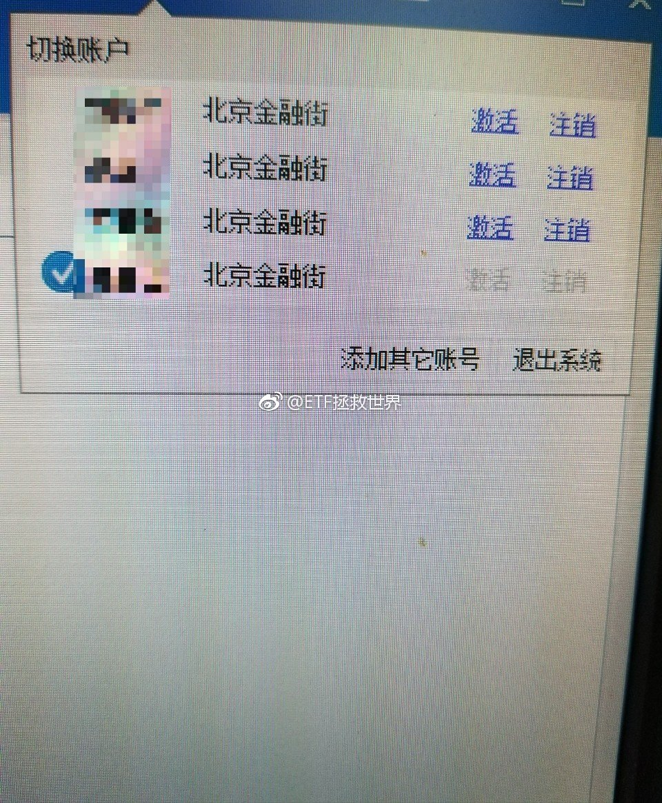

## 2017-09-25 11:09

回复@幸福猪兜仔:4天跌了15%，是不是给你机会进了。43的话，现在买入有几十个点的收益了。//@幸福猪兜仔:我估计今年的8月30号左右，融创就可以涨到43元以上，然后就可以找益达的指数基金去当接盘侠，老大，你说是不是很开心啦

## 2017-09-25 11:23

回复@恶人假mm:你如果全中我借钱给你。利润对半分。//@恶人假mm:下了个1000万的单，不会全中吧

## 2017-09-25 11:30

回复@神毕希嫣:今天很简单，申购072271。每个人都能申购10万股，不要钱，中了才缴款。风险收益吗，破发的可能性不大，中了的话，赚也就赚个蚊子腿……//@神毕希嫣:e大，科普一下转债玩法啦

## 2017-09-25 11:33

嗯哼。 ​​​
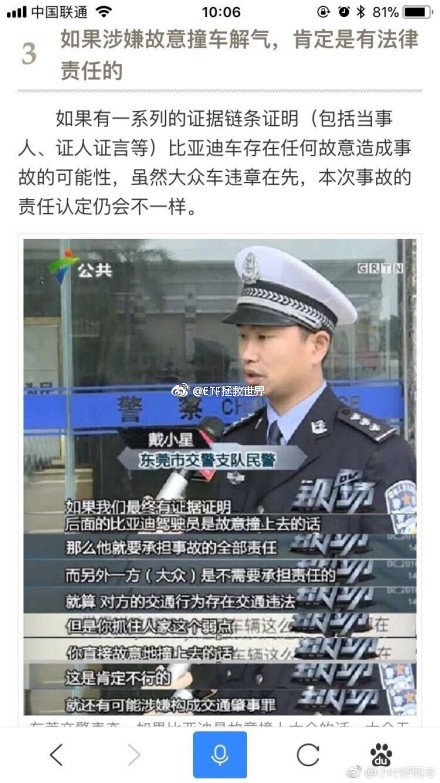

## 2017-09-25 11:40

讲真，我用过n部智能机里面，mate9真的是很有特点的，有几个点我比较喜欢。一个是续航特别强！我用过最强的。第二是音质很不错。不知道为什么，比s8好，跟苹果不分上下吧。缺点是屏幕不好，总感觉有拖影。第二是工业设计不行，笨，重。我比较看重工业设计。看看mate10会不会好看点。

## 2017-09-25 11:58

关于那个变道的吧，昨天说了两句，还让人给怼了……

怎么讲呢。

前车肯定有责任，这个不用说。咱们开车的，也都很痛恨这种人。问题就在于，从我自己的角度讲，如果是后车，会怎么对待这件事。包括从我亲人和朋友的角度出发。

有人说，大快人心啊，终于有人治这样的路霸了。不这样以后他不知道怎么开车。

没错，我也觉得挺好。但这些都是站在第三者的角度。设身处地，把自己换成后车，或者后车的亲人或者朋友，还会这么想吗。

恐怕就不一定了。

咱们先不说后车有没有责任，是不是故意撞。就说前车全责吧。

你给人撞翻了。自己没事，万幸！那如果前车没系安全带，人死了呢？就算你没责任，也不用赔钱，一条人命啊。你真能一点事都没有？我不太相信。

就算人都没事，好。走保险，修车。

碰上老实点的人还好。你要碰上不讲理的，他全责也不会好好给你修车。拖着就是不给你走保险，走了也就是不给你钱。怎么着，就是不给你，你告我去啊！

告不告？告吧。法院走一圈，人家就是不执行。怎么样？

这么一件破事，耽误你无数时间精力，一年后解决了。

值吗？

你的时间是以多少钱计价的？钱不是问题的话，操的心够不够你烦？

还有一个，我的车落点脏东西我都得赶紧擦了，这么撞一下，我得心疼死啊！

我的意思不是鼓励前车的行为，我的意思是，我不会有机会刹车避免这次事故的情况而不刹车。如果实在刹不住没办法，如果有机会，我不会故意撞上去。

命值钱，时间值钱。蝴蝶效应，这一脚油门，不知道会引发多少后遗症。

至于公民素质教育，驾驶员教育，我真的希望ZF能多宣传。把交通事故视频定期在电视网络上不停的循环播放。我相信开车的看多了一定会害怕，也知道遵守交通规则了。

遇到持枪抢劫的，该冲上去拼一把还是该躲起来打电话报警，是很重要的选择啊。

## 2017-09-25 13:06

回复@BR芭斯罗缤:枪毙五分钟//@BR芭斯罗缤:回复@happymami:啥后果？//@ETF拯救世界:回复@神毕希嫣:今天很简单，申购072271。每个人都能申购10万股，不要钱，中了才缴款。风险收益吗，破发的可能性不大，中了的话，赚也就赚个蚊子腿……//@神毕希嫣:e大，科普一下转债玩法啦

## 2017-09-25 13:31

不过说真的，如果拿枪逼着我一定要买股票，选择是：

1、PE个位数的房地产股

2、包含PE60倍阿里巴巴、54倍腾讯、42倍百度、36倍新浪、18倍网易、负数京东的中概互联指数。

我会买后者。

…… ​​​

## 2017-09-25 13:37

还是不会买。不用费力气勾引我了。//@ETF拯救世界:没有相对较大的调整，计划不会再加A股了。怎么讲，现在就是鸡肋时间。

## 2017-09-25 14:06

差不多行了，别嘚瑟。慢慢来好吗。

## 2017-09-25 14:41

还……是……不……买……//@ETF拯救世界:还是不会买。不用费力气勾引我了。//@ETF拯救世界:没有相对较大的调整，计划不会再加A股了。怎么讲，现在就是鸡肋时间。

## 2017-09-25 14:52

29号之前，我少说两句可能比较好。 ​​​

## 2017-09-25 20:01

据说汽油车要被淘汰了 ​​​
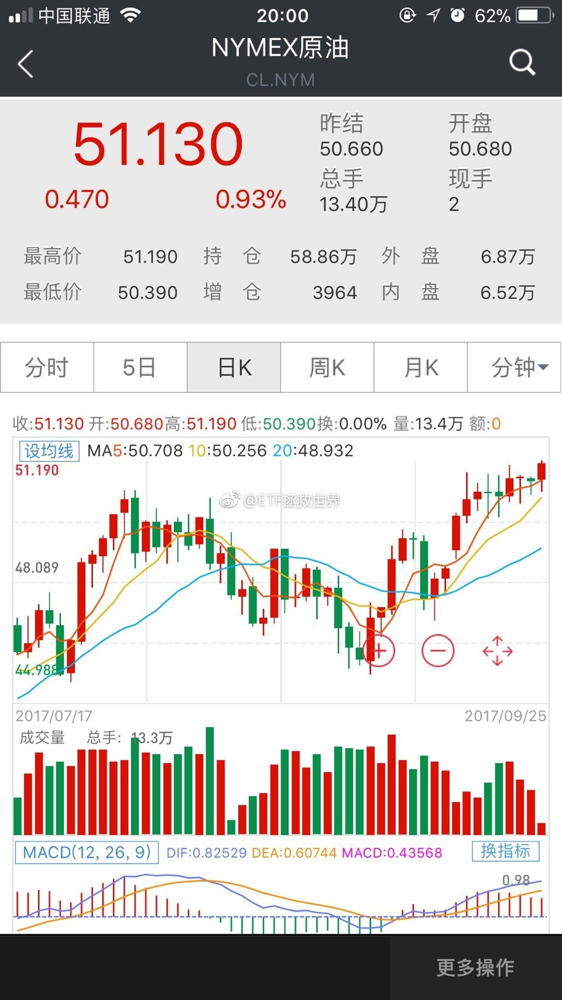

## 2017-09-25 21:28

​​​
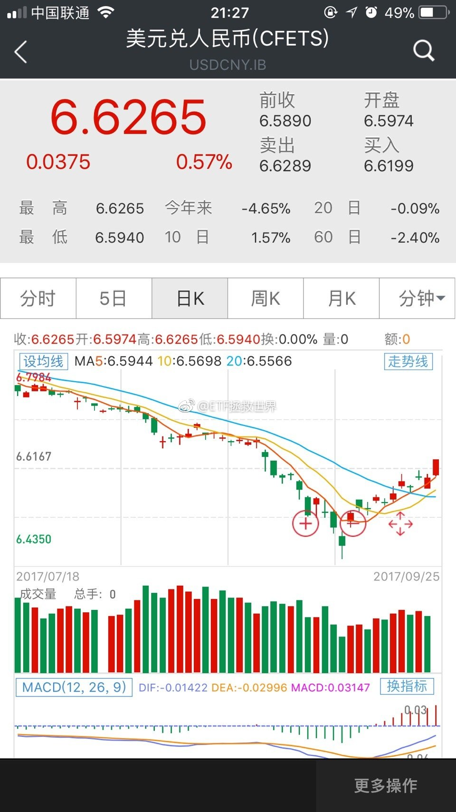 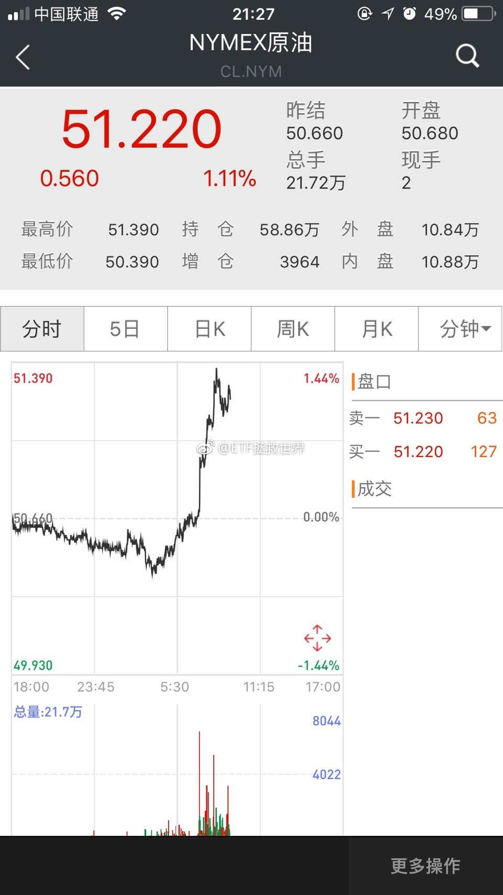

## 2017-09-25 22:54

睡觉去了。明早看看跳不跳。 ​​​
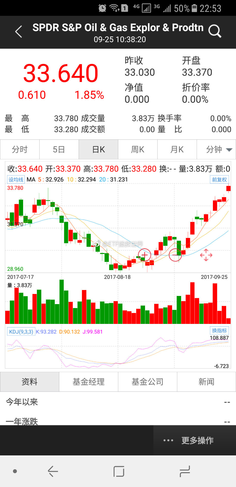

## 2017-09-26 05:51

投资是不是很有意思。

不完全是钱的问题。感受一下。 ​​​
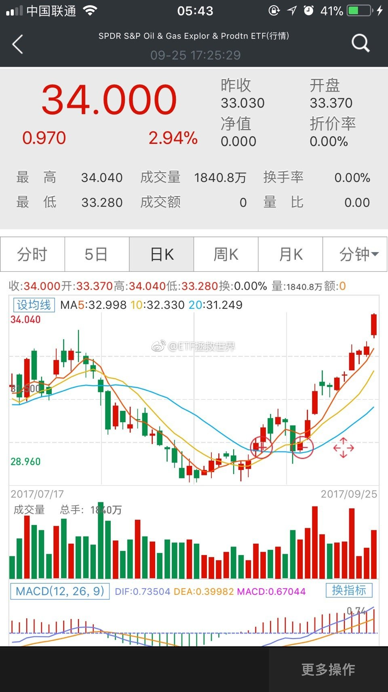 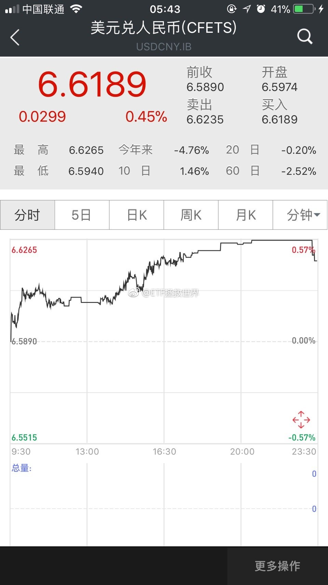

## 2017-09-26 08:29

很多投资者看不上趋势分析。其实无数次量化分析表明，动量因子是最有效的因子之一。当然，能不能用好动量就看每个人的修为了。//@数据分析研究者:是的，不单单是价格，其实均线无处不在，市净率，市盈率，成交量...都有自己的均线

> @数据分析研究者
> 昨晚自研看盘系统观察了一下恒大，不少指标较发出了预警提示。比如市净率，日线9/21开始有5日EMA均线兰色入顶提示，周线自上周起连续出现全均线入顶提示，月线是本月开始出现全均线入顶提示。综合看，周线调整可能才开始，月线要结合周线调整力度观察。分析指标应用解释见：http://t.cn/R0JDper
> 
> 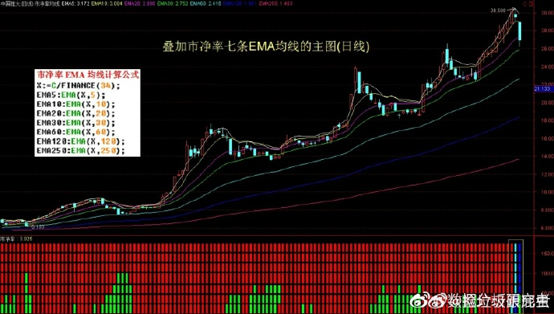
> 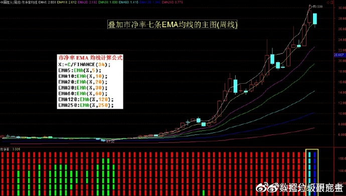
> 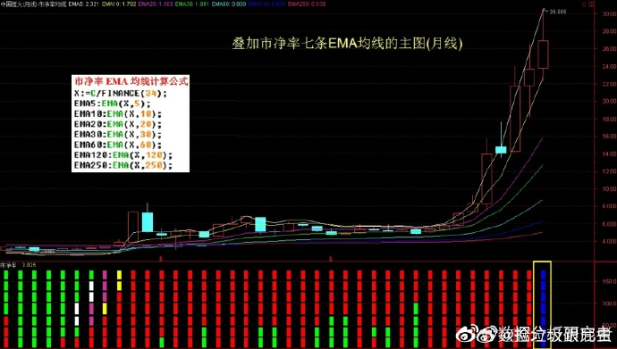
> 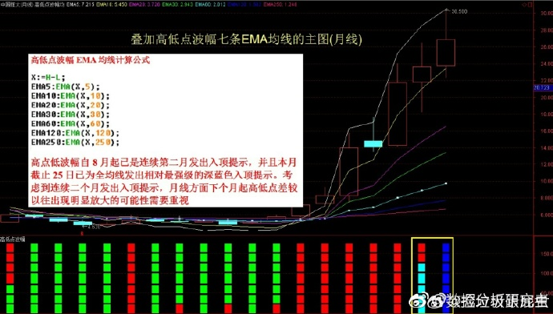

## 2017-09-26 08:50

回复@wuhaowei12345:你怎么知道我有多少仓位？呵呵。//@wuhaowei12345:就哪点仓位，晚上11点看看，早上5点看看。兄也真不容易啊

## 2017-09-26 08:55

一个建议啊，对别人的投资体系投资策略一知半解的话还是不要说话了。

一直说，我本人的金融资产有70%放在计划里。之前那个问答也说得很清楚，这70%中的未使用部分会做各种投资，甚至还举了油气网格的例子。

我只会把最最保险的ETF计划拿出来与大家一起投资，其它的，不会说。不是别的原因，是风险大一些，不是适合每个人。

如果你以为ETF计划就是我的全部，计划的收益率就是我的收益率。

未免就有点图样了。[鼓掌]

## 2017-09-26 09:00

没看过的看吧。免费。

## 2017-09-26 09:11

如果你在厨房里看见一只蟑螂……

## 2017-09-26 09:24

还有三天而已，为什么要涨。好不容易看中的品种。

 ​​​

## 2017-09-26 10:03

竞猜：几点上班。 ​​​​

标的：金融、两油 ​​​

## 2017-09-26 10:06

回复@ironsoul0:7天又过5.5了。这几天有没有希望中期过6？//@ironsoul0:逆回购上来了

## 2017-09-26 10:08

回复@这个月亮有什么好:我说的永远是可用日年化收益。不是“7天”，而是到资金可用日。//@这个月亮有什么好:好像算一下 七天期占用资金13天  ，不如货币基金赚得多//@ETF拯救世界:回复@ironsoul0:7天又过5.5了。这几天有没有希望中期过6？//@ironsoul0:逆回购上来了

## 2017-09-26 10:11

目前GC004和GC007 到10.9年化收益都过5.6%了。需要的可以放一部分。再留一部分看明后天有没有大肉。 ​​​

## 2017-09-26 10:13

到10.9可用都过6%。到10-10可取是5.6%。

## 2017-09-26 12:04

早上上班的路上，我还美滋滋的想着月底开车的品种，计划着买多少，风险平价，资产配置……

几个小时过去，什么玩意啊！人类最大的问题就是想太多了吧！ ​​​

## 2017-09-26 12:08

回复@-反清复明-:图片评论 查看图片 //@-反清复明-:E大以前是不能奶，以后想也不行了

## 2017-09-26 13:46

回复@圣善周闻宗:上周重要股东净减持17亿，正常。政策卡的死，又是敏感期。//@圣善周闻宗:有个问题，E大能否解答一下，最近股市行情这么好，大小非减持情况如何了呢？//@ETF拯救世界:回复@-反清复明-:图片评论 查看图片 //@-反清复明-:E大以前是不能奶，以后想也不行了

## 2017-09-26 13:48

我真的笑出来了啊。港真，有点把持不住了呢。//@ETF拯救世界:还是不会买。不用费力气勾引我了。//@ETF拯救世界:没有相对较大的调整，计划不会再加A股了。怎么讲，现在就是鸡肋时间。

## 2017-09-26 13:53

回复@litterwitch:7以上全部放掉。有再高也不要了。都是命。//@litterwitch:7天逆回购飙升啊//@ETF拯救世界:我真的笑出来了啊。港真，有点把持不住了呢。//@ETF拯救世界:还是不会买。不用费力气勾引我了。

## 2017-09-26 14:03

回复@i云腾致雨:有花堪折直须折，莫待无花空折枝//@i云腾致雨:不是越高越好吗？//@ETF拯救世界:回复@litterwitch:7以上全部放掉。有再高也不要了。都是命。//@litterwitch:7天逆回购飙升啊//@ETF拯救世界:我真的笑出来了啊。港真，有点把持不住了呢。

## 2017-09-26 15:42

回复@小韭菜V:也没有完全达到预期，因为买的还不够多。//@小韭菜V:回复@ETF拯救世界:回头一看，E大又说对了。

## 2017-09-27 10:50

回复@恶人假mm://@恶人假mm:今天8.2卖了点//@ETF拯救世界:回复@litterwitch:7以上全部放掉。有再高也不要了。都是命。//@litterwitch:7天逆回购飙升啊//@ETF拯救世界:我真的笑出来了啊。港真，有点把持不住了呢。//@ETF拯救世界:还是不会买。不用费力气勾引我了。

## 2017-09-27 11:16

回复@且慢管家:但是如果想自己单买计划里已经有的，在且慢里可以自己加车。//@且慢管家:回复@桃枝么么:您好 暂时不能购买单支基金 只能买基金组合//@ETF拯救世界:回复@小韭菜V:也没有完全达到预期，因为买的还不够多。//@小韭菜V:回复@ETF拯救世界:回头一看，E大又说对了。

## 2017-09-27 12:06

蛮荒故事现实版。再想想前几天的视频。

> @新京报我们视频
> 【两车发生剐蹭 男子发狂驾车冲撞乘车者致1儿童身亡】9月24日，郑州一男子驾车撞人，连续7次加速撞击，致1儿童死亡。据死者舅舅告诉记者，事发因两车剐蹭引发纠纷所致。监控视频记录下全过程：http://t.cn/R0allg6新京报我们视频的秒拍视频 @新京报 ​​​

## 2017-09-28 08:06

这样不好。爬得越快，摔得更惨。

一步三回头，进二退一才是我的最爱。 ​​​
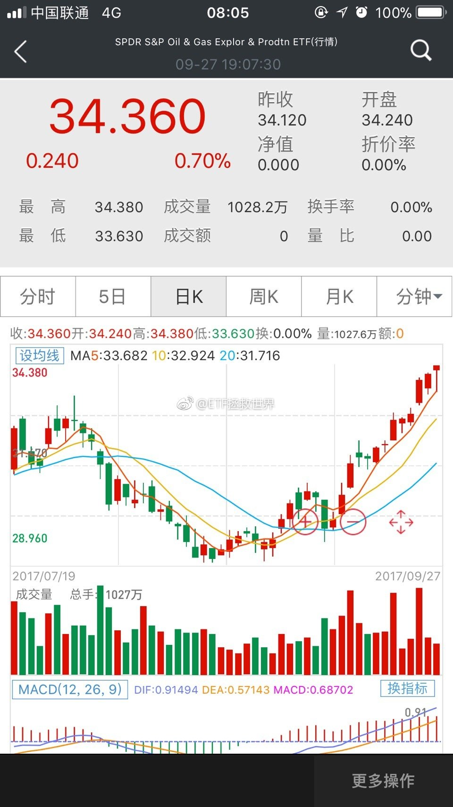

## 2017-09-28 09:34

今晚开新车。 ​​​

## 2017-09-28 10:49

谁还记得 $国证食品 sz399396$    ​​​

## 2017-09-28 11:41

开个车，出门。高高兴兴。谁知道一家孩子没了，一家故意杀人被抓了。蛮荒故事。是不是很荒唐？一点都不荒唐，每天这样的事情都在上演。各位，出门在外，注意安全。

> @平安郑州
> #警情通报#[话筒]我市郑东新区普惠路与福禄街交叉口发生一起刑事案件，犯罪嫌疑人徐某因涉嫌故意杀人已被警方刑拘。 ​​​
> 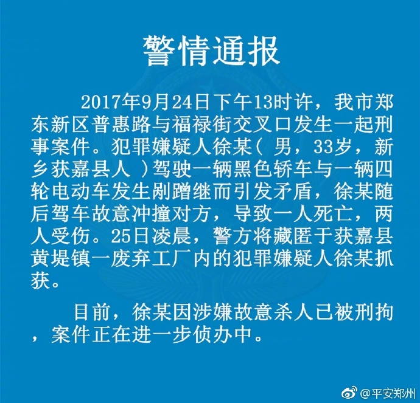

## 2017-09-28 13:34

回复@漓江大雨:我认为能。性格当然有天生的成分，但而更多的可以通过一些方式来改变。比如读书，比如多一些阅历。明白一些道理，看过一些是非，多一份顾虑，很多时候脾气就好了。所以很多人年轻的时候脾气暴躁到了中年以后就会好很多。

## 2017-09-28 14:40

这个广告里的某家公司2007年发行的基金，目前净值0.75。十年过去了，赔了25%。穷人辛辛苦苦攒点钱，就忽悠进来然后这么糟蹋，这，合适吗。

## 2017-09-28 14:55

回复@打猎为生的少爷:回购10%。我哭了！//@打猎为生的少爷:回购是疯了吗？//@ETF拯救世界:这个广告里的某家公司2007年发行的基金，目前净值0.75。十年过去了，赔了25%。穷人辛辛苦苦攒点钱，就忽悠进来然后这么糟蹋，这，合适吗。

## 2017-09-28 15:21

回复@滚滚磨刀门:拉黑你 //@滚滚磨刀门:我买到了11％的，顶我上去，让我在E大面前嘚瑟一下！！！//@ETF拯救世界:回复@打猎为生的少爷:回购10%。我哭了！//@打猎为生的少爷:回购是疯了吗？

## 2017-09-28 15:51

这是我第一条被删的微博。诡异的是，是5月份发的。什么内容我都忘了，看提示应该是关于涨跌家数的数据分析。

这是有人举报了还是什么情况？数据分析也要删？以后可以发什么。

其实发不发微博我根本无所谓。就是想知道边界，别因为发微博闹出什么乱子就不好了。 ​​​
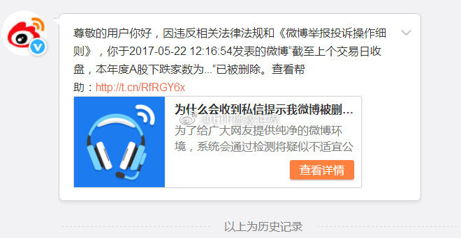

## 2017-09-28 19:47

是不是搞事情 ​​​
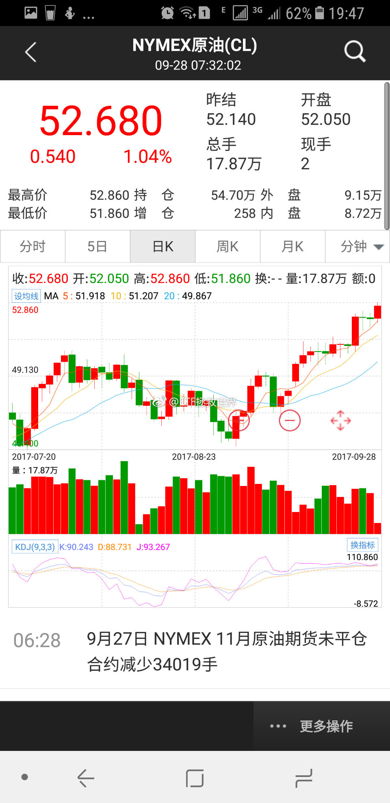

## 2017-09-28 21:59

醉了。公众号只能显示100条留言，结果有500多条在后台。  微博随便评论全都能显示，结果只有几十条评论……  微博药丸。  （这条是不是又要被删了） ​​​

## 2017-09-28 22:28

不错，可惜没有美利坚合众国、霓虹、大不列颠及北爱尔兰联合王国、大德意志啊。可以说并不全面。

## 2017-09-29 10:22

$全指医药 sh000991$  我是真希望它多震荡几年。 ​​​

## 2017-09-29 21:27

每日打卡（84） 

基本痊愈了。今天开始继续每天打卡。 ​​​
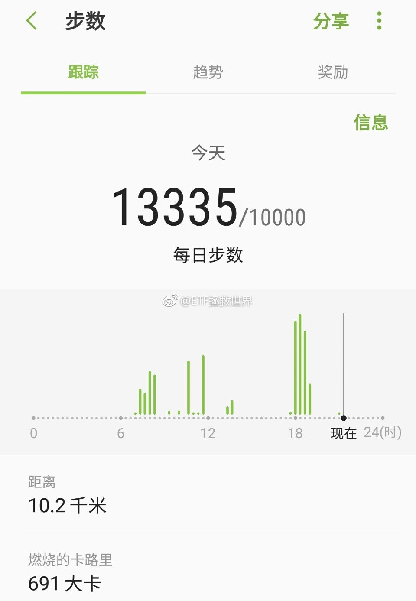 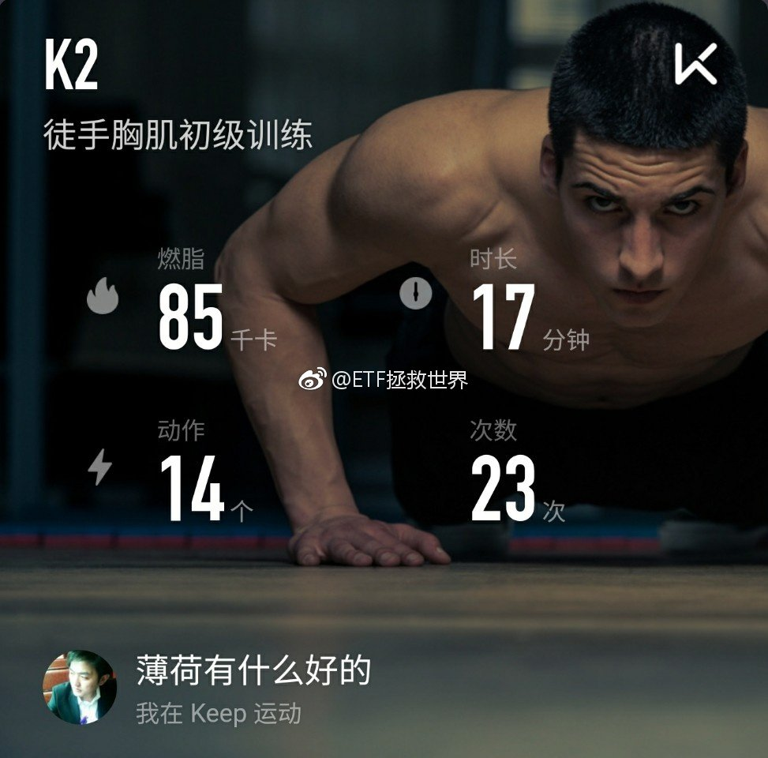

## 2017-09-30 09:03

回复@董无为G:第一个呢，不少人的粉丝数其实很有问题。看评论数量就知道。第二个呢，最近这两年计划确实是稳步增长，慢慢的不停新高。但这并不是ETF计划的常态。某个时间段，疯起来连我都怕啊。现在还是播种阶段。到了夏天狂热，秋天收获的时候再看吧~

## 2017-09-30 22:12

每日打卡（85）

坚持。 ​​​
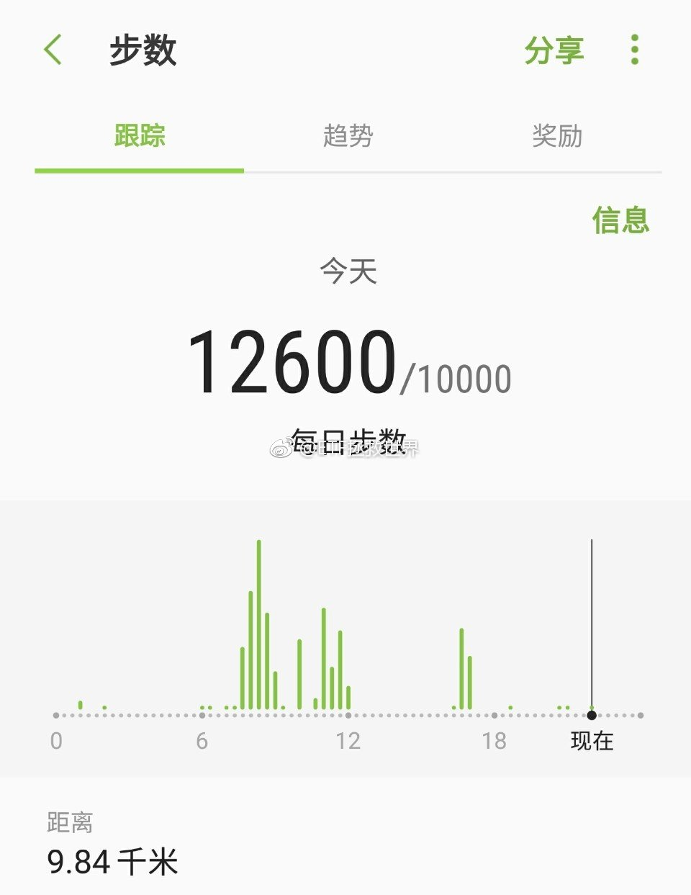 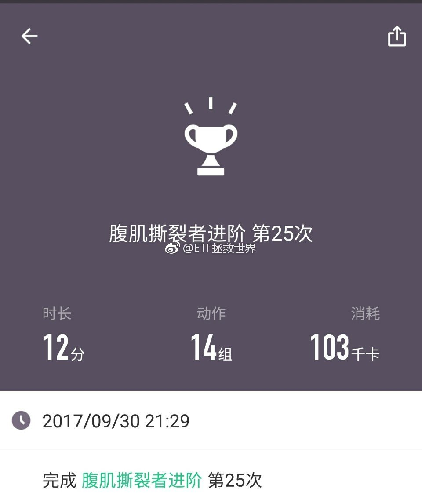

