## 2017-10-01 22:09

每日打卡（86）

各位双节快乐！长假都打算怎么过？ ​​​

## 2017-10-03 23:02

每日打卡（87）

昨天出去浪，没有打卡…… ​​​
 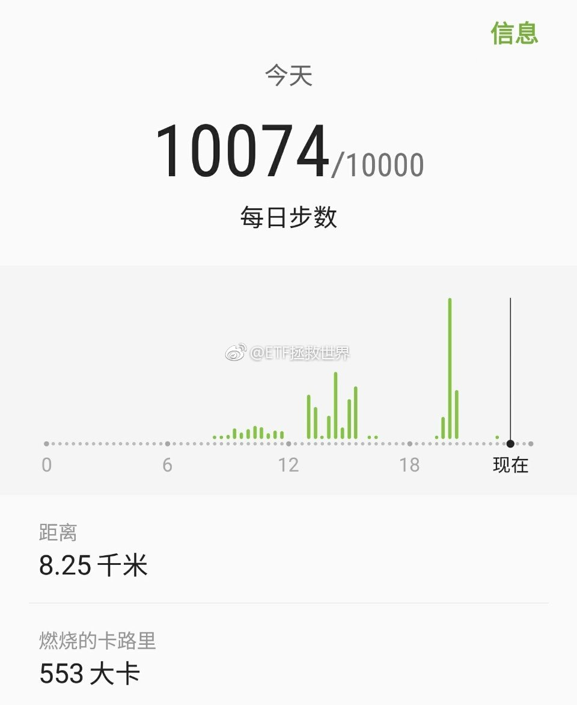

## 2017-10-04 20:56

每日打卡（88）

各位中秋快乐！给逮嘎拜个晚年！祝逮嘎年年有今日，岁岁有今朝！

今天大家是在外面浪还是在家里浪？哪里浪都好，开心最重要……

没法一一回复各位，心意都感受到了……

除了每天一万步，要不要加个每天n分钟平板支撑？不过不想给自己太大压力…… ​​​
 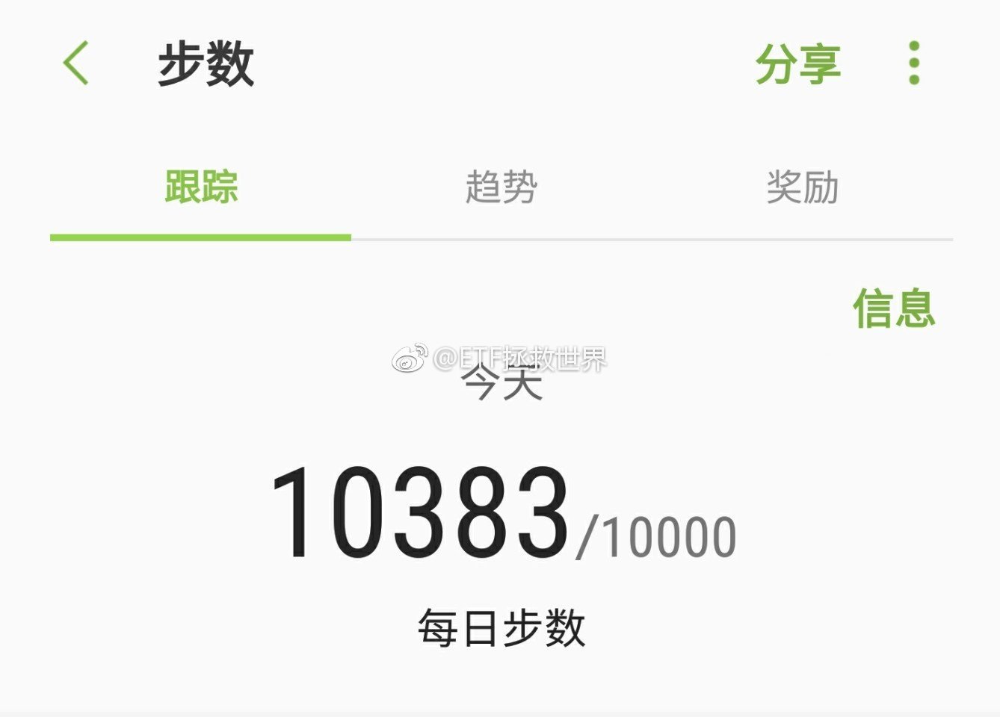

## 2017-10-04 21:52

为什么这样的人可以上路，为什么？！

> @新浪视频
> 【高速路逆行引四车连环撞 女司机哀叹要赔三辆车】3日，沪渝高速荆州段，一名女子驾车在高速路上调头逆行，导致四车连环相撞。行车记录仪显示，女驾驶员一直在说逆行是不对的，但为图一时方便还是冒险操作，事发后女子惊呼“完了，完了 ，我要赔三辆车”。http://t.cn/R0kipQM高速路逆行引四车连环撞 女司机哀叹要赔三辆车 ​​​

## 2017-10-05 21:02

每日打卡（89）

多做两组。开始玩平板。

今天在看《银河基地》，还是没有《三体》震撼呐。 ​​​
 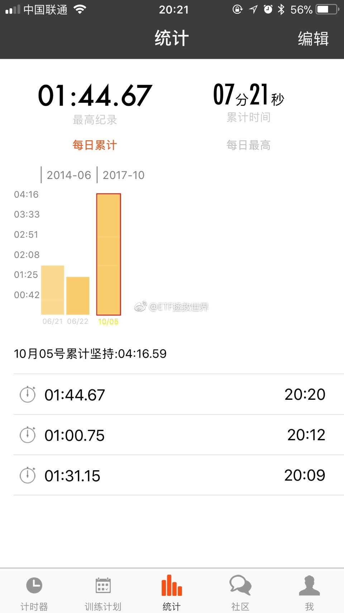

## 2017-10-06 20:03

每日打卡（90）

说话假期就快过完了。今天又出去浪了，然后去剪头发。有没有跟我一样很讨厌剪头发的，抱紧我……

昨天有朋友评论，平板支撑做不过谁，就不做了。这很有意思。

其实呢，咱们这种群众体育运动，目的是什么呢。跟谁竞赛吗。我觉得，肯定不是啊。很简单，就是为了强身健体，每天都比昨天的自己好一点就足够了。

说起来，这跟投资真的很像。您说，咱们又不是基金经理，又不需要用排名吸引客户资金，每天比来比去干什么？今年你挣20%，我赚15%，难过的吃不下饭。明年你赔30%，我赔13%，好高兴啊。

是不是傻。

要比就和自己比。资产增加了没有？跑赢存款利率没有？跑赢通胀没有？跑赢货基没有？跑赢理财没有？五年十年年化是10/15还是20？

你的对手是你自己，比昨天，上个月，去年的自己好，那就值得每天高高兴兴的谢谢自己。

无论是锻炼、赚钱、明白一些做人的道理，都是如此。
 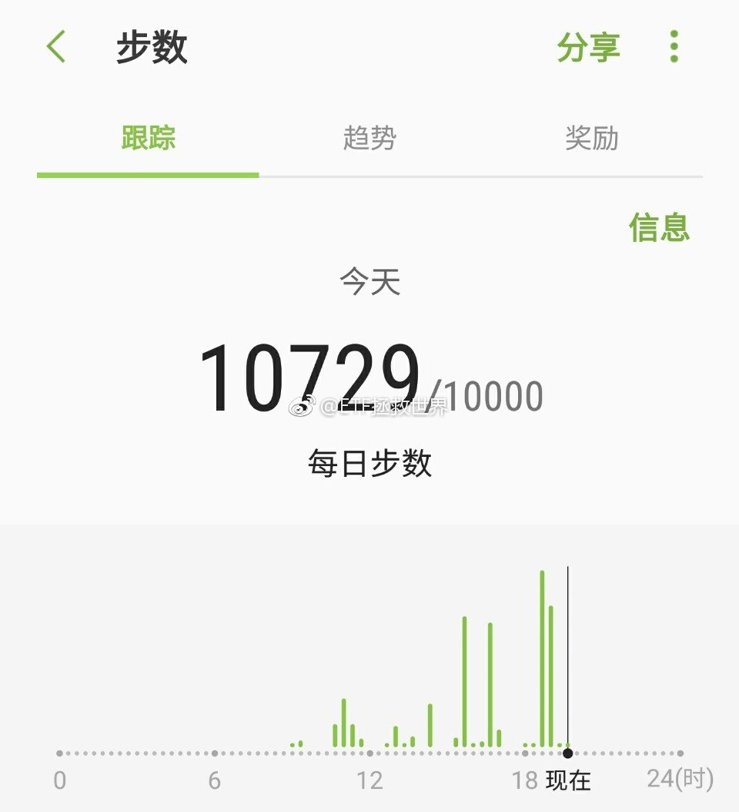 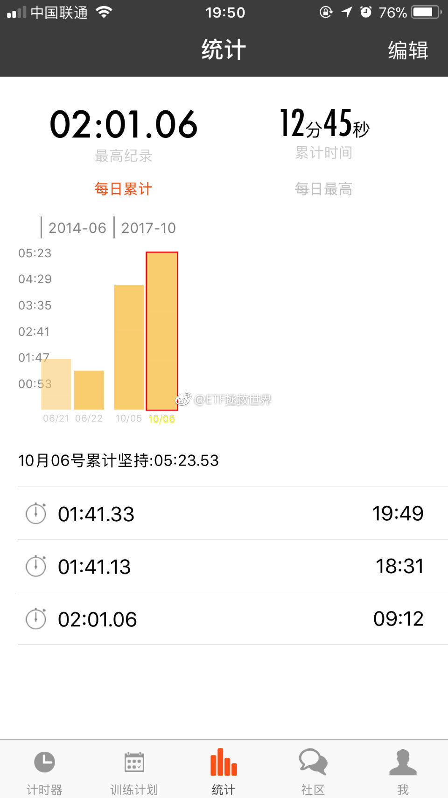 

## 2017-10-09 09:43

不用着急“逃顶”。也不用忙着“补仓”。

仓位舒舒服服的享受资产不断新高是坠吼的。

看着买卖双方擦肩而过互骂“sb”，是一种乐趣。 ​​​

## 2017-10-09 10:01

谁能想到 ​​​
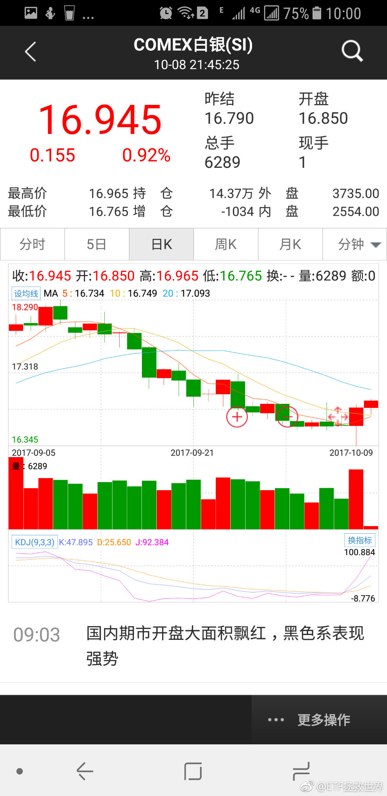 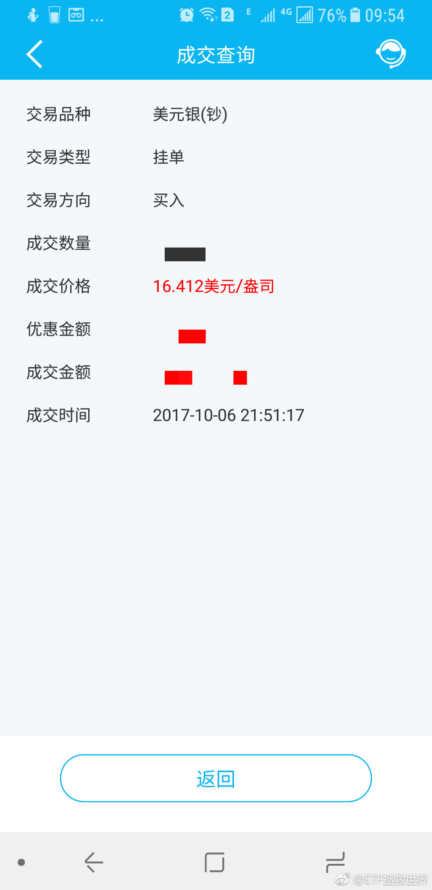

## 2017-10-09 10:05

别说那么多买点先 ​​​
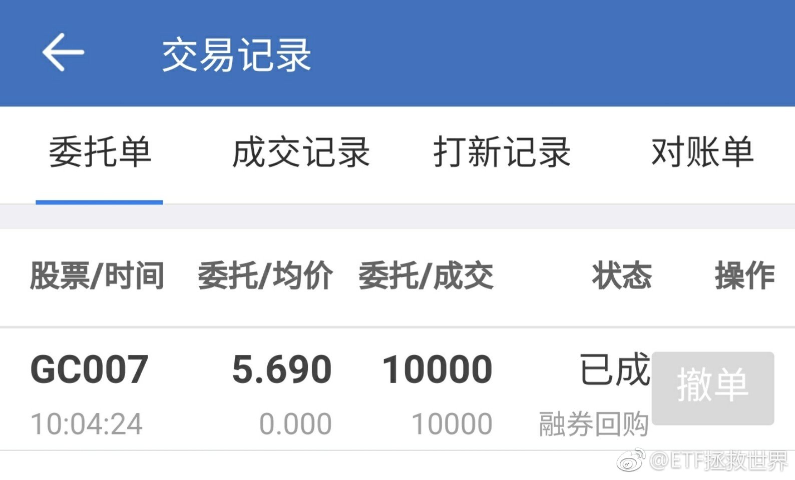

## 2017-10-09 10:11

$全指医药 sh000991$ 是不是良心发现了。 ​​​

## 2017-10-09 14:26

大家好，给大家介绍一下，这是我们的大庄家 ​​​

## 2017-10-09 14:41

不要脸，又涨这么多，继续买！

## 2017-10-09 21:56

每日打卡（91）

每天资产不断新高，锻炼的数据也持续增长。

每天都比昨天好。只有一个没办法：

又老了一天。 ​​​
 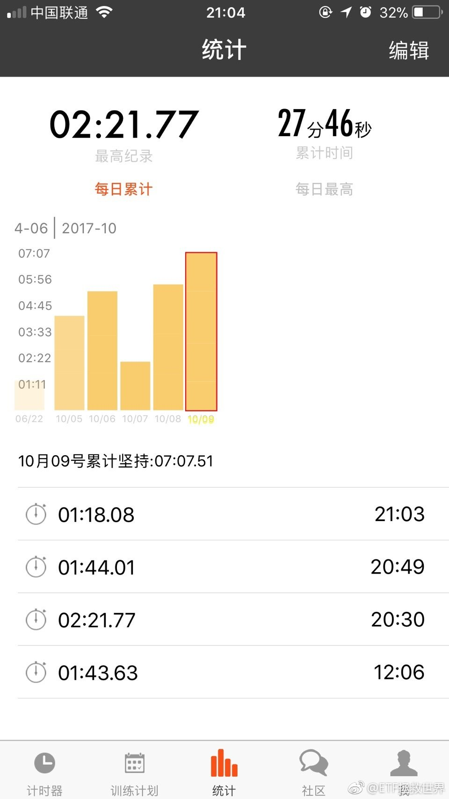

## 2017-10-10 09:33

$全指医药 sh000991$   二话不说奶一口先 ​​​

## 2017-10-10 09:36

$全指医药 sh000991$    讲真，你不涨点，我都替你不好意思了…… ​​​
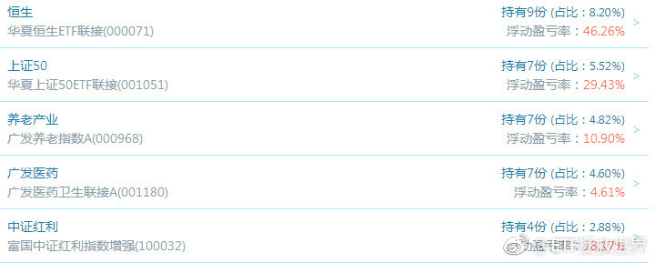

## 2017-10-10 09:46

对了，还有$养老产业 sz399812$  。哥俩其实是表兄弟。计划里面，加起来快10%仓位了。

## 2017-10-10 09:51

各位，我想大家已经无数次见证一个事实，那就是不停的买入“差”的品种，会有好结果。

终有一天，差的会被追捧。雪中送炭是个特别好的事情。原因在于，你只要付出很少，就能拿到很多。当筹码被开始争抢，你的财富就会每天新高，不断增长。

做个好人。 ​​​

## 2017-10-10 09:55

什么情况，毒奶过期了？再奶一口。

## 2017-10-10 10:00

$中证医疗 sz399989$  这个弹性更大，相对估值低。只是绝对估值太高了，实在没法下手。希望未来有机会买一些。 ​​​

## 2017-10-10 10:04

$广发医药 溢价了。胆大的可以套利。 ​​​

## 2017-10-10 11:07

10月到北京来看认真的雪

## 2017-10-10 11:26

今天开始披露三季报。绝大多数公司都是15号之后披露，15号之前只有23家公司。

所以月中应该没什么特别的机会，本月底就非常有意思了。 ​​​

## 2017-10-10 11:33

研究群众，理解群众的行为轨迹。在疯狂的时候与群众一起狂欢，在群众意识到危险之前抽身离去。在群众心灰意冷的时候，回到群众中，隐姓埋名。从群众中来，到群众中去。

> @数据分析研究者
> “群众从未渴求过真理，他们对不合口味的证据视而不见。假如谬误对他们有诱惑力，他们更愿意崇拜谬误。谁向他们提供幻觉，谁就可以轻易地成为他们的主人；谁摧毁他们的幻觉，谁就会成为他们的牺牲品。” ——《乌合之众》 ​​​​

## 2017-10-10 12:09

去库存，群众加杠杆——房子换到群众手中——锁定二手房买卖——推出长效机制。 ​​​

## 2017-10-10 13:24

自信、模糊规避、心理账户、认知误差、记忆误差、锚定、羊群旅鼠。

认识行为金融，规避错误，利用错误。 ​​​

## 2017-10-10 13:48

$中证医疗 sz399989$   跌了半年，一天就涨回来了。这就是证券投资。

证券投资所积累的财富，是跳跃式的。不要因为某段时间，可能是几个月，可能是几年，成绩不好，就放弃。“要知道几年没赚钱还不如存银行”，这种想法肥肠不正确。

三年不开张，开张吃三年。

这些话不是扯淡，不是鸡汤，以后你就知道有用了。

## 2017-10-10 14:27

实不相瞒，又新高了。

计划买入部分年化快突破20%了。 ​​​

## 2017-10-10 14:39

不要管什么“非理性”，不要管什么“不合理”。死死拿住你的低价筹码，不要卖出。医药刚动一动，才涨了多少？

电梯，过山车？无所谓。不要卖，让利润奔跑，享受利润，就这么简单。真的跌了，继续买，下次涨回来就赚更多。

不要妄想你有能力做差价。

不要预测明天的价格，你的成本很低，记住这个。 ​​​

## 2017-10-10 18:30

醉了，闹哪样 ​​​
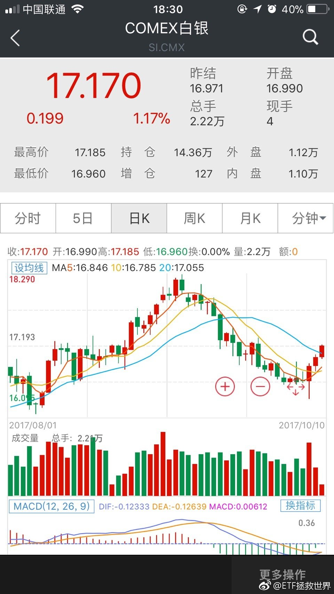

## 2017-10-10 19:59

再涨一点就能出了。4不4有点快啊。

## 2017-10-10 21:49

回复@用户6073012591:wind金融终端机构版//@用户6073012591:回复@雲中漫步_1117:谢谢，跟我用万德的有些不同

## 2017-10-10 22:19

每日打卡（92）

感受肌肉。坚持。 ​​​
 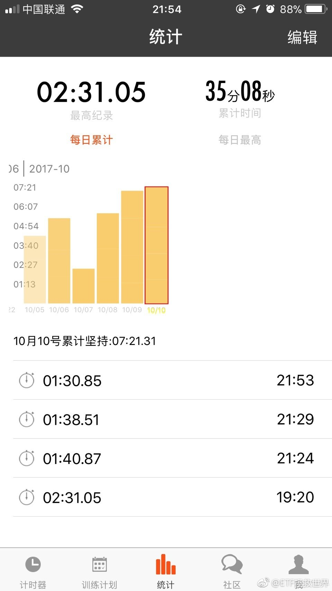

## 2017-10-11 09:51

一个字，不要卖。

踏踏实实赚钱。 ​​​

## 2017-10-11 10:06

$全指医药 sh000991$  $养老产业 sz399812$ 

可以奶一口了吧——

涨的不错啊。 ​​​

## 2017-10-11 10:11

识别泡沫，享受泡沫，在泡沫破灭之前悄悄撤退。

不要识别出泡沫就撤退。

独乐乐不如众乐乐。 ​​​

## 2017-10-11 10:47

$国证食品 sz399396$   感觉有点伤 ​​​

## 2017-10-11 10:52

回复@石头里的虫子: 只因为在人群中多看了你一眼 再也没能忘掉你的容颜//@石头里的虫子:当年8800点的时候我多看了两眼。

## 2017-10-11 14:49

10:04，最高点一口毒奶，服不服。

## 2017-10-11 15:01

好了，2000只股票下跌，继续新高。

今天幅度肯定比前两天小很多了。

没什么意思。看看晚上白银和原油有没有搞头。 ​​​

## 2017-10-11 15:05

还有没有没看过的。对了，这个答案中的打新组合，半年过去净值涨了不少。今天继续新高，年初至今40%……新股没中几只，门票还不错 查看图片

## 2017-10-12 09:43

又咁样？//@ETF拯救世界:10:04，最高点一口毒奶，服不服。

## 2017-10-12 09:50

回复@蓝图806:关注我的朋友里面有17.48%是广东的，给讲讲。//@蓝图806:“咁”，念啥？是啥意思？E大的词汇真丰富，跟着E大即学会了投资，也学会了不少字。//@ETF拯救世界:又咁样？//@ETF拯救世界:10:04，最高点一口毒奶，服不服。

## 2017-10-12 10:22

博时债又要分红了。 ​​​

## 2017-10-12 11:12

买买买

> @见闻实时新闻
> 【快讯】亚马逊发布具备防水功能的Kindle Oasis，显示屏为七英寸，由Audible提供的电池可在快速充电后续航数周时间，将于10月31日上市。亚马逊股价盘初涨0.36%，暂报990.74美元。(华尔街见闻7x24直播 不止是快) http://t.cn/R64lHNR实时快讯 ​​​
> 

## 2017-10-12 14:42

未来20天，跌幅到0.5%的时候买入300ETF，等那谁他们拉，然后卖出，算不算一种策略。 ​​​

## 2017-10-12 22:13

每日打卡（93）

天凉好个秋。 ​​​
 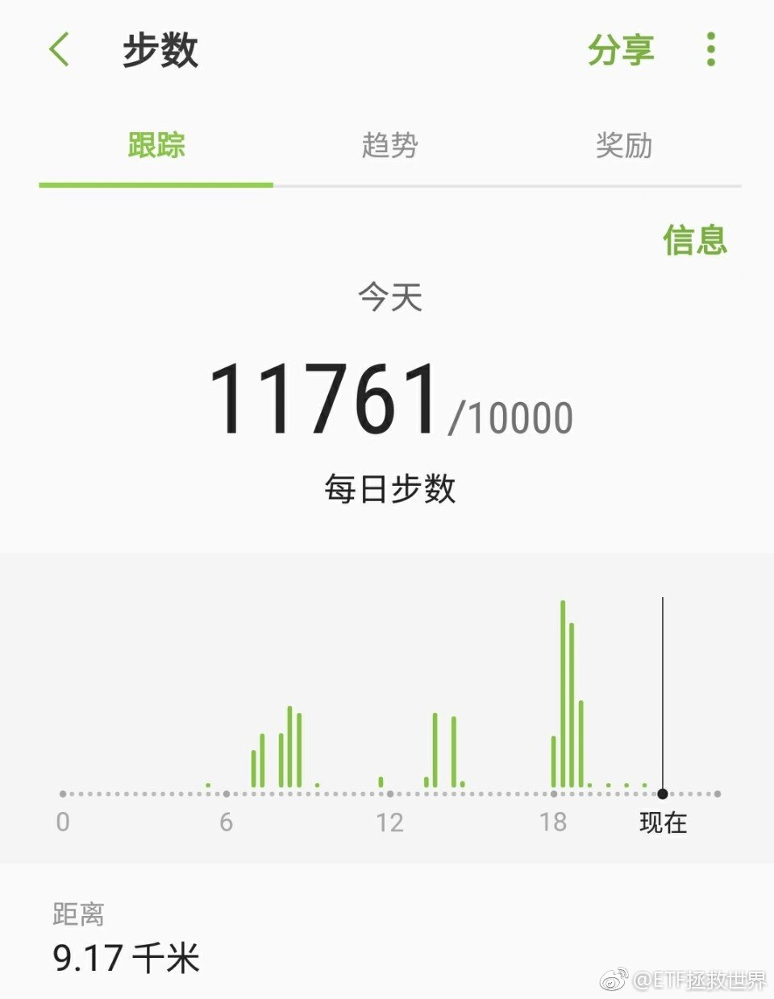

## 2017-10-13 09:41

连续两天毒奶在全天最高点，一分钟都不差。今天收兵，不奶了。随便吧。//@ETF拯救世界:又咁样？//@ETF拯救世界:10:04，最高点一口毒奶，服不服。

## 2017-10-13 10:19

特别悲伤地说一句，养老可能是最后一块相对洼地了。

难道…… ​​​

## 2017-10-13 11:00

加起来接近10%，已经足够影响组合表现了。 ​​​

## 2017-10-13 11:08

三个字，不要卖。你的成本很低，踏踏实实拿着。不要怕过山车，即使过山车，下次回来你赚更多。

这话说过好多次，回头看看，是不是正确的？没错，过山车好几次，每次回来是不是利润增加一大截？

拿着。 ​​​

## 2017-10-13 13:04

婆媳关系不和是2016年离婚第三顺位的原因。//@八大山债人:吐槽下而已。。。不算什么大事，生活不容易吐槽还不让？ //@中国羊肉:真实生活

## 2017-10-13 13:25

总有东西可买

> @见闻实时新闻
> 【中国10年期国债收益率逼近2年高点】10年期国债现券（票面利率3.52%）收益率报3.675%，距离今年5月触及的年内高点仅差不到3个基点，后者同时也是2015年4月以来的最高点。本周累计上涨5个基点，为5月12日当周以来的最大涨幅。http://t.cn/R64lHNR实时快讯 ​​​
> 

## 2017-10-13 13:43

别的指数都刷刷的涨，上证就是±0.01%。

到底是怎么做到的，内谁他们也太神奇了吧喂！ ​​​

## 2017-10-13 13:52

$中证环保 sh000827$   今天是你，请开始你的表演。 ​​​

## 2017-10-13 14:45

还差一哆嗦。五天，五个多点。 ​​​
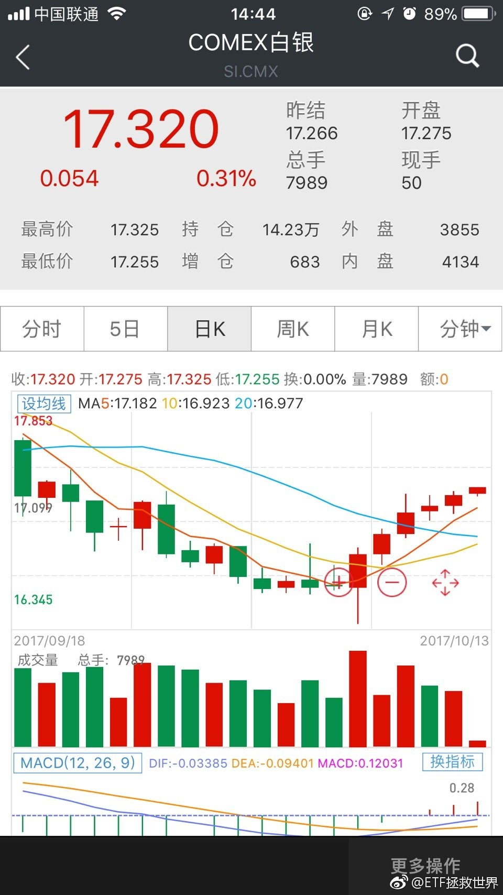

## 2017-10-13 16:21

周末开车。

1-2份。 ​​​

## 2017-10-13 22:08

搞定 
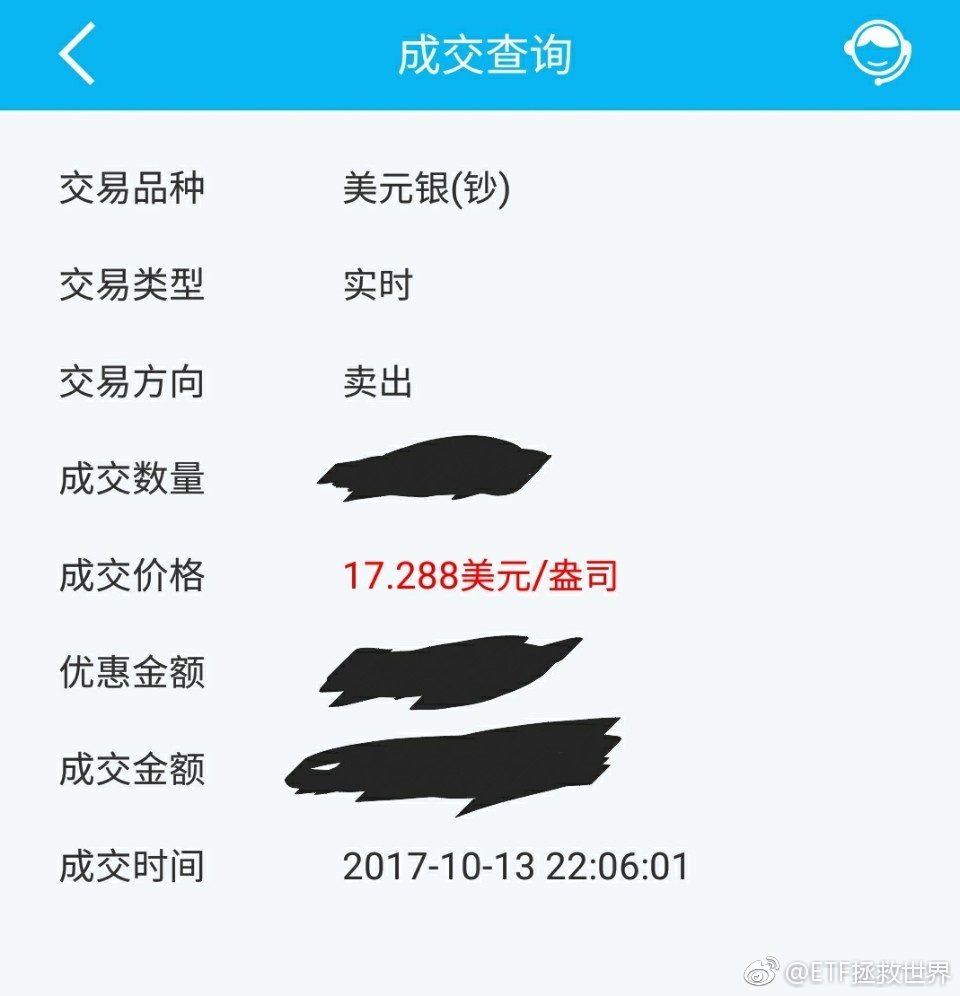

## 2017-10-13 22:20

今天在外面浪，没法打卡了。人生充满意外啊。 ​​​

## 2017-10-15 21:55

每日打卡（94）

很少出去喝酒，周五喝一场，周六缓一天。没事还是少喝比较好。

这个月5号开始平板支撑，基本每天做，加起来快一个小时了。每天一点进步，积累起来就很可观。 ​​​
 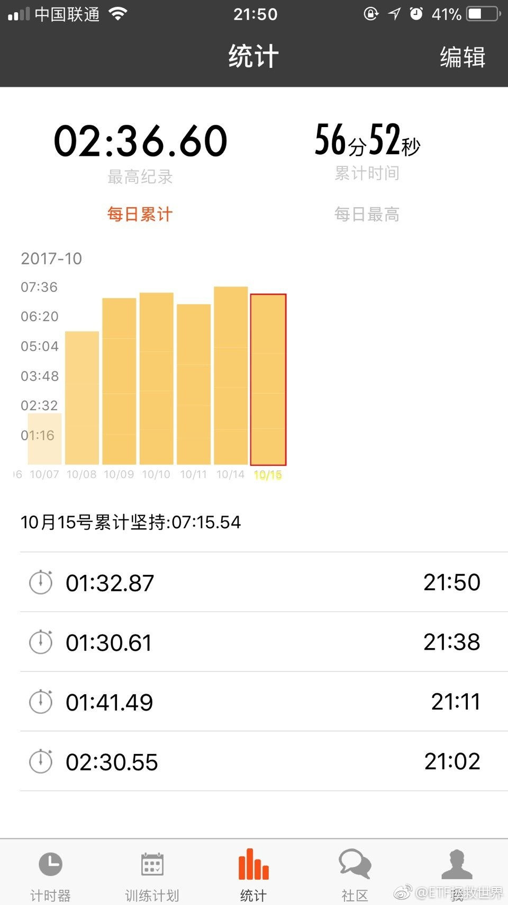

## 2017-10-16 10:34

2400只股票下跌，净值依然在涨，资产配置。

$恒生指数 hkHSI$   距离下次再平衡的区间越来越近了。 ​​​

## 2017-10-16 10:57

​​​
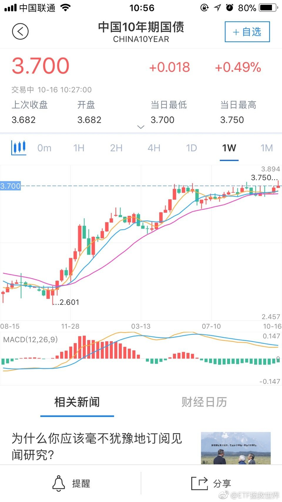

## 2017-10-16 11:00

未来债券配置路线图：

4-4.5会配置到大概10%-15%。 4.5-5会配置到15-20。

如果可以到5以上，会配置到30%——而且是30%杠杆债基。

07年底我重仓配置债券的时候，十年期国债收益率也只是4.8而已。 ​​​

## 2017-10-16 11:30

本人万分支持上证指数的稳定。不过可不可以放手中小股，让他们价值回归。

叠加三季报，真心想月底能买点东西呢！ ​​​

## 2017-10-16 13:27

太有面子了！昨天说半年安全，就这么搞事情。可以说非常开心！ ​​​

## 2017-10-16 14:03

潮水退去才知道谁在裸泳。

太经典了。这句话。 ​​​

## 2017-10-16 14:57

$518880 都赚钱了吧。是不是又全红了。。 ​​​

## 2017-10-16 15:09

坚持这个结论。债券会先见底。所以，热烈的盼望着4%以上。我的资金饥渴难耐了。如果能够更高，那我会做梦都笑出来。

## 2017-10-16 15:20

回复@i云腾致雨:这个道理非常简单。首先债券有利息。就算它5%好了。其次债券价格会跌，那么未来就会涨。净价从90涨到100就是11%（事实上有可能更多）。加上利息就有16%。再加点杠杆，你说会赚多少。07年底我买债券都是70几块，最后回到90多，别人-60%，你+30%多的感觉非常酸爽。

## 2017-10-16 18:39

回复@E大关门大弟子-铁蛋:不信我就发一张//@E大关门大弟子-铁蛋:回复@ETF拯救世界:就服你

## 2017-10-16 21:55

每日打卡（95）

快100天了。 ​​​
 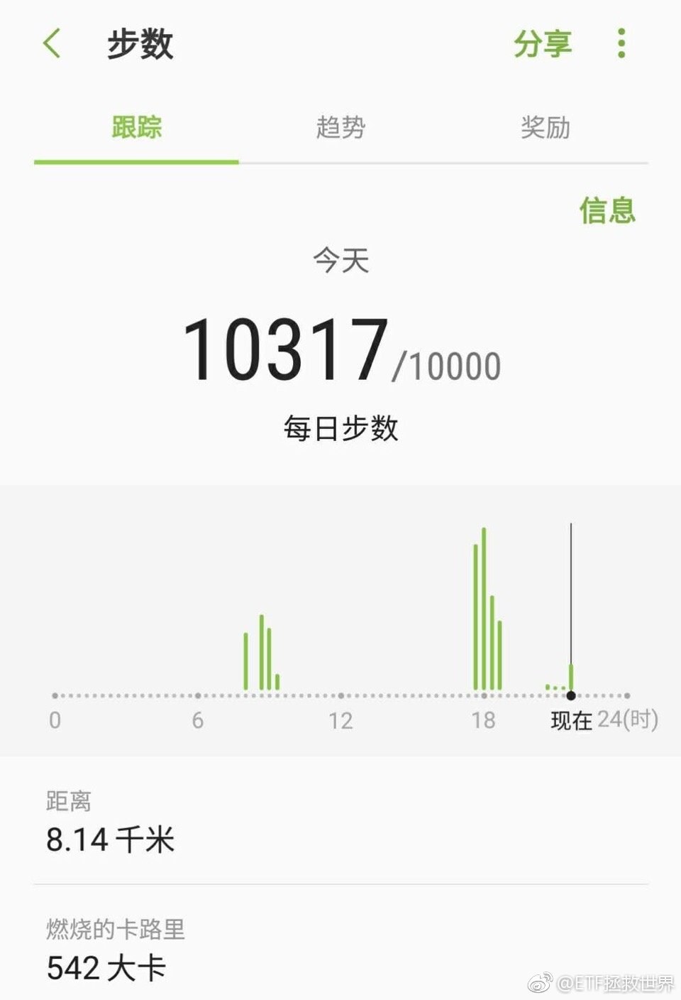

## 2017-10-16 22:02

好好涨，别掉链子。睡觉去了。 ​​​
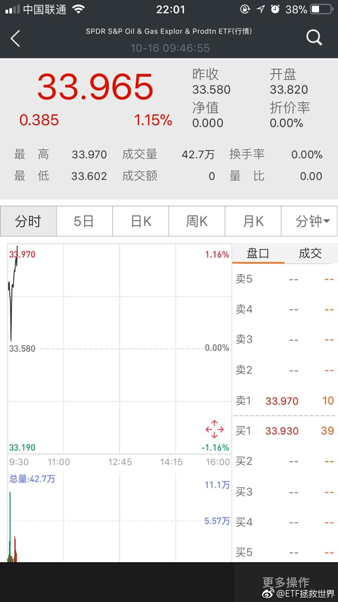

## 2017-10-17 09:21

少说话，多吃饭，安全第一。 ​​​

## 2017-10-17 10:02

已经锁定杠杆率在135-140的债基了。能不能买，就看市场给不给机会了。

两年50%。债券也可以这么风骚的。 ​​​
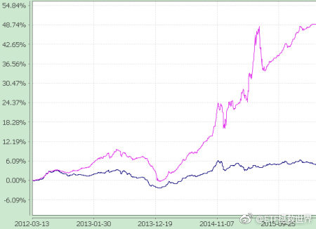

## 2017-10-17 14:09

回复@守正v出奇:ZJH的104号令《公开募集证券投资基金运作管理办法》规定，公募债基杠杆率不得高于140。2016年8月开始执行。之前可以上到200，现在，140顶天了。哎。//@守正v出奇:还有杠杆率更高的吗？e大

## 2017-10-17 14:20

又跌回去了。什么情况，是不是控盘华尔街了。//@ETF拯救世界:搞定 查看图片

## 2017-10-17 14:24

在风险平价的体系中，债券上杠杆是必须的。因为它本身收益率略低，上了杠杆才有可能为组合贡献足够的收益。

各位生活在一个美好的时代。各种指数基金的出现，为资产配置这件事解决了最大的问题。要知道几年前要做到全面的资产配置简直像做梦一样。

举例来说，我2005年想买黄金，还要跑到商场去买实物投资金条。你能想到？

现在太幸福了。

## 2017-10-17 14:45

回复@mydxkl:以前毫无办法。其实现在买油气也是没办法的办法。原油不易保存，投资现货品种基本不可能。期货不可以长期持有。比较麻烦。//@mydxkl:远古时代想投资石油，要跑到油田拉2卡车么

## 2017-10-17 21:33

每日打卡（96）

今天比较简单。量不太够。 ​​​
 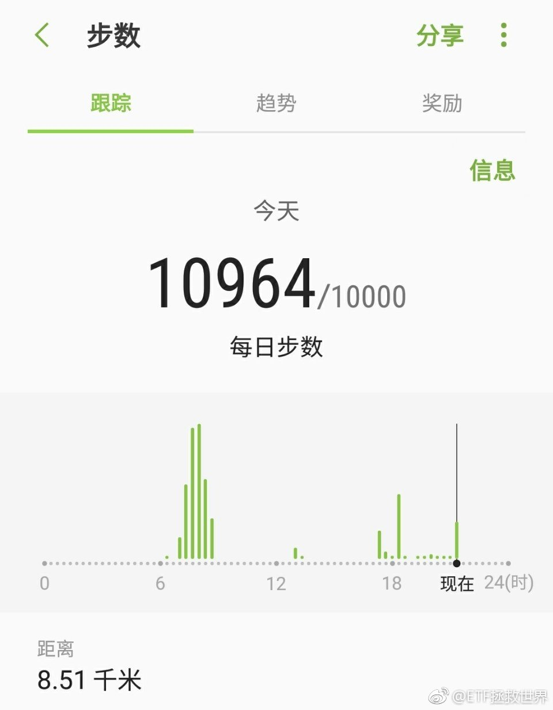

## 2017-10-18 11:27

$全指医药 sh000991$ $养老产业 sz399812$ 

事情还没有结束。 ​​​

## 2017-10-18 13:04

恐慌了？

## 2017-10-18 13:19

走向新高。

## 2017-10-18 13:20

$养老产业 sz399812$ 

今天他们立功了。 ​​​
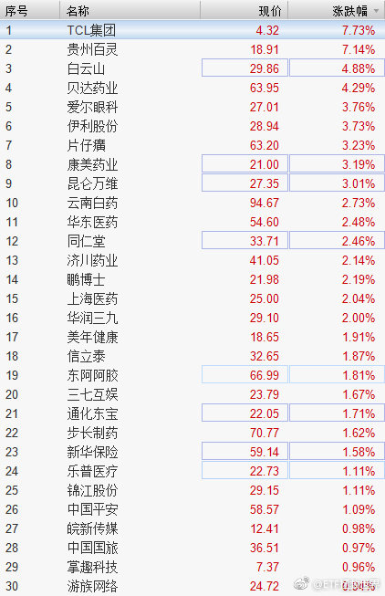

## 2017-10-18 13:32

回复@摩尔金融:我理解啊，咱们这一辈老了的时候，恐怕vr ar都已经是日常生活了。娱乐传媒算养老没毛病。“选取涉及酒店旅游、文化传媒、医药卫生、人寿保险等养老相关业务的上市公司股票作为成份股”//@摩尔金融:掌趣科技和游族网络也算养老产业吗？

> @摩尔投研:掌趣科技和游族网络也算养老产业吗？

## 2017-10-18 13:34

养老产业的选股范围：“属消费电子、休闲用品、酒店旅游、教育、文化传
媒、药品零售、乳品、家庭用品、医药卫生、人寿保险、互联网软件”。 ​​​

## 2017-10-18 13:44

回复@怪叔叔窝窝001:这里面大部分都是“弱周期”。毕竟，经济再差也得吃药。何况，有时候经济越差，娱乐业越好。为什么呢，毕竟及经济差了不能买车，但打开游戏花几十块钱玩一晚上网游看一场电影还是最实惠的。//@怪叔叔窝窝001:经济失去活力 还能有多大的发展

## 2017-10-18 13:49

如果你统计过A股上市以来涨幅最大的股票，恐怕十个里面有七个都是泛“消费”和“医药”。

美国也是如此，最牛的是菲利普莫里斯，干嘛的，烟草。然后宝洁麦当劳辉瑞两个可乐迪士尼……

我坚信未来30年A股在泛消费和医药里面也会有特大长牛股产生。而这两个板块指数也将继续非常牛。

如果有机会重仓买进去，轻易别卖。

## 2017-10-18 13:55

包括这些年美股也是啊。亚马逊、苹果、奈飞，你很难说他们是消费公司还是科技公司吧。刚有朋友说人工智能，我的意思，不要急。等有一家公司真的开发出让你花钱去不断消费的产品，再买它不迟，至少涨5年吧。当然，短线高手例外。概念就可以随便炒了。

## 2017-10-18 13:59

上港哪里有直播谁知道？

> @9号李毅大帝
> 大道之行，天下为公！祝福我们的祖国繁荣昌盛，祝福中国的足球越来越好，更祝福今天的上海上港能够在客场全身而退晋级亚冠决赛！ ​​​

## 2017-10-18 14:02

门票组合今年41%了。然而三季报披露到今天一只也没选出来。

模型真的很严格！ ​​​

## 2017-10-18 14:15

对于为什么不“重仓”这种问题。从2016年的恒生到后来的一些品种，一直都会有这种疑问。

了解我的朋友都知道，恒生我本身建仓的时候有十几个点，会比计划多一点。计划少一些的原因各位也都知道了。但这个不是关键。

关键在于，我恐怕永远也不会买到很多朋友理念中的“重仓”。因为我给一个品种最大最大也不会超过30%，通常，不会超过20%。

比如恒生，哪怕真的跌到16000多，我也只会买20%。也就这样了，还是没有“重仓”。

原因呢，一个原因是资产配置的问题。不给单一品种过大仓位，这与很多朋友不同。

第二个呢，天，我看好的品种多着呢。如果给恒生80%，那我的医药怎么办，消费怎么办，我的门票股怎么办，我的债券呢，我的美股德股呢……有些品种现在虽然机会比较小，但我还是一直惦记着呢。有了机会我就会买买买，机会总会来的。

2015年上半年清仓以来，到现在，也只不过两年多而已。两年多建仓40%，已经很不错了。急什么，我是不急。过去这些年，赚了这么多，我真的怕均值回归让我一把亏到平均收益。买真正便宜的，踏实，也赚得多，何乐而不为。

大致就是如此。

## 2017-10-18 15:43

回复@就看E大啦啦啦:不用看那个组合。我经常忘了在那里调仓，那是补上个月忘了调的。//@就看E大啦啦啦:E大怎么突然调仓了500？//@ETF拯救世界:回复@D8奇迹:其实年初至今只有900只股票，也就是30%的股票上涨，70%下跌。1221只跌幅超过15%，不要太伤心。。。

> @实体化的幽灵:唉，今年门票股收益只有20%。。

## 2017-10-18 21:43

每日打卡（97）

坚持。 ​​​
 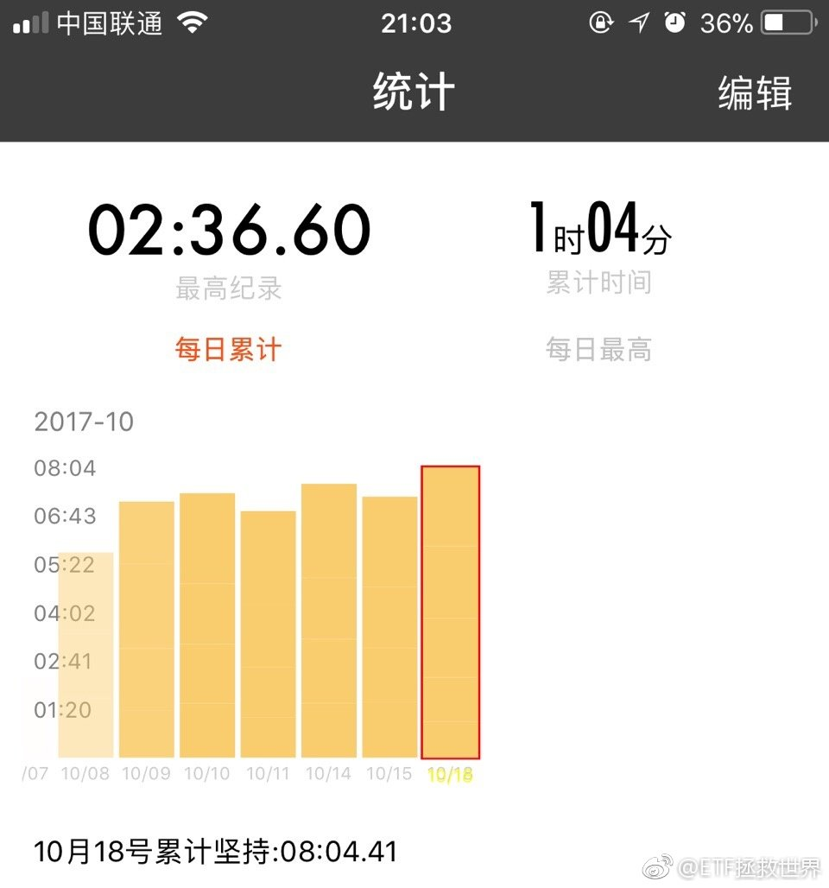

## 2017-10-19 09:47

每天这么浪，会不会累。

## 2017-10-19 09:50

写在反弹新高：我再说一次，不要卖。不要卖。不要卖。坐电梯不可怕，可怕的是轻易卖掉超廉价筹码。//@ETF拯救世界:每天这么浪，会不会累。

## 2017-10-19 10:04

目前这个阶段，整体思路是：

不停的寻找便宜货。总有东西会跌，跌到位了就开始买。买了以后，如果继续跌，就继续买。如果不跌，就放好了，藏起来，几年后拿出来数钱。

就酱。很简单，粗暴，有效。 ​​​

## 2017-10-19 10:21

通常来讲，国债利率倒挂，消费、医药这种板块走强，都预示着_____。

不要多说话，懂就行了。 ​​​

## 2017-10-19 10:29

不知道有没有人注意，8月底之后的50天计划买了五份，只有一份A股。 ​​​

## 2017-10-19 10:42

如果某天临时加车，不要意外。

世界充满惊喜。 ​​​

## 2017-10-19 10:43

谢谢。我们的美元债又……

## 2017-10-19 11:24

嗯哼 ​​​

## 2017-10-19 14:23

别扛了，跟着休息休息吧。连续两天超过2500只下跌了。。//@ETF拯救世界:每天这么浪，会不会累。

## 2017-10-19 14:27

回复@Coreline:反正昨天新高了。今天不好说。//@Coreline:是不是我们每天都新高啊//@ETF拯救世界:别扛了，跟着休息休息吧。连续两天超过2500只下跌了。。//@ETF拯救世界:每天这么浪，会不会累。

## 2017-10-19 14:51

回复@醉翁得意:跌了还不到1%吧。如果买了0.6%，就是浮亏不到0.006%。您要太紧张就卖了吧。不跌我们怎么买剩下的4%。。。//@醉翁得意:黄金etf怎么一直在跌//@ETF拯救世界:回复@Coreline:反正昨天新高了。今天不好说。//@Coreline:是不是我们每天都新高啊

## 2017-10-19 15:07

还有多少人认为我买一份，也就是0.6%就是看好这个品种会涨的……有这种错觉的立即停止参考。 ​​​

## 2017-10-19 15:26

今天全市场数据有点好。 ​​​

## 2017-10-19 15:58

回复@Tippiinsz:不到29500就跌不要脸。//@Tippiinsz:恒生跌了550点

## 2017-10-20 01:47

​​​

## 2017-10-20 09:38

刚才删了一条昨天的微博。

不议论别人，咱们做好自己的投资。 ​​​

## 2017-10-20 22:09

每日打卡（98）

今天有点忙，一天没说话。

坚持。 ​​​
 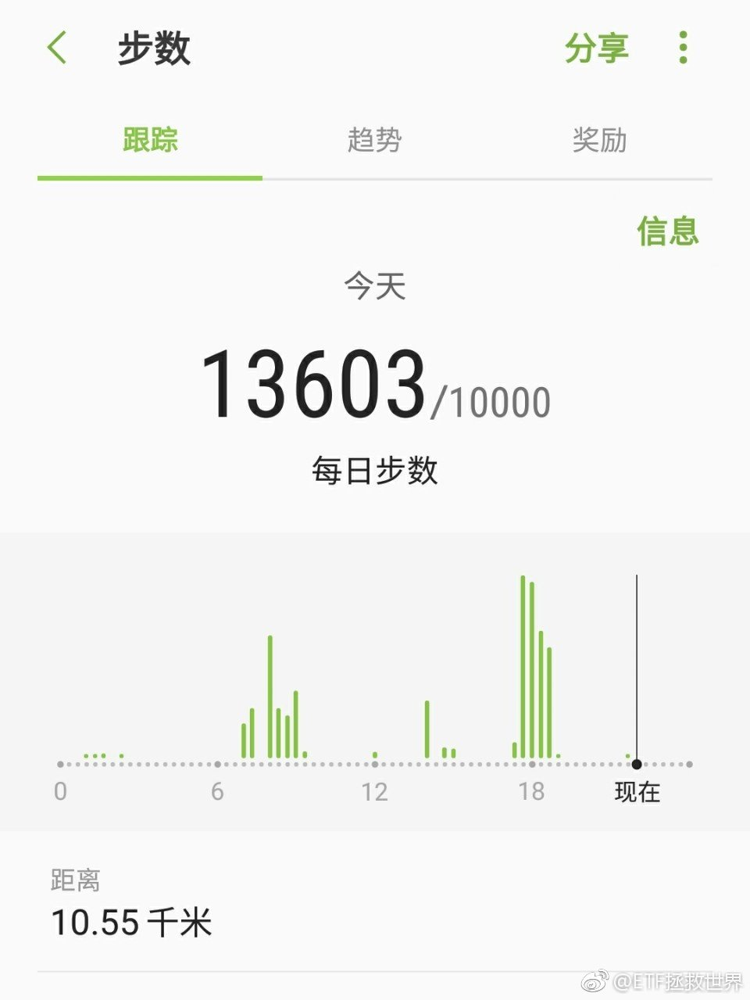

## 2017-10-21 21:14

每日打卡（99）

周末要到一万步真心不容易。 ​​​
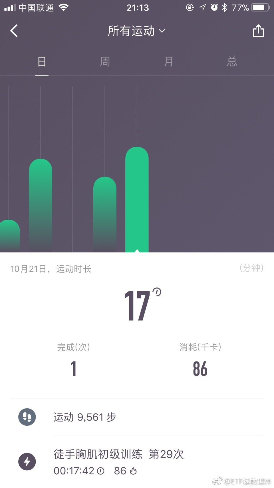

## 2017-10-23 09:45

继续新高。

## 2017-10-23 09:49

回复@求财不劫色:这个要看时间。如果极短时间内50%也可以能走。如果时间长了，十倍可能都不卖。时间，空间的艺术。//@求财不劫色:不翻倍不走//@ETF拯救世界:继续新高。

## 2017-10-23 10:04

投资中有些事情是必然会发生的。或者说吧，极大概率发生。

空间的向上或者向下。

只是时间不确定。那么我们就想办法让时间成为我们的朋友。坚定信念，在还没有发生的时候多积累。

然后继续与时间做朋友，等着就行了。

哪里不会点哪里，so easy。 ​​​

## 2017-10-23 10:34

继续说。不要卖。//@ETF拯救世界:写在反弹新高：我再说一次，不要卖。不要卖。不要卖。坐电梯不可怕，可怕的是轻易卖掉超廉价筹码。//@ETF拯救世界:每天这么浪，会不会累。

## 2017-10-23 10:47

实不相瞒，医药指数能玩一辈子。 ​​​

## 2017-10-23 11:53

回复@9BtJ5EMR4:每一个十倍都是从1%，3%，7%，40%，200%……开始的。刚刚发芽就拔掉，永远无法变成参天大树。买入很严格，一旦买入成功，卖出会更严格。

## 2017-10-23 13:32

回复@微微清风0:众筹50万册我就开始写……//@微微清风0:紧跟E大就好，E大书什么时候能出啊@ETF拯救世界

## 2017-10-23 14:13

券商的弹性真的很大。我们什么时候可以开始买？我也挺期待。 ​​​

## 2017-10-23 14:34

均值回归。//@ETF拯救世界:继续说。不要卖。//@ETF拯救世界:写在反弹新高：我再说一次，不要卖。不要卖。不要卖。坐电梯不可怕，可怕的是轻易卖掉超廉价筹码。//@ETF拯救世界:每天这么浪，会不会累。

## 2017-10-23 21:45

每日打卡（100）

第一百天。坚持不容易。努力。 ​​​
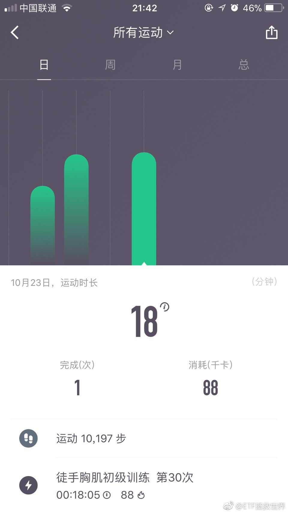

## 2017-10-24 09:03

最近有不少朋友在微博关注我，但是好像看不懂我每天在嘚嘚什么。

答案是：公众号：chinaetfs ​​​

## 2017-10-24 09:26

快月底了，那什么也开完了，给个机会吧，得唔得？ ​​​

## 2017-10-24 10:55

指数红红火火，又是2500只下跌。。 ​​​

## 2017-10-24 14:15

$恒生指数 hkHSI$  不到29500你就这样搞，不厚道了。 ​​​

## 2017-10-24 21:23

每日打卡（101）

坚持。 ​​​
 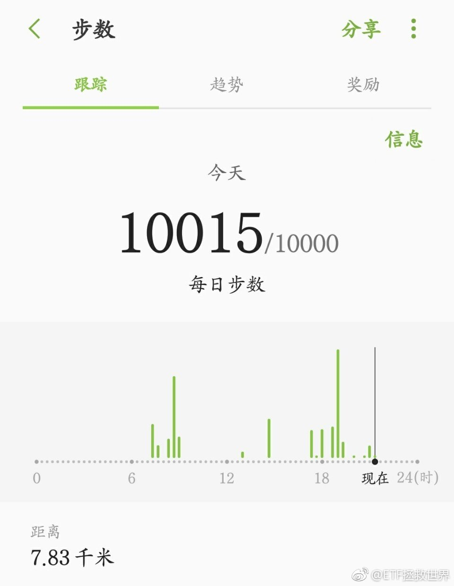

## 2017-10-25 07:15

咱们的海外债买入后的最近21个交易日中只有三天下跌，几乎每天都在涨。 ​​​

## 2017-10-25 10:42

不要卖。//@ETF拯救世界:继续说。不要卖。//@ETF拯救世界:写在反弹新高：我再说一次，不要卖。不要卖。不要卖。坐电梯不可怕，可怕的是轻易卖掉超廉价筹码。//@ETF拯救世界:每天这么浪，会不会累。

## 2017-10-25 13:23

讲真，我不信那谁他们会不继续玩几天。

要面子。 ​​​

## 2017-10-25 13:28

回复@圣善周闻宗:有点兴奋。//@圣善周闻宗:今天十债貌似要崩了，E大怎么看？

## 2017-10-25 13:41

就像一场战争。真的，你好好想想，是不是。

敌人强大的时候，不要硬怼。

先把我们的主力部队隐藏好，然后派出高科技的无人机全方位扫描敌军的布阵。

派出小股部队不断的攻击敌人最薄弱的环节。除非不出手，一出手就要攻城略地，结硬寨，轻易不会再丢。

一口一口蚕食敌人的势力。在敌我双方力量天平开始变化的时候，兵精粮足的主力部队一鼓作气取得全面胜利。

要取得真正的全面胜利，需要爱兵如子，珍惜每一个士兵的生命。你爱他们，他们才能为你拼命。

敌人很强大，不要轻视他们。但要有信心，最终胜利的当然是我们。

## 2017-10-25 13:58

医药今年涨幅7.85%，这一个月就涨了6.5%。

再说一次，证券投资不是每个月，每年平均增长多少多少。而是可能几个月几年没动静，突然爆发赚一下就把几年的钱赚了。

所以最重要是低位收集筹码，然后耐心等。不要用过去的成绩看未来，而是要用未来的眼睛看现在。 ​​​

## 2017-10-25 14:11

4不4要冲11000了。//@ETF拯救世界:不要卖。//@ETF拯救世界:继续说。不要卖。//@ETF拯救世界:写在反弹新高：我再说一次，不要卖。不要卖。不要卖。坐电梯不可怕，可怕的是轻易卖掉超廉价筹码。//@ETF拯救世界:每天这么浪，会不会累。

## 2017-10-25 14:47

159938折价0.4%。

做市商，你们的良心难道不会痛吗。 ​​​

## 2017-10-25 14:57

一切按照剧本走 ​​​
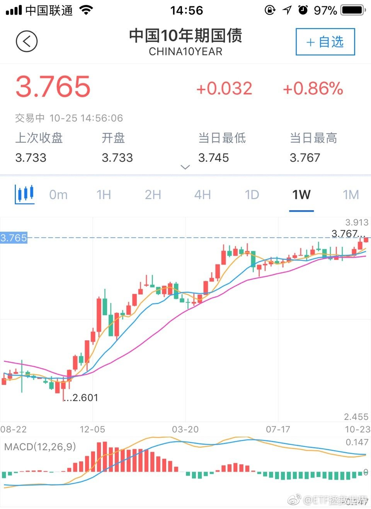

## 2017-10-25 15:02

拉上去了。良心发现。

## 2017-10-26 08:42

现在计划歌单里的好歌已经排好队蠢蠢欲动了。

然而一次只放一首。得多久才能放完啊。 ​​​

## 2017-10-26 09:52

11000是不是内定了。//@ETF拯救世界:4不4要冲11000了。//@ETF拯救世界:不要卖。//@ETF拯救世界:继续说。不要卖。//@ETF拯救世界:写在反弹新高：我再说一次，不要卖。不要卖。不要卖。坐电梯不可怕，可怕的是轻易卖掉超廉价筹码。//@ETF拯救世界:每天这么浪，会不会累。

## 2017-10-26 10:16

回复@就看E大啦啦啦:估值没有到我说的34，为什么要绝望的等？你这个心态太差了，仓位远不是涨跌都舒服吧。//@就看E大啦啦啦:感觉等瀑布等得好绝望啊//@ETF拯救世界:11000是不是内定了。//@ETF拯救世界:4不4要冲11000了。//@ETF拯救世界:不要卖。//@ETF拯救世界:继续说。不要卖。

## 2017-10-26 10:22

回复@Ponder735:心态是买入之前设计好的，不是买入被套之后安慰自己啊。这完全不一样好吗。//@Ponder735:E大，之前不懂，被油气网格深套，心态如何调整//@ETF拯救世界:回复@就看E大啦啦啦:估值没有到我说的34，为什么要绝望的等？你这个心态太差了，仓位远不是涨跌都舒服吧。

## 2017-10-26 14:43

其实2015年之前，我在市场上最喜欢干的一件事，是追踪市场上那些“聪明”钱的动向。

你不能不承认，真的有一些钱特别敏感，特别有预见性。比如一些先行板块真的每次都在涨跌之前就有所动作。比如一些资金真的能大底建仓大顶跑掉。

这些信息，从新闻、资料、甚至盘面都能找到蛛丝马迹。

2015年7月以后，全毁了。

因为你根本分不清是市场还是谁在干。

## 2017-10-26 21:36

每日打卡（102）

这两天有点咳嗽，运动量小了不少 ​​​
 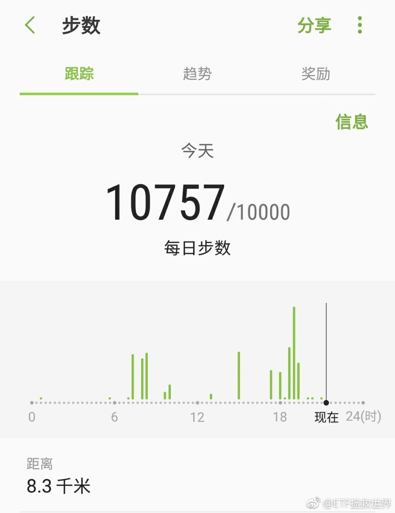

## 2017-10-27 11:35

我有个大胆的想法 ​​​

## 2017-10-27 12:36

滴滴 ​​​

## 2017-10-27 13:43

不觉得券商走得很有意思吗 ​​​

## 2017-10-27 14:10

都在说油腻的中年男人。说起来，我是有个关于年龄关于状态的目标吧。

38岁，算是我的同龄人，差不了几岁，严格一点说是中年人了吧。

肌肉，精气神。努力的方向。

所以其实跟年龄无关，看你自己怎么活吧。。 ​​​
 

## 2017-10-27 14:11

回复@BuBu蛇:有人想让你看到的，并非是真相。真相在转角，在幕后，不要被欺骗。总有蛛丝马迹，豁然开朗。聪明人总是有的，找到他们，观察。//@BuBu蛇:回复@益达铁粉一路莲花:说是牛市，就是不涨券商股

> @狙击手TOM:券商貌似有异动。其实陶博士和利文斯顿喊牛市都快半年了。“先生，这是牛市！”[哈哈][哈哈][哈哈]

## 2017-10-27 15:23

厉害了 ​​​
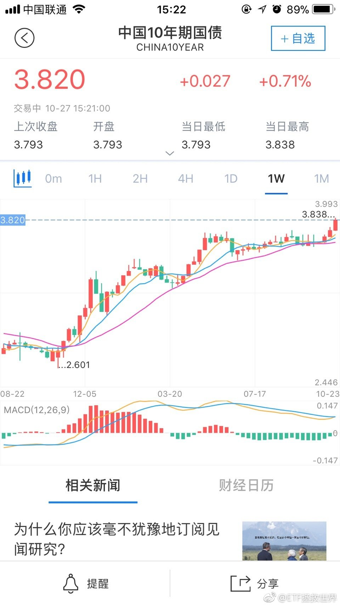

## 2017-10-27 15:41

今天数据出来了。弄不好过几天要加车。三季报+2000多只股票持续下跌的威力。

不一定。 ​​​

## 2017-10-30 11:45

有可能了

> @ETF拯救世界
> 今天数据出来了。弄不好过几天要加车。三季报+2000多只股票持续下跌的威力。
> 
> 不一定。 ​​​

## 2017-10-30 11:51

再说一次观点。这轮债券会先见底。有人说股市不是见底了吗。呵呵。//@ETF拯救世界:坚持这个结论。债券会先见底。所以，热烈的盼望着4%以上。我的资金饥渴难耐了。如果能够更高，那我会做梦都笑出来。

## 2017-10-30 12:41

这几天，有几个方面的信息，要综合分析。

第一个是走势。券商近期走得非常渣。要知道券商一向是市场温度计。说明有些smart money在做事。

第二个是季报。有媒体也已经统计了，GJD减持不少。包括委托给基金公司的几个ww定向基金。个中缘由值得玩味。

第三个是品种。最近非常明显的有些大股票，主要是50/300的权重股疯了一样拉。然而大多数中小股票并没有那么亮眼。500/1000为代表。甚至没有突破前期高点。

第四个是资金。中债指数其实还可以，国债已经雪崩一样跌。资金问题值得留意。两融方面，维持近万亿规模，赌徒不走。

好消息是，三季报披露后，全市场估值又降了。短期/中期/远期的视角，结果会不同。

## 2017-10-30 13:13

朋友送了个紫砂壶，有没有懂的，指教一下，该怎么用。有什么规矩吗。 ​​​

## 2017-10-30 13:46

国债期货。你信不信，今天又要放水了。 ​​​
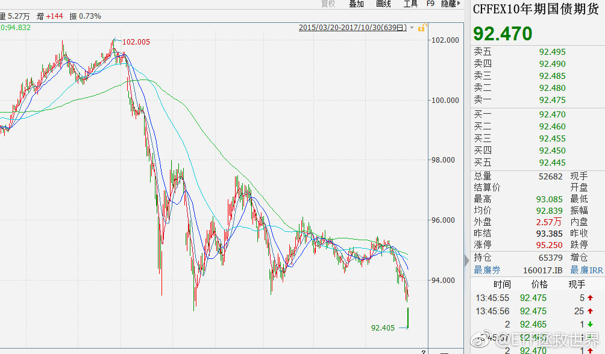

## 2017-10-30 13:51

很多人高估了自己的风险承受能力。危机来临后，才发现自己的财富的风险敞口有多大。自己也没有原来想象中对波动那么无所谓。

可惜，晚了。 ​​​

## 2017-10-30 15:01

今天计划收益率预计下跌0.1x%。不会新高了。

都别嘚瑟了，关灯吃面吧。 ​​​

## 2017-10-30 15:23

今日数据：全市场估值2014年2月以来最低。 ​​​

## 2017-10-30 15:42

sorry，写错了，2014年12月………………

> @ETF拯救世界
> 今日数据：全市场估值2014年2月以来最低。 ​​​

## 2017-10-30 16:05

估值数据“完全不对”。上次有人说这句话，我记得是2014年的雪球。

2012年11月28日，中小板创业板见底的前一天，我在雪球发了全市场估值见底的帖子。之后一年多就没再去雪球。

2013年底还是2014年，有个人把我那个帖子挖了出来，转了，引起了一些议论。然后我就又开始在雪球发言。

当然，那时候也会经常说我自己开发的估值系统和数据。

记忆犹新的，是当时有个大v，几万粉丝，转了我的数据，说，“完全不对，瞎编的”，还加了一个嘲笑的表情。然后，就是他的很多粉丝开始攻击我。

当时也没人关注我。我能说什么呢，这套系统让我几轮牛熊赚了很多？我自己开发的反映全市场的数据当然和官方公布的不同？说这些有什么用。

然后是2015年5、6月。当官方数据完全无法预警危险，这套系统发挥它最大威力的时候，终于有很多人认识到了它的价值。关注我的人也越来越多……现在，无数网站和个人都开始发布指数估值，当然计算方法和我不一样，那些数据对不对准不准不说，起码越来越多的人开始认识到，这是有价值的。

怎么说呢。这件事我有两点领悟。

第一，真正有价值的东西最终会显现出价值。即使一开始没有人知道。

第二，做为有一定话语权的人，不要轻易打击那些默默无闻的人。一个人的水平高低，与他的知名度和粉丝数量无关。尊重每一个理性的意见，即使看起来与你的思想和常识完全不同。至少，不要奚落嘲笑。

## 2017-10-30 16:56

回复@一味7:2016年1月30日，中证1000是7385点，今天该指数收盘7574点。将近两年过去，这1000只股票的业绩增长是多少？放眼全市场3405只股票，比当时低很奇怪吗？难道你看上证和沪深300讨论全市场？//@一味7:我就问  今天估值比2016/01/30还低？

## 2017-10-30 17:14

回复@一味7:2016年1月底至今，当时的2795只股票中，上涨的是1621只，下跌1172只。算上利润增长，A股全市场估值真的是下降了。//@一味7:@ETF拯救世界 e大 我错了， 我看上证 深成指都涨了25% ，比中证1000的话  我就无话可说，估计e大的估值体系是等权的，

## 2017-10-30 17:23

回复@豆豆海要行天下:说出来你不信，中证500三季报平均利润增幅超过20%。//@豆豆海要行天下:利润增长非常厉害，我看三季报很多公司都在百分之几十的同比增速。这样估值就会下降很快。 再这样，明年说不定可以买更多

## 2017-10-30 21:00

每日打卡（103）

咳嗽好多了，开始恢复训练 ​​​

## 2017-10-31 10:33

有时候呢，补仓太快是赔钱利器之一。

节奏。很重要。 ​​​

## 2017-10-31 10:56

截至昨天为止，今年上涨的股票821只，下跌2139只。

上涨的股票不到28%。

同时，全市场利润增速维持在10%左右。

此消彼长。 ​​​

## 2017-10-31 11:25

说买就买不扯淡。 查看图片 //@ETF拯救世界:买买买

## 2017-10-31 11:32

谁还记得汽车是个强周期行业。

> @日经中文网
> 【比亚迪7～9月纯利润同比减少23%】7～9月销售额增长3.8%，但政府环保车补贴减少影响了利润。预计全年纯利润将减少15～25%…http://t.cn/RWedDgZ网页链接 ​​​

## 2017-10-31 14:45

一只股票，让多少人的命运为之改变。真的NB。J

*应该是贾跃亭*

## 2017-10-31 15:20

回复@夏洛蒂L:我不懂融创也不懂乐视，但我懂人。J和S是一类人。不是说人品，而是敢干的那股劲。翻翻S的履历就可以知道，真的敢干，不输J。包括投资他们股票的人。球球上的，你会发现，投资他们股票的人和这两个人其实是一类人。敢干！错了就死，对了就发！

## 2017-10-31 20:08

每日打卡（104）

坚持。健康是最大的幸福。 ​​​
 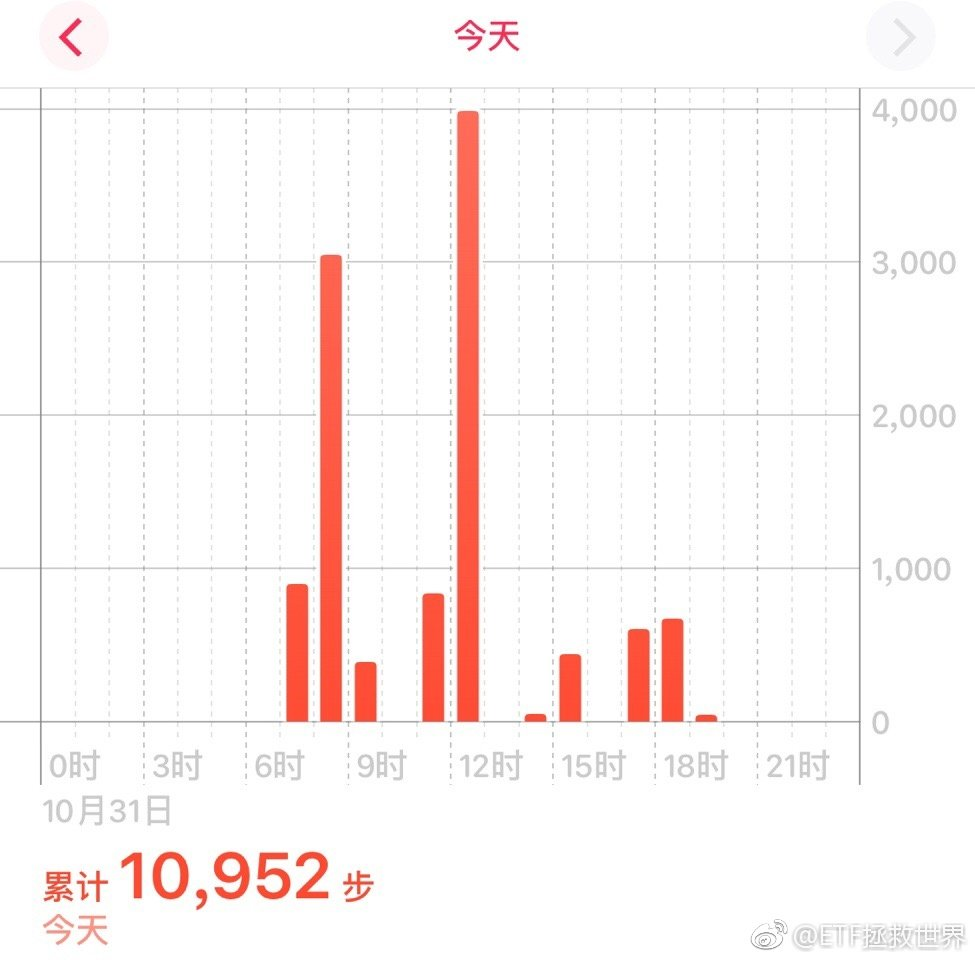

