## 2017-12-01 09:48

2011年初，我在第二轮q&amp;a里面写过这样一句话：

“我们不需要股市涨，只需要波动。即使20、30年后上证还在3000点，也能挣钱。我无法给出一个准确的预期收益率，我只能说长期来看，这个计划很安全并能取得高收益。”

现在将近7年过去了。上证3300点，涨了10%。我们真的赚了非常多，而且几乎没有回撤过。

未来依然如此。不敢说不会回撤。我的信心是，下去之后，再回到原地，或者上去之后再回到原地，资产会比现在多很多。这是非常有趣的一件事。

## 2017-12-01 09:51

$恒生指数 hkHSI$ 

快跌破29000了 ​​​

## 2017-12-01 09:58

回复@颜_祖:你这就是造谣了。。2001年，我还是学生。你这个造谣转发500次就报警给你抓起来。。//@颜_祖:我只知道2001年你就两套房，股票九十多万，存款二十多万，坐标北京，那年我刚考上大学

## 2017-12-01 10:01

$中证环保 sh000827$   难道昨天是…… ​​​

## 2017-12-01 10:30

$创业板50 sz399673$   猛。

说未来小股票没戏的人，呵呵。

现在还不算最便宜，反弹都这么猛。你能想象一旦真的便宜后，会怎么涨？

总有人用几个月的表现判断未来。看得太短，毫无希望。 ​​​

## 2017-12-01 11:06

回复@丌天大圣:一颗赛艇//@丌天大圣:回复@丌天大圣:久立可转债已破发@ETF拯救世界

## 2017-12-01 12:40

回复@用户5567945807:不用我每天说吧。那么多骗子，那么多问我是不是我的，我一个个说不过来啊。最重要的，我会low到那个地步吗//@用户5567945807:E大，带我操作，是你么//@ETF拯救世界:回复@丌天大圣:一颗赛艇//@丌天大圣:回复@丌天大圣:久立可转债已破发@ETF拯救世界

## 2017-12-01 12:46

这件事处理不好，全国老赖数量将井喷。有样学样。

## 2017-12-01 18:07

回复@唐僧用飃柔:10000%不靠谱。不建议3-5年要用的钱跟车。否则以后会后悔//@唐僧用飃柔:由于双十一剁手消费太多导致这次没钱跟车，E大你说用工行融e贷贷款跟车靠谱吗？年利率大概6个点

## 2017-12-02 18:24

每日打卡（118）

坚持。

今天看了《解忧杂货店》。出版好几年了，终于看了。

故事虽然精妙，但看完不舒服。

现在很不喜欢这样关于时间的故事。 ​​​

## 2017-12-03 20:33

今天我在4s店，亲眼看见一个女司机倒车直接撞后面一个站着的保安身上了。第一次看到这样的情况，讲真还是挺震撼的。就是有点不理解，一个是不是有倒车雷达吗怎么会撞上。第二是这样为什么敢开车出门……

## 2017-12-03 21:41

刚才那条微博不是贴标签啊。只是客观叙述一下。。。实际上到底是女司机开车靠谱还是男司机靠谱，没有客观数据，所以我不敢胡说。

不过我亲身经历的事情。有一次我车挺地下车库，左前方是一条减速带。然后一天早上有人给我打电话，说把我车撞了。我想停车库怎么撞的呢。

下去一看，整个左边从头到后面全花了。

原来是对方想停我左边，倒车的时候因为有减速带，所以一脚油门没刹住，撞上了。而且是没刹车从头到尾。

是女司机。。

当然这也不能说明女司机开车不行。就是正好碰上是个女司机而已。

不过有一点，你说我主观也好什么也好，给我的感受就是如此：

过马路的时候，北京80%的右转车不会让行人。不过一小部分特别绅士的让的，反正我碰见的，都是男的。

反而有一些明明过马路的人是绿灯，开车的要右转还加速挤行人的，好几次都是女司机。。

倒不是说别的，我想可能是有些女司机不太清楚怎样才算文明驾驶吧。

其实我觉得的中国的老百姓真的都挺好的。有时候你停车让一下行人，不管是老头老太太还是年轻人，好多都会打个招呼表示感谢。双方心里都会很舒服，多好。

最sb的是你让行人，后面的车滴滴你。辣鸡。

## 2017-12-04 09:26

$恒生指数 hkHSI$ 

跌破29000。 ​​​

## 2017-12-04 09:35

27500，正常区域。出发吧！//@ETF拯救世界:回复@xDBA顾德吴:有几个点位吧。一个是29500，属于我能认知的最高区域了。从估值和其它方面看都是如此。第二个是27500以下，算是回到正常区域了。到22000左右以下，是比较低估，极限低位是16000，再低我就又不理解了。这些点位每年都要往上加几百点。

## 2017-12-04 09:36

8848获利筹码只剩55%了。这个股票换手虽然低，但是在高位几个月了，基本上接盘的都吃饱了。。。 ​​​

## 2017-12-04 09:38

$中证500 sz399905$   2300只下跌，就你能！嘚瑟。 ​​​

## 2017-12-04 09:54

无论如何，做好极度深寒的准备就ok。

冬天不可怕，可是冬天有可能死人。死的都是没有准备的人。

你知道冬天也许很冷，砍好柴火，准备好羽绒被，弄好热可可。别人瑟瑟发抖的时候你在烧着火盖着被子喝热可可。

虽然你的庄稼也冻死不少，但你知道熬过去了春天会更好。 ​​​

## 2017-12-04 09:59

太毒了！

不看了。。 ​​​

## 2017-12-04 13:53

又是2500只下跌。今年所有股票跌幅中位数已经接近18.5%了。

上涨股票711只，23%。

77%下跌。

价值回归依然在路上。 ​​​

## 2017-12-04 14:17

回复@天狼星爱吐槽:少年，做好所有的准备，可以活得久一些。——来自伏地魔的劝告。//@天狼星爱吐槽:E大，您的分析我都很认同，但现在国家强力调控之下，原先的那种深度熊市、遍地是黄金的机会很难出现了。

## 2017-12-04 14:27

3.0,3.2的分级A终于又要见8字头了。

其实我真的对分级A特别有感情。真的。

2013和2015两波，可以说为我的资产积累起到了很大的作用。

特别是2015年7月，一直到现在，那都是我在资本市场赚钱最多的一个月。

希望有机会再搞。 ​​​

## 2017-12-04 16:46

回复@吃货神圣不可侵犯:极度低估是扯淡。那是因为他们没有以前的数据。//@吃货神圣不可侵犯:E大，请问下有的软件估值显示中证1000现在极度低估，很有投资价值。但是很多APP并未把中证1000纳入估值表（例如集思录）  ，请问下到底哪个正确呀

## 2017-12-04 16:48

2008和2012都不到30，现在40多，怎么可能极度低估！//@ETF拯救世界:回复@吃货神圣不可侵犯:极度低估是扯淡。那是因为他们没有以前的数据。

## 2017-12-05 10:39

又破了，再奶一口续命。。

## 2017-12-05 11:09

又是2600家下跌。

开不开心。 ​​​

## 2017-12-05 11:14

回复@安妮的花圃:可能会补回之前卖掉的啊。如果回到便宜区域，还可能继续买呢。//@安妮的花圃:@ETF拯救世界  恒生回到正常范围内，对计划很重要吗？//@ETF拯救世界:又破了，再奶一口续命。。

## 2017-12-05 13:38

有10%的人已经开始明白了。

## 2017-12-05 13:42

其实很多人不懂“惨烈”的含义。

## 2017-12-05 14:08

回复@广羽叁的微博:再说最后一次。港股今年的香港中小指数涨了30%多，比恒生指数高。美国中小指数罗素2000这几年涨幅大于标普500。现在A股中小股票的问题是还比较贵。某天跌到位，飞起来吓死你，还有那些说“彻底完蛋的”追涨杀跌分子。

## 2017-12-05 14:41

我非常感谢GJD现在的策略。

拉住200只，任由3000只下跌。

总比2015拉住2000只，好得多。

真的。现在这样特别好。

感恩。

打折季是不是快来了。 ​​​

## 2017-12-05 14:42

回复@小狗上马路:现在远算不上地板吧。//@小狗上马路:真的挺惨的，地板下面还有地下室，还有地狱，地狱也还分十八层//@ETF拯救世界:其实很多人不懂“惨烈”的含义。

## 2017-12-05 14:45

回复@snh48-潘驴邓小闲:分化。其中100只很惨，100只继续好。这不是算命，是2003-2004年表现特别好那10%的下场。//@snh48-潘驴邓小闲:求e大算个命，这200只以后会怎么样

## 2017-12-05 14:50

$中证1000 sh000852$ 

2015年2月以来新低。然而这并不是最小的股票。中证1000是除沪深300+中证500外最大的1000只股票。

这三个板块加起来1800只，还有更小的1500只，其实更惨。

知道操盘手的厉害了吧。 ​​​

## 2017-12-05 15:21

回复@闲人的日常:一切按照节奏。如果能进入下一档位，就会尽快补足该档位的部分基础仓位。如果还不能进入，则会有节奏的缓慢建仓。//@闲人的日常:月中多来几车咯？

## 2017-12-05 15:25

今天全市场估值2014年8月以来最低。 ​​​

## 2017-12-05 15:29

这么看月中搞不好有大巴。

## 2017-12-05 22:21

每日打卡（119）

开始跑步。今天只跑了四公里，休闲式跑步。 ​​​
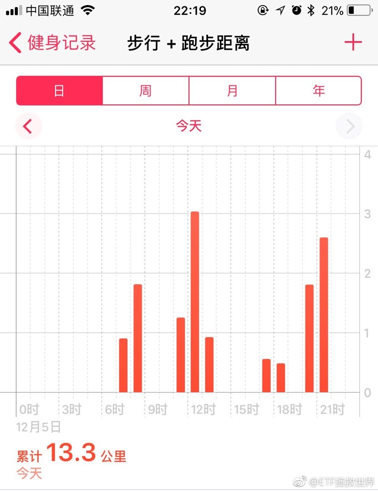

## 2017-12-06 10:47

不奶不行了。。。//@ETF拯救世界:回复@xDBA顾德吴:有几个点位吧。一个是29500，属于我能认知的最高区域了。从估值和其它方面看都是如此。第二个是27500以下，算是回到正常区域了。到22000左右以下，是比较低估，极限低位是16000，再低我就又不理解了。这些点位每年都要往上加几百点。

## 2017-12-06 11:04

从恒生整个的过程，大家就应该对未来有个大致的理解了。

计划就是这样，不可能买在最低。恒生etf最低0.944，计划的成本大概是1左右。也就是距离最低是6%，实现了我们离最低15%最好10%以内的预期。

然后一路坚定持有。在1.5附近减持了两次，实现了高抛低吸。但我们也不可能卖在最高，也不会全部卖出。

基本就是这样。其他品种也不会差很多。一轮上涨，绝大部分我们都能吃到。但不会吃到全部。有吃全部的需求，不要看计划了。

我能力有限，做不到最低买最高卖。

## 2017-12-06 11:05

不过我还是不理解那些叫着恒生低估，在29000以上还在忽悠买入的人是怎么想的。

## 2017-12-06 11:47

回复@古力果ra:我这里是说指数的，你跟我说股票？你说有没有问题？//@古力果ra:港股个股低估的一大把   有问题？//@ETF拯救世界:不过我还是不理解那些叫着恒生低估，在29000以上还在忽悠买入的人是怎么想的。

## 2017-12-06 11:49

回复@双树下的和尚1:我告诉你一件事，任何东西涨起来都会有无数理由解释它，并认为会继续好下去。反之亦然。有一些会成真，大部分是悲剧。

## 2017-12-06 12:03

回复@女儿培养日记:全部卖掉就犯了一个最致命的错误：预判。不用预判，根据概率执行策略//@女儿培养日记:E大，既然知道很高了，不卖掉的逻辑是什么?_?

## 2017-12-06 14:13

​​​

## 2017-12-06 14:19

后悔了，怎么忘了拉个顺风车过来……

## 2017-12-06 14:47

再说一次，谁看不起小股票，下波牛市至少少赚一半 ​​​

## 2017-12-06 14:52

回复@peng75106:银行纸白银要什么成交量//@peng75106:@ETF拯救世界  这几天白银怎么基本上没有成交量，已经被套住了

## 2017-12-06 15:16

暴力反弹，有人松口气，有人不开心。

这两种人都是仓位不对。 ​​​

## 2017-12-07 07:50

回复@唐僧用飃柔:股价短期涨跌更多是情绪因素。而且一年翻番了跌点不是很正常吗。毕竟五六十倍估值。//@唐僧用飃柔:E大，特别想知道你怎么看阿里和腾讯这几天连续的暴跌，公司基本面没出问题，仅仅是特朗普税改案通过，为什么会对我们中国的科技巨头造成这么大影响呢？

## 2017-12-07 07:52

回复@渝夏夜的微风-hc:特别好。这种言论很多的时候，就是你all in的时候。还不够多。//@渝夏夜的微风-hc:E大，雪球有大V在说创业板跌到25倍都不是底，不能以过去创业板的估值为锚，创业板只值10PE。怪吓人啊！

## 2017-12-07 09:31

一张图告诉你为什么a股上午没人管 ​​​
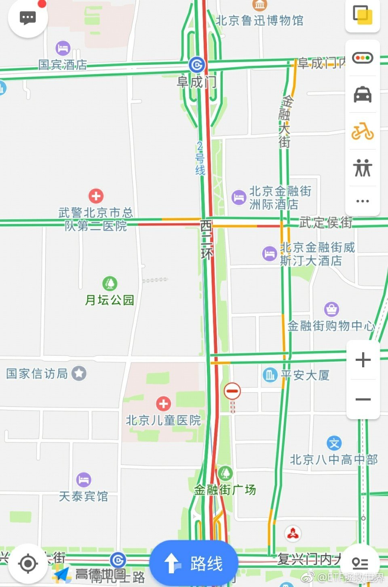

## 2017-12-07 10:22

获利比例剩50%了……

## 2017-12-07 10:58

即将跌破28000。//@ETF拯救世界:27500，正常区域。出发吧！

## 2017-12-07 13:51

回复@纯香芥末:急什么？仓位不够就加仓啊。有什么急的。不是很懂。//@纯香芥末:不按套路走了呢，市场最近屡屡翻红，债市也走红，有点纳闷会不会牛市要来啦不跌啦，好捉急啊//@ETF拯救世界:即将跌破28000。//@ETF拯救世界:27500，正常区域。出发吧！

## 2017-12-07 14:08

这一个月多发了两篇文章，关注人数加快了不少。

我特别奇怪的是微博，为什么关注人数增加的这么慢。是所有平台里面最慢的。是不是用微博的人少。 ​​​

## 2017-12-07 14:22

回复@_沧海中的一粟:你说了我才去看，相当感慨。我觉得且慢可以把我的ETF计划从首页拿下来了。  @且慢管家//@_沧海中的一粟:益达，且慢推出的那个指数定投，你觉得怎样？//@ETF拯救世界:即将跌破28000。//@ETF拯救世界:27500，正常区域。出发吧！

## 2017-12-07 14:26

回复@蜜蜂猴子葡萄蝙蝠:问题是我还在玩呢。这就比较尴尬了。//@蜜蜂猴子葡萄蝙蝠:估计且慢是怕E大以后不跟他们玩了, 所以自己也搞了一个//@ETF拯救世界:回复@_沧海中的一粟:你说了我才去看，相当感慨。我觉得且慢可以把我的ETF计划从首页拿下来了。  @且慢管家

## 2017-12-07 14:46

无论是上涨还是下跌，给市场时间。

你看，今天一拉，有人又不淡定了，有人又要着急冲进去。

时间都不用太多，一个小时，真相毕露。

趋势形成后，想要改变极其困难。不要急，给时间。 ​​​

## 2017-12-07 17:37

今天晚上去跑步还是写篇东西，这是个问题。 ​​​

## 2017-12-07 23:23

已经400多条留言了，看不完了，睡觉去了。明天再看。。 ​​​
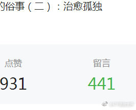

## 2017-12-08 06:34

配置的意义 ​​​
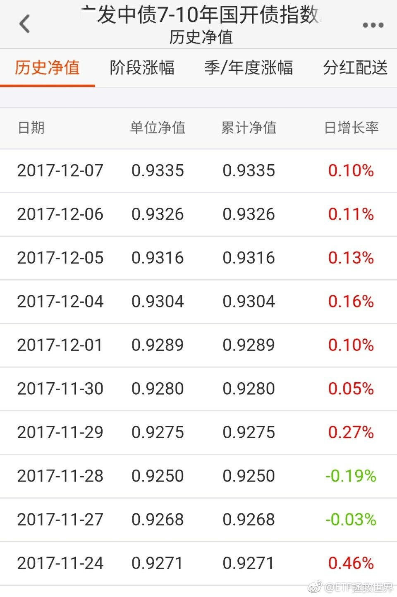

## 2017-12-08 09:16

回复@Doraven:是这样的。我不是说现在债券挣了多少钱。我是说最近股票调整很大，而债券在上涨，会为组合平滑收益。今年国开债跌了7%，我们浮亏0.7%。我自认为成本控制的不错。未来上涨的时候，会吃到所有上涨收益。挺好。//@Doraven:啊，e大，22号那一天跌了挺多的，为什么不放上来

## 2017-12-08 09:22

哈哈哈，妹子真的好饿。

> @澎湃新闻
> 【空姐“偷吃”多份剩余餐食：被停飞调查】http://t.cn/RYreqcY澎湃新闻的秒拍视频 近日，一段“空姐吃多份飞机餐”的视频热传。12月7日，乌鲁木齐航空公司回应视频中的空姐确为公司乘务员，未按规定处理剩余餐食，试吃数份被拍下。目前已被给予停飞调查处分。（视频来源：综合网络）http://t.cn/RYreqcT空姐“偷吃”多份剩余餐食：被停飞调查 ​​​

## 2017-12-08 09:56

养老最近真的稳。这个月还涨了1.6%…… ​​​

## 2017-12-08 11:12

黄金又入坑了！虽然只有0.6%……

再来一把“虽然买了很弱的品种但是就是能把你玩盈利”的操作吧…… ​​​

## 2017-12-10 21:37

每日打卡（120）

最近事情多，坚持的不好。要改。 ​​​

## 2017-12-11 09:47

今天调整各大成分指数的成分股。

有些指数变化较小，有些指数可以说相当大。

月中要开跟前几个月不同的车了。 ​​​

## 2017-12-11 10:02

快4%了。是不是跌不动了。

> @ETF拯救世界
> 养老最近真的稳。这个月还涨了1.6%…… ​​​

## 2017-12-11 10:33

$养老产业 sz399812$   之前一路都在说，不要卖。结果回调5%。你会不会想，还不如卖了，再买回来，成本降低5%，多好啊。

你事后看，这样简直完美。问题在于，你能做到吗。卖在最高点，买回在最低点？

且不说一来一回手续费有多少，就说这个时机的把握，能做到？

买了成本不高的品种，最重要的就不是再降低成本，而是你怎么才能吃到未来不知道什么时候来的大涨。

动不动就卖，利润是锁定了，但是你很有可能就接不回来了。接不回来，怎么讲，基本几年就白干了。

不是说未来它不会跌了，而是一种思维模式。要考虑清楚。

## 2017-12-11 11:15

永辉也是养老成分股，敢不敢复牌！

## 2017-12-11 11:24

距离留言1000不会太远了吧。每次只能放出来100条。 ​​​
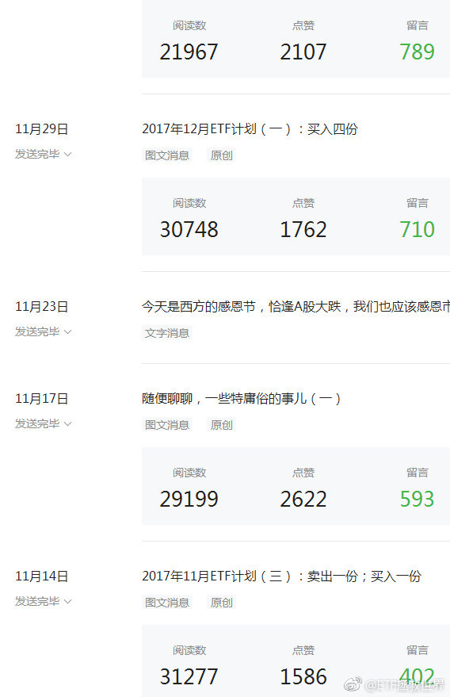

## 2017-12-11 13:24

弄不好又变自行车了//@ETF拯救世界:这么看月中搞不好有大巴。

## 2017-12-11 15:56

历史确实如此。未来不好说。咱们有幸见证书上才见过的历史了。

## 2017-12-12 08:50

消费医药和信息技术一定会继续增加，最后两者加起来能超过至少50%。

> @买买提X
> 这个图不错。。 ​​​
> 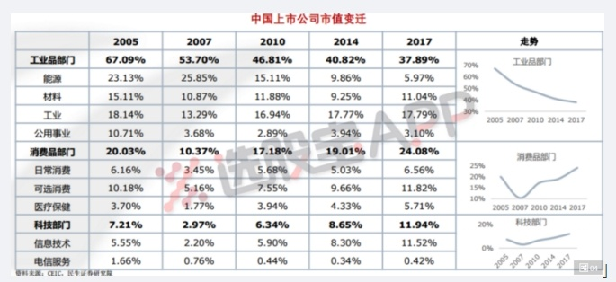

## 2017-12-12 09:03

回复@啊肥豪啊:不会。这是我们国家经济发展阶段的大概率走向。医药消费信息科技会在未来占据越来越大的比重。这个不是均值回归的问题了。//@啊肥豪啊:e大，刚好看过雪球上您转的黄若谷的文章有个疑问，倘若A股最近10年信息医药消费表现比较好，那相对来说，未来10年是否将能源工业类的比重增大

## 2017-12-12 09:06

某个行业在股市中市值占比不断减少，不代表这个行业一定无法跑出大牛股。有些股票在萎缩的行业中成长的非常好。

同样，一个行业市值占比越来越大，也不必然投资者能赚到很多钱。

其实如果BATJ之类的公司都在国内上市，国内的科技信息产业市值占比要比现在高很多了…… ​​​

## 2017-12-12 10:00

人类有时候是没有底线的。

> @xyl125cn
> @ETF拯救世界  ,E大，这个人复制你的话，在“知识星球”上收费  ​​​
> 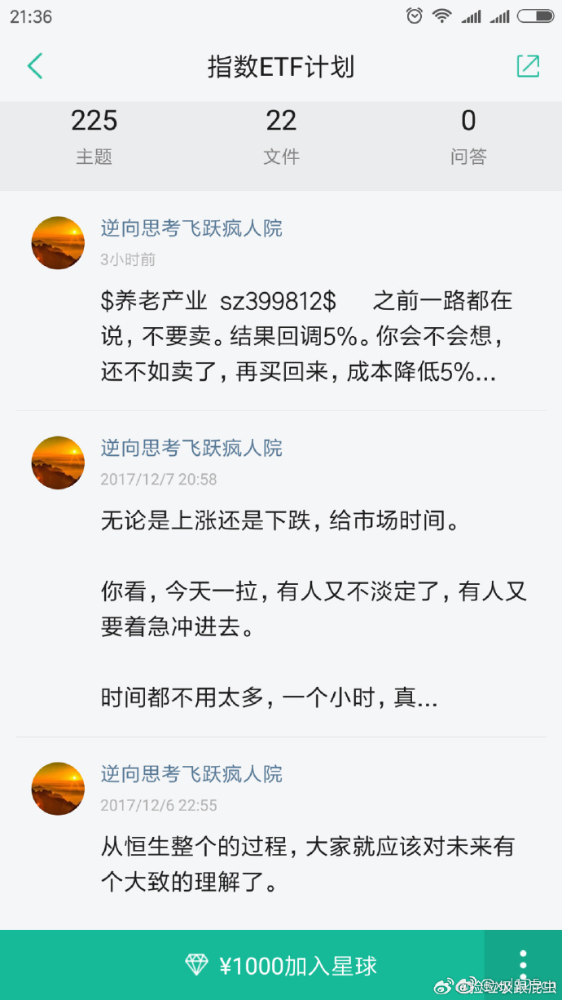

## 2017-12-12 10:07

确认了，月中发车保时捷。 ​​​

## 2017-12-12 10:23

reits和金融时报100指数是我需要的。

## 2017-12-12 11:32

今天在雪球看了一个文章，苹果1980年上市的。

其实那时候苹果已经是万众瞩目了。非常火爆。

谁能想到，24年后，2004年，才是它真正长牛之旅的起步点。之前一直起起伏伏。

急什么，很多事急也急不来。

今天又看了一篇文章，关于国民公公的。也是着急，要几年内资产怎样怎样，空手套白狼。反正到现在情况不妙。

欲速而不达。

## 2017-12-12 13:38

这一波涨价去库存不知道库存去的怎么样了。居民加杠杆加到什么程度了，大家手里还有多少钱。

## 2017-12-12 14:17

回复@英德美加:其实这个说法和股市高点有人买入就有人卖出赚到钱一样。两个考虑方向，第一，卖房的人会不会离开这个游戏。买家加杠杆买了卖家的房。卖家拿到钱加杠杆换更大更好的房。最终谁都没钱，都加了杠杆。第二，钱最终流入了谁的手中。

## 2017-12-12 14:19

回复@小狗上马路:04、09年初。不跌我是不会买的，第二套是金融危机中。//@小狗上马路:E哥的房子都是05年买下的吗？//@ETF拯救世界:这一波涨价去库存不知道库存去的怎么样了。居民加杠杆加到什么程度了，大家手里还有多少钱。

## 2017-12-12 14:25

我的一个表妹家，父母这些年买了三套房。其实真的很厉害，收入也不高，一直买。

去年卖了一套，然后表妹老公家也卖了一套，加了几百万贷款，又买了一套280平米的大平层。

过去十几年，所有卖房离开游戏的都是输家。所以我怀疑有多少卖家会卖了房离开。恐怕没多少。一般都是置换更好的或者学区房，继续加杠杆。

有很多人是会再买第二套。

也就是买家，卖家都加杠杆。

房地产商也在加杠杆拼命拿地。

钱不会消失，但货币乘数杠杆率如果降低，钱就会变少。另外现在几乎是历史最低利率的时候，会不会加息？如果加息会怎样？

这些我都不知道。不懂房地产。就是看着觉得很有意思~

## 2017-12-12 14:51

今天多嘴了。不谈房地产了，没别的原因，就是因为不懂。不懂的事不瞎说。能力圈外。好在今天也没说什么，就是讲了讲身边的事……

## 2017-12-12 14:53

回复@披头士披头士:04年刚10岁。哪有那么多钱买两套。//@披头士披头士:还以为E大两套房子都是04年买的呢，09年抄底，👍//@ETF拯救世界:回复@小狗上马路:04、09年初。不跌我是不会买的，第二套是金融危机中。//@小狗上马路:E哥的房子都是05年买下的吗？

## 2017-12-12 14:56

脸都丢尽了。//@ETF拯救世界:弄不好又变自行车了//@ETF拯救世界:这么看月中搞不好有大巴。

## 2017-12-12 21:55

每日打卡（121）

今天太冷了，不到10000 ​​​
 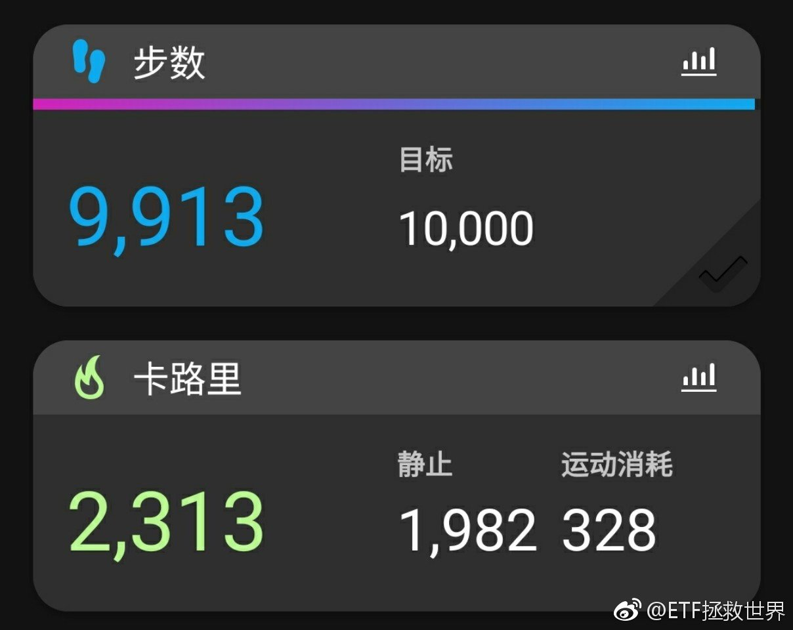

## 2017-12-13 09:05

我已经不敢想象20年后这世界是什么样子了。

> @老马自奋蹄
> 台球机器人，动作稳健，什么时候跟丁俊晖比一场(http://t.cn/RT4kUTl笑歪牙的秒拍视频 ) ​​​

## 2017-12-13 09:26

回复@你好大麦茶:肯定比保姆对你好，没准还能给你定制一个小鲜肉帅哥的机器人伺候你。一个想法，不一定对。//@你好大麦茶:等我老了，希望陪在我身边的机器人对我好点//@ETF拯救世界:我已经不敢想象20年后这世界是什么样子了。

## 2017-12-13 10:14

不过也不用太乐观。你想想吧，20年前，跟现在有什么实质性变化没有，没有。

科技遇到瓶颈很久了。

20年前，1997，也能上网。就是网速慢了点。电脑，有区别吗，没区别。硬盘内存小了点，屏幕小了点，也就这样。

手机变成能触摸的了，网站变成app了。没有什么实质性的发展。

家里，洗衣机电视电冰箱空调，还跟20年前甚至30年前差不多。电视就是变薄了，变大了。

出行，也没变。公交车地铁，线路多了，方式没变。自己家的自行车变成共享里的了。私家车多了点，但是车本身没什么变化。有特斯拉比亚迪电动车了，其实也差不多，自动驾驶出来才算有突破。

高铁，速度快了，其实还是以前的模式。几十年没变了。

淘宝京东是什么。跟20年前的玫凯琳邮寄购物有什么本质区别吗。

百度谷歌，也是十几二十年了。本质跟雅虎也差不多。

完了，我们已经被三体人锁死技能了。没有突破，没有改变人类的大发明，都是小打小闹小升级而已。

20年后藤原纪香模样机器人伺候我的梦破灭了。

## 2017-12-13 10:49

券商什么时候可以买。

很有挑战性的问题。 ​​​

## 2017-12-13 10:55

勿忘国耻。//@向小田://@树蛙盒盒盒盒:一觉醒来看到这篇文章很难受，勿忘国耻，铭记历史

## 2017-12-13 11:00

券商，一定是左侧一部分右侧一部分。难点在于，多少仓位给左侧，多少右侧。左侧的火候如何拿捏，节奏如何把握。弹性太大的品种要考虑清楚。

## 2017-12-13 11:18

行业，我的预计，未来20年是这样的。

首先大消费还是最赚钱不用说。日常消费+医药医疗。医药医疗市值占比会加大，继续跑大牛股，所以行业指基我们肯定要配一部分。娱乐业也包含在里面。据说steam一半玩家都是中国的。

金融领域都不会死，20年后肯定都在，不过应该有分化。保险应该还可以，券商波动大，银行在全市场占比应该降低，目前利润太多，市值占比过大，不合理。这些也都会配。

信息科技，发展会比较大，全市场市值占比会提高很多很多。但不容易赚到钱。为什么，常年都很贵。行业发展再好你也可能不挣钱。不贵的时候买会赚不少。会配。

其它的，制造业占比会下降。资源类也是周期，长期不好说。其它的都会有阶段热点，但很难说会长期好。也许阶段性会配。

宽基肯定是基础。

## 2017-12-13 11:27

回复@lasting8888:A股的军工都是伪军工。哪里有波音/洛克希德马丁那样的公司……概念炒一炒就好了……//@lasting8888:回复@天影198:第三次世界大战的时候  军工会超乎想象

## 2017-12-13 11:40

回复@小宝_霸霸:地产股的走势要看房地产行业的情况了。具体我不好说，我只能说，未来20年房地产股票的价格波动会非常非常非常大……大概率。//@小宝_霸霸:谢指点，地产呢益达哥？

## 2017-12-13 17:23

讲真，你们两个站在我面前，我真的会脸盲……

> @澎湃新闻
> 【女子买两部苹果手机，均被女同事面部解锁】http://t.cn/RTMsSUd澎湃新闻的秒拍视频 近日，江苏南京的颜女士先后买了两部iPhone X手机，却均能被一位非亲属关系的女同事面部解锁。她担心手机的安全问题。苹果店工作人员表示这是个案如不满意可退货。（视频来源：江苏网络电视台）http://t.cn/RTMsSUg女子买俩苹果手机，均被女同事面部解锁 ​​​

## 2017-12-13 21:17

每日打卡（122）

刚才出去跑了一公里，呼吸肺疼，太冷了。老老实实回来享受暖气了 ​​​
 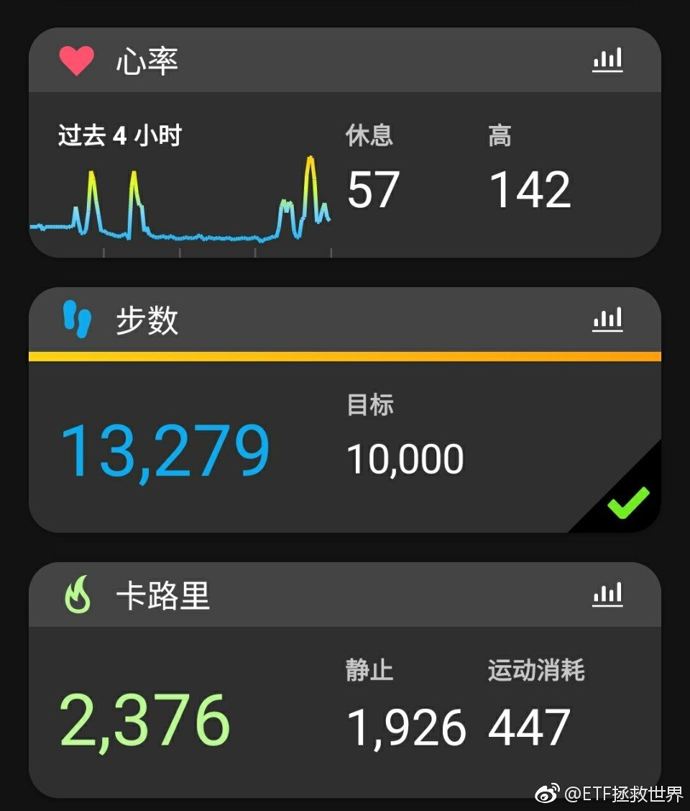

## 2017-12-14 05:39

辣鸡

差几厘

 ​​​
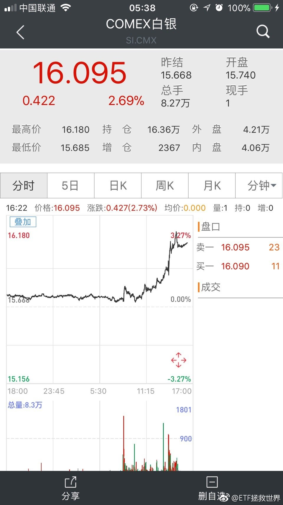

## 2017-12-14 08:44

突然发现最近看好中小股票的人多起来了。怎么办。需不需要继续逆向。

## 2017-12-14 09:04

回复@取个名字真TMTMD难:有区别的。很多小盘股肯定是不行了，没那么多钱去炒它们。但是中小盘股里有好东西，现在很多人开始发掘这个了。我们的创业板指数可以说是最好的100只创业板指数，500指数算是最好的500只中盘指数。这跟那些三无的垃圾完全不同。

## 2017-12-14 09:27

被那么多人看到的风险就不是风险。真正的风险来自于非常不起眼的地方。突然长大，引爆全场，花火般美丽。//@曹增辉:转发微博

## 2017-12-14 09:53

干不干 ​​​

## 2017-12-14 11:06

可能是借了现金贷。

> @蓝鲸TMT
> 【贾跃亭妻子刷卡额度2000元 却开万元月薪请家教】贾跃亭在接受采访时曾说“小薇的卡被冻结，只能刷2000块”可如今额度两千的甘薇，却要出万元月薪为孩子聘英语家教。据悉贾跃亭已被法院列入了“老赖”名单，根据规定“老赖”的子女不可以就读高收费私立学校。（每日经济新闻） ​​​
> 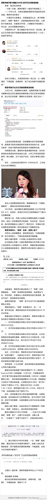

## 2017-12-14 13:23

券商股是这样的。

你把成本控制好，五年不赚钱，没事。踏踏实实的。

然后一年150%，年化妥妥超过巴菲特。

所以最关键两点，成本不要高+踏踏实实拿着等牛来。 ​​​

## 2017-12-14 14:10

中证500跌幅0.1%，券商指数跌幅1.7%。

不骗你，真的特别凶残。一定要做好心理准备。 ​​​

## 2017-12-14 15:25

开个会回来538了，晚上回家慢慢看吧…… ​​​
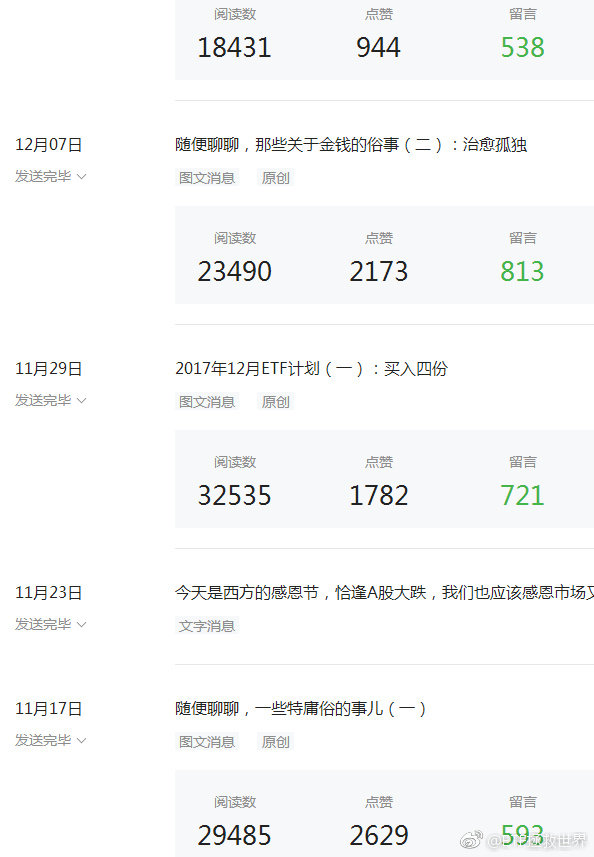

## 2017-12-14 16:09

很多事情啊，讲个分寸。度把握好了什么都好说，度把握不好容易出事。

我这里啊，一直其乐融融。开玩笑什么也都没事。不过开玩笑的时候还是要有分寸，否则引起其他人反感就没必要了。每天糟心事儿还不够多啊，还来网上添堵。

所以以后就都客气点吧。不然您哪天突然没法跟大家交流了就可惜了。 ​​​

## 2017-12-15 08:57

8848配股是非常合理的。从公司和老孙的角度来讲，非常合理，符合一贯作风。 ​​​

## 2017-12-15 09:50

$证券公司 sz399975$   我认为360-400点应该是极限底部了…… ​​​

## 2017-12-15 10:11

不用看了，下次买入是600点了。。。

## 2017-12-15 10:16

有些数学知识在投资里面还是很重要的。比如这个。

你在1800点买入证券指数，到400点是亏损78%。

那你等到腰斩，900点买入，觉得很安全了吧，到400点亏损是56%。

控制风险永远是投资的第一课。 ​​​

## 2017-12-15 11:12

再来做一道数学题。

800点买入证券指数，跌一半，400点再买入同样的金额。

你的成本是533，而不是你想象的600。

如果回到800点，你的盈利是50%。

如果800点就不贵，最后涨回1800，那么你的盈利是237%。 ​​​

## 2017-12-15 11:16

延伸：如果800点买入1份，400点买入2份，则你的成本会直线下降至480。回到800你的盈利是67%。这个结论可以说是我们整个体系的core。

## 2017-12-15 11:26

回复@核电牛奶:问题在于如果真的到了400，你，或者你的家人，或者你的客户，能否承受攒了一辈子的资产瞬间减少了50%，如果此时需要用钱则是灭顶之灾。所以“认为800不贵”不应该是买完的理由。解决这个问题，需要用概率+配置来解决。

## 2017-12-15 13:20

……

> @ETF拯救世界
> $证券公司 sz399975$   我认为360-400点应该是极限底部了…… ​​​

## 2017-12-15 13:23

是不是有人监控我微博！专门来打脸的！站出来！我现在就打电话摇银儿！

## 2017-12-15 13:54

把概率和预测混为一谈的人，可以说完全不理解基于概率的投资体系。

预测是，我预测未来要涨还是跌，根据这个做出投资决策。

概率是，我不知道未来涨还是跌。但我会想办法计算涨跌的概率。然后根据涨跌概率，再加上预期盈利与预期亏损的因子，做出最佳（系统设计者自认为）仓位配置。在这种情况下，风险/收益比完全控制在模型设计者的手中。这个时候，最大会损失多少，最少会赚多少，基本都已经确定了。

如果你还不懂，我来举个例子。

如果你把自己的资产80%配置在一个每年5%的品种上，另外20%配置在一个每年可能-20%到40%的资产上，我请问，你每年最差和最好的收益是多少？
 
其实非常简单，如果这样配置，你每年最差的收益是0。也就是不可能亏损。而最好的收益可以到12%。

这是无概率的情况。增加概率，则再在这个模型上增加概率因子。根据概率增加或减少80%/20%的配比。

整个过程中，我没有做出任何预测，跟预测有一毛钱关系吗。

## 2017-12-15 14:06

举例证券行业指数。把模型简化，如果我在800点买入，配置0.6%。如果我认为它最大的下跌幅度是50%，则我最多会损失0.3%。如果上涨，涨100%，只会赚0.6%。这时候根据各种模型计算涨跌的可能性，然后把预期收益放入模型。显然，损失0.3%绝对可以接受。但是只赚0.6%不可以。下跌概率小时即可加仓。

## 2017-12-15 14:08

回复@红枫0825:你坐在那里想概率，当然是主观的。如果我用很多数据和模型去支撑呢。如果你说，历史数据对判断未来概率毫无用处，那我也就没话说啦。主观因素会有，投资本来就是科学+艺术。但基础是科学。

## 2017-12-15 14:17

我估计除了听消息，任何投资方式都是与概率有关，只是很多人没有意识到而已。

价值投资不是概率吗。当然是了。拼命研究报表，找到好的企业，排除差的，这就是提高成功概率的方法。是不是找到好企业就没有失败的概率了？当然不是。所以这时候买入一组好企业，成功的概率就大幅增加。

趋势投资不是吗？趋势向好后买入，就是认为趋势延续下去的概率比突然转折的概率大。

所以任何投资都是要想方设法提升成功的概率，降低永久性损失的概率。

## 2017-12-15 14:34

其实我想问的是，为什么那个行人要在马路上走。旁边不是明明有人行道吗。

> @澎湃新闻
> 【父母没空接，12岁女孩独自骑车撞死人】http://t.cn/RToVgR9澎湃新闻的秒拍视频 12月13日，江苏淮安一名年仅12岁的女孩独自骑电动车将一路人撞倒致死。其父称，家中有两个孩子无法同时接送，就让大女儿自己骑车上学。按相关规定，骑行电动车须年满16周岁，骑车女孩父亲作为监护人将承担责任。（视频来源：江苏网络广播电视台）http://t.cn/RToVgRK父母没空接，12岁女孩独自骑车撞死人

## 2017-12-15 14:38

回复@炒股为生2015:讲了0.5%的东西。//@炒股为生2015:这帮人，下跌行情在这套E大的投资方法呢？@ETF拯救世界 E大，小心这帮人学会了抄你的底

## 2017-12-15 14:41

回复@披头士披头士:变形警车珀利说的啊！你敢不听？//@披头士披头士:所以我们家孩子问我为什么她只能坐安全座椅不能坐副驾驶的时候，我应该如何回答她？//@ETF拯救世界:其实我想问的是，为什么那个行人要在马路上走。旁边不是明明有人行道吗。

## 2017-12-15 15:31

惊呆了。刚才有个新的研究发现：

如果今天你持仓的品种下跌5%，那么你明天需要涨5.26个巴仙才能回本。

神秘的数学！感觉去麻省理工教数学已经绰绰有余了。 ​​​

## 2017-12-16 20:35

每日打卡（123）

坚持 ​​​

## 2017-12-17 22:11

每日打卡（124）

随便跑七公里。跑步的时候能静下来想很多事。 ​​​
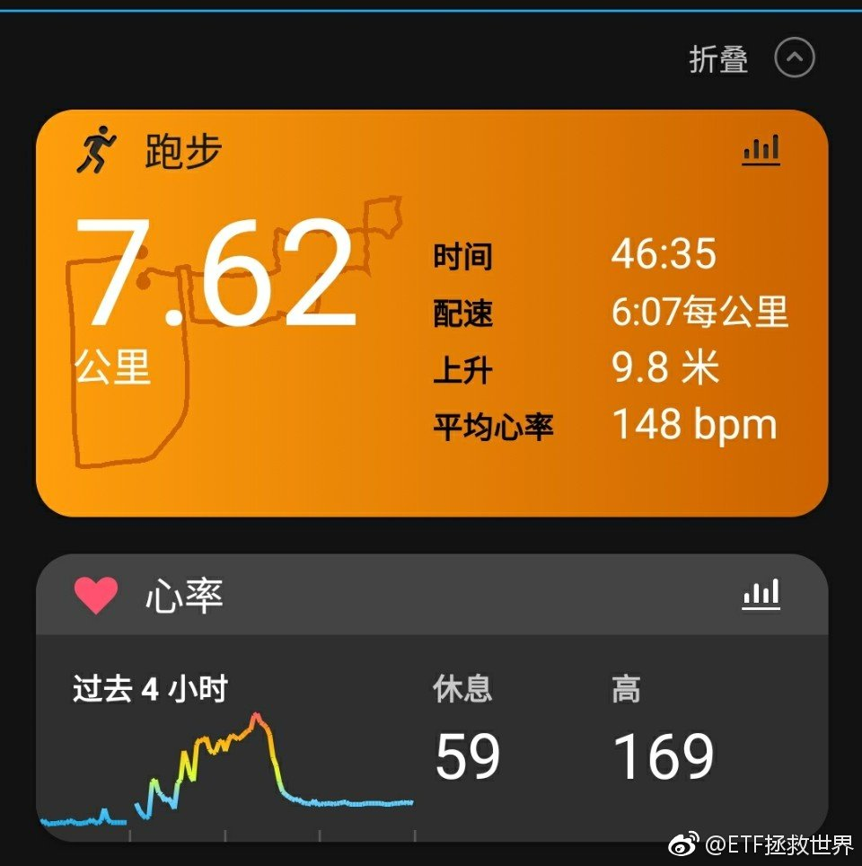

## 2017-12-18 10:31

44%//@ETF拯救世界:获利比例剩50%了……

## 2017-12-18 11:00

回复@不想長珍珠的蚌:不是不看好。毕竟我不懂。我害怕的是太过疯狂的企业家和投资者。这里只是做个记录而已。//@不想長珍珠的蚌:e大为啥不看好融创，就是因为涨了5倍，估值过高吗//@ETF拯救世界:44%//@ETF拯救世界:获利比例剩50%了……

## 2017-12-18 12:41

回复@鸡架熊:据说身体好的人心率会低一些。一个观点，不一定对。//@鸡架熊:静息状态下，心率不到60？！是不是问题啊

## 2017-12-18 13:31

2400只下跌。

cool。 ​​​

## 2017-12-18 13:42

回复@奥斯特洛夫大柴夫斯基:谁人背后无人说,谁人背后不说人。无所谓啊~好了遭人嫉妒，差了让人瞧不起；忠厚人家说你傻，精明了人家说你奸；冷淡了大伙儿说你傲，热情了群众说你浪！走在前头儿挨闷棍儿，走在后头儿全没份儿！

> @大奔奔Eric:雪球上有个50多岁的大v又对你指指点点了 呵呵呵 真TM烦

## 2017-12-18 13:48

回复@_ideast:我觉得半个月到6.5-7以上应该能见到吧。//@_ideast:老大，12月下旬了，逆回购最近如何操作最优？还是搞点银行理财，收益也可以

## 2017-12-18 14:24

控制节奏。 ​​​

## 2017-12-18 14:29

回复@万里浮云无股也呻吟:中证500极限30%-35%吧。再多我就理解不了了。//@万里浮云无股也呻吟:中小板怎么的还有一半以上的跌幅，对吧

## 2017-12-18 14:52

回复@我在故快乐:也因为你的仓位合适了。//@我在故快乐:这几次大跌没加车冲动了，看来看老大微博还是有作用的。

## 2017-12-18 15:02

真的喜欢小马哥和东哥的面相。主要是眼神。

> @跨境梨子姐姐
>  网友说：阿里太可怕，抱团取暖。[笑cry] ​​​

## 2017-12-18 15:26

2017年，我的遗愿清单上又增加了一项新的内容。

“探索1%的地球。” ​​​

## 2017-12-18 17:10

回复@LEVELEEE:是的。时间换空间。//@LEVELEEE:回复@ETF拯救世界:要是明年能有20%利润增速，又不涨不跌，是不是就没多大下跌空间了？

## 2017-12-18 21:00

这就是传说中的羊群了//@林萍在日本:一呼百应//@頑俞渝羭諭蝓貐://@本杰努布:羊：人类太好逗了 我们能逗她一天。

> @娱乐学姐蒋欢欢
> 对一群羊喊“咩~” 会发生什么？
> 哈哈哈哈有毒！忍不住笑出声[允悲][允悲][允悲] http://t.cn/RTYFpyCYouTube上的搬运工的秒拍视频 ​​​

## 2017-12-19 10:13

37%//@ETF拯救世界:44%//@ETF拯救世界:获利比例剩50%了……

## 2017-12-19 10:23

雾霾有人骂，天气好了还是有人骂……

## 2017-12-19 10:45

$养老产业 sz399812$   真的稳 ​​​

## 2017-12-19 10:48

$证券公司 sz399975$   不想骂你，自觉点 ​​​

## 2017-12-19 14:15

我知道很多朋友心里都很着急，为什么不断波动就是不涨/不跌。赚不到大钱。

真的不用急。股票不敢说，好的指数，它们的成分股每一天都在为你挣钱。业绩在不断上升，价值也越来越大。

价格不涨，急什么。证券投资就是这样，三年不涨，一涨吃三年。现在的大牛股平安，08-2014一分钱都没涨，六年啊。而且，08年还是在跌了很多很多的情况下买，还是六年不赚钱。如果高位买十年不赚钱。

然后呢，不是涨好几倍。现在拿平安的是股神，08-14年他们什么心情你恐怕不知道。

只要你买的不贵，不要急，早晚会涨。趁着没涨的时候，多买点筹码，以后多赚点才是王道。

## 2017-12-19 14:40

回复@布RUCE:一定先于大盘新高。就这么决定了。//@布RUCE:好久没有新高了

## 2017-12-19 14:44

回复@O_Zhong_O:06-07几乎所有指数两年六倍。12-15创业板2年多接近7倍。同期医药三倍，500是4倍。就凭中国人这种赌性，我相信下个牛市恐怕要比12-15更疯狂。//@O_Zhong_O:指数也能几年不涨，然后一下翻好几倍吗？一个问题，不一定提得好

## 2017-12-19 14:49

上面两条微博可以连起来看。

0607之所以翻6倍，是因为01-05跌了整整4年多。

12-15之所以那么多小指数暴涨几倍，正是因为之前07-12/13跌了5、6年（有过一次大反弹）。

任何大行情都是要把大多数人的信心、耐心磨没了才会产生。要不然，那么多人一起抄底赚大钱？做梦呢。 ​​​

## 2017-12-19 14:57

回复@木木不哭木木:不能机械看。但风格轮换是所有证券市场都会存在的现象。轮换不仅与时间空间有关，还与行情的性质、经济周期有关。不过有一点，哪里便宜点哪里，提前埋伏，等风来。风来了继续埋伏便宜的。所以计划有两年+50%的品种，也有刚开始布局的品种。

> @W未来式W:2015年，上证50跌幅-6.23%，创业板涨幅84.41%；（大弱小强） 2016年，上证50跌幅-5.53%，创业板跌幅-27.71%；（大强小弱） 2017年，上证50涨幅23.32%，创业板跌幅-9.08%；（大强小弱）

## 2017-12-19 15:22

回复@5ive55555:都是定折吧。//@5ive55555:@5ive55555: E大 能不能请教一下您怎么看今天很多分级a大跌 或者什么原因导致的 唔该晒

## 2017-12-19 23:26

大宵是资本市场揣着明白装糊涂第一人。

> @蓝鲸新闻
> 【鲸视频:李大霄谈投资逻辑 跟着国家走吃喝啥都有 国家叫买股就买股】在2018网易经济学家年会上,李大霄表示,我的核心逻辑,就是“做好人,买好股,得好报”。国家叫我们买股票就买股票,国家叫我们买房子就买房子。什么时候叫我们买房子?房贷七折,就是叫我们买房子;什么时候叫我们买股票呢?股市发不出去的时候,就叫我们买股票。(来源：网易财经) http://t.cn/RTEaQQw蓝鲸财经记者工作平台的秒拍视频

## 2017-12-19 23:33

每日打卡（125）

都要健康 ​​​
 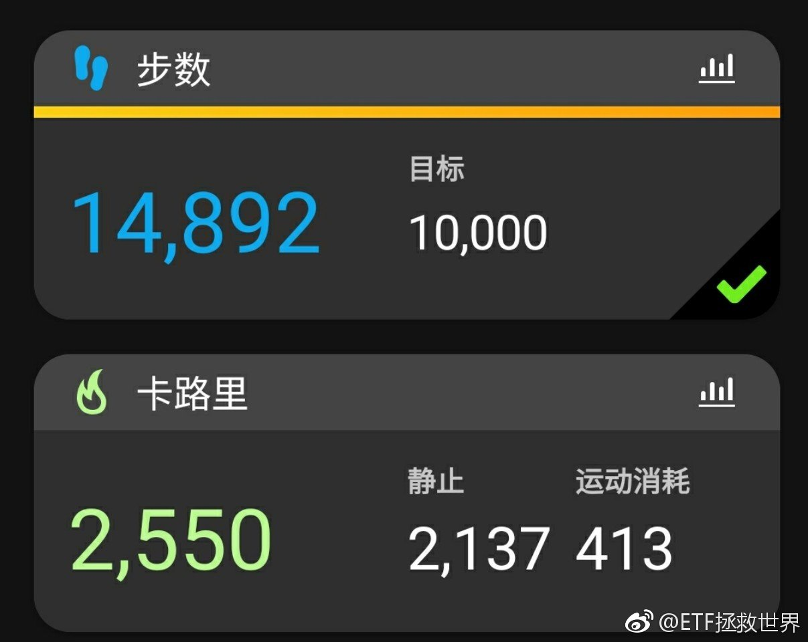

## 2017-12-20 08:57

就看法院的了。如果葫芦僧乱判葫芦案，恐怕就是下一个彭宇案，会影响深远。

## 2017-12-20 09:16

回复@Mili:这事的事实众说纷纭。我不评论案情本身。我是说，彭宇案的传播对中国社会造成的巨大的影响。我说的是影响，而非真相。真相，也许永远会被埋葬。

> @Mili:益达可以百度下彭宇案的真实经过，包括因为派出所丢失了最初的口供，彭宇的律师得知以后指导彭宇翻供并利用舆论的过程，非常震惊。说到底，人根本就是彭宇撞的……

## 2017-12-20 09:49

信任两个字在当今这个年代已经非常难得。

所以如果有人信你，最好珍惜。

别人因你而亏损，当然可以一句“大家都是成年人，不要做巨婴”而推的干净，然而其实未必可以那么简单。

所以我坚持一个原则，任何计划里的品种，绝不建议高于我的成本价买入。我不会说自己1块买的，到了1.5还说值值值。你只可能比我成本低，不会比我高。赚的一定比我多。赚的比我多我不嫉妒，很开心。

钱这东西，重要不重要？我啲感觉都好重要嘅！but，哪能港，所谓君子爱财取之有道，总是没错了。

福未至祸已远，也就够了。

## 2017-12-20 09:59

稳。忍不住奶一口

> @ETF拯救世界
> $养老产业 sz399812$   真的稳 ​​​

## 2017-12-20 10:13

回复@蜀行天下:意念盘，无需操作。类似于暗物质与气功的结合体。无形无色无味，但当量相当于一万多亿资金在操盘……//@蜀行天下:每次看到你说奶一口我都要深思一段时间，这又是什么操作，我会不会错过一个亿//@ETF拯救世界:稳。忍不住奶一口

## 2017-12-20 10:18

$证券公司 sz399975$   够狠。跌破753就是700见了。然后就是我们的补仓点位，600…… ​​​

## 2017-12-20 10:39

我该说什么呢。 ​​​

## 2017-12-20 10:51

都不对。我就两个字：反弹！

## 2017-12-20 10:59

回复@小祝Joochill:是的。再说我这个ID，“ETF拯救世界”，意思是指数基金能够让很多炒股不赚钱的人改变投资命运，而非某个人可以拯救世界，我还没那么二……主语是ETF……//@小祝Joochill:这个人语文学的不好，连E大的名字里主语是什么都没有弄清楚……

## 2017-12-20 11:20

回复@枫93:不会的。我不信一个在村里用50块钱和芙蓉王贿选村长的治疗半身不遂的无证中医会来跟计划……//@枫93:搜了Ｅ大  冒牌货 用了Ｅ大头像冒牌的有18个他是不是被冒牌的骗了 来找正版的Ｅ大报复了呢 搞错了人呢

## 2017-12-20 12:51

回复@i云腾致雨:不可能//@i云腾致雨:E大心态为什么这么好？别人找的女朋友比你的漂亮，也不嫉妒？

## 2017-12-20 13:28

35%。最近这个区间是成交稀少区。还有大量成本在18左右的筹码。//@ETF拯救世界:37%//@ETF拯救世界:44%//@ETF拯救世界:获利比例剩50%了……

## 2017-12-20 14:15

好歹也得反弹一波涨个10%换换手吧……//@ETF拯救世界:35%。最近这个区间是成交稀少区。还有大量成本在18左右的筹码。//@ETF拯救世界:37%//@ETF拯救世界:44%//@ETF拯救世界:获利比例剩50%了……

## 2017-12-20 14:24

回复@豆丁没事:不会。仓位非常巴适。不用着急加车，月底正点开车。//@豆丁没事:E神，这周会发车吗//@ETF拯救世界:好歹也得反弹一波涨个10%换换手吧……//@ETF拯救世界:35%。最近这个区间是成交稀少区。还有大量成本在18左右的筹码。//@ETF拯救世界:37%//@ETF拯救世界:44%

## 2017-12-20 14:43

回复@李贤1985_319:不是看到。是极限跌幅。跌到400我不吃惊。就酱。//@李贤1985_319:在雪球很多人都说证券指数已经到了底部区域，e兄看到600，甚至能到500的理由是什么呢🤔🙏。

## 2017-12-20 14:51

回复@李贤1985_319:今天有朋友在微博问，“在雪球很多人都说证券指数已经到了底部区域，e兄看到600，甚至能到500的理由是什么呢。” //@李贤1985_319:在雪球很多人都说证券指数已经到了底部区域，e兄看到600，甚至能到500的理由是什么呢🤔🙏。

## 2017-12-20 15:58

500估值又新低了。

人生美好。 ​​​

## 2017-12-20 16:05

回复@老股民穿越牛熊:不是看，我是算。我每天都算，跑程序跑20分钟。源数据出来第一时间就算。算估值是我人生中第三大最爱干的事。你咬我呀。 一会儿就拉黑。//@老股民穿越牛熊:你每天看估值累不累？心态不好 慢慢练心态吧！

## 2017-12-20 16:11

“我先拉黑你”，佢话。

我笑喷了。拉黑不拉黑谁care啊。我根本就不想看你的微博好吗……蜜汁自信……

跑到别人微博评论里说，我要拉黑你。这是一种什么精神…… 我都唔知你系边个…… ​​​

## 2017-12-21 06:24

……

## 2017-12-21 06:34

相当完美的区间波动 ​​​
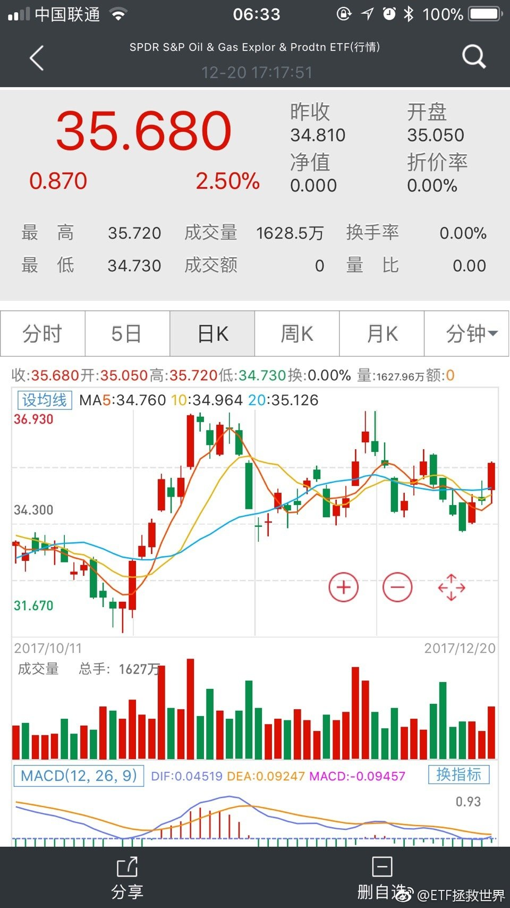

## 2017-12-21 09:45

看看是不是有机会加仓美元债。//@华尔街见闻APP:在岸人民币创3月来新高

## 2017-12-21 10:11

$证券公司 sz399975$  新低。下跌空间打开了 ​​​

## 2017-12-21 10:49

回复@Yanb丶: 就问你服不服//@Yanb丶:毒奶界唯你最强

## 2017-12-21 11:02

这就是“弹性”。应该还不到时候。到时候它会让你目瞪口呆。。//@ETF拯救世界:回复@Yanb丶: 就问你服不服//@Yanb丶:毒奶界唯你最强

## 2017-12-21 13:54

快回去了。

## 2017-12-21 14:59

如期而至。。//@ETF拯救世界:好歹也得反弹一波涨个10%换换手吧……//@ETF拯救世界:35%。最近这个区间是成交稀少区。还有大量成本在18左右的筹码。//@ETF拯救世界:37%//@ETF拯救世界:44%//@ETF拯救世界:获利比例剩50%了……

## 2017-12-21 17:09

回复@用户6244991818:可以。目前50、300、180、100、500、广发医药、恒生、黄金、H、中小、创业等ETF全都支持融资买入啊。//@用户6244991818:问个弱弱的问题:指数基金可以抵押融资，但融来的资买不了指数基金。e大说的低点融资，是用来干嘛？//@ETF拯救世界:如期而至。。

## 2017-12-21 22:55

每日打卡（126）

两组其实量不够 ​​​
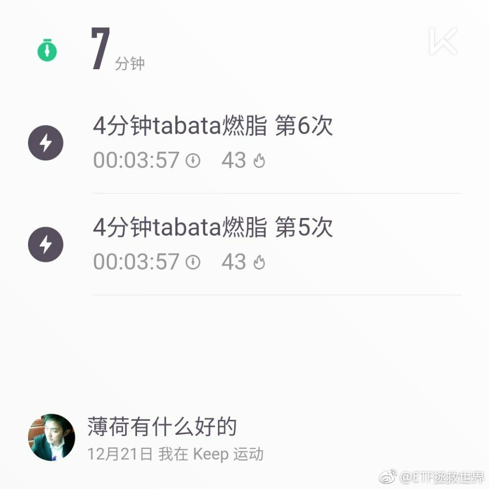 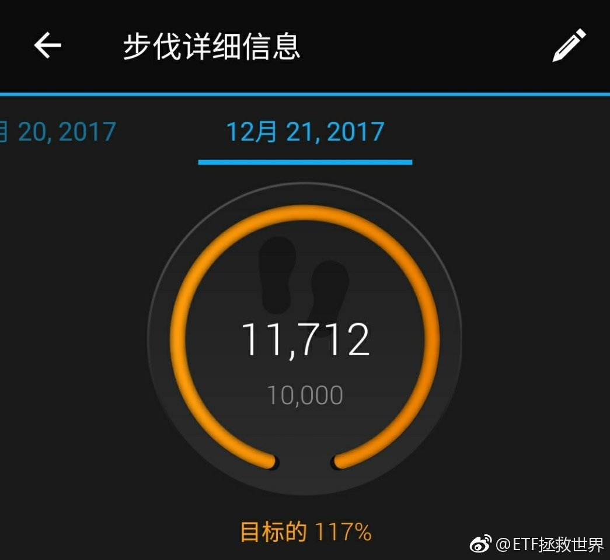

## 2017-12-22 06:36

有波动就有利润，提款机 ​​​
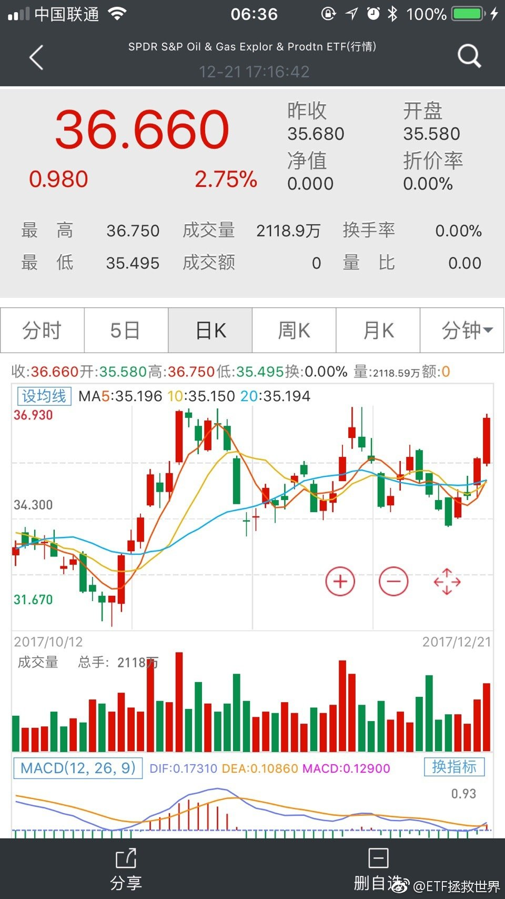

## 2017-12-22 11:01

回复@April·D·S:品种很多。各国etf、各种久期的国债etf，reits，tips。总能挖出来能买的。//@April·D·S:回复@ETF拯救世界: 钱又要回一部分到雪盈了，之前在投机做空，好不容易决定不做空了，回归A股了，E大要做美股ETF了 但美股目前高估中，E大也只是研究还不会买对吧?

## 2017-12-22 13:17

$全指医药 sh000991$  风是不是吹到医药了。 ​​​

## 2017-12-22 13:30

回复@诸葛不亮_若如初见:给咱们抬轿子？？？//@诸葛不亮_若如初见:雪球公众号已经快一个月连续推医药了，还有我关注的别的财经类，平均两天一篇推荐医药股和医药指数的文章

## 2017-12-22 13:48

回复@观海听山:今年基金超级低配医药股。就这样医药好歹今年也没跌，当然涨幅和沪深300没法比。我坚定看好这个行业。长期的看好。//@观海听山:除了那几个龙头，其它大多数医药股还是不行

## 2017-12-22 13:52

回复@Maggie的夏至:就当历史书看吧……怎么投资上面没有，只是告诉你那个金融危机发生了什么。//@Maggie的夏至:正要补充书呢看到你雪球上发的《大而不倒》。好看吗？推荐不

## 2017-12-22 14:41

退博了。

## 2017-12-22 15:17

10年期债主力T1803收涨0.40%，创近10月27日以来新高新高；5年期债主力TF1803涨0.22%，创10月26日新高。

国泰君安表示，中短期来看，目前长端利率水平已经充分透支了利空预期，随着未来1-2个季度名义GDP回落、对监管恐慌的平抑，债市大概率将会迎来一轮级别比较大的熊市反弹，10年国债和国开收益率有望回落至3.7%和4.5%以下。

## 2017-12-22 17:22

回复@linsuozhang2009:中文网路上当然是我的最准，还用说吗。//@linsuozhang2009:回复@卢泽森Samuel:每个大V和且慢的估值算法不见得一样，都只是为了自己的投资体系服务，没有谁对谁错或者准不准确的问题

## 2017-12-23 10:54

回复@飞雨的魔法袋://@飞雨的魔法袋:白银昨晚成交了//@ETF拯救世界:回复@linsuozhang2009:中文网路上当然是我的最准，还用说吗。//@linsuozhang2009:回复@卢泽森Samuel:每个大V和且慢的估值算法不见得一样，都只是为了自己的投资体系服务，没有谁对谁错或者准不准确的问题

## 2017-12-23 11:02

a股，原油，白银，债券，美/德，相关度都很低。再加上汇率因素，此消彼长可以不断盈利。

a股内部，也有各种风格切换。

全天候赚钱，长短结合，稳定，持续盈利，就是我们投资体系的核心思想。 ​​​

## 2017-12-23 14:50

很多要二胎的都是接近中年了。不少都是老婆辞职看孩子，男方工作一旦有什么问题……

> @水木社区官微
> 老公正经历中年失业，做老婆的该咋办？ ​​​
> 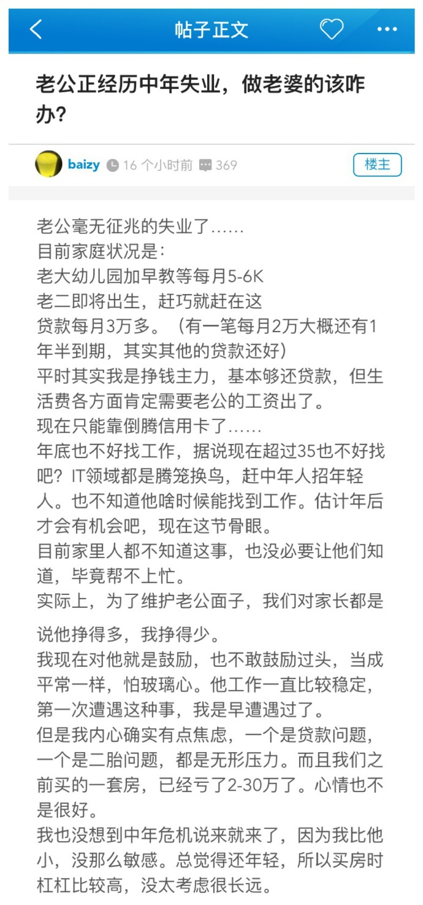

## 2017-12-23 18:28

很多人事事都要听父母的，根本原因在于经济依赖，还不能独立，需要父母资助。

这个没办法，既然拿人家的钱，就要听人家的话。否则，就自己多挣点，自己的事就能自己拿主意了。 ​​​

## 2017-12-24 07:21

75年人口出生高峰，90年房地产股市大崩盘

## 2017-12-25 10:34

相信老司机没错的……新低意味着不断的大概率新低。新高同理……

## 2017-12-25 10:40

回复@初夏拾穗的少年:我没法给你建议啊。我自己投资指数基金，绝对不会止损。第一它一定会涨回去，因为第二点。第二点就是我买的成本一定不高。//@初夏拾穗的少年:原有的基金要不要止损呢？已经跌了百分之十了。益达，怎么办？

## 2017-12-25 10:42

说起来各位可能不信，我对2018年充满信心。即使明年此时没有大赚，也大概率已经把大部分筹码买进去了。

三年了，差不多了。 ​​​

## 2017-12-25 11:29

2700只下跌。还有3天。给个面子啊 ​​​

## 2017-12-25 11:30

回复@马甲不停:12月11日成分股调整。红利调整了20%的成分股，估值暴降。醉了。//@马甲不停:麻烦请教一个问题，上一期计划中，重新购买一份中证红利？这个逻辑是因为调仓，估值下降的缘故嘛，所有购买一份中证红利。

## 2017-12-25 14:14

越来越觉得，成功的投资需要信仰。

无论客观环境发生什么变化，无论别人称赞还是诋毁你，坚持信仰才有可能成功。

当然，信仰不等于迂腐不化，更不等于刻舟求剑。术要与时俱进，道万变不离其宗。 ​​​

## 2017-12-25 15:10

中证1000+创业板综即将新低。

这意味着，3300只股票中，100多只在高位，700多只反弹到高点的一半左右。其它的2500只都快新低了。

这也与每天基本上都是2000-2500只股票下跌一致。

 ​​​

## 2017-12-25 21:50

每日打卡（127）

坚持很不容易。 ​​​
 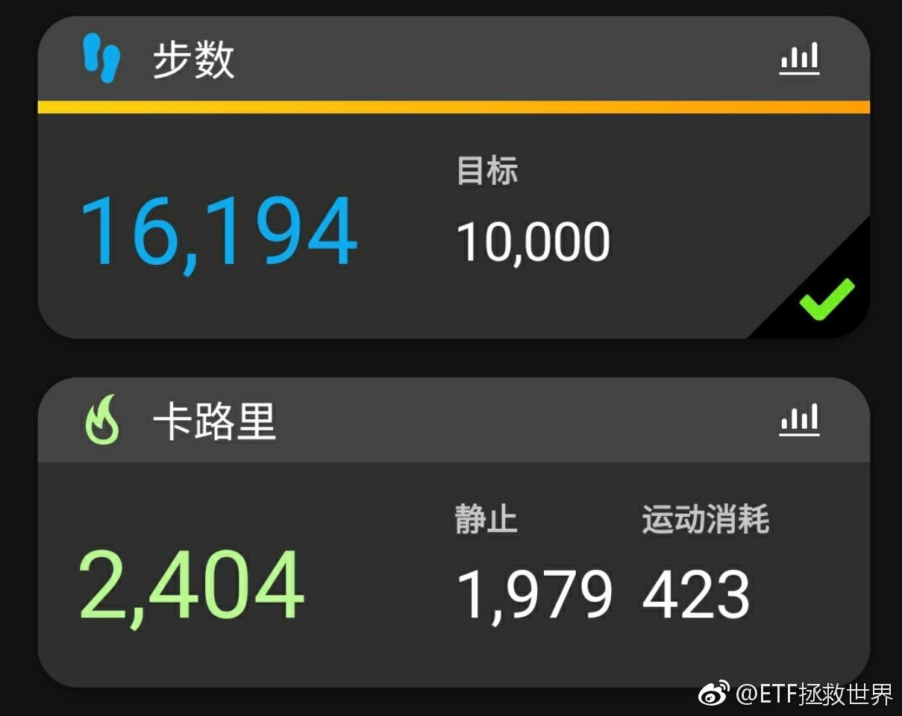

## 2017-12-26 10:42

那位举报的仁兄又出动了。每次到了月底发车的时候他就来一下。

真的NB，人类。

我还是开个头条号对冲一下风险吧。。万一哪天公众号让那哥们儿给玩歇菜了怎么办。 ​​​

## 2017-12-26 10:56

现在回头看这个，有没有一点新的体会。

## 2017-12-26 11:08

回复@josephtang:送你个大保健得唔得嘅？//@josephtang:回复@ETF拯救世界:益达，指数又反弹了，我要心理按摩。//@ETF拯救世界:现在回头看这个，有没有一点新的体会。

## 2017-12-26 13:32

回复@Yoran_咩咩咩:真的有些品种可能这样，所以炒个股要小心//@Yoran_咩咩咩:咋不能图片评论，现在别的财经博主评论下面都是a股必然港股化僵尸化，还有说必须要认清a股未来丧失流动性的先决战略再去选股。吓得我还是来e大这按摩心灵吧//@ETF拯救世界:回复@josephtang:送你个大保健得唔得嘅？

## 2017-12-26 14:21

长短结合逆回购搞起来！ ​​​

## 2017-12-27 04:05

突破了 ​​​
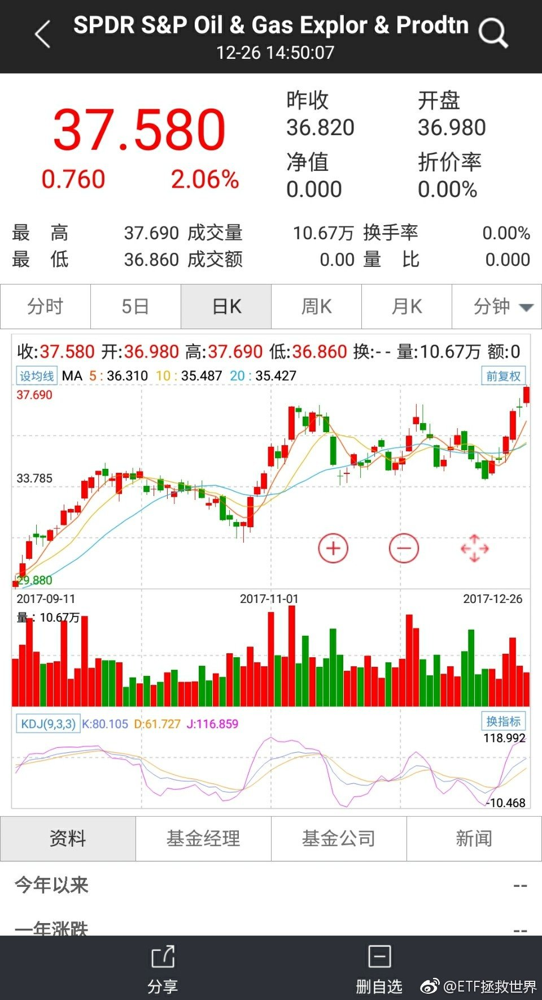

## 2017-12-27 08:07

回复@灰涩柳丁:别人说什么一点都不重要。金融投资不是投票产生赢家。//@灰涩柳丁:还记得在某论坛那时还被好多人质疑了

## 2017-12-27 10:02

逆回购长短结合搞起来！ ​​​

## 2017-12-27 10:20

回复@o我有一只猫:元旦后的话，3、4、7都可以。1月2、3回到账户。7会多一天。14天收益率少，但多吃7天。//@o我有一只猫:今天搞哪个结算到元旦节后的啊？

## 2017-12-27 10:22

港真，14天我预期在6.5以上都好满意嘅，没想到给了8%。我都好中意解个系场！ ​​​

## 2017-12-27 10:33

8.6。贫穷限制了我的想象力，今天没钱了！

## 2017-12-27 10:36

9.05。哭出来了。//@ETF拯救世界:8.6。贫穷限制了我的想象力，今天没钱了！

## 2017-12-27 11:26

长久期国债个券崩的一塌糊涂。 ​​​

## 2017-12-27 11:39

我说14天你们说1、3、4、7，鸡同鸭讲……//@ETF拯救世界:9.05。哭出来了。//@ETF拯救世界:8.6。贫穷限制了我的想象力，今天没钱了！

## 2017-12-27 13:56

如果你的油气网格赚了，逆回购卖了好价格，同时指数又跌了，过两天还能买到便宜货。

别嘚瑟。

低调。

木秀于林风必摧之。毕竟长者说过…… ​​​

## 2017-12-27 14:01

是，刚才有朋友说还有白银。我就不跟你们一起开心了，毕竟这波差几厘没买到。

是时候进化策略了。 ​​​

## 2017-12-27 14:51

有些蓝筹看看前期低点能否撑住。撑不住就大概率是M了。

不懂技术，瞎说。 ​​​

## 2017-12-27 15:04

我估计，这里95%的朋友没有过满地便宜货，满地金子钻石等你捡的经历。

怎么讲，几年一次，捡的时候感觉很复杂，五味杂陈。

主要是每次都会嫌弃自己钱太少。 ​​​

## 2017-12-27 15:07

回复@Cubic_N:那么容易让你猜到就不叫金融市场了。所以，有花堪折直须折，莫待花落空折枝//@Cubic_N:@ETF拯救世界 E大如何评价逆回购今日尾盘跌的一塌糊涂，不是一般收盘暴力拉升么//@ETF拯救世界:我说14天你们说1、3、4、7，鸡同鸭讲……//@ETF拯救世界:9.05。哭出来了。

## 2017-12-27 15:30

今天真是个骗局。好像跌了多少似的，其实是大股票跌得多。全市场居然没有新低。

辣鸡。

明天看情况是中午或者晚上开车吧。大跌就中午开，不跌就晚上开。妥妥的。 ​​​

## 2017-12-27 17:16

钱宝什么的不了解。据说收益率很高，有50%？

我有个观点，跟你说无风险收益率在10%以上的，都要小心点。越高越要小心，因为这不科学。

当然，这说的是正常时期。 ​​​

## 2017-12-27 18:36

炒股票有什么问题。我告诉你有什么问题。

最大的问题是不确定性。

绝大多数人根本不知道一个股票到底值多少钱。涨起来了要不要卖掉。卖掉了会不会涨的更高，不卖会不会跌下去。

其实对于短期波动，我相信大多数人也能够不在乎。但问题是你根本不知道它是短期波动还是这一下去就回不来了。

所以不知道什么时候买，不知道什么时候卖。最后很容易弄个十几年不赚钱。

不买吧，大牛市来了别人都赚钱，买吧，自己一进去就被干掉了。

当然了，真的有认真研究企业的。分析的贼6，再加上一点运气，踏踏实实拿着赚好多倍。

但大多数人，绝大多数人做不到。心里没底，涨跌都没底，所以炒股不赚钱。也不怪这些人，小马哥当初打算100万卖掉腾讯，上市后又没完没了的各种减持。谁能说清一个公司到底值多少钱呢？老板都不知道。

所以，大多数人，炒股赚不了钱。

指数就不同啦！ [并不简单]

## 2017-12-27 22:35

每日打卡（128）

坚持！ ​​​
 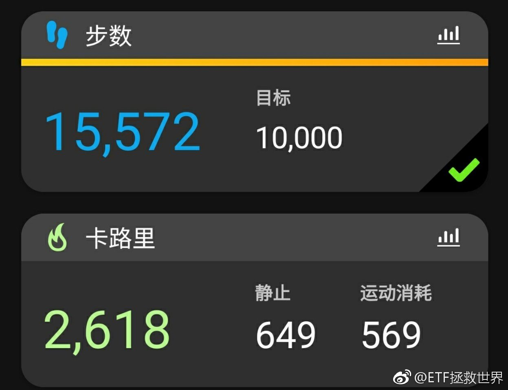

## 2017-12-28 08:23

儿子幼儿园弄了台造雪机弄一院子雪给孩子们玩…… ​​​

## 2017-12-28 09:35

今天转了最后一笔钱进账户。最终决战一把逆回购…… ​​​

## 2017-12-29 09:47

$中证红利 sz399922$    你这么稳，奶一口算了。 ​​​

## 2017-12-29 13:05

随着仓位逐渐加大，持仓品种也相对全面，2018应该更加从容了。

价值，成长，大盘，小盘，低波，高波都有，没那么焦虑了吧。

踏踏实实的。 ​​​

## 2017-12-29 13:34

压力位的压力好强。能过去吗//@ETF拯救世界:好歹也得反弹一波涨个10%换换手吧……//@ETF拯救世界:35%。最近这个区间是成交稀少区。还有大量成本在18左右的筹码。//@ETF拯救世界:37%//@ETF拯救世界:44%//@ETF拯救世界:获利比例剩50%了……

## 2017-12-29 13:36

虽然人少，但力量大…… ​​​
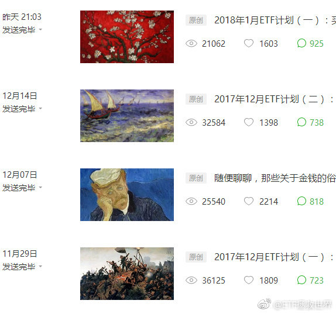

## 2017-12-29 13:47

纽约突破60。布油已经66。

“石油要被淘汰了” ​​​
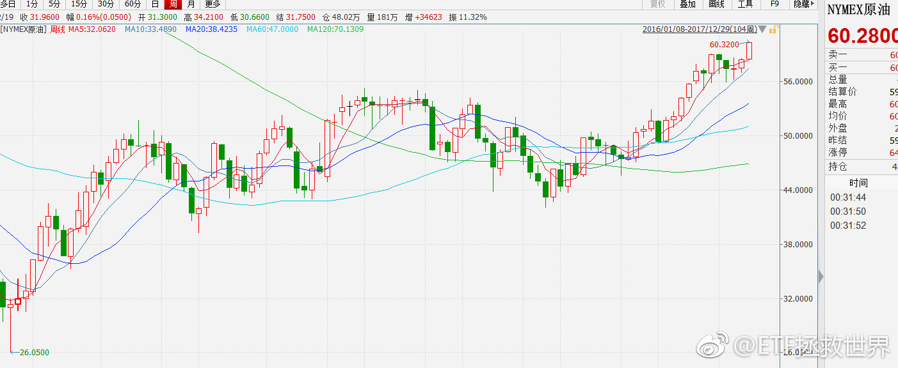

## 2017-12-29 15:01

两个0.74%。   ​​​

## 2017-12-31 09:38

今年最后一天，抽空好好算算账吧。

账户太多，乱七八糟。昨天扔了几大袋东西，今天弄清楚账户资产。清清爽爽的进入2018！ ​​​
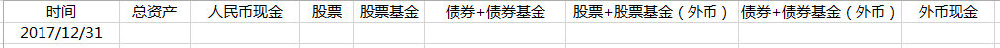

## 2017-12-31 14:17

回复@拓跋笑笑:有缘的都看到了！//@拓跋笑笑:我错过了什么？再发一次，亲爱的e，来吧，来吧，秀18岁照片啦😄

## 2017-12-31 23:10

2017就要过去了。这一年发生不少事，有好的有坏的，也有虚惊一场的。

无论如何，把它们都留在2017了。

2018新的开始。

希望所有人都健健康康。希望自己坚持健身效果明显。希望大家都赚很多钱。

新年快乐！心想事成！ 

2018你有什么心愿？ ​​​

