## 2018-01-01 22:00

每日打卡（129）

新年第一练 ​​​

## 2018-01-02 09:22

虽然对苍老师的艺术作品并不熟悉 ，但还是祝福……看微博和以前的推感觉是很可爱的女孩子……希望结婚对象是真命天子吧！

> @苍井空
> 给粉丝们。 ​​

## 2018-01-02 09:34

$中证红利 sz399922$   是不是要新高了 ​​​

## 2018-01-02 09:42

回复@Maggie的夏至:有可能分红，各位一定要都改成红利再投资。目前这个情况红利现金分红不合适。//@Maggie的夏至:今早收到了基金份额确认短信，中证红利是不是要分红了，必须红利再投资

## 2018-01-02 09:45

Middle East那个国家那么大的事，油价和黄金居然不反应？再也不相信真爱了。 ​​​

## 2018-01-02 09:51

我尽力了，奶不住了。连加两车不是开玩笑的……

## 2018-01-02 10:13

回复@LEVELEEE:港股如果今年继续大涨，那么就有机会看烟花。//@LEVELEEE:港股真是神一样，又新高了//@ETF拯救世界:我尽力了，奶不住了。连加两车不是开玩笑的……

> @ETF拯救世界
> $中证红利 sz399922$   是不是要新高了 ​​​

## 2018-01-02 10:30

回复@5DONY:这几次加的500也都开始赚钱了。市场波动真的不是风险，而是利润来源。//@5DONY:zz500好牛//@ETF拯救世界:回复@LEVELEEE:港股如果今年继续大涨，那么就有机会看烟花。//@LEVELEEE:港股真是神一样，又新高了//@ETF拯救世界:我尽力了，奶不住了。连加两车不是开玩笑的……

## 2018-01-02 10:50

今天涨幅超过$中证红利 sz399922$  的股票是500只，占总数的15%。

买指数的好处你慢慢就知道了。 ​​​

## 2018-01-02 11:18

计划还差0.3%就要新高了。看看和几个指数比谁先达成。//@ETF拯救世界:回复@布RUCE:一定先于大盘新高。就这么决定了。//@布RUCE:好久没有新高了

> @ETF拯救世界
> 我知道很多朋友心里都很着急，为什么不断波动就是不涨/不跌。赚不到大钱。
> 
> 真的不用急。股票不敢说，好的指数，它们的成分股每一天都在为你挣钱。业绩在不断上升，价值也越来越大。
> 
> 价格不涨，急什么。证券投资就是这样，三年不涨，一涨吃三年。现在的大牛股平安，08-2014一分钱都没涨，六年啊。而且，08年还是在跌了很多很多的情况下买，还是六年不赚钱。如果高位买十年不赚钱。
> 
> 然后呢，不是涨好几倍。现在拿平安的是股神，08-14年他们什么心情你恐怕不知道。
> 
> 只要你买的不贵，不要急，早晚会涨。趁着没涨的时候，多买点筹码，以后多赚点才是王道。

## 2018-01-02 14:43

回复@布RUCE:我自己这几年主要投资指数的原因，是不敢把大量资金放到个股上。辛苦积累这么多年，碰到一个黑天鹅就要均值回归。买个股资产小的时候无所谓，资产大了真的心里有点虚。

## 2018-01-02 15:30

回复@waslj0603:不同意。指数投资没有资产大小之分。为什么原始资产小，因为收入少。收入少能攒点钱来投资更不容易，更需要确定性大的投资方式。炒个股当然有人发大财，但是一将功成万骨枯，那些赔钱的人谁又在意？人生没有s&amp;l。除非极有天分极有兴趣的人可以去炒股，绝大多数人还是玩指数靠谱。

## 2018-01-02 15:32

续：谁说A股指数赚钱少？不说低买高卖的计划了。就是十二年前选对指数，某些指数这十二年涨了12倍以上。而且12年里面有9年上涨，这个不会比买到牛股差！

## 2018-01-02 15:39

你看一个股票也好，指数也好，投资组合也好，投资人也好，你把时间拉的稍微长一点。一两年你什么都看不出来。

拿全指医药来说吧。2016和2017年的涨幅分别是-14%和7.6%。垃圾不垃圾？是不是很垃圾？

但是如果你从2006年开始看，这十二年，这个指数涨了超过12倍。

而且！十二年里面，只有08、11、16三年下跌，有9年上涨！

牛不牛？

辣鸡还是牛，长期收益有多少，全看你能站多高看多远。

## 2018-01-02 15:59

可能会出现1000多个强东族谱。

> @蓝鲸TMT
> 刘强东发布寻祖公告：解放前，刘氏家族祖籍系湖南湘潭，后来移居江苏宿迁。别说小编不带大家发财，机会给你们，剩下的就看祖宗了[并不简单] ​​​​
> 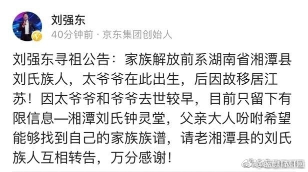

## 2018-01-02 21:53

每日打卡（130）

坚持 ​​​
 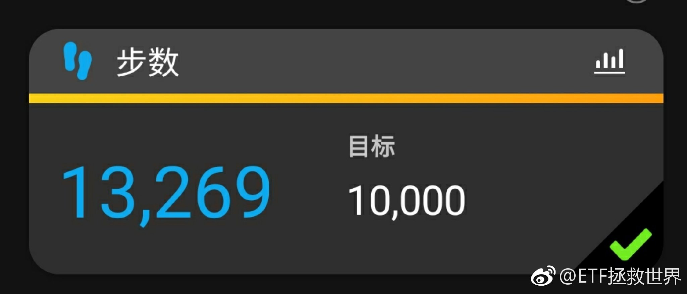

## 2018-01-03 00:04

四个字形容你的感受 ​​​
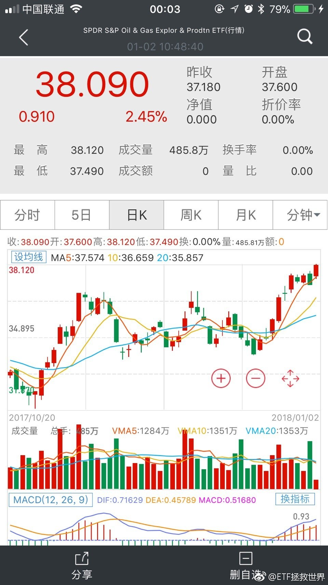

## 2018-01-03 00:30

看对了黄金，买了个辣鸡…… ​​​
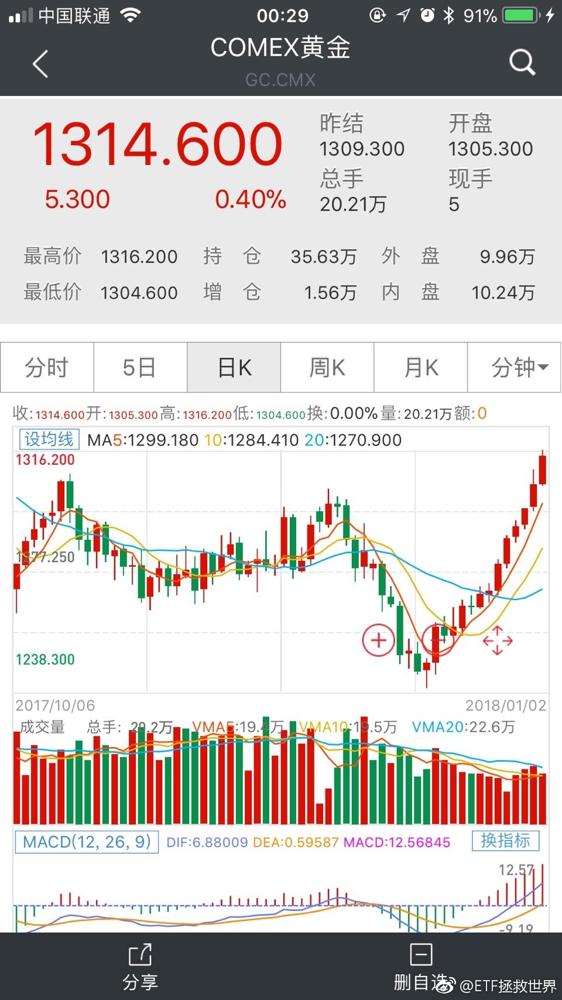 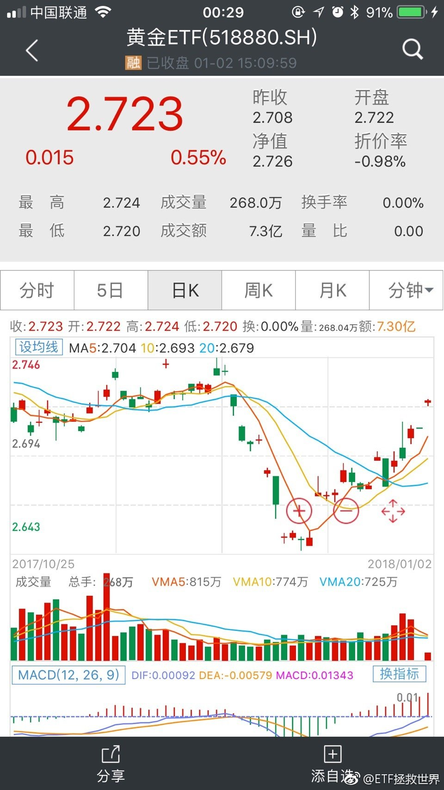

## 2018-01-03 09:30

今天能不能新高。

其实实盘已经新高了吧，毕竟用货基计算剩余资金收益率太低了，连逆回购都没有。 ​​​

:: Comment

> 哆啦萌喵 :昨天500增强一下起来，扭亏为盈了。跟车没多久，心里很舒服，之前下跌也没有太多负面情绪。真的感觉E大是一个值得追随的方案
> 
>> ETF拯救世界
:回复@神志那风斗200510:其实说起来就是那么简单。把成本控制好，随便涨一下就会开始挣钱。之前我说的，无论熊市有多熊，控制好成本，牛市来了1-2周开始赚钱，就是这个道理啊。浮亏什么的根本不用理会，大多数时候是亏越多越好

## 2018-01-03 09:36

敢不敢继续跌。月中又有的买了。 ​​​
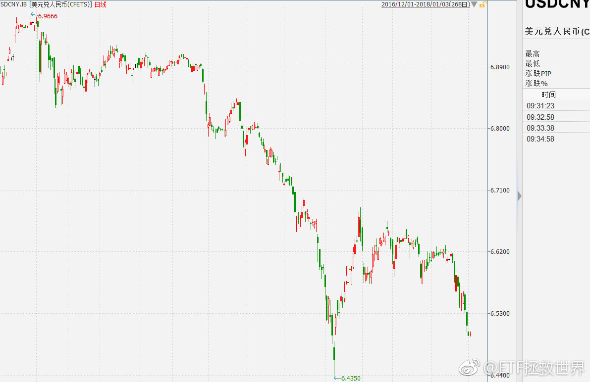 

:: Comment

> 老衲成全了师太 :老大，请教个事，买美债，和换同样数量的美金（一万美金以内），哪个更合适点？
>> ETF拯救世界:换了美金干嘛啊。我手里一堆美金不知道干嘛

## 2018-01-03 09:53

$中证红利 sz399922$  新高还是M……答案即将揭晓。 ​​​

## 2018-01-03 10:17

回复@神志那风斗200510:其实说起来就是那么简单。把成本控制好，随便涨一下就会开始挣钱。之前我说的，无论熊市有多熊，控制好成本，牛市来了1-2周开始赚钱，就是这个道理啊。浮亏什么的根本不用理会，大多数时候是亏越多越好

## 2018-01-03 10:49

$证券公司 sz399975$   弹性依然很大。 ​​​

## 2018-01-03 10:54

回复@喜欢富兰克林:任何时候市场都会有上涨的股票。能力强当然可以去选股，不过熊市中选股成功率低一点罢了。这是肯定的啊。我对自己的要求就是熊市不亏或者小赚，牛市大赚。一轮轮这样下来如果成功，就能秒杀99%的投资者了。当然这也很难。

## 2018-01-03 11:14

回复@朱姬:不知道。建议尽快配置到涨跌都舒服的仓位。//@朱姬:弱弱问一句：还能跌吗？

## 2018-01-03 14:20

vipkid怎么样，有没有上过课的朋友…… ​​​

## 2018-01-03 14:24

$养老产业 sz399812$  和  $中证红利 sz399922$   谁先新高…… ​​​

:: Comment

> hello鹿晓 :e大 我是你的真心粉呀，有个问题想请教您呢。最近手上有一笔美元，不多不少的，不知道要不要换成人民币呢……美元汇率什么的都不懂，一天到晚只会抄你的作业，希望e大看到了能给指条明路呀[太开心][太开心][太开心][太开心][太开心]
>> ETF拯救世界:我自己也有大概10%的美元资产。我是不会换成人民币的。。

> ETF拯救世界:红利大概率会赢了。是不是咱们连加两次的威力。

## 2018-01-03 14:41

今天500干掉了300,1000干掉了500，创业50干掉了1000。

不要预测2018是大盘还是小盘，价值还是成长。

大小搭配，再加上一些长牛的行业，齐活。 ​​​

## 2018-01-03 14:48

回复@叫我小天就好了丶:现在创业板真的不算便宜。也很难说有多少长期投资的价值。但终有一天值得大买特买。我坚信。指数投资来说，没有垃圾的品种，只有垃圾的价格。//@叫我小天就好了丶:e大，国家这样打击游资，特停妖股，深深担忧创业板的前途

## 2018-01-03 14:58

组合内除了油气，任何一个指数都没有新高，然后组合已经新高了。

相信绝大多数人的账户也新高了。

………… ​​​

## 2018-01-04 09:53

为什么特别喜欢医药和养老指数。不知道，就是喜欢。

然后仓位合适，就非常舒服。

买了喜欢的东西真的舒服啊！

谁能体会。 ​​​

## 2018-01-04 09:57

回复@无聊打发时间的大叔:增强指基，每年能跑赢基准全收益指数1-3个点我已经非常非常非常非常满足了。//@无聊打发时间的大叔:报告 发现000478连续六个工作日跑赢001052

## 2018-01-04 11:40

指数都涨了，谁能想到又是2000家下跌…… ​​​

## 2018-01-04 13:46

红利大概率会赢了。是不是咱们连加两次的威力。

## 2018-01-04 13:56

回复@Mansteingeneral:它只是叫“养老”而已。你叫它“消费升级”指数也行。它包括医药+保险+乳业+超市+TMT。这些行业我都看好，所以看好它。不是因为它叫什么~~

## 2018-01-04 14:09

回复@石头里的虫子:标普红利去年13%，中证红利去年21%。当然，一年不代表什么，但是我暂时还没有找到买它的理由。//@石头里的虫子:E大，你觉得和标普红利比怎么样？//@ETF拯救世界:红利大概率会赢了。是不是咱们连加两次的威力。

:: Comment

> 啊肥豪啊 :E大，那买标普红利的理由又是什么？？？[允悲][允悲][允悲]
>> ETF拯救世界:我没买啊。红利一直推荐富国红利。雪球组合只能场内，只好买它。

## 2018-01-04 14:12

没想到浓眉大眼的保险股也跌了20%…… ​​​

:: Comment

> ETF拯救世界:超过30%了。
>> ETF拯救世界:快40%了。服了。

## 2018-01-04 14:14

回复@啊肥豪啊:我没买啊。红利一直推荐富国红利。雪球组合只能场内，只好买它。//@啊肥豪啊:E大，那买标普红利的理由又是什么？？？//@ETF拯救世界:回复@石头里的虫子:标普红利去年13%，中证红利去年21%。当然，一年不代表什么，但是我暂时还没有找到买它的理由。

## 2018-01-04 15:14

回复@用户1224718611:除了“舒服”，还要有“策略”。交易的策略。主观操作很容易少赚+后悔。

## 2018-01-05 06:43

准备去南方看雪了

## 2018-01-05 11:13

回复@小韭菜V:大盘下跌7%，计划回撤1.7%。这叫什么坑，最多算个小水洼……//@小韭菜V:计划创新高了，从坑里面爬上来了。//@ETF拯救世界:准备去南方看雪了

## 2018-01-05 11:26

回复@石头里的虫子:这个心态不对。为黑天鹅做准备是对的，但投资是概率问题。要对各种情况都做好准备。//@石头里的虫子:等大坑//@ETF拯救世界:回复@小韭菜V:大盘下跌7%，计划回撤1.7%。这叫什么坑，最多算个小水洼……//@小韭菜V:计划创新高了，从坑里面爬上来了。

## 2018-01-05 11:27

奖杯准备发给红利了。//@ETF拯救世界:红利大概率会赢了。是不是咱们连加两次的威力。

## 2018-01-05 13:25

第三个看疯了//@八大山债人:这里面第16的小公务员说自己苦，呵呵只对领导的苦而已 //@来去之间://@飘雪共青城:转发微博

> @鲍迪克
> 讲个故事，东部某市来了家东北企业，对方考察后对环境很满意，于是坐下来沟通，对方领导直接拍了目测20万左右的现金在桌上，说他们懂规矩这是辛苦费，现场小领导和我们几个办事员脸都快吓绿……我们告知对方这边没这种规矩，对方感慨在东北巴拉巴 ​​​

## 2018-01-05 13:51

回复@kaka涛:好吗。2011-2014三年多从3000多点跌到2000多点，跌幅40%。同期创业板涨了50%。站在不同的时间，结论就会完全不同。2014年看，这是个大垃圾~//@kaka涛:这个真是牛逼了，真正的好指数//@ETF拯救世界:奖杯准备发给红利了。

## 2018-01-05 14:06

今天红利涨幅贡献度。有很多地产股。 ​​​
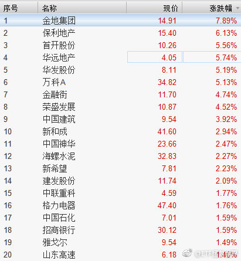 

:: Comment

> HelloWaiting:跟车晚，不过我才发现，我跟车不久之后经历了e大组合的最大回撤o(╯□╰)o然而在且慢上看到最大回撤也只有1.72%而已。实在是太稳了。e大组合的夏普比例真高！最简单的指标其实能反映了最浅显易懂的道理。
>> ETF拯救世界:这一波之前最大回撤0.7%。包含了2015年-2016三次股灾。以后回撤会越来越大，因为仓位越来越高。然而经过这次我相信很多朋友会明白，有节操的回撤一点都不用害怕，分分钟就会新高。

## 2018-01-05 15:34

回复@HelloWaiting:这一波之前最大回撤0.7%。包含了2015年-2016三次股灾。以后回撤会越来越大，因为仓位越来越高。然而经过这次我相信很多朋友会明白，有节操的回撤一点都不用害怕，分分钟就会新高。

## 2018-01-05 15:51

回复@夏虫碎碎念:我说新高了当然是总资产新高。我说回撤小，也当然是总资产回撤。我什么时候拿已投入部分年化接近20%说事儿了？你见过我说一个字已投入年化收益多少吗？找出来。欲加之罪何患无辞了吧有点。之所以计划和且慢列出来已投入收益率，是为了让投入的人清楚理解已投入部分资金收益率。

:: Comment

> 夏虫碎碎念 :算回撤以总份数为分母，算收益以已投入为分母……过于投机取巧了
>> ETF拯救世界:总投入年化/已投入年化/总收益三项一直并列显示，你这话说的是不是有点太过于想当然了？
>>
>> 夏虫碎碎念:回复@ETF拯救世界:我不知道你说的哪里，只是微博上常提的说法有向这样引导的趋势
>> 
>> ETF拯救世界:回复@夏虫碎碎念:我说新高了当然是总资产新高。我说回撤小，也当然是总资产回撤。我什么时候拿已投入部分年化接近20%说事儿了？你见过我说一个字已投入年化收益多少吗？找出来。欲加之罪何患无辞了吧有点。之所以计划和且慢列出来已投入收益率，是为了让投入的人清楚理解已投入部分资金收益率。

## 2018-01-05 16:15

其实第二轮开始，总收益率就有点不好计算。因为建仓的时候有大量资金闲置，这部分怎么算收益呢。

我用最保守的货币基金，还是收益率很低的那种。比如第三轮用的钱袋子，长期只有3.x%。没事，我就用这个，保守计算嘛。虽然比如易方达b这样的货基收益常年在4.5%以上了。。

之前我发过一个问答，说没有投入的部分我会做什么。我相信也几乎不会有人长期只买货基吧。你做个逆回购都能收益上升很多。更别提加上网格、打新这些收益了。买理财，p2p钱宝这些更不用说了……

这些我都不算，就算收益率最一般的货基。因为我认为，这个收益率数字一点都不重要。我又不发私募，我又不收费吸粉，没必要把收益率弄得很好看。

赚多少钱，赔多少钱，每个人心里都清楚。参考计划的朋友从2015年7月的几百人到2016年的几千人，到现在的至少上万。一个人可能长期是傻子，一群人可能一时是傻子，一群人长期是傻子的可能性不大。

今天又新高了。[并不简单]

:: Comment

> 豆宝橙:@ETF拯救世界 ，E大，你是觉得易方达货币基金也不怎么安全么？
>> ETF拯救世界:非常安全

## 2018-01-05 16:54

回复@徐L鑫:500etf不太可能。你说的是对的。你看广发医药2015年6月干到3块钱！溢价超过100%。可惜，现在可能性不大了，规模大了。500etf规模很大，也不太可能。有一些规模小的未来有可能

> @徐小包s:说实话，因为是长期持有，到牛市才卖。所以牛市里场内有溢价的可能性更高。私下觉得500ETF更好些。搞不好直接加个0卖给下家。

## 2018-01-05 17:43

回复@吃遍祖国大好河山:2005-2009是第一轮；2010-2015是第二轮。2015年7月1日到现在是第三轮。//@吃遍祖国大好河山:益达，这是第几轮？

> im浅浅:期待今年能有机会见到2500点，未来5倍收益可期[太开心][太开心][太开心]
>> ETF拯救世界:别看上证。我认为应该主要关注中小盘股的颓势。能不能见底就看他们会不会继续烂了。
>> 
>> im浅浅:回复@ETF拯救世界:是啊，创业板能到1200点可以考虑卖身抄底了哈哈，不过如果要开启一轮大牛市，肯定最后会大小齐跌，一个想法，不一定对(^o^)/

## 2018-01-05 19:11

反思了一下，确实，有些事情没必要回应。

以后会改，沉默是金，欢迎大家监督。

又level up了！ ​​​

## 2018-01-05 23:01

每日打卡（131）

认真过每一天。

因为，

过一天少一天。 ​​​
 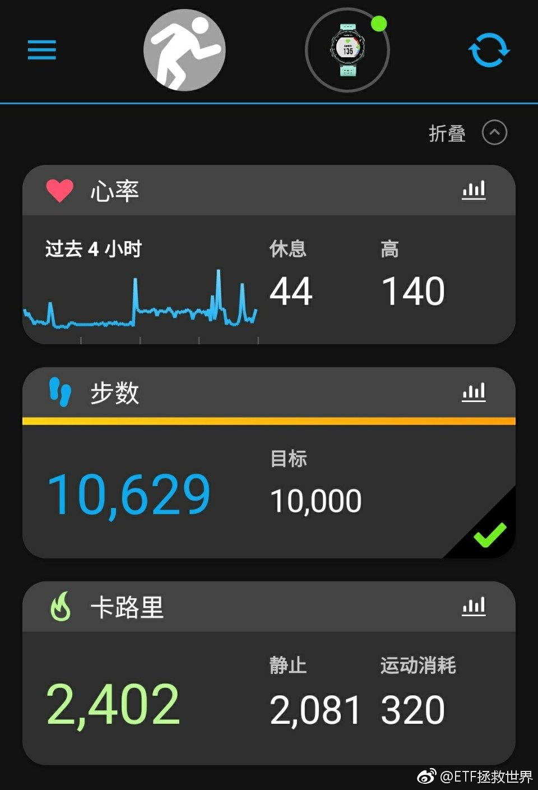

## 2018-01-05 23:07

给儿子选英语老师：

“这个怎么样。”

“太黑了！”（黑人）

“……”

“这个呢？”

“太老了！”（37岁，不过美国人是真的挺显老，像50多）

“……”

“这个呢？”

“这个可以，这个好。”（20岁）

如果他不是四岁，好想揍他一顿啊。 ​​​

## 2018-01-06 18:41

其实是不是要辞职职业投资还有一个工作本身的问题。如果你的工作是自己喜欢的，同时工资又高，似乎没有必要一定要职业投资。 ​​​

## 2018-01-06 19:53

每日打卡（131）

坚持 ​​​

## 2018-01-07 19:29

我围观了@留几手 的回答，该问题价值2990.00元，围观仅1元，快来一起围观~  ​​​

## 2018-01-07 19:47

每日打卡（132）

好久没跑了，舒服。

今天是变速跑，在加速跑阶段，心率表没有提示心率过高的时候，迈开最大的步幅用最快的速度疯狂往向前冲，感觉非常好，好像体内野性的基因被激活了。

不信你试试。 ​​​
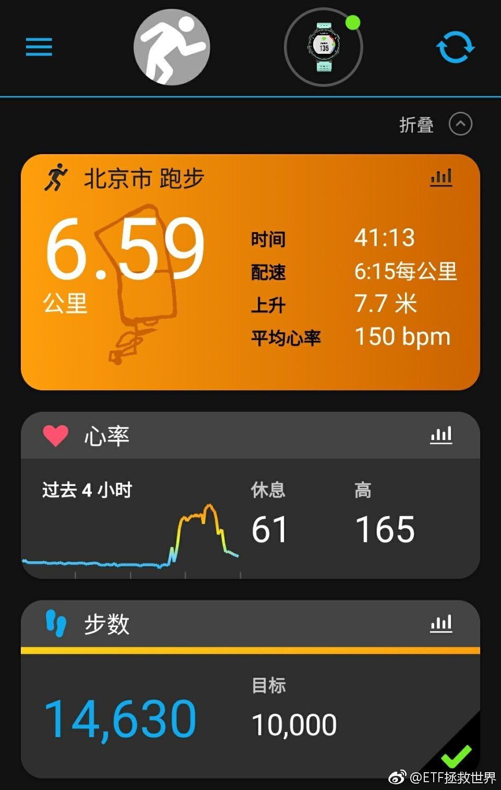

## 2018-01-08 10:44

如果我没弄错，目前这个时点，计划里所有的权益类品种都赚钱了。（两个创业板一起算）

问题在于，其中很多品种明明还在创着几年新低的附近…… ​​​

## 2018-01-08 10:54

红利新高。恭喜！//@ETF拯救世界:奖杯准备发给红利了。//@ETF拯救世界:红利大概率会赢了。是不是咱们连加两次的威力。

## 2018-01-08 10:57

谁能想到今天是1100上涨，2200下跌…… ​​​

## 2018-01-08 11:06

$证券公司 sz399975$   弹性，朋友们。感受一下。 ​​​

> 种金币的塔莎花园:请教e大，这个弹性设置多大的网格间距会比较合适呢
>> ETF拯救世界:我自己10%

> 盗有道生二:上次说要创新低，给割地板上了，后面又接回来。
>> ETF拯救世界:主要还是看我怎么做。。计划这种极度保守的组合都在买。。仓位控制最重要。

> 用户6122527238:我还等60%的跌幅那，看样子没有了？
>> ETF拯救世界:有没有不知道。我们做好跌60%的准备，然后买入一点，控制好仓位，涨跌都开心。分享给你。

## 2018-01-08 11:14

回复@用户6122527238:有没有不知道。我们做好跌60%的准备，然后买入一点，控制好仓位，涨跌都开心。分享给你。//@用户6122527238:我还等60%的跌幅那，看样子没有了？

## 2018-01-08 11:32

回复@草农123:乌龙指吧。不是前任，是正房，还没卖啊。油气是小妾。小妾比较折腾，也受宠，但正房更加端庄大方……//@草农123:E大，前任石油基金，今天疯了？//@ETF拯救世界:回复@用户6122527238:有没有不知道。我们做好跌60%的准备，然后买入一点，控制好仓位，涨跌都开心。分享给你。

## 2018-01-08 11:39

回复@sandaohe:原则！网页链接 //@sandaohe:达里奥《选择》 没搜到这本书？英文版的？//@ETF拯救世界:回复@草农123:乌龙指吧。不是前任，是正房，还没卖啊。油气是小妾。小妾比较折腾，也受宠，但正房更加端庄大方……//@草农123:E大，前任石油基金，今天疯了？

## 2018-01-08 11:48

回复@BR芭斯罗缤:我昨天73买的，今天一看66了。一万点暴击。将近一个跌停，而且无法补仓摊低成本，不可能回本了！//@BR芭斯罗缤:放购物车了//@ETF拯救世界:回复@sandaohe:原则！网页链接 //@sandaohe:达里奥《选择》 没搜到这本书？英文版的？

## 2018-01-08 12:03

回复@布依巫凌:谢谢提示，搞定了。作为京东股东我很满意。。 查看图片 //@布依巫凌:京东可以申请价格保护，会退差价//@ETF拯救世界:回复@BR芭斯罗缤:我昨天73买的，今天一看66了。一万点暴击。将近一个跌停，而且无法补仓摊低成本，不可能回本了！//@BR芭斯罗缤:放购物车了

## 2018-01-08 12:13

回复@erduo:我犹豫了半天，最终还是决定买一本纸质的，以后可能再买电子的。这种大师的书，我要买纸质珍藏。现在我90%的书都是买电子了，断舍离，不希望拥有太多实体的东西……//@erduo:电子书便宜，还环保。。。。

## 2018-01-08 15:08

回复@小白晖晖:刚又申请保价了，已经第二次退差价了。不是在乎这几块钱，第一次用保价，考察一下公司业务！//@小白晖晖:E大没开通个plus会员吗？会员价才58.8，还有畅读。//@ETF拯救世界:回复@BR芭斯罗缤:我昨天73买的，今天一看66了。一万点暴击。将近一个跌停，而且无法补仓摊低成本，不可能回本了！

## 2018-01-09 09:12

我的目标只是让自己正确 —— 我并不关心正确的答案是不是来源于我。所以我学会了让自己保持极度开明的心态，允许其他人指出我可能疏忽的东西。《原则》 ​​​

## 2018-01-09 09:34

回复@瑞芝如海:我觉得可能不是适合所有人看，说投资的部分不多。我看完再总结吧~//@瑞芝如海:老大，我也买了，今天下午到货

## 2018-01-09 09:58

$全指医药 sh000991$  是不是也快新高了。 ​​​

## 2018-01-09 10:20

回复@LEVELEEE:点一下不就起来了//@LEVELEEE:根本还早

## 2018-01-09 10:44

市场在每个阶段，表现好的品种是不同的。是有周期的。

比如医药消费与资源与科技股等等就会在不同的周期中表现出色。

有时候某些行业不动不是它不行，而是它的季节还没到。

你见过夏天开的梅花吗。 ​​​

## 2018-01-09 11:03

回复@十步侠:有。月底打算建个新品种。希望这个月它别动。//@十步侠:e大，最近市场感觉很沉闷，没啥可交易的品种。

## 2018-01-09 13:34

医药动，$养老产业 sz399812$  也沾光了。看谁先新高。 ​​​

## 2018-01-09 13:57

持仓品种比较多的优势就在于，每天都有可能出现让你很开心的东西。

然后就推着你的账户不断的新高……

不用去判断明天哪个表现好，反正你都有。 ​​​

## 2018-01-09 14:19

偶尔搜了一下我的昵称。

 ​​​

## 2018-01-09 16:06

……搞什么飞机。

## 2018-01-09 19:51

还有三天 ​​​
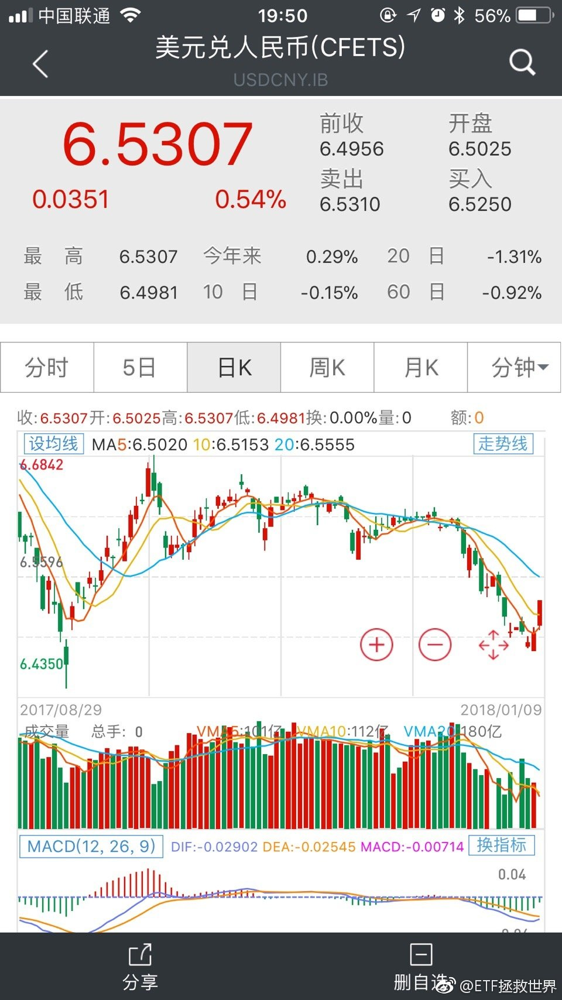

## 2018-01-10 08:09

注意，1987//@见闻实时新闻:标普500指数2018年录得最近31年最佳新年开局——2018年已经连涨六个交易日，累计涨幅2.7%，新年里前六天累计涨幅创1987年以来最大。#标普500指数#

> @见闻实时新闻
> 【美国三大股指2018年第四天齐创收盘纪录高位，财报季开始之前医疗保健和银行股表现突出】华尔街见闻讯：http://t.cn/R64lHNR实时快讯 标普500指数收涨3.58点或0.13%，报2751.29点，2018年连续第六个交易日创收盘纪录高位。道指收涨102.80点或0.41%，报25385.80点。纳指收涨6.19点或0.09%，报7163.58点，也是2018年连续第六天创收盘纪录高位、且连续六天站上7000点整数位心理关口。

## 2018-01-10 09:17

看了1/3《原则》。发现跟我的原则没什么大区别：

不预测未来，根据概率对未来可能发生过的所有情况做好准备。

别预测，预测就会有错的可能。 ​​​

> 谷爆:我的理解是，如果不预测，只为未来会发生的各种情况作好准备的做法是，要买便宜的东西，永远不能满仓，但也不能仓位过低，觉得一般情况下，长期半仓最安全。我这样想对吗？
>> ETF拯救世界:不对。该博的时候就要拼命干。甚至加杠杆——在安全的范围内~

## 2018-01-10 09:33

“买入时，预计最大跌幅算预测吗”。

你觉得算吗？这就是我讨论的，为未来出现的所有情况做好准备。“以目前价格计算最大下跌幅度60%”的意思是，这个品种在最坏的情况下有可能下跌60%，同时，我已经为这个情况的出现做好准备。

“预测债市先于股市 见底，这算预测吗？”。

严格的说，是一种判断。但你要注意的是，我的体系和系统有没有完全依赖这种判断做出操作。预测的意思，是预测债市先于股市见底，所以不买股票，只买债券，吃完债券再买股票。观察一下，我是这么做的吗。

对未来发生的事情，一定会有判断。根据数据也好，根据经验也好。把这个判断加入你的体系，做为一个变量和因子。

再举个例子，恒生29500是我能够理解的最高点，这说过无数次了。但你要注意，我有没有在29500卖光恒生ETF？没有。一共只卖出了2份——我的系统，对于恒生持续上涨，有非常好的包容力。我的系统不会因为我主观的理解不理解，让我做出错误的操作。

不知道说清楚没有？

> 慎独慎入慎犬儒 :其实有点不理解，29500的恒生会比当前的医药和养老指数更有价值吗，是不是可以利用不同品种爆发时点不同进行轮动配置呢，资金利用会更快！求解！
>> ETF拯救世界:“价值”不是决定中短期价格的唯一因素。背离价值的价格可能会持续很久很久很久，久到你目瞪口呆。

> suo大suo:明白E大，但如果某个指数超出了你理解的最高点，我们还持有，那什么时机卖出呢？
>> ETF拯救世界:我的体系有解决这个问题的策略。。

> nick8965 :请教益达，最近一年多来上证50为代表的蓝筹股不断创新高，有一种声音认为由于中国各行业市场的日趋成熟，各行业龙头会不断巩固自己的垄断地位，中小企业会不断会边缘化，甚至断言以后的A股将会成为由大蓝筹占主导的常年慢牛，不会有任何风格切换。你对此怎么看？
>> ETF拯救世界:我的评价是：扯淡。 中小股只是在价值回归而已。到位了自然会涨。

> 啊肥豪啊:e大，想问你当年07年530发生的时候是怎么处理当时的情况
>> ETF拯救世界:2007年5月，A股全市场等权估值已经到了56倍，如果是现在，计划应该已经将A股仓位降至极低。6月会少少回补一部分，然后一路踏空至6124。没办法，5000-6000那一段注定吃不到。

## 2018-01-10 09:38

回复@倪谷拉丝:SPSIOP这一波真的挺辣鸡的。大家都赚了，但赚的不够多。//@倪谷拉丝:油气出了，现在只留利润了，成本-0.007，第一次见到负的

## 2018-01-10 09:42

回复@谷爆:不对。该博的时候就要拼命干。甚至加杠杆——在安全的范围内~//@谷爆:我的理解是，如果不预测，只为未来会发生的各种情况作好准备的做法是，要买便宜的东西，永远不能满仓，但也不能仓位过低，觉得一般情况下，长期半仓最安全。我这样想对吗？

> 蓝图806:E大，我有个疑问，假如股市到了该博的时候，要不要把债券类资产卖掉换成权益类资产呢？
>> ETF拯救世界:当然有这个可能。

## 2018-01-10 09:47

回复@慎独慎入慎犬儒:“价值”不是决定中短期价格的唯一因素。背离价值的价格可能会持续很久很久很久，久到你目瞪口呆。

## 2018-01-10 10:07

哪能港，今天是不是又要吹红利了。。。$中证红利 sz399922$ ​​​

## 2018-01-10 10:18

回复@赢在ETF:又分？红利再投。//@赢在ETF:E大，博时信用债马上要分红了，请问选择分红还是红利再投？

## 2018-01-10 10:23

回复@啊肥豪啊:2007年5月，A股全市场等权估值已经到了56倍，如果是现在，计划应该已经将A股仓位降至极低。6月会少少回补一部分，然后一路踏空至6124。没办法，5000-6000那一段注定吃不到。//@啊肥豪啊:e大，想问你当年07年530发生的时候是怎么处理当时的情况

> 啊肥豪啊:那意味着08年2月份之前益达您的仓位都极低了，毕竟看回历史大盘6124后上涨乏力，而中证500又继续涨
>> ETF拯救世界:我2007年底就开始满仓债券了。一直到2008年底。以前博客有记录可以看看。

## 2018-01-10 10:54

回复@老纳法号破戒:接近2500//@老纳法号破戒:接近2400家下跌//@ETF拯救世界:回复@啊肥豪啊:2007年5月，A股全市场等权估值已经到了56倍，如果是现在，计划应该已经将A股仓位降至极低。6月会少少回补一部分，然后一路踏空至6124。没办法，5000-6000那一段注定吃不到。

## 2018-01-10 11:25

回复@nick8965:我的评价是：扯淡。 中小股只是在价值回归而已。到位了自然会涨。

## 2018-01-10 11:29

任何基于最近情况推导未来的，我认为都是流氓。

在某些品种暴涨后找出理由来支撑，忽悠别人接盘的，流氓x2。

历史上没有一次泡沫是不自带理由的，否则怎么会有人去接盘。

历史上所有的极度价值都是极度悲观带来的。

听别人忽悠赚不了钱。这就是我的观点。 ​​​

> 牡丹亭集小言 :E大，对于在涨的基金能买吗（易方达消费）
>> ETF拯救世界:涨不涨从来不是我买不买的理由。比如红利去年涨了不少，我们最近依然又买了两次……大不大小不小也不是理由，一视同仁。至于消费……我暂时就不打算买了。

## 2018-01-10 11:38

回复@绿雪一:涨不涨从来不是我买不买的理由。比如红利去年涨了不少，我们最近依然又买了两次……大不大小不小也不是理由，一视同仁。至于消费……我暂时就不打算买了。//@绿雪一:E大，对于在涨的基金能买吗（易方达消费）

## 2018-01-10 13:18

今天没法新高了，别嘚瑟了。该干嘛干嘛去吧！ ​​​

## 2018-01-10 13:24

回复@ForeverFight命運:你们的心态已经是股神级的了。真的。佩服佩服。//@ForeverFight命運:虽然没办法新高，但是马上能捡便宜货啊。

## 2018-01-10 13:44

……

谁还敢说这是牛市…… ​​​
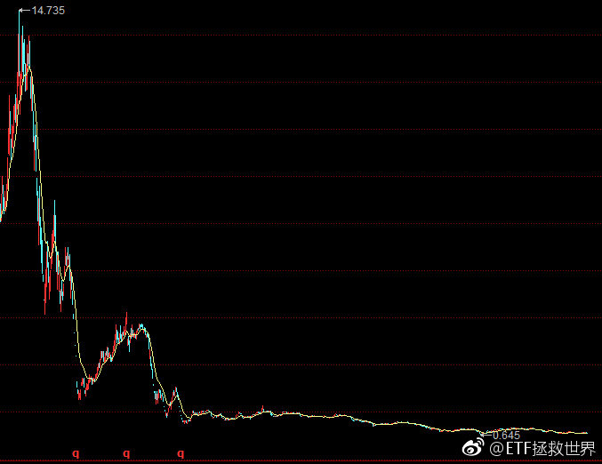

## 2018-01-10 13:54

回复@幸运的baogongshu20170:你们两个私信联系一下。//@幸运的baogongshu20170:回复@可可的乐事:路见不平一声吼，我还没有女朋友

## 2018-01-10 15:06

说早了，还是有可能新高的。恒生+50+红利+油气做出正向贡献。倒不是说新高不新高有什么重要的，只是说看看一个组合在2500只下跌，700只上涨的市场中如何做到稳步向上。。

## 2018-01-10 16:02

不知道朋友们有没有看那个高铁女阻止列车关门的视频，说是后来乘警让他们一家人上车走了，然后单位让她停职了。

这事儿从头到尾就让人感到莫名其妙。

首先当时乘警列车员就应该直接把人拉下去，然后带到车站派出所。这种延误列车发车的行为，难道算不上扰乱社会秩序吗。更重一点，有没有可能危害公众安全？

第二个是，居然让上车走了。很好，这件事这样处理，以后无数挡车门的就可能出现。反正挡了没事啊。

第三个，违反治安条例甚至违法了，该拘留拘留。单位为什么要因为这个停职？当然了，如果单位有这个规定，可以。如果是领导一拍脑袋就给人停职了，这就不妥了。一码归一码。

## 2018-01-10 16:21

说今天恒生指数连涨12天，创了1964以来的记录。

这是恒生90年代以来的走势。恒生的走势波动非常非常大，各位要做好心理准备。 ​​​
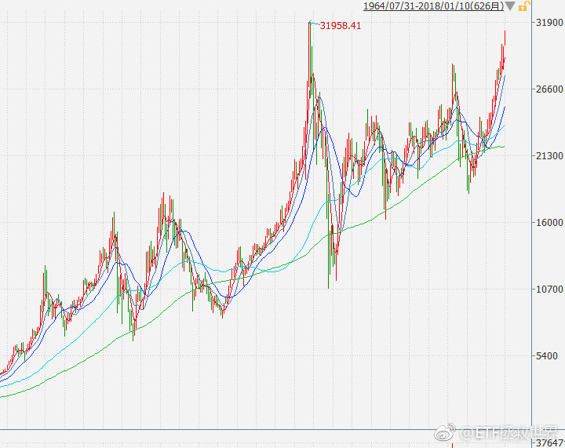

## 2018-01-11 09:50

有些指数好像已经跌不动了。 ​​​

## 2018-01-11 10:14

回复@kaka-98:数学不好了吧。1块钱开始跌，跌到0.5你买入，然后按照我说的，跌到0.2最低，你0.5买还是亏60%啊。即使你0.3买，跌到0.2，也得亏33%……

## 2018-01-11 10:18

如果你20多30多开始投资，我相信在几十年的投资生涯中，一定能见到至少3-5次，某个指数品种能跌到最高点20%-25%的地方。

不要犹豫，干进去，至少要持有到回到高点。改变命运很大程度就靠这几次。

5-10年会出现一次这样的机会。 ​​​

## 2018-01-11 12:01

网络没有秘密，慎独。//@八大山债人:哦。。。

## 2018-01-11 13:44

shiiiiiiittt!!!! ​​​

## 2018-01-11 14:13

回复@董衍辉:仓位大不大。不大的话可以找机会再买，摊低成本。等着回去是不行的。即使最后不赔钱，这几年收益率也会不高。加仓不用着急，看看我之前发的数学题，自己设计一下方案//@董衍辉:E大，15年我在创业板跌到3000时买了创业板指数相关基金，您预计啥时候能解套啊？

## 2018-01-11 14:25

发现一个看上的品种，然后它跌了好多年，也不贵，你造吗，那种心情怎么港。

一种欣喜。

拿出计算器算算，知道未来几年可能会带来很不错的收益，感觉充满希望。

但最终还是要讲缘分。希望不要有缘无分。 ​​​

## 2018-01-11 15:27

回复@艾悟67992:追女孩的关键是自己要够好。我的体会是，也许死缠烂打或者做好多感动女孩的事，有可能让女孩从不感兴趣到感动到接受，但好多时候这种并不长久。最关键还是自己够好，够努力，够上进，钱够多（至少让人看到希望），身材锻炼的够好，品味不差，有点幽默……

## 2018-01-12 02:40

趋势的力量 ​​​
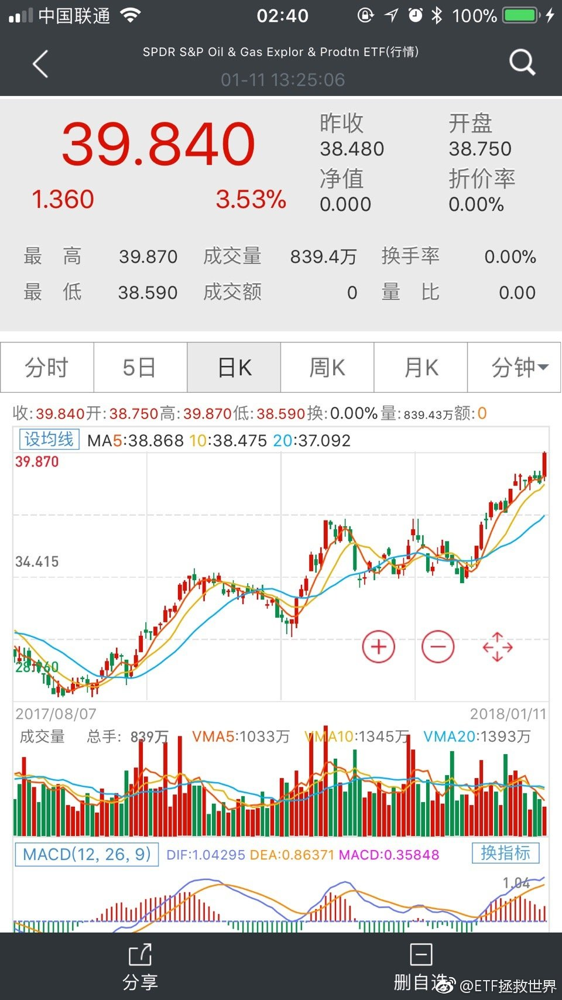

## 2018-01-12 07:59

讲真，网格系统升级后，这一波油气真的多赚很多。最大一网可能有30%以上收益。

深度思考，经验，自我更新，纪律……缺一不可。 ​​​

> 无词歌咏 :请问E大网格系统升级的重点是？
>> ETF拯救世界:重点是在吃波动的前提下多吃大周期。

> 老丁的变形记:请教E大: 华宝油气这一波确实很有收益,但我看在您的配置里占的比例还是比较小的,是因为考虑到最大跌幅吗?
>> ETF拯救世界:计划配置低。还有做波动的策略，仓位会高很多。具体的去看我之前的问答。免费。

## 2018-01-12 08:08

回复@岩春岩春:主动基金我没法评价。因为人是最难量化的变量。//@岩春岩春:兴全合宜A（163417） e大这只基金好吗

## 2018-01-12 08:19

降杠杆

## 2018-01-12 09:22

回复@老丁的变形记:计划配置低。还有做波动的策略，仓位会高很多。具体的去看我之前的问答。免费。//@老丁的变形记:请教E大: 华宝油气这一波确实很有收益,但我看在您的配置里占的比例还是比较小的,是因为考虑到最大跌幅吗?

## 2018-01-12 09:43

$511880 折价要被吃掉了。 $中证红利 sz399922$ 又要新高了。

打算建仓的那个又涨了……辣鸡 ​​​

## 2018-01-12 09:48

除了三个国内债基，成熟新兴，股票贵金属原油，大小盘成长价值周期

全红了 ​​​

## 2018-01-12 10:25

回复@幻某人一不小心:S计划直接就一把买入，现在看是非常合适的。几乎是这段时间涨幅最好的指数了。//@幻某人一不小心:S计划中证红利还是跟少了，佩服e大选指眼光

## 2018-01-12 10:34

回复@龙飞1807576:都是忽悠的。10连阳一共涨了4%//@龙飞1807576:十一连阳？不可思议，莫非在学美股

## 2018-01-12 13:47

回复@长风破浪100:达里奥69才出书，林奇退休了才写，我所知道的投资大师，无不是经过几十年市场的风风雨雨百炼成金后才写东西。我想，总要用时间证明一些东西，再去写吧。另外，如果我写一些大路货给各位，读者难道不会骂娘吗。写核心的东西，sorry，暂时过不了自己这关啊。

## 2018-01-12 14:30

今天涨跌家数1:2，继续新高。

昨天沪深300跌，新高。今天中证500跌，又新高…… ​​​

## 2018-01-12 21:22

每日打卡（133）

坚持 ​​​
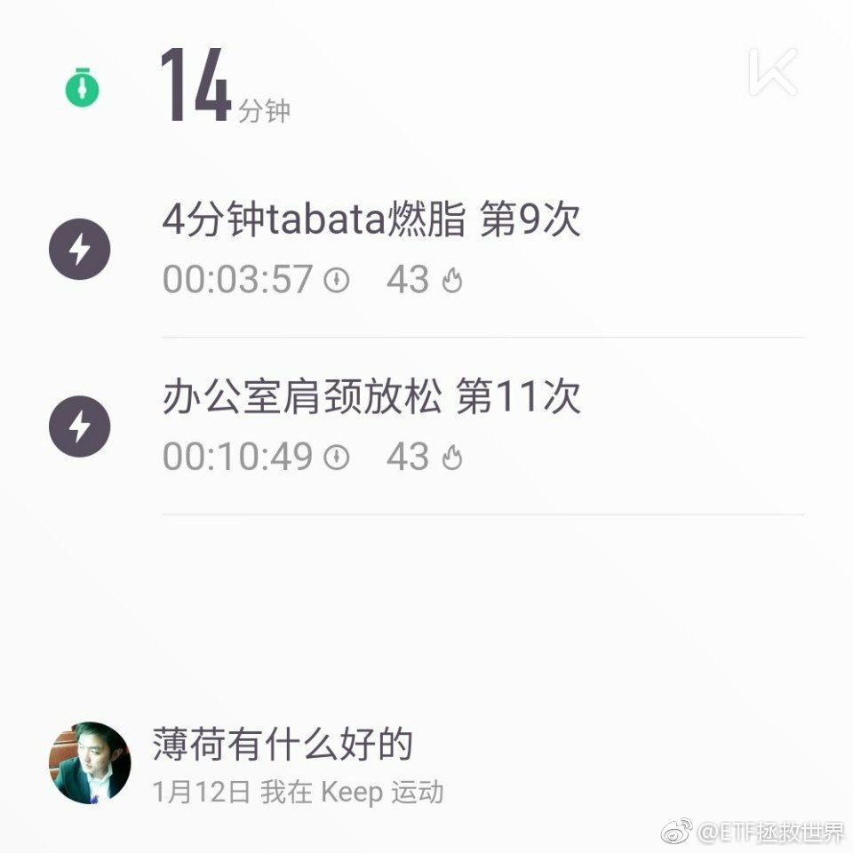 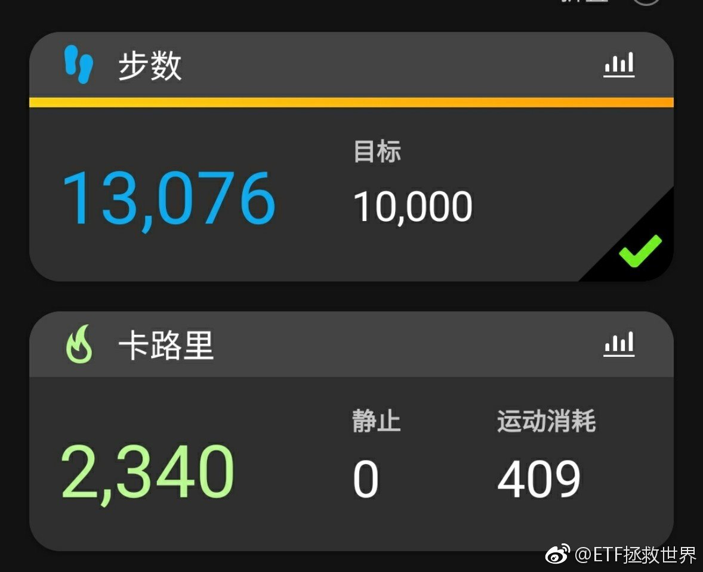

## 2018-01-14 09:33

这个十年前就在美国的农场见过了。机器上带GPS，会自动掉头。老大一个农场就两个人工作。还养几百头牛……有时候效率低收入少的人太多没什么意义。//@佐罗_厚恩投资:转发微博

> @智慧科技迷
> 无人驾驶农业机械，未来的农业科技。以后最幸福的职业非农民莫属#制造业强国##农业科技# http://t.cn/RQ5jX1L工业科技迷的秒拍视频 ​​​

## 2018-01-14 10:03

回复@很多话不想说:没有农民。那两个人中一个叫农场主，身家几千万美刀吧。另一个是雇的长工……一会我把当时拍的照片发上来//@很多话不想说:我也很想那么幸福地做农民

## 2018-01-14 10:05

回复@青年人与卫生标兵:我愿意，管着吗你，就每天发，气死你//@青年人与卫生标兵:所以呢，这点技俩很牛吗，偶尔一发也就算了，每天都有这么一条，是不是把自己定位为a股韭菜的启蒙教父了？

## 2018-01-15 09:58

$全指医药 sh000991$  我的最爱 ​​​

## 2018-01-15 11:27

涨跌家数

600:2700。

权重股已经拼了…… ​​​

## 2018-01-15 11:34

新高后面就是新高。加油( ¯ᒡ̱¯ )و ​​​
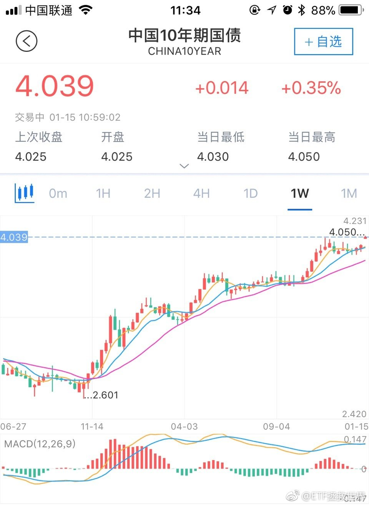 

> 胖猫Leo:E大，这是最近人民币大幅升值引起的？
>> ETF拯救世界:降杠杆，缩流动性。

## 2018-01-15 11:54

回复@胖猫Leo:降杠杆，缩流动性。//@胖猫Leo:E大，这是最近人民币大幅升值引起的？

## 2018-01-15 13:31

$518880 渣渣…… ​​​

## 2018-01-15 13:43

月中不发车，就搞那么大，这合适吗！ ​​​

## 2018-01-15 14:43

抄底也要有节奏，也要遵照基本法。—— ETF拯救世界首发 ​​​

> 蔚蓝方zhou:@ETF拯救世界 想知道E大怎么看沪深300，它的持仓那么少
>> ETF拯救世界:相当一般的指数。大股票好的时候不如50，小股票好的时候不如500创业。鸡肋。

## 2018-01-15 14:48

不好意思，今天没法新高了。估计净值会减少0.1x%。

 ​​​

## 2018-01-15 14:54

连红利都撑不住了，50依然NB....

去杠杆的威力果然很大。 ​​​

## 2018-01-15 15:02

收盘确认是下跌0.2x%……

## 2018-01-15 15:14

不管怎么说，我想很多朋友终于体会到不被市场走势，账户涨跌影响情绪的感觉了。

情绪不受影响，你就会冷静。冷静，你就很难出错。不出错，别人就赚不到你的钱。别人赚不到你的钱，你就会赚别人的钱。

成熟的投资者=成熟的投资体系+成熟的投资心理

无论如何，很多人距离成为一个成熟的投资者越来越近了。

## 2018-01-15 15:46

回复@面条在厦门:相当一般的指数。大股票好的时候不如50，小股票好的时候不如500创业。鸡肋。//@面条在厦门:@ETF拯救世界 想知道E大怎么看沪深300，它的持仓那么少，

## 2018-01-15 17:02

回复@功不唐捐小盆友:没有新低。还是上个月25日最低。//@功不唐捐小盆友:E大，现在整个市场估值啥水平啦，能发个估值图让我们膜拜一下吗？

## 2018-01-15 17:07

如果这样下去，不出意外的话，计划中的A股仓位占比会在上半年翻一倍。

希望能够如愿以偿吧。 ​​​

## 2018-01-15 17:20

回复@用户y49f7o7jj4:没买完就涨了怎么办？买完了还是跌怎么办？这就是艺术了……//@用户y49f7o7jj4:钱买完了，牛市还没来，还跌咋办

## 2018-01-15 19:47

回复@zhanshang2606200907:没有吧，微博一直就这么多人。公众号是浏览和留言的人不停的创新高……//@zhanshang2606200907:E大，你觉得现在关注和评论你的人在减少么？

## 2018-01-15 21:03

每日打卡（134）

身体是自己的。 ​​​
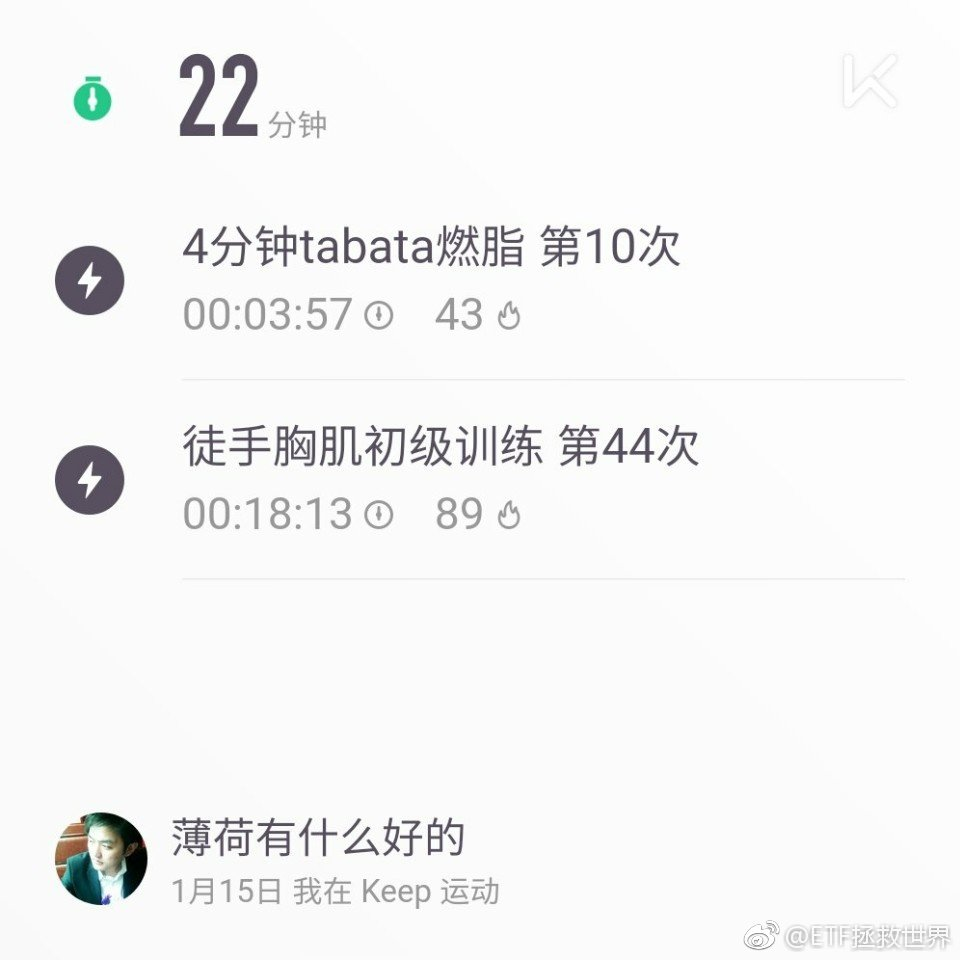

## 2018-01-16 13:29

$中证红利 sz399922$   就服你。 ​​​

## 2018-01-16 13:45

回复@我在故快乐:第二次买应该来两发。//@我在故快乐:这么猛，不愧连加两车。

> 穿越30年:创业板要是敢连跌3天，我明天就开黑车 [喵喵]
>> ETF拯救世界:回复@gfddfgghhfcvh:我考虑创业板30以下就值得多买点了。任重道远。

## 2018-01-16 17:05

回复@gfddfgghhfcvh:我考虑创业板30以下就值得多买点了。任重道远。//@gfddfgghhfcvh:回复@啊肥豪啊:创业板25pe也太低了吧，这得惨到什么样//@ETF拯救世界:回复@我在故快乐:第二次买应该来两发。//@我在故快乐:这么猛，不愧连加两车。

## 2018-01-16 17:17

你们这些骗子，你们都是大垃圾。我第一次在公开场合骂人。

你爸你妈把你生出来就是让你骗人的吗？你有手有脚一定要靠骗人挣钱吗？

别人辛辛苦苦挣点钱容易吗？你不怕遭雷劈？？？不怕生孩子没有生殖器？

我们一起诅咒你！

各位朋友，大家自己也要提高警惕啊！我已经发过很多次提示了，那些主动联系大家的都是骗子！我99.99%都不会主动私信各位！擦亮眼睛！

气死我了。我再骂一句，骗子去死！这条我自己花钱买个置顶！大家都要擦亮眼睛！
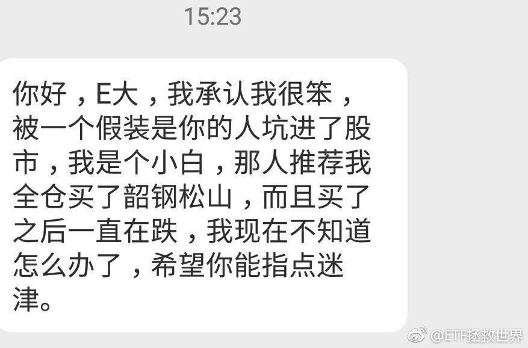 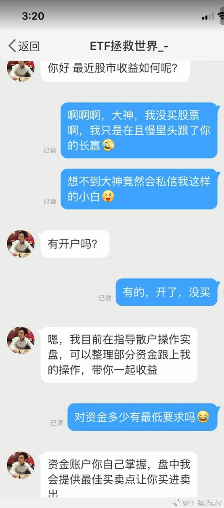 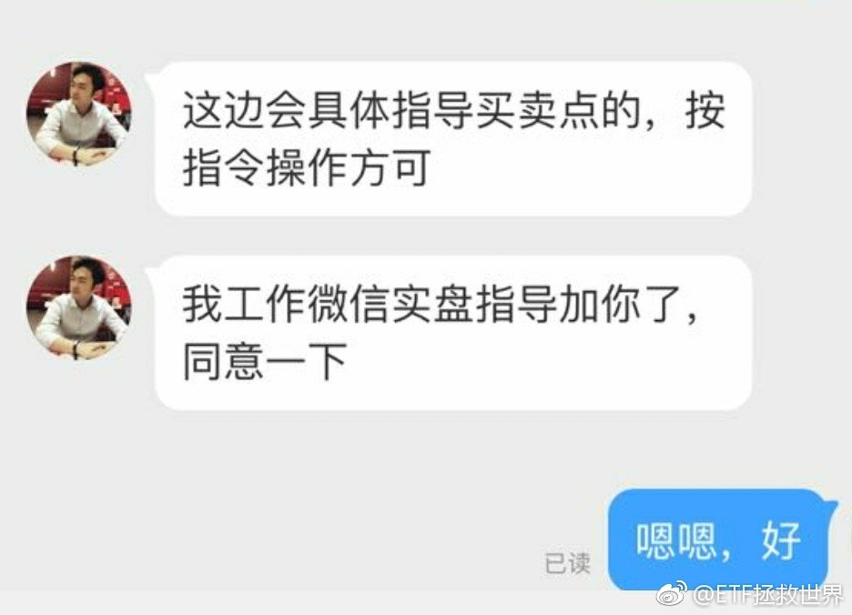

## 2018-01-16 17:46

各位朋友，我一直以来的观点是这样的。

不要做坏人，不要犯法，不要违反公序良俗。

但是，同样重要的，是做“好人”，不要做“老实人”。

区别是什么。区别是，好人是有能力去做坏事，但是不做。所以别人来害你，来骗你，你都可以一眼识破。因为你有能力，够聪明。甚至你还可以把骗子给骗了，把坏人给干掉。

老实人呢……不说了，总之就是很单纯……尽快聪明起来，成熟起来。

世界上永远有坏人，咱们能做的，就是比坏人更聪明，更有力量。

## 2018-01-16 20:03

最关键的，事后看，这些基金里面有赚大钱的吗。

## 2018-01-17 09:35

$证券公司 sz399975$   又轮到你表演了？ ​​​

> 金家岭吴彦祖:不是弹性的问题了，简直易燃易爆。
>> ETF拯救世界:我跟大家说几个弹性巨大的品种，未来的牛市中可以当杠杆基金用的：券商、信息、军工。买的对就发了，买不对等着赔死吧。未来计划都会买，别急。

## 2018-01-17 09:38

分化太严重了。今年的戏份非常足。各位准备好。 ​​​

## 2018-01-17 09:42

一笔不大的红利单子居然分了这么多笔成交，全是小散户在买啊。。 ​​​
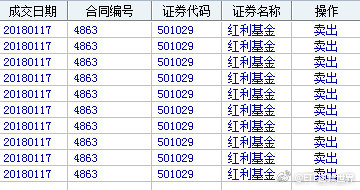

## 2018-01-17 09:46

回复@fang宝贝在路上:自己做网格用的。//@fang宝贝在路上:老大买了这个？

## 2018-01-17 09:49

如果这一波可以顺利下去，就是最后一波了。一波到底，震荡，然后迎接下轮飞跃。

不是去年几十只蓝筹那种翻番的，而是大面积翻几番的，真正的大牛市。

如果依然有人捣乱，那就继续慢慢跌。不知道要多久了。 ​​​

## 2018-01-17 09:52

回复@金家岭吴彦祖:我跟大家说几个弹性巨大的品种，未来的牛市中可以当杠杆基金用的：券商、信息、军工。买的对就发了，买不对等着赔死吧。未来计划都会买，别急。//@金家岭吴彦祖:不是弹性的问题了，简直易燃易爆。

> 看你一眼万年:军工我定投了一年。总感觉未来可期。 不过我投了易方达国防军工混合。感觉跟踪军工指数的指数鸡强[允悲]
>> ETF拯救世界:定时定额最害怕的是在高位长期投入，那样会对整体收益造成不可挽回的损失。做做数学题就懂了。

> 小孩子的生啤:E大，传媒弹性大不大？
>> ETF拯救世界:2013年涨了100%你说大不大……

## 2018-01-17 09:54

回复@原来一切都是虚幻:果然不出所料，这个月会分红。已经通知过大家了，应该都已经改了。//@原来一切都是虚幻:100032今天也分红//@ETF拯救世界:回复@fang宝贝在路上:自己做网格用的。//@fang宝贝在路上:老大买了这个？

## 2018-01-17 10:08

回复@Iridescensea:定时定额最害怕的是在高位长期投入，那样会对整体收益造成不可挽回的损失。做做数学题就懂了。//@Iridescensea:军工我定投了一年。总感觉未来可期。 不过我投了易方达国防军工混合。感觉跟踪军工指数的指数鸡强

## 2018-01-17 10:14

证券投资来说，最好的一种情况是在底部区域大量买入。底部区域横盘越久，你投入得越多，未来赚的会最疯狂。

一般的情况是在快速下跌或者上涨的过程中买入，这样的也会赚的还可以。即使你在顶部买了一点。

最差的情况就是在顶部区域大量买入。分两种情况。一个是你重仓全仓买在很贵的地方。一个是顶部区域时间特别长，你慢慢的在上面买了很多。这种情况，未来很多年都会收益有限。除非你有更大的资金在便宜的时候继续买入。

> 涵旭他们的娘:E大，今天的50ETF涨的太好了
>> ETF拯救世界:说过很多次，300是鸡肋。大盘股涨的时候远远比不上50。如果50继续这样搞，计划就又要平衡一次了。

## 2018-01-17 10:26

券商10%网格出货。美滋滋。 ​​​

## 2018-01-17 10:37

回复@涵旭他们的娘:说过很多次，300是鸡肋。大盘股涨的时候远远比不上50。如果50继续这样搞，计划就又要平衡一次了。//@涵旭他们的娘:E大，今天的50ETF涨的太好了

## 2018-01-17 11:06

废柴。我只是说说，吓成这样了……//@ETF拯救世界:回复@涵旭他们的娘:说过很多次，300是鸡肋。大盘股涨的时候远远比不上50。如果50继续这样搞，计划就又要平衡一次了。//@涵旭他们的娘:E大，今天的50ETF涨的太好了

## 2018-01-17 11:12

无论是公募还是私募，都有一个共同的问题，就是他们很难去买下跌的东西。因为有投资者在盯着他们，净值不好看钱就没了。

所以，你能看到互联网基金重仓的是茅台格力和平安。

个人投资者的优势就在于，你根本就不用去考虑给谁看的问题。只要你的内部记分卡长期真的赚到钱了，就可以。所以，你可以优雅的买入那些越跌越便宜的东西，等到风吹到它们这里，再优雅的卖给那些需要给别人看成绩的人。

## 2018-01-17 14:31

东哥，作为京东股东，想说一句，悠着点……

> @刘强东
> 前两天走访了东北三省，未来三年京东分别在三个省投资从数十亿到百亿人民币不等！最近几年大家似乎都不对东北看好，不可否认东北三省的经济也确实遇到不小的困难！但是大家不要忘了建国初期东北三省GDP一度占据全国85%！可以这么说，没有东北就不会有国家初期的工业振兴！今天他们有了困难，大家都应该过去帮一把！算是一种感恩吧！
> 
> 我看到的是东北三省中高层领导那种真诚、积极、高效的工作作风，我相信他们的营商环境一定会逐步改善的！我相信东北人民那种乐观热情、重情重义的个性不会亏待我们的！2018年，祝福东北！
> 
> 养蜂人图片说明：京东在黑龙江饶河县以蜂产品合作社模式进行精准扶贫，带动贫困户脱贫。

## 2018-01-17 17:10

$恒生指数 hkHSI$   新高。11年前买入的人终于解套了！ ​​​

## 2018-01-17 21:16

每日打卡（135）

其实这几天一直在练，忘了打卡了。 ​​​
 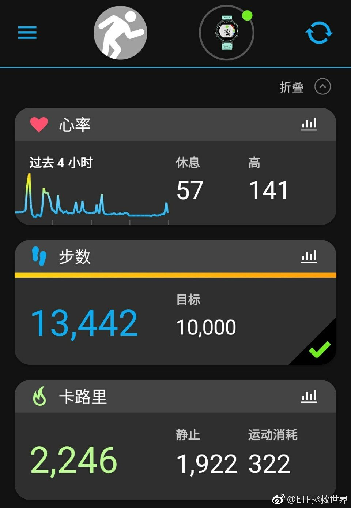

## 2018-01-17 21:43

开始看这个 ​​​
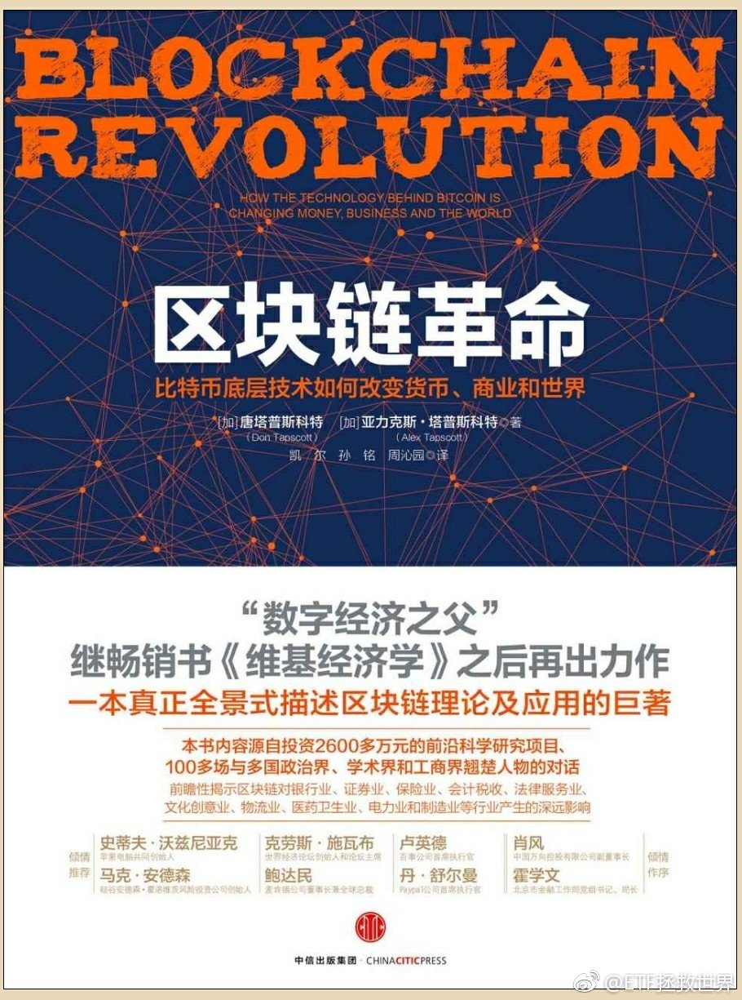

## 2018-01-18 09:11

网络游戏虚拟娱乐前途无限。利好___。

## 2018-01-18 09:27

家训必须再拿出来重温……

## 2018-01-18 11:24

回复@慧姨妈的菜鸟成长记:我儿子还没到沉迷游戏的年龄。不过我有两个看法。一个是很多人之所以沉迷游戏是没有其它爱好。培养孩子更加健康的爱好应该有好处。第二个是游戏可以玩，我还会陪他玩，但是规定时间，到点就停。其实游戏之所以吸引人，无非是即时奖励而已。可以从这个思路让他多体会其它快乐。

## 2018-01-18 11:26

从这几天的评论可以看出，很多人又开始牛市焦虑了。

嗯。 ​​​

> 圣善周闻宗:说不焦虑是假话，但重点是调节和对信仰的坚定。
>> ETF拯救世界:焦虑就调仓到舒服。特别简单。如果焦虑，那就一定是哪里错了。

## 2018-01-18 11:34

昨天看《未来简史》，里面谈到21世纪，解决了温饱，没有战争之忧的人，考虑的就是长生不老、追逐快乐了。

我想了想，是有道理的。没钱的人会为了温饱和财务自由不断努力可能暂时顾不上长生不老。很多钱多的只是数字的人，其实真的无论花多少钱都希望多活几十年的。

而追求快乐，应该是所有人的共同追求。

快乐是什么，有很多种方式得到快乐，每个人得到快乐的方式也不同。刚才说的，电子游戏，那沉迷的人就可以从里面得到快乐。而且是不能停的，必须持续的玩，才能持续的快乐。

咱们投资不是吗。当然也是。赚一万，十万，一百万，一千万。能停下来吗，停不下来的，需要持续快乐。而且阈值越来越高，跟其它成瘾的事情，比如吸毒、赌博之类的都是一个道理。

人类追求快乐的脚步不会停止，提供快乐的公司和行业就不错。

> 芭蕉smart:所以要修心啊，才能持续平安喜乐，我在朋友圈夸口要活120岁呐[污]
>> ETF拯救世界:恩。佛家就是抑制欲望。没有欲望了，就不需要成瘾就持久的快乐了……

## 2018-01-18 11:43

再说两句。很多朋友觉得如果自己有了100万，500万就会非常快乐开心。其实你真的赚到了，确实会很开心，不过不会超过一个星期。接下来你就会为1000万而焦虑了。其实很多其他的事情也是如此。你一直梦想的东西得到了，发现快乐持续不了很久的。接下来，要么就是空虚，要么就是继续追求更高的梦想……

## 2018-01-18 13:47

回复@圣善周闻宗:焦虑就调仓到舒服。特别简单。如果焦虑，那就一定是哪里错了。//@圣善周闻宗:说不焦虑是假话，但重点是调节和对信仰的坚定。

## 2018-01-18 15:27

今晚。 ​​​

## 2018-01-19 09:10

把馋说的那么清新脱俗，佩服佩服！

## 2018-01-19 09:26

没有溢价，千万别抢。 ​​​

## 2018-01-19 09:46

$中证传媒 sz399971$  别红啊！场外的兄弟们怎么办。 ​​​

## 2018-01-19 09:49

$证券公司 sz399975$  弹性是不是很大。还有比它更大的…… ​​​

## 2018-01-19 10:17

回复@孔熙佑241:不断新低的股票有2000多只，只是被市场忽视了而已。所以你这概率并不低……//@孔熙佑241:手里中国卫星不停创新低，服了

## 2018-01-19 13:37

美国纳斯达克指数能给我们一些启发。

2000年估值70多倍，5000多点。3年后跌到1000点，下跌75%。

2016年，十六年后，突破5000点，创新高。

目前7000多。

超高的估值需要时间+空间消化。一旦消化完成，获利空间将是巨大的。

我们的有些指数也会如此。2015年确实很高，但是只要跌的够深，买入后持有机会利润巨大。

## 2018-01-19 13:39

$证券公司 sz399975$   看把你能的…… ​​​

## 2018-01-19 14:13

真的快。计划里面的一份两天时间从不赚钱到快10%了

## 2018-01-19 22:14

每日打卡（136）

明天打算练一个小时 ​​​
 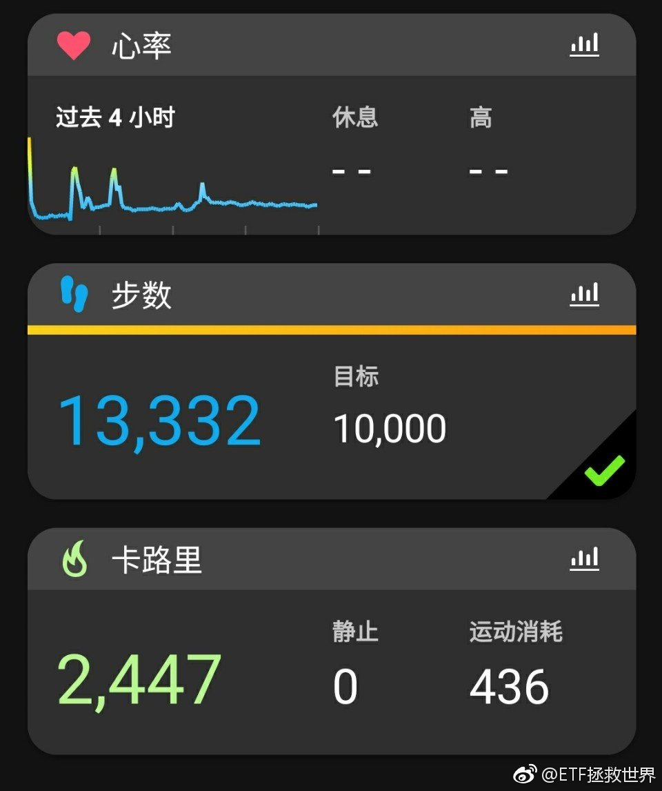

## 2018-01-20 21:18

每日打卡（137）

搞定。 ​​​
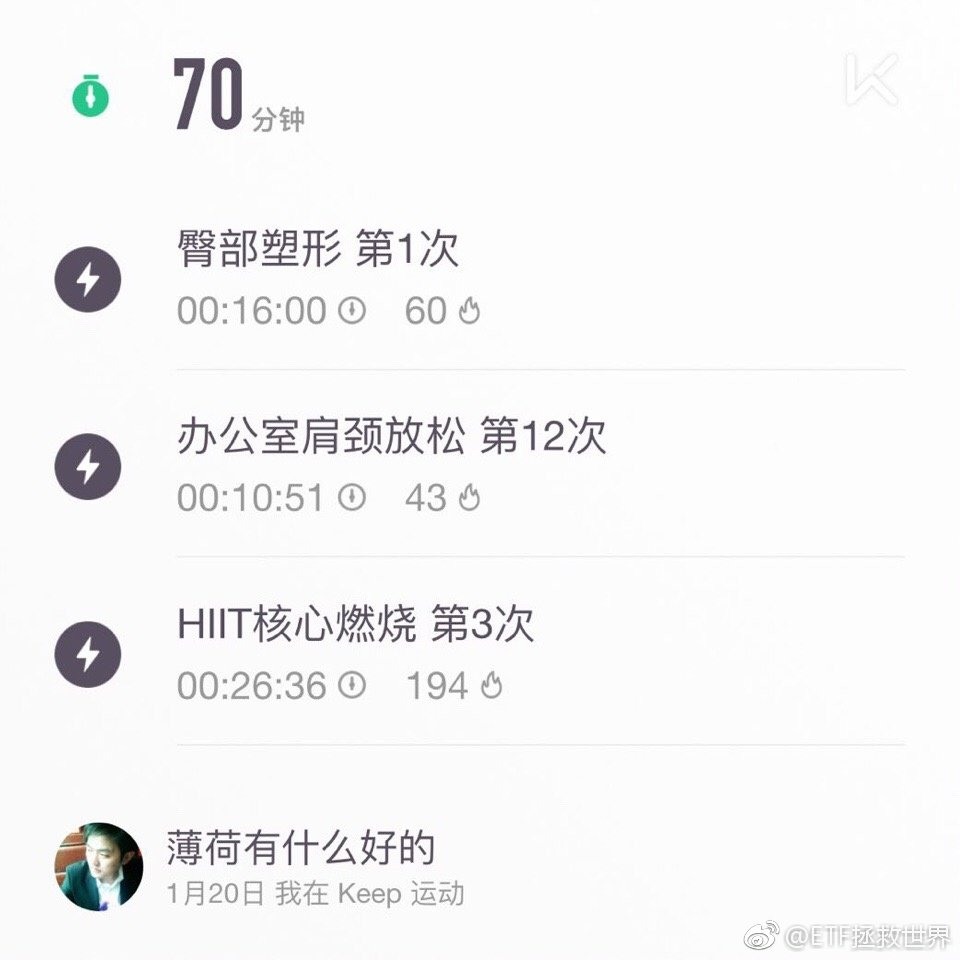

## 2018-01-22 09:07

两融余额再创熔断以来新高，群众的信心越来越足了。 ​​​
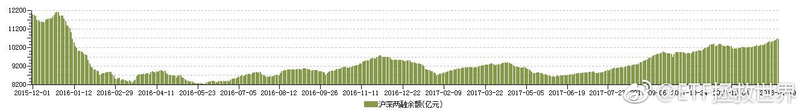

## 2018-01-22 09:50

金融投资中，什么人下场是最惨的。

不是在一波大涨中“踏空”的人。他们没有损失什么。

也不是那些一开始就在大涨中不断炒作的人，未来即使下跌他们也只是利润减少。

下场最惨的人，是一路都非常怀疑上涨，然后越涨心里越难受，越焦虑。最后终于忍不住买入的人。 ​​​

## 2018-01-22 10:01

回复@超哥不止洪超哥:我2016年在雪球建了一个测试组合，只买收益率每年只有3%的最差货基，现在跑赢70%组合……//@超哥不止洪超哥:老老实实买余额宝的也能战胜很多投资者

## 2018-01-22 10:18

$中证传媒 sz399971$  不要嘚瑟，还没买够啊喂。 ​​​

> 大奔奔Eric:【国家队基金连续大减仓！成立2000亿已赚540亿，仓位20%创新低】——记得收藏这条新闻，谢谢！
>> ETF拯救世界:已收藏

## 2018-01-22 10:27

涨幅超过沪深300了，搞什么飞机……

## 2018-01-22 10:37

回复@穿越30年:跌了三年了，随时会涨。。//@穿越30年:回复@泸州单身俱乐部--剑平:跌了3年了，我也不信这就开始涨了

## 2018-01-22 10:58

回复@发ass:最近这几次节奏确实还不错。可以吹几个礼拜了。//@发ass:上次红利没跟车之后，悔得肠子都青了。这次第一时间跟了//@ETF拯救世界:回复@穿越30年:跌了三年了，随时会涨。。//@穿越30年:回复@泸州单身俱乐部--剑平:跌了3年了，我也不信这就开始涨了

## 2018-01-22 11:36

$养老产业 sz399812$   终于也快新高了。不容易。 ​​​

## 2018-01-22 13:01

3%。奶一口，下来吧孩子//@ETF拯救世界:回复@发ass:最近这几次节奏确实还不错。可以吹几个礼拜了。//@发ass:上次红利没跟车之后，悔得肠子都青了。这次第一时间跟了//@ETF拯救世界:回复@穿越30年:跌了三年了，随时会涨。。

## 2018-01-22 13:47

$159938 溢价了，你懂的。 ​​​

## 2018-01-22 14:18

其实你们想过没有，这样涨有什么好的。还有7个交易日就要下个月发车了，这么涨还买个P呢。。。

本来已经计划好买什么了…… ​​​

## 2018-01-22 14:50

回复@努力12367:怎么证明你这条是正经的问题而不是没事儿扯淡呢……//@努力12367:E大，转型情感类话题吧。我遇到一个我很喜欢的妹子，而且她也很喜欢我。我是处男，可惜她不是。我好难受啊

## 2018-01-22 14:54

真的稳。底部不断抬高。喜欢。

## 2018-01-22 15:24

回复@孤独者生存1:第一：左臂肘关节上方三寸的地方是否有守宫砂。第二：右臂肱二头肌是否比左臂发达，也就是是否有俗称的麒麟臂。//@孤独者生存1:请问E老师，处与非处，男的如果鉴定？//@ETF拯救世界:回复@努力12367:怎么证明你这条是正经的问题而不是没事儿扯淡呢……

## 2018-01-22 17:14

我再也不相信美女了。//@林萍在日本://@空山幽静:你快清醒一点！//@大熊弟不是PDD:我透哇。。。。。//@组长_失了个智: 哈哈哈哈哈哈哈//@腐宅姬://@动漫基地: 一定要看到最后太骚了//@星尘使徒: 从此打开了新世界的大门//@若你成花成霜:哈哈哈哈

## 2018-01-22 22:11

今天传媒场外净值只增长了0.5x%。看基金经理在雪球说，应该是周五申购太多，规模增加太快导致。估计原来两千万的场外基金已经被咱们干到8000万了。这个真的没办法，正好赶上大涨了。场内没有这个问题。 ​​​

## 2018-01-23 08:14

冻僵了 ​​​
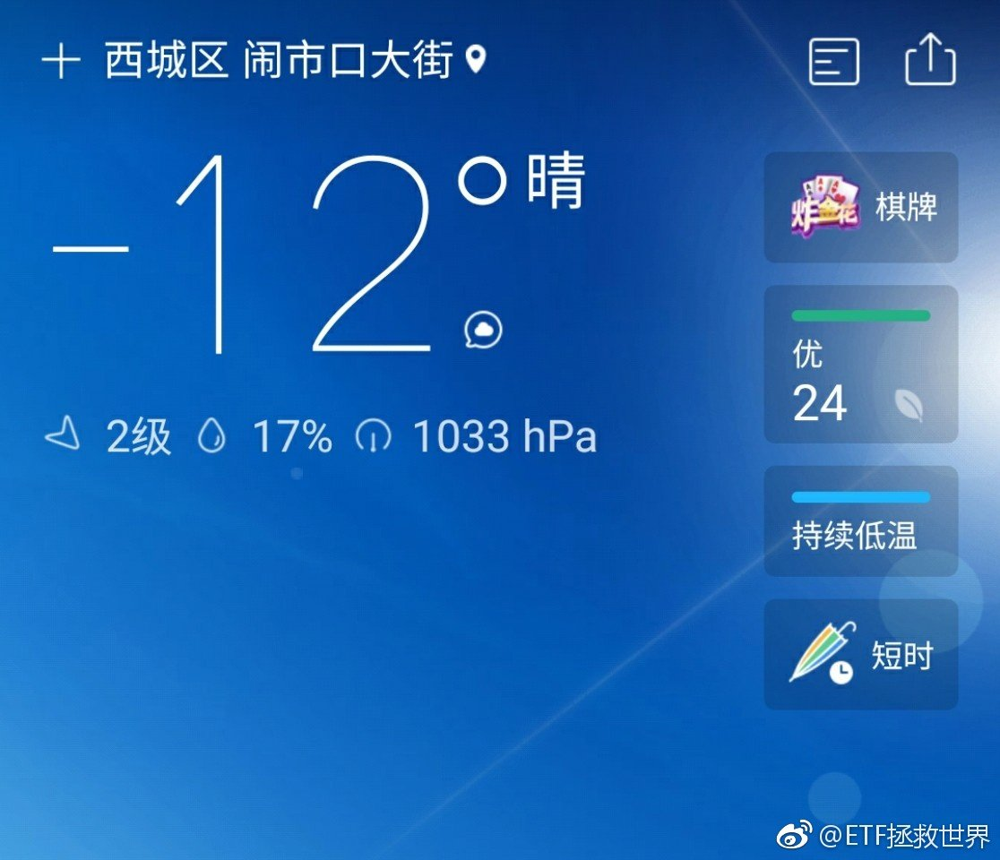

## 2018-01-23 09:17

第一次阅读量超过4万，纪念一下。

什么时候我也有10万+的文章，是不是就可以成为网红了。 ​​​

## 2018-01-23 09:43

$中证传媒 sz399971$   又来？

对于要建仓的场外链接基金来说，今天最差的一种走势就是先涨后跌…… ​​​

## 2018-01-23 09:51

这次传媒可以吹一阵了吧……

## 2018-01-23 10:05

按照这个节奏，50为代表的大蓝筹上半年应该就可以造个万人坑出来~

不过咱们的持仓依然不动……策略+纪律&gt;预测…… ​​​

> 文小陈c:最早一批铁粉，想起益达两年多前写的荒岛十年，“50和恒生的现估值”，眨眼间就快到万人坑了，我A真是个神奇的地方～
>> ETF拯救世界:对不对？还有哦，我那时候写的会买的500估值，已经比现在高了哦。

## 2018-01-23 10:22

乐视除了主动抛售的股票，有几个方面的股票一定会抛。一个是各大指数基金的持仓。之前乐视除了是创业板之类指数的成分股，甚至是沪深300的成分股。现在已经调出来了，有很多基金必须要抛。第二是质押部分，机构也要抛。这些筹码消化掉，再说其他机构散户的抛盘吧。不知道多少钱会有人接？

## 2018-01-23 10:31

$162411  好消息不断…… ​​​

## 2018-01-23 10:41

其实想一想，套在山顶的人也没什么好埋怨的。

如果不是自己看着暴涨，贪心杀进去，又怎么会被套。

一切都是天意。 ​​​

## 2018-01-23 11:01

我现阶段的投资逻辑：

看好中国和A股，就不可能只看好100只股票。

A股目前3400只股票，大涨的是中证100的100只。沪深300中的剩下200只和再往后的中证500基本不动。

都说A股港股化，好的，就算未来严格退市+仙股遍地，3400只里面，2400只都是垃圾可以不可以？还不行？那么3400只里面，3000只都是垃圾，可以了吧。

那还是有500只啊。怎么可能一个大牛市只有50-100家公司涨，其它都不动？

更何况，经过几年漫漫下跌，很多中小股票已经颇具投资价值了。

前几年，小就是美。现在，大就是好。要我说，都是扯淡，忽悠。

美和好，跟规模一点关系都没有。谁便宜买谁。最重要别被人忽悠和洗脑。

50、红利、恒生，我们2016年买了不少。

现在越买越多的是500以及医药等。逻辑就是，不信A股有3300只辣鸡，100只好股票。至少有500只还不错吧！

## 2018-01-23 11:28

回复@小牧yc:奇怪的是，这20万人很沉默，基本听不到他们的声音啊。//@小牧yc:2017-10-28 股东人数185875，将近20万人。。。。

## 2018-01-23 11:38

至少先上个英国ETF好吗。

> 爱吃苹果的小小白:美股有啊，msci指数，代码 ewu
>> ETF拯救世界:早买了。A股也需要

## 2018-01-23 13:47

回复@善广辉:现在看，除了当时可以买的50和恒生，到目前，500和养老算是符合标准了。就看3个月后的年报季报了。

## 2018-01-23 14:55

$中证传媒 sz399971$  光头收盘，稳如狗。

然而，还是50和红利最高……当然，还有恒生。

对于恒生，我已经设定了下次再平衡的标准。如果它达到了，月底会来一次。 ​​​

## 2018-01-23 14:58

回复@快乐Daisy1115:如果是可口可乐肯德基的我当然Ok啊。然而大部分都是p2p和各种理财平台，我还有点底线，不会为了钱接这种。//@快乐Daisy1115:回复@乐活广场com:可以接点，赚个油钱，我们不介意的

## 2018-01-24 09:06

乐视的20万股东中，如果有人只是有一部分分仓给乐视，那没有大问题。退一步，就算是重仓，也无非是看错股票而已。

如果是满仓甚至融资买入，那基本上的结论就是，没有入金融投资的门。

金融投资最重要的不是赚多少，而是不死。

即使概率极低的黑天鹅，也要在投资前考虑到。一次把命压上，没事，两次，没事，三次没事……第十次，第二十次呢？

发生了，就一次归零。

所以最关键的是，无论如何，无论发生什么事，都要保证自己不会死。

这应该才是最关键的问题。

什么是死呢，我认为，应该是说本金彻底消失，或者长期（五年以上）无法回本，这就是死了。 q

> 用户1258851033 :这段话太深刻了。记录下来
>> ETF拯救世界:你再记一道数学题：90%的获胜概率，连续玩十次，获胜的概率就只剩34.87%。别以为胜率高就可以赌命，玩多了，赌不起的。不怕输，怕的是输了命没了。

## 2018-01-24 09:12

回复@眼睛视界:你再记一道数学题：90%的获胜概率，连续玩十次，获胜的概率就只剩34.87%。别以为胜率高就可以赌命，玩多了，赌不起的。不怕输，怕的是输了命没了。//@眼睛视界:这段话太深刻了。记录下来

## 2018-01-24 09:25

乐视的第三、第九、第十大股东是GJD，估计后面还有。问题：GJD有没有优先卖出通道…… ​​​

## 2018-01-24 10:08

回复@愤怒的小小小小鸟:你再好好想想。连续十次是一个整体，怎么会是独立的？十个人赌博，1个人必败。每一轮淘汰一个人后，其它九个人都走了，那才是独立的。人都不走，连续玩十轮，连续获胜的概率是多大？怎么会是独立的？

## 2018-01-24 10:16

即使获胜的概率很高，如果你不停得玩，玩的次数越多，那么连胜的概率就越低。

这里就引出一个关键的问题，也就是老巴说的：打卡机。

老巴说，一辈子如果只有20次机会，你会做什么投资。这其实是非常睿智的。不仅包含了要严格筛选投资标的的问题，还有下手次数不要太多。

同样的意思，还包含在他另一个比喻中。就是把棒球的击球区分位几百块，只在最有把握的那几个区域挥杆，其它时候不动。动的越多，越危险。

如果单次获胜机会是90%的话，连赢10次的概率就下降到34.87%；连赢50次的机会只有0.52%。

所以其实还是那句话，常在河边走哪有不湿鞋。湿鞋是肯定的，没人能一直赢。问题就在于，输可以，千万别死。

## 2018-01-24 10:17

$中证传媒 sz399971$   又来了。舒坦。 ​​​

## 2018-01-24 10:31

我比你们想象的更爱传媒股……

别追了，50%了。。记得买的时候在微博贴了K线，还有个评论里的哥们居然看出来是哪只了……只能说他真的NB。 ​​​
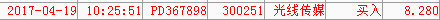

## 2018-01-24 10:32

回复@张大山gz:一次买了两份，已经不少了……//@张大山gz:看着它涨，总有底部买少了的感觉。佩服E大的淡定，坚守纪律

## 2018-01-24 10:34

回复@达达尼敖:传媒场外的我劝各位一句，千万别因为没跟上赎回。我个人认为，那么大的基金公司不会这么业余。给点耐心你再看看。//@达达尼敖:场外的表示然并软

## 2018-01-24 10:36

$512980   ​​​

## 2018-01-24 11:31

这下月底真的没什么可以买了。

别看了别看了，散了散了啊。 ​​​

> 快乐行者9:E大，给推个美股可以交易的指数呗，开了盈透账户，坐看账户里美元贬值[泪]
>> ETF拯救世界:我自己买了EWU，英国；EFA，非美发达国家；EWP，西班牙。都已经涨了很多了，买一点问题不大，别多。

## 2018-01-24 11:41

“金融投资想要赚钱无非是四个字：低买高卖。每个人都懂，然而能做到的人就少之又少。

道理很简单，“低”的东西一定是不被看好的。“高”的东西一定是众星捧月。所有人都不看好的时候，你怎么才能下决心走出羊群，到另一片没人跟你抢的地方去享受美食？

其实真的很难。

人类和羊群是一样的。走出羊群，特立独行，虽然有大片可以独享的草原。然而，也因为落了单，弄不好会成为饿狼的美食。所以，大多数人，是非常惧怕走出羊群的。

可惜，在市场上，我就是不想做羊群里的普通一员。别人不要的，我最喜欢。

你的垃圾，我来守护……”

“今天，我们再来买一只已经连跌三年，无人看好，从最高点到目前已经跌了65%，在我的估值体系中已经不比沪深300贵多少的指数。
 
这个动作，在这个时候，看起来是那么的不合时宜，也注定赚不到持续上涨的快钱，甚至有可能继续下跌，几个月乃至一两年不赚钱。不过，这就是我的投资方式。
 
很多人在面对历史k线的时候，总是希望自己的筹码买在低位。而现实真的发生时，又有几人能耐住寂寞买入暗淡无光的东西？
 
知行合一，是我一生所求。”

那天，三年多新低。

知行合一，很简单。

## 2018-01-24 12:18

回复@快乐行者9:我自己买了EWU，英国；EFA，非美发达国家；EWP，西班牙。都已经涨了很多了，买一点问题不大，别多。//@快乐行者9:E大，给推个美股可以交易的指数呗，开了盈透账户，坐看账户里美元贬值

## 2018-01-24 12:28

有没有人告诉我这个有什么好玩的。玩了一会没感觉到亮点是什么啊…… ​​​
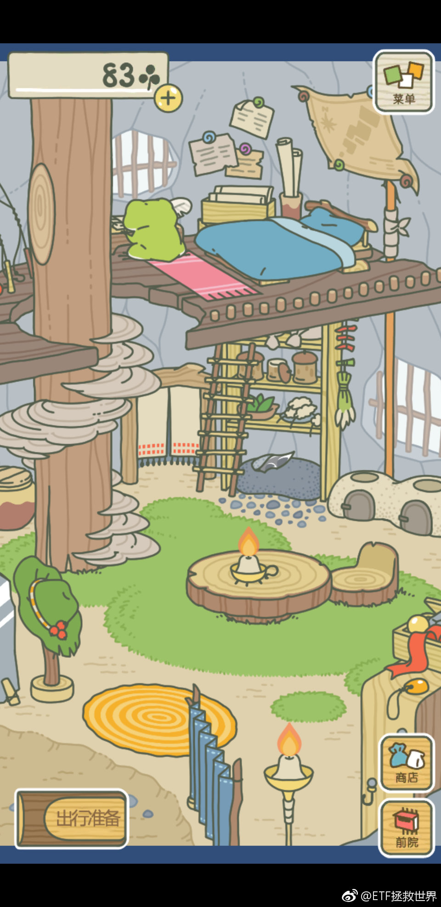

## 2018-01-24 13:06

$养老产业 sz399812$  稳了，新高。 ​​​

## 2018-01-24 13:16

$证券公司 sz399975$  弹性…… ​​​

## 2018-01-24 13:30

回复@morninggloy:相信我，经验值很多钱。真的值很多钱。//@morninggloy:难怪这个网格要10%

## 2018-01-24 13:43

又来了……第二个10%。 ​​​
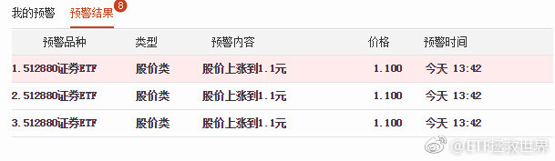

## 2018-01-24 13:57

我去开会，不要掉链子。

还是把会议延后……毕竟传媒有点厉害了。 ​​​

## 2018-01-24 17:37

“这次不一样”//@佐罗_厚恩投资:转发微博

## 2018-01-24 21:40

每日打卡（138）

明显感觉有效果啊 ​​​

## 2018-01-25 10:09

即使你在2017年5月买入传媒，浮亏近一年，还是会在距离大底3天内赚钱了。

这就是我说的，控制好成本，不要怕浮亏。牛市来了，你那点浮亏一周，半个月就就赚钱。

这些话说太多，你没经历过永远不会懂。经历一次才懂，可惜，已经付出很多很多年的时间。 ​​​

## 2018-01-25 10:15

回复@孔熙佑241:这次？//@孔熙佑241:起飞前一天精准买入，跟着E大这次操作太666

## 2018-01-25 11:18

不少人会在“价值投资元年”之后，在一些“蓝筹股”上套3-5年 ​​​

## 2018-01-25 13:29

回复@润泽20170101:ETF拯救世界: 1978年以来，英镑/美元走势图。 特别喜欢买下跌的东西，这可能是一种病。 英镑/人民币中间价，注意，国庆英镑暴跌没有包...  2016年底一部分美元换了英镑。去年英镑兑美元涨了9个多点，今年不到一个月已经6个点。//@润泽20170101:E大的美元怎么对冲的

## 2018-01-25 14:28

今天传媒这个长上影不知道埋了多少英雄进去，为什么要追实在是不懂……

一般这样的长上影出来，明天就不会太好。哈哈。 ​​​

## 2018-01-25 14:38

其实计划中大概有45-50份是除非出现“极度价值”，否则不会买下去的。这也是最后的敢死部队，大获全胜的最后希望。

所以说，其实一般情况下可供投资的也就是20多30份了…… ​​​

## 2018-01-25 23:14

回复@圣善周闻宗:跟你们说了不要急，那么大公司不会这么业余//@圣善周闻宗:回复@小七薪:重点是跑赢了指数不少。。活久见

## 2018-01-26 09:12

回复@吃货神圣不可侵犯:有所为有所不为，目前我不买军工//@吃货神圣不可侵犯:e大e大 最近几天好像看到雪球和且慢某些组合都开始对军工蠢蠢欲动了 e大有何看法//@ETF拯救世界:回复@圣善周闻宗:跟你们说了不要急，那么大公司不会这么业余

## 2018-01-26 09:37

$中证传媒 sz399971$   我就默默的看着你装B…… ​​​

## 2018-01-26 11:00

回复@tcwjdid:军工是炒作属性，PE是安全边际。没有安全边际的炒作我这辈子也不会干。//@tcwjdid:买军工不能看pe，因为是国家管制+垄断行业，因为不懂所以不买//@ETF拯救世界:回复@吃货神圣不可侵犯:有所为有所不为，目前我不买军工

## 2018-01-26 11:11

$恒生指数 hkHSI$   我个人观点，它正在制造一个堪比2007年的泡沫。 ​​​

> 快乐行者85762:那就来个泡泡浴吧[酷]
>> ETF拯救世界:不要主动预测泡沫何时破，更不要做空。索罗斯怎么说的？识别泡沫，享受泡沫，在泡沫破灭前悄悄离去。最后的疯狂通常利润最丰厚。enjoy。

## 2018-01-26 11:27

享受泡沫和享受泡沫并不同。

像刚才说的，首先要做到的是识别泡沫。也就是说你知道危险。然后才是享受泡沫。你知道危险，但你依然享受。然后才是在破灭前离开。

另一种就不同了。另一种是，根本不知道这是泡沫。坚信是合理的。他们从来不会想到危险，也不会想到破灭前离开。因为在一个上涨的品种上，一定是有各种利好，各种支撑。否则它也不会涨对不对？

这些利好和支撑是否真的能站住脚，每个人的判断就不同了。能否透过现象看到本质，其实很重要。

然而，对我们来说，这些都不重要。因为这些是“主观”。

尽量不用主观做为操作依据，按照既定策略，规避风险/获取收益才最重要。数据也好，主观也好，只是策略中的可变参数。

## 2018-01-26 13:08

谁能想到，pony买$网宿科技 sz300017$  利好传媒……

## 2018-01-26 14:01

所有指数都在涨，结果涨跌家数对比是1300:1900…… ​​​

## 2018-01-26 14:03

分级A跌的我又开始感兴趣了。2年多了，好想它们 ​​​

## 2018-01-28 14:27

现在演黄婆婆不用化妆了……

## 2018-01-28 21:29

分级b本身长期持有就是必死。正常情况下是几年死一次，如果上折过就有可能一年死几次。分级b千万不可以长期持有，上涨趋势阶段性拿拿还可以

## 2018-01-28 21:43

回复@九州风语者:这个真的不能一概而论。情况特别复杂，一两句说不清。分级a是含看跌期权的债券。分级b是杠杆率随时变动的杠杆基金。还有各种折溢价变化。非常好玩，同时对一般人来说非常危险//@九州风语者:那上折过的分级B，是不是对分级A来说就是一个好事呢？

## 2018-01-28 22:06

每日打卡（139）

一直在练，有时候忘了上传…… ​​​
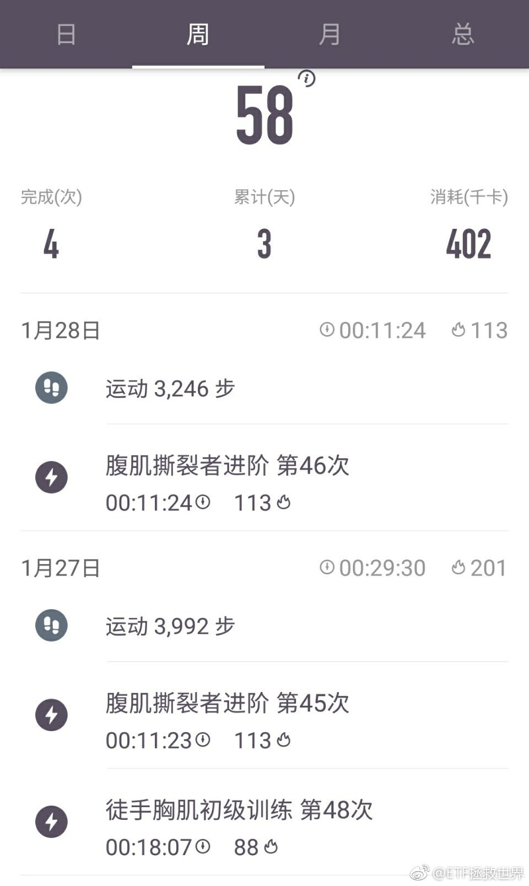

## 2018-01-29 09:44

一转眼就29号了……真快啊。 ​​​

## 2018-01-29 10:04

回复@zoeyllyeoz:有什么好建议，各位？//@zoeyllyeoz:E大一家春节有啥休假安排涅？

## 2018-01-29 11:06

回复@安乐健:少说话，多许愿……//@安乐健:太赞了，翻绿了

## 2018-01-29 11:24

回复@晞诺稳投:看过，想去玩。多少钱一次……//@晞诺稳投:不知道e大看过西部世界 没 推荐//@ETF拯救世界:回复@zoeyllyeoz:有什么好建议，各位？//@zoeyllyeoz:E大一家春节有啥休假安排涅？

## 2018-01-29 11:27

前几天，很多评论都特别焦虑，“是不是牛市来了？”

今天，很多股票都出现暴跌的走势。可能又有很多朋友焦虑，“是不是要熊市了？”

未来如何，根本不可知。你能把握的就是自己账户里的资金、持仓品种，以及自己的心态情绪。

买入便宜的东西，分配好资产，踏踏实实等着更便宜或者价值回归。至于未来牛熊关你什么事。

总之你知道未来自己大概率会赚不少就行了。

## 2018-01-29 11:36

回复@瑞芝如海:我知道啊。我是说那里面的虚拟世界多少钱一次，我想去玩！//@瑞芝如海:《西部世界》是个美剧//@ETF拯救世界:回复@晞诺稳投:看过，想去玩。多少钱一次……//@晞诺稳投:不知道e大看过西部世界 没 推荐//@ETF拯救世界:回复@zoeyllyeoz:有什么好建议，各位？

## 2018-01-29 11:37

回复@飞雨的魔法袋:最近在严打，封杀了1000多个网红。谁能想到，我的网红之梦还没开始就结束了，嘤嘤！//@飞雨的魔法袋:回复@zoeyllyeoz:直播，千万粉丝网红第一步

## 2018-01-29 14:09

不要说话。____。 ​​​

## 2018-01-29 14:24

这个新闻我看了两遍，不吐不快了。

到底这个人要求什么样的父母？完美的？对不起，没有完美的人，没有完美的父母。他说的有几条特别在意的我实在不懂。比如出去玩导游开玩笑让他和两个女生住一起，怪父母不反驳。你都18了，不爽就怼回去啊。谁成长的过程中没有几个SB亲戚或者SB的人开一些特别SB的玩笑？你又不是7、8岁，还要父母替你说什么？

下雨天，父母去接你也是错了。会不会如果你父母一次都不接你，你又反过来怪父母不关心你？

我自认为感情也算细腻的一个人了，看了这篇东西都觉得很多事简直是匪夷所思。当父母这么容易吗？一个孩子养大多难啊，每一句话每个行动都要不出差错吗？

中国的父母确实很多根本就不及格，但这个人这种情况，要把所有的问题都归结到父母身上就有点过分了。这分明就是自己心理出问题了。

什么事情怪别人都非常简单快捷高效。但有用吗？所有错都是别人的，你能进步吗？你能走出阴影吗？你能活得开心吗？

>北大毕业美国留学生万字长文数落父母 12年春节不归决裂拉黑父母6年
>
>在父母和外人眼里，王猛（化名）符合所有“别人家孩子”特征：从小成绩数一数二，四川一地级市高考理科状元，被北大最好专业之一的生物专业录取，本科后又成为美国排名前50的大学研究生……
>
>然而，这一切光环的背后，却是王猛和父母的决裂：12年前，他不再回家过春节；6年前，他拉黑了父母所有的联系方式；他甚至还准备再到北大读个心理学方面的博士，以解决自己长期压抑之下的心理问题。
>
>他将自己与家庭决裂的根源归结为父母从小对自己的“过度关爱”。近日，他写下万字长文，并发给了一些要好的朋友，告诉这些年轻的父母“哪些事情是不能做的”。
>
>A
>
>儿子的万字长信
>
>“肆意操控”“冲突”“炫耀”…
>
>15000余字记录着放不下的过去
>
>1月23日晚6点30分，北京海淀区的一栋图书大厦前，王猛老远叫出了记者的名字。“我在国家新闻出版广电总局的网站上查到了你，看了照片。”这是他见面的第一句话。
>
>他背着双肩包，包里的电脑装着他至关重要的一封信。这封足有15000余字的长信，记录着他从小学到北大，再到美国研究生毕业前后，与父母间的种种经历，以及生活工作的不顺利等等。行文间，言辞激烈。
>
>见到记者后，我们走进大厦后的一个糕点店，找了个靠窗的位置。他拿出电脑，打开了这封长信。对话全程，他的目光很少离开电脑，“要说的话都在信里写了”。很显然，相对于直面交谈，他更善于文字表达，超出文稿外的内容，则常常需要思索许久，话语也十分简短。他不避讳自己性格的“弱点”，“内向，敏感，不善交际”。
>
>他认为，这正与父母有关。他的文字里，满是父母的“肆意操控”、“冲突”和“炫耀”，父母的过度关爱以及缺乏亲情，让他没能树立足够的信心。他说，“父母的爱其实是伤害，过去的经历无法与我的认知调和。”
>
>这封长信，他于近日完成，也前后发给了多个朋友——不过二三十个人，更多的是一些同学。他希望给这些已是或即将为人父母的同学一些参考，说说哪些事情是不能做的。另一方面，他也想给自己找到答案——在伤害已经发生后，自己还可以做些什么。
>
>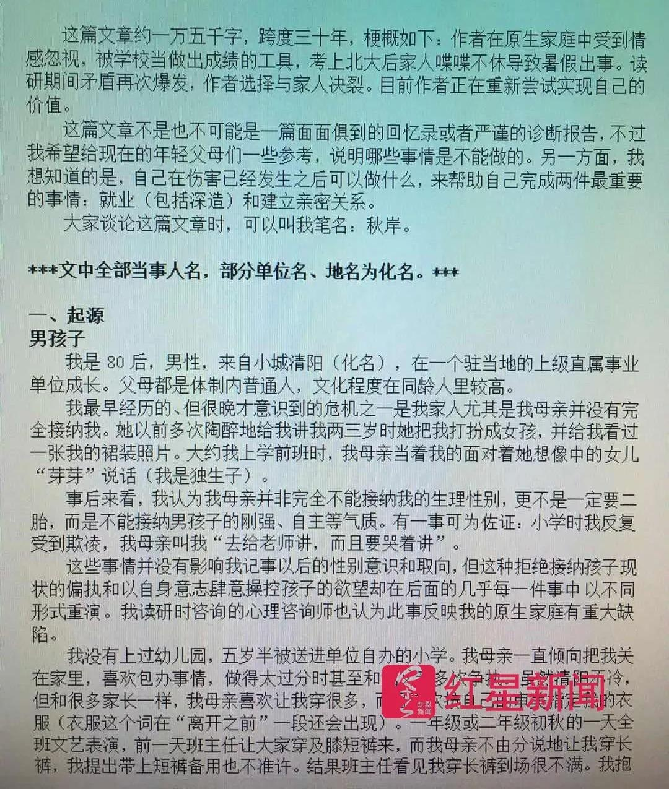
>
>被控制的爱：单纯环境限制了社交能力
>
>“如果教育的目的是控制孩子，那我父母真的是出类拔萃的模范！”王猛直着眼睛，说完话紧咬嘴唇，“他们所有的付出只是为了控制。”
>
>“我母亲一直倾向于把我关在家里，喜欢按自己的喜好包办事情。”王猛至今记忆深刻的一件事发生在小学一二年级的时候——
>
>那时，班里要搞文艺演出，前一天班主任要求大家穿齐膝短裤参加，但演出时却只有王猛没按要求着装。“我母亲不由分说地让我穿长裤，我提出带上短裤备用的请求也没被准许。”在穿衣的事情上，这不是孤例。王猛说，从小到大几乎所有的衣服都是按照父母的意愿和审美来置办的，几乎没有一次是按照自己的意愿来进行选择的。
>
>王猛是大院子弟，从上小学到高中毕业，所有的生活圈子几乎都在这个院子里，“包括朋友，都是他们（父母）认识、了解或者听过的，跳出学校的几乎没有”。
>
>王猛介绍，五六年级时，自己对奥数很有感觉，而一开始母亲并不乐意让自己去，一次在外参加奥数考试回来后，发现携带的文件夹不见了，找回后发现被人划坏并涂抹，“回到家后，母亲不但没有安慰我，反而说‘这下你知道外面的世界很精彩了吧’！”
>
>高中时，王猛曾强烈要求到外面的学校上学，但遭到了父母的拒绝。此后多次争取也均遭到家人拒绝。尽管后来考上北大，但王猛认为，正是这一封闭单纯的环境让自己的社交能力从小就受到了影响，与一些同学的难以相处也让他对人际交往不再期盼。
>
>原本以为，考上北大，就能远离家乡，逃离父母的“控制”，但依然没有。“就在离开前，家人要求我跟北京的大姨打电话，请她之后多多照顾”。王猛说，大姨果然像父母一样“照顾”他：不断给他打电话，甚至悄悄联系他同学了解他的情况。
>
>在王猛看来，这不是照顾，而是一种控制。
>
>情感的孤儿：向父母求助从未得到支持
>
>在王猛看来，家人所有的“爱”和“保护”不过是保证控制对象的基本安全以便持续控制，至于成长环境和心理健康并不在考虑之列。自己成长过程中的数次“救助”都没有得到家人的尊重和支持。
>
>“这种不支持从小就有。”王猛说，小学时，因为不会剥鸡蛋，他遭到同学的取笑，后来传到家里亲戚耳里，又一次遭到了亲戚的取笑，且不止一次，“但面对取笑，家人从来没有保护过我，不以为然。”
>
>发生在大学前的一次旅行，让王猛至今难以接受。大学前，自己“被迫”参加父母“邀请”的一次毕业旅行。旅行团由单位里的几家人组成，带团的是一名年轻导游。“一路上，母亲都在不停讲述者我如何优秀和培养我的体验，让人很不舒服，尤其是她的表情却是愁眉苦脸。”
>
>最为突然的事情发生在当天晚上。导游在安排住宿时，当着全团二三十个人的面提出“这位北大的状元和两位小姑娘一起住，如何？”王猛瞬间僵住，“我不知所措，什么也没有说。”父母也没有搭话。
>
>回到房间后，王猛才不平地问父母导游为什么这么说，却遭到了父亲的一阵教育责骂，“你马上要出去读书了，别人乱说话这类事会很常见的。”“但实际上，我需要的是他们的一个反应，哪怕哈哈一笑呢？”王猛说，“他们什么都没有做。”
>
>而在上学择校的问题上，同样有类似遭遇。王猛称，在大院学校上高中时，一次向父母反映自己调座位后身边环境变得糟糕时，也遭到了父亲的打骂，“你凭什么要学校优待你？凭成绩好？”高二时，再向父母反映学校的处境，提出想跟校方谈谈时，父亲依然没有支持，而是说“你必须学会跟任何人相处”。
>
>决裂：拉黑父母，“他们本有很多的机会”
>
>2005年春节成了王猛在家度过的最后一个春节。当时，王猛即将大学毕业，小时候取笑他不会剥鸡蛋的亲戚来到家里，“她看我正在做一件塑料模型就瞟了我一眼，讪笑道‘原来你只有玩模型时，动手能力才不那么差’。”
>
>王猛介绍，因为剥鸡蛋的事，多年来频繁遭到嘲笑，加上大学几年本就因为动手能力原因显得被动，这次便没有忍住，猛地站起来怒视相对。“这次，父母依然没保护我，也没对亲戚说不”，之后，自然少不了一场争吵。
>
>自那以后，王猛便没在家过春节。2018年春节，他也依然没有回家的想法。毕业后，在经历了几年不太顺利的工作后，王猛借着英语优势决定出国读研。
>
>然而父母的“关爱”如影随行，随后就给他找了一位“老朋友”照顾他。在与家人的通信中，王猛讲述了与这位“老朋友”并无共同话题，并列举出其为人的诸多问题，“信有4000多字，至少在我看来是证据严密的，让他们明白我跟这人的关系。”
>
>回信一天后就来了。“尽管承认我的愤怒是真实的，但却称‘绝交未免太狭隘无理了’，且依然要求我学会跟有问题的人交往。”王猛无法接受父亲的回信，“父母的反应仍然不以为然，并不顾我的感受。”
>
>2012年前后，一封长长的决裂信发出，接着，王猛拉黑了与父母所有的联系方式，与“家”彻底告别。他不再主动联系家人，也几乎不回复任何信息。这一步，充满无奈，“这期间有太多的机会，但凡有一次他们抓住了，就不至于此。”
>
>最近10年，王猛仅回过一次家，还是“例行公事”——更换过期身份证。那是2015年春天，整个行程仅在老家的城市呆了6个小时，在家中停留了不到10分钟。这还是因为需要向父母拿户口本，否则，连10分钟也没有。
>
>救赎：性格弱点突显，赴美申清心理学研究生
>
>北大毕业后，王猛进入一家做生物工程科学实验的研究机构上班，说起来跟专业再符合不过，但王猛并没有信心能做好这份工作，“动手能力跟不上，交流也出现问题，自卑的心理导致很多事情跟不上，绩效评估下跌，不到一年只好离开。”此后的几个工作也都不顺利。
>
>事实上，王猛已意识到自己性格中的“弱点”，并强烈认为这与家庭教育有直接关系，也曾想过到心里咨询机构就诊，但当时国内心理学科以及心理咨询机构并不成熟，这也让他的心理问题无法提早得到解决。他决定为自己冒一次险，同时解决自己的心理问题——决定转换专业，去一个心理学课题组跟组学习，并在之后申请赴美读心理学研究生。
>
>他希望心理学能够帮他弄清楚自身遭遇的问题，与过去抗争，也希望找到一个适合自己个性的专业，“搞清楚自己到底为什么会这样”。
>
>救赎之路并非一路坦途。在美国，王猛曾有一段时间不由自主的会想起从前沮丧的事情，注意力难以集中，他找到学校的心理咨询中心。这是他第一次做咨询，他足足讲述了6个多小时，“咨询师说我几乎有了创伤性应激障碍的所有症状”，而这些问题也印证了自己对家庭教育出现问题的猜想。报告出来后，王猛给父母寄回一份，但父母依旧不以为然，“即便后来承认事实，一有机会就把责任推给我。”
>
>研究生毕业后，王猛回了国，仅有几个要好的朋友知道自己的去向。回国后，在经历了几份不太顺利的工作后，王猛最终在一所高校做起了心理学相关的项目研究，“主要是一些心理基础学科，比如一些孩子的记忆、情感、知识的唤醒，让他们能够分析问题，解决自身遇到的一些问题。”
>
>至今，王猛的父母也不知道他身在何处，做着什么工作，最多的信息莫过于“在北京”。但身边人问及王猛为何每年春节都不在家时，母亲的回答则一直是“人在美国，没时间回家”。
>
>2017年国庆，王猛收到父亲的邮件，邮件中，家人转变了语气，希望聊一些王猛自己感兴趣的话题，“你喜欢什么就聊什么”，王猛没有多说，只冷冷地回了一句“我喜欢的话题有人聊”。
>
>B
>
>父母搞不懂
>
>儿子为何老揪着过去不放
>
>一步步走到今天，到底是谁的错？
>
>看到儿子发来的决裂信，一开始老王（化名）没觉得有啥特别，因为儿子类似的“抱怨”已经不是第一次了。
>
>儿子把这封信称为对家人的“最后通牒”，但老王觉得，这算是什么最后通牒啊？“既然是通牒，你总该提出条件吧，总该是不能达到什么条件才会怎么怎么吧！”老王没想到，这不像“通牒”的通牒，真成了儿子与家最后的告别。老俩口搞不懂儿子为何会远离，为何不能“举重若轻”，为何老是揪着过去不放。
>
>搞不懂的或许不止老俩口。一个容易被忽略的问题似乎最应该引起重视——为何在这样一个父母受过良好教育，孩子生活无忧，从小成绩优异好学上进，似乎没有任何缺憾的家庭中，父母和孩子的关系却偏偏脱离了轨道呢？
>
>春节：母亲只能谎称儿子在美国“忙”
>
>这些年来，无论儿子能否收到，母亲老刘（化名）都会在春节前给儿子发去短信，询问其是否回家过春节。结果如预想一样，大部分信息几乎都没有回应。仅有的两次回复还是在几年前，而回复也极为简洁，“有事，不回”和“不”。
>
>前些年，还有些不适应，但近几年，老俩口似乎已慢慢习惯了。“不然呢？我们除了被动的接受还能怎么办？他电话拉黑了，短信不回，也没有什么微信。”
>
>“每年春节都有人问，你们儿子咋又没回来，我都说他在美国，忙，不方便也没多少时间。”老刘觉得这样回答是在为儿子撑面子，“不然说他和父母决裂了，不回来了？”
>
>王猛曾埋怨，说母亲用怪异的情绪来炫耀自己的种种经历，但老刘认为，“我能怎么说，别人要问，我说什么，说儿子不行吗？”
>
>“我们在期待一个契机，给他时间和空间。”老俩口内心期待着儿子的回归，希望与儿子重新建立起亲密联系，他们认为在关系的重建上，主动权仍在儿子那边，家的大门永远打开，“你走近，我不会反手推开你”。
>
>而自己能做的，只有给足儿子时间。
>
>但在儿子王猛眼里，目前似乎并没有重建的基础，“已经没法信任他们了，那么多次机会都那样了，能相信突然地改变吗？”
>
>“可父母就你一个孩子，把你抚养大，送进了令众人向往的高等学府，就这样决裂，你有想过他们的感受吗？”红星新闻记者反问。
>
>“那是他们自作自受。”王猛回答得很干脆。
>
>疑问：明明“正常的”孩子，咋就这样了？
>
>饭桌上，老刘多次重复着一句话，“搞不懂他是啥原因”。
>
>可儿子12年不回家过春节，彻底决裂也已6年，身为父母难道真的没有思考过其中的原因吗？
>
>在两人看来，儿子从小到大，到上大学都是正常的。“有什么问题想法都会给我们说，有一次还主动用别人的电话给我们打电话，回家也会说学校里的情况，甚至还会做几个新菜。”在老刘看来，儿子这些举动都跟其他家庭的孩子一样，再正常不过。
>
>“即便是他没有回家过春节的前几年，2008年家里地震，他拿到去往美国的offer，还是从家里启程的，到那边还主动给家里说自己的情况。”父亲老王说，从种种表现来看，都没有什么不正常的。
>
>老王认为，在美国做了心理咨询后，加上和“老朋友”的相处不愉快，他就开始不和家里联系了。“这是一个转折事件，总认为我们给他推荐的人不行，是要控制他，也总认为先前的一些其他人比如他的大姨二姨等都是不能交往了，但你不交往就不交往吧，礼节还是要一些吧，他们反正也不会完全进入你的生活。”老王说。
>
>“国内就不说了，国外是完全陌生的环境，我们介绍一个朋友，在必要时候也好有个照管，我们错了吗？这是要控制他吗？”母亲老刘说，“同时，我们也不了解你的学科，也不了解对方是不是专业的人，你不认同，觉得对方在帮助你的过程中有错，你自己改过来不就好了吗？”
>
>老俩口还是没搞懂儿子到底怎么了。
>
>掌控？人生一半都在外边，“问题出在后面啊”
>
>会不会真如儿子所言，是父母从小的掌控和过度保护导致的呢？
>
>这一点上，母亲老刘似乎也不认同。“要说掌控，他17岁以后就不在我们身边，现在34岁了，人生一半都在外边，如果前半程我们在掌控他，可问题出在这后面啊，照这样说，反而是掌控不够。”
>
>老刘也承认，的确对孩子说了很多“不”，但这些也都是原则上的不。“我们单位是讲政治的，那时候就有一个警示片，里面讲一个儿子犯错后，在生命最后时刻都在埋怨他父母为什么不能多告诉他一些‘不’字，哪些是不能做的。我可能也更多的是在这些方面给他说了一些不，收得紧了些。”
>
>对于王猛提及的上学问题，以及父母按照个人喜好决定其衣着，老王说，“当时，学校外边经常能看到一些学生在抽烟，有时候还打架，我们大院内就单纯得多。”另外，上学无论在哪里更重要的还是自身的努力。在选择衣服上，老王则称父母的确会帮其做选择，“但也不是所有”。
>
>小白（化名）是王猛的初高中同学，在小白看来，王猛父母的确在对王猛的保护上有些过度了。小白介绍，当时王猛上学到回家实际上仅有几分钟的距离，不过，但凡下雨天，在下晚自习前，王猛的父母都会出现在教室的后门，“手上必备的就是一把雨伞和一双雨靴，连续几年都是这样。”
>
>C
>
>寻因反思
>
>总以大原则要求他
>
>却忽略了儿子的“不一样”
>
>最近，老王仔细地分析了儿子与家人断绝关系前后的几次转折点，他得出结论，儿子强烈的情绪爆发点往往都在其经历不顺的时候。他认为，儿子本身的性格内向且带着些软弱，在抗挫折能力上是不行的。
>
>“他是状元，到了北大肯定会有比他更好的人，在大学的后期出现情绪异常。之后毕业工作，一开始是很用力的，但后续遭遇不顺，又一次出现了情绪问题。再往后，到美国上研究生，出国时还有很高的目标，前期也还觉得语言很顺利，但后续在专业上出现了无法集中精力，学业出现困难时，也就开始认为是周边的人有问题，同时在看了心理医生后，把所有的问题归结到了他从小到大的经历上，迁怒于家人。”老王说。
>
>这一点上，小白有同样的观点。“他是当年的理科状元，上了当年北大最好的生物专业，从来都是班级里数一数二的学生，但一直孤僻，不善言语，他抗挫折的能力要差一些。另外，因为从小就在大院里，衣食住行基本都不用操心，在社交能力方面，以及应对外界社会的适应能力上也自然差一些。”小白认为，即便王猛不出国，在国内也终有一天会出现挫折，而他一样可能难以适应。
>
>在王猛的中学老师张老师看来，王猛内向，但有上进心，喜欢跟自己较劲，比如在体能方面，如果班级里其他同学比他好，他也非要去锻炼提升，“之前他有顺拐（走路同手同脚）的问题，在别人休息的时候，硬是要练回来。”但其在班级里孤立少言的状态也让张老师担心，怕王猛太过压抑出现心理问题，这是有原因的，“大院里，交流有缺陷，交际能力比外边要差一些，说得好听点是单纯，但对外界了解得少，还是会影响发展。”
>
>红星新闻记者将王猛的万字长信转给了老王一份，希望他能清楚儿子对过往真实的思考和想法。看完信的老王没有说太多感受，“还是以前说的那些事”，他依然认为儿子太放不下。
>
>毕竟儿子远离这么多年，老王其实也有自己的反思。抛开儿子本身性格中的内向，抗挫折能力不强外，他也开始回顾自身是否也存在问题：说不上太多，但他觉得曾在处理儿子的“求助”上的确存在方式方法的问题，忽略了儿子的心理感受。
>
>“好比那次他耿耿于怀的旅行，如果当时真的站在他的角度，或者在现场对导游的话有所回应，他肯定会有不同的感受。”老王说，“再比如，他不喜欢的大姨、无法沟通的美国‘老朋友’，或许并没有必要硬要求他一定要联系，应该尊重他的想法。在很多事情上，或者给出策略和办法，让他自由选择要好得多，而不是帮他做决定。”
>
>老王说，儿子是“不一样”的，“但过去，自己却偏偏在任何事情中都一律以大原则来要求他，对任何人都应与人为善，却忽略了凡事都有不同。”
>
>这些年，老俩口搬了四次家，老刘丢掉了所有与自己大学相关的书籍或笔记，对于那个年代的她来讲，这些东西意义非凡，“我都是孩子三岁了才去上的大学，他爸更晚一些”，但惟独没有丢弃的是，王猛从小到大的所有物品，哪怕是一个小小的手工，都在家里放着。
>
>“不管怎么样，我们爱儿子，希望能跟他重新联系起来。”老刘说。
>
>END
>
>红星新闻记者丨杜玉全
>
>编辑丨汪垠涛​​​​
>
>http://t.cn/R8weMJQ

## 2018-01-29 14:48

回复@青梅如豆的家园:是啊。我总是对四岁的儿子说，我是你最好的朋友。我是把他当做一个“人”来看。尊重是基础。但是父母真的很难永远一点错都不犯，不可能每句话都那么合适。哎。

## 2018-01-29 14:58

今天计划跌幅-0.5x%……

太凶残了 ​​​

## 2018-01-29 15:03

上飞机头等舱为什么不跟经济舱的人一起排队？想要绝对的公平恐怕是没有的。

## 2018-01-29 15:05

回复@蜀中弟子:今天是大盘股跌得多。300是-1.8%；500是1.1%。创业板还不到1%。//@蜀中弟子:计划稳如狗啊，不过今天是少见的大小盘一起跌

## 2018-01-29 15:27

回复@拙讷隐于市:不是。不同的是，有人选择了谅解，有人选择了不再纠缠过去，有人选择了转移注意力，集中精力活好当下。在中国，大部分孩子都能写出一万字父母对自己心灵的伤害。

## 2018-01-29 15:37

做个结语，关于刚才那个与父母关系的话题。

第一个，同情心，同理心，换位思考。把自己代入父母的情境，看看有没有什么新的感受。或者真的为人父母了，看看跟以前的感受会不会不同。

第二，太细腻的人，尽量活得糙一点…… ​​​​如果导游跟我说，让我和那两个姑娘一起住，我会开心的说：好啊，她们没意见的话我现在就搬行李去了~~即使对方有恶意，不要太往心里去。每个人都是一粒浮尘而已，就这么几万天……

## 2018-01-29 17:27

回复@天外的琴弦:网页链接 //@天外的琴弦:E大，想问下哈，在哪可以看到分级a的约定收益率

## 2018-01-29 17:37

2015年5月，估值172倍的信息产业在不断疯狂杀估值的情况下，已经回到了45左右。

虽然依然高，但追赶其它指数，最终达成所有指数估值汇聚一点的节奏在持续。

没法更好了。 ​​​

## 2018-01-29 19:33

乐视到底坑了多少人多少钱啊……

> @新浪财经
> 【乐视体育雷振剑辞职 投资人:对大家来说都是一种解脱】1月26日，网上曝出雷振剑正式向董事会提出辞去乐视体育CEO等职务申请。雷振剑称：“我之前已经替公司跟我朋友借了几千万，甚至自己连垫带借也给了公司1000来万，现在只能通过重组来改变。投资者王敏说“雷振剑的辞职，对大家来说都是一种解脱。”http://t.cn/R8yTLVF乐视体育雷振剑辞职 投资人:对大家来说都是一种解脱

## 2018-01-29 20:42

每日打卡（140）

随便练练 ​​​

## 2018-01-30 12:58

7万关注留念。

不说话主要是今天很忙，下午还要忙，估计说不了几句话。

勿念。 ​​​

## 2018-01-30 19:22

把剩下的2000万看住了，不再让她卷走了！

> @澎湃新闻
> 【法治课｜假如亲闺女卷走你300万积蓄去挥霍，你该咋办？】最近，微博上叫做“一个失业父亲等待女儿归”的账号引发了大家的关注。这位父亲在文章中泣不成声，痛斥女儿将自己为她存的300万积蓄（包括学费）和男朋友在加拿大挥霍无度，还把自己和全家人拉黑。若本案证明基本事实为女儿在父亲不知情的情况下转走卡上的300万并拉黑父亲，首先，女儿的行为确系盗窃；其次，女儿的行为是否构成盗窃罪，取决于其是否能取得父亲的谅解；第三，关于父亲在网上曝光女儿信息行为，此举涉嫌侵犯女儿的隐私权和名誉权，属于侵犯公民个人信息的行为，应当承担相应的法律责任。检察日报微信公众号
> --更多精彩内容，请下载澎湃新闻APP--
> http://t.cn/R8G2d6J法治课｜假如亲闺女卷走你300万积蓄去挥霍，你该咋办？

## 2018-01-30 19:29

今天下午去一家公司开会，我们都夸80后美女老总年轻。美女老总笑着指着我说他才年轻呢，90后吧。

我不开心的说我是00后，唔该！

我长得有那么老吗！

还得继续坚持锻炼啊，是不是要开始用面膜了，懂的展开讲讲。 ​​​

## 2018-01-31 09:41

旺旺大礼包 ​​​

## 2018-01-31 10:19

不要保时捷法拉利的。

不到真正满地金子的时候，要控制节奏。节奏很重要。 ​​​

## 2018-01-31 10:51

喷了。包括今天计划最近三天下跌幅度分别是0.5、0.2、0.3。

太凶残了吧！要知道生扛三轮股灾最大跌幅也不过0.72%。

瑟瑟发抖的我准备晚上发车加仓了…… ​​​

> 上头云:E大，市场最便宜的时候是怎么样一种场景，你能说说不，我看到好多创业板股票都打2,3折了
>> ETF拯救世界:将近一半股票pe不到20倍，成交低迷，无人问津，聚会无人再讨论股票，很多人说再也没戏了或者还要熊五年暂停IPO，有人跳楼，大面积爆仓，私募关门失联，券商员工没钱吃饭……

## 2018-01-31 13:23

回复@Souvenir凡:不可能。知易行难。大多数人在底部会怀疑和悔恨——回本再也不玩了！//@Souvenir凡:像你这样的人越来越多了。又会怎么样。市场还会给机会吗？

## 2018-01-31 13:39

午后的星巴克，MacBook Pro，三百亿并购，pre-a融资，“两天跌了15%，哦，19了”。

当代金融生活。 ​​​

## 2018-01-31 13:45

白天不发车是不是失策了

## 2018-01-31 13:48

不过今天的数据非常关键。只要没人捣乱，会非常非常好。可能会影响开几趟车。//@ETF拯救世界:白天不发车是不是失策了

## 2018-01-31 13:57

回复@观音山上拜观音:几乎所有品种都可以做担保品。有“融”字的是可以融资买入的。//@观音山上拜观音:广发医药还是融资担保品吗？怎么上面的融字没有了😔//@ETF拯救世界:不过今天的数据非常关键。只要没人捣乱，会非常非常好。可能会影响开几趟车。

## 2018-01-31 14:15

中证1000三年新低了。这才是真正的中国股市，而不是那几十一百多只集中力量办大事做上去的股票。

几千万股民买的是其它3000只不断创出新低的股票。大多数人正在承受估值回归的痛苦。

没办法，买的太贵了，不容易赚钱。这就是金融投资的铁律。 ​​​

## 2018-01-31 14:22

微博4万人关注我，留念。虽然我知道，其中有35000是僵尸……

基本上微博增加1000人关注，对应的公众号就会多1万…… ​​​

## 2018-01-31 14:31

回复@钮钴禄-八戒:非常多。很无耻。有些无耻到会把微博扯淡的话一字不差的抄进去。但是你又能怎么样。好气哦。//@钮钴禄-八戒:公众号抄袭。e大的不少

## 2018-01-31 14:49

谢谢不救之恩。

去做事了！ ​​​
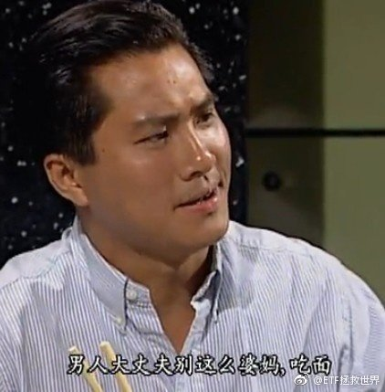

## 2018-01-31 22:51

每日打卡（171）

坚持 ​​​
 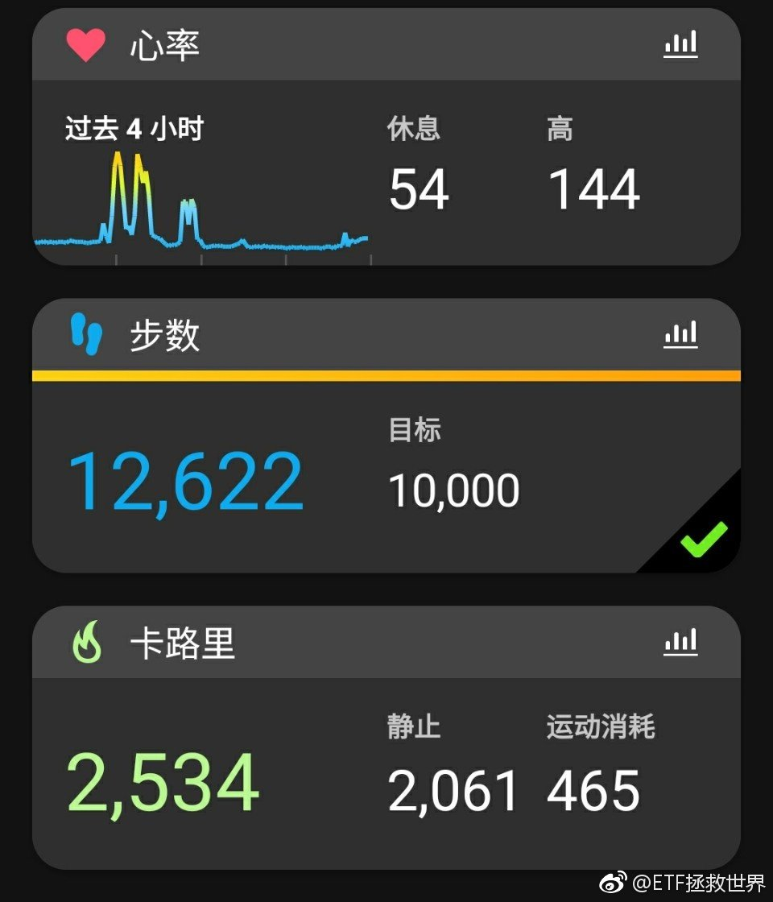

