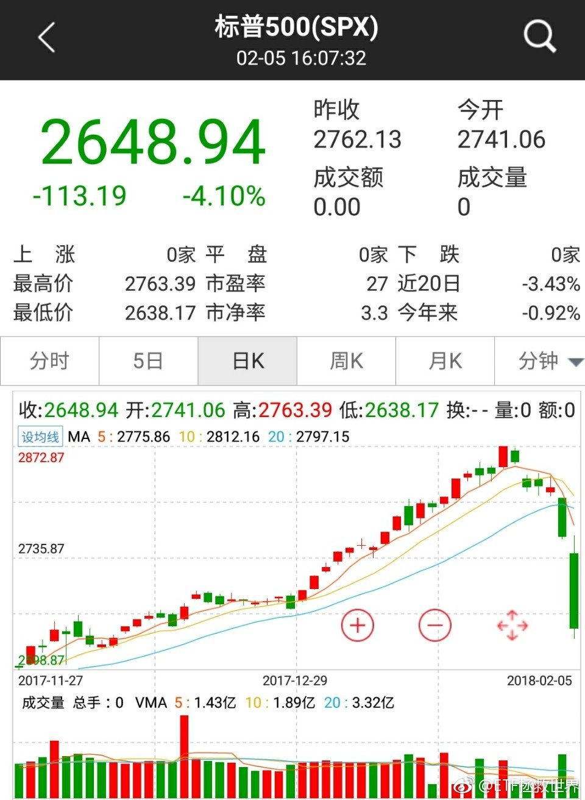
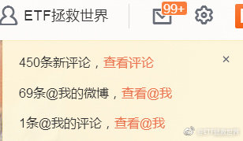
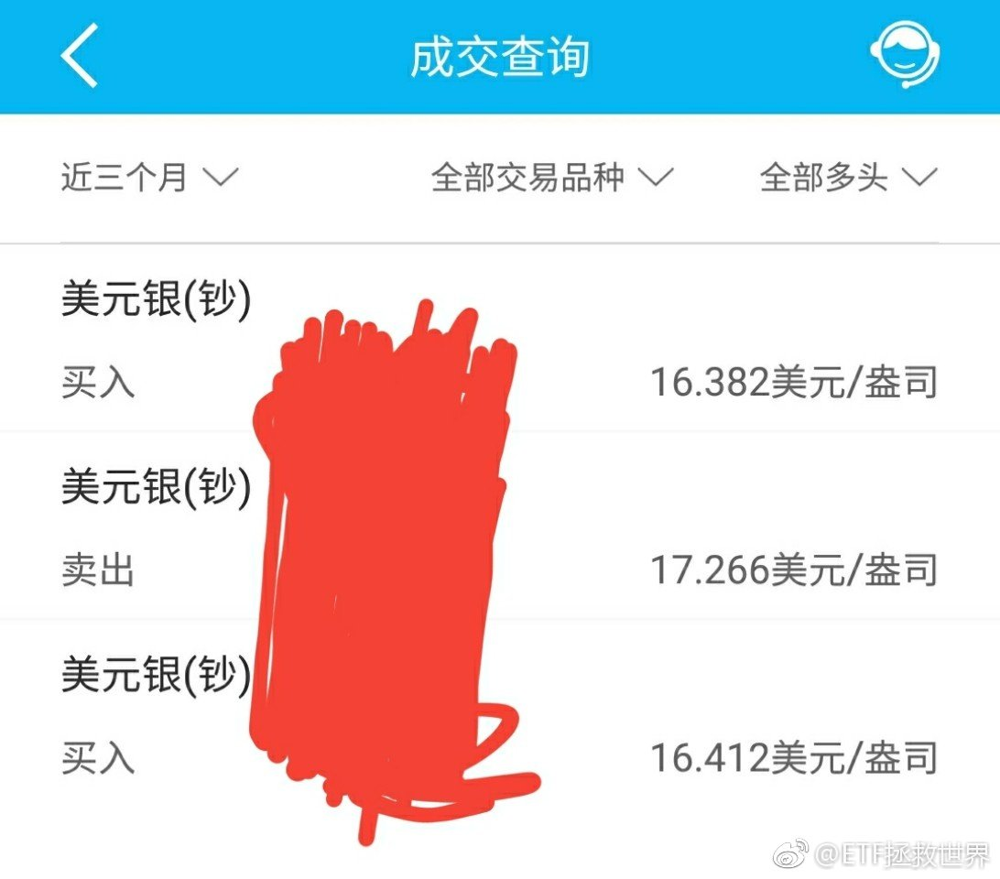
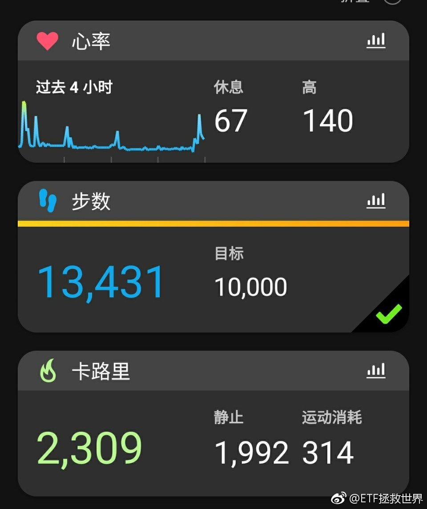
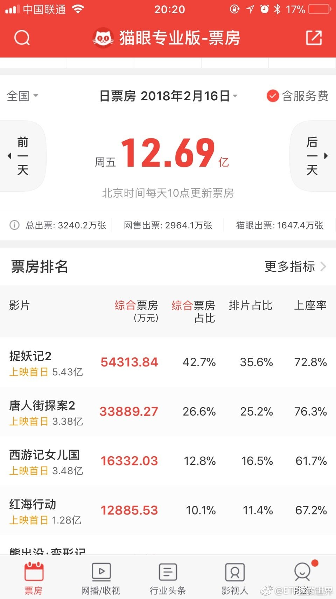
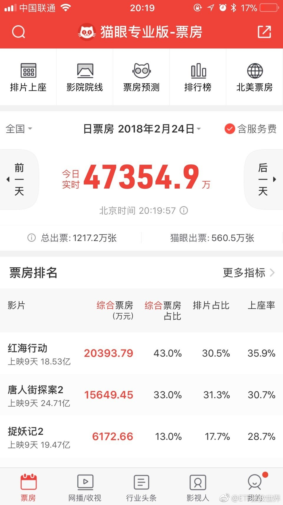
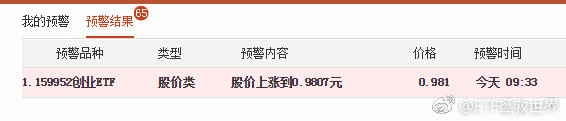

## 2018-02-01 08:37

回复@Halle噜呀:有人在行动。

## 2018-02-01 09:08

回复@文森特isALLIN:你说的哪个股指？1月24日计划与沪深300同创新高，之后沪深300下跌2.6%，计划回撤1.18%。其它指数，中证500低于9月高点10%，中证1000更是在昨天创出三年新低。你说的是哪个指数？//@文森特isALLIN:e大，最近股指不是涨了好多嘛？为啥咱们的计划一直在跌呢？

## 2018-02-01 09:40

基本上从这个月起，只要没有大幅反弹，计划应该就开始进入“真正”的建仓期了。

之前的算是少量配置期。

目前这个区域，自从2014年6月突破后，4年后才回来，真的很不容易。

可以买买买了。

不过也不要特别乐观。上一轮在2011年9月跌入这个区域后，三年后的2014年才再次突破，这么长的时间，可以说会对很多人的心理以及生理上造成很大的痛苦……

总而言之，一切都在向越来越好的方向发展。战胜恐惧的考验要来临了。

> yedn:“之前的算是少量配置期”，但是之前已经买了80份左右了啊，如果不出现“极度价值”，剩下可买的也就20-30份了，量也不多啊，除非有“极度价值”，不然这个建仓期也建不了多少，所以，我理解E大的意思是从现在开始，“极度价值”已经是可期待的了？
>> ETF拯救世界:没有这么多。大量的恒生油黄金债券。我这里说的是A股。

> 有风张尽帆:e大，这个区域是全市场外部加权估值25倍左右么？
>> ETF拯救世界:等权35以下

## 2018-02-01 09:58

昨天评论707条，有83.5%是吐槽买的太少的。

图样。

你们对资本市场的风险根本一无所知…… ​​​

## 2018-02-01 10:25

回复@yedn:没有这么多。大量的恒生油黄金债券。我这里说的是A股。

## 2018-02-01 10:52

中证1000如果到4500-5000我不会吃惊。跌破4500会比较出乎我的意料。

## 2018-02-01 10:55

回复@人-丑-就-要-多-读-书:不是要到。再说一次，我不预测，预测不了。只是说4500-5000我不吃惊，也做好了应对策略，在预期之内。超过了就超出我的预期了。//@人-丑-就-要-多-读-书:现在6669，我没看错吧，要到5000？

## 2018-02-01 10:58

回复@菜猫时代:30%并不可怕。这个幅度，完全可以把总成本控制在距离底部10%-15%的区域。之后就是关上账户几年后打开数钱。这是说指数。个股我可不敢说，弄不好有些股票永远也涨不起来了。//@菜猫时代:可能还有2000点，30%，太可怕了。

## 2018-02-01 11:02

回复@马甲不停:2月有可能随时发车。目前的情况来看。昨天不是说了吗，弄不好情人节有大礼包。//@马甲不停:今天是不是再多增加一份？

## 2018-02-01 11:10

好久没有买医药和养老了吧。你看这不就回来了。不用急，该买肯定买，这两个加起来至少要20%仓位呢。 ​​​

> no哚咪:e大，环保怎么说呢？
>> ETF拯救世界:该买的时候会买。这个不会太多，可能就给5%。

## 2018-02-01 11:19

记住，2年前恒生浮亏超过10%。现在60%+

哪个品种浮亏超过这个再操心吧。别有点波动就急得不得了。

记住，你买的是指数，不会死。你还有很多很多钱没买下去，以后成本会很低，会赚钱的。 ​​​

## 2018-02-01 14:00

回复@mp86pgd:你为什么会这么机智。清华毕业的吧！//@mp86pgd:我改成了红跌绿涨，现在看见红色也就美滋滋了

## 2018-02-01 14:01

回复@python路:每天少好几万。谁能安慰一下我。//@python路:e大千万级资金，这几天回撤也有几十万，还时不时安慰几万块钱小散，佩服佩服

## 2018-02-01 14:54

随时准备开车。留几份现金没错的//@ETF拯救世界:回复@马甲不停:2月有可能随时发车。目前的情况来看。昨天不是说了吗，弄不好情人节有大礼包。//@马甲不停:今天是不是再多增加一份？

## 2018-02-01 15:10

回复@小涛子大人:你有点能体会到我20121128的感受了//@小涛子大人:收盘手已经激动得颤抖了，能生在这个时代太好了//@ETF拯救世界:随时准备开车。留几份现金没错的//@ETF拯救世界:回复@马甲不停:2月有可能随时发车。目前的情况来看。昨天不是说了吗，弄不好情人节有大礼包。

## 2018-02-01 15:19

700多条留言了……我先不看了，跑数据去了。

数据如果特别好就加车。反正如果不反弹，情人节那车肯定不会小。 ​​​

## 2018-02-01 15:27

全市场出来了，2014年6月以来新低。我有个想法。

## 2018-02-01 15:45

怎么说呢。就是那种感觉吧。

姑娘们，想买的包包，漂亮衣服。男人们想买的各种3C产品，汽车。一直想买，等了两三年，终于开始打折了。已经6折了。三折就在不远处。

就是这种感觉。体会一下。 ​​​

## 2018-02-01 19:55

1000多条，一条条看完了。

行了，以后不会受到噪音干扰，一个字，就是干。 ​​​

## 2018-02-02 09:41

节奏是艺术。

## 2018-02-02 09:47

回复@0瞎晃悠0:不会连续下跌的。要吸引一部分人冲进去接盘抢反弹，然后才能继续跌。这个位置，暴跌没有大事，阴跌才会跌透。//@0瞎晃悠0:求教：之前说提到过大概6-9个月，看这架势5月底之前是不是就差不多了？//@ETF拯救世界:节奏是艺术。

## 2018-02-02 10:34

反弹了就踏实了，不考虑加车了。该干嘛干嘛去吧都。。 ​​​

## 2018-02-02 10:55

回复@后生天天uping:估值比2016年同样的点位已经下降25%了。这就是指数投资只要买的不贵就极大概率会赚钱的重要原因之一。如果再过两年指数点位还不动，就是历史最低估值！//@后生天天uping:回复@小涛子大人:几乎是16年的水平了

> 蜜蜂猴子葡萄蝙蝠:咨询E大，咱们的计划，以后创业板和证券ETF会分别配置百分之多少呢？@ETF拯救世界  谢谢
>> ETF拯救世界:创业10-15，券商5-10
>>
>> 攸宁陶陶:回复@ETF拯救世界:请教E大，中证500是给到多少？10-15%吗？[作揖]
>>
>> ETF拯救世界:回复@Constance康斯坦丝:15-20

## 2018-02-02 11:17

回复@Cubic_N:都在考虑中。所以信息已经远远低于中枢为什么我们还没买//@Cubic_N:E大你的模型中会考虑估值中枢的变化吗？国内的经济发展和债务现状已经不容乐观了呀

## 2018-02-02 13:56

喷了，情人节的礼包得多大啊。 ​​​

## 2018-02-02 13:59

我四岁儿子昨天晚上跟我说：“XX（女）在校车上抱着我的胳膊，靠着我。”“为什么？”“她可能喜欢我。”“你说什么？”“我没说什么，挺舒服的。”“……”

## 2018-02-02 14:55

回复@glay_lee:没有调低预期，本来就给它的预期配置少，买2%了，不会再买太多了，接下来的会用于将它的成本降低到最低点10-15以内

## 2018-02-02 16:46

回复@协和雪碧:给你打气，环保PE已经到了2012年底最低值附近了。我不敢说它不会大跌了，总之你长期拿这个价格不会赔钱。我有这个自信。拿着吧。忘了它就行了……//@协和雪碧:回复@BuBu蛇:是我错了… 提前加仓了，现在套的想哭

> x-titans :请问E大，现在的A股权益仓位给到多少？
>> ETF拯救世界:35-65
>>
>> 有风张尽帆:回复@ETF拯救世界:这范围有点大哈
>>
>> ETF拯救世界:回复@西风将起:因为每个人风格不同。激进，保守

## 2018-02-02 16:57

回复@LEVELEEE:还没低于当时，不过接近了。我买哪个都是有节奏的。各位也可以从环保上体会一下未来也许会出现的情况，也就是说，我们建仓基本完毕了，又跌了10%，做个心理准备。当然环保还没完……

## 2018-02-04 21:41

每日打卡（142）

明天崩不崩。痛快点，大家都很忙的。 ​​​

## 2018-02-05 09:52

不要催，不要问。节奏我会控制好。就酱。//@ETF拯救世界:节奏是艺术。

## 2018-02-05 10:17

买也好卖也好，永远问问自己舒服不舒服。也就是目前的情况下跌30%和上涨50%，舒服不舒服。 ​​​

## 2018-02-05 10:35

五粮液下跌快20%了。

所谓价值股就可以闭眼买入，这种思维被不断灌输进很多人的思维中。

很多人这几个月突然发现以前不赚钱是因为没有买入“价值股”，现在终于找到了一条赚钱的终极之路。

上涨的时候买入短期会很舒服。因为上涨趋势中，你怎么买都会赚钱。但是趋势一旦改变，你就会欲哭无泪。

下跌趋势买则不同。控制节奏的买入，一定是越买越亏。然而你会发现趋势改变后，开始享受赚钱的乐趣。

这种事情，你不经历两次，是体会不到的。

## 2018-02-05 13:40

其实很多时候，我们看的鸡汤都将“努力”忽悠的有点过分了。

人这一辈子，运气其实同样重要，很多时候甚至更重要。

比如中证500，咱们如果可以在4500买到，那就是运气极好的。5000以下也不错，可以说未来5-10年的不错收益率可以保证了。

当然，努力也非常重要，否则运气来了的时候也抓不住。运气走了有可能会更倒霉……只是，有时候光努力，没运气也没用。不过这个没办法，都是天意了。

## 2018-02-05 13:48

回复@请输入昵称_昵称:2008年我的博客，那时候我刚7岁：网页链接 //@请输入昵称_昵称:最近流行一命二运三风水四积阴德五读书，几千年传下来有点道理

## 2018-02-05 14:50

如果医药这次有机会到理想区域，未来恐怕就不是5-10年的问题了，而是10-15甚至20年不用担心金融投资收益率……

在一般情况下，至少不会差。如果碰上疯牛慢牛，收益率就会很棒。只是不知道有没有这个机会，都是天意。

这是一个2005-2015十年二十倍的指数…… ​​​

## 2018-02-05 14:59

回复@静待晚秋:医药现在的估值比2005年高67%……如果以那个标准的话，不用急。不过那个情况真的太难得了。//@静待晚秋:意思是医药有可能下来，我还没上医药车呢。

## 2018-02-05 15:32

今日最新数据，全指医药估值跌回2013年6月水平。也就是说近五年最低。（绝对值依然不低）你们都没有意识到目前大部分股票每天这么跌到底意味着什么。美丽新世界。//@ETF拯救世界:回复@静待晚秋:医药现在的估值比2005年高67%……如果以那个标准的话，不用急。不过那个情况真的太难得了。

## 2018-02-05 22:05

每日打卡（143）

越来越近了 ​​​

## 2018-02-06 06:13

美国证 监会干嘛吃的，为什么不组织花旗高盛筹集资金救市。

美联储为什么不投两万亿美金买道琼斯30。

我看美国不行，迟早药丸。 ​​​

## 2018-02-06 06:18

回复@葫芦岛心灵的旅途:你这个想法非常大胆。负责任的告诉你，如果真的如此，必提前开卡车//@葫芦岛心灵的旅途:迟早要买，我们也要买。 一个想法，不一定对。 中午跌狠了，有车加吗，比如中正500跌4%

## 2018-02-06 08:21

回复@不畏雾霾遮望眼:我反手就给你一…………张车票

## 2018-02-06 08:51

回复@用户6099242654:昨日505只标普500成分股中，有两只上涨。503只下跌。1946只罗素2000成分股中，87只上涨。//@用户6099242654:谁能来一个美股上涨跟下跌股票的比例？//@ETF拯救世界:回复@葫芦岛心灵的旅途:你这个想法非常大胆。负责任的告诉你，如果真的如此，必提前开卡车

## 2018-02-06 10:39

我急需开发一个盘中可以计算估值的工具。 ​​​

## 2018-02-06 11:18

想干，但是数据要15:30才算出来。中午试着弄一下盘中数据吧。不知道准不准。

## 2018-02-06 12:12

干了。先不看留言了，出去走走。去吹吹风……//@ETF拯救世界:想干，但是数据要15:30才算出来。中午试着弄一下盘中数据吧。不知道准不准。

## 2018-02-06 12:45

回复@天影198:瞧瞧人家……//@天影198:中午出去吃泰国菜，想着EE还要在办公室算数据，想给你带个外卖🍗//@ETF拯救世界:想干，但是数据要15:30才算出来。中午试着弄一下盘中数据吧。不知道准不准。

## 2018-02-06 13:07

159938场内不要溢价抢！！！ ​​​

## 2018-02-06 13:16

有没有闻到恐慌的气息。

别人的，你自己的。 ​​​

## 2018-02-06 13:51

再说一次，指数基金不会死。而且我们买的都至少是不贵，有的已经算是便宜。给时间，一定会有好结果。第二，还有很多资金，会尽量将成本控制的比较低。第三，我相信绝大多数人每天减少的资产不会比我多。踏踏实实的。多大点事儿啊……

## 2018-02-06 13:56

NO！！！ ​​​

## 2018-02-06 14:29

回复@我在故快乐:讲真，现在还远没到拼信仰的时候……//@我在故快乐:将来会加倍还给我们的，在这个时候，就是有没有信仰，能不能坚持执行的事了。

## 2018-02-06 14:41

今天这是管不了了还是撒手不管了……很放纵的感觉啊。 ​​​

## 2018-02-06 14:53

回复@Chaos怒了:500跌20%-25%我已经满仓。说到做到，做不到发一万块红包给你们。//@Chaos怒了:我估算500再跌20%-30%才到拼信仰的时候//@ETF拯救世界:回复@我在故快乐:讲真，现在还远没到拼信仰的时候……

## 2018-02-06 15:08

回复@冷饮疯子:明天要有几百家停牌了。//@冷饮疯子:411家跌停，108比3015

## 2018-02-06 15:29

今天的数据感动到想哭。 ​​​

## 2018-02-06 17:40

今天分级A大涨……

## 2018-02-07 09:28

回复@小小的nananana:昨天只是一个预演。各位。好好体会一下昨天自己的心情，自己做了些什么。是害怕的卖出还是高兴地买入。这个预演对未来也许会出现的极度黑暗之下自己该怎么做有很大帮助。一点点累积正确的经验，不断进步。不要总是犯同样的错误。//@小小的nananana:益达，这次择时太给力啦！

## 2018-02-07 09:33

有时候当时的感觉是无比黑暗再无希望，其实到了事后再想，都是风轻云淡。

但是这种感觉你自己不体会一次并不能理解。 ​​​

## 2018-02-07 10:48

美帝甩锅了：你A下跌与我无关 ​​​

## 2018-02-07 11:01

真的很感慨，也很感动。

等了几年，又一次资产飞跃的机会要来了。

耐心真的是优质特征。 ​​​

> 韭菜笑天:E大，深圳交易所公布的中小板平均市盈率现在是38倍，极度低估时曾经到过18倍。从这个指数看市场如果极端情况下还有可能下跌50%，请教您怎么看？感觉您比俺更乐观。
>> ETF拯救世界:金融危机可能。没有金融危机30%到头了。做投资就怕涨起来信心百倍，跌下去感觉无限深渊。

## 2018-02-07 13:41

吃顿饭回来这样了，不知道从何看起…… ​​​

## 2018-02-07 14:10

……原来你竟然是这样的五粮液……

## 2018-02-07 14:58

为什么感觉队里的兄弟有点破罐子破摔了。

爱谁谁，不管了。 ​​​

## 2018-02-07 16:54

这种情况会越来越多的。中小股票跌了这么多年，终有一天会被价值发现。投资者不发现，公司就自己发现。

## 2018-02-07 17:09

回复@幸福呱呱:大家注意！我不是说兔宝宝好！也不知道这次回购安的什么心。我是说，跌的太低了，回购和增持会越来越多的。价值发现。。。绝不谈个股！//@幸福呱呱:E大能带着炒股吗？新手这就开账户去

## 2018-02-08 07:36

价投命短的积累钱少，都没法成名。复利导致最后十年可能赚到所有财产的90%。//@买买提X:这个不懂，老外的说法是做长线价值投资的长寿~

## 2018-02-08 08:52

最近白银波动也小了，一个月成交一笔…… ​​​

## 2018-02-08 09:27

年度私募冠军很少有善终的。不信把近十年私募冠军拿出来看看。第一没什么好，长期保持在前30%的才是最棒的

## 2018-02-08 09:50

前天难道又是阶段最低 ​​​

## 2018-02-08 11:29

怎么搞的。是不是参加冬奥会去了。

## 2018-02-08 12:15

回复@中江笑天:金融危机可能。没有金融危机30%到头了。做投资就怕涨起来信心百倍，跌下去感觉无限深渊。//@中江笑天:E大，深圳交易所公布的中小板平均市盈率现在是38倍，极度低估时曾经到过18倍。从这个指数看市场如果极端情况下还有可能下跌50%，请教您怎么看？感觉您比俺更乐观。

## 2018-02-08 14:15

谁能想到这么快！

## 2018-02-08 15:53

我反思了一下，最近总是黑“蓝筹股”也是不对的。

毕竟无论是恒生、50还是红利，都只有15、16倍的估值，绝对值来讲真的没那么贵。也就是说，它们的成分股，大部分并不会让你套3-5年。

有些“蓝筹股”还是会套。这个也没办法。

我只希望红利继续压一压，咱们继续买。总体看，大盘、价值股配置的还是不够，希望有机会继续加。

## 2018-02-08 21:53

每日打卡（144）

快过年了 ​​​

## 2018-02-09 05:38

很多人会慢慢感受到风险的真正含义，节奏是最重要的。//@ETF拯救世界:节奏是艺术。

## 2018-02-09 06:10

回复@事以理成:现在看要不了这么多。最多最多五份。没到扫射区域//@事以理成:帅帅的益大，情人节大礼包准备10份够不够？年前资金紧张，要提前预留出来。//@ETF拯救世界:很多人会慢慢感受到风险的真正含义，节奏是最重要的。//@ETF拯救世界:节奏是艺术。

## 2018-02-09 08:40

回复@罗司徒:是啊。现在这么跌你要做空美股吗。任何时候我都不做空。//@罗司徒:前段时间还说永远不要做空美股，享受泡沫//@ETF拯救世界:很多人会慢慢感受到风险的真正含义，节奏是最重要的。//@ETF拯救世界:节奏是艺术。

## 2018-02-09 11:55

又开了一上午会。 ​​​

## 2018-02-09 12:12

先别说那么多，又是300多条评论没看了。

我就说两个字，冷静。

然后再想，指数不会死。我们买的不高，会回去的。还有很多钱，可以买到便宜货了。三折那种。

冷静了吧。

踏踏实实看戏，执行策略。 ​​​

## 2018-02-09 12:16

至于要不要提前开车，对不起，没到时间，还有两个交易日，我没理由破坏规矩。到时候可能更高，也可能更低。除非今天数据出来特别NB，我周日晚上加车，否则还是按时。

## 2018-02-09 13:08

先准备十份，能不能用得上我不知道。 ​​​

## 2018-02-09 13:50

回复@ETF拯救世界:兜兜转转一个多月，终于回到我能理解的29500下方。感谢市场。

## 2018-02-09 14:42

今天真的没时间看评论了。一天都很忙。这种时候要做正事了。 ​​​

## 2018-02-09 17:07

今天NB了。1%资产蒸发了。

1%！！！！其实是1点多！

有没有人抱抱安慰一下。 ​​​

## 2018-02-11 09:11

上班的打个卡，互相安慰一下。

不开盘为什么要上班！ ​​​

## 2018-02-11 10:29

我刚才想到一件事。

其实我特别想看看各地的朋友是怎么过年的。吃什么啊，玩什么啊，有什么有意思的事儿啊。要不咱们创建一个话题，各位把过年的照片都发到自己的微博上，然后加个话题，让我眼馋一下，哈哈。

然后我选一个觉得最好的，送一本达里奥的《原则》给你……如果好的照片多也许还有别的礼物。

话题就用 #EE开心过年# 吧……

## 2018-02-11 19:45

#ee开心过年#   超赞啊朋友们！今天外面忙了一天，回来看到这么多朋友已经开始发照片了。感觉到年味了！

直接点上面这个话题就可以看。自己发的微博加上 #ee开心过年#  别人就都能看到~~ ​​​

## 2018-02-11 22:51

每日打卡（145）

看雪球，觉得私募锁定五年才合理。就是不知道有没有人买了…… ​​​

## 2018-02-12 09:11

为什么我一直想去一次山西呢……今年必须去。

## 2018-02-12 09:13

一定要找个时间自驾周游一圈，请各位带我去吃当地最好吃的好东西了。

## 2018-02-12 09:20

月中发车是这样，如果继续大跌就今天发。如果反弹了就明天白天或者晚上发。就酱 ​​​

## 2018-02-12 09:30

2008年，我为什么会一直到9、10月开始买，11、12月才把绝大多数仓位买进去。

说起来你可能不信，那时候我看趋势。

我的一套判断趋势的方法，在上涨/下跌趋势非常明显的时候特别好用，震荡市不好用。

迄今为止，主要以趋势为投资依据，只有2008年一年。但那次真的救命了。其它的时间，是价值为主，趋势为辅。

以这套趋势系统看，目前的各个指数并不乐观。所以你也能看到，类似于张老师的28那种趋势策略，在上周是清仓的。

## 2018-02-12 09:36

微博上都是自己人，有些话可以说的稍微明白一点。

对于资管机构来说，公募还好点，尤其是私募。天生的有重仓满仓的冲动。因为客户的资金对于资金管理人员来说，其实是免费的杠杆。只有赚得越多，他们才能提成越高。

但是就像人和人不同，私募和私募也不同。有一部分私募是真的希望与客户双赢，以为客户保值增值为前提去投资。一起做大一份事业，比如老巴。

大部分私募更希望将这份免费杠杆用到极致，多赚钱，多提成。

还有一部分就不说了，简直是垃圾了……

所以投资私募，其实是投人。一要看人品，二要看水平。否则，水平越高，人品不好，合作的人越惨。

其实基本上所有事情都是如此了。

## 2018-02-12 10:34

回复@我是子轩的爸爸:这就是相信自己主观能力还是相信自己的策略。这不是分裂，是一种选择。//@我是子轩的爸爸:张老师刚刚发文说，本周大买特买沪深300指数基金c端抄底。而他的二八策略上周五刚刚清了。也蛮“人格分裂”啊。做投资真不容易。

## 2018-02-12 10:36

回复@落宾:是的。我一不撕逼，二不炒作，你想在微博的茫茫人海中找到我很难。所以一定是真爱才会关注我……//@落宾:老大，微博上反倒基本都是您的粉丝居多？有点难以置信，微博是比雪球更开放的平台哦

## 2018-02-12 10:40

回复@谢日_40447:我会设计完善自己的策略，然后在科学执行的时候加一点点艺术。肯定不会自己的策略要求我买，我自己卖。我不相信自己，因为我有喜怒哀乐。我更相信没有感情的机械化策略。//@谢日_40447:e大，主观能力和策略哪个更重要

## 2018-02-12 14:47

涨一天牛市来了，跌一天瑟瑟发抖。

这是病，得治。

不要怕抄不到底。多那么两三个点的成本，毫无所谓。一个是放到长期来看不重要。一个是卖的时候晚一周就能多十个点的收益。

还是按节奏，大概率明天发车。 ​​​

## 2018-02-12 16:14

我A收盘后你跳，辣鸡。

## 2018-02-12 17:59

利好保险股，参保率将大大增加。别问我为什么这么想，因为我已经开始找合适的补充医疗保险了……有没有懂的推荐一下……

## 2018-02-13 09:01

回复@讨厌抱怨:巴菲特会一直买到成为大股东，然后进入董事会改造或者维持公司。华盛顿邮报如此，富国如此，盖可也是如此。买错了就重组，比如哈萨维。//@讨厌抱怨:不知道怎么做到比ceo还了解公司的

## 2018-02-13 11:32

大卡车变独轮车了，各位，开车了…… ​​​

## 2018-02-13 13:39

玩儿我呢4不4.

## 2018-02-13 22:03

每日打卡（146）

今天有没有虚度。 ​​​

## 2018-02-14 09:15

看见这个我想起来有一次在张家界爬山，下大雨，到山上全身湿透了，又饿又冷。山上有个饭馆，只有辣菜。从不吃辣的我，就着那些辣菜吃了三碗米饭……从此开始能吃辣了。。

> @你好大麦茶
> #ee开心过年#湖南腊肉，山里冬笋肉片汤，油炸小鱼，围炉夜话，开启养猪模式 ​​​

## 2018-02-14 09:40

#ee开心过年# 校车上小姑娘抱着的就是他，别让他跑了！ ​​​

## 2018-02-14 14:42

至少昨天开车比今天强。人生中的小确幸……

## 2018-02-14 17:07

没杀过。晕血的朋友不要点进这个话题了，又是杀鸡又是杀羊的场面太刺激了。虽然红色是好兆头……哈哈。

> @长睫毛的小都
> #ee开心过年#又在媳妇儿家过年。每年来陕西，性格豪爽却从没有杀过鸡的岳父都会指派姐夫捉鸡、杀鸡，几年下来，姐夫也是一个杀鸡的好手。E大杀过🐔吗？[馋嘴][笑而不语] ​​​

## 2018-02-15 10:06

亲们，别忘了看公众号消息呀。 ​​​

## 2018-02-15 19:03

哈哈，2、3分钟之内就抢完了。厉害了你们。抢到的朋友来说说抢了多少。

祝大家新春大吉，资产嘉玲！过年去了！ ​​​

## 2018-02-15 19:42

回复@刘新锋96829:10分钟是红包包好到抢完的时间。我提前8分钟1852包好红包，然后1900发提示开始，1902抢完。。//@刘新锋96829:怎么两分钟就没了，提示又说10分钟抢完。

## 2018-02-16 10:32

哈哈，不错。为什么每个菜上都放两片胡萝卜……

## 2018-02-16 13:36

别吃了，说你呢！ ​​​

## 2018-02-16 20:44

每日打卡（147）

螳臂挡车 ​​​

## 2018-02-20 17:34

看了看评论的贴图，怎么讲，这样拥挤的旅游倒贴我钱我都不去……加点钱境外游多好，最讨厌人多的地方。

> 瞪羚下跳棋:e大，据说罗素2000市盈率120？真的假的？
>> ETF拯救世界:25左右

## 2018-02-21 22:15

每日打卡（148）

有时候练了忘了打卡。

明天赌场又要开门啦。 ​​​
 

## 2018-02-22 09:51

看着好吃啊。

## 2018-02-22 09:51

棒。有机会一定去看看。

## 2018-02-22 09:52

前几张貌似是个奥莱。喜欢逛美国的奥莱……

## 2018-02-22 09:54

棒！新疆菜是我的最爱之一

## 2018-02-22 10:00

饺子包的很有特点！

## 2018-02-22 11:26

回复@循环的风景:这轮调整接近最低点的地方开两次车，买了4份。别人在割肉，你在买买买。计划应该能先于所有指数创出新高。至于说买的够不够多，继续看看再说。//@循环的风景:一涨就感觉上不了车了//@ETF拯救世界:饺子包的很有特点！

## 2018-02-22 15:25

谁一个月前这样说：“我们现在正处在黄金时期。通货膨胀不是问题。增长是好的，一切都非常好，税收法律的变化带来了巨大的刺激。美国公司减税将进一步推动经济和股市进入第九个好年头。在这种背景下，达里奥说持有现金而不是投资风险资产，如股票，可能是一个错误的策略，可能会使投资者损失。”

## 2018-02-22 15:34

回复@胜兵先胜Alvin:其实主要还是看他做了什么，而不是说了什么。有没有可能声东击西，明修栈道，也有可能。继续观察。//@胜兵先胜Alvin:我最近还在读他的《原则》。但是从最近他的几个言谈和行为来看，桥水很没有原则啊

## 2018-02-22 22:03

每日打卡（149）

其实还做了深蹲 ​​​
 

## 2018-02-23 10:51

目前仓位已经很合适了。除非A股整体估值下降到下一个区间，否则不会再大幅加仓。 ​​​

## 2018-02-24 11:13

老百姓还是不富裕，毕竟发展中国家。东京人均收入是30万人民币。美国是五万多美元。然而房价差的不多了

## 2018-02-24 20:01

每日打卡（160）

今天看了红海行动，很燃，这几年我唯一给五星的国产片。

激发男性荷尔蒙。以后每天要加一组运动了。

如果你也喜欢，可以再去看看疯狂的麦克斯，MAD MAX 4，同样很燃。 ​​​

## 2018-02-24 20:10

回复@ETF未来式:我给战狼二的打分。 查看图片 //@ETF未来式:和战狼2相比哪个更好哟

## 2018-02-24 20:23

红海 唐人街 捉妖同日上映。第一天无论票房还是排片，红海都远远落后，甚至比不上女儿国。

再看今天。红海已经连续第二天逆袭拿到单日冠军。这完全是口碑的逆袭。

好东西就是好东西，人民是有分辨能力的。好不好，时间会给出答案。 ​​​
 

## 2018-02-26 08:04

不想让别人听到的话，最好不要说。 ​​​

## 2018-02-26 09:41

回复@终生专注交易和养生:谢谢你帮我用实例完美论证了我的结论。虽然是因为你没有好好看我说了什么吧。//@终生专注交易和养生:你没见过日本房价跌幅，70%，你也没见过香港房价跌幅65%，你没见过2008年A股跌幅80%吗

## 2018-02-26 09:48

即使在相对擅长的领域，我也会错。太正常了，谁不会错？谁要说自己不会错谁就是傻子，或者骗子。

“错”的原因，一方面是因为自己的眼界和知识所局限，一方面是整个人类的认知水平所限——也就是说，其实绝大多数人都是错的，你也跑不了。

错了很正常。不过有两点需要注意：

第一，你犯的错会不会让你死。或者会不会让你重伤到缺胳膊断腿。我觉得这都是不能接受的。

第二，错了以后能不能反思帮助自己成长。能，这个错就没白犯。不能，就是废柴。

有时候回头看以前自己说的话，觉得很2，那就对了，因为你成长了。但是如果以为自己现在说的话不2，那就太2了……2是常态……

## 2018-02-26 09:58

回复@wander0403:说美股。2000年纳指最高点5132,2002年最低点1160，是最高点的22.6%。完美。这里说的是极限，并不是说每次都会跌到。注意审题。

## 2018-02-26 10:08

回复@王冠every:到不到不是我们要考虑的。不能死等到，也不能判断肯定到不了。我们要考虑的是：如果到了30%或者20%，我们不会死，或者说，你能接受这样的损失。按照这个原则，布局。向死而生，会过的很幸福。

## 2018-02-26 10:25

回复@厉欧:估值跌幅肯定不重要，因为与时间有关。另外，估值没有一个“必然”的区间。你觉得20很低，可能会继续到10，又可能到5。所以要从很多维度去考虑，找到一个大概率的共振区间。当所有维度都指向一个地方，那个地方恐怕就很值得关注了。

## 2018-02-26 10:53

回复@关耳人圭:我看过一千多部电影。真的觉得不错的才会推荐……//@关耳人圭:看了益达推荐昨天去看了红海行动~震撼啊！

## 2018-02-26 11:21

三星的系统慢问题不解决不会再买了。虽然屏幕和相机真的太棒了……一个好点的系统对三星来说就这么难吗，真的不理解啊。

> @日经中文网
> 【三星3月16日上市Galaxy S9】
> 
> 在移动通信展览会“世界移动通信大会（MWC）”开幕之前，韩国三星电子发布消息称，将于3月16日发售最新款智能手机“Galaxy S9”。除了新增自身开发的人脸创作3D表情功能之外，还提高了摄像头的性能。受电池起火问题的影响，三星2017年没有发布新款智能手机，其希望通过此次的新款在增长开始放缓的智能手机市场维持首位宝座。
> 
> 在该公司总括IT＆移动沟通部门的DJ Koh表示，“沟通的方法不仅限于电话，正日趋多样化”，还表示“共享照片、利用表情文字的服务也日趋重要”。
> 
> 此次发布的旗舰机“S9”和“S9 plus”可识别人眼的颜色，拍出最佳照片，并从多张照片中自动选出最好的图像。此外，增加了能拍摄慢动作视频、并将完成编辑的影像迅速与朋友共享的功能。
> 
> 由于美国苹果的最新款智能手机“iPhone X”是与S9系列相同的高价位终端，可以说三星强烈意识到“iPhone X”。关于iPhone X，采用卡通人物的3D表情包和将面部对准屏幕即可进行认证的“Face ID”曾成为关注点。
> 
> 另一方面，三星的S9可以利用自己的脸和表情创作3D表情，并通过SNS（社交网站）发送给朋友。三星方面表示，智能手机的认证将面部和虹膜识别相结合，“安全性能将明显好于竞争对手的机型”。显示屏的尺寸与iPhone X同样为5.8英寸，采用有机EL。
> 
> 不过，大部分功能已在三星以外的智能手机上得到应用，S9在功能层面整体缺乏创新性。
> 
> 据美国IDC数据，2017年智能手机供货量下降0.6％，为14亿7240万部。三星的市场份额为21.6％，依然居首位，但在欧洲和亚洲，面临中国华为技术等的攻势。三星希望在已迎来平台期的智能手机市场扩大市场份额，但正处在艰难的局面下。
> 
> 日本经济新闻（中文版：日经中文网）大西绫 巴塞罗那 报道

## 2018-02-27 08:16

投资中可能遇到的情景是可以穷举的，所以如果一个投资者把每一个情景出现的时候的决策原则都提前想好，面临决策的时候只需要针对当时当地特定的情景进行模式识别，然后按事先设定的准则行事，其决策的准确度和效率都会大大提高。而这一套决策准则在经过现实生活中不同的决策情境的测试考验中不断改进和完善，最终会帮助投资者获得成功。

——来自我那本还没送出去的《原则》

## 2018-02-27 09:23

回复@glay_lee:一本书，能有一两句话让你提高境界就值了。就像一次旅行，有一两张满意的照片就不错了……//@glay_lee:略有失望，但是对其中的心理学和脑科学的分析感兴趣，原则五步法也比较实用。其他的感觉一般。

## 2018-02-27 09:32

尤其是老外的书。你们发现没有。其实一本书，基本上两三句话，最多一页就能说清楚的事，他能写一本书。特别神奇，真的。全是各种案例，各种废话。神了！//@ETF拯救世界:回复@glay_lee:一本书，能有一两句话让你提高境界就值了。就像一次旅行，有一两张满意的照片就不错了……

## 2018-02-27 09:38

悲剧了。预警报出来了，该卖了，结果找不到哪个账户买的了。

前一段时间每天各种策略买太多，忘了记账了…… ​​​
 

> carol_张 :e大，刚开始在且慢上跟您买，且慢的补仓策略就是低于您的建仓价就建议补仓。那么请教您的长赢策略只有买进，从来不卖出吗？
>> ETF拯救世界:从前两次计划的情况看，基本是建仓期两三年，持有期两三年，卖出期半年到一年
>>
>> carol_张:回复@ETF拯救世界:谢谢答复。我看您的计划15年8月建仓，差不多2年半了，建仓79份，建仓进度不算快。是否这次周期会有所拉长呢。或者后面加速。。。？
>>
>> ETF拯救世界:回复@carol_张:不出意外今年内搞定

## 2018-02-27 09:46

不瞒你说，月底唯一可以买的就是传媒了。

结果它又这样。

什么意思，不让买了是吗。 ​​​

## 2018-02-27 10:28

很多人买“蓝筹股”、“绩优股”，不仅没有考虑到短期涨幅过大接盘的问题，更没有考虑到历史的进程。也就是说，这些过去的蓝筹股，随着经济环境的转变，是否还是未来的“蓝筹股”？ ​​​

## 2018-02-27 10:44

删了，还是坚持不说股票。 ​​​

## 2018-02-27 11:17

回复@Paul6_chicago:这次只到4，有点意外。我偏向于认为可以到4.5或者5以上。不过看样子今天我们的国内债券就都可以盈利了……//@Paul6_chicago:E大，十年国债算是到底了吗？@ETF拯救世界

## 2018-02-27 11:40

回复@良民博博:看你自己的策略。是长线还是短线，是吃波动还是吃长牛。//@良民博博:我也有创业etf啊，这么快就到卖的季节了？

## 2018-02-27 13:40

十年后，你回头看，A股指数投资，赚钱不是问题。

问题是，收益率。

有可能收益率很低。

所以我们要极力避免这种情况的发生。怎么避免，就是尽量买的便宜一点。

中证500，目前的点位大概是2015年2月的点位。这三年，大概只有不到30个交易日价格低于目前。也就是说，过去三年你除了这几十个交易日，任何时候买，都不挣钱。即使你在更低的几十个交易日买，收益率也非常一般。

如何不让这三年的情况在未来十年重演，最关键的就是买的便宜些。

有人说，沪深300已经回到2015年3月了啊。而且过去2年你买了都能赚的还可以，都有十几二十个点的收益。

我说，不要用后视镜看。

2012年底到2014年7月这一年多，上证50、沪深300被按在地板上摩擦的时候，人家500和小股票都飞到不知道哪里去了。

你敢保证300、50未来不会重蹈覆辙？

而且，50和300这两年表现不错，正是因为2016年2月他们够低了。

所以，买的低是最重要的。

好消息是，现在确实越来越便宜了。

> leveyleveylevey:请问500的满仓位是多少份？500已经买了10份了，估值却才是15年2月的估值。也就说这10份买的估值并不低？
>> ETF拯救世界:我是说点位。估值500已经回到2014年4月了

## 2018-02-27 13:52

获利盘还剩12%。基本上绝大多数筹码都集中在30-40之间，形成密集成交区。这只股票是观察本轮港股牛市的标杆。

## 2018-02-27 14:11

辣鸡……$中证传媒 sz399971$

## 2018-02-27 14:35

回复@小小牛XY:在这个区域，它们的仓位基本差不多了。再加仓，要下一个区域。//@小小牛XY:可惜，之前广发医药，养老产业都挺低的。。。//@ETF拯救世界:辣鸡……$中证传媒 sz399971$

## 2018-02-27 15:28

回复@请输入昵称_昵称:说得真好啊。//@请输入昵称_昵称:得意时不张狂，末路时不慌张---e大语。//@ETF拯救世界:回复@小小牛XY:在这个区域，它们的仓位基本差不多了。再加仓，要下一个区域。//@小小牛XY:可惜，之前广发医药，养老产业都挺低的。。。

## 2018-02-27 16:04

回复@gyf9422:券商=全市场杠杆指数。所以券商好的投资机会是全市场在最低区间。更好的投资机会是从最低区间开始突破时。（价值69.3万的一句话）

## 2018-02-27 21:51

很多人看PB投资券商指数。呵呵，你们不知道，真正的熊市券商的坑有多大，净资产会减少多少。看，资产减值了一个。

## 2018-02-27 21:55

每日打卡（161）

坚持。明天会很忙 ​​​

## 2018-02-27 22:07

投资股市部分不会超过30%。另外没听说过哪个机构要建仓满世界嚷嚷我要建仓了//@亟兮般若:果然是社保来了

> @央视财经
> 【大消息！人社部：逾2800亿元地方养老金已到账并开始投资】昨天，人社部副部长游钧新闻发布会上表示，去年基本养老保险基金投资运营稳步推进，北京、安徽等10个省市签署了4400亿元的委托投资合同，2831.5亿元资金已经到账并开始投资。 http://t.cn/REfAL2x央视财经的微博视频 ​​​

## 2018-02-28 09:06

回复@手机用户2828591421:我人微言轻，就算喊卖房加杠杆买入也不会影响市场。超大机构就不同了，买什么东西一定是静悄悄建仓。否则成本会大涨。除非这个机构主要目的不是赚钱。显然社保基金是要赚钱的//@手机用户2828591421:E大不就是满世界嚷嚷要建仓了吗

## 2018-02-28 09:31

潮水退去，才知道谁在洗澡。 ​​​

## 2018-02-28 09:42

今天3 6 0市值4000多亿。在美国退市前600多亿。公司没变，市值增加6倍多。

大型魔幻现场。 ​​​

## 2018-02-28 09:56

长期看，大概率赚大钱的股票就是：

吃 喝 玩 乐

还可以加上

生 老 病 死

其它的，阶段性玩玩。 ​​​

## 2018-02-28 10:26

大股票好的时候，有人会告诉你小股票再也没戏了，大股票一定会溢价的。

小股票好的时候，有人告诉你大烂臭死定了，永远不会涨。

之所以这么说，是因为有人傻，还有人就是坏。

始终应该用客观的角度去看待问题。均值会回归，低买高卖，永远不会错。

别人说什么没那么重要。 ​​​

## 2018-02-28 11:02

$中证传媒 sz399971$    SXXX…… ​​​

## 2018-02-28 11:14

跌停。市值减少10%。

## 2018-02-28 11:32

回复@用户6258578557:建议，不要在估值高的地方买入太多筹码。那样很难摊低成本，最终很难有好收益。目前创业板又回到40多倍了。这个我个人认为不便宜。如果是我我会暂停投入，以后再继续买。//@用户6258578557:回复@ETF改变生活:17年六月定投到现在，创业还亏两个点，纠结去留！

## 2018-02-28 11:35

很多品种的双头做的好漂亮。 ​​​

## 2018-02-28 11:43

回复@mtuo2001:新来的吧。定投基金的可以取关我了。//@mtuo2001:你这就是判断大盘走势了，那我不如做股票，基金搞个定投算了，长期持有，又做股票又做基金，还上班就忙不过来

## 2018-02-28 11:45

回复@童言无忌Orz:这么说吧，如果一定要继续投，那也可以。不过最好在便宜的时候加倍投，那样收益率还能高点。30-35以下加倍吧。//@童言无忌Orz:请问E大觉得创业板多少倍是合适的呢，我也在定投创业板

## 2018-02-28 11:46

回复@放弃围脖放弃治疗:苹果是农业股好吗。当我们白痴啊。可笑。拉黑你。//@放弃围脖放弃治疗:要不巴菲特怎么那么爱食品股呢~什么喜诗糖果 DQ 可口可乐 亨氏 现在还重仓苹果

## 2018-02-28 11:59

回复@mtuo2001:举个例子吧。180ETF。如果你从2007年6月开始定投，那时候价格与现在一样。那么11年过去，你的收益率是48%。还不如买货币基金。你真的能接受这样的结果吗。如果是去年2月，你十年收益率只有28%。每年不到3%。你确定没问题？这还是低估指数，你知道定投太多高估指数十年后有多惨吗？

## 2018-02-28 13:32

出去办事了，下午不用刷微博了。 ​​​

