## 2018-03-01 12:23

​​​

## 2018-03-02 06:12

这就叫做东方不亮西方亮。继续加仓美德的日子还会远吗？

说实话，还挺远的，除非持续下跌…… ​​​
 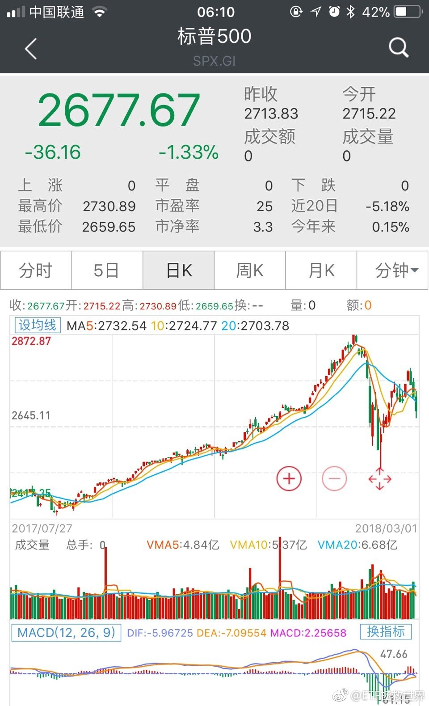

## 2018-03-02 09:53

谁能想到，价值投资元年的忽悠竟然是蓝筹接盘总动员

## 2018-03-02 10:07

回复@手机用户2831823203:我经常预测。关键是你会把多少预测放入你的交易系统。好好想想区别//@手机用户2831823203:这属于预测吗？我们不是不预测吗//@ETF拯救世界:谁能想到，价值投资元年的忽悠竟然是蓝筹接盘总动员

> 谷爆:请教E大能能说说买纸白银和黄金判断价格高低买卖的标准吗？
>> 双树下的和尚1:金银比，金油比，都是只言片语，自己揣摩吧。

## 2018-03-02 10:58

回复@djndnehwbbf:红利红了……这就是为什么跟我自己的主观判断相比，我更相信自己的系统。人总是会有感情，也会有很多主观错误，系统可靠多了。//@djndnehwbbf:老大，我有一点搞不清楚，既然这样，为什么还要继续买入中证红利呢？中证红利不也是属于大盘股为主吗？@ETF拯救世界

## 2018-03-02 11:07

红利是一个价值策略。这个策略长期看有效，短期可能持久低迷，有可能是好几年。所以不能全部买它，要有配置，适应各个阶段 ​​​

## 2018-03-02 12:00

即使队友不给力，也要撑到最后拿第一。

可以加我晚上一起吃鸡…… ​​​
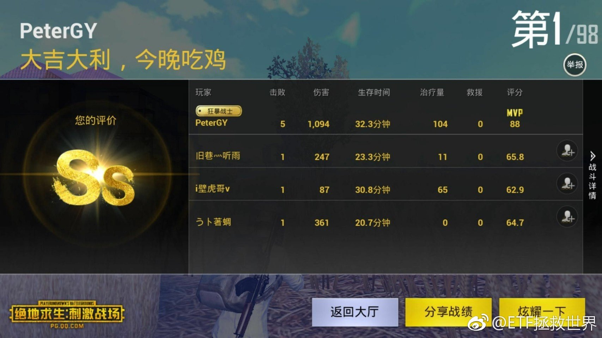

## 2018-03-02 20:57

加仓德国的日子可能不会很远了。 ​​​
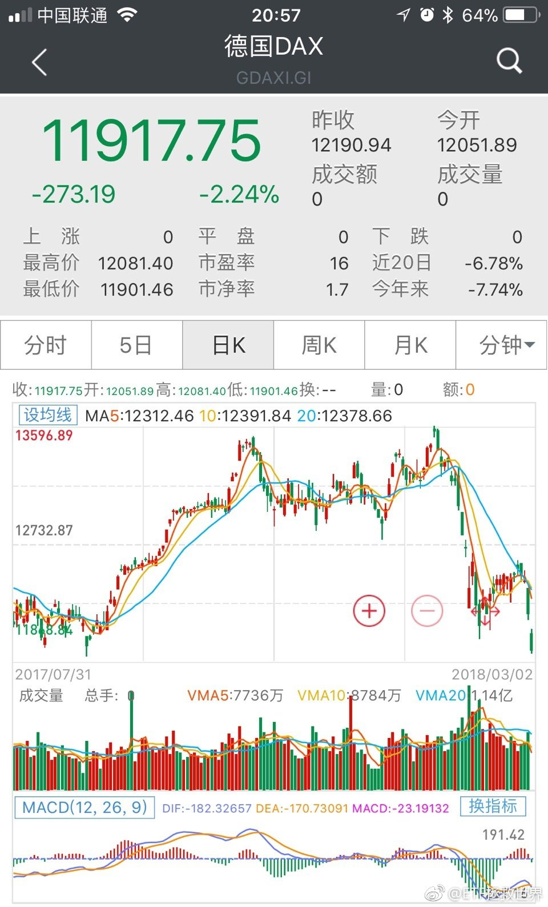

## 2018-03-03 09:03

魔幻

> @澎湃新闻
> 【SUV与小轿车斗气互撞，车碎片洒一地】http://t.cn/REKk3Qk澎湃新闻的秒拍视频 2月12日，湖南株州，一辆SUV和小轿车在路边互撞，撞击导致SUV车头和小车车尾受损。其间小车下来的一男子叫嚣SUV，被SUV几度缓撞。旁边者表示无能为力。（视频来源：综合网络）http://t.cn/REKk3QF网页链接 ​​​

## 2018-03-03 12:23

这是网易的股价。目前美股估值十几年最高，中概股更贵。

参照3 6 0的案例，这些股票回来市值都要一两万亿。

真正高速成长的肉没吃到，庞然大物又要回来了。

十一年前中石油的一幕又要重演吗。 ​​​
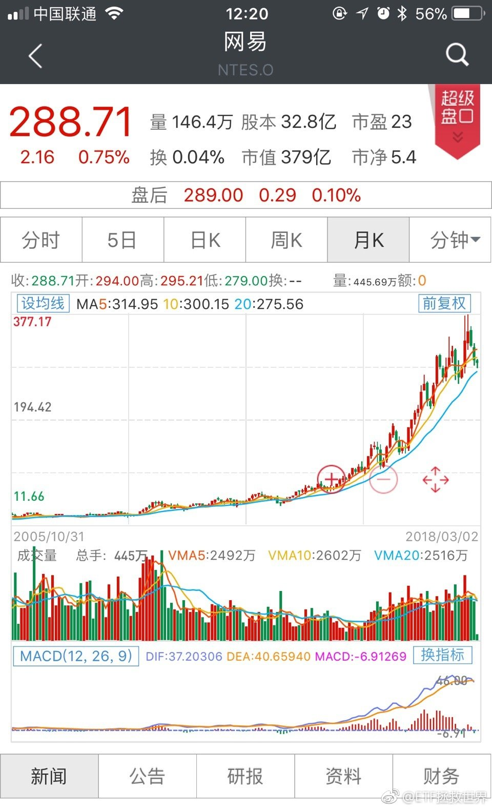

## 2018-03-03 18:40

稳超了。后劲不减 ​​​
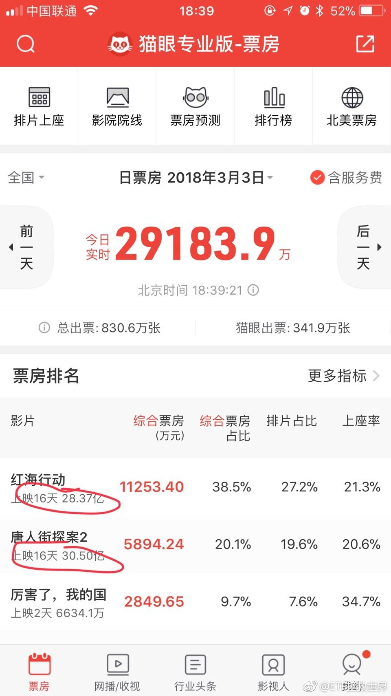

## 2018-03-03 18:48

回复@后生天天uping:不是单位组织看到吗……//@后生天天uping:看了厉害了我的国，感觉医疗，养老的前景以后会不错。

## 2018-03-03 19:49

回复@诸葛不亮_若如初见:40倍肯定买不到。据说现在估值12000亿，它现在利润有300亿？//@诸葛不亮_若如初见:回复@ETF拯救世界:A股太丧病了。。。听说最近小米可能在A股上市，我也就肯给他40倍……

## 2018-03-03 20:25

我在豆瓣给电影评分的标准是这样的。

五星就是可以看很多次也不烦，不腻，不觉得无聊。又或者是各方面都特别满意，觉得真好啊。

代表：

寻梦环游记 Coco；

疯狂的麦克斯4：狂暴之路 Mad Max: Fury Road；

荒蛮故事 Relatos salvajes

遗愿清单 The Bucket List

宿醉 The Hangover

天使爱美丽 Le fabuleux destin d&#39;Amélie Poulain

无耻混蛋 Inglourious Basterds

楚门的世界 The Truman Show

江湖告急

迷雾 The Mist

真爱至上 Love Actually

重庆森林

看过1100多部电影，达到这个标准的一共66部。

四星就是看的时候觉得真不错，但是有点瑕疵，节奏，音乐，故事，画面，演技什么的。然后不是很想看第二次。国产片会稍微放松点要求……有一点瑕疵也上升到五星了。

三星就是看的时候觉得呵呵呵，但是能看完。绝对不会看第二次。

二星就是看到一半觉得真的看不完，会睡着。

一星就是看了五分钟觉得辣鸡。。

## 2018-03-03 22:42

每日打卡（162）

这几天有点不舒服，恢复正常锻炼节奏 ​​​

## 2018-03-04 20:26

在看《腾讯传》

有很多感触。

一个公司的发展，运气到底占多大比重？

这本书也推荐给各位。 ​​​
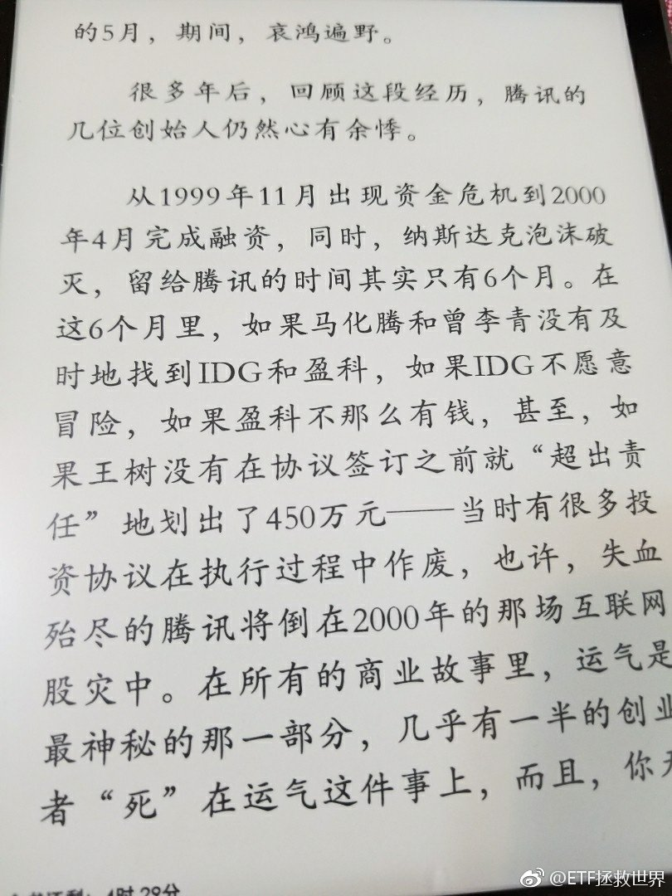

## 2018-03-05 08:37

回复@唐僧用飃柔:迷雾我给五星的原因，只因为最后一幕：永远不要放弃希望//@唐僧用飃柔:《迷雾》是我看过一遍就再也忘不了的电影，但我总觉得哪里不对？努力自救的都死了，反而那些听天由命的活了，难道灾难来临我们要学会放弃求生？

## 2018-03-05 09:35

回复@背着新水壶去上学:当然有了。如果像你所说，那么说深了，有这样的老爸也是运气。对不对？//@背着新水壶去上学:如果没有马化腾老爸的关系，盈科能出手吗？笑话啊！这世上，是没有运气二字的。

## 2018-03-05 09:46

一点感悟。

一个人，想要成功，一定必然需要运气。你生在70、80、90年代的本朝，就是运气。要比生在埃塞俄比亚，或者生在某些年代就是要运气好。又或者极端一点，父亲是谁母亲是谁，给你多少资源，给你多少智商，培养你什么样的情商，当然也都是运气。

想要成功，更是要运气。可能是碰巧某个机会砸到你头上，或者碰巧一个贵人很赏识你，又或者碰巧你做了一件不起眼的事，说以一句不重要的话。

结果，成功了。

然而，这当然是有前提的。前提就是，你真的也有那个实力去成功。你努力过，奋斗过。

我的体会，很大一部分成功，根本就不是计划好的。而是你在某个方面，某个领域，甚至只是某个细节不停的研究，不停的成长。有时候你根本不知道自己为什么要这样做，也根本没有什么赚大钱的点子。然而就是不停的努力去做。

然后，有个机遇，成功了。

所以，有能力有实力的人，真的不一定成功。因为没有运气。有运气的人是很少的。

但是，想要成功，真的必须努力。否则就一点机会都没有了。

## 2018-03-05 10:01

恒生，就看我给的上限29500能不能撑住了。撑不住就算是回归正常了，还继续疯就呵呵呵。 ​​​

## 2018-03-05 13:12

你有没有发现，对未来80%的忧虑都是无意义的。事后通常会发现，根本没有想象中那么困难。

其实，真正的灾难，来自于你的预期之外。 ​​​

## 2018-03-05 13:19

昨天刚给了《逃出绝命镇》3星，今天人家就获奥斯卡奖了！

> @守望好莱坞
> 第90届#奥斯卡#奖项全部颁出↓《水形物语》获最佳影片，陀螺也获最佳导演，成最大赢家。弗朗西斯·麦克道曼凭《三块广告牌》获影后，加里·奥德曼凭《至暗时刻》封影帝。罗杰·迪金斯14次奥提后终于凭《银翼杀手2049》首次拿下最佳摄影。《请以你的名字呼唤我》获最佳改编剧本，《逃出绝命镇》最佳原创剧本，《寻梦环游记》战胜《马戏之王》拿下最佳原创歌曲，也无意外拿下最佳动画长片。科比的《亲爱的篮球》拿下最佳动画短片，《普通女人》最佳外语片。

## 2018-03-05 13:28

回复@蜀中弟子:这片子在美国得奖，很大程度是种族问题的政治正确。咱们看没有那么深的体会。看了就知道。//@蜀中弟子:这叫打脸吗？e大//@ETF拯救世界:昨天刚给了《逃出绝命镇》3星，今天人家就获奥斯卡奖了！

## 2018-03-05 15:59

太坏了，每次3点以后开始跳。 ​​​
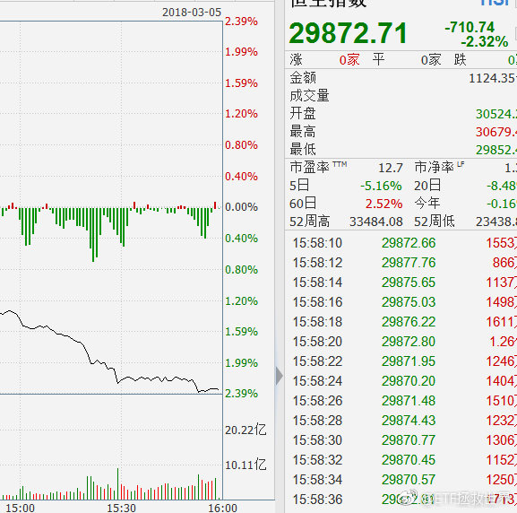

## 2018-03-06 09:39

$全指医药 sh000991$  快回一万了，奶一口 ​​​

## 2018-03-06 09:41

回复@良民博博:怎么飞了，2月不是买了吗。//@良民博博:全飞了

## 2018-03-06 10:15

目前医药+养老的持仓已经超过10%了。少吗，一点都不少了。10%已经足够影响整个组合的表现了。

当然以后还会买，不过一定是更便宜的地方。目前这个区域，足够足够了。飞不飞，不关我事了。 ​​​

## 2018-03-06 10:29

别人被暴跌弄得焦头烂额疯狂杀跌的时候，你安安静静点击买入按钮拿到便宜筹码的感觉，

是不是很过瘾。

做生意就是低买高卖。就这么简单。 ​​​

## 2018-03-06 10:52

$国证食品 sz399396$  不知道什么时候还可以买。 ​​​

## 2018-03-06 10:59

回复@家有八妹:长线仓位我的建议是不要乱动。想做波段就用短线仓位做。为什么，我告诉你。未来有一次，当你涨了一点卖出等更低的时候，它就这么一路向上起飞了。那么，你浪费的是几年的时间。这样做的成本非常高，损失的利润要比波段赚的那点收益多很多。

## 2018-03-06 11:12

回复@落宾:2015年至今，100跑输全指医药10个点，我不清楚为什么那么多人来问100。如果我买了100，会不会很多人来问为什么不买全指，不卖300医药 500医药？至于估值，我只能说，远远不是最低。其他人的数据我不评价。//@落宾:益达，梧桐树说医药100估值历史最低了，您的数据如何？为何不选100

## 2018-03-06 13:23

功力一天不如一天

## 2018-03-06 13:42

回复@桐妈品质团:未来医药的走势其实很微妙。所以我会更加谨慎买入剩下的仓位。何况医药目前将近40倍并不算什么特大机会。//@桐妈品质团:未来十年因为医保控费的关系应该全指医疗增长不会像过去十年那样年化20%了

## 2018-03-06 14:03

$中证红利 sz399922$  不错。 ​​​

## 2018-03-06 15:40

截至今日，中证500有14只成分股公布年报。两家业绩下降，12家上升。平均增速超过40%……

204家公布业绩快报，平均增速15%以上。

喜欢500。为什么？

因为比300多200啊！ ​​​

## 2018-03-06 17:12

回复@石头里的虫子:每次买入都比现价低，你之前是怎么做到亏损的？ 查看图片 //@石头里的虫子:回复@悠然见南山98518:我也红了。//@ETF拯救世界:回复@良民博博:怎么飞了，2月不是买了吗。//@良民博博:全飞了

## 2018-03-06 17:19

看了一眼，2016年12月买入那次与前几天价格差不多，但是一年过去，估值下降了19%……//@ETF拯救世界:回复@石头里的虫子:每次买入都比现价低，你之前是怎么做到亏损的？ 查看图片 //@石头里的虫子:回复@悠然见南山98518:我也红了。//@ETF拯救世界:回复@良民博博:怎么飞了，2月不是买了吗。

## 2018-03-06 21:59

每日打卡（163）

坚持。感觉有必要加量了 ​​​
 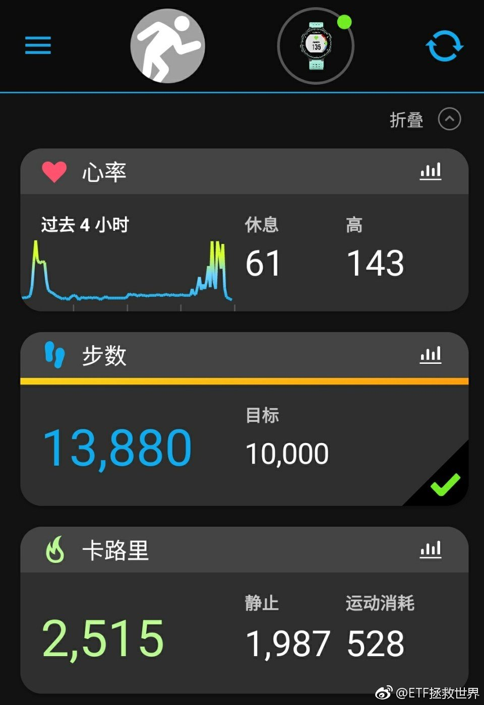

## 2018-03-07 09:11

一条新闻告诉你重仓单一品种的风险。

今天，“14富贵鸟”再次因为暴跌30%，被交易所暂时停牌。收盘后，“14富贵鸟”报8.56元。从公司价值上看，由于富贵鸟公司至少存在49.09亿元资产金额很可能无法收回，导致富贵鸟债务总额约30亿元，而公司账面流动资金不足1亿元。各种迹象显示，公司违约风险极大，不能排除进入破产清算的可能性。

“14富贵鸟”的暴跌也让重仓该债券的中融融丰纯债型基金踩雷。

中融融丰纯债型基金持有14富贵鸟的比例高达47.2%，自“14富贵鸟”3月1日复牌大跌后，中融融丰纯债A单位净值已经由0.878跳水到3月5日的0.658，中融融丰纯债C单位净值也由1.021降到0.765。

## 2018-03-07 09:15

不过讲真，投资十几年，第一次见到8块的债券。。 ​​​
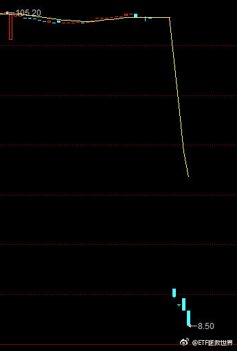

## 2018-03-07 09:43

迷雾，这电影，看完了，体会就是，其实人最怕的是什么。

我感觉，最怕的是——未知。

为什么绝大多数人都怕黑，因为黑暗里面的东西是未知的。迷雾中也是，你看不清就会害怕。因为你不知道下一步是万丈深渊还是什么更恐怖的东西。

所以不要嘲笑为什么很多人在底部割肉。因为未知。不知道未来会怎样，看不清。恐惧，钱已经少了60%了，会不会再少60%，未知。恐惧。

所以最关键的是看清市场。大致知道哪里算是贵，哪里算是便宜。便宜了就不要太恐惧，拿的是指数，又不会死，又便宜。开开心心，继续买。个股不同，容易让人恐惧，因为公司的未来是未知的。

道指最初的成分股中，只有GE还在。然而GE是最近十年表现最差的成分股。这就是公司的不确定。

最重要的是让投资的世界里不要有太多的迷雾和黑暗。大致看清未来，充满希望，结局就大概率不会是悲剧了。

## 2018-03-07 09:52

回复@做而论道725:能力圈。举个例子来说，马戏团里的高空飞人演员说，每次表演要注意1234，就没问题了。这时候你知道他有这个能力做到但你不行。投资同样，巴菲特有能力找出好鸡蛋而且看好篮子（买成大股东控制公司）。但他知道，99%的人不行。所以他连续十几次推荐指数基金。他能做到的99%的人做不到

## 2018-03-07 09:56

什么意思是不是要阶段新高了//@ETF拯救世界:功力一天不如一天

## 2018-03-07 10:30

这几天跟两位微博的朋友组队吃鸡。一次第四一次第二。

怎么讲，本来我是想抱大腿的，结果两次都是剩我一个人在干，变成了大腿。

你们好好练，到时候组个战队，开直播，变成游戏直播网红，美滋滋。

到现在都不知道是跟哪两位组的，评论里报个名！ ​​​

## 2018-03-07 10:49

回复@lihuanan:哈哈，是你。打完后加那两个妹子好友没有。//@lihuanan:E大，昨天9点左右，你我，跟两妹子一起。抱你大腿了

## 2018-03-07 14:07

为期两周的贤者时间不用看盘 ​​​

## 2018-03-07 14:45

震惊！贤者时间结束了！

## 2018-03-08 08:10

没有刘海会买一个。太反人类的设计，完美主义者接受不能

## 2018-03-08 08:21

妹子们，节日快乐！

一会发个红包，只有妹子能领！ ​​​

## 2018-03-08 08:30

回复@小王紙D:微博发，930不见不散！//@小王紙D:一会儿是什么时候

## 2018-03-08 08:39

回复@深蓝的大海013:500个应该够了。男人不要抢，考验素质的时候到了//@深蓝的大海013:春节红包差点没抢到，这回还是只能看看了//@ETF拯救世界:回复@小王紙D:微博发，930不见不散！//@小王紙D:一会儿是什么时候

## 2018-03-08 09:32

#ETF拯救世界的红包#感谢一年来大家对我的爱与支持！我往红包里塞了现金，特来为大家送上好运，狗年旺旺，领到红包旺上加旺！ ​​​

## 2018-03-08 09:34

纳尼？？？500个抢完了？？？

## 2018-03-08 09:37

大多数都没见过啊。以后不能这样发了，感觉好多人为了抢红包混进来了。 ​​​
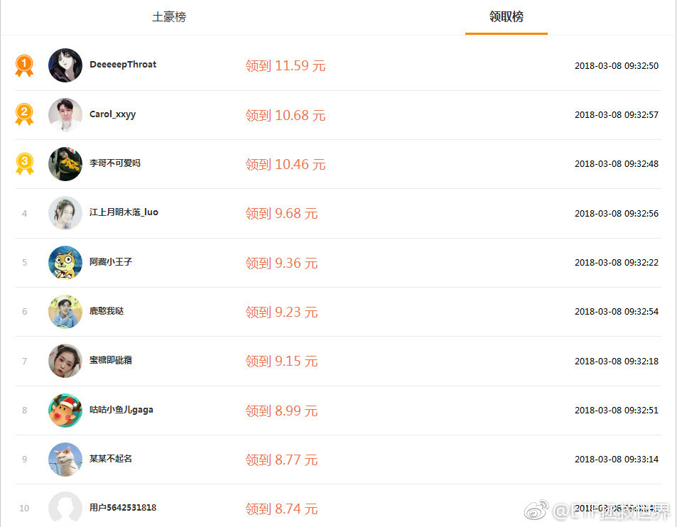

## 2018-03-08 09:59

继续//@ETF拯救世界:什么意思是不是要阶段新高了//@ETF拯救世界:功力一天不如一天

## 2018-03-08 10:03

回复@不装X你值得拥有:可以分性别，也可以分关注时间，但是不能同时！所以怎么选都是错啊。//@不装X你值得拥有:微博发红包可以设置只能女性抢红包还有什么老粉的吗

## 2018-03-08 10:09

回复@干物妹土間埋酱:钱让机器人或者其他不认识的人抢走了我怎么能开心。。等于掉路上让风吹走以后落在火堆里烧成灰吹散在太平洋小岛上让土埋住了啊。给各位老朋友就不一样了。。//@干物妹土間埋酱:你开森就好

## 2018-03-08 11:27

这么多年金融投资，有一个特别重要的感悟。

一个品种，只要你买的够低，不要担心它不涨。低的时候你就一直买，越低越买，越买越多。

只要这个品种没问题，只要你的成本低，它早晚会一飞冲天。但什么时候涨，真的不知道。可能一两个月，可能一二三五年。起飞的日子总是出乎意料，总是非常神秘的。

但是只要它开始飞，就会让你这些年的等待全部值回票价。

## 2018-03-08 13:29

//@ETF拯救世界:继续//@ETF拯救世界:什么意思是不是要阶段新高了//@ETF拯救世界:功力一天不如一天

## 2018-03-08 14:14

今天计划以30%多的仓位做到了跑赢60%股票涨幅。。论持有强势品种的重要性。 ​​​

## 2018-03-08 15:04

$中证环保 sh000827$   $中证红利 sz399922$   今天几个宝宝表现都不错。 ​​​

## 2018-03-08 15:09

回复@totwo_9751:人生呢，最重要就是开心。每天都开开心心的多好。挣钱的时候觉得还有钱没投入，没赚够。赔钱的时候更难受，那还有没有高兴的时候啦。//@totwo_9751:不是还有一半资金没投入吗？没到开心的时候吧

## 2018-03-08 15:31

回复@山喵饲养员:朝阳仁波切给我开过天眼。//@山喵饲养员:E大怎么得知多少人跟投计划呢？

## 2018-03-08 16:36

回复@手机用户3134109401:别这样。我说这些不是让你们说谢谢或者打赏好吗。。更不是矫情，是那位朋友正好说到这个了，我说说自己的想法，我没什么预期。比如说发红包，这几个节日发了也有一万多了吧，要是为了听谢谢是不是有点贵。主要还是希望大家都开开心心的呗。

## 2018-03-08 21:10

每日打卡（164）

坚持做一件简单的事 ​​​
 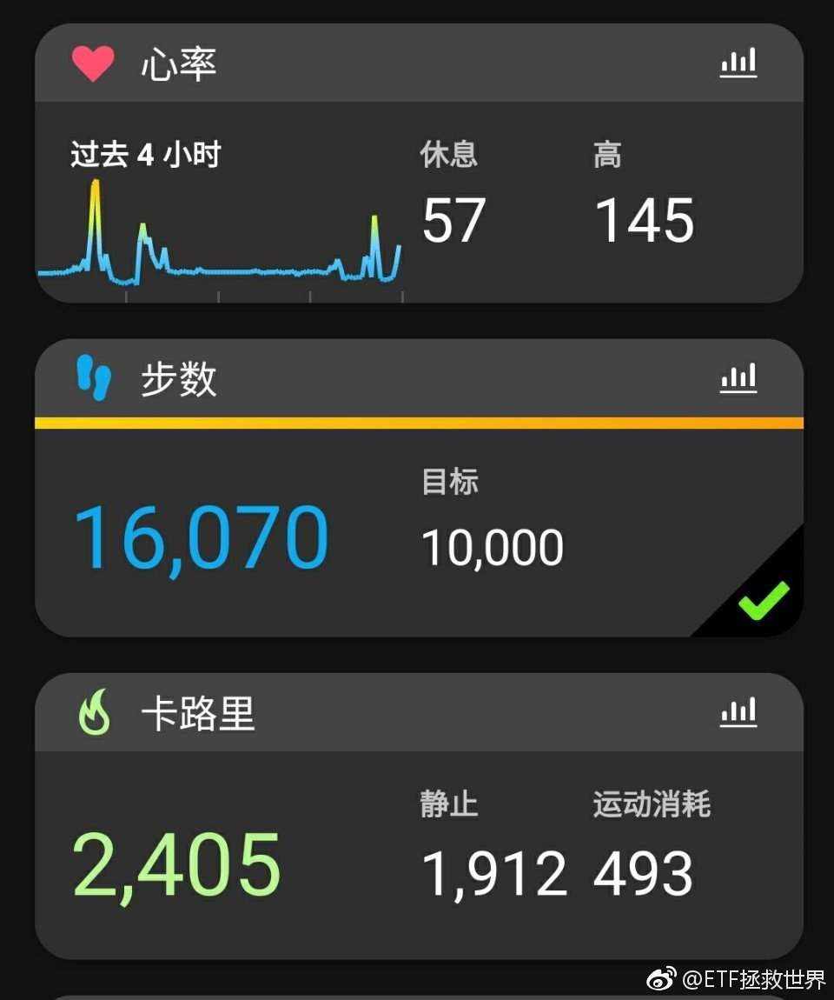

## 2018-03-09 10:15

三只国内债基终于全都出坑了。美元债还在坑里。-2%。

 ​​​

## 2018-03-09 10:26

股票（境内外）/国债/原油黄金/外汇

说白了就这四个大类。不同的周期把权重多给不同的品种，就能做到达里奥说的“全天候”。

基本上任何时间段，这四种东西一定有上涨的。基本上没见过所有东西同时下跌的时候。 ​​​

## 2018-03-09 10:45

$中证传媒 sz399971$  今天轮到你了？milk一下 ​​​

> ETF拯救世界:又是2%的品种。不过这个比医药少多了。anyway，赚钱就要happy。

## 2018-03-09 11:24

回复@IMcygnus:请尊重阶段性股神谢谢。//@IMcygnus:E大 最近身边股神又开始活跃了。。。股神爱说自己挣钱，怎么不说自己断过腿。。

## 2018-03-09 11:25

又是2%的品种。不过这个比医药少多了。anyway，赚钱就要happy。

## 2018-03-09 11:29

基本上一轮深坑后，有三种人。

第一种是底部卖出了。止损，趋势。现在泪在眼里，苦在心里。

第二种是没买没卖，坐了过山车。心里不舒服，觉得没钱低位补仓不开心。

第三种是低位买了，笑嘻嘻。

对了，还有第四种，就是在座的某些ladies and 乡亲们！低位买了，一二三，连开三车，还觉得买的不够，伐开心，要包包。

哪能港，这就叫身在福中不知福了！

## 2018-03-09 11:43

不要一个上涨就认为牛市来了，再没有机会买入。也不要一个下跌就要金融危机。

我再说一次，金融市场的机会永远都有，只要你活着，就能看到无数机会向你扑来。

你以为的底，未必是底。别人说什么，可以参考，但不能做为操作的依据。一切按照自己的体系来，赚钱只是一开始就被设计好的结果实现了而已。 ​​​

## 2018-03-09 11:47

回复@酒舞之樽:这次下跌后，相信很多人才会真的认识到@且慢管家  的补仓提醒有多么重要。建议仓位不够的朋友还是要用起来。关键时刻真的管用。当然，细节还可以进步，比如提醒的时机，如果是当天提醒就更及时了。//@酒舞之樽:第五种，补车补一半，结果车飞上天了

## 2018-03-09 13:21

$中证环保 sh000827$   可能没人注意，15个交易日中，只有2天下跌。 ​​​

## 2018-03-09 13:29

$养老产业 sz399812$   谁能想到默默无闻的它有可能先收回失地。失敬了。 ​​​

## 2018-03-09 13:43

回复@我是风清扬201412:这次下跌，对很多人是一次非常好的训练。没有这次训练，未来也许会犯极为关键的致命错误了。

> 我是风清扬201412:E大的投资理念非常容易理解，但执行起来真难，跟了E大5个月，在这次下跌中，开始信心满满的买买买，后来看到环保帐面浮亏都十几个点，怕了，不买了，现在，也快翻红了呀，坚定信仰的心，把且慢的份额改多些，感谢E大

> 艺曼美学修图:这次网了传媒，一涨一跌，赚钱了，喜欢这种感觉。
>> ETF拯救世界:波动不是风险，是利润的来源，是提款机。

## 2018-03-09 13:59

21个品种还剩4个浮亏，一个油，一个黄金，一个海外债，一个券商。浮亏全部不超过5%。

其它全部盈利。最高的超过50%。 ​​​

## 2018-03-09 14:24

回复@金顶佛光:再给我一次机会，我还是不会买。45倍估值买一个指数，除非你把我打傻。//@金顶佛光:没有买信息，有点可惜

## 2018-03-09 15:04

回复@浅九深:不好意思，我们有创业板指数。说到接盘，只有别人接我们的，谢谢关心。//@浅九深:你们可能还不相信创业板会有大行情，等你们相信时，应该快3000点了吧？你们冲进去，就套死在里边//@ETF拯救世界:回复@金顶佛光:再给我一次机会，我还是不会买。45倍估值买一个指数，除非你把我打傻。

## 2018-03-09 15:07

回复@Cubic_N:增速又高，估值又低，未来行业前景还好，你帮着说一个符合标准的品种//@Cubic_N:回复@投资雷达:估值只是历史分位低。如果从利润增速角度看，估值偏高//@ETF拯救世界:回复@金顶佛光:再给我一次机会，我还是不会买。45倍估值买一个指数，除非你把我打傻。//@金顶佛光:没有买信息，有点可惜

## 2018-03-09 15:54

回复@秋叶纷飞2016:记住三点：第一，指数不会死，长期一定越来越高。第二，我们买的一定不贵。第三，还有很多钱没买，即使再跌成本也会越来越低。怕什么，就是干！//@秋叶纷飞2016:机会来的时候，总是害怕怎么办？

## 2018-03-09 15:59

我有一点觉得特别好笑，为什么有的人总认为：你现在不买，以后高位等着你来接盘！

这个说法有两个特别可笑的地方。

第一，为什么一定要买这个品种。“价值投资元年”之前我们就布局了50恒生300红利。价值投资元年中，我们开始布局500创业传媒医药养老。你大蓝筹涨你的，我买不涨的东西。现在不涨的起来了，我再去找还没涨的。

别人一定会去追高，这是多么sb的想法啊！！！

第二，以后再说。

## 2018-03-09 16:54

回复@蓝天翔雁:hey,dude,that's me.//@蓝天翔雁:就是不太明白，你经常重复来重复去说服那些留言，有啥意义呢

## 2018-03-09 18:25

回复@诸葛不亮_若如初见:趋势投资本身没有错，但不适合大多数人。如果一个品种我说1块买，跌到9毛我卖了。涨回1.03我又买回来，跌到0.92我又卖了。99%的人要么会觉得我这个人是脑残，要不就会觉得这个策略太2了。即使这个策略未来会在牛市中赚几倍。震荡市不断低卖高买，没几个人可以坚定执行下去的。

## 2018-03-09 22:07

有没有人，都干嘛呢，聊点什么。

今天没回家。

出差呢。 ​​​

## 2018-03-10 01:00

好了，散了散了，睡觉去吧~~~

## 2018-03-11 21:18

每日打卡（165）

日常锻炼。 ​​​

## 2018-03-12 09:21

真好，暴露坐标后二向箔已经在路上了。大家吃好，玩好。//@买买提X:填了。。好期待，外星人会给我发邮件么？

> @NASA爱好者
> NASA在帕克太阳探测器上放置了一枚芯片，邀请公众填写自己的名字，在今年夏天随着帕克太阳探测器一同送至离太阳最近的地方。报名地址：http://t.cn/RE8SaJW网页链接 ，截止日期为2018年4月27日。这段视频由“杨Arthur”听译。
> 
> 尽管帕克太阳探测器会为我们对理解日冕，并了解太阳风的起源和演化带来革命性的认知。与所有伟大的探测器一样，帕克太阳探测器可能会给我们带回更多的问题，也就是问题总比答案多。 http://t.cn/RED9J08NASA爱好者的秒拍视频

## 2018-03-12 09:27

$养老产业 sz399812$   还是 $全指医药 sh000991$ ，谁先新高。 ​​​

## 2018-03-12 10:01

有没有一点理解为什么最近一年我们都在布局非大蓝筹指数了。

别人吹蓝筹的时候，我们布局其它的。等别人踩烂臭追小的，我们再买大蓝筹。

永远让别人给咱们接盘。 ​​​

## 2018-03-12 10:16

$中证传媒 sz399971$   也不错。底部补仓的新朋友赚嗨了 ​​​

## 2018-03-12 10:45

关于为什么不“高位卖出，低位买回”，这样的说法。

这样做，理论上是可行的。但是实际操作起来很难。因为你要保证卖出后就跌，然后还要保证涨之前能买回来。真的真的很难。

比如我之前买的一只港股。

http://t.cn/REkUd2b

一个月赚了20%。美滋滋卖掉了。想跌回去再买。结果今天一天涨了20%。

这都是小游戏，无所谓。然而如果在大的仓位犯这种错误，就要吃大亏。几年的等待就白干了。

最好的策略是每次跌下去就买，回到高点后，你就赚得更多。至于什么时候卖，不急，持有，等极度高估。或者，中周期做动态平衡。

指数这样做，要比股票容易得多。股票估值太难了。

## 2018-03-12 10:57

回复@蜜糖即砒霜:我周末正在看量子物理。准备将经典物理的波动与投资结合起来。。//@蜜糖即砒霜:三体看了2遍，入坑理论物理推荐E大看一看//@ETF拯救世界:真好，暴露坐标后二向箔已经在路上了。大家吃好，玩好。//@买买提X:填了。。好期待，外星人会给我发邮件么？

## 2018-03-12 11:01

不错，一个帖子奶死两个。

## 2018-03-12 13:56

风又吹到传媒了。今天涨幅第一。

## 2018-03-12 14:58

继续以1/3的仓位完胜沪深300。

怎么港，买入不同特点的指数是非常有必要的。 ​​​

## 2018-03-12 15:45

回复@charles_MAO:有产品我就会开始关注，计算历史估值，设计投资方案，纳入整个体系。现在有些品种不关注，是因为没有产品，关注也没用。

## 2018-03-13 08:25

分享单曲外婆的澎湖湾（@网易云音乐）

对了，很多朋友问前天文章背景音乐是谁唱的，是赵鹏。

我一般听歌都是听节奏和旋律，然而赵鹏怎么港，完全就是听声音了。建议听的时候用稍微好点的设备。 

可以再听听这首。 ​​​

## 2018-03-13 13:19

$中证传媒 sz399971$  搞事情啊。 ​​​

## 2018-03-13 15:00

今天回撤0.28%。解个世界都好残酷。 ​​​

## 2018-03-13 19:10

天啊写的太好了//@电疗哥-归去来兮:美好的爱情，自带光亮；纯真的情人，都是诗人！ 

> @新京报
> 【“她就是我的光”  小学生“暗恋”作文惊呆网友：神来之笔[跪了]】还记得写出“深度逆天”的《看沙漏》的小邵同学吗？近日，有人又在宁波华天小学王老师@我们1班王悦微 微博翻出了他的另一篇作文《第一次奋进》。仔细读完，嗯……明明是《第一次暗恋》嘛！网友直呼“文笔太好了”、“第一句就被迷住了”、“想起初中时候的自己”……来感受下↓（新华社）http://t.cn/REkW1P7这篇小学生作文火了！这样才情兼备的小朋友，能不能给我来一打

## 2018-03-14 07:16

你看到的，也许是事实，但不一定是全部真相。

不想着怎么提高自己，提升消费者体验，天天想着怎么勾结掌握话语权的人黑对手，这样的机构就是辣鸡。

到底谁退换货容易，到底谁假货多，大家心里都有数。 ​​​

## 2018-03-14 07:56

我没那么狭隘啊。我没做过大范围调查，只是自己的购物感受。有朋友有不同看法很正常，个体体验嘛。

就像我说的，你喜欢一个人可能有很多理由，不喜欢一个人可能就因为很小的原因甚至一句话。不喜欢一个网站，那就太容易了，因为整个流程任何地方任何一次让你感受不好，基本上就死刑了。

但我想说的是，我很感谢jd，也是它的股东，买了它的股票。没想赚钱，就是谢谢它。

为什么。因为我清楚的记得没有它之前去中关村买电脑是怎么和奸商斗智斗勇的，买笔记本是怎么被带到楼上被洗脑推销别的型号，那时候没车买了大件是怎么坐公共汽车扛回家的。

它让我的购物成本低了。不仅是价格，更多是时间成本，沟通成本，辨别真假的成本，退换货的成本。

当然，我只买自营……

## 2018-03-14 13:18

今天肯定不会开车了，月底开 ​​​

## 2018-03-14 15:33

回复@大象鼻子看看特别长:关键看有没有油。//@大象鼻子看看特别长:开不开车关键看什么？

## 2018-03-15 09:04

现在最高的一篇阅读已经4.6万了。离10万+还远吗。

也是一种成就感啊。

要知道我这种可不是什么蹭热点抓眼球的文章…… ​​​

## 2018-03-15 09:42

回复@依然肉多多ETF:真正的牛市，能跑赢一个好的ETF组合的买股票的人会非常少。信不信由你，我先把话撂这儿。指数基金最大的作用是在牛市才能被发挥出来。//@依然肉多多ETF:我周围有20多年股龄的老人都认为熊市才买etf，牛市买股票

## 2018-03-15 09:59

回复@美食嬷嬷茶:没错。我特别建议投ETF的时候也自己投股票。大部分人发现自己炒股没天分就踏实了。小部分发现有天分以后就能赚更多了。可以说百利无一害//@美食嬷嬷茶:所以益达建议7 3比例分配计划和自己操作股票，万一自己有股神的潜质呢 查看图片

## 2018-03-15 10:01

回复@asdasdsadasdadad:不是涨幅问题。是你能赚多少问题。有些10倍股，绝大多数人也就赚个30%、50%。为什么，有几个人能拿住股票？你知道多少是贵？心里不踏实，根本就拿不住。踏踏实实拿住指数去掉头尾吃到大部分利润，秒杀绝大多数追涨杀跌的股民。你以为牛市都挣钱么，错，大牛市也只有70%的人挣钱

## 2018-03-15 10:05

很多人可能又忘了老巴和对冲基金的十年赌约了。这十年，美股牛市，标普500秒杀所有组合中的基金。十年标普500涨幅125%，组合里的对冲基金最大收益88%，最小才2.8%。炒股，很多东西不是那么简单的。

## 2018-03-15 10:30

回复@kaka涛:宏观经济≠股市走势。//@kaka涛:有观点说现在的改革政策还是比较给力，经济也有触底迹象，1819年有可能开启新一轮牛市，你怎么看？@ETF拯救世界

## 2018-03-15 10:39

回复@左边是璞玉wwwwwww21985:股市走势我只从三个维度观察：长期看估值，中短期看资金和情绪。政策之类的会影响的还是资金和情绪，所以最关键的还是这三个维度。//@左边是璞玉wwwwwww21985:等于不等于是数学问题 那么问题来了 宏观经济对股市的影响有多大呢 倾巢之下岂有完卵

## 2018-03-15 10:53

回复@卧梅-闻花:昨天我公众号发的那段话就是这个意思。能赚多少，谁也不知道。因为谁也不知道未来市场会怎么走。我能做到的，就是在投入金融市场这个前提下，尽量做到最好。

## 2018-03-15 11:29

回复@你在红楼我在西游V:10%，基本是7年翻一番。可能有人觉得太少太少了。类比一下房价。10%年化，目前北京均价可能5-6万。7年后就是10-12万，14年后就是20-24万，21年后就是40-48万。不出现恶性通胀，这个可能性有多大，不知道~

## 2018-03-15 12:36

回复@东艾西通杜:给人出主意买红利基金的是没有认真思考。人家要求是持续分红，因为要生活。红利指数虽然每年有3-4的股息率，但是基金可不保证每年分红。亏损年度就可以不分，那时候卖掉等于底部割肉。然后就像去年一年又分掉30%。这都不符合人家的要求。长期，持续从组合中提取资金是要认真设计的。

## 2018-03-15 23:01

每日打卡（166）

坚持 ​​​

## 2018-03-16 08:43

定速巡航少用吧……

> @雨燕的翅膀2011
> #交通微语# 河南一奔驰车定速巡航失控，上演狂奔闯收费站一幕！
> 
> 2012年11月，浙江一车主驾车行至杭浦高速，突然发现车辆的定速巡航无法解除，上演生死时速。此事曾在全国范围内引起强烈关注。
> 
> 时隔数年后，2018年3月14日晚，现实版的“索命定速巡航”生死时速又在河南通往陕西的连霍高速上上演：
> 
> 河南焦作车主薛先生驾驶奔驰200L轿车，在连霍高速上开启定速巡航，后发现车辆失控，只能以120公里/时的速度继续飞驰，生死未卜。
> 
> 庆幸的是，在河南、陕西两省高速交警紧急施救以及奔驰售后方面操作下，奔驰车在失控近一小时、约一百公里后，终于安全停下。
> 
> 要命的定速巡航：
> 
> 2018年3月14日晚8时许，焦作的薛先生驾驶豫H5L***奔驰C200L轿车，沿连霍高速自东向西赴成都参加全国订货会。
> 
> 当时，他独自一人驾车从连霍高速洛阳段上高速，随后开启了车辆定速巡航模式，时速120公里一路向西。
> 
> 一路顺风顺水的薛先生在过了三门峡东站后，发现了一个要命的情况：
> 
> 车辆突发故障，刹车和档位等系统无法正常运行，而此时车子依然始终定速行驶，保持在120公里/小时的状态。
> 
> 刚买一个多月的车子出现问题，让他不知所措，车子已经无法减速、无法停车。
> 
> 这意味着，只要前方遇到任何需要降速的障碍，他都将面临生死考验。
> 
> 薛先生在行驶过程中多次电话咨询奔驰售后，依据提供的多种解决方案进行操作，多次未果……
> 
> 薛先生慌了，眼看着车速减不下来，危在旦夕、命悬一线。
> 
> 晚上9点35分，绝望中的他拨打了110报警求助。
> 
> 灵宝市公安局110接警后，迅速将警情通报给了三门峡路警联合中心。
> 
> 生死路途：
> 
> 警车上高速一路咬紧失控，车主数次想擦挂、追尾降速最终放弃冒险……
> 
> 当晚9点40分，距离薛先生报警过去5分钟。
> 
> 三门峡市高速交警第二大队事故民警张建勇、张景博接到警情，根据大队长杨宏伟指示，他俩立即驾驶警车拉响警笛，一路咬紧这辆“问题奔驰车”。以暂时确保行车安全。
> 
> 民警与薛先生取得联系，了解情况开始协商应急措施。
> 
> 车辆仍在失控中飞驰，距离河南和陕西的省界站，越来越近。
> 
> 电话里，民警进一步安抚薛先生稳定情绪、保持镇定，适时采取紧急避险措施。
> 
> 同时，警方也通知了省界秩序中队长柴海峰，在省界收费站安排警力全力以赴进行援助，打开一条生命通道。
> 
> 失控的奔驰车还在狂奔。
> 
> 在民警的持续安抚下，命悬一线的薛先生保持了镇定，凭借过硬的驾驶技术，在一路险象环生的情况下保持前行。
> 
> 在这一段路途中，薛先生多次试图紧急避险，几次想与同路行驶中的货车擦挂或者追尾来降速。
> 
> 不过，薛先生每次都在最后选择了放弃，没有冒险去和死神擦肩。
> 
> 但前方不远处有一关，将再次考验各方。
> 
> 这一关，就是省界收费站。如果这里不是完全通畅，将无法让狂奔的奔驰车顺利通过。
> 
> 而且，收费站的车道是分流的，也没有高速公路那样宽敞，薛先生需要以120公里的时速开车飞驰过去。这对任何人来说，都是一个考验。
> 
> 当时，省界秩序中队长柴海峰接到事故民警警情通报后，立即组织辅警李宁、刘思汗、李翔在豫陕界收费站广场全力救助。
> 
> 警方快速清空了收费站三个车道，并保证了省界站中间广场畅通无阻。
> 
> 同时，警方与陕西高速交警沟通，打开了所有入陕车道。
> 
> 只有这样，才能保证一辆时速120公里的车辆能顺利通过收费站。
> 
> 就这样，河南、陕西两省交警持续接力，用十分钟的时间，为薛先生开辟了一条畅通无阻的生命通道。
> 
> 一切准备就绪后不到1分钟，当晚10点25分，按照交警的引导指示，薛先生驾驶奔驰车风驰电掣地从豫陕界收费站ETC通道无障碍通过省界站，出了河南。
> 
> 令人欣喜的消息很快传来：进入陕西后，奔驰售后终于通过后台系统操作，使这辆在高速公路上失控距离长达一百公里、失控时间近一小时的奔驰车，安全停靠在连霍高速923KM处路段，并从华阴站口安全拖离高速。
> 
> 车主后话
> 
> 经历生死时速的薛先生，已经安全到达成都参会。
> 
> 他在电话里说，是高速交警救了他的命，7天后，他要专程去一趟，感谢救命恩人。

## 2018-03-16 09:13

可能一直在看开机照片。//@华尔街见闻APP:打得一手好广告

> @见闻研究所
> 【董明珠：其他手机看两个小时眼睛就发涩发痛，我的看一天都没事】3月15日，格力电器董事长董明珠在接受采访时表示，很多人看手机两个小时眼睛就发涩发干，但是格力手机看一天都不会有这种现象。董姐为自家手机打广告已经不是第一次了，这些年董姐化身广告狂人，抓住一切机会路演自家产品，你会被她的手机圈粉吗？http://t.cn/RnwsX5W见闻短视频的秒拍视频

## 2018-03-16 09:21

回复@落宾:没有没有。我非常尊重这样有能力有魄力的企业家。何况是女性，女性想要做点成绩出来在现在的社会上其实更难。就是开个小玩笑……//@落宾:貌似老大不太喜欢董姐姐？//@ETF拯救世界:可能一直在看开机照片。//@华尔街见闻APP:打得一手好广告

## 2018-03-16 10:34

我预感$全指医药 sh000991$  这一把新高应该是稳的。之后就不知道了。 ​​​

## 2018-03-16 10:55

投资讲不讲运气，我觉得当然讲。就不说你会不会碰到牛市极高溢价卖出这个运气了。

你有没有运气20-25之间买入$全指医药 sh000991$  就是运气。 如果能，那中期年化收益15+毫无问题。

关键就是运气来的时候要抓住。这个不是每个人都能做到的。 ​​​

## 2018-03-16 12:10

也就那么回事吧 ​​​
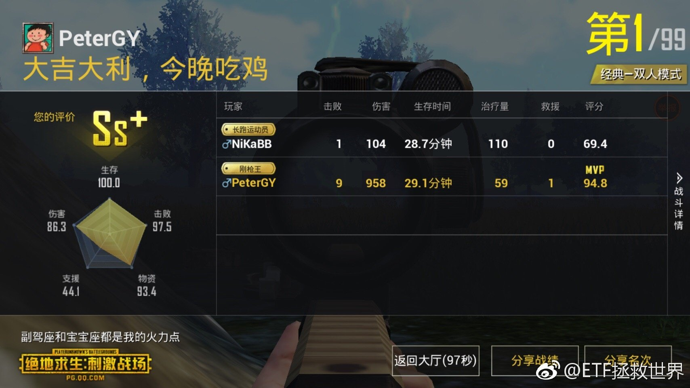

## 2018-03-16 16:12

退博了。

## 2018-03-16 16:36

不过今天沪深300是-0.97%，中证500是-0.55%。我测算计划大致回撤0.18%左右。仓位虽然越来越高，但是回撤风险还是控制住了。//@ETF拯救世界:退博了。

## 2018-03-19 09:34

知道月中为什么不开车了吧。

老司机的世界你不懂。 ​​​

## 2018-03-19 09:40

回复@livston09:第三轮以来，有。往前翻，吓死你。比如2015年12月底。那个月，还卖出了。4天后，你懂的。//@livston09:有过月末不开车的先河吗？

## 2018-03-19 09:41

医药和传媒又要来打脸吗。准备退博了。

## 2018-03-19 10:20

现在沪深300+0.26%，中证500+0.24%。

30%多仓位的计划预估+0.26%。

宽基为基础，精选行业+策略指数。

低仓位就能跟上大盘。有没有想过仓位上去后牛市会怎样。

再加点杠杆呢？ ​​​

## 2018-03-19 10:42

回复@石头里的虫子:到那个时候，我家庭资产90%都会放进去。再跌20%，有可能。但是我会毫无感觉，因为经历过好几次了，知道是什么结果。在那个地方，无论你会怎么做，下一次都会毫无感觉了。但是，下一次，又要间隔至少5-7年。

## 2018-03-19 10:50

回复@后生天天uping:这个很难把握。其实谁也不知道到底哪里才是最低。只要大部分筹码买在底部区域就足够了。还有一种办法，左侧买大部分，小部分右侧买入。这些都会体现在计划里。计划包含的东西比一般人想象的多的多。（我怎么记得这段话说过两次了）

## 2018-03-19 10:59

其实你只要做做数学题就知道，底部的20%并不那么重要。

如果1000点是绝对最低点，那么你的成本是1000还是1200，其实差别没那么大。

同样是5000点卖出，1000点获利是400%，1200点成本获利317%。真的没差。

我最近在看一本书，里面有某位大师的所有重要交易。你会发现，他从来都没有买在最低过。经常是买完以后大幅下跌，成本距离最低点差几十个点。

那又如何。

无论左侧，右侧，都不可能每次买在最低。这个心魔过不去，恐怕很难赚大钱。

## 2018-03-19 11:15

再奶。我就不信每次都那么邪门。

## 2018-03-19 11:42

回复@ncfengbo:我们还有其它20个。如果都不涨，那你还遗憾什么。说明这个市场上几乎没人挣钱了。//@ncfengbo:e大，如果这个指数就涨了20%怎么办？不是没赚到钱?似乎和你经常说的（要买的足够便宜）有点矛盾啊

## 2018-03-19 12:31

今晚可以开始跑步了 ​​​

## 2018-03-19 13:37

山雨欲来风满楼 ​​​

## 2018-03-19 14:20

还差80点。

> @ETF拯救世界
> 我预感$全指医药 sh000991$  这一把新高应该是稳的。之后就不知道了。 ​​​

## 2018-03-19 14:24

$159938 还差7厘//@ETF拯救世界:还差80点。

## 2018-03-19 14:30

回复@ETF信徒者:这个属于把西瓜和黄瓜放在一起比较谁好吃。我不是评价谁便宜谁贵，不同行业的股票不可以这么比。//@ETF信徒者:飘仙说：“恒瑞医药的市值快接近2500亿元的交通银行了。交通银行一年700亿净利润。恒瑞2017年大约30亿。”对于这样的情况合理吗//@ETF拯救世界:还差80点。

## 2018-03-19 14:54

回复@梓溪20180316:强不到哪儿去啊。你这样，真正的牛市里根本赚不到什么钱。做对20次小波段，一次牛市卖飞了就几年白玩。当然，长线仓坚持，另一部分资金做波段没问题。

## 2018-03-19 15:26

回复@好心情S65:长线是为了赚大钱，短线波动是为了提高资金利用率，提高收益率。跟哪个效果好无关。包括各种套利，网格等等都是有效获得收益率的手段。//@好心情S65:一部分长线，一部分短线，哪个最终效果好是不是还是靠运气呢？

## 2018-03-19 17:04

今年会很好。

## 2018-03-19 21:22

每日打卡（167）

没有去跑步，多做一组。

问个问题，你现在最想要的是什么 ​​​
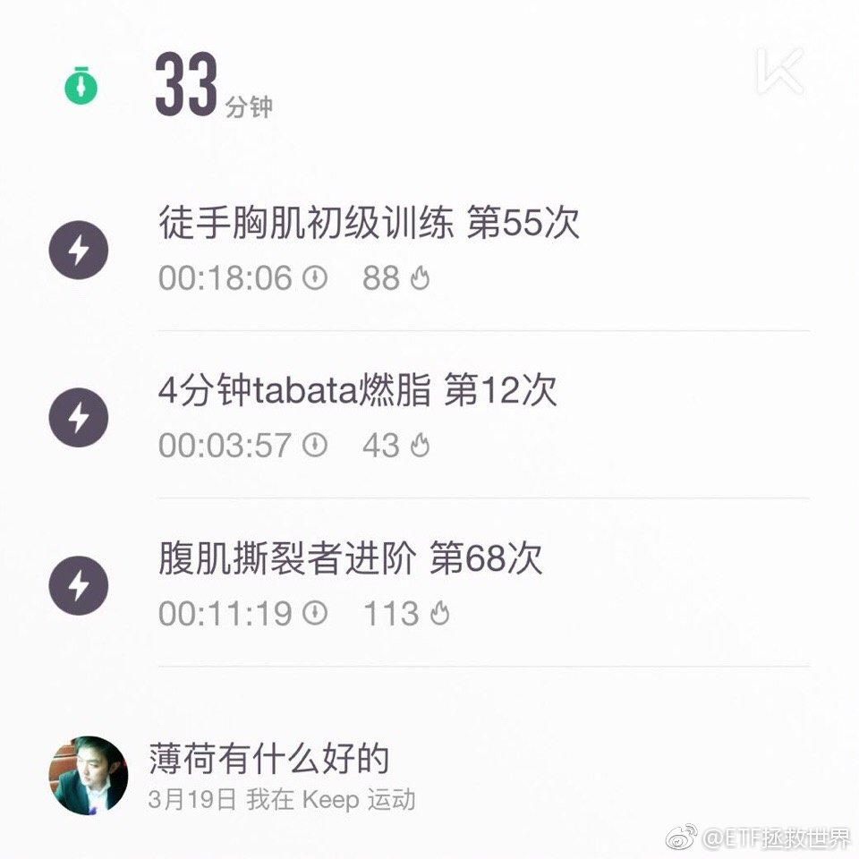

## 2018-03-20 09:28

## 2018-03-20 09:38

昨天看 帕丁顿熊2 Paddington 2。

几年没见的休格兰特怎么变成这样了。我印象中的他还是诺丁山，四个婚礼一个葬礼，甚至后面的真爱至上里面的样子。

岁月是把杀猪刀。sigh。 ​​​
 

## 2018-03-20 09:42

还差50点，畀面我啦//@ETF拯救世界:还差80点。

## 2018-03-20 09:44

$159938  新高。恭喜各位。//@ETF拯救世界:还差80点。

## 2018-03-20 09:52

$全指医药 sh000991$  指数也新高了。“稳”这个字我不经常用。用了就是大事件。//@ETF拯救世界:$159938  新高。恭喜各位。//@ETF拯救世界:还差80点。

## 2018-03-20 10:05

不过各位，不要太乐观。我个人不太相信医药会在这里有什么大的独立行情。毕竟太贵。长期看，我还是很喜欢这个行业。以后还会继续买。//@ETF拯救世界:$全指医药 sh000991$  指数也新高了。“稳”这个字我不经常用。用了就是大事件。//@ETF拯救世界:$159938  新高。恭喜各位。//@ETF拯救世界:还差80点。

## 2018-03-20 10:23

知不知道为什么买的低能赚很多很多，收益率远超这个世界上绝大多数投资的收益率。

因为“低”太难了。过去二十年，只出现过3次。05 08 12。

如果那么简单就能出现，所有人收益率都很高，可能吗，不可能的。

然而你又不能死等低的出现。万一回不去呢。

这个度怎么拿捏真的不容易。 ​​​

## 2018-03-20 10:42

回复@医命相卜山:价格永远也回不到原来了。即使是创业板也不会回到2012了。这就是长期投资指数一定会赚钱的根本。波动的话，GJD先离场再说吧。不离场，那就慢慢磨。外资没多少钱，赌徒们又不可能几年就有变化。所以最大的主线还是GJD。

## 2018-03-20 13:03

回复@橡皮擦对阵:不知道。我经常主观判断后市，但操作从不依据这些判断。//@橡皮擦对阵:医药今天是不是该清仓了？以后再买？

## 2018-03-20 13:21

回复@石头里的虫子:我赚大钱的交易中，没有一次是今天卖了等过几天低点买回来这样做的。无一例外都是低位买入，死死拿住，无论如何波动都不下车，几年后疯狂时候卖给接盘侠。//@石头里的虫子:理论上，今天卖了，过两天低位买回，不过，你老是这么干，总有一天你要在更高的位置接回来。

## 2018-03-20 14:00

回复@美好一诺:其实不难判断。难以判断的是疯狂可以持续多长时间。//@美好一诺:疯狂，很难判断//@ETF拯救世界:回复@石头里的虫子:我赚大钱的交易中，没有一次是今天卖了等过几天低点买回来这样做的。无一例外都是低位买入，死死拿住，无论如何波动都不下车，几年后疯狂时候卖给接盘侠。

## 2018-03-20 15:05

回复@asekiyoshi:任何股票高估值买都不要预期收益率太高。这就是我的想法。//@asekiyoshi:E大认为现在买恒瑞医药，将来的收益率会如何？恒瑞第一次站上80倍pe是07年6月，第二次是08年1月，然后回调40%，本月是第三次//@ETF拯救世界:回复@美好一诺:其实不难判断。难以判断的是疯狂可以持续多长时间。

## 2018-03-21 09:13

又到一个整数，留念。

对于一个每个月更新2-3次的公众号来说，也算不错了。。 ​​​

## 2018-03-21 09:32

$159938 溢价了。你懂的。 ​​​

## 2018-03-21 09:33

晚了！

## 2018-03-21 11:14

昨天看各路大v激动的发帖，我以为今天平安要涨停…… ​​​

## 2018-03-21 14:10

万万没想到

## 2018-03-21 14:30

目前很敏感，整个市场，环境。一动不如一静。踏踏实实等。 ​​​

## 2018-03-21 14:45

如果医药新高+月中不发车这两个居然同时对了，那说明什么。你展开讲讲。

## 2018-03-21 15:00

今天预估跌幅0.2%。 ​​​

## 2018-03-21 22:46

是不是要突破了 ​​​
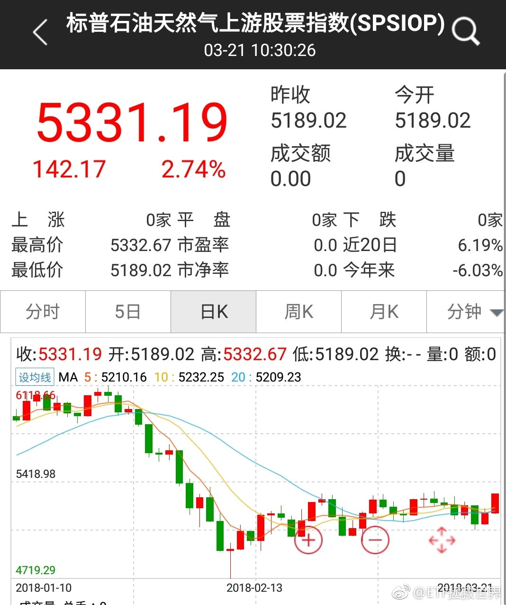

## 2018-03-21 22:52

来劲了嘿 查看图片

## 2018-03-21 22:58

怀念那次油气溢价6%套利赔钱的经历。

为什么，因为当天晚上美国基准涨了8% ​​​

## 2018-03-22 09:30

今天所有国内债，油气都已经出坑。还剩一个海外债和黄金在坑里。2%左右。

讲真，赔钱太难了。 ​​​

## 2018-03-22 10:07

以前我写过一篇文章，整个证券市场是一个丛林。有它整个的生态系统。

食物链从高到低。

做为比较低层次的生物，基本处于食物链底部的人，想要在这市场中不死，然后还越来越大，实力越来越强，一定要有特别的能力。

第一步是找到自己在食物链中的位置，第二部是找到活下去的方法。

比如，死死盯住猎物。等它进入自己的攻击范围，出其不意一跃而起死死咬住对方的喉咙。

把战利品带回家，储存能量，继续盯着下一个目标。战斗两分钟，等待一整天。

每天在丛林里走来走去，这打一下那摸一下，开场第一幕就要被食物链上层发射的二向箔干掉。

## 2018-03-22 10:31

因为月中没有开车而不开心的人已经破涕为笑。 ​​​

## 2018-03-22 10:47

之前有没有人感受到。

## 2018-03-22 15:03

## 2018-03-22 15:47

支持！太棒了！

## 2018-03-23 05:32

还会远吗 ​​​
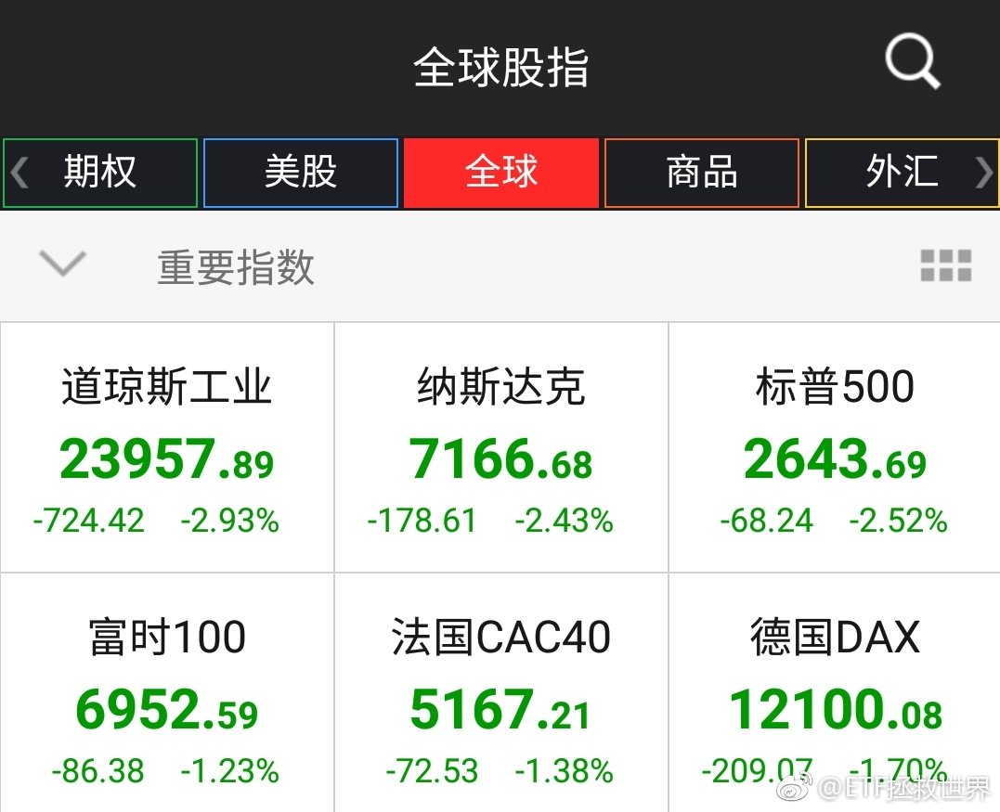

## 2018-03-23 08:30

想加车某个品种，没决定 ​​​

## 2018-03-23 09:12

回复@蔷薇欧欧:买啊怎么办。2015年到现在等的不就是这个吗。//@蔷薇欧欧:如果中美贸易战开打，经济增长放缓，股市很长一段时间下跌，股债双杀的情况出现的话，怎么办呢益达？

## 2018-03-23 09:26

今天可能都懂了。

## 2018-03-23 09:35

今天跌破3000亿。

## 2018-03-23 10:40

腾讯成交1000亿。有人星夜赶考，有人辞官回家。 ​​​

## 2018-03-23 11:24

统一回答一下，今天不会加车。道理很简单，我们买和不买的空间不可能是3%。跌3%什么也不是。

仓位合适，一切按部就班。正式车也就还有一周了。看看数据，提前2、3天倒是有可能。

其实今天倒是想加个非A品种。再看看吧。 ​​​

## 2018-03-23 11:27

回复@碾米机:拍照真的好！碾压其它所有品牌！颜值高！手感舒服！但是系统渣渣辉！真的是没有完美的东西啊。//@碾米机:e大，s8可好用？最近想换个拍照好的手机

## 2018-03-23 14:01

。。。改成?%比较合适。

## 2018-03-23 14:19

雨有点大。

## 2018-03-23 15:26

这个月计划搞不好要2015年7月以来第四次月度净值回撤了。

前三次分别是16年12月，17年11月和18年2月。

之前三次股灾都没回撤，没办法，随着仓位的加大，不可避免~ ​​​

## 2018-03-23 15:41

今天的数据有点crazy。周日发不发是个问题。 ​​​

## 2018-03-23 18:17

三年又三年，什么时候可以让我们好好买点便宜货

> @蓝鲸新闻
> 【鲸快讯:知情人士称中国国家相关资金今日买入部分蓝筹股 避免股市跌幅加剧】3月23日讯,新浪援引彭博报道,知情人士称,中国国家相关资金今日入市干预,买入部分蓝筹股。国家相关资金入市只是为维护市场稳定,并非为推高股价。今日买入中国人寿、中国石化等蓝筹股;全天都进行维稳操作,下午操作的力度加大。 ​​​

## 2018-03-23 21:54

不明白为什么买债券的同学懂了吧 ​​​
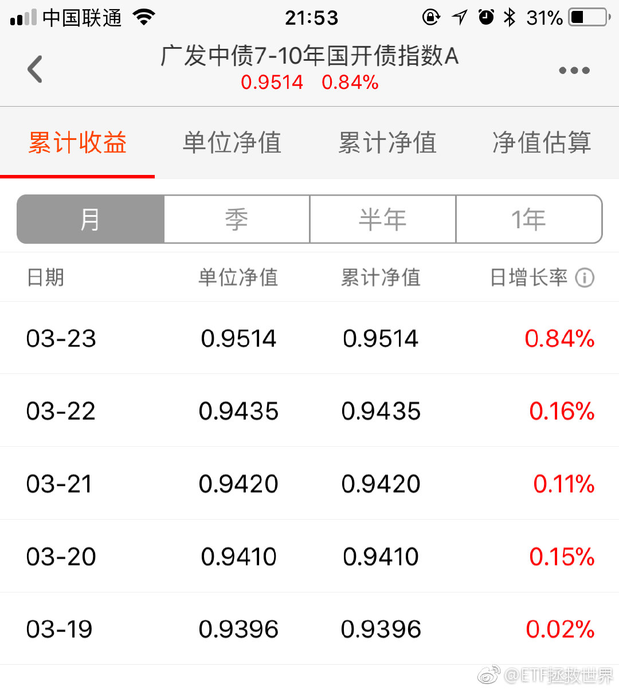

## 2018-03-26 09:11

仔细观察，你会发现，投资的原则，很难遵守。大部分人，绝大多数人，都做不到。

设计一个系统，一个体系，一个策略。开始之前想得好好的，一定要按照策略来。然后，发生一些事，你突然又觉得，我要主观做一些动作。然后策略不遵守了，体系崩塌了。

主观，我从来不相信主观。

谁要主观判断行情，一次两次对，最后都要被打脸。

施行策略的时候，不要随意改变规则。规则不行，是规则的问题，一轮过后可以修正。然而执行的时候不坚定，是人的问题。

人有了问题，就彻底完了。

没戏了。

## 2018-03-26 09:39

给不给机会提前为国接盘？ ​​​

## 2018-03-26 10:00

老司机的尴尬 ​​​

## 2018-03-26 11:05

$中证银行 sz399986$   这几个月刚刚皈依价值投资的朋友又被割了。 ​​​

## 2018-03-26 11:14

呵呵，还不是要跌回来。

来自老司机的迷之自信。 ​​​
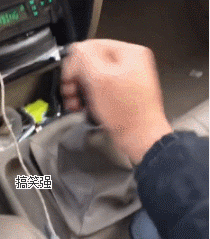

## 2018-03-26 12:09

## 2018-03-26 15:07

散了散了，踏踏实实等月末了。 ​​​

## 2018-03-26 15:54

今天数据出来，有些品种便宜哭了。

为什么这么便宜，点解。

但是从趋势看即将开始暴跌。

趋势和价值能不能统一在一个体系中？这是个大问题。 ​​​

## 2018-03-26 22:15

每日打卡（168）

坚持 ​​​
 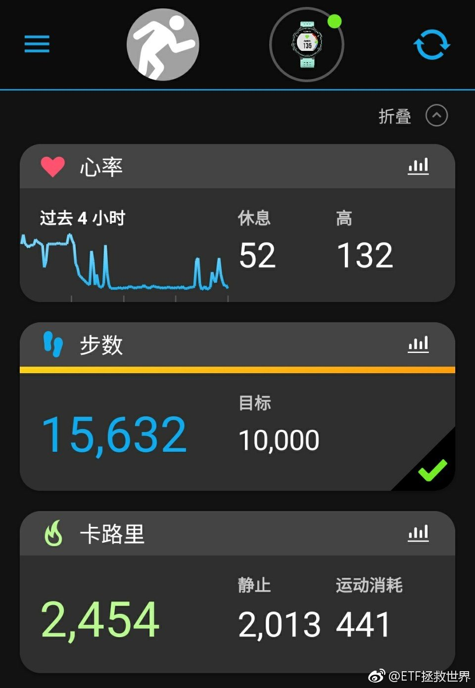

## 2018-03-26 22:41

美国涨了点，欧洲跌了啊。

而且，美国涨不涨跟咱们也没关系。还有几天，踏踏实实的。 ​​​
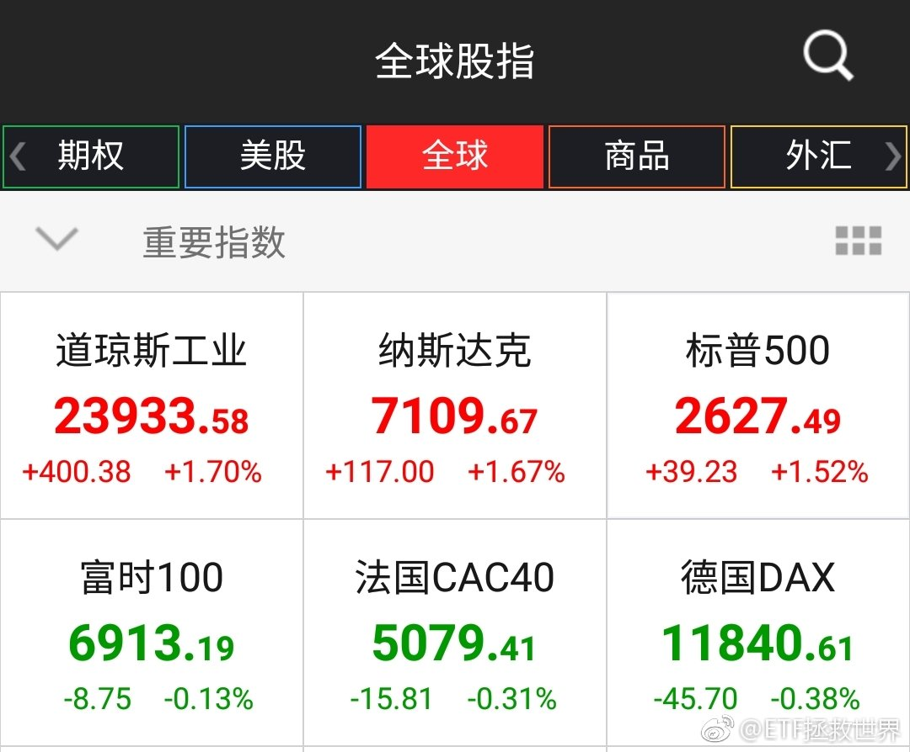

## 2018-03-27 09:30

最近做趋势和主观判断的都很郁闷 ​​​

## 2018-03-27 09:45

回复@小磊_哥:为什么要发？我们不是月底定时吗。定好的策略不执行和咸鱼有什么区别？//@小磊_哥:e大昨天为啥不发车啊

## 2018-03-27 10:17

讲真是不是又要新高了。计划第二大持仓，a股第一大

## 2018-03-27 11:03

回复@蜜蜂猴子葡萄蝙蝠:+30%之前不要提再平衡。//@蜜蜂猴子葡萄蝙蝠:医药是不是要再平衡呢?//@ETF拯救世界:讲真是不是又要新高了。计划第二大持仓，a股第一大

## 2018-03-27 11:39

最近大盘股又成辣鸡了。咱们还是老规矩，捡辣鸡。 ​​​

## 2018-03-27 13:00

回复@我陪你试婚纱:通俗来讲就是 劫富济贫//@我陪你试婚纱:什么是再平衡呢//@ETF拯救世界:回复@蜜蜂猴子葡萄蝙蝠:+30%之前不要提再平衡。//@蜜蜂猴子葡萄蝙蝠:医药是不是要再平衡呢?//@ETF拯救世界:讲真是不是又要新高了。计划第二大持仓，a股第一大

## 2018-03-27 21:47

每日打卡（169）

颈椎痛，今天治疗颈椎 ​​​
 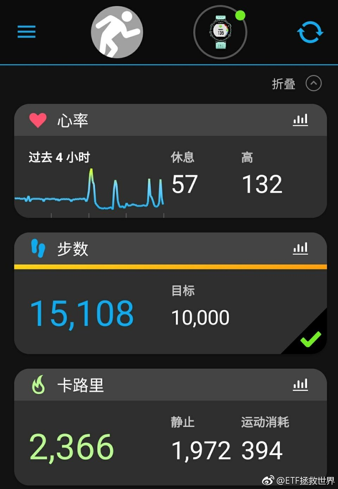

## 2018-03-28 06:22

急什么 ​​​
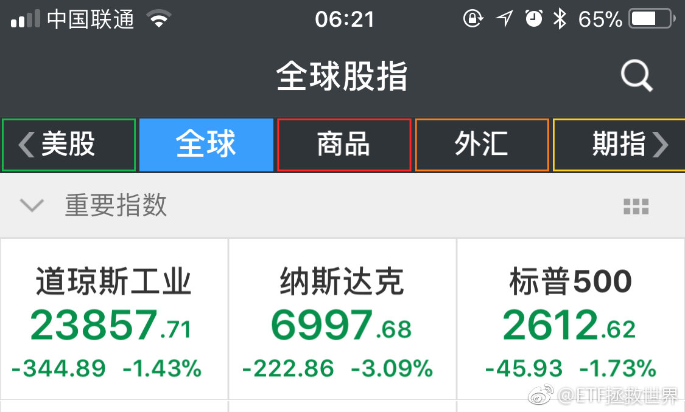

## 2018-03-28 09:43

服了//@ETF拯救世界:讲真是不是又要新高了。计划第二大持仓，a股第一大

## 2018-03-28 12:30

30%了。//@ETF拯救世界:……原来你竟然是这样的五粮液……

## 2018-03-28 12:40

朋友们，怎么港。

有些我们一直喜欢的东西，食品饮料，消费，甚至包括中概，总有机会入手的。如果不合标准，就不买。但总会有合标准的时候。

投资的世界充满迷雾，但我们有自己的标准，我们坚守信念，结局就不会差。

至于已经买了的？如果有好机会，当然多多益善。 ​​​

## 2018-03-28 13:46

有时候趋势是有用的。但很多“价值投资者”不这么看。很多人非此即彼，非黑即白。思维不够开放。有用的东西就拿来用，当然，怎么用是关键。

## 2018-03-28 14:21

作业炒得好，炒股穷到老！

## 2018-03-28 14:25

回复@恐龙02:我的作业有几个特点：1，买卖点明确。2，高于我的买入价禁止买入。这两个特点有别于其它，保证了只要我不赔，其他人也赔不了。这两点非常关键。因为品种再好，买卖价格不对，也无法盈利。//@恐龙02:我抄益达大作业会发财的//@ETF拯救世界:作业炒得好，炒股穷到老！

## 2018-03-28 17:46

正常。股票涨高了就是卖的。难道拿一辈子吗。

> @蓝鲸新闻
> 【鲸快讯】3月28日讯，腾讯控股总裁刘炽平在3月27日减持100万股腾讯股份。 ​​​

## 2018-03-28 20:55

大家辛苦了。看完视频觉得做的事有意义，同时压力也不小。一起努力吧！

 ​​​

## 2018-03-28 21:56

这是小米被黑的最惨的一次

## 2018-03-29 13:45

今天要是涨就周末发车。跌就今晚发。

无所谓。

耗着呗。 ​​​

## 2018-03-30 10:34

有点饿，你中午吃什么。 ​​​

## 2018-03-30 10:57

$全指医药 sh000991$   真的是很喜欢这个。不是因为涨了。就是现在太贵。没法买太多。 ​​​

## 2018-03-30 13:24

你信不信中小股票一直涨？不信，好，那就一直涨。

信了？Duang，归你了。

——来自1月大盘股的经验。 ​​​

## 2018-03-30 13:38

回复@YAN_楚平:应对什么。我们买了不少了。//@YAN_楚平:怎么应对E大

## 2018-03-30 13:56

回复@i云腾致雨:我个人认为，创业板40倍开始飞的几率不太大。所以暂时不加仓。//@i云腾致雨:创业板买的少//@ETF拯救世界:回复@YAN_楚平:应对什么。我们买了不少了。//@YAN_楚平:怎么应对E大

## 2018-03-30 15:34

服不服。新高。一句投资金句告诉你：新高不卖。//@ETF拯救世界:讲真是不是又要新高了。计划第二大持仓，a股第一大

