## 2018-06-01 09:29

感觉不会再爱了。 ​​​

> z独角兽z:上证从3500下来，经历几波下挫反弹，反弹越来越乏力，反弹幅度越来越小，下挫每次都很急，3000托底，如果再有黑天鹅，有点拖不住啊！

## 2018-06-01 10:27

今天是不是应该给自己送个礼物。你有什么一直想买还没买的东西吗，说来听听，参考一下 ​​​

## 2018-06-01 11:17

回复@急速火狐:是啊，连续两天高位放大量，反弹无力。//@急速火狐:感觉医药不太好了。

> mmmm123456987:要卖了吗
>> ETF拯救世界:问题是医药现在比2013年还便宜，让我卖，我实在下不了手啊！

## 2018-06-01 11:21

我发现好多朋友想要的东西我都有，有空我可以聊聊使用体会……有些东西确实很不错，能提高生活质量。 ​​​

> 进击的足球小将:智能马桶盖买哪个牌子？
> > ETF拯救世界:我用的松下……

## 2018-06-01 11:28

回复@mmmm123456987:问题是医药现在比2013年还便宜，让我卖，我实在下不了手啊！//@mmmm123456987:要卖了吗//@ETF拯救世界:回复@急速火狐:是啊，连续两天高位放大量，反弹无力。//@急速火狐:感觉医药不太好了。

> 渝夏夜的微风-hc:去年7月买的万科a，1月份的时候赚了65%，没卖，现在只赚5%了，并不觉得难受
>> ETF拯救世界:股票不好估值

## 2018-06-01 11:31

回复@慢城畔海:是的。电梯肯定是让人郁闷。但这个事情我说过好多次了。如果真的电梯下去，我们会继续买。然后，再次回到这里的时候，我们会赚的多很多。//@慢城畔海:想卖的都是害怕坐电梯的。//@ETF拯救世界:回复@mmmm123456987:问题是医药现在比2013年还便宜，让我卖，我实在下不了手啊！

## 2018-06-01 11:37

回复@老高GG:老外：“我没进”//@老高GG:大盘果然熊啊  全部空头排列 让你MSCI进来  先教教老外做人//@ETF拯救世界:回复@慢城畔海:是的。电梯肯定是让人郁闷。但这个事情我说过好多次了。如果真的电梯下去，我们会继续买。然后，再次回到这里的时候，我们会赚的多很多。

## 2018-06-01 12:16

回复@O_Zhong_O:全指医药你我这一生能见到30万点，甚至40万点。//@O_Zhong_O:E大，下去以后再也上不来的概率是不是也存在？//@ETF拯救世界:回复@慢城畔海:是的。电梯肯定是让人郁闷。但这个事情我说过好多次了。如果真的电梯下去，我们会继续买。然后，再次回到这里的时候，我们会赚的多很多。

## 2018-06-01 12:24

我的最爱。一定要活到它30万点那天…… ​​​
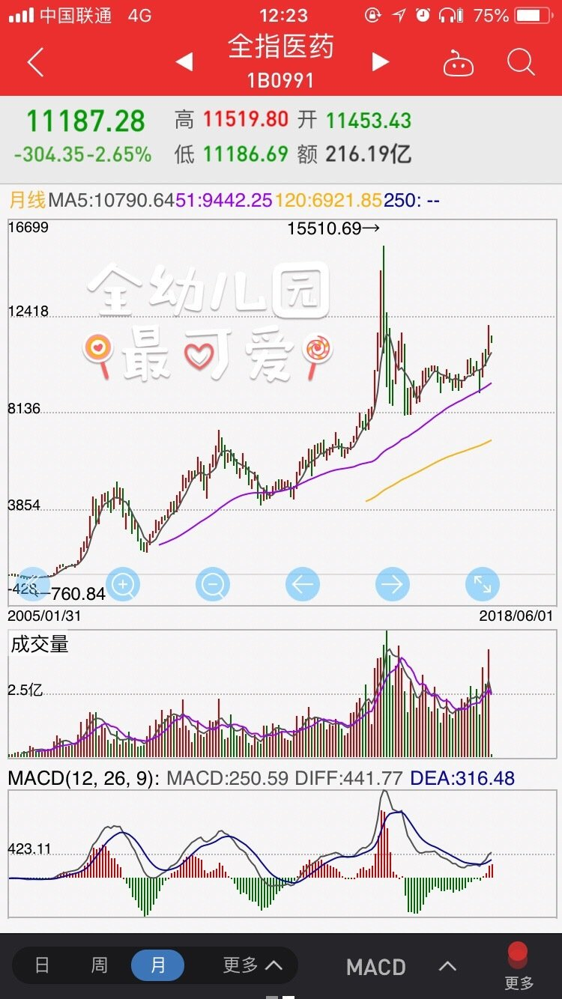 

> 投资滚雪球:30倍！！！[偷笑][偷笑]
> > ETF拯救世界:05年到2015就20倍了

## 2018-06-01 16:04

回复@Lily-invest:20倍，我觉得你很难见到。过去14年中，低于30倍的时候只有11个月，其中9个月出现在2004-2005。过去13年只有两个月低于30倍。700点最惨的时候也有25倍。//@Lily-invest:期待医药20倍的那天🙏🙏跟着益达准没错了

> XlightYYYYYYYY:E大，邱国鹭和好多大V都有分析养老和医药在老龄化里面的增长不如预期，主要参考是日本老龄化期间医药养老产业的营收虽然增长但利润率暴跌，同时参考国内的各地医保局、医院都是限制医保支出，要求把医药从利润中心改为成本中心来控制，对医药和养老产业的利润增长限制会很明显，E大怎么看？
>> ETF拯救世界:这些早在模型的变量中体现了。所以为什么医药加养老只有十个点？

## 2018-06-04 08:42

回复@化工_达人:如果传媒可以跌到最高点的25%-20%，我将突破给它预留的仓位，可以加到10%-15%。目标x倍。如果能成真，将是第三轮计划的第一个放手一搏的品种。人生能有几回搏。//@化工_达人:问题来了，崔永元怼范冰冰事件，传媒指数再来一脚，会不会出黄金坑

## 2018-06-04 08:57

950-1200点左右。大概率是1000点梭哈。到不了就给常规仓位。//@ETF拯救世界:回复@化工_达人:如果传媒可以跌到最高点的25%-20%，我将突破给它预留的仓位，可以加到10%-15%。目标x倍。如果能成真，将是第三轮计划的第一个放手一搏的品种。人生能有几回搏。

## 2018-06-04 08:59

回复@赐予我力量吧:sorry，你可能不了解我。布加迪威龙如果不给我100-50的神券，我是不会买的。//@赐予我力量吧:e大的意思 告诫你们是618忍住手  多过几天布加迪威龙马上就要打3折了

## 2018-06-04 10:18

回复@喜欢富兰克林:我看了一下，很NB。那时候沪深300估值与现在一模一样。当时2800，现在3800。涨了36%。现在500估值比当时低18%，指数涨了101%。//@喜欢富兰克林:E兄，十年前，也就是2008年的6月份，大盘3100点，那时的沪深300市盈率是多少？现在沪深300是13倍左右，那时估计要25倍左右了吧

> 携风牧云:所以前几天某球说中证500不如沪深300，因为ROE低，但事实是成长性要比ROE重要的多，看看500和300的表现就知道了
>> ETF拯救世界:一知半解最可怕。
>>
>> 黄连树:回复@ETF拯救世界:E大能给详细讲讲么？这块确实没懂。螺丝钉说的有些道理感觉。
>>
>> 诸葛不亮Kylin:回复@黄连树:螺丝钉属于财经网红，和e大方丈这些比起来只是半桶水。。。
>> 
>> 黄连树:回复@诸葛不亮_若如初见:这个我当然知道，我只是想就事论事讨论500估值问题。。。。你知道么？
>>
>> 诸葛不亮Kylin:@黄连树 比如如果都是10的pe，大盘股利润增速10%，第二年股价不变的话pe就变成9.09了，这个也是e大经常说到的，指数点位不变，盈利增长，pe降低。 如果是小盘股，利润增速50%，第二年股价不变，pe就变成6.67了。 越高的利润率，一般对应越高的pe，因为市场相信这些企业的增长能消化估值
>>
>> 诸葛不亮Kylin:以上是我理解的，市场对300和500的估值思路。 至于螺丝钉么……他是只看静态估值不看相对百分比的，思路也和我刚写的差不多，就是高成长指数的低估阈值高一些，低成长指数的阈值低一些，红利这些优化策略的指数比同类阈值可以更高
>>
>> 诸葛不亮Kylin:班门弄斧了，希望e大能够斧正
>>
>> 黄连树:回复@诸葛不亮_若如初见:你这个是举例，不是实际数据。中证500roe只有9.43，不如沪深300高。所以这个问题我当时听了膨胀钉的想法之后觉得他说的不无道理。
>>
>> 诸葛不亮Kylin:回复@黄连树:这一堆指标倒来倒去好麻烦[笑cry]我们回归本质探讨下吧，假设企业A资产一万亿，今年利润一千亿，企业B是一千亿资产八十亿利润，那么roe是10%和8%。但企业A利润增长只有20%，明年利润132亿。企业B利润增长50%，明年利润130亿，几乎追平，所以企业B肯定估值更高
>>
>> 黄连树:回复@诸葛不亮_若如初见:我知道你的意思，你在这里想引出利润增长率。但是看数据的话中证500的利润增长率和沪深300拉不开差距，利润率还比沪深300低。所以究竟为啥中证500在高pe时还是低估值这点我想不明白。低估完全是因为历史上中证500pe一直在高位。那么这是不是因为a股市场都喜欢炒小股而带来的呢？
>>
>> 黄连树:回复@诸葛不亮_若如初见:某钉在解释深证基本面120和中证500这两个相对高pe指数时，认为前者roe高而利润增长率又和中证500差不多，所以他给的估值里前者低估，而后者不是。我虽然从各种历史回报和其他干货分析更相信益达，但说实话，我这算是盲从。
>>
>> 黄连树:回复@诸葛不亮_若如初见:以我自己的知识我是想不明白除了历史分位较低外还有其他数据表明500已经低估了。
>>
>> 黄连树:回复@ETF拯救世界:益达，我不知道你能不能看到我和这个诸葛的讨论，我确实是一知半解的，不知道你会不会来就我的疑问能详细指导一下，谢谢了
>>
>> 诸葛不亮Kylin:回复@黄连树:我也是一知半解，希望e大啥时候能展开来讲讲

## 2018-06-04 10:21

回复@Henry00:算半黑不黑吧。这种颜色的天鹅，我们的系统完全可以屏蔽风险。对我们的组合没有任何杀伤力。//@Henry00:崔和范那摊事，算是传媒黑天鹅呢//@ETF拯救世界:回复@赐予我力量吧:sorry，你可能不了解我。布加迪威龙如果不给我100-50的神券，我是不会买的。

## 2018-06-04 10:34

传媒这种情况，未来就是两步走。

第一，拉大建仓间隔，每次建仓都要有效降低成本。在正常区间建立正常仓位。

第二，在非正常区间，大力加仓。超配。 ​​​

## 2018-06-04 10:39

传媒其实也是在还债。这个指数2013年上涨102%（当年涨幅第一，同期沪深300下跌8%），2014年上涨19%，2015年到最高峰的时候是上涨159%，年度收盘上涨69%。

最疯狂的时候估值超过120倍，现在即将低于25。

均值回归。就是这样，一轮又一轮。是赔是赚，赔多少，赚多少，全看你是买在轮回的哪个位置了。 ​​​

## 2018-06-04 11:38

现在想，还珠格格是不是神剧。ZW,FBB,LXR,ZJ，都是娱乐版风口浪尖的人物啊。

前两个更是让很多股民闻风丧胆…… ​​​

## 2018-06-04 12:05

怎么讲，可以说非常理性和科学的同时，又加上了一些神秘主义的加持，你赢了 ​​​

## 2018-06-04 12:09

回复@梁建光:这些早在模型的变量中体现了。所以为什么医药加养老只有十个点？

## 2018-06-04 15:01

这次旅游无理由取消险的情况汇报一下。

全赔了，100%。本来条款里是自身原因赔80%，非自身原因赔100%。结果要了病历，100%全赔付了。也挺方便，网上自助报案，上传材料。

整个过程损失了四百多保险费，比我想象的好多了。

不错。 ​​​

## 2018-06-04 15:11

回复@泡泡沫In:我连哪个保险都没说怎么拉客户？这种小钱我会赚？太不了解我。我在公众号如果推个广告够出去玩几次了，你看我推过一个广告吗……//@泡泡沫In:那不错，这是为了拉客户给了优待吗

## 2018-06-04 15:46

我是想说说买的各种东西的感受，比如有几位朋友说的降噪耳机，BOSE也买了，大法也买了。

可是也不好说，一方面说好有做广告的嫌疑，一方面好不好的每个人感受不同，人要看了你写的买了不满意怎么办…… ​​​

## 2018-06-05 09:40

鉴于有人理解能力有问题，上一条就删了。

大概几年前开始吧，我在一个叫“days matter”的软件上开了两个倒计时。一个是“到40岁”还有几天，一个是“到终点”还有几天。终点我定的是80岁。

人们总觉得未来还很长，可以把时间浪费在很多无谓的事情上。其实，可能也没那么长。一天天就减少了。

然而另一方面呢，每一天都是新的。很多事情完全可以重新开始。

你有没有牙疼过。或者其他什么不舒服。一点小小的疼痛就会让你特别难受，然后不疼了的时候你觉得世界太tmd美好了。

其实大多数时间你的身体都很舒服，但你就不会觉得世界美好了。

无病无灾的时候，好好享受生活吧。一些小破事儿就别太往心里去了。

## 2018-06-05 10:01

立个flag，医药我不会卖的。

13000之前。或者12500…… ​​​

## 2018-06-05 10:36

回复@努力成为Master陈:500的flag不是立过了吗。5000点买满。认识极限4500，再跌就超出我的认识范围了。//@努力成为Master陈:e大给500立个flag

## 2018-06-05 11:16

回复@陈叔爱吃五花肉:如果传媒能见到1000点，你买入，你的3-5年收益率会远超巴菲特。那时候你就不叫人家半死不活了。//@陈叔爱吃五花肉:传媒环保这种一直半死不活的在1000？//@ETF拯救世界:回复@努力成为Master陈:500的flag不是立过了吗。5000点买满。认识极限4500，再跌就超出我的认识范围了。

## 2018-06-05 11:42

回复@王冠every:如果投资就是看看市盈率ROE这么简单，那么数学家和会计师应该是最成功的投资者了吧。你见过几个数学家和会计师投资赚大钱了。如果继续这种线性思维，将失去大量的投资机会。

## 2018-06-05 12:43

回复@桑丘的那头蠢驴:深套是多少？仓位4%，浮亏12%，总市值的0.4%。我给你们两个一个建议，趁早停止参考计划。我要怎么提，十几个品种每个每天说几遍？再说一次，停止参考计划！你们还没做好投资股市的准备！

## 2018-06-05 12:58

每次某个品种浮亏到超过10%，就有人开始各种牢骚。你们想想是不是。恒生，油气。

结果呢，哪个最后不是赚不少？

很多道理说来简单，你自己做起来才知道什么样。

12%深套？什么鬼？仓位4%啊。

一个跌幅超过50%的指数，坏消息不断，你跟着市场怕了？

存余额宝去吧。追利好不断的强势品种去吧。

这里不适合你。

## 2018-06-05 13:08

通过我观察那么多年，发现

你告诉别人品种，不行。再加上买卖价格，还是不行。再加上仓位管理，依然不行。

我想，加上投资心理管理和预期控制总行了吧，结果还是不行。

一句话，某些人注定不适合权益类金融投资。 ​​​

## 2018-06-05 16:39

今天回血不少！晚上不用再哭着吃面了！

准备吃牛排。牛排已经买好了，谁有好的牛排酱推荐吗…… ​​​

## 2018-06-05 21:24

五分熟西冷

没有酱…… ​​​
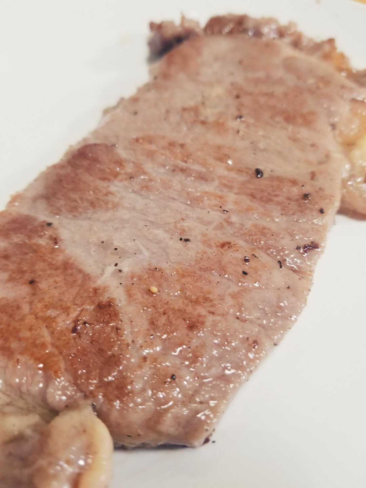 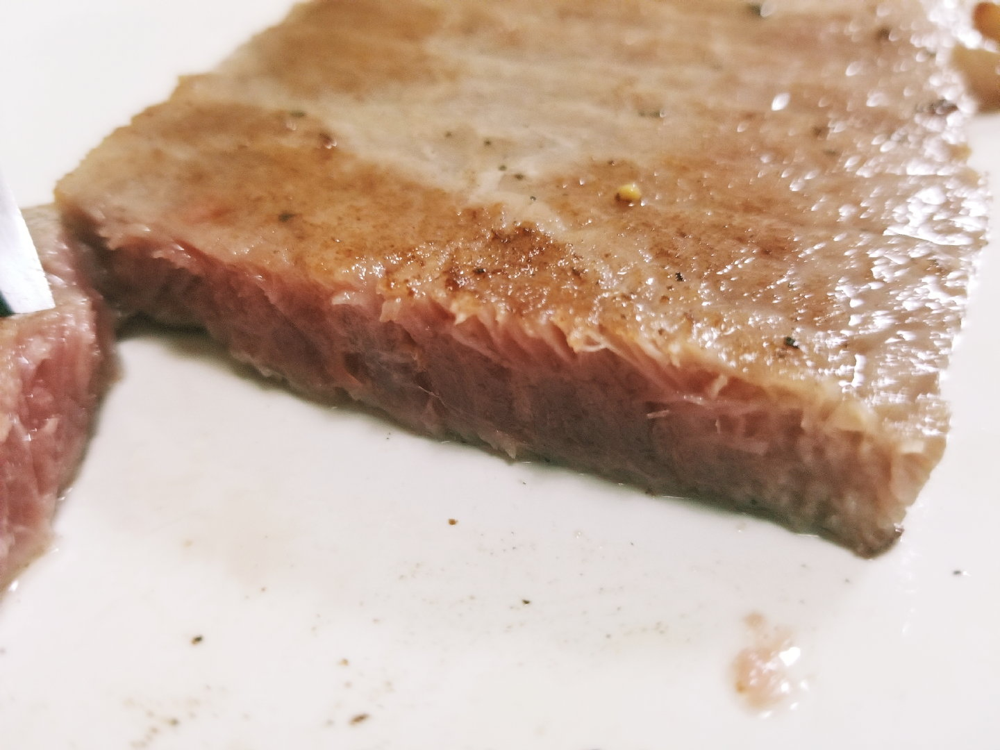

## 2018-06-05 21:49

每日打卡（190）

还是咳嗽，凑合跑了几公里。 ​​​
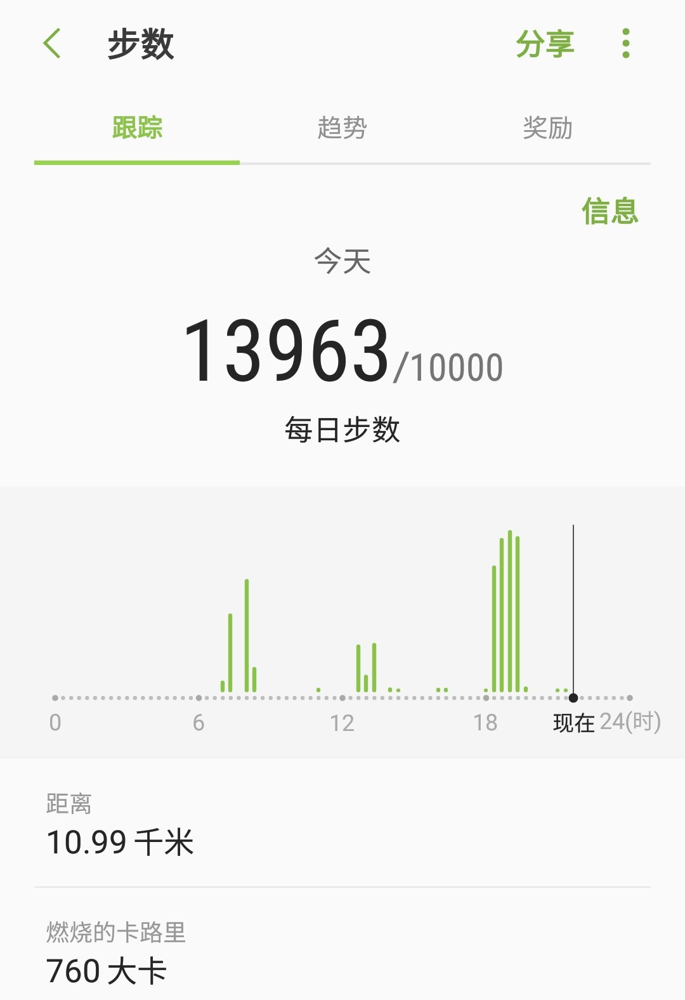

## 2018-06-05 22:08

油气为什么不跟跌，好气哦 ​​​
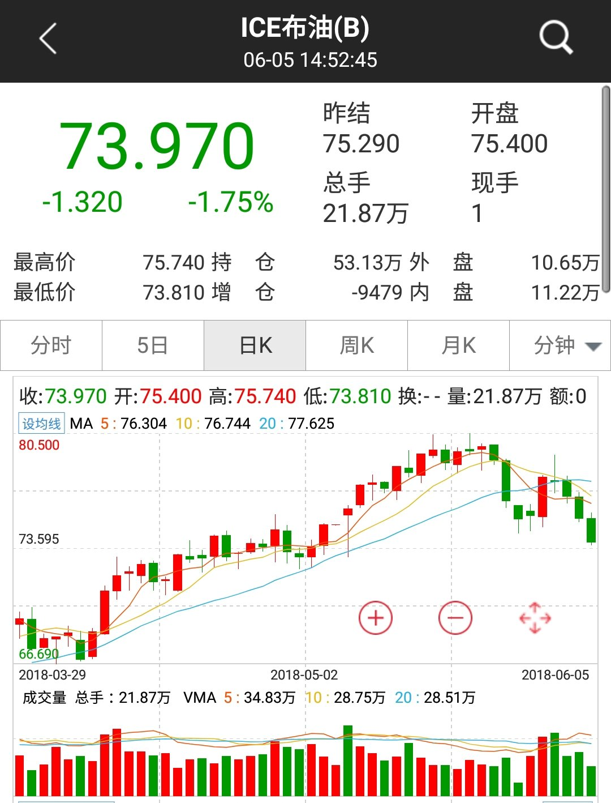

## 2018-06-05 22:43

回复@葱葱AQQ:话说的太早了。万一过几天又猛涨就难看了。能低位再接回来再得瑟吧……//@葱葱AQQ:会卖的是师傅！不服不行！感恩益达！

## 2018-06-06 10:42

有时候真的特别感动，总觉得自己也没做什么，好多朋友就对我特别好。

我也不知道说什么了，只能用尽全力做的再好一点。

不说了，说多了矫情。 ​​​

## 2018-06-07 07:54

谢谢！

虚岁60了！以后请尊重老年人！ ​​​

## 2018-06-07 10:34

好多人想的是CDR基金能不能挣钱，为什么我想的是几千亿抽血原来的股票怎么办。 ​​​

## 2018-06-07 14:26

我发现有人太贱了。公众号功能改版，必须关联一个微信账号，同时必须起个唯一的作者名字。

然后我输入“ETF拯救世界”，发现已经被别人占用了。

怎么那么贱啊。

以后可能公众号文章你就看不到“ETF拯救世界”这个作者名了……哪位朋友要发现哪个公众号用了这个作者名通知我一下……

我改个什么名字比较好。

## 2018-06-08 09:17

好了，这几天乱七八糟的过去了。咱们继续开始日常吐槽模式。

我想周末写篇跟投资关系不是特别大的东西，你兹不兹瓷。 ​​​

## 2018-06-08 09:36

跌的有点惨了，我再奶一把，队里的兄弟们可以拉了。不过，跟各位特别真诚的说一句，这个阴跌的时间越长，越折磨人，未来的爆发越震撼。两个条件，第一，极度便宜。第二，某件大事催化剂。

## 2018-06-08 10:47

我告诉你一个数学常识：

下跌33%，涨回去就会赚50%。

请问，你希望不希望你想买的东西下跌33%。

 ​​​

## 2018-06-08 12:33

$中证传媒 sz399971$   真的牛了。15年6月以来连跌3年，跌幅68%。

70%了，80%还会远吗……

计划1.8%仓位瑟瑟发抖中。 ​​​

## 2018-06-08 13:19

不要急，节奏我自然会控制好。

尽在掌握。 ​​​

## 2018-06-08 13:53

其实现在的情况真的很差。特别差。别老盯着几个明星股，至少3000只股票一直在下跌，连创新低。

但你知道你为什么心里不慌嘛，因为你已经做好准备了。

没准备的人才慌，因为他们不知道发生什么了，以后还会发生什么。

第一步，分析所有可能发生的事。第二步，对所有可能发生的做好预案。

当然，其实你不可能分析出所有的事，但你的系统要对你没有分析出来的事也要有容错性。

做到这些，你怎么可能死在A股。

## 2018-06-08 21:59

今天计划回撤0.4，几个增强指基表现真不错 ​​​

## 2018-06-09 15:58

拿回来了。

## 2018-06-11 09:00

回复@ETF改变生活:下午三点半即可知道答案。我比较期待。//@ETF改变生活:今天指数调整，不知对估值有什么影响

## 2018-06-11 09:11

回复@酩酊大醉的三藏:据我根据进出名单之前的计算，500会稍微下降，但是不多。//@酩酊大醉的三藏:比较好奇500的估值会不会进一步下降//@ETF拯救世界:回复@ETF改变生活:下午三点半即可知道答案。我比较期待。//@ETF改变生活:今天指数调整，不知对估值有什么影响

## 2018-06-11 14:10

不要猜底。一个建议。//@ETF拯救世界:再说一次，一定要做好长期抗战的心理准备。其他的问题不大，关键是心理准备。希望，意志，最重要。一切尽在掌握。

## 2018-06-11 14:46

回复@佛系坤少:挠挠。//@佛系坤少:老大，战略配售能不能买？有点痒//@ETF拯救世界:不要猜底。一个建议。//@ETF拯救世界:再说一次，一定要做好长期抗战的心理准备。其他的问题不大，关键是心理准备。希望，意志，最重要。一切尽在掌握。

## 2018-06-11 14:47

今天数据没出来，但如果尾盘半个小时没有猫腻，那么今天A股全市场PB应该会降至2.5以下了。

这是一个标志性的事件。意味着进入真正意义上的“低估”区域。

绝不仅仅是对比历史，还包括横向对比各国市场。

感谢资本市场，感谢这时代。

show time.

当然，前路依然崎岖。主要阻力来自于非市场因素。不埋怨，不骂娘。坦然接受客观事实，想办法获取最大利益
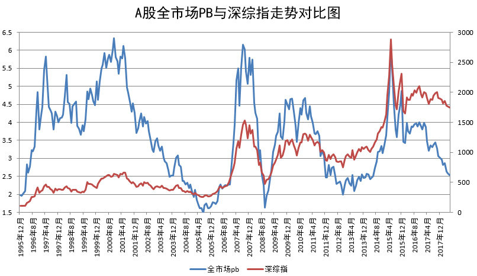

## 2018-06-11 15:52

打脸了，没破。

## 2018-06-12 10:08

GJD的操盘手一定在骂娘。当然，Zj也在骂…… ​​​

## 2018-06-12 10:18

八年来第一次进医院看病，咳嗽一个月了。

医生看完化验单，说，什么事都没有。

 ​​​

## 2018-06-12 13:56

谢谢大家。几百条建议，我准备神农尝百草了。哪天朕突然不发微博公众号球球就是被你们某剂方子给害了……应该没什么事……

## 2018-06-12 14:41

除了指数基金，各位可以选择一些消费类的股票，超长期持有。除非全市场极度高估，不卖。

我不是说现在买，总有特别好的买入机会，买了就别卖放着就行了。

反正就是那些吃吃喝喝的股票。大品牌。你经常买的那些。

医药的话，专业性挺强，买点指数基金就行了。

其它行业的股票，一般都是阶段性周期性的。想抓住每一个热点其实很不容易。不如就是指数基金+消费类的好公司好股票做个组合，长期看，很大概率会赚很多。

## 2018-06-12 15:10

回复@写代码的YuHao:当然了。美股历史上超级大牛股就是消费+医药。其它各领风骚的都灰飞烟灭了。//@写代码的YuHao:对美股也适用吧？

## 2018-06-12 15:13

回复@堺小黑:当然可以。我想很多朋友都记得几年前我在雪球发的六个必配品种：50、500、创业、医药、消费、信息产业。买了这六个基本上任何行情都落不下了。目前艰难买入中。//@堺小黑:510500这种可以买了长持吗？

## 2018-06-12 15:16

回复@风中的黑森林:我说了，不是现在买。以后总有特别好的机会。一定要记住，资本市场最不缺的就是机会。从来没有所谓“不可错过”的机会。//@风中的黑森林:不过近期消费类基金创新高，追入需谨慎呐同学们

## 2018-06-12 15:17

回复@吕凯飘在北京:算大消费吧。我看申万好像要把腾讯和网易CDR纳入传媒板块了。//@吕凯飘在北京:腾讯也算消费类的吧？//@ETF拯救世界:回复@写代码的YuHao:当然了。美股历史上超级大牛股就是消费+医药。其它各领风骚的都灰飞烟灭了。//@写代码的YuHao:对美股也适用吧？

## 2018-06-12 19:21

喷了，上一篇夜话打赏的朋友已经969人了，是不是你们怕我不接着写了，用金钱来腐蚀我？ 

没用的。我会是那种为了钱卖艺的人吗？省省吧。

PS，难道没想过用美人计试试吗？ ​​​

## 2018-06-13 09:35

个股。一天，40%。A股也一样，4个跌停也没差。

你说，你低位买的吧，利润减少40%。

高位买的吧，不说了。多少年白干了。

个股还是不能单压，还是得分散配置。所谓集中投资满仓穿越牛熊，只是那些幸存者偏差剩下的人跟你扯的蛋。你信了，也有可能是幸运的，也有可能不是。自己想清楚就行。

不过，最垃圾的，恐怕就是那些根本没赚钱还忽悠你集中投资满仓穿越牛熊的人……
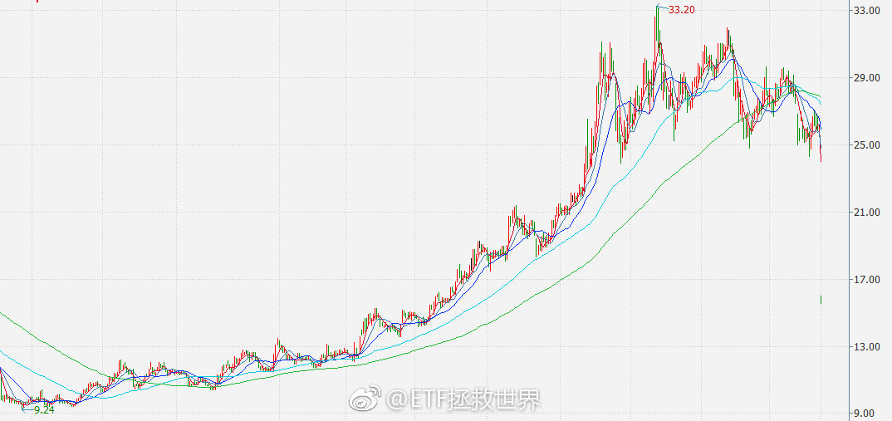

## 2018-06-13 11:12

回复@香克斯芒007:投入感情。控制节奏。加油，你行的。//@香克斯芒007:E大。我就不夸你的投资水平了，我就想问，为什么连你的文笔都这么的优秀？为什么？你是不是开挂了？@ETF拯救世界  写作是不是你有特殊的技巧？

## 2018-06-13 16:03

开完会回来怎么这样了。

没我的毒奶还是不行啊。

哈哈哈哈哈。

什么时候发车不敢奶了。 ​​​

## 2018-06-13 16:24

这一轮熊市，你能赚多少我觉得就不要预期了。

但你应该知道一件事。

就是，无论有多熊，你在资本市场死去的可能性，

几乎没有。

舒服。 ​​​

## 2018-06-13 16:29

回复@佳峻爸2013:我们的A股仓位超过60%-70%大概率就快了。//@佳峻爸2013:熊市啥时候能结束？等了好久了…

## 2018-06-13 17:23

今天收盘后，计划今年年度计算可能就变成浮亏了。大概0.2%左右吧。中证500已经下跌10%了。。

看了一下，今年A股下跌家数78%。跌幅中位数是-13%。跌幅超过20%的股票有1089只……

当然，上涨的也有22%……

不过我估计今年计划不会是亏损。年底看。 ​​​

## 2018-06-13 17:33

回复@宋隆河:不是第三轮计划浮亏，是今年。计划还有十几个点的收益扛造。对应大盘指数下跌大概要30%。也就是说，同期中证500要跌80%，第三轮计划才会浮亏。//@宋隆河:传说中的浮亏终于来了

## 2018-06-13 17:48

回复@lzg54:左右互搏，我是真的看不懂。//@lzg54:本来E大担心国家队，现在好了，熊市发独角兽，估计今年计划就能打满。

## 2018-06-14 08:55

回复@Luckier1:朋友，以我十几年的投资经验，跟你说两点。第一，股市涨跌与宏观经济数据并不密切相关，中短期来看。超长期有关。所以经济数据好不好与我们长期投资关系不大。第二，正因为数据不好，才有便宜货让我们买，难道什么都好了，涨到牛市了再买吗。

## 2018-06-14 10:12

有心报国，国先拉了。 ​​​

## 2018-06-14 10:13

是不是都买房去了。

## 2018-06-14 10:27

群众：我不跟。GJD：跟一个要反转了。群众：借我点钱。

## 2018-06-14 13:48

看看盘，有没有闻到恐慌的气味。 ​​​

## 2018-06-15 10:03

凉凉 ​​​

## 2018-06-15 10:14

$中证金融 sz399934$  万绿丛中一点红。辣鸡，又要追高建仓 ​​​

## 2018-06-15 10:54

快了

## 2018-06-15 11:33

还是那句话，控制节奏。不用急不要慌。

节奏。 ​​​

## 2018-06-15 13:42

回复@平常心的Alan:我要看的是这些人心理和情绪的改变。//@平常心的Alan:e大，您怎么看有些人说的A股估值体系的改变？

## 2018-06-15 14:32

回复@天啊我是笨蛋还不行:不会。不过我知道，现在很多人心里已经开始有点疑虑了。//@天啊我是笨蛋还不行:益达啊，我问一句，你不觉得很奇怪吗，这轮所有人都能跟车跟的下去。。。而且大家都很兴奋啊，确定这里是底？//@ETF拯救世界:回复@平常心的Alan:我要看的是这些人心理和情绪的改变。

## 2018-06-15 14:44

回复@石头里的虫子:计划损失25%意味着大盘从现在开始要跌60%。//@石头里的虫子:想起《滚雪球》里面说到红杉基金在1973年损失25%，1974年损失更多，最大投资人动不动就打电话痛骂比尔鲁安。//@ETF拯救世界:回复@天啊我是笨蛋还不行:不会。不过我知道，现在很多人心里已经开始有点疑虑了。

## 2018-06-15 15:11

回复@十洲山水:其实主要原因就是你没经历过。经历过就懂了。以后你每天暴增的时候根本就想不起来现在每天波动的感受了。不过这个没办法，说了你也不明白。没经历过的事你怎么会明白。

## 2018-06-15 17:14

大家开开心心过周末！可以看看球。生活多美好。

周末要不要再写一篇东西，还没想好。别催，别期待，可能不写，也可能写。

开心点都！ ​​​

## 2018-06-19 08:40

哈哈哈哈哈哈哈，让你们不申购战投基金

## 2018-06-19 09:09

有人昨天晚上还担心要崩盘了，早上听说小米暂缓突然又觉得牛市要来了。 ​​​

## 2018-06-19 09:18

回复@亹亹Vk:后天走。鉴于去年去欧洲十几天A股发生的事，决定这次带上笔记本。//@亹亹Vk:还是去环球旅行吧

## 2018-06-19 09:28

每周发车模式正式启动！ ​​​

## 2018-06-19 09:33

井喷式网格预警…… ​​​
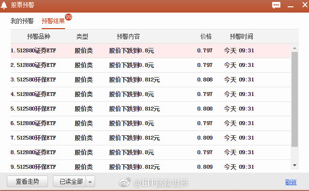

## 2018-06-19 10:22

我再说两个最重要的字：

节奏。 ​​​

## 2018-06-19 10:51

回复@泸州单身俱乐部--剑平:是的。但是这都说的是趋势投资模式，与我们的有不同。不买不卖是说不一把梭的买卖，而不是根据时间空间的再平衡调整。//@泸州单身俱乐部--剑平:E大，记得你说过新高不卖，那对应的是不是新低不买呢？

## 2018-06-19 11:14

中午发车。为国护盘。 ​​​

## 2018-06-19 14:23

没想到这么疯狂，中午是不是买少了 ​​​

## 2018-06-19 14:30

绝大多数朋友终于意识到150份的重要性了。

该发生的总会发生。 ​​​

## 2018-06-19 14:32

我承认，我看错了。我以为是阴跌，结果出现股灾了。我以为他们是王者，谁知道是青铜……//@ETF拯救世界:再说一次，一定要做好长期抗战的心理准备。其他的问题不大，关键是心理准备。希望，意志，最重要。一切尽在掌握。

## 2018-06-19 14:37

喷了，这么快！！！！！！！！！//@ETF拯救世界:快了

## 2018-06-19 14:50

回复@天啊我是笨蛋还不行:我怎么觉得他们比我还兴奋……//@天啊我是笨蛋还不行:益达啊。。。你还记得我跟你说的吗？之前跟车的人都很兴奋啊。。。今天终于有点可怕的感觉了//@ETF拯救世界:喷了，这么快！！！！！！！！！//@ETF拯救世界:快了

## 2018-06-19 14:52

$中证500 sz399905$   跌破5000时，就是我们再次发车日。本月如果再发车，可能需要4-5份以上。看自己情况准备吧。

投资太有意思了不是吗。 ​​​

## 2018-06-19 15:29

2012年底不远了。然后是2005，然后是2008。

我的准备只能做到2008，如果再低，就超出我的理解范围了，我就只能装死了。当然，会留一部分右侧。怎么也不能真死是吧。 ​​​
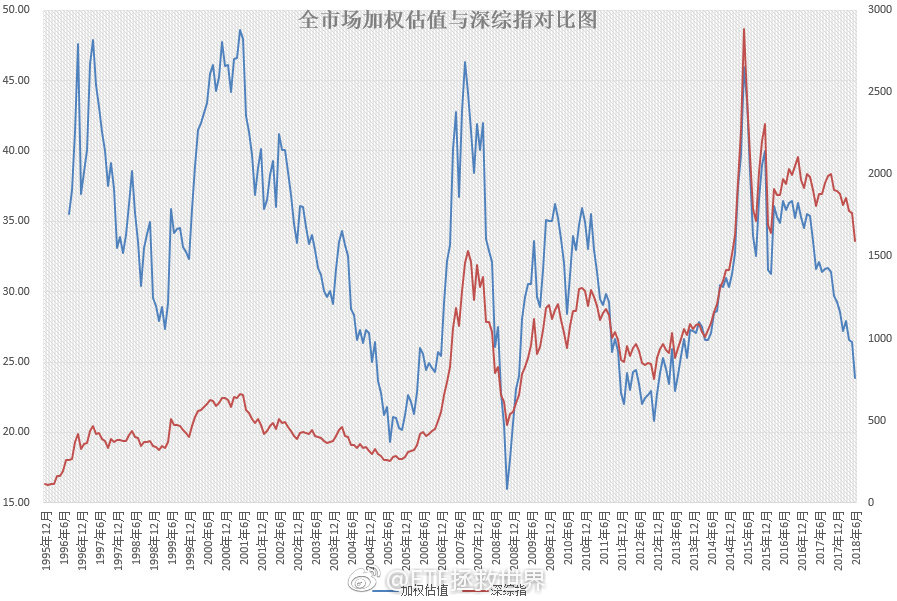

## 2018-06-19 17:19

辣鸡美元债敢不敢涨一点……

## 2018-06-19 17:24

下定决心更新了一下理财软件的收盘价，看了一眼总资产变化……

糟糕，是心肌梗塞的感觉。 ​​​

## 2018-06-19 18:17

回复@用户y49f7o7jj4:远没到我的预计范围啊。比如500我认知极限是4600点。现在5100。还有10%呢。//@用户y49f7o7jj4:老大，现在情况还在您的预想范围吗？

## 2018-06-19 18:24

我跟你说个真实的感受。几年以后的。你的感受。

那时候你回想现在或者未来一段时期，根本想不起来痛苦和难受的感觉了。好像从没有过那样的感觉。

最大的可能，是你后悔为什么当时没有多买一点。

不信你就记着我说的，看看到时候是不是这样想。当然，别因为这几句话就满仓。控制好节奏。问问自己，买的东西如果下跌30%，或者上涨50%，哪个更痛苦。想清楚了再干。

但是未来，大概率你是会忘记痛苦感受的。

我也不知道为什么。

## 2018-06-19 18:53

回复@雪夜途经你的盛放:不是。指数随着时间的推移会不断上涨。顶部，底部都会不断抬高。明年此时的极限点就变成4900-5000点了。//@雪夜途经你的盛放:杠一下。之前老大说认知极限是4500呢，今天认知极限涨了100是指数名单调整的结果么？今天一想到这，就忍住了剁手。

## 2018-06-19 19:54

回复@歪嘴笑笑笑:今天球球有个加杠杆的大v哭了。我建议普通人还是不要上杠杆。买指数是大概率胜，随便加杠杆是大概率要出事的。//@歪嘴笑笑笑:E大，加杠杆是怎么样的思路，可以谈谈吗！

## 2018-06-20 09:47

就是那么刺激。GJD敢不敢不要出手？ ​​​

## 2018-06-20 10:59

回复@默与婷:其实你可以思考一个问题。或者看看这些人2015年的发帖。在2015年，中证500接近12000点的时候，他们有没有看空。如果没有，在2018年，500即将跌破5000点的时候，看空了。其他的话我不多说。

## 2018-06-20 11:06

$全指信息 sh000993$   4年新低了。一直需要配置，一直没有买。现在还是不买，依然贵。继续等。

熊市医药+消费会表现好。

牛市就要看科技、信息。风险偏好不同。如果这一轮信息可以砸到很便宜，下轮牛市大概率的王者之一是它。 ​​​

## 2018-06-20 12:07

不过，超长期来看，10-30年的投资维度。

还是医药+消费。这个观点已经持续十年了。低位买入，有能力做超大波段就做超大波段，没能力就死死拿着。最后结果总不会差。买的够低，长期年化15%+不是大问题。

这个大概率不会错。 ​​​

## 2018-06-20 12:23

回复@nemours-2号炉:我从没听说过这个人，今天一看居然10w粉丝？然而每个帖子评论居然只有不到10条，大多1、2条。这个有点奇怪了。另外，500PE腰斩？//@nemours-2号炉:回复@黄连树:方何之子昨天说500pe得腰斩

## 2018-06-20 12:45

我大概跟大家说一下500的估值历史，大家心里也有个数。

目前中证500全收益指数比2008年1月和2010年12月两次顶部区域都高一点，大概高5%。也就是说你如果在这两个月买了，10年，以及8年后，只能赚5%。

为什么呢。因为这两个月，500的PE分别是58倍和45倍。所以你看，千万不要买贵了。

10年过去，指数只涨了5%，那么估值呢？估值已经从58倍降到了24倍。下降了60%。

这么说吧，如果500还能回到58倍估值，那么现在买，不考虑利润增长，会涨140%。

我们先不要这么乐观。我们就考虑，500这辈子大顶估值就是24倍了。不会超过了。那么未来能赚多少。

历史上，24倍的估值最近三次出现在2005年11月、2008年9月、2012年11月——没了。

2005年11月买入，至今赚520%；2008年9月买入，至今赚158%；2012年11月买入至今赚91%。

各位可以自己算算年化收益。什么？不会？我帮你算。

2012年至今年化心算大概是12%；08至今年化10%多；2005年买入至今大概15%左右。

会不会觉得12%、10%、15%比较少？别忘了我们的前提，前提是，未来24倍就是大顶了，不会出现更高的估值了。2015年那种70倍的估值再也不会出现了。当然，如果出现，你会把巴菲特甩掉10条街。

那么，会不会以后连15倍都超不过了？那么我们不就收益率很低了吗？

有可能。不过我要告诉你的是，2008年，金融危机，最低点，500估值，18倍。也只维持了一个月。也就是说，2005年至今13年，只有一个月500估值低于20倍。

下次不一样，这次不一样。

去年利润增长超过25%的指数你连20PE都不给我？

呵呵，信了你的鬼。

## 2018-06-20 12:49

回复@南海恶神的师傅:会配置。但现在我肯定不会买。违反我的原则了。//@南海恶神的师傅:回复@不说的树:不可能的//@ETF拯救世界:回复@nemours-2号炉:我从没听说过这个人，今天一看居然10w粉丝？然而每个帖子评论居然只有不到10条，大多1、2条。这个有点奇怪了。另外，500PE腰斩？

## 2018-06-20 12:52

回复@lenezzaa:是的，这次不一样。不过我想告诉你的，是美国纳斯达克以及美国中小指比500要贵。是不是美国也没有参考价值？更不要说很多人喜欢的印度了。所有人都说，未来要不一样了。我倒要看看20倍的500能不能赚钱。

## 2018-06-20 13:07

很多人最大的问题，就是会被最近发生的事情迷惑，以为最近发生的就是永恒。

这几年，拜GJD托底所赐，资金抱团大蓝筹，很多人认为中小股票完蛋了没戏了。

我之前说过很多次，中小股票现在确实还是贵。比如创业1000咱们几乎还没买，就是因为贵。但你不能因为它贵就说它未来没戏了。就算美国、香港，这一轮牛市依然是中小指数涨幅大啊。既然跟国际接轨，你不看看外面的世界是什么样？

我从来不戴有色眼镜看任何品种。大的小的，合适了就买。别干什么事儿先把自己框起来，这不行那不行。逗。

银行股涨得好的时候，银粉是价投的唯一标准。白酒涨得好的时候，酒粉是唯一标准。这对吗？难道世界上只有一种投资方法，一个成功标准，只能买入一个品种？

别说未来不一样。我看没什么不一样。就是因为最近表现差，看衰的人才多。我就不同，正是因为最近表现差，我才越买越多。这一切的历史都会被记录下来，未来看看会怎样。

## 2018-06-20 13:20

是不是有人看了我微博开始拉了。是不是你，队里的兄弟。太给面子了吓吓侬。

## 2018-06-20 15:01

回复@中国动量:券商，如果重仓，就要做好三年不开张开张吃三年的准备。//@中国动量:E大，我觉得目前券商etf很便宜，从2015年高点下来，跌幅70%以上，值得定投买入。请问E大的看法？

## 2018-06-20 15:06

回复@titie89:重仓慎重。计划这样只有不到两个点的轻仓还是可以拿。券商这个版块还是挺奇葩的。经常与众不同。//@titie89:e大，之前听到一个说法，因为券商行业后期有一定利空因素，所以券商etf不值得配置。这个您怎么看？

## 2018-06-21 14:50

下了飞机定睛一看

原来是股灾。  ​​​

## 2018-06-21 15:17

回复@去年十二月十二日:第一次带孩子出远门，还是来最低难度的地方。如果表现好以后再加大难度。//@去年十二月十二日:以为老师去南半球呢，很热吧，介绍一个岛给你，塔斯马尼亚岛，环境不错。

## 2018-06-21 17:09

不过说起来也真的挺邪门的。去年我出去的二十天内就跌出了沪深300的最低点。蓝筹牛市从那天启航。我记得很清楚，那天我在达沃斯。

这次出去十天会不会跌出谁的最低点？ ​​​

## 2018-06-21 17:18

真是比较震惊了，连中证1000都快跌入30倍了。要知道2015是100倍啊。

## 2018-06-21 17:23

回复@ETF拯救世界:历史性时刻不远了。还记得我说的6-9个月吗。太NB了。中小股票再暴力几天就够了。//@ETF拯救世界:真是比较震惊了，连中证1000都快跌入30倍了。要知道2015是100倍啊。

## 2018-06-21 19:03

不要激动，历史最低19。08金融危机。现在还在30以上。//@ETF拯救世界:真是比较震惊了，连中证1000都快跌入30倍了。要知道2015是100倍啊。

## 2018-06-21 19:10

回复@CC_轨迹:其实我真的不懂，投资这件事，别人怎么说真的这么重要吗。你自己在干什么，自己的优势是什么，劣势是什么，未来大概率会发生什么，小概率会怎样，最差如何，最好如何。想清楚，为什么要看别人怎么说？99%不断评论别人的人一毛钱都赚不到。

## 2018-06-22 07:28

回复@book41:我不会这么业余的。知道很多人为什么说1000历史最低吗，因为他们没有历史数据。 查看图片 //@book41:@ETF拯救世界   08年，中证1000不是还没有吗//@ETF拯救世界:不要激动，历史最低19。08金融危机。现在还在30以上。

## 2018-06-24 12:29

出太阳就去冲浪游泳，下雨就在房间泳池边上看书，还会有只小鸟来陪你，这才是休假啊。

不过还是不建议住带泳池的小别墅。因为孩子虽然会在里面玩的很高兴，但是当他问:“我们家为什么没有游泳池”的时候，场面一度会相当尴尬。 ​​​
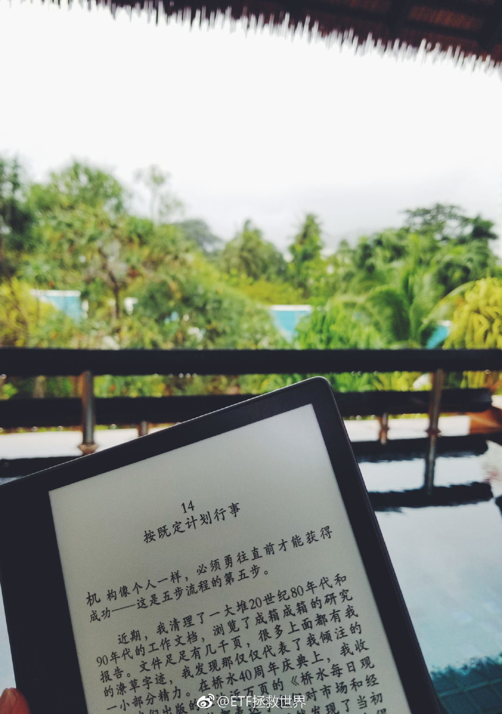 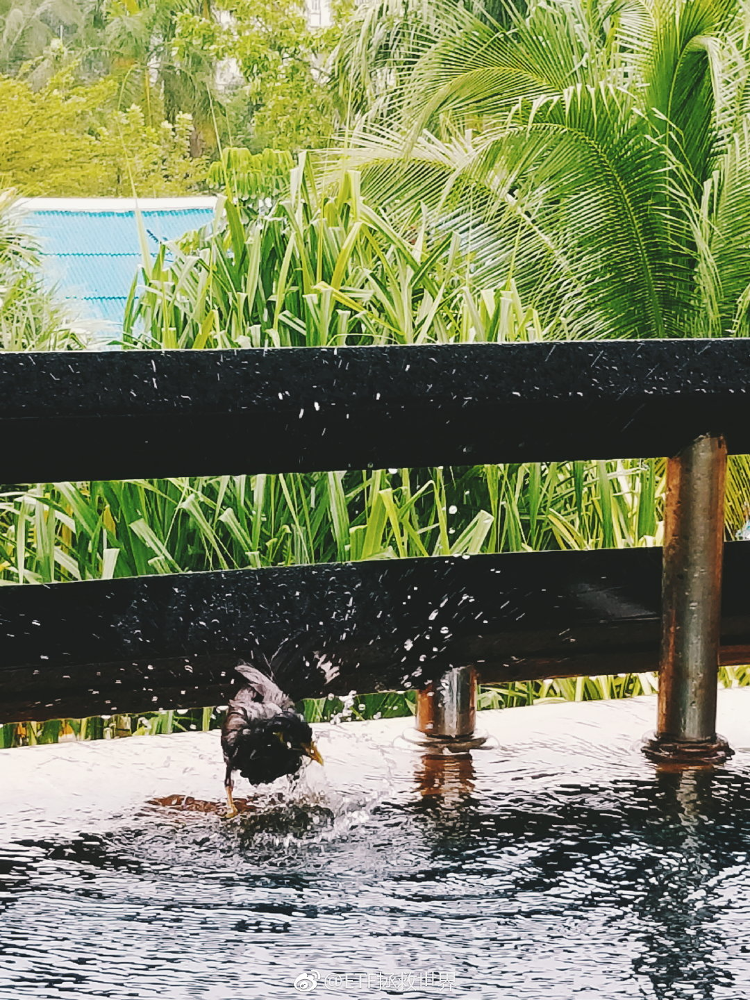

## 2018-06-24 13:01

准备上板了。浪起来。 ETF拯救世界的秒拍视频 ​​​

## 2018-06-24 18:22

生活小贴士:

防水手机也不要下海。 ​​​

## 2018-06-24 18:30

降准了。本来打算下周继续买的金融地产指数还能买到吗。 ​​​

## 2018-06-25 13:52

功力不减

## 2018-06-25 14:04

今天腾讯提示我，有人投诉另一个公众号抄袭我的文章，作为公众号运营人是否确认投诉。

我点进链接一看，厉害了。该公众号把我那篇《凭什么赚钱》的文章居然做成漫画放出来了。这可是一家投资机构，不是个人。

当然确认投诉了。也特别感谢这位投诉的朋友。几年前第二轮计划就是因为有人抄袭我才设定了博友可看。现在我写的东西被更多的人抄来抄去，从计划到文章都不放过。

只有一句评价:不要脸。

## 2018-06-25 16:54

越来越佩服YT。超厉害！

## 2018-06-26 08:20

回复@chen_扬:是啊，很多人太乐观，也没有弄清楚估值的细节。能保证自己在发生任何情况都不死，是必备技能。可惜，很多人还没有完全领悟//@chen_扬:560了，700点喊抄底质疑600点可能性的人还好吗

## 2018-06-26 09:34

节奏，注意节奏 ​​​

## 2018-06-26 09:57

本帖发出次日，沪深300见顶。我说的很多话并不好听，但是通常有用，有时候能救命。

## 2018-06-26 10:05

保守能让你活得更久，但永远保守无法让你资产飞跃。

审时度势，人弃我取，逆人性而为。永远与大多数人的思维模式保持距离。 ​​​

## 2018-06-26 10:22

回复@鱼香基丝:因为怎么跌我们的50 300都不会被套//@鱼香基丝:可您当时也没清仓沪深300和上证50啊，见顶了咋自己不清仓呢？//@ETF拯救世界:本帖发出次日，沪深300见顶。我说的很多话并不好听，但是通常有用，有时候能救命。

## 2018-06-26 10:37

回复@走在大航边:球球就是让你知道大多数人在想什么的地方啊//@走在大航边:永远与大多数人的思维模式保持距离，难！有时候不知道大多数人在想什么。

## 2018-06-26 11:02

回复@王大哈hahawang:5000就这么难吗！好气哦，游泳去了//@王大哈hahawang:e大  我感觉500真的到底了  跌不下去了啊！//@ETF拯救世界:回复@鱼香基丝:因为怎么跌我们的50 300都不会被套//@鱼香基丝:可您当时也没清仓沪深300和上证50啊，见顶了咋自己不清仓呢？

## 2018-06-26 11:25

回复@元气-2017:很多人不明白在我的体系中，买入区域，持有区域和卖出区域的区别。不卖不代表可以买//@元气-2017:这回答牵强了，不会套和把到手的利润白白还回去是一样的么？//@ETF拯救世界:回复@鱼香基丝:因为怎么跌我们的50 300都不会被套

## 2018-06-26 11:34

回复@joans2018:算。但我是五月买的，跌了几十个点以后。不是1月25买。而且只买了0.6%。怎么这些都要解释吗//@joans2018:那之前买的全指金融算不算蓝筹范围内呢//@ETF拯救世界:回复@元气-2017:很多人不明白在我的体系中，买入区域，持有区域和卖出区域的区别。不卖不代表可以买

## 2018-06-26 14:41

回复@牛one:刚从游泳池回来。除了我们一家都是欧洲人，我估计大部分都是俄罗斯的。穿着比基尼的姑娘们身材我不多说了。图没拍！自己脑补吧。//@牛one:假期愉快！不要浪费时间搭理这些问题了，上个比坚尼照啊！

## 2018-06-26 16:24

球球有活动，我得奖了，奖品一个华为手机，然后我送给投我票的朋友了。

为什么微博没有人送我东西？我可以转送给大家啊，急死我了。

要不然这样，下次再有人找我在微博做广告，我接一个。拿到的广告费分给大家，这个办法好不好，你资瓷不资瓷。 ​​​

## 2018-06-26 21:35

麻蛋，算错时间了。丢人了。

辣鸡surface显示的系统时间居然不是当地时间…… ​​​

## 2018-06-26 21:45

这次带出来的电子产品，大部分都自动校准当地时间，比较方便。三星还自动在锁屏显示当地与出发地两个时间，很不错。佳明的表会根据gps校对时间。

surface为什么没有联网自动改时间呢。不过总体来说，surface这次出行算是完成任务。基本的文档操作以及娱乐功能没问题，轻，小巧。飞机上可以当平板使用，看两部电影问题不大。如果不玩游戏没有重度使用需求的朋友其实可以考虑，不过最好去看看实物。双11应该会很便宜。
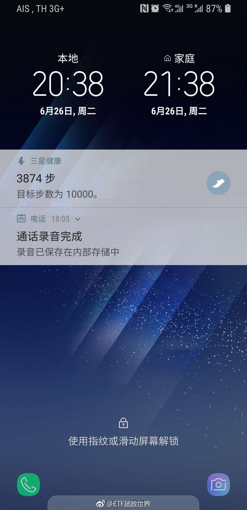

## 2018-06-26 22:33

“散户是不是都是追涨杀跌的？”

这个还用别人说吗。看看身边曾经炒股的朋友亲戚同事。问问他们现在是否还买入跌跌不休不到3000点的股票？绝大部分都肯定跟你说炒股赚不了钱，都是骗局，不要炒股。同样一批人，大牛市会重新杀回来接盘。

自己做的就是赔钱的标准动作却怪市场不给力。A股之所以牛短熊长，一年可以涨完美股十年的涨幅，然后漫漫熊途价值回归，真得感谢追涨杀跌的人啊。

## 2018-06-26 23:30

回复@冯大雄君:你问问自己，有没有通过不道德的，或者违法的手段赚别人的钱？如果没有，有什么可困惑的？你高考的时候多考一分，会有几千几万人被你踩在脚下，可能就考不上理想的学校了，你是不是损人利己？你通过自己的知识智商意志赚钱，有什么困惑。

## 2018-06-27 07:43

回复@Alex森岚:底部区域不是靠猜的。这么说吧，全中国最好的几百家公司，一倍多市净率，就是底部区域。系统风险也许会有，但你看看历史，哪次系统风险不是真正的钻石坑？我们需要的是做好准备捡钻石而非吓得抱着现金发抖

## 2018-06-27 07:55

什么叫情绪，我告诉你什么叫情绪。

2000 2007 2015，全市场市净率都接近7倍。你愿意用7倍市净率去抢股票，还幻想一万点。

2005 2008 2012，全市场市净率都是一倍多。然而这些时候成交低迷，没有人愿意买股票。

2018，现在又快跌破2倍了。更多的人开始担心经济危机，开始担心过去的经验无用了。

这就是情绪。

## 2018-06-27 08:53

本来是要居民加杠杆给企业和那什么接盘负债，没想到居民加了杠杆把以前的债务接过来以后，企业和那什么的负债更高了。

## 2018-06-27 10:51

我再送各位一个贴士，关于在球球观察情绪的方法。

就是你注意观察，现在谁最红。

谁最受群众追捧，谁发个帖几百上千回复，打赏的人上百。

那你就要注意，把他捧红的那个股票或者板块就很危险了。

不信你回想一下是不是这样。 ​​​

## 2018-06-27 10:56

回复@云雾China:这个我不知道。因为我说”要敬畏市场“，他把我拉黑了。//@云雾China:现在最红的是黄建平吧

## 2018-06-27 11:46

大家可以观察一个股票跌破长期高位横盘平台后的表现。作为一个案例。

## 2018-06-27 14:31

利好:我的假期即将结束…… ​​​

## 2018-06-27 15:36

你们自己看看，评论里有点熊市的样子吗？严肃点！不成体统。

## 2018-06-27 16:58

你们心态好是因为还有很多钱抄底。

现在再回忆一下大v们倡导的满仓穿越牛熊。 ​​​

## 2018-06-27 18:35

熊市不要随便猜底。但是你必须知道，底越来越近了。

看起来是废话？好好体会一下。很重要。 ​​​

## 2018-06-27 22:09

回复@周蝶梦庄:如果到，会写。目前距离那个估值大概十个点左右//@周蝶梦庄:请问E大一个问题啊，现在距离您写2012年11月28日那种文章还有多大空间呢，到了那种时候，您会不会也写一篇那样的文章呢，谢谢E大，望答复！

## 2018-06-28 05:43

美股被我A带坏了。

什么时候才能配美股啊。 ​​​

## 2018-06-28 14:01

2800就别守了，守2700吧。。 ​​​

## 2018-06-28 15:14

回复@glay_lee:哪有的事儿呢。//@glay_lee:说，队里是不是有人

## 2018-06-28 15:28

不过，说起球球的人乐观。其实我从4年前开始上球球就有这个感觉。

感觉很多人根本没有经历过真正的熊市。包括很多大v。

我当时真的很震惊，尤其是2015年。看着他们的发言，心中就一个疑问：

05、08年和11 12他们是怎么活下来的？

总体来说，球球真的是从上到下乐观洋溢的一个地方。谨慎的人会被喷得比较厉害。

## 2018-06-28 15:48

今天红利市净率快跌破1倍了。

超赞的。 ​​​

## 2018-06-29 05:15

债券的意义。现在懂了吧 ​​​
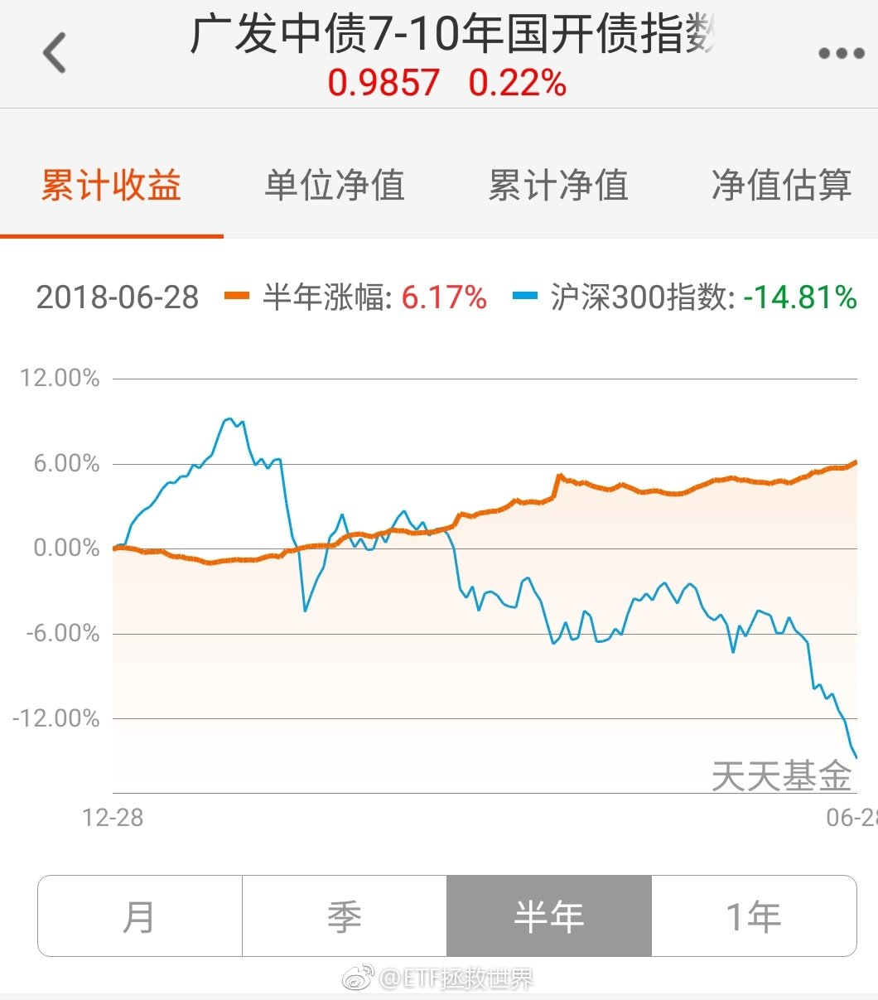

## 2018-06-29 06:21

回复@花花世界231:无论你能不能坚持住，不用来我这里报告。否则拉黑。其他人也一样。不好意思。别给我压力，除非你以后赚钱的时候给我分20%。//@花花世界231:目前浮亏2万＋希望自己能坚持住

## 2018-06-29 08:05

计划半年成绩：A股40%多仓位，加上港股超过50%仓位。全是指数基金，这个回撤幅度算是合格。

计划上次年度亏损还是2012年，今年我觉得也不会亏。 ​​​
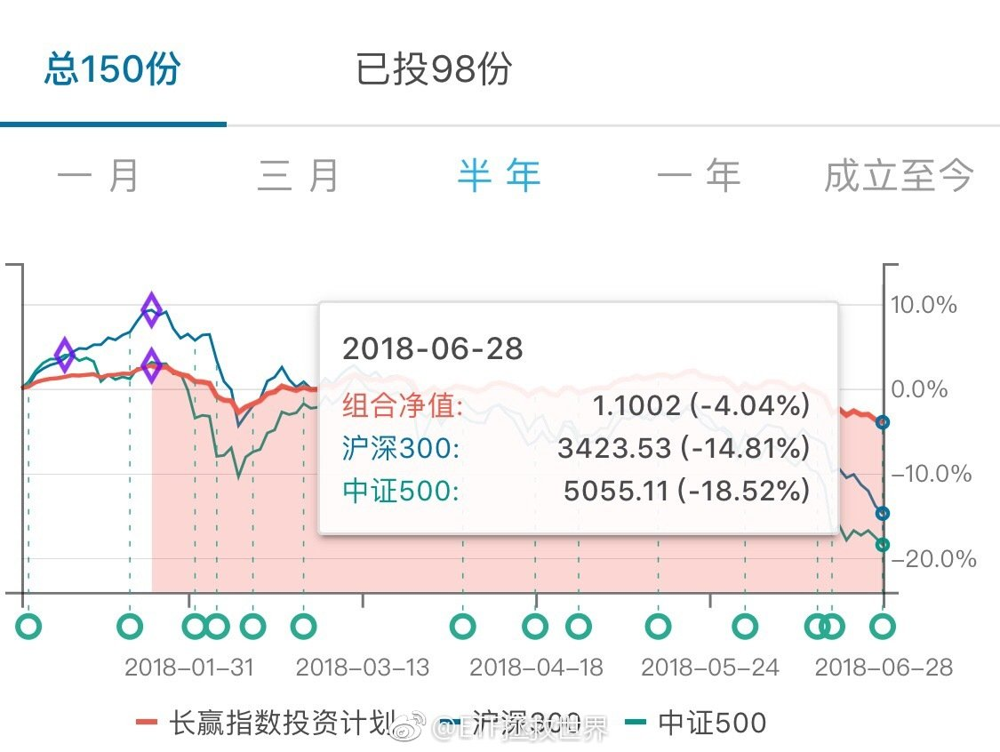

## 2018-06-29 08:51

如果我没搞错的话，不是一直在走自己的行情吗。是我瞎了？

## 2018-06-29 09:17

回复@-昂昂-:历史上从没出现过这几年这种分化如此严重的情况。低的低到10倍，高的还在50多倍。从2000年开始就没出现过。后面怎么走，值得期待。

## 2018-06-29 09:38

其实德国也不贵了，可以继续加了。

但是！513030真的跟的太差了。每年跑输基准几个点，有一年跑输20个点。

只能等再便宜点，多给它点容错空间吧。

QDII真是服了。

跟汇率无关，基准是排除汇率因素的。 ​​​

## 2018-06-29 09:45

今天如果反弹，那么昨天的买入舒服不舒服。仓位舒服不舒服。

如果继续跌，仓位舒服不舒服。

问问自己。

我估计大多数人是很舒服的。那你就不会犯错。

不舒服，紧张，慌乱，就很容易出错。 ​​​

## 2018-06-29 09:56

夜观天象，算了一卦，99%概率不会跌破2400。

如果破了，我就删帖。 ​​​
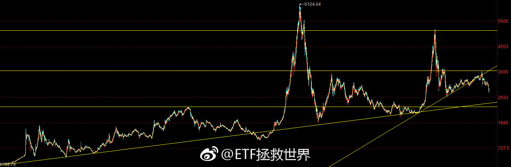

## 2018-06-29 10:28

传媒今天能不能搞3%？ ​​​

## 2018-06-29 10:51

这么听话实在不好意思了。

## 2018-06-29 10:56

再说一次，目前有点浮亏根本不要在意。

只要你相信A股在你有生之年还有牛市，那你的浮亏在牛市来临的1-2周之内会变成盈利。

这个说过很多次，但是只有真的发生了你才明白是怎么回事。

我说的很多东西，随着时间的推移，都一一实现。这个也不会例外。 ​​​

## 2018-06-29 11:33

半年浮亏还剩3%了。今年盈利很乐观。

## 2018-06-29 11:43

回复@牛牛s:一天反弹什么也说明不了。目前中长期趋势没有变化。反弹是下降趋势中经常出现的，跌多了弹一下很正常。什么时候趋势扭转再说吧。//@牛牛s:E大，我伤心了，说好的熊市呢，60车资金已到位，准备大干一票，然后冬眠两年，突然没了

## 2018-06-29 11:51

回复@godshan:只要是我们买的基金，就不用担心份额太少清盘。为什么我就不说了。自己体会。不信可以注意看看金融地产的半年报数据。//@godshan:回复@VX北城不夏:亲，你这回答没看懂啊，前面说不会，后面又说最近有个因为份额太少清盘了？

## 2018-06-29 13:15

有没有可能4%。//@ETF拯救世界:这么听话实在不好意思了。

## 2018-06-29 13:48

队里的兄弟们悠着点啊。5%肯定到不了了。//@ETF拯救世界:有没有可能4%。//@ETF拯救世界:这么听话实在不好意思了。

## 2018-06-29 13:52

回复@看我看我252:某一天，我们持有的某些指数，一天就能涨8%以上。爱信不信了。//@看我看我252:太慢了，能不能来个涨停//@ETF拯救世界:队里的兄弟们悠着点啊。5%肯定到不了了。//@ETF拯救世界:有没有可能4%。//@ETF拯救世界:这么听话实在不好意思了。

## 2018-06-29 13:57

昨天没有申购或者买入的今天就先算了吧。这也太暴力了。或者少买点。 ​​​

## 2018-06-29 14:06

回复@看我看我252:昨天真的写的很急。因为必须当天发车。我不瞒大家说，慌乱之中，少发了一车……//@看我看我252:益达，你是不是提前结束假期回来主持大局维稳来了。

## 2018-06-29 15:06

年底只要收在2900，年度就可以不亏了。如果下半年继续暴力下跌，那么年底收在2800甚至更低就可以不亏。熊市每年不亏，牛市跟上。很难实现的目标，但值得努力。//@ETF拯救世界:半年浮亏还剩3%了。今年盈利很乐观。

## 2018-06-29 16:05

下半年应该是大部分价值仓位布局完毕的最后日子了。

小部分趋势仓位有可能会多保留几个月。

一个预感，不一定准。 ​​​

## 2018-06-30 12:43

私募猛如虎。

买私募真的要擦亮眼睛好好选。 ​​​

## 2018-06-30 15:19

君子爱财，取之有道。

送给各位好友。 ​​​

## 2018-06-30 18:31

之前用的iPhone彻底凉了，只能把以前的拿出来用。

防水手机不要碰海水，一定要记住…… ​​​

## 2018-06-30 19:09

又想写点东西了。 ​​​

