## 2018-07-01 22:25

每日打卡（191）

痊愈了，正式恢复每日打卡 ​​​

## 2018-07-02 09:37

喷了，球球周末大战还有人做了个双方对阵图，也是闲的……

观察球球是非常有意思的。球球和微博、公众号都完全不同。我一直说，球球就像个小村庄。微博像个国际大都市。你比如，你在北京生活的感受，一定跟在小镇小村生活不一样。我虽然没在小镇和村里生活过，但我大概也能知道是一个什么状况。

观察球球，只要你深入观察深入思考，不仅能学到投资知识，观察到群众情绪，还能学到很多这个社会上有的，但不会这么集中又明显的摆在你面前的社会学知识。

非常有意思。

多读点历史，多读点大人物传记，再看，更有意思。

## 2018-07-02 10:13

数学题：如果某股票跌40%，那么回到高点，你会赚：________。第二道数学题，一个股票跌40%你买入，当它从最高点跌70%的时候，你跌40%买入的部分，下跌是百分之_____//@ETF拯救世界:回复@ETF拯救世界:快40%了。服了。//@ETF拯救世界:超过30%了。

## 2018-07-02 10:20

回复@佛系大猫:虽然我没见过真机，但我觉得nex和find x会不会很厚。毕竟一个升降摄像头啊。我对手感要求很高的。目前摸着最舒服的，屏幕看着最舒服的还是我的s8。极品。//@佛系大猫:我始终觉得，现在性价比和外观等综合考虑，nex s是最佳选择，find x太贵，刘海屏又不喜欢

## 2018-07-02 14:41

真❁股灾 ​​​

## 2018-07-02 14:44

好了，周四没有来得及申购的，今天可以动手了。听我的没错的

## 2018-07-02 14:57

我再说一次，节奏

看看你自己的账户，东西还少吗。急什么。你又不是开印钞厂的。

节奏！

给空间，空间！！

新低后面跟的大概率是什么，你心里没点数吗。 ​​​

## 2018-07-02 15:02

回复@狸大猫猫:钱多钱少没有关系。有一亿不知道控制节奏，也都折进去了。有十万控制节奏，依然开开心心捡辣鸡。水平不够，控制的钱越多，毁灭性越大。//@狸大猫猫:钱少的时候就要注意节奏，现在就痛恨自己钱少

## 2018-07-02 16:22

我以为跌多少呢，算完全市场估值发现没减少多少啊。

定睛一看，500还在5100多点呢。

多大点事儿啊。不就是大蓝筹开始杀跌了吗。这不应该在半年前就预料到了吗…… ​​​

## 2018-07-02 16:40

你知道抱团取暖的问题是什么吗。是，谁都别跑。只要有跑的，大家都跑。都跑就没人接。其实我对蓝筹没有成见，但你们不能组团忽悠让别人给你们接盘吧，有点不地道。“价值投资元年”，老乡们，长点心眼吧。人家去年翻番了，吃饱了抹抹嘴要走，谁来买单？

## 2018-07-02 18:40

如果CDR停了，卖的几百亿基金怎么办。

好戏不断。 ​​​

## 2018-07-03 07:59

回复@王千炎:他是持仓部分八个点。我辛辛苦苦做的配置，下跌过程中对冲的跌幅白做了？我分150份是扯淡呢吗。就像你买个基金，它有个持仓品种跌了8%就崩溃了？不看基金净值？//@王千炎:8个点就煎熬了，怕不是没经历过5178满仓扛到2638吧，人生啊，还是要多经历一些

## 2018-07-03 08:59

谨慎乐观。

什么意思。

就是保守，但是乐观。

什么意思。

就是，天塌了你也不会死。如果一定要死，撑到最后一批死。因为你很谨慎，保守。防守好，全场不丢球或者只丢一个。

但是很乐观。相信一定会好，自己一定能进球，至少两个。

盲目乐观，盲目悲观都不足取。

为什么。

盲目乐观挂得早。盲目悲观一辈子也就那样了。

这里面涉及战术和战略的视角问题。

要有大的战略眼光，也要有小的战术技巧。结合起来你才是战神。

## 2018-07-03 09:33

“客官别走，再来玩玩”。

熊市中的每一次反弹。 ​​​

## 2018-07-03 10:35

1月，我在球球上说，3万2的恒指在吹一个大泡泡。

被人喷惨了。

另一个v说恒指干到48000，打赏无数。

群众。

现在，28000的恒指，快要回到正常区域了。25000-26000正常中枢。 ​​​

## 2018-07-03 10:59

今天杀前期强势股。

熊市，就是谁也别嘚瑟。轮着来，不要急，早晚到你。 ​​​

## 2018-07-03 11:04

回复@南海恶神的师傅:500都没有新低，空间极度不够，怎么发。//@南海恶神的师傅:看来下午发车有望

## 2018-07-03 11:07

不过我必须承认，我没想到会是这样的下跌方式。我以为阴跌是大概率。

但是没事，体系完全可以应对这样的意外。

一个成熟的体系，不仅应该对你能预料到的事情做出应对，也应该对意料不到的有容错性。 ​​​

## 2018-07-03 11:19

2700就别守了，守……嗯？人呢？GJD解散了？

## 2018-07-03 16:28

下午出去办事了 ​​​

## 2018-07-03 22:02

每日打卡（192）

坚持 ​​​

## 2018-07-04 08:47

与大多数讽刺挖苦的人不同，我个人认为，从现在开始，十年后，2028年，沪深300&amp;中证500的涨幅一定大于同期的标普500。风水轮流转。

## 2018-07-04 08:53

过去十年，A股表现很差吗？中证500已经三年大熊市了。就这样，从2008年低点算起，也涨了249%，但是2015年最高点可是涨了681%。标普500天天新高，十年前最低点到现在也不过是涨了307%。A股一点都不差，只是波动大了点。但是波动大不正是超额利润的来源吗。当然，对高位买入的人来说……

## 2018-07-04 09:04

我们买的所有份数7-10国开债全部盈利。

然后，这个基金净值还没回1。

也就是说，一个产品赚不赚钱，或者说，一个指数，一个市场很多年后你看涨没涨，都不重要。

你依然能赚钱。

你信不信。

2010年我写过，“很多年后上证还在3000点我们也能赚很多。”结果8年后上证连2700都没到，我们依然赚了很多很多。

有波动就行。

## 2018-07-04 09:10

回复@ch506:男人重感情。女人不行。//@ch506:回复@用户2253967720:为啥表白的E粉都是男的？

## 2018-07-04 09:22

回复@D8奇迹:我一直说我们在做的是超级大机构才会做的事情。几年后就都懂了。//@D8奇迹:又一个抄底信号？机构和大户借道ETF增持 大中小盘股全受益  ——同花顺。益达威武霸气

## 2018-07-04 10:05

稍微反弹一下：见底了见底了快抄底踏空怎么办。

跌一跌：完蛋了危机了崩溃了。

正常点行吗。没那么好，也没那么坏。按照几率配置资源，下注。踏踏实实的。

我怎么看你这一个熊市恨不得要抄300多个大底。 ​​​

## 2018-07-04 10:15

回复@中原李李:如果是这样，不买股票，你有什么保全财富的应对之策吗。//@中原李李:讲真，贸易战硬打起来可能导致中国经济长期趋势转入大萧条，A股可能50年之内都回不到3000点之上，楼主有应对此风险的预案和措施么

## 2018-07-04 10:24

前面这位朋友提的问题，不是说不可能。萧条几十年。有没有可能，有。没有什么事情是不可能的。

有几个问题要注意一下。

股市之所以不断的跌，就是因为各种悲观情绪，预期越来越多。记不记得我之前说的决定涨跌三要素？ 估值、资金、情绪。这样的问题，就是情绪。

如果真的出现那样的萧条，你的资产几乎没有可能保值。除非你能都转移到境外。然而如果中国这么大体量的经济体萧条，恐怕够全世界喝一壶。你转移到哪儿都很麻烦。

你的房子，债券，甚至现金都有问题。甚至，你想，如果中国最好的几百家企业组成的指数都完蛋，那你工作的单位也大概率要完蛋。体制内体制外都一样。你连工资都没了，还想什么呢。

先去好好玩玩《我的战争》练练求生的本事吧。

还是那句话，保守操作，乐观预期未来。不保守你死得快，太悲观这辈子也就这样了。

当然，一切都看大的运势了。你我造不了时势，只能顺势而为。

## 2018-07-04 10:32

另外，我说一点。

我从来没有鼓励过任何人投资股市。包括我的亲朋好友。对于跨大类的资产建议，包括房地产与股市的转换之类的问题也从来不说。

我只是对有意投资股市的朋友有一点自己的建议。比如建议通过科学的方法投资指数基金。因为我觉得这样获胜的概率比自己瞎炒大的多的多。

我也不建议各位鼓励其他人投资股市，人家赚了没人念你的好，赔了责任都是你。关键是，能够反人性的人太少，所以赔钱是大概率。

就酱。

## 2018-07-04 11:05

我说几个指数的极限认知吧。极限认知就是跌到这个点位是我能理解的，再跌就不理解了。不排除还会跌，不过我不理解。当然也有可能跌不到。

上证大概是2300-2400。

300大概是2800左右。

500是4600左右。

医药7800-8000左右。

消费7500左右。 ​​​

## 2018-07-04 11:34

回复@lewvi:创业板指1100-1200吧。我的认知极限。//@lewvi:创业板指呢 e达

## 2018-07-04 13:54

恒指终于跌的比上次减持的地方低了……低了2%。

正义不会缺席。

看看什么时候买回来吧。 ​​​

## 2018-07-04 13:59

回复@joy1206:本来不想回答，但问的人太多了。我说一下，我自己如果有操作的我会说。如果没有我不会说。至于分级母基到底是怎么回事，真有心的朋友去看看资料，我这里不会做普及知识的工作。//@joy1206:益达，指数分级证券投资基金502010 要份额折算业务了  要先卖出规避吗

## 2018-07-04 14:33

我再说明一下，防止有阅读能力不佳的朋友误会，之前就发生过。我说的“可以理解的极限”，不代表我认为指数会跌到那里。指数到多少点只有上帝知道，谁说能猜到谁就是骗子，或者傻子。我是说，这个点位是我能理解的极限，我做好准备到这里了。到这里我不会意外。ok？

## 2018-07-04 14:38

今天不办事。 ​​​

## 2018-07-04 16:03

回复@国民偶像superIQer:中报+三季报我估计会降5%起。也就是说，目前已经低于2012年底以及2005年底了。全收益点位2012.11是2971，目前是5752。//@国民偶像superIQer:e大 马上中报出来估值还得降吧

## 2018-07-04 17:13

很文明啊，连一句骂都没有。点赞。//@蓝鲸财经记者工作平台:

## 2018-07-04 17:27

怎么搞的。江浙沪包邮搞得年轻人都不结婚了吗，我看思想问题要抓一抓了。//@挖龙脉的超级鹿鼎公:转发微博

## 2018-07-04 17:34

准备组织一个“江浙沪ETF投资论坛暨优质单身男女互撩爬梯” ​​​

## 2018-07-04 17:40

回复@梦游鱼生活在路上:搞笑，关注我的哪有劣质的？不存在的。劣质的都关注别人去了。//@梦游鱼生活在路上:劣质的可以报名吗

## 2018-07-05 11:06

开会回来，看盘，

磨磨唧唧人神共愤。 ​​​

## 2018-07-05 11:37

手里有现金的在笑。

手里全是现金的是刚割肉的，害怕反弹，慌。

手里没现金的表面镇静，实际有点慌了。会不会发生什么大事？

你在笑还是慌了。 ​​​

## 2018-07-05 11:49

回复@大槐树sz:我不上杠杆就不会慌。那么多买了一辈子都涨不回去股票的人都不慌，我2000多成本的指数基金慌什么。//@大槐树sz:跌到2000以下，你可能也要慌

## 2018-07-05 11:55

我有个想法…… ​​​

## 2018-07-05 13:46

冷静一下！听我解释！

## 2018-07-05 13:48

这一轮不知道有多少私募要爆仓了。 ​​​

## 2018-07-05 14:02

各位如果跳出自己的账户，自己的情绪。打开k线，无论是各种指数，或者绝大多数股票的k线。

好好看看。

设想一下自己满仓持有的是这些股票，有没有一丝凉意。反正刚才我看了看，感觉有点恐怖了。

活着真好。现金是空气。 ​​​

## 2018-07-05 14:21

注意，目前有些资金是“不得不卖”。也就是说它不会管持有的东西值几个钱，必须卖。

就像你看的电视剧里，穷困潦倒的富二代富三代，拿着祖传的宝贝去当铺当两个大洋买馒头吃。其实那东西很值钱。

这时候，就是你收宝贝的好时机。首先，你得有眼光。第二，你得有钱。

缺一个都不行。

还好，咱们都有。收那些破落户廉价卖出的宝贝吧。

## 2018-07-05 14:27

说个让你们开心的事：

我有股票跌60%了…… ​​​

## 2018-07-05 14:38

好了，破了。这样，说一下。500仓位买满是15%-20%。大概率是15%左右。目前大概是10%。还有5%，也就是大概8-9份。4600-5000之间会加速建仓，全部买完。然后500的仓位就买完了。

## 2018-07-05 14:50

$510050   50居然是红的？

好气哦！ ​​​

## 2018-07-05 15:50

今天的数据，有1000家公司的估值水平已经是2008年金融危机的次底部水平了。

再跌就是2008年10月。真够悲观的。 ​​​

## 2018-07-05 15:56

在A股。通常来讲，5年就有一次，十年就有两次特别好的机会。

各位，属于你的第一次大机会不远了。

敌人还会疯狂进攻。

做好准备。等他们进入最佳坑杀区域，咱们一起为负伤的兄弟们复仇。 ​​​

## 2018-07-05 16:18

但是！全市场&amp;小股票的估值，距离2008年最低，还有30%左右的空间。诡异的市场，便宜的到10倍，贵的依然40-50。

## 2018-07-06 09:29

今天会很精彩。 ​​​

## 2018-07-06 10:33

冷静一下，注意节奏。 ​​​

## 2018-07-06 11:05

回复@天啊我是笨蛋还不行:肯定不发。又不是开印钞厂的。给空间。//@天啊我是笨蛋还不行:中午不发车？我不信

## 2018-07-06 11:12

“结果8年后上证连2700都没到”，你以为是笔误吗。呵呵哒。真的是笔误。

## 2018-07-06 11:15

球球上加杠杆的有没有最新消息。包打听在哪里。 ​​​

## 2018-07-06 11:18

回复@O_Zhong_O:2015年唱多的是不是同一批人。确认一下。//@O_Zhong_O:E大，现在很多大V在唱衰，世界在孤立中国//@ETF拯救世界:“结果8年后上证连2700都没到”，你以为是笔误吗。呵呵哒。真的是笔误。

## 2018-07-06 11:26

别走开，下午更精彩。

## 2018-07-06 12:43

今天各位可以观察一下大利空实现之前，实现之后，资本市场如何反应。

也可以多观察两天。因为短期走势未必代表市场的意志。 ​​​

## 2018-07-06 13:26

25个月第一次重买50，是不是最低点。开心。 ​​​

## 2018-07-06 15:53

开会回来，无惊无喜。

都散了啊，别围着看了，说你呢。别看别人就是你！ ​​​

## 2018-07-06 16:14

我想到一件事。

比如说你和一人，他比你能打。然后啪，给你一嘴巴。

说，你不许还手，你要敢还手我再打你十个大嘴巴。

然后你看了看围观群众，发现没人帮你。拿出来手机要摇银儿发现也没什么朋友。

你会怎么做。打的话，你肯定打不过那种。弄不好会被打残。

不顾一切还手还是打110报警。 ​​​

## 2018-07-06 19:45

朋友们，最近我又有一条人生经验：

周末文章说…… ​​​

## 2018-07-06 23:15

什么东西啊，美国人一点都不在乎啊，还涨啊。

能不能认真点打贸易战啊，好气哦。

$标普指数 .INX$ ​​​

## 2018-07-07 13:14

大周末的，让好多朋友操心了，不好意思。

算是正式离开球球了。其实不是只因为这件事。算是最后一根稻草。

主要我感觉在那边我变成了一个特别二的人。总是跟各种各样的人掰扯，浪费时间，心情变糟，根本无暇输出有用的东西，对不起关注我的十几万人。

彻底离开。就是特别遗憾，我的AEB组合达到预期的日子越来越近了，我的计划组合也初步布局完成了。扛到最低迷的时候，只能关停。可惜。

但是离开我想是正确的。少给自己添堵。

至于昨晚的事，我已经通过各种渠道找到对方及公关公司的相关信息，下一步准备跟公关公司联系，问清楚到底是怎么回事。据几位了解情况及公关公司运作的朋友分析，应该是公司拿我的文章做例子希望与其它大号做类似的合作。我要跟公关公司联系，希望他们能做出相关证明，证明他们与我无关。

后续要怎么做，正在计划中。很多朋友愿意帮我进一步推进，不过第一步先弄清楚整件事再说。

没事，都开开心心的啊。

## 2018-07-07 13:40

但是今天特别让我感动的，是近千评论里绝大多数都是念我好的。好些没什么交集的大V也发帖支持。能这样也算没白混几年。更让我增加很多沿着这条路坚定走下去的信心。

## 2018-07-07 13:41

回复@ETF拯救世界:然后，球球把我那篇帖子的转发屏蔽了……//@ETF拯救世界:但是今天特别让我感动的，是近千评论里绝大多数都是念我好的。好些没什么交集的大V也发帖支持。能这样也算没白混几年。更让我增加很多沿着这条路坚定走下去的信心。

## 2018-07-07 13:53

回复@随雨的风筝:时间线上看不到。比如你关注梁宏，但是你刷你的主页是看不到他的转发的。但是在他的主页里可以看到//@随雨的风筝:没屏蔽，刚转发了，可以的。//@ETF拯救世界:回复@ETF拯救世界:然后，球球把我那篇帖子的转发屏蔽了……

## 2018-07-07 13:58

回复@风听树吟4931:丹书和黑暗时代可以，是在他们之后屏蔽的。雪球这样说。雪球的人跟我说是不希望事情扩大。//@风听树吟4931:回复@ETF拯救世界:我关注的丹书，黑暗时代都看的到//@ETF拯救世界:回复@ETF拯救世界:然后，球球把我那篇帖子的转发屏蔽了……

## 2018-07-07 14:09

回复@喜欢ETF:千万不要。不要有理变成没理。一切走合法途径//@喜欢ETF:回复@细雨龙腾:那人电话多少，我们打电话骚扰

## 2018-07-07 14:52

回复@菠萝油园丁大白:不可能的，那都是我的心血思考和记录。都特别珍贵，绝对不删。//@菠萝油园丁大白:恳求益达别像唐朝那样删光帖子，留个回忆给我们//@ETF拯救世界:回复@喜欢ETF:千万不要。不要有理变成没理。一切走合法途径//@喜欢ETF:回复@细雨龙腾:那人电话多少，我们打电话骚扰

## 2018-07-08 17:58

公众号，十分钟后发布文章。

不看不是中国人。 ​​​

## 2018-07-08 18:58

我希望这事在我公开发布的东西中就结束在这一刻了。

后续的事情我会继续做，但不要整天这样干扰大家的生活了。这是我自己的事，我来处理。

我还会跟大家继续谈投资，谈生活。

周末过去了，新的一周开始了，让辣鸡事情留在这一秒。 ​​​

## 2018-07-08 20:06

其实自己做的有些事回想起来自己会觉得很有意思。。

一般很多券商都会联系有影响力的人推荐开户什么的。每天很多人联系我，我没有答应过。

几年前，有一个我特别喜欢的朋友也有这个任务了，我就帮了他。但也没在公开的地方推荐，只是在一个很小范围内给一些朋友做了推荐。

因为给的条件很优惠（两融利率不到6%），所以一些朋友开户了。然后我那个朋友把推荐奖励发给了我（每个人50块）。

然后，

我把这些钱，一分不差的都转给那些开户的朋友了……

我是不是有什么病……

## 2018-07-08 21:16

公众号后台留言已经有安定医院的大夫要帮我治疗了。

哪能港，朋友们，我的症状已经表现的这么严重了吗！

开个玩笑，谢谢这位医生…… ​​​

## 2018-07-08 22:34

不行了，今天真看不完了。还剩1000条没看。

明天继续看吧……老年人要早点睡觉去了…… ​​​

## 2018-07-09 09:06

据说今天要大涨？

真的假的。

两办怎么没通知我。 ​​​

## 2018-07-09 09:40

喷了，真的假的，第三轮计划50买入全纪录。 ​​​
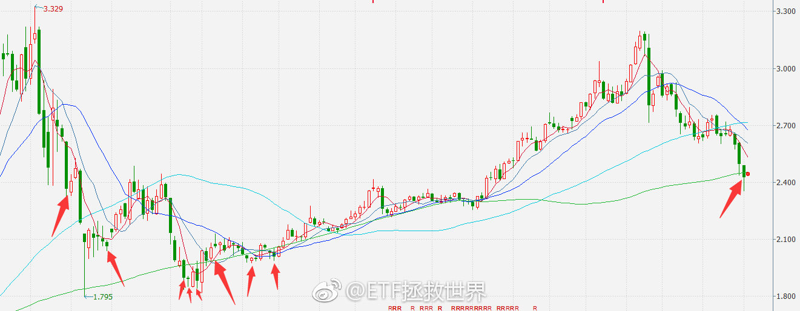

## 2018-07-09 10:13

上证反弹200点是正常反弹范围。如果超了，就要考虑反转可能性。

你问我为什么这么说。

当然是瞎蒙的。 ​​​

## 2018-07-09 10:20

本来周末文章是想讨论一下未来一段时间走势的问题。结果被这破事儿占了两天。

好气哦。

这周末再说吧。 ​​​

## 2018-07-09 11:56

这次反弹到多少计划会创新高？我初步估计3000-3200？

这就是投资的乐趣。你不用管股市涨不涨，只要有波动，你就能让自己的成本越来越低，筹码越来越多，最后赚的也越来越多。

想要赔钱也很简单，反着做就可以：高位越买越多，低位开始卖。

你以为我们低位买的是谁的筹码？ ​​​

## 2018-07-09 12:09

回复@微鲸发展:我不信A股会一直在2000多点。这是不可能的。十年后，2028年，300、500如果没有五倍以上涨幅我会比较惊讶。//@微鲸发展:就怕这个筹码终究不值钱

## 2018-07-09 12:18

回复@安小之18:未来怎么走谁也不能确定。大趋势的判断需要底部走出样子来才能看出。不要肯定的认为这是反弹或者反转。设计好应对各种可能的策略到时候执行就可以。//@安小之18:亲们，是不是说到3000多点还会下跌回来？

## 2018-07-09 12:58

回复@王者华山:2008年，中证500最低1488，目前涨幅241%。期间最高涨到11616，涨幅680%。目前500估值与2008年次低点估值几乎一致。可自行判断未来十年A股会否有可能出现哪怕一次大牛市。//@王者华山:2008年时，有没有人说这些话？

## 2018-07-09 13:04

再跟大家分享一下牛熊市大多数人的想法。

在牛市中，绝大多数人都不信股市还会跌到一个很低的地方。怎么看都不可能，一路向上，情绪激昂。怎么可能跌？哪怕跌，也一定是到更高的地方以后才会跌。

熊市中则相反。绝大多数人甚至想象不出牛市的样子。因为各种因素都太差了，差到没人相信未来股市会走牛，更何况股市还会疯狂。

## 2018-07-09 15:13

回复@小马快乐跑:气什么。我们仓位越加越重，7月以来一周多时间已经连发两车，买的这么低，今天净值将大幅反弹，开心都来不及啊。//@小马快乐跑:怎么不跌了，好气哟

## 2018-07-09 15:18

回复@要么唯一要么第一:这不是“说”。而是跟几万人一起“做”的。计划了解一下。//@要么唯一要么第一:你看跌，涨了又说自己加仓了//@ETF拯救世界:回复@小马快乐跑:气什么。我们仓位越加越重，7月以来一周多时间已经连发两车，买的这么低，今天净值将大幅反弹，开心都来不及啊。

## 2018-07-09 18:32

4000留言。我毛估估，这个公众号五年内不可能再有文章打破这个留言记录了……我会每条都看的。 查看图片

## 2018-07-09 22:58

每日打卡（193）

坚持！ ​​​

## 2018-07-10 08:45

不错。

六天逾240亿元借道ETF入市 华安创业板50ETF破百亿  ​​​

## 2018-07-10 10:20

回复@穿越30年:这事也不好说。几个月前说大资金大幅申购券商指数基金，结果还不是凉凉了//@穿越30年:益达，按你的理解，是什么资金在大笔申购ETF呢？应该不是追涨杀跌的散户，也不会是公募基金，他们大都是直接买股票的...

## 2018-07-10 10:34

回复@巧巧蜂蜜:我心目中的神操作是2013年上半年真正的GJD入场扫货50和180,2015年5月清仓走人。叹为观止。//@巧巧蜂蜜:大资金左侧入场，凉凉也是很正常的//@ETF拯救世界:回复@穿越30年:这事也不好说。几个月前说大资金大幅申购券商指数基金，结果还不是凉凉了

## 2018-07-10 10:39

来，让你们看一下真正的GJD实力。不是2015年下半年之后的那只

2013年：
基金半年报披露 汇金上半年大举买入蓝筹ETF

2015年：
网页链接

说股神，我只认大内高手。 ​​​

## 2018-07-10 10:49

回复@火眼金睛_qq:买ETF有什么底牌。买点第二轮计划与他们差不多。卖点就差多了。我们4月就卖掉大部分了，然而他们5月才走，又多吃了不少。这种操作无须底牌。稍微有点理智就行。他们牛在真是从头吃到尾。//@火眼金睛_qq:靠，这些都是看了底牌的选手。不公平

## 2018-07-10 11:09

回复@nemours-2号炉:人家吃完了走了，你在那舔盘子的时候，服务员拿着账单找你来了。为了两口菜汤，你把一桌子的单给买了。//@nemours-2号炉:回复@牛牛s:舔舔盘子可爱

## 2018-07-10 11:26

回复@感恩禅心:这个是正道。钱不能让你一个人赚了，保持一份佛心，留点钱给别人赚，反而会更好。不信各位可以试试。总想赚尽最后一个铜板，太贪就可能出事。//@感恩禅心:总要留点给别人吃吧

## 2018-07-10 14:08

回复@一场清风一场秋梦:我是有心帮助各位有需求的帅哥美女，但太多问题了啊。比如，万一非单身人士来欺骗感情怎么办。。//@一场清风一场秋梦:我只关心江浙沪e大相亲会

## 2018-07-10 15:07

一年没有答题了吧，简单回答一个问题。

我回答了 @大不拉不dabulabu 的问题，问题价值￥99.00，大家快来花1元围观~ 微博问答 ​​​

## 2018-07-10 15:11

回复@河上雨:我这一年多，后台几百个问题，回答了一个。99块。您可太操心了。别的不说，每年给大家过年红包我就发小一万，您赶紧休息休息吧。//@河上雨:股市里那么赚钱，那么神算，何需还要收费微博？？？！！！

## 2018-07-10 15:16

回复@卖萌货微博:其实公众号有个周末问答，也好久没更新了。我准备把好的问题归拢一下放在那里回答。今天闲着没事答一个又被质疑了。//@卖萌货微博:回复@ETF拯救世界:希望花点时间把高质量提问的都答啦。太想看了。不过很浪费E大休息的时间来讲自己的投资逻辑和想法。

## 2018-07-10 15:18

回复@我是真的不知道用什么昵称:其实他的质疑也合理。但只能说他不了解我。哪怕他知道前几天球球活动我得了华为手机转手送给粉丝的事，估计这种质疑就不会有了。//@我是真的不知道用什么昵称:回复@河上雨:为什么总有些人内心如此阴暗？阴阳怪气的 看着难受

## 2018-07-10 15:45

回复@有波动有机会:99一位。被选中的提问的人会赚很多。有一半围观答案的收入归提问人。所以谁能想出好的问题，谁就能赚钱。。收益率会非常高。//@有波动有机会:我E大回答问题只看心情，不看价格！

## 2018-07-10 16:04

回复@看我看我252:不限制。我不能告诉你什么话题最好，我只能说，群众们都很庸俗。//@看我看我252:回复@ETF拯救世界:我得好好想想，话题限制范围吗

## 2018-07-10 16:08

$162411  油气7毛了。

你们谁还记得十个月前，净值3毛多的时候，多少人说石油价格再也涨不起来了，电动车的世界来了。

任何品种，低位的时候，一定有无数理由看衰它。你根本就不要在意任何噪音。好好分析这个品种本身，找到适合它的策略。

听大众的噪音，能赚钱是奇迹。 ​​​

## 2018-07-10 16:48

回复@ch506:健身。弄个好的发型。首撩成功率增加37.4个巴仙。//@ch506:想请问E大有没有什么快速自我提升的方法，可以增加撩妹成功率的分享一下，最好具体展开讲讲（这个够俗气？）//@ETF拯救世界:回复@看我看我252:不限制。我不能告诉你什么话题最好，我只能说，群众们都很庸俗。

## 2018-07-10 20:17

看到一个好问题。如果我回答，提问人至少能赚2000。

但是我不会回答。

我会在公众号写篇文章回答。不要钱。

就最近。 ​​​

## 2018-07-10 22:17

每日打卡（194）

坚持。总感觉应该加量 ​​​
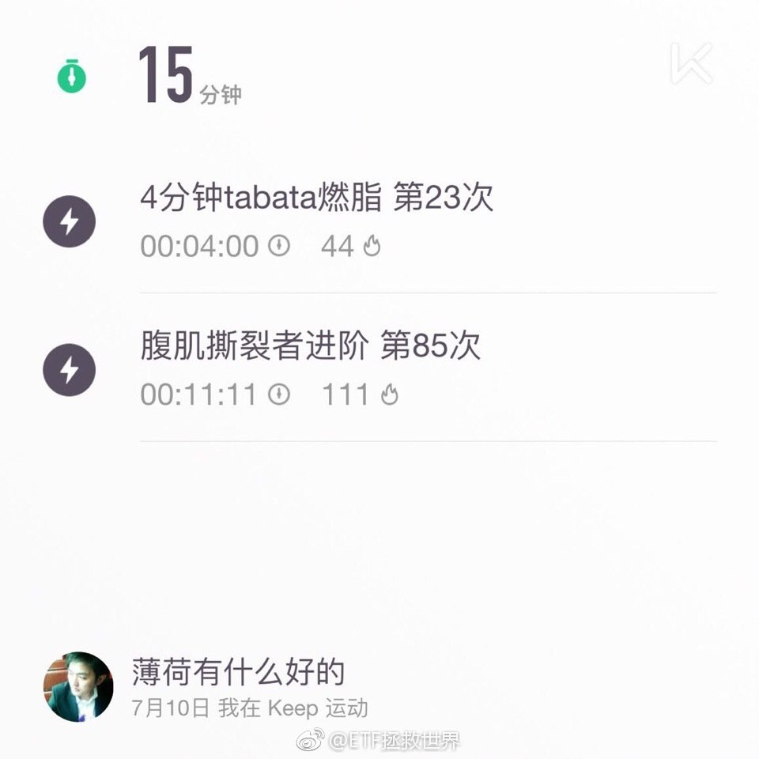

## 2018-07-11 09:05

2000亿，今天又要好看了。

连续剧啊，高潮不断。 ​​​

## 2018-07-11 09:11

回复@夜雨梧桐2010:这得美国队里有银儿吧//@夜雨梧桐2010:没看到消息啊，队长，是队里内部通知的吗？

## 2018-07-11 10:49

我理解的“趋势”，与很多人不同。好多人一天两天，就能看出趋势变了。

我不行，我能力比较差。在我的观察体系中，可能甚至需要数周，才能判断大概率趋势变了还是没变。

确实，我没有那些灵敏度高的人抓到超级大底的可能性大。但是，我的概率会比较大。而且我很难被骗。你拉两根阳线想骗我，呵呵哒。

跌三年，你可以猜400多个底。我可能只判断一次。

判断世间大势其实很难。太早不行。比如你和6个小伙伴去找个游船商量要做点大事，我看没几个人敢加入你们。虽然也许你们其中一个人最后会特别NB。

太晚也不行。都打到海南岛了你再举手投降没什么用，十几年后还要被干。

所以，你怎么才能在趋势转折的时候，顺势而为，是一个非常考验眼光的事。太早太晚都不行。

很多人每天猜底，我的意见是最好休息休息。伤了钱包厚度是小事，给自己整的每天都很焦虑没有意义。

站高一点，看远一点。不要在意每天的这点波动。

多大点事儿啊，踏踏实实的。

## 2018-07-11 11:01

另外，我不知道是微博新关注我的人比较多，还是球球的喷子跟过来了。

稍微反弹一点就冷嘲热讽。

喷了。

你是不是以为我是空头呢？你以为我看跌呢？

哥们，把键盘收起来吧。我的仓位非常舒服。涨了我特别开心，跌了也很开心。

如果能更低呢，当然不错。我还有钱， 买了以后能赚更多。涨了呢不知道多高兴。前几天一天账面少一**，涨回来多开心。

所以啊，你得认识到，你的思路和我的思路完全就不一样。不要再把你那套看多看空的东西搬到我这里了。我是根据走势的涨跌概率配置资产，说了要是你不理解我就不说了。

反正，以后再有来我这不好好说话的一律拉黑。疑似的也拉黑。

## 2018-07-11 11:16

回复@adnap_314:下次你们领导开会的时候说完话，你说一句呵呵哒，就知道什么意思了。//@adnap_314:益达益达，呵呵哒是啥意思，我也想呵呵哒呵呵哒

## 2018-07-11 11:26

回复@加糖_咖啡:没错啊。月初一发，上次一发，月中一发，第三周一发。哪儿错了。//@加糖_咖啡:说好的每周一发呢//@ETF拯救世界:回复@A小散的梦想:想多了。目前距离上次买入没有什么空间，没必要着急发车。眼看快月中了，急什么，不要急。踏踏实实的。

## 2018-07-11 13:35

回复@用户5319322024:我本人鼓励大家用keep锻炼完发自拍然后圈我，大家互相监督……//@用户5319322024:回复@litterwitch:不早说？我刚刚删了keep

## 2018-07-11 13:46

回复@姜小葵77:如果再这么跌下去，我怀疑不远的未来会发生一次非常强烈的反弹。//@姜小葵77:500又破5000了//@ETF拯救世界:回复@加糖_咖啡:没错啊。月初一发，上次一发，月中一发，第三周一发。哪儿错了。//@加糖_咖啡:说好的每周一发呢

## 2018-07-11 14:01

回复@喜欢ETF:我考虑好了。95%确定了。基本长线仓位布置完毕后，在计划里用一部分资金做波段。应对未来可能出现的只有波动没有涨幅的情况。//@喜欢ETF:E大带我们做波段//@ETF拯救世界:回复@姜小葵77:如果再这么跌下去，我怀疑不远的未来会发生一次非常强烈的反弹。//@姜小葵77:500又破5000了

## 2018-07-11 14:18

回复@日照雷门peter:今天两只500etf都放巨量。不知道是谁在进场。//@日照雷门peter:500出现13万手买单，土豪捡漏都拣不了啊//@ETF拯救世界:回复@喜欢ETF:我考虑好了。95%确定了。基本长线仓位布置完毕后，在计划里用一部分资金做波段。应对未来可能出现的只有波动没有涨幅的情况。

## 2018-07-11 14:34

回复@谷爆:别发这种了。节奏我会掌握好。自己的黑车可以随便开。//@谷爆:队长我们还等什么？跑步进场吧！//@ETF拯救世界:回复@日照雷门peter:今天两只500etf都放巨量。不知道是谁在进场。//@日照雷门peter:500出现13万手买单，土豪捡漏都拣不了啊

## 2018-07-11 15:00

刚看到，喷了。 ​​​

## 2018-07-11 15:05

回复@石头里的虫子:我看到了。她说的其他东西我就不评价了，“其他的质疑，确有不严谨之处（绝无伪造），双方沟通中早已解释和致歉。”完全是乱扯。解释和道歉完全没有。可惜我不能在雪球发东西了。//@石头里的虫子:还有更喷的:白话投资说你投降了。

## 2018-07-11 15:50

回复@花悟菩提:雪球有些员工真的特别好。帮我把两家同样被诬陷的公司拉到一起商量对策。我是真的感激。但是平台，我就不评价了。对我的帖子限流，为我说话的没有一句脏话也禁言。不说了。就此结束。//@花悟菩提:雪球作为平台方都不管吗？这么无作为以后只会越办越差

## 2018-07-11 16:14

说出来你不信

连中证1000都快跌破2PB了…… ​​​

## 2018-07-11 16:22

回复@laosui666:不至于，上次是2013年4月。也就5年。连2012年底都没到呢。更不用说2008。还要努力啊。//@laosui666:十年一遇啊

## 2018-07-11 18:36

关于那件事，本来说了不说了。但既然事情又有了变化，我再多说几句。这几句话，主要是说给各位关注我的朋友的。

特别感谢大家的支持。从那天晚上开始，到现在几天的时间，切切实实感受到潮水一样的支持。这也是我为什么能迅速恢复情绪，把注意力转向正常生活和投资的关键。

今天对方发的这个东西，每一句话依然充满着尖酸刻薄与虚假。

我要怎么去评论呢？再开个帖子逐条反驳吗？

不，我不会。因为这几天，几乎所有人的反应，都让我明白一件事：

群众，并非不明真相。每个人的眼睛都是雪亮的。只要有一点点良知和思维能力，就会做出正确的判断。

根本不用我再去说什么，公道自在人心。

在这里，我要跟各位说的是，特别感谢大家的支持。不过，表达自己的情绪，也请各位理性一些。

我再次声明，我真的感谢大家，不希望大家觉得我说这些是打击各位的支持。

对方无耻，我们不可以无耻。对方做下流的事，我们不做。更何况，也许各位不知道，就我所知，有一些小号在相关的群、文章下煽风点火，就是希望我们做一些失去理智的事，对方才能有机可趁，变无理为有理。

所以，请各位理智。不违反法律，不违反基本的道德基准。合理合法表达自己的情绪就可以。

我始终认为，做人也好，做事也好。不要得理不饶人，得饶人处且饶人，也所谓穷寇莫追。

既然真相已经大白天下，对方已经承认诬陷的东西没有证据，就各自回归各自的正常生活。也希望对方能感知我的善意。我已经离开，空间都留给他们了。就不要再无休无止的尖酸刻薄和造谣生事。

我们的人生，很宝贵。就那么3万多天。我们做点有意义的事，你说多开心。

再次感谢各位。

## 2018-07-11 18:57

回复@进击的足球小将:各种渠道联系我的律师朋友一共十三位，有各个领域的，北京上海广州都有。还两位我都比较吃惊居然在关注我，相当有名气。加上我自己的朋友，律师肯定够了。。只能说，十万关注我的人里面真是藏龙卧虎……//@进击的足球小将:如果有个律师，会不会好一点

## 2018-07-11 22:53

是的看到了，标普500重挫0.4%。我A微跌2%

## 2018-07-11 23:00

人多真的不是国富民强的根本。

## 2018-07-11 23:11

7左右开始出辣鸡美元债。要你何用。 ​​​
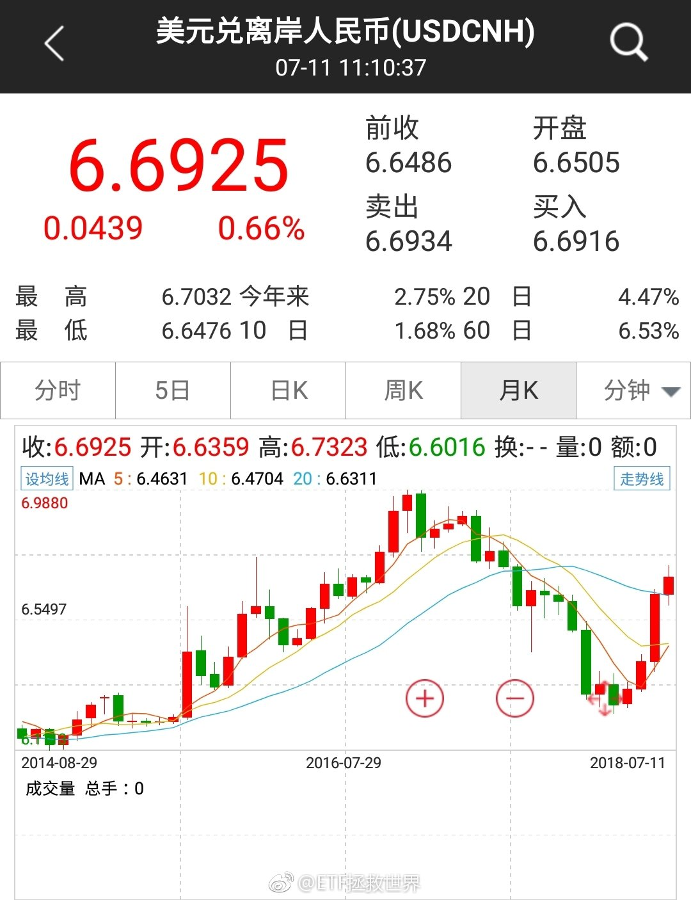

## 2018-07-12 10:11

$全指医药 sh000991$   医药最稳。 ​​​

## 2018-07-12 10:22

看到一些关于是否应该始终满仓的争论。

我总是不清楚，为什么每个人都认为这个世界上只有一条真理，为什么不可以多元化生存？

适合你的，未必适合别人。你让一个20岁的年轻人，和一个60岁的老年人投资策略一样，可能吗？更不用说，我一直吐槽的，很多人说满仓，只是一小部分资产满仓而已。真的跌了，它会莫名其妙的多出很多其它现金，又来买。

涨了说满仓，跌了还有很多钱。醉了。

最关键的，是找到适合你自己的投资方式。适合满仓就满仓，适合动态平衡就动态平衡。

如果真的始终满仓收益最高，为什么养老基金只拿极小部分出来买股权？为什么巴菲特手握几百亿现金？

就像一个国家的zhidu，真的要适合这个国家的国情。即使西方大国，就它们的选举制度都完全不同。哪里有什么天下一统适合所有人的东西？

至于替别人管钱，用什么策略。只要跟投资人讲清楚未来可能发生什么，让投资人做好心理准备，投资人认可就行。

就怕替人管钱的人，自己都不知道未来可能发生什么，就是最麻烦的事了。

## 2018-07-12 10:38

回复@你在红楼我在西游V:我看那篇文章了。我还挺同意的。目前确实在低估区域。注意，是区域。//@你在红楼我在西游V:新华社发文说A股低估了,是啊，4000点才是牛市的起点,现在3000都没有

## 2018-07-12 10:39

回复@LL_96:这怎么是浪费精力呢。这是讨论投资理念。这一条东西，是一个投资人所有投资体系的根基。你选择怎样的投资体系，第一条要解决的就是这个问题。非常非常有意义。//@LL_96:别再浪费精力说这些了

## 2018-07-12 10:53

目前医药+养老≈12%；

500≈11%；

红利+50+300≈15%；

港股≈8%；

占大头的这几个我认为基本仓位已经建立起来了。每类最多是15%-20%。所以踏踏实实的。 ​​​

## 2018-07-12 11:22

好消息，中报已经开始披露了。

7月有134家；

8月所有半年报披露完成。

也就是说，未来一个月，全部指数估值又将出现系统性下降。

再过两个月三季报也将披露完毕。关键点就在这几个月了。 ​​​

## 2018-07-12 11:41

回复@柳暗花明又二村了:如果没有2000亿的事情，之前的反弹会延续。太弱了，必须要反弹啊。下一步是什么情况还需要继续观察。//@柳暗花明又二村了:E大短线也是神准，昨天就说过暴力反弹不远了……

## 2018-07-12 11:44

回复@动感超人diudiudiu:急就打啊。你账户密码忘了？//@动感超人diudiudiu:E大！他怎么涨起来了！！！还有子弹没出手！好急！！

## 2018-07-12 11:51

3500点的时候，我们比现在仓位低很多。那时候你都不急，结果跌到2800，仓位增加了十几个点，开始急了？

谁急谁加啊。适合自己就行啊。就记住一句话，加到涨跌都舒服，完事。 ​​​

## 2018-07-12 13:31

确认底部有两种方法：

第一种是不断的猜底：幼儿底，婴儿底，尿布底。

第二种是市场走出底部后判断趋势改变。

无论哪种方法，你必须先承认自己対预测的无知。然后对自己判断正确与否都有相对预案。

昨天我就说了，“如果再这么跌下去，我怀疑不远的未来会发生一次非常强烈的反弹。”这不是预测的准，而是根据经验，连跌7周有很大概率会有反弹。至于后续会不会确认底部转为反转，不判断，不预测，观察，然后启动相应预案。

仓位问题，我们的计划中有10%以上是趋势仓位。趋势变了自然会加。这事我会随便告诉你吗。

## 2018-07-12 13:36

不是我说，总是让我感到很惊喜。

你们自己看看，是不是在用心做事？

一个产品，用心不用心，你能感受到的。

据说很快就上线了。 ​​​
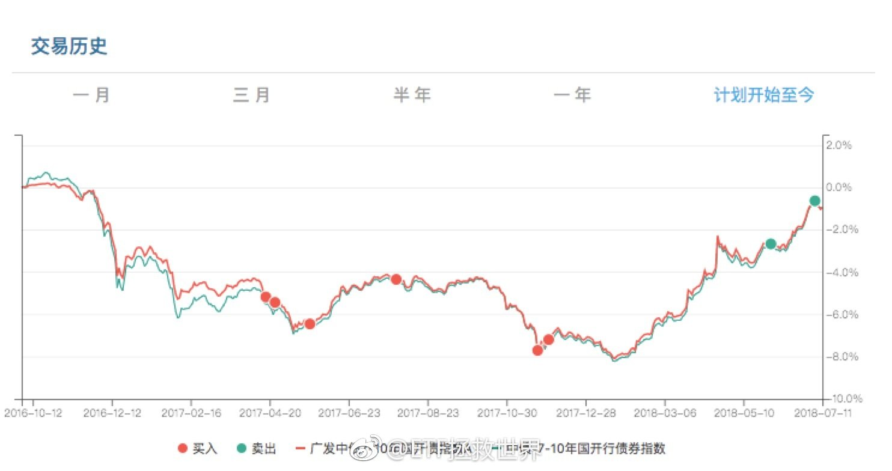

## 2018-07-12 13:46

回复@D8奇迹:未来的牛市，这个指数大概率会非常疯狂。//@D8奇迹:全指信息弹性真大

## 2018-07-12 14:02

回复@潺潺的清河:两年内93.6%概率启动。//@潺潺的清河:未来十年不会有牛市//@ETF拯救世界:回复@D8奇迹:未来的牛市，这个指数大概率会非常疯狂。//@D8奇迹:全指信息弹性真大

## 2018-07-12 15:37

昨天，我发了20多条微博。每条4、5万人看。一天大概100多万。一个月2000万吧。

然后，新浪看关注我的粉丝这么少，才不到8万，居然每天有100多万阅读，所以认为我肯定是刷的，就把我的金v取消了……金v的标准是每个月1000万阅读。

他们没看看我的评论数比那些几十万的博主还多，可能更没见过3万多阅读，4300条留言，3500人打赏的公众号文章吧。

@曹增辉  曹总，粉丝少的人阅读量大，不一定都是刷的……相反，很多几十万粉丝又几乎没有互动的人，粉丝更可能是刷出来的。。。

金不金倒无所谓，就是说说这个事儿……

## 2018-07-12 15:55

回复@拿破顿:我一直奇怪，说我无私什么的。我到底干什么了？不就是把自己的投资计划发出来了吗。从2010年开始就发啊，只是从博客转到公众号而已。还干嘛了？不就是隔几个礼拜写篇文章，每天在微博扯扯淡。没干嘛啊。这叫什么无私。至于过年发红包送手机那些，都是平常大家打赏给我的，又不是我自己的钱

## 2018-07-12 17:09

回复@Halle噜呀:你可别瞎搞了……人家那是记笔记呢。我也经常这样把有用的东西存到印象笔记啊。很好用。微信微博都可以。你以为我那些资料都是怎么存下来的……还有网页版，一键剪藏。好用。//@Halle噜呀:@曹增辉 能不能干点正事，把博主下面艾特某印象笔记的号都封一封。大家顶我上去

## 2018-07-12 17:10

我去，加回来了。喷了。谢谢 @曹增辉  曹老板，虽然不知道是不是你帮的忙……

## 2018-07-12 17:29

回复@小小8885376:有可能会。因为历史只是历史，未来可能发生变化。所以还要用其它辅助的依据来判断。总之操作的时候，你把这个因素考虑进去，有应对的办法就行了。做好：历史依然有效、无效两手准备。

## 2018-07-12 21:27

富国的这只增强真的厉害，无论涨跌天天跑赢 ​​​
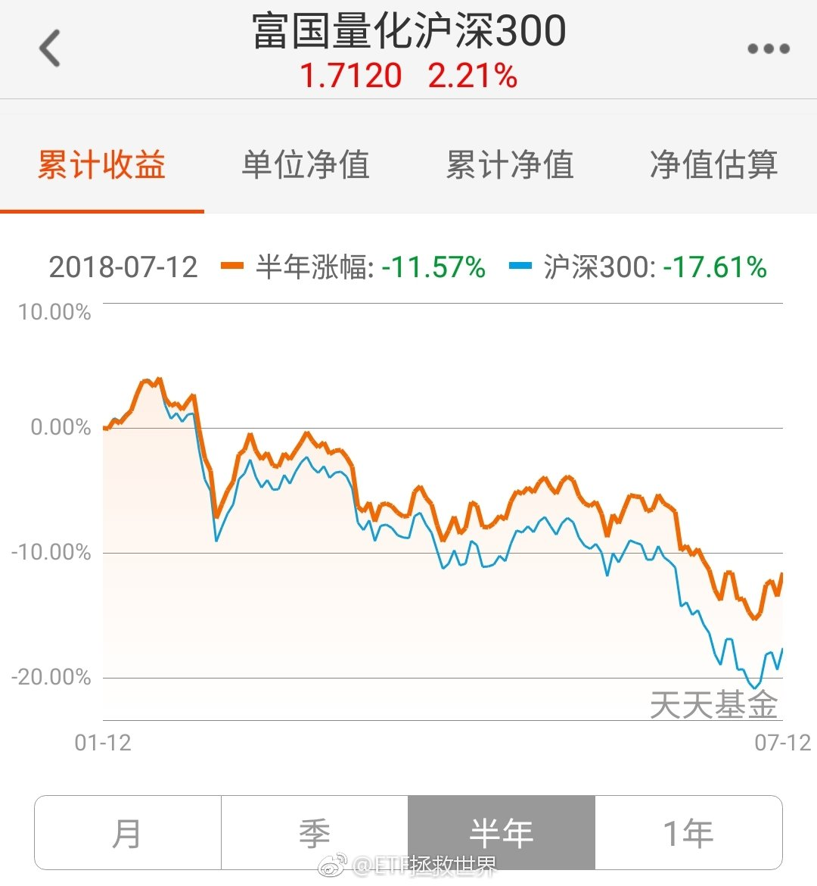

## 2018-07-13 08:51

发布了头条文章：《还是得客客气气的》 ，随便聊聊，您随便看看。  ​​​

## 2018-07-13 09:45

回复@湛江街拍:建信500一点都不差。2015、2016都是500增强指基第一。2015年跑赢富国500高达17个点，2016年富国500下跌6%，建信上涨1%。建信之所以最近一般，很大因素是因为我们把它搞大了……//@湛江街拍:e大，富国几个增强基金做不错，为什么我们不选富国500，而是建信500呢？

## 2018-07-13 09:55

$全指医药 sh000991$   还是医药最高！犀利。是不是又向新高去了。 ​​​

## 2018-07-13 13:07

$小米集团－Ｗ hk01810$   mi boy的实力果然不容小瞧。 ​​​

## 2018-07-13 13:47

回复@冯二宝6538187080:倒不是点的问题，而是还是贵现在。40多倍的估值买一个指数，长久看赚大钱的概率略低。30多我可能会开始布局。//@冯二宝6538187080:e大 能不能说一下 大概多少点布局全指信息呢//@ETF拯救世界:回复@潺潺的清河:两年内93.6%概率启动。//@潺潺的清河:未来十年不会有牛市

## 2018-07-13 13:53

指数和股票不同。股票你买亏损股都有可能赚大钱。指数就不是。指数你不能买太贵，否则赚钱的概率很低。不是说不可能，而是长远看，很低。

另外，如果你去研究一下巴菲特买股票的历史，你会发现，绝大多数他买的股票，PE都不超过20倍。虽然他买的时候并不用pe估值。 ​​​

## 2018-07-13 14:01

论健身与练拳的必要性。

## 2018-07-13 14:21

回复@你在红楼我在西游V:创业板是从2015年的120倍跌下来的。了解一下。//@你在红楼我在西游V:感觉创业板跌了这么多，估值还那么高？//@ETF拯救世界:回复@冯二宝6538187080:倒不是点的问题，而是还是贵现在。40多倍的估值买一个指数，长久看赚大钱的概率略低。30多我可能会开始布局。

## 2018-07-13 14:28

回复@葱葱AQQ:2015年第二轮计划大概3、4月大量卖出。站在5、6月看，后面的一大块利润没吃到。但是我站在理性的角度，在4月，沪深300估值45倍，中小板80倍，创业板90倍，全市场到了60倍，全都是超级股灾的标准，那时候跑，即使到现在，我也不认为有什么问题。//@葱葱AQQ:120倍！谁能想到那么的疯狂？

## 2018-07-13 14:33

回复@qzy6_87413:120倍的创业板跌到30多倍，我买入1%，我不认为有什么太大的问题。//@qzy6_87413:那为啥去年e大那么贵的时候买创业板呢？有点不懂//@ETF拯救世界:回复@冯二宝6538187080:倒不是点的问题，而是还是贵现在。40多倍的估值买一个指数，长久看赚大钱的概率略低。30多我可能会开始布局。

## 2018-07-13 14:39

在证券市场上，理性的人很难赔钱。但是太理性的人赚不到大钱。

当然，理性已经很难了。大多数人是非理性的。

所以，在理性和疯狂之间要找到一个平衡点，心里非常明白，身体却要跟大众一起狂欢。还要在午夜之前全身而退，这样综合起来，要求非常高。正因为这样，赚大钱的人很少。这太难了，不仅跟实力有关，更与运气有关。

难啊！

## 2018-07-13 17:06

回复@dzb__:你买创业50是50家公司，创业板指数是100家公司，不用你买整个创业板啊。就像你买上证50不是买上证1000多家公司一样。

## 2018-07-13 17:08

今天净值增加0.28%左右。不过不失，凑凑合合，就那么回事吧。

所以你不要总是担心牛市来了赶不上趟了。今天沪深300才0.33%。即使真的牛市开启，也差不到哪儿去。何况趋势仓位还没加。

就跟你说，踏踏实实的。舒服最重要。 ​​​

## 2018-07-16 00:45

是不是钦定了。 ​​​

## 2018-07-16 08:41

算是个里程碑了。

开始看留言。 ​​​

## 2018-07-16 09:56

回复@夜雨梧桐2010:黑夜给了你黑色的眼睛，你却用它来寻找不可描述的数字。//@夜雨梧桐2010:E哥，你这也太能创造故事了，又是10又是69的……

## 2018-07-16 10:16

几张图告诉你为什么卖比买难100倍。

买都可以精准买在阶段最低。但卖你很难卖在阶段最高。（50那次卖出是换了红利）

如果不贵，就坚定持有。 ​​​
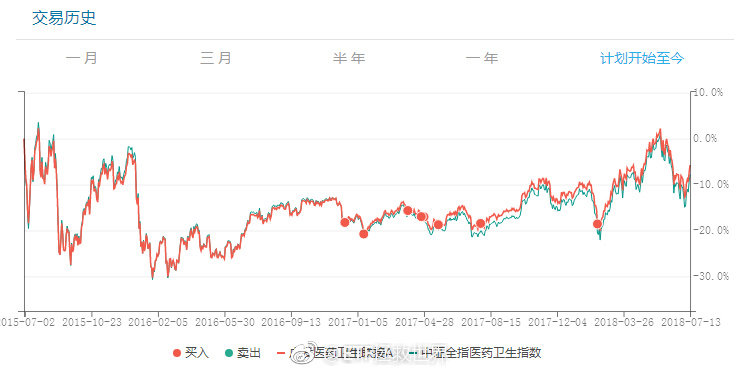 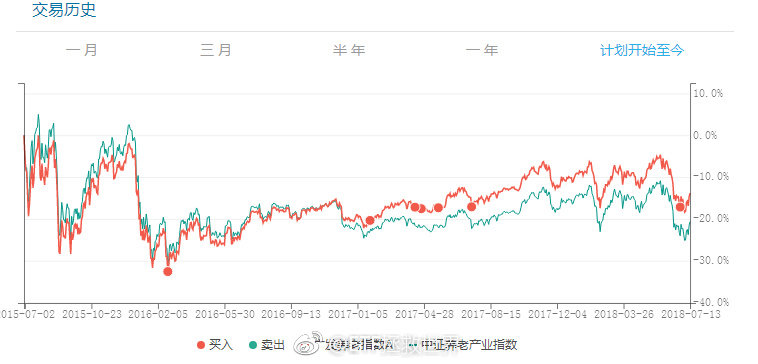 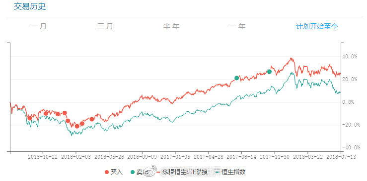 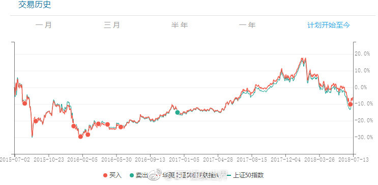 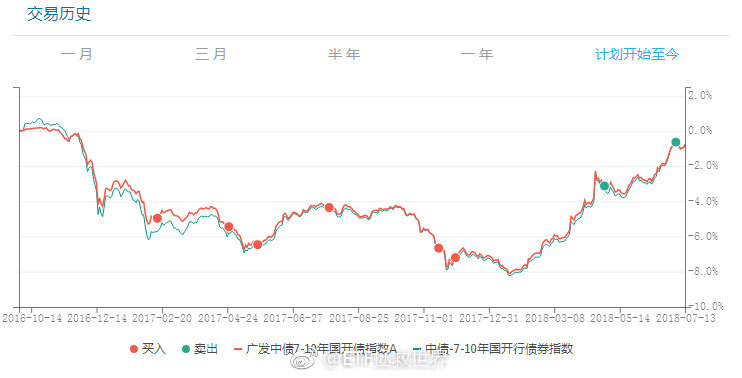

## 2018-07-16 10:20

回复@单眼皮的小明明:贵不难判断。但是市场不会因为贵就停止上涨。最难的是判断人性的疯狂。//@单眼皮的小明明:难在判断什么时候算贵了

## 2018-07-16 11:56

看了看账户，有点舒服。 ​​​

## 2018-07-16 13:30

这次金融行业感觉要先有钻石坑了。

最后会不会蝴蝶效应，边走边看。 ​​​

## 2018-07-16 14:28

去年年报和今年一季报，医药+养老都是15%以上增速。不高，但是在各行业中已经是很不错的了。

看半年报了。目前医药已知的五只股票半年报，增速在30%多。但是这个不具代表性。

不过最大的问题，这两个品种，还是不够便宜。当然，也几乎从没有真正的“便宜”过。

如果能在25以下买医药，可能就是投资这件事上最幸福的事了。

## 2018-07-16 14:49

回复@厉欧:金融危机最低27//@厉欧:E大，2011年全指医药指数发布之前，有没有PE低于25发生过？@ETF拯救世界

## 2018-07-16 16:01

周五沪深300上涨0.33%，计划净值增加0.32%。

今天沪深300下跌0.59%，计划净值预估下降0.05%。

打扰了。 ​​​

## 2018-07-16 16:17

云音乐更新歌单那哥们掉链子了……两首没更新啦。 ​​​

## 2018-07-17 07:53

掐指一算，今日不宜出门。 ​​​

## 2018-07-17 08:57

原油敢不敢跌回50。

我发现是不是别的品种不用做了，每年来回吃油就行。 ​​​

## 2018-07-17 10:01

$沪深300 sh000300$ 

震惊！固定发车日只买一份A股品种的原因找到了！ ​​​

## 2018-07-17 10:23

我这半年多关注的8848和腾讯，不是说对这两家公司有什么看法，我是在观察情绪。

这两家公司在持续暴涨的时候，带了很多很多情绪。尤其是前者。很多人因为没买后悔的夜不能寐，很多人买了抱持坚定信念可以再涨好几倍。

一家公司，一个行业，到底是不是真的能预判五年、十年后？

很难讲。前几天看到一个资料，里面说很久以前腾讯COO就跟朋友说赶紧卖掉，pony的太太也多次劝闺蜜不要买腾讯。

一个公司的经营者都不能看到五年十年后，那么多远离中心的投资者却能，很有意思。

还是说，我对这两家公司没有什么特别的看法。只是在暴涨后，很多投资者的情绪让我觉得特别有意思。我非常喜欢观察这些东西。

## 2018-07-17 11:26

再说件不开心的事让你们开心一下：

前几天刚换的苹果又坏了，昨天淋了一点雨。耳机插孔和关机键出问题了。

一个月不到两个。

什么玩意儿啊…… ​​​

## 2018-07-17 13:02

回复@O蒲公英的种子O:我不扔手机。苹果从4S到X除了8都买了。都放着呢，除了一个7让海水泡了，一个6SP耳机孔出问题了，一个X正在用，其他的有没有人要。//@O蒲公英的种子O:别扔了，还能换个盆，304不锈钢的，了解下

## 2018-07-17 14:06

还有人怀疑钻石坑吗。

可能没了。

但一会儿往上拉一下又怀疑了吧。 ​​​

## 2018-07-17 14:40

其实很多品种空间真的不大了。很难再跌30%以上。

但是时间就不好说了。这个大底可能要磨一段时间了。 ​​​

## 2018-07-17 15:01

回复@淡泊宁静以养心:新关注我吧。日常操作。//@淡泊宁静以养心:神了！最低点！

## 2018-07-17 15:06

年初蓝筹上涨，本身是没问题的。问题是涨的太快太猛。

现在是什么情况，服了。10倍的东西还要跌，40、50的居然领涨。你要说某只成长股50就算了，这可是几百只50倍以上的往上干啊。

我就看着你疯。

继续布局辣鸡。 ​​​

## 2018-07-17 23:34

老这样多不好意思。 ​​​
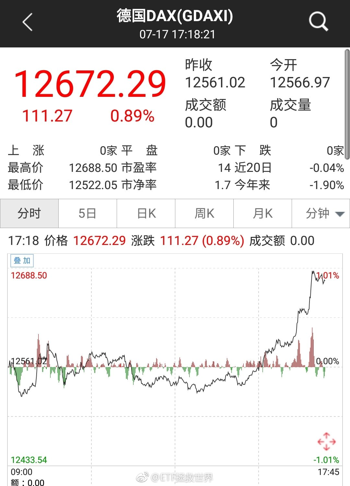

## 2018-07-18 08:40

这就是为什么我要做京享值超过8万的plus会员，为什么要持有京东股票。

周末买了个天龙功放，有噪音，昨晚申请换货。二话不说上门换新。

买东西买的很舒服。 ​​​
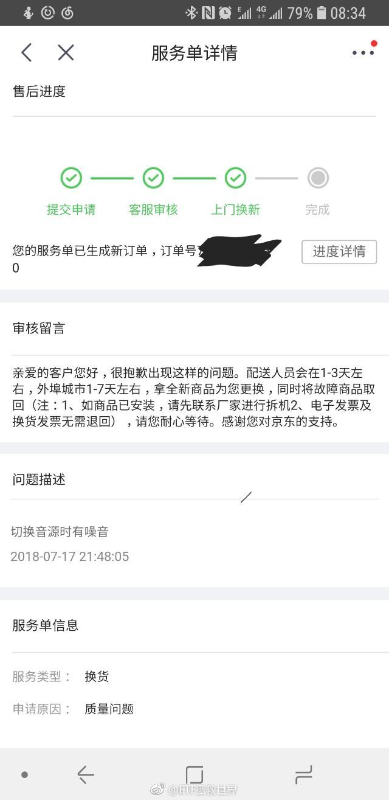 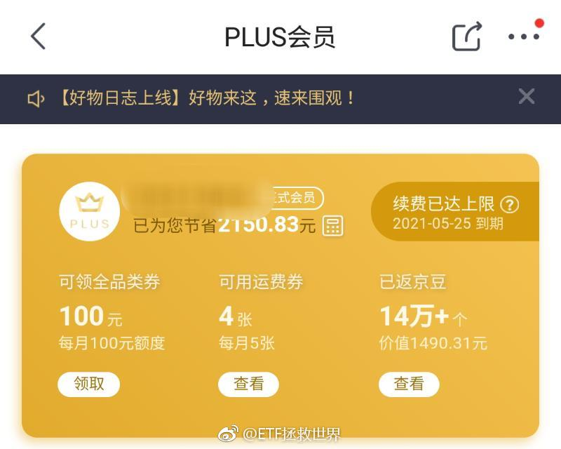

## 2018-07-18 08:49

回复@星云Bert:你可真扯淡，看不惯你这种人，瞎忽悠。京东方是京东和新东方合资成立的，各占30%股份，京东并没有控股。//@星云Bert:回复@我是队长别怕:算，京东方是京东控股的

## 2018-07-18 09:08

回复@随便一个动作:我们贡献了多少。

## 2018-07-18 09:11

你已成为这些公司的股东。讲真，传给孙子毫无问题。 ​​​
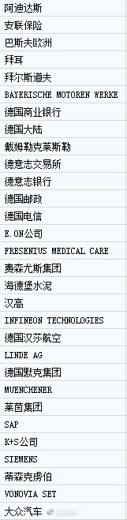

## 2018-07-18 09:15

回复@Aaaaaraaaq:基本上都是。曾经在天M某“旗舰店”买过一个，结果各种问题，甚至看评论说有可能连充电器都被换了。吓得连机子都没开就退货了。自己感觉还是JD买电子产品放心一点。//@Aaaaaraaaq:E大手机都是在京东买的吗？我感觉自营很可靠，可身边的人都不这么认为

## 2018-07-18 09:24

回复@梦游鱼生活在路上:机子不能开。苹果手机一旦开机激活就不能退了。甚至天M店你只要撕开包装就要扯皮了。比如去售后检测等等。看评论，收到货的各种问题。难道我看别人的还不够吗，还非得自己再试试？最后，我发现那家中移动旗舰店都是假的……

## 2018-07-18 09:38

有波动就有利润。 ​​​
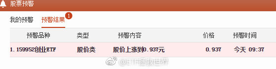

## 2018-07-18 09:54

图片评论 全靠策略。不主观判断涨跌。不过这距离最高价就差一厘也真是有点过分了。 查看图片

## 2018-07-18 09:59

回复@阿笨的微博:德国商业银行上面那个。第一个字母合起来组成“BMW”。//@阿笨的微博:哪个是宝马

## 2018-07-18 10:05

国债继续大涨。7-10国开债也会跟上。

这次唯一遗憾的是收益率没到5。哪怕是到4.5都好啊。 ​​​
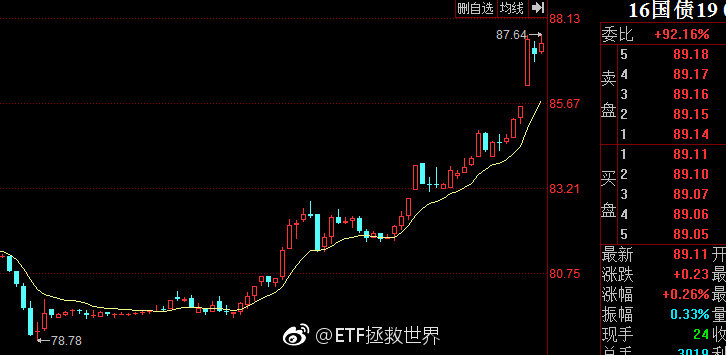

## 2018-07-18 10:23

$中证环保 sh000827$   野百合也有春天。保持涨幅领先半小时。 ​​​

## 2018-07-18 10:32

回复@葱葱AQQ:我不说这次。但是你造吗，国债还有个属性是“避险”。在其他品种非常危险的时候，国债有可能成为最后的避风港。这是它的属性之一。//@葱葱AQQ:后进生请教：国债上涨的逻辑是什么？因为投资者判断后面会继续放水、所以看跌远期利率？

## 2018-07-18 10:37

回复@大明190736:永远不亏损卖出任何品种。铁律。所以，只买不会死的品种。//@大明190736:海外债快回本了。。。//@ETF拯救世界:回复@葱葱AQQ:我不说这次。但是你造吗，国债还有个属性是“避险”。在其他品种非常危险的时候，国债有可能成为最后的避风港。这是它的属性之一。

## 2018-07-18 10:41

浓眉大眼的万科也腰斩了。

房价还没开始跌呢。 ​​​

## 2018-07-18 11:06

回复@ruannuan:日欧0关税自贸协定这种消息我是不会提前知道的。//@ruannuan:老大能说说买他的逻辑吗？我在wind上看，现在是他的最高点，怎么就便宜呢？

## 2018-07-18 11:09

回复@梓溪20180316:我惊呆了。你们都以为阿迪是哪个国家的！//@梓溪20180316:回复@ETF拯救世界:我从来没想到阿迪达斯是德国的。。

## 2018-07-18 11:44

炒小米的和腾讯的是不是一拨人。卖了腾讯去买小米了。 ​​​

## 2018-07-18 11:51

回复@8点钟的太阳_13214:不好意思，这次真的不算大。因为跌的时候收益率还是不够高。我曾经在5%的时候重仓债券，大熊市赚30%。也是希望有机会跟各位再体会一下。所以无论什么品种，只要有波动，就能挣钱。低买高卖即可。

## 2018-07-18 12:01

就是这个。

## 2018-07-18 13:40

提示一下，dax溢价0.8%了。我们买之前是折价的。场内别乱追了 ​​​

## 2018-07-18 13:58

无论是什么投资，本金的安全是最最最重要的。

可能是我的思维模式比较保守。P2P这么多年来，投过两个公司。一个是好多年前，得7、8年前了吧，那时候张化桥宣传有利网，我投了点。到期就撤了。第二个投过陆金所，分成好几个标的投，但是其中一个总是有逾期，到期后我就停了。一直也没管，钱应该还在账户里一直懒得提出来。

投的不多，也没仔细研究。但是因为那几次逾期，让我感觉很不好。虽然钱都回来了，也有逾期赔偿，但我决定不再投。因为不是标准化产品，我控制不了。

我还是认为，股市虽然赔钱的人多，但还是有很多监管机构帮你看着。还不放心，就不要炒股，买基金。如果买基金不放心基金经理，那就买指数。只要买的低，总会涨的。也基本不会出现公募基金跑路的问题。还不放心，就买最大基金公司的指数产品。

债券，买国债，买国开债。基本都等同于国家信用了。

所有这些东西，都极大概率不会被骗。不赚钱，只能说明水平不行，但人家发行的人没骗你。指数基金怎么骗人，很难。

不被骗这个条件满足了，之后就是怎么投才能保住本金，才能赚钱。这就不难。

保住本金其实真的不容易，但是指数投资算是相当靠谱的一个选择了。既有可能赚大钱，又没人骗你把你的钱卷跑了。

再次强调，金融投资，保本第一！！！保本第一！！！保本第一！！！

## 2018-07-18 14:23

这条新闻我收藏了。目前纳斯达克100估值接近30倍。有意思。 【贝索斯个人财富超过1500亿美元 超过1999年的盖茨】JeffBezos）成为现代史上最富有之人彭博亿万富翁指数显示，贝索斯的个人财富刚刚跨过1500亿美元大关，这比位居第二... 原文：贝索斯个人财富超过1500亿美元 超过1999年的盖茨 （分享自@微博搜索） ​​​

## 2018-07-18 14:57

回复@沉默地飞扬:“保住本金”的意思不是说没有波动。没有波动是银行存款。保住本金的意思是，中长期看，本金不会损失，还会有满意的收益率。短期波动谁也没有办法，只能靠组合争取降低波动率

## 2018-07-18 16:25

溢价被干到1.6%

## 2018-07-19 09:47

7附近开始出货。立个flag

## 2018-07-19 10:09

我看，这样的情况下，每天盯盘会让你觉得很无聊。

我的建议是，删掉行情软件。回归生活。回归亲人朋友的身边。不再想股市这点烦心事。

然后，你会发现，

更无聊了。 ​​​

## 2018-07-19 10:33

回复@青柠乐茶:再买点股票。今天我的某只股票预警又跳出来了，跌了30%，该补仓了。买点股票你会发现，很充实。人也会充满上进心，不会再想财务自由做社会的蛀虫了。//@青柠乐茶:自从买了ETF后觉得每天都很无聊，想问E大平时怎样打发时间的？

## 2018-07-19 10:52

回复@青柠乐茶:股票和指数基金玩法肯定不同。指数基金的策略前提是：不会死。而股票有可能死，所以出发点就完全不同，导致策略也不同。股票交易三种方式，价值、趋势、量化。我用量化方式买入一篮子股票，现在主要是为了打新。但是股票仓位占比极低，全部几十只加起来才十几个点。

## 2018-07-19 10:58

回复@苏黎世投机者:是策略问题。不同的人用不同的策略，拿股票来说。重仓某只与很轻的仓位持有，策略完全不同。就像刚才说的下跌30%的那只，补完了仓位从0.12%上升到0.25%了。这与重仓持有就是完全不同的策略，买卖方式完全不同。重仓持有的话，下跌30%已经是大灾难了。

## 2018-07-19 11:12

如果这波反弹就此结束，那真的是远远弱于我的预期。熊市中这么弱的反弹都很少见。我以为至少得碰碰2850-2900呢。 ​​​

## 2018-07-19 11:16

难道下周又要开车了？好气哦。

涨几天休息休息不好吗。

BGM库存快空了啊喂。 ​​​

## 2018-07-19 13:18

今天涨跌家数1:5，中小股股票继续回归。很好，很健康。 ​​​

## 2018-07-19 14:05

回复@ETF未来式:如果你过去二十年一直在跟踪宏观经济，你会发现每天都有各种各样严重的问题。每次都好像过不去了。包括宏观，房价各种各样的。但是其实一直没什么大事，即使经历了金融危机，大多数人还是越来越好。还是那句话，保守的乐观。不保守，会死的快。不乐观，这辈子也就这样了。

## 2018-07-19 14:06

如果两只会新低，谁会先行一步……

## 2018-07-19 14:52

8848赢了。有心的朋友可以好好回顾一次这次的情况，包括大众的狂热，以及其他。相信对未来的投资会有非常大的帮助。会让你更加冷静看待这个市场的鼓噪。//@ETF拯救世界:如果两只会新低，谁会先行一步……

## 2018-07-19 17:44

6.8了，6.9以上开始出。我预料到了人民币贬值，但没预料到美元债像个弱鸡。//@ETF拯救世界:7附近开始出货。立个flag

## 2018-07-19 18:57

最好的慈善是先让自己，家人生活的好。还有余力再去帮助别人。

## 2018-07-20 08:46

空调的发明者堪称伟大。

不接受质疑。 ​​​

## 2018-07-20 08:58

黄金快跌破1200了，我们什么时候动手？

2011年1900清仓后一直没有真正建仓。十年一个轮回，开始关注。 ​​​
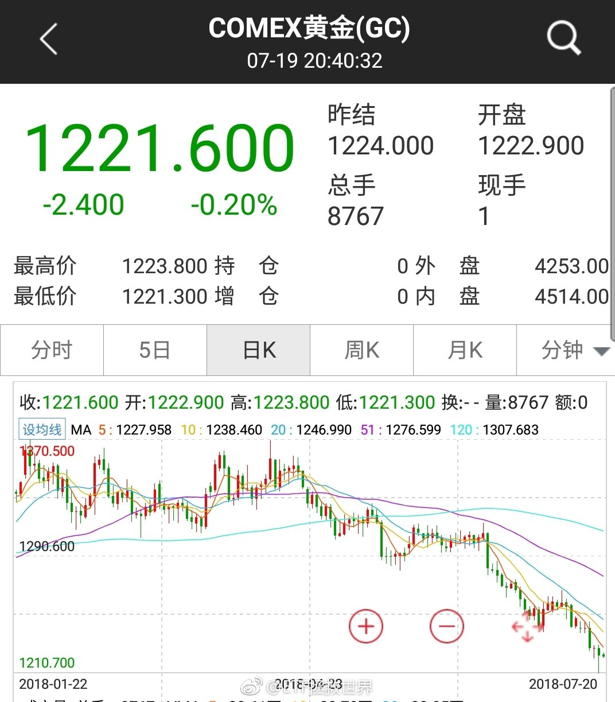

## 2018-07-20 09:36

无论是突破平台后的新高，还是跌破平台后的新低。

后面大概率跟的还是新高和新低。

不信你观察一下。 ​​​

## 2018-07-20 09:38

感觉鹅厂也不甘落后啊。//@ETF拯救世界:8848赢了。有心的朋友可以好好回顾一次这次的情况，包括大众的狂热，以及其他。相信对未来的投资会有非常大的帮助。会让你更加冷静看待这个市场的鼓噪。//@ETF拯救世界:如果两只会新低，谁会先行一步……

## 2018-07-20 09:39

回复@O_Zhong_O:五年后回头看这条消息会有无限感慨。

## 2018-07-20 09:41

回复@美味果冻64516:白银基金161226万万不可以买。想玩白银网格可以去银行买纸白银。支持美元玩，跟的更好。//@美味果冻64516:想弄点白银基金来着

## 2018-07-20 09:44

新低。//@ETF拯救世界:感觉鹅厂也不甘落后啊。//@ETF拯救世界:8848赢了。有心的朋友可以好好回顾一次这次的情况，包括大众的狂热，以及其他。相信对未来的投资会有非常大的帮助。会让你更加冷静看待这个市场的鼓噪。//@ETF拯救世界:如果两只会新低，谁会先行一步……

## 2018-07-20 09:49

回复@李白先生vip:这不是经验。你要看它持有的是什么品种。持有期货品种的基金不可以买，比如南方油，比如226.。长期损耗让我们根本无法长期持有。//@李白先生vip:经验是无价之宝

## 2018-07-20 09:57

腰斩。经典的散户顶部接盘实例。

## 2018-07-20 10:01

$恒生指数 hkHSI$  有没有机会在25000左右把之前平衡掉的接回来？ ​​​

## 2018-07-20 10:02

回复@ETF信徒者:别说话，_____。

## 2018-07-20 10:07

国债继续疯。收益率破3清仓债券。 ​​​
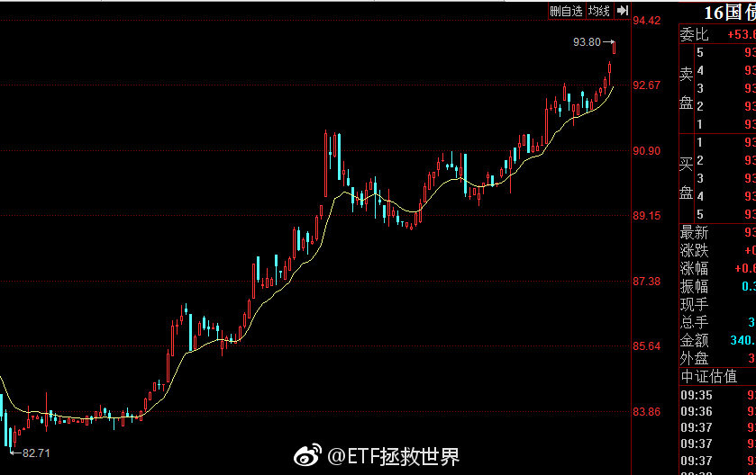

## 2018-07-20 10:13

回复@陶醉6松手4电学_337:央妈都带人来给你接盘了你还不卖？//@陶醉6松手4电学_337:昨天，央行要求商业银行买等级低的债券。是利好债市的啊！！咋就要清仓呢？

## 2018-07-20 10:30

我有种预感。这一波恒生我们有机会加到10%+，甚至15%+。 ​​​

## 2018-07-20 10:39

打扰了。

## 2018-07-20 11:58

今天球球头条有个帖子，叫做“腾讯创新低，该买还是该卖。”

去看看评论。

再去找找1月底关于腾讯的帖子以及评论。

你会对这个市场的投资人有更深刻的理解。 ​​​

## 2018-07-20 12:41

接着上一条说。

我们观察群众情绪，一方面是体验市场温度。一方面是给我们自己做出警示。

具体说，

如果过去一段时间我们自己表现的太好，则一定要更加严格谨慎的对待接下来的考验。反复确认之前成功的策略以及品种是否有可能均值回归。

尽量将自己的成绩持久性的保持在前20%-30%。不要做最好。如果做到了最好，就想办法往后退一步。主动寻求成绩落后一些，不要做最好。

吃饭，7成饱最舒服。如果你吃十成饱甚至12成饱，难免会吃饱了撑到。对身体没有任何好处。

## 2018-07-20 13:35

$全指金融 sh000992$   回本有望了…… ​​​

## 2018-07-20 13:43

涨了一个点觉得仓位低难受的不得了的人自己去加仓，不要到我这里抱怨。否则一律拉黑。

50也加了，券商也加了，金融也加了。还觉得不行的赶紧取关。 ​​​

## 2018-07-20 13:56

回复@封单爱吐槽:我以后还是闭嘴算了。只干不说。//@封单爱吐槽:e大你的嘴是开了光的呀//@ETF拯救世界:回复@陶醉6松手4电学_337:央妈都带人来给你接盘了你还不卖？//@陶醉6松手4电学_337:昨天，央行要求商业银行买等级低的债券。是利好债市的啊！！咋就要清仓呢？

## 2018-07-20 13:59

注意 $全指金融 sh000992$   之前我们浮亏4个多点。今天弄不好一把干红。

这就是我一直在强调的，“你那点浮亏，牛市来了，一周，最多半个月就翻红，然后开始资产飞跃。”

今天是不是反转日，我不知道。但是你可以感受一下我说的意思。有点浮亏，浮亏几年，根本不是问题。只要浮亏幅度不大，分分钟变红。但是你如果一定要等牛市来了才投资，那就是接盘侠的命了。

## 2018-07-20 14:18

$中证转债 sh000832$   $中证红利 sz399922$   开始赚钱。 ​​​

## 2018-07-20 14:25

我就说这么弱的反弹真的没见过。看来还要继续。2900上下浮动50个点都算正常情况。

## 2018-07-20 14:31

关于网格。有波动就有利润。提款机。

注意，如果你也要做，请一定做好压力测试。这是最关键的。 ​​​
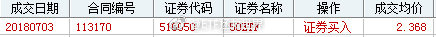 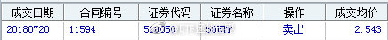

## 2018-07-20 14:38

波段仓位和长线仓位毫无关系。这个不要弄错。

未来会发生什么，我们都不知道。也许一个区间波动几年不涨。这个时候，波段仓位可以提供源源不断的利润。但是如果开始长牛，只做波段又赚不到大钱，所以长线仓位要拿死。

之前我说，考虑在计划中加入波段仓位，就是干这个用的。有机会会加进去。不过这个牵扯的问题比较多，我也会比较慎重。

## 2018-07-20 21:47

每日打卡（195）

坚持 ​​​
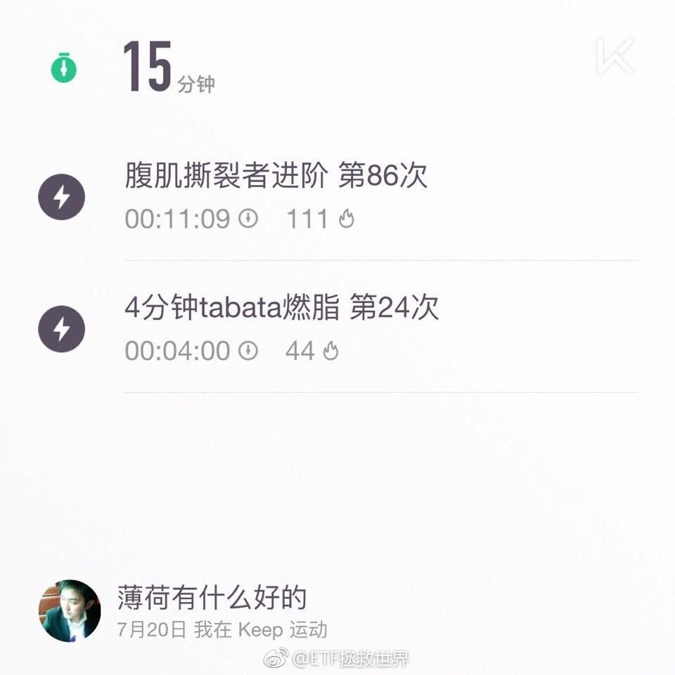

## 2018-07-22 08:36

今天巡视北二环，昨天视察了东二环。

谁能想到我即将成为接盘侠。 

苍天饶过谁。 ​​​

## 2018-07-22 16:44

回复@摇身一变我就是孙悟空:可能你挣了钱是要带到那边去吧。我不是，无论是工作还是投资挣得钱我都是要花的。该花的时候就花，不然挣钱干嘛？顺便说一句，这个评论点赞的全都拉黑//@摇身一变我就是孙悟空:所以etf没啥用 最后还是得房子 哈哈哈哈哈哈 人生讽刺啊

## 2018-07-22 16:59

投资是为了什么呢。其实绝大多数人投资都是想用投资收益过上想过的日子，买想买的东西——不眨眼那种买。

你不会说，你在股票上挣了钱还是要买奥利奥，迪奥，奥迪啊，好讽刺啊。你居然没有把股票拿到临终那一天啊，你怎么不吃糠咽菜去积攒基金份额啊。

买学区房当然也一样，这就是个消费品。想投资房地产的人几乎不会来买这个。买的人都是当做消费品。未来涨不涨跌不跌反正我不在意。

有时候有些钱必须花，至少你自己认为是必须花的，那就花呗。制定远期投资计划的时候，这些支出应该是早就在预期范围内，不加到计划中的。

## 2018-07-22 20:43

回复@伟哥就是你伟哥:我的感受和绝大多数人一样。但我知道这件事可能也很难真正改变什么。后续的发展可以参照十年前。至于医药指数的投资，如果真的挖深坑，我愿意为国护盘。//@伟哥就是你伟哥:E大，有空能谈谈你对这段时间沸沸扬扬的疫苗造假事件的看法吗？

## 2018-07-22 22:10

回复@A夜如故:据官方说法，这次疫苗主要是效价指标不合格，就是可能会失效，对健康应该没什么危害，打了这些批次的家长暂时不用太担心。后续密切关注吧，另外是不是要补种疫苗

## 2018-07-22 23:28

不知道该说什么。也不知道怎么说。

不过，在三周后，没人再提起这件事的时候，我依然会持续关注。

就像持续关注这些年那些轰动一时的事件后续发展一样。

关注热门事件的后续发展，会让你有两点感悟。

第一是，你一定想不到，大多数事件会最终不了了之。

第二是，几乎什么都没改变。

到底从什么时候开始会有改变，我几乎不抱希望。

## 2018-07-23 08:40

就是这13位，已拉黑。如果有误伤的，不好意思了。

最近水逆的厉害，很多不顺心的事情，心情不好，以后心情好了再解黑。

昨天车还出问题了，突然自动熄火，不知道是不是自动启停出问题了。抽空去查查。

刚买完DAX就出这事，感觉是，你爱德国然而德国不爱你…… ​​​

## 2018-07-23 08:44

//@陈宇极品投资: 转发微博

## 2018-07-23 09:47

你看，所以其实没有什么行业是完全安全的，更别说个股了。

食品饮料安全吗？三聚和塑化剂的事这么快就忘了？

医药安全吗？你看看。

金融地产？

公用事业？

其实到处都是坑。

所以，指数投资+低估是躲坑最佳方式。对于普通投资者来讲。 ​​​

## 2018-07-23 10:04

但是，说一点我的经验：每次某个行业出大事挖大坑，事后看，都是真正的钻石机会。

## 2018-07-23 10:49

回复@勤奋happyfire:主动基金的问题就是确实无法把握它的表现。即使跌了很多，也不知道补仓的话未来基金经理会不会继续踩坑。如果是我，可能会把空间拉的大一点慢慢补仓。

## 2018-07-23 11:21

其实入门的话，罗总这本介绍指数基金的书是很不错的。有希望了解指数基金的朋友可以看看~~

## 2018-07-23 12:55

其实你们大多数人，甚至大多数父母，可能没有体会过刚才那篇文章里那种孩子出事后撕裂般的痛苦。

我儿子曾经有一次病了，做了检查，疑似很严重。如果确诊，是没有办法治疗的那种。

知道这个检查结果我就崩溃了。带着他到各大医院去看，根本不在乎花多少钱，那时候钱已经没意义了，找最好的医生，做最好的检查。

最后几位专家都说，没事。很正常。

瞬间感觉人生又有希望了。

然而，我永远也忘不了在一个专家办公室，排在我们之前看病的那个小孩。

可能一两岁，自己在旁边玩着玩具。那位湖南来的妈妈在跟专家说话。

妈妈说，真的没希望了吗。

专家点点头。

妈妈又说，那我们就回家等死了吗。

专家没说话。

那一瞬间，我泪如雨下。

没有经历过的人，不可能体会好好的孩子突然莫名其妙不行了的感觉。那些生产假疫苗的人，还有那些试图掩盖真相的人，

都不得好死。

## 2018-07-23 13:18

50的买点为何总是这么风骚……再次买在最低，今天又领涨。

其实50真的很棒，只要你会玩…… ​​​
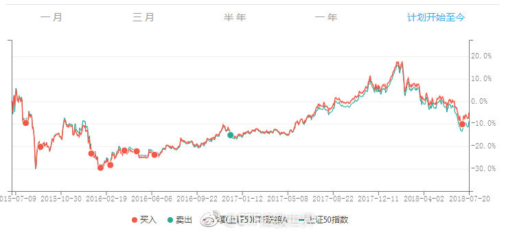

## 2018-07-23 13:48

医药趋势已坏，不要频繁抄底，注意节奏 ​​​

## 2018-07-24 06:51

回复@追求确定性2:连涨15个交易日，野百合也有春天。买辣鸡没错的//@追求确定性2:昨天美元债大涨啊，我的正1%了。

## 2018-07-24 10:19

富国300，全指金融开始盈利。 ​​​

## 2018-07-24 10:23

回复@炒饭821:还没签呢！疯了。//@炒饭821:老大，通稿新政策影响挺大的啊，医药也翻红了，难道股市楼市真的要活跃了，你这房子买的点厉害了//@ETF拯救世界:回复@追求确定性2:连涨15个交易日，野百合也有春天。买辣鸡没错的//@追求确定性2:昨天美元债大涨啊，我的正1%了。

## 2018-07-24 10:24

回复@向往世界的游星:2900±50是压力//@向往世界的游星:如你所说，反弹2900点//@ETF拯救世界:回复@追求确定性2:连涨15个交易日，野百合也有春天。买辣鸡没错的//@追求确定性2:昨天美元债大涨啊，我的正1%了。

## 2018-07-24 12:07

分享两个最近的案例：

一，500网格。一个小网可以出货了。

二，我经常说的“让大家开心一下，我某个股票又跌了30%”。是的，我会用一小部分资金配置打新门票，再等权买入一堆量化选出的股票。其中一个下跌30%补仓的例子是这样：

我对于门票股的补仓价位，是该股下跌30%；60%；90%各补一次。金额与初始金额相同。

这只股票下跌到30%（复权价格）的时候补了一次，几乎是最低点。目前盈利15%。

介绍一点经验，如果想借鉴，一定要做好压力测试。同时，下跌补仓只适合量化买入几十只股票的情况，不适合重仓补。
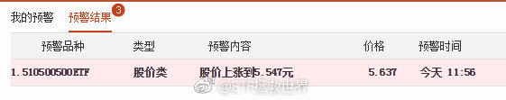 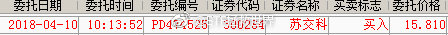 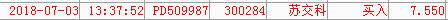

## 2018-07-24 13:16

目前所有持仓品种，浮亏的没有超过15%的。

25只品种中，还有8只浮亏。超过10%的有三只。

不知道什么叫赔钱。

牛市会不会来？一定会来。来了所有品种两周内翻红。 ​​​

## 2018-07-25 09:57

传媒是不是又加在底部了 ​​​

## 2018-07-25 10:22

回复@小小宇宙要爆发啊啊:再次奶在最高点。虽然最近水逆，但功力还在，放心了//@小小宇宙要爆发啊啊:高点也奶得精准，毒奶神功，名不虚传哈哈哈

## 2018-07-25 10:24

回复@8点钟的太阳_13214:50的关键是，两年多来第一次买入……//@8点钟的太阳_13214:我感觉最近50加仓位置E大选择的时点太棒了，我居然短期盈利快到10%了。传媒没的说

## 2018-07-25 10:34

敢不敢新高 ​​​
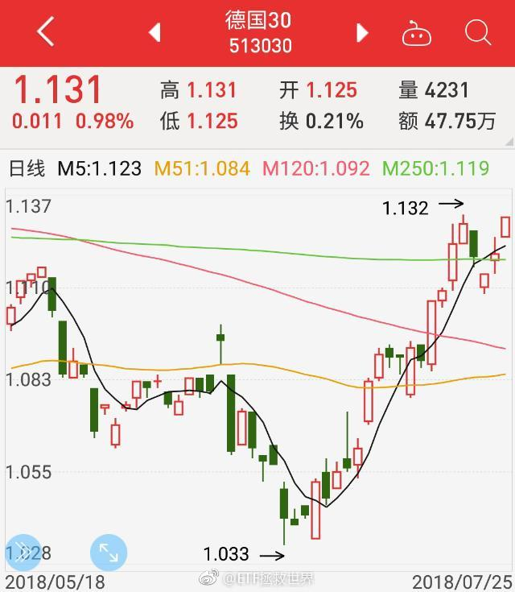

## 2018-07-25 11:55

太听话了吧。

## 2018-07-25 12:23

回复@小散逆袭史-铁粉小伍:看了，确实不行。都不要看了。以后谁再来我这里做广告我就评论“看过了，不行，千万不要去看”，然后置顶。//@小散逆袭史-铁粉小伍:回复@如醉且坠:没看就在说不行//@ETF拯救世界:太听话了吧。

## 2018-07-25 12:54

人成年后到底记不记得六岁时候父母的样子？

## 2018-07-25 13:53

你们有没有发现一件事。

为什么古天乐吴彦祖吴尊刘德华这些巨帅身材又好的男人

不会乱搞。而且是好老公好爸爸。

至少咱们没听说。

明明机会很多啊。 ​​​

## 2018-07-25 15:05

自动熄火重启有故障提示后续:

去4s店检查，行车电脑没有任何故障码记录，也就是说没事，不知道为什么有故障提示。

检查的时候我出去办事了，回来车洗了，玻璃水加满了，60块打车票报了，离合匹配了，又蹭了顿饭，最后和店里的妹子们谈笑风生。

哪能港，就是感觉你爱德国，德国又爱你了。

水逆是不是要结束了。得去白云观拜拜了。

## 2018-07-25 15:09

回复@小散逆袭史-铁粉小伍:你这个素质，这辈子也就在网上给人做水军了。所以我不会跟你计较的。生活很难吧，加油。//@小散逆袭史-铁粉小伍:sb//@ETF拯救世界:回复@小散逆袭史-铁粉小伍:看了，确实不行。都不要看了。以后谁再来我这里做广告我就评论“看过了，不行，千万不要去看”，然后置顶。

## 2018-07-25 16:44

如果我这两年内能安排好所有必须完成的事，顺利退休，那我会做一件特别特别有意思的事。

90%的人看到都会觉得有意思的事。应该没人做过。但也许是很多人的梦想。

如果真的做了，我可能会红！

敬请期待…… ​​​

## 2018-07-25 16:55

很多人的思维太集中在投资了，没有想象力。90%的人都觉得有意思的事情，极大概率跟投资无关。跟人生有关。特有意思。

## 2018-07-26 13:13

非常忙，勿念。 ​​​

## 2018-07-27 06:29

我以为要三周大家才会忘掉。

谁能想到，只需要三天。

很有意思。 ​​​

## 2018-07-27 08:48

最近一线实体亲测调研了帝都房地产二手市场。

几点初步感想。

杠杆越来越大。因为卖房的人几乎没有拿现金走人的。都是卖了房加杠杆继续买。

关键是，杠杆本身已经很大了。我谈了那么多套，各种各样的情况之前都没听说过。比如，把房子抵押出去已经是最普通的情况。二抵也不在少数。

抵押在银行的还好。我遇到一个抵押给担保公司的，拿到400万去投资，结果赔光。现在每个月要还4万多利息，被迫卖房。

买房的加杠杆，卖房的加更大的杠杆继续买房。

关于人。

相谈甚欢的是年轻人。三十多岁。程序员，医生，金融从业者。没那么多事。无论成不成都很开心。

唯一一次让我恶心了好几天的是某省的大叔大妈。我从来不以地域给人贴标签，但这两位确实给家乡招黑。中介说，对那个地方的人来说，这很正常……大叔也还好，大妈简直了。

少跟大妈做生意，少接触某省的人，我的总结……

最后，我不得不说，我朝的女性真的站起来了。

谈了好几个，卖家都是30多岁的单身姑娘，手里都不止一套房。有些胆子很大，二抵之类的……

男人们，你们要努力了！

## 2018-07-27 08:50

回复@天外的琴弦:卖地的是链条最后的那一环。//@天外的琴弦:卖房，加杠杆买，这个链条总有最后一个卖房的人。

## 2018-07-27 09:14

忙的刚看到。

另外，美元债连涨几十个交易日了吧。辣鸡知耻后勇了。 ​​​
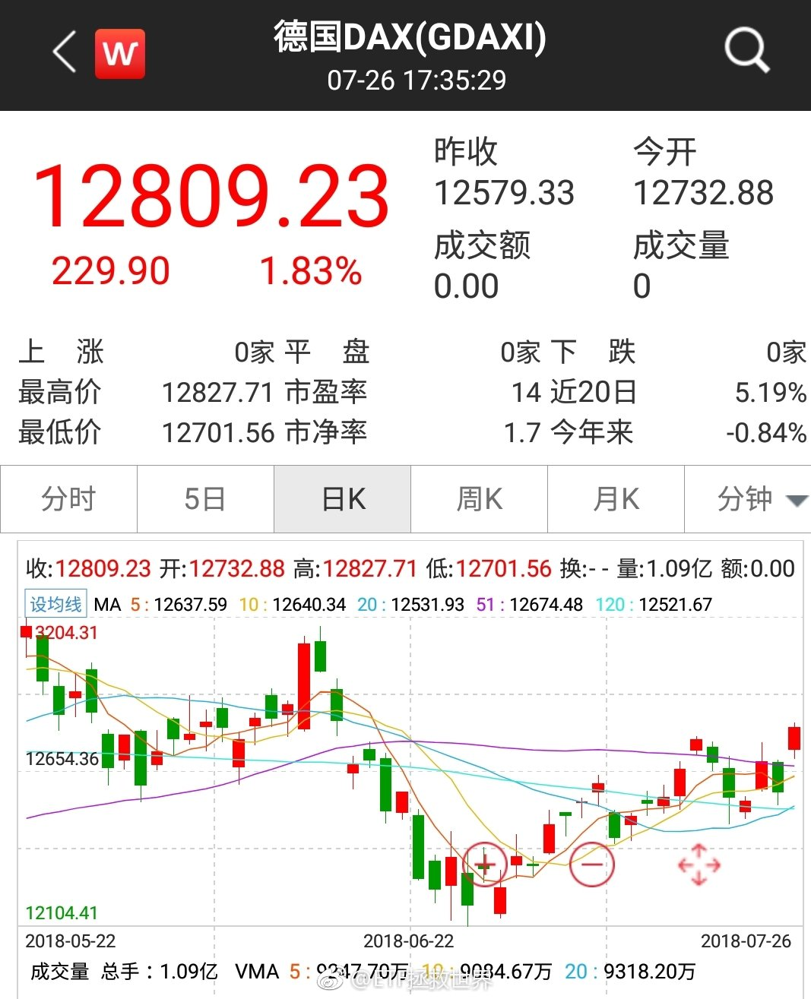

## 2018-07-27 09:22

$Facebook FB$   一天20%，几个月白涨了。

有没有只涨不跌的股票？

我看，没有。

而且，越多人认为只会涨不会跌的，其实杀伤力越大。 ​​​

## 2018-07-27 09:37

$513030  溢价1.8%了。至于吗 ​​​

## 2018-07-27 09:55

$腾讯控股 hk00700$  股王能否守住前期低点？这是价值投资的湮灭还是道德的沦丧，人性的扭曲？

答案即将揭晓…… ​​​

## 2018-07-27 10:03

2.1%了。越说越来劲。不要追。

## 2018-07-27 10:33

看着这样的走势，想起单大师的经典了：

忽冷忽热爱感冒，刮风下雨怎知道。

据小道消息，从西伯利亚来了一股暖压槽，正在由北向南缓缓地移动。

然后，忽儿向东，忽儿向西，一会儿向南，一会儿向北…… ​​​

## 2018-07-27 11:44

这个4%真的是没想到。那么，18-40岁年龄段的本科有30%-40%了吧。

## 2018-07-27 11:58

## 2018-07-27 12:00

笑出声了。

## 2018-07-27 16:38

准备。快6.9了。//@蓝鲸财经记者工作平台:【鲸滚动】在岸人民币兑美元官方收盘报6.8246，创2017年6月26日来新低。离岸人民币跌破6.83关口。//@蓝鲸财经记者工作平台:【鲸滚动】7月27日讯，在岸人民币兑美元跌近300点，跌破6.82关口。

## 2018-07-30 06:59

在委内瑞拉，黄金美元股票指数都是不错的选择

## 2018-07-30 08:22

讲真，这么对比看北京的房价也不是很离谱。1000万多一点，二环内，距离广场直线距离不到两公里，各种设施极其成熟，交通便利，好学校，100平出头。//@挖龙脉的超级鹿鼎公:转发微博

## 2018-07-30 08:55

回复@whole丧心病狂:我十年前第一次去美国，了解那边的制度后就发现，其实都一样。他是有永久产权，但每年得交税，税还不低。那以后我再也不吐槽70年//@whole丧心病狂:关键是我们只能买房子产权，资本主义国家是能连地一起买了。不一样吧

## 2018-07-30 09:21

恭喜什么，我又没买……就是汇报一下调查的真实行情……穷，买不起……

 ​​​

## 2018-07-30 09:42

$128012  这年头连转债都不能相信了 ​​​

## 2018-07-30 09:48

发微博是真的有用啊

## 2018-07-30 10:53

回复@深南椰风:别这样，低调点好吗。//@深南椰风:益达，全指医药又新低了，不夸下自己？[米奇比心]

## 2018-07-30 12:18

我相信央妈不会允许到7。6.9附近会有动作

## 2018-07-30 13:38

踏踏实实的，按照自己的节奏来，不要被别人的情绪和k线影响自己的节奏。

一场比赛你想赢，就要把比赛节奏控制在自己的频率下。总跟着别人的节奏走，连球都摸不到。 ​​​

## 2018-07-30 14:18

我的感觉，家长有能力的话，能帮就帮一把。能帮多少看家庭实力，别为了孩子降低生活水平就行。扶上马，送一程，孩子起点高了，后面不会吃亏。

## 2018-07-30 14:35

其实吧，你说人和人，智商真的差很多吗。我觉得除了那种天赋异禀的人，其实普通人绝大多数人都差不多。99%的人都差不多。

剩下的是什么区别，情商，性格。然后就是家庭，背景。可能就决定很多事。

我之前看报告，说最近这些年，考上TOP2,985的农村孩子比例越来越少了，城市的越来越多。农村孩子和城里孩子真的智商差很多？我不信。我想可能就是周围环境，家庭，教育资源，等等问题的影响吧。

我还有个体会，就是贫富差距真的是越来越大的。都是30多岁的同龄人，刚毕业，十五年前你家里人有实力帮你在二环内50多万买一套房，现在价值1000万。你家里人实力差点，十万帮你在三环付个首付买个房子，现在价值600万。同样如果没人帮你，真的一分钱都没有实在买不了，还得不停的给家里寄钱，那现在还是0。

这就是举个例子。看个意思吧。

美国也是啊，父母藤校毕业，孩子接着上的可能性就很大。各种捐款一弄，父母又是校友，孩子上的概率就很大了。

总之感觉，孩子，第一当然是让他自己努力要强，培养好。第二就是能帮就帮一把。我很不赞成自己吃糠咽菜给孩子凑房款。有能力就帮一把，没能力就尽量帮，实在一点都帮不了那也没办法。

别说为了锻炼孩子故意不帮。没什么意思。扶上马送一程，孩子能跑的快点，他生活的轻松一点，父母也能轻松一点。没准孩子有出息了你还能沾点光呢是不是，虽然几率很低吧……

## 2018-07-30 14:48

最高2910。//@ETF拯救世界:我就说这么弱的反弹真的没见过。看来还要继续。2900上下浮动50个点都算正常情况。

## 2018-07-30 14:58

回复@周夢在緬甸:不知道。是继续还是结束，最近几天非常重要，要观察。能不能撑住，很重要。//@周夢在緬甸:反弹结束了？//@ETF拯救世界:最高2910。//@ETF拯救世界:我就说这么弱的反弹真的没见过。看来还要继续。2900上下浮动50个点都算正常情况。

## 2018-07-31 09:00

回复@悠然见南山98518:你这种情况我早就在之前的文章里精准预料到了。还是那句话，我写的很多东西你当时觉得不重要，几年后才会发现，当时如果重视就好了！

## 2018-07-31 09:56

两只股票春风得意的时候，买入者极度乐观的情绪，没买的人极度焦躁，这是非常生动的一课，各位应该好好回顾，好好体会。与价值无关，情绪。

## 2018-07-31 11:21

中午不发车，都别惦记了。

漫长冬夜，还是自己找点乐子比较容易扛过去。这行情不看比看强。 ​​​

## 2018-07-31 14:18

跟你说别盯盘吧。盯着盯着人家诱惑一下你又杀进去了。

佛系投资。 ​​​

## 2018-07-31 15:40

2018年7月最后一个交易日，全指医药里程碑的一天：

2012年11月以来，全指医药首次进入历史最低估值区域。

6年了。 ​​​

## 2018-07-31 16:17

美的这次回购我觉得很奇怪。从16涨到64，只跌到了50，公司就坐不住了。为什么这么急于稳定股价？是有股权激励还是要增发啊。真的不太理解。20、30的时候怎么不着急呢。

## 2018-07-31 16:54

果然，看了一眼大事记，5.8有股权激励。“本计划所采用的激励形式为限制性股票，其股票来源为美的集团向激励对象定向发行新股。价格28.77”。5.22回购预案。

## 2018-07-31 16:57

谨言慎行，永远没错……

## 2018-07-31 17:15

预告一下，本来应该今晚发车，但是时间太紧来不及了。明天上午或者中午吧。 ​​​

## 2018-07-31 17:18

防不胜防。想了半天，这个真的没法躲了。

