## 2018-08-01 09:37

哥儿俩每天轮着凉……//@ETF拯救世界:两只股票春风得意的时候，买入者极度乐观的情绪，没买的人极度焦躁，这是非常生动的一课，各位应该好好回顾，好好体会。与价值无关，情绪。

## 2018-08-01 10:20

7月财新中国制造业PMI录得50.8 创八个月新低。产出增速、新订单增速均出现放缓，新出口订单指数创25个月以来最低，通胀压力减弱，制造业景气度温和走弱。 ​​​

## 2018-08-01 12:03

谁的手比较快？ ​​​

## 2018-08-01 13:29

太乐观的人可能要挂一批。 ​​​

## 2018-08-01 13:31

另外，没有经历过0405,08,1112的朋友们，现在可以用心去体会危机的感觉了。 ​​​

## 2018-08-01 13:46

节奏就是，上周没发车，今天发一车。如果下次是月中发车，那么就是一个月只发了一车。

代表我的态度了。

节奏，节奏。 ​​​

## 2018-08-01 13:54

乐观的人早就满仓被套了。悲观的人在逃跑。

我们拿着现金在捡辣鸡。 ​​​

## 2018-08-01 14:32

各大指数开始考验前期低点。

前期低点有多重要，现在已经不用我说了吧 ​​​

## 2018-08-01 14:39

现在想，那些买CDR基金的人非常明智了。

虽然CDR黄了，连货基收益都拿不到。但是不赔当赚，可以说大赢家了。

就是不知道几年封闭期以后什么样。 ​​​

## 2018-08-02 09:40

惨！ ​​​

## 2018-08-02 09:44

还是那句话，注意节奏。

你家不是开矿的，也做不到很多人“昨天涨的时候满仓了，今天明天跌了继续加仓”那样 ​​​

## 2018-08-02 09:49

今天是一块凉。//@ETF拯救世界:哥儿俩每天轮着凉……//@ETF拯救世界:两只股票春风得意的时候，买入者极度乐观的情绪，没买的人极度焦躁，这是非常生动的一课，各位应该好好回顾，好好体会。与价值无关，情绪。

## 2018-08-02 09:56

来，各位，投个票。我观察一下情绪。微博直接有投票，不像球球那么麻烦点赞了。

我发起了一个投票 【面对A股，你现在的情绪是】网页链接 ​​​

## 2018-08-02 10:00

在这样跌下去，未来会赚多少我已经没有概念了……

钻石底真的越来越近了…… ​​​

## 2018-08-02 10:13

我说过很多次，在A股，你太乐观会死的很快，太悲观赚不到什么钱。

这句话可能以前你不太在意，现在越来越对前半句有体会了。然后，几年后，你会发现后半句更绝了。 ​​​

## 2018-08-02 10:30

开会。 ​​​

## 2018-08-02 11:24

现在各位回头想，几个月前鹅厂南非大股东巨额减持，总裁刘炽平减持100万股，他们才是大玩家。 ​​​

## 2018-08-02 11:25

每周发车模式再次恢复运行。 ​​​

## 2018-08-02 11:47

刚才看见有个评论说，“股市是你家开的啊”

特别有意思。为什么，因为这句话这几年经常在我脑子里响起，因为三年前球球上也有个人这么说。

“股市是你家开的啊，你说跌就跌？踏空狗。”

三年过去，踏空狗活得很好。不知道那位仁兄还好吗。 ​​​

## 2018-08-02 11:50

“未来会赚多少没概念”是什么意思？

投资指数，能赚多少，正常情况下是有概念的。不会超过一定范围。比如买的低，长期长期可能6%-15%。

但是低到一定地步，就没概念了。甚至可能两三年年化可以50%，已经不能用常理推断。

什么都不懂就来喷，悲哀。 ​​​

## 2018-08-02 11:55

军工信息归位日，A股见底时

## 2018-08-02 13:04

​​​

## 2018-08-02 13:25

500开始挑战我做人的底线了。

4600-4700 ​​​

## 2018-08-02 16:37

今天开始，A股进入过去二十年第四次“持有股票优于持有债券”的时期。

上一次该时期是2012-2013。 ​​​

## 2018-08-02 16:42

环保指数估值即将跌破20倍。

 ​​​

## 2018-08-02 18:10

有道理是有道理，但如果自己低位买入，赚了几倍还不停再看高几倍极力宣扬还是低估，很多事情就很难说清了。你可以说跟的人没脑子，自作自受，但吹票的人未免少了一些同理心以及善良。

## 2018-08-02 18:23

这么说吧。

我一直看到有一种论调：别人说股票是别人的权利，再怎么吹，你是成年人，你愿意跟，赔多少也是你自己的事。正好让那些不适合股市的人赔光，走人。

这样的说法，看起来有点道理，但我始终始终无法接受。

那么，买P2P的人是不是也应该自作自受？被忽悠瘸了买保健品的大爷大妈呢？被电信诈骗的人呢？性质可能不完全一样，但是如果把所有责任都推到信任你的人身上，是不是有点不厚道？

有一定话语权的人，真的最好能为别人想一想。有人是把所有家当拿出来信任你。尽量少点忽悠，别让那么多人赔那么多。

忽悠成了，自己变成了股神。不成，自己也毫发无损。

只是，凄惨了那些连声音都发不出来的ID后面的那些人。

## 2018-08-03 09:07

鹅厂怎么也得反弹个10%吧……这个数字怎么算出来的，蒙的。 ​​​

## 2018-08-03 09:40

低调一点多好。

## 2018-08-03 10:09

时间，空间。

牛市或者熊市，必须给时间。每天买，家里不是开矿的，你没那么多钱。

给了时间，空间就会拉开。熊市成本会大幅降低，牛市利润会飞速增长。

节奏。 ​​​

## 2018-08-03 10:14

浓眉大眼的白酒也跳。

没法活了。 ​​​

## 2018-08-03 10:17

美帝企业，苹果这样的，挣了钱，好多现金，回购股票，流通股本减少，每股价值提升，股价上涨，股民管理层一起笑哈哈。

我朝某些企业，赚了大钱，现金几百亿，也不回购也不好好分红，又没有什么资本支出，低息借给地方政府。

差距有点大啊。 ​​​

## 2018-08-03 10:32

很多人的信心已经处在崩溃边缘了。 ​​​

## 2018-08-03 10:57

1月26日，恒生见顶前一天。

被骂的狗血喷头。

太可惜了，我没法在雪球再做情绪测试了。

那才是测试群众情绪的最佳场所。

当时看到48000的v是群众心中的神。

ETF拯救世界: 恒生正在吹一个不输于2007年的泡泡。 嗯哼，没错，就是不怕对这么强的品种唱反调。不怕打脸。 然而别因为我扯淡就随便卖啊... ​​​

## 2018-08-03 11:05

不会见到0字头吧！0.0xx……

## 2018-08-03 11:10

回复@安小之18:指数就是股票组成的，这个说法不觉得很可笑吗。宽基+高弹性指数秒杀大多数股票。另外，你以为股票涨10倍，拿着的人能赚多少？我不会告诉你70%炒股的人牛市也赔钱的……//@安小之18:E大，对于“牛市中指数没有股票盈利多”这种说法你怎么看？

## 2018-08-03 11:17

回复@路上有只羊:我有种感觉，球球是鼓励或者说默许喷子的。没有喷子就没有流量。流量才是最重要的。这个我没有什么证据，只是自己的感觉。真正有价值的东西，一定是与大多数人的思考结果不同的，一定很多人不同意。球球对逆向思维是扼杀状态。

## 2018-08-03 11:30

回复@Elainealry:再稳一稳。让美元债再飞一飞。//@Elainealry:离岸汇率已经破6.9了我们要做点什么吗

## 2018-08-03 13:11

回复@阿奕长官:不好意思，我没法预测哪里是反弹高位。你知道谁有这个能力吗。//@阿奕长官:E大，请教一下:我基本上按您发车全部跟了全指医药001180，现在这个品种盈利从几千跌回到几百，为什么当初没有发指令高位卖了低位再买？这个问题您在策略中怎么考虑的？谢谢

## 2018-08-03 13:25

还剩7%，给不给面子。

## 2018-08-03 13:31

刚才那位朋友的问题，我不是没有解决办法。而是暂时没有用到计划里。

接下来我准备尝试用一下。可能下次发车就会用。可以部分的解决波动利润问题。 ​​​

## 2018-08-03 13:38

小米，年轻人第一支被套的股票……

## 2018-08-03 14:11

其实绝大多数人来投资股票，最大的问题是两点：

第一，是买之前没想到过自己会赔。

第二，是想到自己会赔，但没想到买的东西会跌这么多。

也就是预期不够。预期不够就没有应对策略，没有应对策略，最坏的事情发生了就一脸懵逼。

如果你对最坏的情况已经有了预期（比如，该品种目前买入最大下跌幅度：xx%），然后再设计好应对的策略，可以说就没有太大问题了。

当然，也许会有超过预期的坏事发生。但只要你买的东西不会死，而且大概率长期向上，而且你买的还不贵，那么就不会有大问题。

何况，如果你够理性，你本身预计的最差情况应该距离真正黑天鹅也不会太远了。

毕竟，当初你说出你预计的最坏情况时，绝大多数人都认为那已经是个黑天鹅了。

## 2018-08-03 14:51

太坏了，又骗了多少人进去一锅焖了…… ​​​

## 2018-08-03 15:46

养老产业估值已经跌破2008年10月金融危机大底。

然而，军工信息依然高高高高在上。

好气哦。 ​​​

## 2018-08-03 16:06

看了看自选股。开始杀白马了。

这就是熊市。通杀。

苍天饶过谁。 ​​​

## 2018-08-03 16:09

回复@悠然见南山98518:500即将跌破2012年底。开始杀向08年。//@悠然见南山98518:可能除了军工信息，其它的都接近或超过12年的低，不知猜的如何

## 2018-08-03 16:16

回复@flight09:军工2015年估值是220倍，了解一下。//@flight09:我看了下军工指数从3040高点到现在的902，估值还是很高么

## 2018-08-03 16:27

回复@fight2021:从下往上数第二层。//@fight2021:如果共五层地狱，那么现在我们在哪一层？

## 2018-08-03 16:39

“满仓穿越牛熊”。

“持有好公司，不在意股价波动。”

 ​​​

## 2018-08-03 16:59

也就是在微博。如果在球球我说这些能被喷到北极去……感谢你们不喷之恩。（其实是喷的都拉黑了）

## 2018-08-05 17:58

想写点什么，打开电脑坐了半天觉得现在也没什么好写的。

锻炼去了…… ​​​

## 2018-08-05 22:20

有没有你关注的人，之前一直信心满满的满仓满融，最近开始有点含糊，甚至真的减仓的。 ​​​

## 2018-08-05 23:00

每日打卡（196）

刚才看了看计划，今年净值下跌5%了。

多少年都没赔钱了，今年要开荤？年底前要翻身！ ​​​
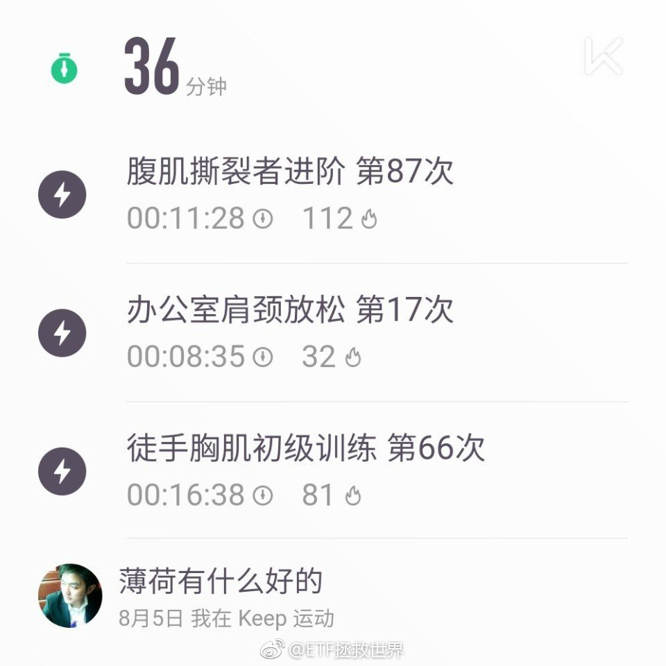

## 2018-08-05 23:24

曾经在威尼斯的码头上坐了一个小时看云。威尼斯真的美，有机会要去看看。

## 2018-08-06 09:01

我回忆了一下，发现自己对某个去过地方的印象，居然很大程度上不是来自于那里的景色和历史，而是来自于那里的人。

接触到的人好，对那里就有很好的印象。接触到的人一般，印象就会很差。

目前来说，印象最好的是，说出来政治很不正确的美国和日本。

美国老百姓是真的热情，有礼貌，甚至有点，用我们的话说，缺心眼。其实就是相对来说非常单纯。我说的是老百姓，精英阶层未必。但是即使是在华尔街，大街上的人也非常热情。我在纽约联储门口和朋友拍照，一个OL会在旁边站半天，然后问需不需要帮我们拍合影。相对底层人民更不用说了。素不相识的大厦保安会拿出手机搜出来一个美籍韩国艺人问我是不是他（其实根本一点都不像，外国人对亚洲人也脸盲……）。超市排在前面的人看你拿了一件东西会主动让你先结账。去商店转转，没买东西也能和导购聊起来，然后互留email……反正就是各种小事，你会觉得，生活的非常舒服。当然，这都是很表面的东西。但是至少，表面上会让你觉得很舒服。

日本人没那么热情。但是更加有礼貌。你走在温泉民宿的走廊上，对面楼梯突然下来一位穿和服的日本少女，看到你会马上站住鞠躬和你打招呼。（第一次碰到的话会懵逼）。孩子们上下学都是自己走，看到你拿个相机像游客，会微笑着跟你说欧哈优。商店的导购就不用说了，当然不会跟你互留email，但会让你感觉到像上帝。

至于景色，人文，美国和日本都没得说。去看看一般不会后悔。购物，感觉没什么太大必要大箱子小箱子往回扛了，现在海淘网站这么发达。

欧洲的话，其实我的感觉还可以吧。比美日差点。主要是人民没有这么热情。瑞士的风景当然非常好，随便拍都是画，但是人就真的会比较冷漠。意大利总体来说，除非你是对历史特别有研究感兴趣，其实挺一般的。人不能说冷漠，但是真的，我接触的90%意大利人都不会说英语，文字也看不懂，所以买个披萨都不容易。但是有的地方真的很美，比如威尼斯。我去的那天，刚下过雨，天空竟然是彩色的。搭配各种颜色的房子，真的美。能看很久很久都不腻。法国人也不热情。语言比意大利强点。但是这几年治安情况差了很多。相比于举世闻名的巴黎，我更喜欢法国各种特色小镇。去过十几个，真的太太太太太美了。就像油画中的一样，每个小镇风格完全不同。仙境一样。

非洲只去过一次阿尔及利亚。没什么特别的感觉。以后有机会往南边走走。

东南亚几个国家，整体还ok。人民也比较热情，景色还不错。休闲游非常合适，我觉得比海南强。

觉得还不错的国家和地区，我会去好几次。但是有时候也能感觉到，几年后再去，那里的人对我们的态度也会有些细微的变化。变化最大的是香港。我04年和14年两次去，感受完全完全不同。以后没事也不会再去了。还是希望世界人民都能对我们热情友好下去。

一个地方的人不行，景色再好我也不会有好印象。其实放在国内也是如此啊。

## 2018-08-06 09:16

这周随时发车。2车以上。不会超过5车。 ​​​

## 2018-08-06 09:21

论加强锻炼的重要性。//@新京报我们视频:交警：你要skr止啊//@-强说着忧愁的孩子-:累死skr人

## 2018-08-06 09:34

强势股开始补跌。熊市进入新阶段了。 ​​​

## 2018-08-06 10:02

想为国护盘，然，国不给机会。那么我们就等着吧。

## 2018-08-06 10:36

一年过去，医药满仓点位上升至7700点。//@ETF拯救世界:说正经的吧。以目前的情况，医药满仓点位是7000，减仓区域是12000-13000。这几个数字每年增加500-1000点。//@ETF拯救世界:回复@求财不劫色:放过它！医药还是个孩子！//@求财不劫色:什么时候医药才能减呢？

## 2018-08-06 10:47

GUO:还是你们来吧。 ​​​

## 2018-08-06 13:00

滴滴！！！ ​​​

## 2018-08-06 13:23

回复@小饺子ww:刚才下楼吃饭有很多滴滴邦邦恰恰恰，比过去三年见过的总数还多……//@小饺子ww:滴滴～邦邦～恰恰恰～

## 2018-08-06 13:32

要拉回去？中午发车都不行了？以后收盘前十分钟？ ​​​

## 2018-08-06 14:04

指数好歹是有底的。

3000多只股票里面，至少有2000多只的底真的不知道在哪儿了。。 ​​​

## 2018-08-06 14:07

真.股灾。 ​​​

## 2018-08-06 14:21

信心已经完全崩盘了。

本来以为自己可以坚定持仓的开始卖了。 ​​​

## 2018-08-06 14:26

A股历史上，20倍以下的中证500，只在金融危机最底部的那个月出现过一次。

2008年10月。

7年后，它从1500点，涨到了12000点。涨幅700%。

难道这次会再次创造奇迹吗。又能见到1字头了？

感谢资本市场。 ​​​

## 2018-08-06 14:34

是不是有一批私募要挂了 ​​​

## 2018-08-06 15:10

回复@从容淡定2003:这就是为什么只要买的够低，指数投资是极大概率挣钱的。至于挣多少，要看你买的多低，以及未来会有多疯狂了。尤其后者，更是随缘了。。//@从容淡定2003:7年前的20倍和今年的20倍相比，指数涨了不少呀

## 2018-08-06 15:31

无论现在的你是什么情绪。

很多年以后回头看，你都会感谢现在坚持买入的自己。 ​​​

## 2018-08-06 16:04

离开了，依然还会有痕迹…… ​​​
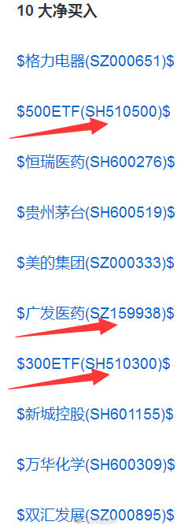

## 2018-08-06 17:16

前面两个孩子……没了。想说一句，各位父母们，带孩子出门的时候都长点心吧。

## 2018-08-07 08:14

估计不少公司的质押要爆了 ​​​

## 2018-08-07 09:32

反弹了吗。如果是，医药每次都买在最低点是什么鬼。 ​​​

## 2018-08-07 10:00

A股 ​​​
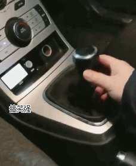

## 2018-08-07 10:13

目前A股正在向05/12年狂奔。马上就到了。能撑住就撑住，撑不住就08年。

要知道08年可是全球金融海啸，经济危机。那时候美国德国英国估值只有10倍。现在美帝在23-28。

如果好好的真的冲向08年，真是非常神奇了。到底是情绪的错杀还是资本市场先行指标发挥作用了？

拭目以待吧。总之，各位在经历一个至少十年才能一遇的关键时期。以后跟别人吹的时候有资本了。

“想当年，2018，兄弟在A股……”

## 2018-08-07 11:42

养老产业，目前点位与2015年1月，2016年2月基本一致。

然而，2015年1月估值49倍，2016年2月估值38倍。

目前，只有25倍。

我个人不太相信2年后还是这个点位，如果这样，估值会到15倍左右。无论如何我也不信。因为这是一个增长在十几个点的优质指数。

如果真的有机会到20以下买入，我相信未来十年收益率会秒杀中国任何城市的房价涨幅。93.2%的概率吧。

## 2018-08-07 11:55

目前养老80只成分股有十只披露或预披露半年报，只有一只永辉利润下降，8只利润增长在20%以上，6只在40%以上。当然，全部披露后，我估计也就10%-15%之间吧。但已经相当不错了。个人认为，该指数极限跌幅给15%-23%比较合理。那里是钻石区域。

## 2018-08-07 13:02

相信很多人心中现在有一个终极疑问:

是不是反转了？我是不是要踏空了？ ​​​

## 2018-08-07 13:40

谁能想到，第二天就想跟自己说thank you了。

## 2018-08-07 13:50

医药买点。

也许这就是缘份吧…… ​​​
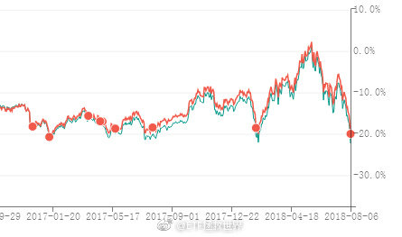

## 2018-08-07 14:04

目前的仓位情况是这样的。

A股大致在50%左右。趋势如果真的改变，会右侧买入十个点左右。加起来是60个点左右。

境外的部分加起来十个点左右。其它转债之类的全都算上，一共70多个点。还有点债油等等。

所以现金部分大概也就20个点左右吧。

这是说如果就此反转，不会出现钻石底的情况，有20%会没机会买。这样的话，这20%就不买了。你不到钻石，我就不买。20%不会影响太多未来的收益。相反会有很大的平衡空间。

总之，“踏空”不是需要担心的事情了。

## 2018-08-07 14:15

之前忧心忡忡的朋友，涨几天你的所有担忧就都没了。趋势一反转，所有人的担忧都没了。

好像突然之间所有问题都解决了。

什么叫情绪，你将会有深刻的体会。 ​​​

## 2018-08-07 14:20

非常尴尬了。500一天就反弹了两个多点。这样下去，说话就到波段卖出位置了。

然而连7天都没有，时间不够啊。 ​​​

## 2018-08-07 15:10

不要预测。反弹还是反转，不要预测。你预测不了。

昨天收盘，全市场顺利回到历史最低区域。未来发生任何事情都有可能，不要预测。一方面是逢低就买，一方面叫做顺势而为。不要把自己的意志强加在市场上。

有些行业的估值低到可耻。甚至已经低于2008。这些行业来说，就此开始涨也没什么意外。

所以在我的体系中，没有意外。对于未来所有可能发生的，都做好了准备。不同的是根据外界的变化调整系数调整概率而已。

## 2018-08-07 15:20

昨天的BGM意义重大。 ​​​

## 2018-08-08 09:06

车里面放锤子，教孩子怎么砸窗户这件事，是一道防线。

并不是说有了这道防线就不用每次下车时候一定要把孩子带下来。

跟投资一样，你不知道会发生什么意外。但是要尽量做好发生意外的准备，即使发生能预计到最坏的事，也要安全。

一道防线，两道防线。把能想到的最坏的情况都想到，然后用策略去解决它。一旦真的发生，因为演练过无数次，所以就不慌。按照策略一步步的做，大概率就不会有事。

## 2018-08-08 09:12

颈椎非常不舒服。还有救吗 ​​​

## 2018-08-08 09:28

刚才看了看雪球，已经有大v开始跑了。在2700多点。开始跑了，准备清仓了。

不止一个。

开始散播悲观言论的更多。

球球啊，球球。观察情绪太棒的地方了！ ​​​

## 2018-08-08 09:46

回复@研究病毒的chan:你这个结论有依据吗？//@研究病毒的chan:散户越来越自信，大V和机构越来越恐慌，为啥呢？

## 2018-08-08 10:02

其实我想看看，现在开始看空的人，在2015年5月是怎么说的。

如果在5000点看多，2700开始看空，那就可以毫无疑问的断言，是水货。

不管文章写得多漂亮。

注意，我说的是开始看空。如果从4000多一路看空下来，是另一回事。和2700、2800开始看空不一样。 ​​​

## 2018-08-08 10:09

各位一定要注意，所谓的机构和机构也是不同的。

我只关注超级大机构的动向。比如险资，比如2015年前的汇金。他们才是真正的价值投资者。

公募整体没有关注的价值，有一小部分可以关注。

私募整体没有观测价值。为什么，因为绝大多数私募都有清盘线。85或者80、75就清盘了。这种时候，他即使看多也不能满仓做多。趋势这么差，弄不好就清盘了。更何况私募更是鱼龙混杂，全国几万家私募，说实话里面混管理费的不少。有能力强的，就那么一小撮，大多数是混子。所以整体没有什么参考价值。

外资。QFII整体来说还可以，但也没有特别大的观测价值。他们不会频繁的加减仓。

所以，不要一说“机构”就崇拜的不得了。唯马首是瞻。你有个几百万，也可以去私募工厂开个私募，你也变成机构了。其实很多很多机构和散户没有什么区别。

## 2018-08-08 10:20

回复@十里堡彭于晏:当年中信证券自营业务巨亏30亿，整个自营部门解散。//@十里堡彭于晏:就是，别迷信机构，机构亏钱的多了去了。

## 2018-08-08 11:09

到今天为止，只有10%的公司披露半年报。

有一半的公司会在最后一周披露。所以下半月估值变动将非常明显。有些板块会自然下降5%以上。

这个月还是很关键的 ​​​

## 2018-08-08 11:13

有一个品种其实已经不贵了，但是趋势真的太差了。是刚刚从强转弱的那种差。

所以这次还是选择了没有买入。对于大多数心理承受能力差的朋友来说，这样的破位所带来的跌幅恐怕很难接受。希望最近有机会买入。

是我最喜欢的六个品种之一。这个买了以后，六个里面就剩一个了。 ​​​

## 2018-08-08 13:57

我看有人讨论a股利润下降的问题。过去几个季度是这样的。

按照我的计算，2017年前三季度全市场利润增长12%左右，全年增长12%左右。

2018年一季度全市场利润增长7-8%左右，增速比17年下滑了。半年报目前披露和预披露的400多家，增速是15%左右。这个不能算数，因为一般是好公司会先披露。半年报全部的数据要月底才知道。

至于myz对A股上市公司的真实影响，可能要三季报甚至年报才能看出来。

但我觉得，全体上市公司利润下降这个真的比较难。这些年增速有高有低，但真正不增长的可能就是08年几个月。

我个人不是太相信上市公司整体利润会持续下降。

## 2018-08-08 14:04

又看了一眼，2017年一季度全市场增长是16%左右。也就是说最近几个季度确实增速在下降。

## 2018-08-08 14:13

资本市场其实非常敏感。我个人认为最敏感的市场是债市，然后就是股市了。

股市大多数时间是比较理智的，能大致反映上市公司的情况。

所以，不要过于乐观，这一路满仓满融抄底我并不认同。但也绝对没必要太悲观。目前的下跌已经反映了很多坏的预期。

还是那句话，控制节奏，捡辣鸡。乐观的人死得早，悲观的人赚不到钱。咱们不乐观不悲观，心情平静的捡辣鸡。

## 2018-08-08 14:16

昨天弄错了，其实这才是A股 ​​​

## 2018-08-08 14:29

回复@我叫你一声你敢答应嘛233:我不怕被打脸。大多数指数再跌20%就是世纪铁底。我不是说一定跌到，而是说最差也就这样了。钦定了。//@我叫你一声你敢答应嘛233:啥时候是个底？

## 2018-08-08 14:52

为了多买点辣鸡，我决定note9暂时不买了。消费降级。

共克时艰。 ​​​

## 2018-08-08 15:12

送大家一张图。看颜色即可。最近十年的行业估值图。

绿色是低估，红色是高估。

第一波绿色是08年。第二波是12-13年。第三波就是现在。

红色第一波是09-10。第二波是14-15。

一图胜千言，我不用说太多。

这次会不同？

每次都有人说，这次不同。

其实，没什么不同。

2012年至今，6年了。 ​​​
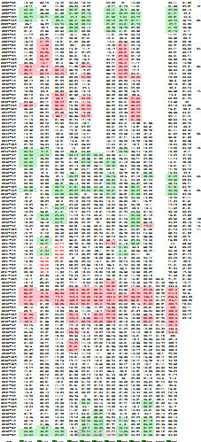

## 2018-08-08 17:22

赶紧跌。卖好多了等着买回来呢。

## 2018-08-09 09:43

这个区域还在怕的人，这辈子在金融市场也就那样了。 ​​​

## 2018-08-09 09:48

回复@郑弯弯直直:市场底部区域，就是要不停的震荡，涨涨跌跌，洗掉所有不坚定的人。最后几根大阴线干掉那些假装坚定的，最后崩溃的，然后，嘿嘿嘿。//@郑弯弯直直:昨天拉50 能源股 砸全指信息 创业板使劲跌 今天反过来：弹能源股猛砸 全指信息猛拉… 感觉几乎每天都这样 。

## 2018-08-09 09:49

回复@愿苍天举剑:不好意思，我这个大区域得4个月以上。您明年再来吧。//@愿苍天举剑:话说那么绝对干嘛。过一个月再来看

## 2018-08-09 09:58

新关注我的朋友，现在看我的言论，觉得我是个多头。

老朋友都知道，2015年上半年开始我在球球做为空头代表天天被人骂，骂到关评论。

一个人，低位看多，高位依然看多，不难。一个人，高位看空，低位继续看空，也不难。

难的是高位看空，低位看多。

体会一下。 ​​​

## 2018-08-09 10:03

回复@陈诺-2009:非常奇怪。目前今年计划浮亏4、5个点。但我强烈感觉年底会转正。我的感觉准不准，就在此一战了。如果不准，我准备第32次封博了。//@陈诺-2009:之前E大说对今年实现正收益是很有信心的，四个月后让别人来追高

## 2018-08-09 10:04

到没到10%。这么听话好烦哦。

## 2018-08-09 10:12

情绪这个东西，你真的没法说。羊群，旅鼠，乌合之众。你不经历一次，你不知道这都是什么意思。

大事，什么是大事。有人说目前的情况坏过08年。我拜托你，2008年是什么情况了，强烈建议去看看保尔森和盖特纳的回忆录。

什么是大事，2011年欧洲多少国家都要关门破产了。欧元都快挂了。

但你回头看，哪个国家现在不是活的好好的？大家的股市不是继续不断新高吗。

至于更久远的，日本台湾，人家股市也都快涨回去了。何况你已经跌了那么多了，5000多点的时候你怎么不担心？

坏事总会发生。问题在于，价格已经反映了坏事的影响。坏事过去就会回归正常。全世界都这样。过去这样，未来也还会这样。

我们不成熟的旅鼠是特别的多，这样也好，咱们才能捡到更便宜的筹码，不是吗。

## 2018-08-09 10:18

回复@RobinAmos:讲真，美国是想和你好好做生意，多占点便宜而已。这么大的贸易伙伴，弄死你？另外，让美国搞一搞，长远看，也许我们很多事情会变得更好。这个不能往深处说了。//@RobinAmos:这些国家没被美国搞

## 2018-08-09 10:24

你知道为什么要洗掉不坚定的人吗。

因为这些人特别讨厌。

涨一涨他们就卖，弄得根本涨不动。——一个队伍里有思想不统一的，队伍根本没有战斗力了。

所以市场先生一琢磨，干脆在底部把他们洗出去。弄得他们一抄底就套，一抄底就套。最后套的不敢抄了，市场先生带着意志坚定的队友向着东北方向出发了。

等那帮不坚定的人忍不住追进去，变成“打死都不卖”，也就差不多到顶了。

## 2018-08-09 10:47

第一次波段操作目前为止非常顺利。能不能顺利出掉看看运气如何。 ​​​

## 2018-08-09 10:49

回复@下一个春天2015:对这种真的只能拉黑了。大家说是不是。//@下一个春天2015:昨天不是说指数下跌20%吗，又变了啊

## 2018-08-09 10:53

真服了，这句话说得还不够清楚是吗？语文是看拉丁语教材自学的？//@ETF拯救世界: 回复@我叫你一声你敢答应嘛233:我不怕被打脸。大多数指数再跌20%就是世纪铁底。我不是说一定跌到，而是说最差也就这样了。钦定了。//@我叫你一声你敢答应嘛233:啥时候是个底？

## 2018-08-09 13:16

别的指数都奔3%甚至4%了，辣鸡上证只有不到2%。

这就是上证 ​​​

## 2018-08-09 13:56

做投资，少看那些喜欢讲宏观的人写的东西。

文章写得漂亮，大趋势，大转折。未来三五七年宏观经济走势门儿清，前后五百年大势运筹帷幄。

说真的，对你的投资没有任何卵用。甚至副作用极大。

金融投资，就回到金融投资的本质。公司、行业、资金、情绪、政策、策略、体系。有的没的看那么多你挣不到钱。

话糙了点，你体会一下。

## 2018-08-09 13:59

回复@巍在旦夕:未来牛市更牛。就看能买多少了。//@巍在旦夕:全指信息真牛

## 2018-08-09 14:08

回复@老张不高兴:怎么定义便宜呢。已经有1/3，接近1000家公司PE不到20倍了，真的一点都买不了吗。也不至于吧。太图便宜也是一种病，只能去拼夕夕买东西了。//@老张不高兴:已经跌了不少可还是不便宜，难道只能右侧买入了//@ETF拯救世界:回复@巍在旦夕:未来牛市更牛。就看能买多少了。

## 2018-08-09 14:19

今年计划浮亏幅度收窄至3.x%。如果涨上去，将先于所有指数创出新高。//@ETF拯救世界:回复@陈诺-2009:非常奇怪。目前今年计划浮亏4、5个点。但我强烈感觉年底会转正。我的感觉准不准，就在此一战了。如果不准，我准备第32次封博了。

## 2018-08-09 14:29

回复@日天小清新丶:或者这么说吧。如果文章里面有逻辑，有数据，可以看过程，少看结论。如果逻辑数据都没有就不用看了。//@日天小清新丶:一直很喜欢看海通宏观姜超的文章，现在，决定不看了

## 2018-08-09 14:37

今天中证500涨幅超过2.6%，全市场涨幅超过它的股票只有1100只，不到1/3。

创业板涨幅3.7%，涨幅超过它的股票有550只，占比16%。

如果是大股票行情，那么超过沪深300或者上证50的股票更少。

你何德何能认为自己的股票在牛市上涨中一定能超过指数？讲真，有50%概率超过就不错了。

何况，股票你还拿不住，一轮牛市下来，赚不了几个大子儿。

## 2018-08-10 09:07

回复@ppott2017:祝早日康复。虽然这个问题我之前总是在说，但有些事情突然发生也没办法。真的要用钱，那就只能卖掉。我的体系中，唯一不确定的就是无法预判牛市什么时候来，所以最好用闲钱。另外，商业医疗或者重疾险真的挺有必要的。再次祝早日康复！

## 2018-08-10 09:16

有人问今年-10%怎么办那个，你们回答的都没到点子上。

关键问题在于：仓位控制，资产配置。

他从今年开始参考，我估计仓位也就30%-35%。持仓部分下跌10%，也就是总资产损失了3%多一点。

今年大盘下跌20%多，股票中位数下跌20%多。

为什么第二轮计划我要把资产分成50份，第三轮分成150份。就是因为我知道我不分，不说清楚，99%的人根本不知道怎么做资产配置。我把品种、交易价格、甚至仓位配置全部说的一清二楚才行。

然而，如果你还是不把整个组合看做一个整体，总是盯着其中一部分，那你根本没有理解这是怎么回事。

比如说，你买个基金，无论公募私募。今年这个基金净值减少了3%。你会觉得，恩，不错，风控很好。但你要把它的持仓打开，也许有些品种跌了10%，你会不会抱怨说，为什么你组合里有品种跌了10%？你搞什么飞机啊。

最后说一下，抱怨的人拉黑。为什么？因为我不欠你的。我给你的建议就是，立刻停止参考我的计划，清仓已投入品种，取关我。你不取关也没事，反正我拉黑你了。

## 2018-08-10 09:18

回复@老刘想长胖:另外，给他点赞的8个人也全部拉黑。//@老刘想长胖:跟投长赢半年以来收益-10%，我该怎么办

## 2018-08-10 09:53

好了，事情我自己处理。咱们还是说正事。又到了每日一吹的时间：

医药又来？又买到最低了？

$全指医药 sh000991$ ​​​
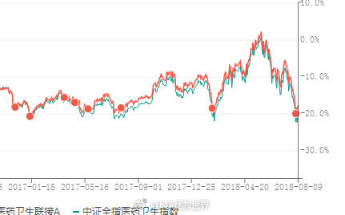

## 2018-08-10 10:18

其实在微博大多数拉黑，不是什么别的原因，是因为我不想让不理性的抱怨影响我的心态。

当年恒生的一幕我不希望再发生。

还请多担待了。 ​​​

## 2018-08-10 10:46

目前养老+医药的仓位已经12%了。距离15%-20%的最终目标其实并不远了。

还要给最差情况的7700-7800留一些余地。所以基本上医药这块各位可以稳了。

经过前几天的大跌，相信大多数人也都补到这个仓位了。踏踏实实的都。 ​​​

## 2018-08-10 11:12

回复@一想调味剂116:不用急，趋势这么差。说起下跌，A股从来不会让我们失望。//@一想调味剂116:后悔死了，周一周三各买了一份，还想着更低的

## 2018-08-10 13:25

今天看到一篇文章，说鹅厂已经赶不上互联网的发展了，4g 5g没有入口。

真是墙倒众人推，破鼓万人捶啊。半年前都干嘛去了呢。

任何东西都是这样，跌下去就各种理由差，涨上去就各种理由好。 ​​​

## 2018-08-10 13:35

截至今日，13家养老产业成分股披露或预披露中报。

12家利润增加（只有永辉一家下降），超过10%的11家，超过20%的10家，超过40%的7家。

恒瑞这种增加20%的只能排在第10位。

剩下的60多家给点力。 ​​​

## 2018-08-10 14:19

回复@23RRRR:还是有差距的。如果2016年8月15日第一次开始投资中证500指数，到目前为止共投资24次，收益率-18.03%。计划持有18份，收益率大致是-14%左右。以后计划每次投入都会比定时定额更加快速拉低成本。//@23RRRR:回复@戒不了你MZ:中证500亏了10多个点，大概跟计划收益差不多

## 2018-08-10 14:25

回复@做而论道725:我没有把做波段的一份算进来。如果算进来收益率还会高一些。//@做而论道725:益达，数据有出入？中证6份，建信11份，富国一份，903一份，500类资产应该是19份吧

## 2018-08-10 14:29

500其实算是买的一般的，原因很多。因为之前没有什么可以买的时候，我都是默认买500的。

50就威武很多了。

我们的上证50是2015年8月开始买第一次。如果那个时候开始定投到现在，投资37次，收益率7%。

我们的收益率是22%。

这个问题其实就牵扯到我打算在锦囊里说的“节奏”问题。

定时定额投资，很好。但是缺点也非常明显。其实你完全有机会可以做得更好。

这里面坑特别多。有些东西你需要2-3轮，也就是十年的时间才能知道自己在走弯路。

## 2018-08-10 14:39

下周有一个愿望，500C顺利的以好价格出掉。大家一起感受一下波段的乐趣。

我希望周收益率可以到6%-8%左右。 ​​​

## 2018-08-10 15:49

现在各种政策转向太快了。前几年还严控，现在要鼓励了。真是防不胜防啊。

## 2018-08-10 16:18

同学们有没有开电动车的讲讲是不是这样啊。

## 2018-08-10 21:46

欧洲又要危机？ ​​​

## 2018-08-12 21:36

回复@快乐行者9:你因为对方是少妇头像才撩了半个月吧！再次提醒大家，我不会主动私信任何人，没有群，不指导操作，不要上当！

## 2018-08-13 09:28

15号发车，欧洲也来助攻？ ​​​

## 2018-08-13 09:36

价投普遍不相信趋势。

其实，趋势都好重要嘅！ ​​​

## 2018-08-13 09:48

所谓价值，所谓趋势，左侧右侧，其实就像当年华山派剑宗气宗之争。

争什么呢，挣钱才是王道啊。

价值就不会出问题吗？未来的公司，未来的行业，未来的世界，你能那么确定？一旦看错，几十年就浪费了。别说那些成功的人，那些没有成功的价投十倍于他们。

趋势就不会出问题吗？明明已经巨便宜了还在杀跌，明明已经很贵了还在追涨，你不死谁死啊。再来个十几二十年的震荡市。开心了。指数二十年没变，你追涨杀跌赔了50%。

我的意思，剑气合一，内外兼修。先立于不败，再求一点点进步。

还怕不能成事吗？

## 2018-08-13 11:17

回复@业余定投者:调整仓位到不慌为止。//@业余定投者:说实话我有点心慌慌

## 2018-08-13 13:36

国开债是不是又卖在高点了。 ​​​
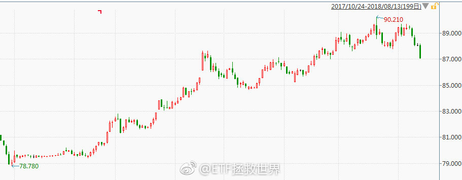

## 2018-08-13 13:53

国开债这一轮总体来说还可以，没犯什么大错。不过，在箭头这个地方为什么没买呢。

想不起来了。

是不是在等4.5？下次得注意。 ​​​
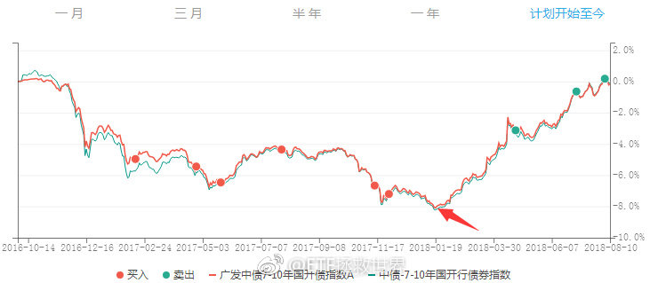

## 2018-08-13 13:58

怎么涨回去了。

表脸。

说好一起到白头，你却偷偷焗了油。

辣鸡。 ​​​

## 2018-08-13 14:03

回复@shimeihaojie:我对这次500c首战告捷还是挺看好的。奶一口。//@shimeihaojie:下午500可能会翻红，要不要出500C呀。

## 2018-08-13 14:33

500c风骚的买入点。如果卖出点是阶段高点就完美了。 ​​​
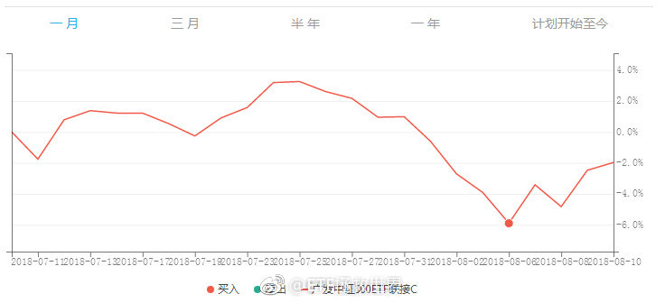

## 2018-08-13 16:06

回复@天生歌者不唱歌:哪有的事儿呢。//@天生歌者不唱歌:回复@ETF拯救世界:我不信每次蒙这么准，一定是国家队里有人

## 2018-08-14 13:42

还真没反弹到10%就回来了。看看能不能守住前期低点吧。大热门真的要离远一点。股票如此，人也是如此。

## 2018-08-14 13:50

有没有想在球球出名的朋友。我送你一条经验贴士。

经验来自于我连续观察超过十年的大v。

经验就是，看多。

强烈看多，极具浪漫主义，革命色彩的看多。总有一天你的东西会涨，涨的时候继续看多。

而且看多的程度要天马行空。

比如2015年5月要看到上证30000点。比如2018年2月要看到恒指几个月内到40000点。

股票就不用说了。越夸张越好。

错了，没有关系。几年后删掉帖子，没人会记得。你依然可以在牛市中收获更多的粉丝。

只要你极具鼓动性，你就能赢。

真的，不信你试试。

## 2018-08-14 14:18

一直惦记恒生的朋友们，你们的机会来了。

24000开始入货。 ​​​

## 2018-08-14 14:31

有没有感觉暗流涌动。 ​​​

## 2018-08-14 20:22

有没有发现，很久没人吐槽PM2.5了。

反正就我的体会，这两年北京的空气有改善。看了看数据，确实如此。

希望越来越好吧。 ​​​
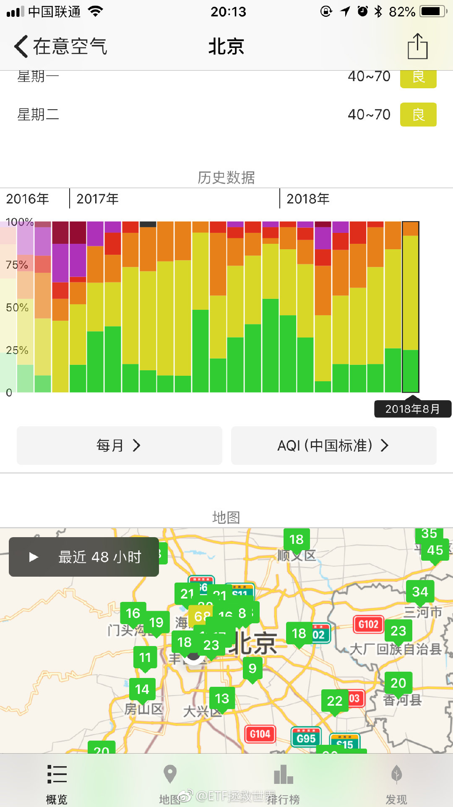 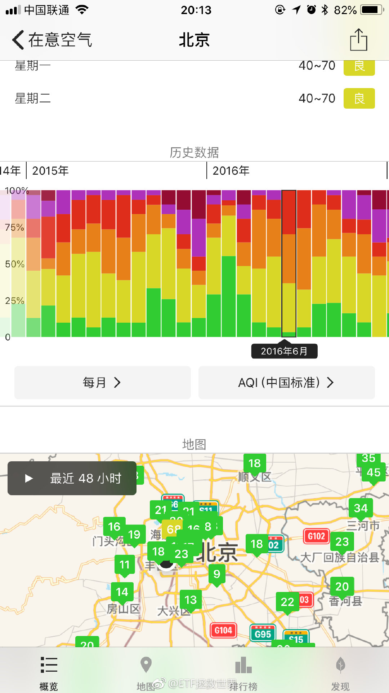 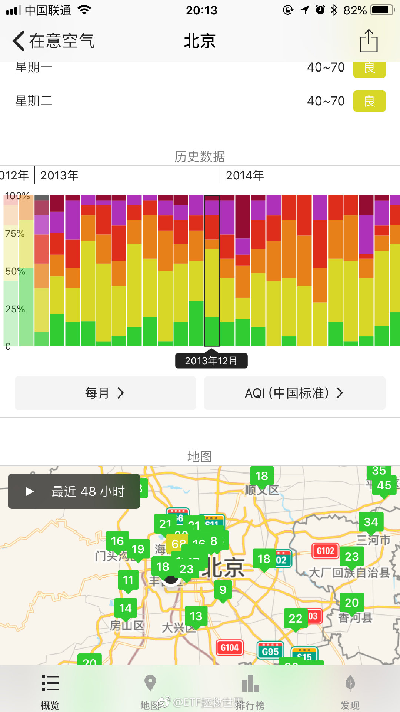

## 2018-08-14 20:54

回复@比神还N:我建议下个“在意空气”软件，比较一下比如石家庄等城市与前几年的变化，然后再骂。客观的用数据说话比用情绪好一点//@比神还N:尼玛比的，北京好了，周边还是那么垃圾，空气越来越差，曰。

## 2018-08-14 20:58

这是石家庄的1718与1314对比。

当然，有人还会说，为了空气好，很多工厂停工了。

是啊，大家都想什么都不变然后空气变好了，可能吗。 ​​​
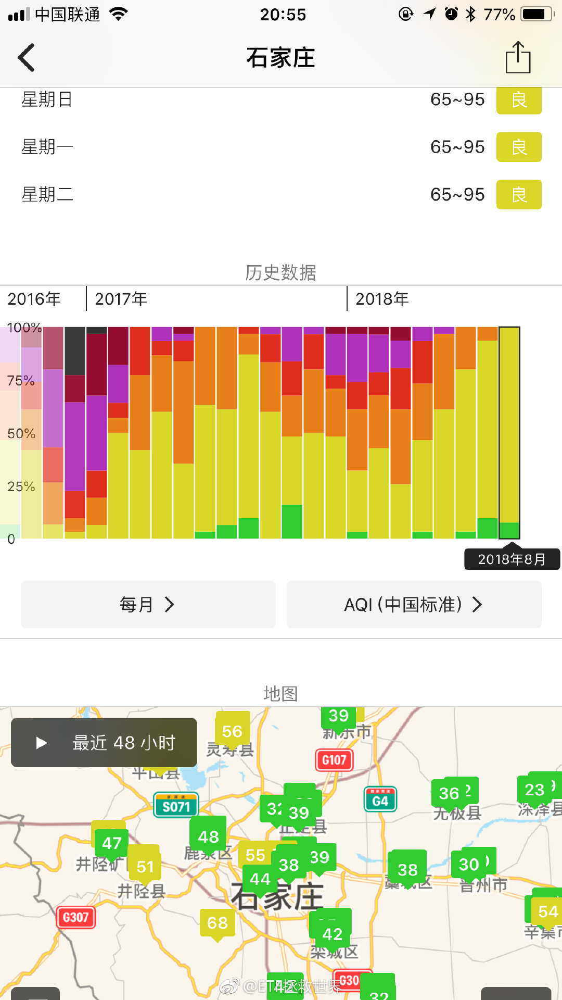 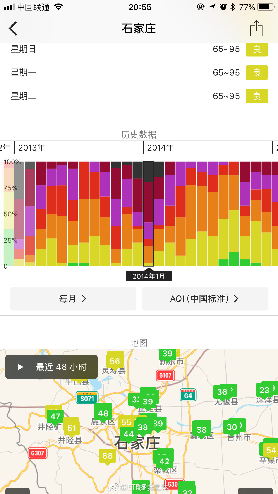

## 2018-08-15 10:06

新低没守住。继续寻底吧。//@ETF拯救世界:还真没反弹到10%就回来了。看看能不能守住前期低点吧。大热门真的要离远一点。股票如此，人也是如此。

## 2018-08-15 13:20

刚收到内部消息，

股灾了！（绝密） ​​​

## 2018-08-15 15:09

回复@战场男舞神:你可能没弄清楚公募和私募的区别。公募基金跑路的话，那个时候基本上你的银行存款也不会太安全了。第二，我没有推荐你什么，我是把自己的操作公布出来。各位自己做投资，我真的希望能了解一下最最最基本的金融知识。如果连最基本的东西都不懂，我真心不希望你来看我的计划。

## 2018-08-15 15:14

再次重申：

1：我不说任何股票，防止道德风险；

2：我不说任何主动基金，防止老鼠仓，防止道德风险；

3：我不投资小规模公募基金公司发行的指数基金产品，只投最大的那几家。

如果在中国的金融市场上，华夏 南方 易方达 广发 富国 华安这些最大的，管理几万亿资产，管理中国社保 养老基金，管理无数大小机构资金，管理几亿人财富的公募基金公司也能跑路

那你还是先担心担心你的银行存款吧。

黑人也不带这么黑的。什么都不懂的取关我吧。我不是那种普及基础知识的人。我没精力，没兴趣普及基础知识。谢谢。

## 2018-08-15 17:45

6.9附近开始出货说到做到

## 2018-08-15 18:06

回复@98号元素:这里会有一场争夺战//@98号元素:E大，扔个骰子，觉得汇率会破7吗？//@ETF拯救世界:6.9附近开始出货说到做到

## 2018-08-16 09:06

今天会不会很刺激？

惊不惊喜，开不开心？

猜不到吧！ ​​​

## 2018-08-16 09:18

回复@佳峻爸2013:据我观察球球上，只要有v说大奇迹日，事后看，通常都是又一波暴跌的起点。不信你们去看看。//@佳峻爸2013:大奇迹日！

## 2018-08-16 09:19

回复@dotajjyy:不会太远了。即将进入真正的十年大底区域。//@dotajjyy:E大什么时候才是底

## 2018-08-16 10:00

围观一下。确认了，是专门过来黑的。不知道谁派来的。记录：2018年8月16日，上证2690点，“投资指数基金是骗局”//回复@战场男舞神:感觉你和这帮粉丝的言行 完全就是个传销诈骗组织嘛 我也没说啥就问了下风险 瞧你们各个那猴急洗白的样 被人骗了 还傻乎乎的帮人数钱

## 2018-08-16 10:18

回复@yaoyan02:失望什么。如果市场短期走势你可以预测到，那就不叫市场了。市场总是会出乎你的意料。所以别预测，看市场表演。猜不到吧！//@yaoyan02:有点失望

## 2018-08-16 10:27

再说一次：

一轮熊市，只有一个真正的“大底”，只有一个真正的“大奇迹日”。

在那之前，会有300-1200个假底。

你可以想想，在不断的新低中，今天是“大底”的可能性是多大？

你要做的，是放弃“抄底”的思维。想办法让自己的筹码分布在一个底部“区域”。

因为如果你一定要抄底，则很可能把大部分筹码压在半山腰上。那样就会非常非常非常被动。比如你可以看到有些新发行私募的净值，一个月就能减少20%-30%。就是觉得低了，压底造成的。

一个想法，不一定对。

## 2018-08-16 10:58

全指医药截至今日有76家公司披露/预披露半年报。

其中17家利润下降，58只上升。48只升10%以上，39只升20%以上，30只升30%以上。

依然很强。 ​​​

## 2018-08-16 11:06

看了一眼第三轮计划以来，A股的股票涨跌幅。

2015年7月1日以来，截止昨天收盘：

2744只股票中：

285只上涨，占比10.39%。

涨幅超过20%的181只，占比6.6%。

2459只股票下跌，可以说惨不忍睹。

跌幅超过60%的是890只，占比32%。也就是说，1/3的股票下跌超过60%。

86只股票下跌超过80%。可以说如果没有意外，其中绝大部分永远不会涨回去了。

跌幅超过50%的是1438只，占比52.4%。超过一半股票市值只剩一半了。

跌幅超过20%的是2285只，占比83%。

每天你都能在网上看到有人说，赚大钱了。

其实，大部分炒股的人真的赔惨了。绞肉机啊简直。

## 2018-08-16 11:16

回复@finalphoenix00:A股是个聚宝盆：做到一点就能赚大钱 //@finalphoenix00:所以普通人在A股到底能不能赚钱？

## 2018-08-16 11:26

回复@开心快乐追求:第一，大部分人赔就是因为文章中说的牛市进来熊市出去。你反着做怎么不赔？第二，你一定要在熊市建仓的时候说不赚钱，我也没办法。好在我从2010年开始在博客公布第二轮计划，到2015年几十位朋友一共赚了5000多万这件事正好回答你的问题。

## 2018-08-16 11:31

2010年开始的第二轮计划，到2012年的时候一定是没有赚钱。好在那时候看的人也少，参考的人也少，都是真正懂投资的，杂音也少，没人抱怨什么。

最后大家一起爆发，一起开心在2015年吃完大餐买单之前起身走人。再去下一家饭馆开始等着上菜。

不像现在，关注的人多了，各种埋怨在熊市里为什么没有赚大钱的人也多了。

有这样的声音，特别正常。毕竟你想让所有人都成熟面对投资是不可能的。但苍蝇虽然不咬你，嗡来嗡去的也烦啊。

您说是不是。

## 2018-08-16 14:51

回复@金魚草_:什么时候确实不知道。不过这种走势，不跌就罢了，一旦开始跌，没个3、5、7年缓不过来。理由是什么？没有，蒙的。//@金魚草_:长江电力 何时补跌？

## 2018-08-16 15:12

你可能没发现，越是大熊市，突然爆出来的利空就越多。

2008年金融危机就金融危机吧，突然出来一个三聚氰胺。伊利马上被干到地狱里了。

利空叠加利空，各种坏消息越来越多。

要不然你以为为什么2008年10月最后一根大阴线一个月居然跌了25%？要知道之前11个月已经跌了63%了！ ​​​

## 2018-08-16 15:15

回复@唐僧用飃柔:不是，你算错了。跌63%的基础上，再跌25%，是72%……//@唐僧用飃柔:所以合计跌了88％，跌的这么厉害啊

## 2018-08-16 15:26

其实我建议各位也去关注一些可以被证明经历过至少2轮以上牛熊，并且可以被证明两轮过后活的很好赚了不少钱的人。

你可以看看他们现在是怎么做的。

我觉得大多数这样的人，还是会有一些共性的。也许投资方法，投资标的不是太一样。但总是有些共同点的。比如对收益/风险的判断等等。 ​​​

## 2018-08-16 16:03

## 2018-08-16 16:20

对本轮熊市，我暂时会将预期极限放在2005和2012年的低值上。这两个时间的低值是一致的。

当然我也会对2008年的情况做出准备。

但是如果真的连2008年的低值都撑不住，我就没有概念会到哪里了。

现在？急什么，连2005和2012都没到呢。 ​​​

## 2018-08-17 09:58

如果可以7700点附近买入医药，那未来5-10年关上账户等着数钱就对了。 ​​​

## 2018-08-17 11:41

一上午没看盘，嗬，又坑杀一批抢反弹的啊。

想起年初很多公众号的文章：

“先生，这是牛市。牛市就是要解决问题的。”

 ​​​

## 2018-08-17 13:17

看了眼账户，太惨了，想去卖血。

大平层变老破小了。 ​​​

## 2018-08-17 13:21

回复@ETF是什么:照你这个，军工还得跌75%，太狠了！//@ETF是什么:跌多了为什么我觉得银行证券5-10pe，医药消费环保10-15pe，科技军工15-20pe才是合理估值，现在有些行业估值太高了

## 2018-08-17 13:32

刚才看评论里有人去别人的公众号问计划的事。公众号居然还洋洋洒洒说一大篇。

要是问我，我根本不会解释和按摩。

所有别人暴跌之后才开始做的按摩，我下跌前就提醒过一万次了。我的配置也完全能够应对这个级别的下跌。

现在慌？我不会劝。因为第一，你没好好看我的东西，你根本不理解我在做什么。

第二，给你打气毫无意义，只有你自己坚持或者放弃后，有了对应的结果，下次你才知道怎么做。

害怕的赶紧停止不要再投，之前的回本就卖是王道。

## 2018-08-17 13:51

股债双杀。 ​​​
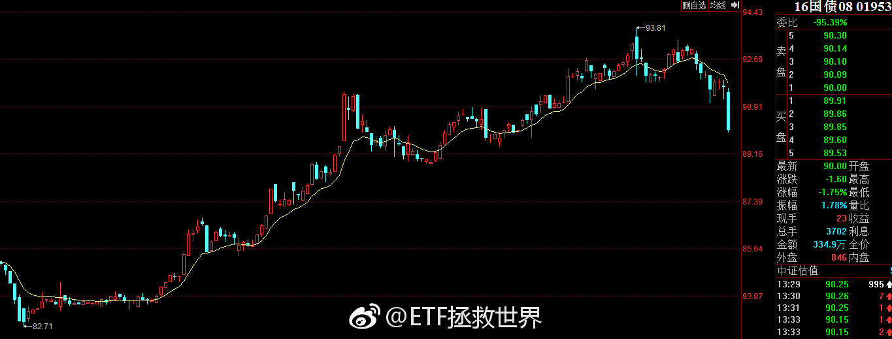

## 2018-08-17 13:57

不过话说回来——

三年多，300下跌接近30%，500下跌超过40%，我们才买了50%A股仓位，大量仓位还是最近买的，除了A股其它买的所有品种除了黄金都在挣钱，计划整体依然在盈利，这种情况，如果还吓得到处问：

你真的真的真的不太适合做权益类金融投资。

我是说真的。 ​​​

## 2018-08-17 14:01

另外，今年300下跌19%，500下跌23%，我们的计划下跌5.8%。这可是有60%以上权益仓位的状况下取得的成绩。你知道这代表什么样的风控水平吗？这还吓成这样，真的赶紧离开！

## 2018-08-17 14:03

今晚写篇公众号，清洗一下。//@ETF拯救世界:另外，今年300下跌19%，500下跌23%，我们的计划下跌5.8%。这可是有60%以上权益仓位的状况下取得的成绩。你知道这代表什么样的风控水平吗？这还吓成这样，真的赶紧离开！

## 2018-08-17 14:04

回复@浅小染86129:这样的情况下周必有车。//@浅小染86129:支持益达，8月的车发完了吗？//@ETF拯救世界:另外，今年300下跌19%，500下跌23%，我们的计划下跌5.8%。这可是有60%以上权益仓位的状况下取得的成绩。你知道这代表什么样的风控水平吗？这还吓成这样，真的赶紧离开！

## 2018-08-17 14:18

回复@23RRRR:军工信息不死，牛市不来。//@23RRRR:e大军工多少会考虑开始进//@ETF拯救世界:回复@ETF是什么:照你这个，军工还得跌75%，太狠了！//@ETF是什么:跌多了为什么我觉得银行证券5-10pe，医药消费环保10-15pe，科技军工15-20pe才是合理估值，现在有些行业估值太高了

## 2018-08-17 14:25

军工，2008年最低20倍。2012年最低33倍。

现在，50倍。

我倒不是说它不会继续炒，但我肯定不会去买50倍的指数。我不知道它成长性有多高，还是说只是炒概念？

不好意思，我真不喜欢炒概念。那么多人也承受不起这个风险。这个钱赚不到我认了。 ​​​

## 2018-08-17 14:37

咱们8800的食品是不是又有机会了！ ​​​

## 2018-08-17 14:43

上次有这样的经历，还是2011/2012。

时光荏苒。日子过得太快了。

一转眼我都23了。 ​​​

## 2018-08-17 14:48

我看，周末要开个会了。

那个谁谁谁，班子的同志都通知一下。 ​​​

## 2018-08-17 14:54

我想了一下。大家都是正常人，有没经历过的，慌也是正常。不过，你看是不是等破了05和12的底再慌。最好破了08的底再慌。那时候我也蒙圈了，没见过啊。那时候大家再抱一块哆嗦也不迟。现在一切都在正常范围内，几年一次，慌什么。

## 2018-08-17 15:11

刚才有朋友问我，这么低了，是谁在卖。

除了那些主动卖的，也就是吓傻了的，心理和外界压力承受不住的等等人，还有很多人是——

不得不卖。

比如，公募私募基金。很多人赎回，不得不卖。前几天梁大师在球球就说了，很多人要赎回。其实更多的私募没说，现在肯定是赎回大于申购。所以他们必须卖，拿了钱给投资人。

另外还有私募清盘。到了清盘线，咔咔咔卖出。没办法，必须卖。75 80就清盘了。

还比如质押。大股东把股票质押给券商，跌到位了，不卖不行。又没钱没股补质押。也得被迫卖。

还有两融。融资的，9000多亿，赔惨了。带着杠杆赔。怎么办，要爆仓了，卖吧。

所以下跌带动了更多的卖出，更多的卖出带动了更大的下跌……

你拿着那么多现金有没有做梦都要笑醒了。

有价投总是说：

现金是收益率最差的品种，必须满仓穿越牛熊。

现在你还信吗。

## 2018-08-17 15:31

好多人问现在离0512还有多远。今天收盘最新数据，距离05/12平均值还差11%。这不是上证，是全市场。另外，考虑业绩增长，不跌的话一年多左右也就差不多到了。你要知道，这可是过去20年最便宜的第二和第三。目前是最便宜第四阶段。第一当之无愧的08。这次能不能当个冠军？

## 2018-08-17 15:42

环保和传媒这两个货即将双双跌破20倍。

2015年，一个80倍一个120倍。

喷了。 ​​​

## 2018-08-17 15:50

很多人不知道，意识不到，自己已经站在第一次财富飞跃的起点不远处。

至少从空间来讲，不远了。

我就不同了，我都飞四次了。

像第三次一样，我会写一篇东西，纪念那个起点。 ​​​
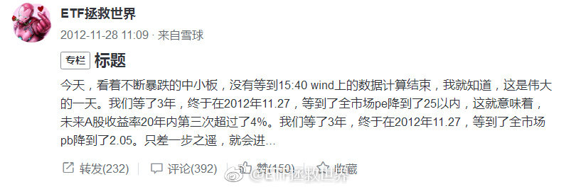

## 2018-08-17 17:48

为什么印度30可以

比上证50贵131%；

比沪深300贵44%；

比中证500贵27%。

要知道，那是30指数哦。按理说跟50对标才对。

目前英/德/美/澳/新，基本都在17-22倍之间。

西/意/法稍低，在13-15。

A股50-500标段，从全球对比也不贵了。

我倒是真的好奇，很多人每年都在悲观的悲观未来到底是什么样子。

## 2018-08-17 22:31

回复@wz郑小厨:明天吧，别等了。。今天没时间写了//@wz郑小厨:在等文章呢，有多少人和我一样的//@ETF拯救世界:回复@乔松狡童:结束了。等消息吧。//@乔松狡童:神了，马上就开。 查看图片

## 2018-08-18 11:06

哈哈哈哈，微博上只有大宵能让我开心笑出声了//@李大霄:本来不想继续了，可有这么多人的力挺，我就继续坚持一下吧//@股道热肠也://@但斌:请继续！//@李大霄:

## 2018-08-18 13:48

不行了，1600评论一个小时看了一半。先休息休息，一会再看剩下的。。 ​​​

## 2018-08-18 18:23

如果周末不捣乱，周一不大幅反弹，会加3-5份。

希望老爷们这几天好好休息休息，不要再救市了！A股从2015年惨到2018就是救出来的。

市场的东西，就让市场来定价好吗。 ​​​

## 2018-08-20 09:37

保守的乐观。

不保守，会死的快。不乐观，这辈子也就这样了。

至少前半句你现在懂了。后半句还要用时间来验证。

节奏，节奏！ ​​​

## 2018-08-20 09:40

如果今天强力反弹就不买了。涨跌随意。

## 2018-08-20 09:44

回复@龙水六队:一点都不高深。告诉你原则：每周最多只能买一次。能懂吗？我估计你还是不懂。是不是还是太高深了？//@龙水六队:故意，上星期五买不就好了吗，假装莫测高深//@ETF拯救世界:如果今天强力反弹就不买了。涨跌随意。

## 2018-08-20 09:49

回复@胡鹏171:非常非常乐观了可以说。这是计划体系最乐观的情况。每周一次。如果这周还买，将是第三轮计划三年来第一次一个月买四次！//@胡鹏171:原来是一个月只能买一次，一周一次已经够乐观了

## 2018-08-20 09:52

为什么要定时间？比如一个月，两周或者一周。

因为，无论熊市还是牛市，又或者是震荡市，你要给行情发展以时间。今天买，明天买，除非你有极强的现金流，否则撑不了多少久。然后你会发现，熊市买在半山腰以上，牛市卖在半山腰以下。

用一些策略，强制自己忍一忍。时间就是一个角度。空间也是一个角度。时间+空间是最好的角度。

熊市，你给它时间让它跌。牛市，给它时间让它涨。

时间和空间，是节奏的两个重要支点。

## 2018-08-20 10:12

截至今天，医药有1/3公司披露预披露半年报，业绩增长继续维持20%以上。

养老有1/4公布，维持20%以上。

养老如果按照一季报的业绩增长看，目前PEG已经小于1。

厉害了。 ​​​

## 2018-08-20 11:15

当然是干了 ​​​

## 2018-08-20 11:32

是不是逗我呢。

## 2018-08-20 16:24

我看有好多朋友今天跳车了。其实没什么必要吧。

差那么零点几个百分点不至于的。当然，过几天是可能更低，熊市嘛。

不过反正我觉得总想买到最低也是一种病。。 ​​​

## 2018-08-20 17:07

有句话不知当讲不当讲 ​​​
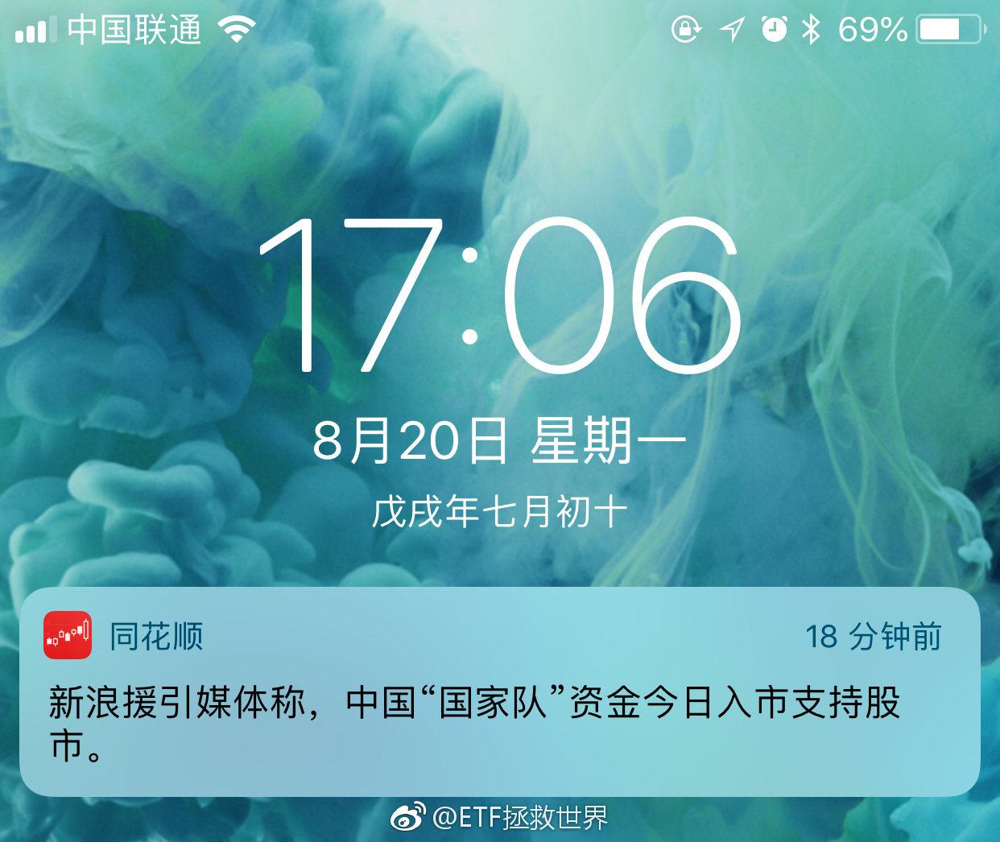 

## 2018-08-20 21:13

//@月风_投资笔记: 保险机构开始左侧买入了，这种思路框架毕竟我太熟悉了。

## 2018-08-21 06:03

看微博好像宏观马上就要崩了，各种公司举步维艰。看上市公司半年报平均增长15%+。

感觉是两个世界。 ​​​

## 2018-08-21 09:34

金融市场就是轮回。

潮起潮落。

不仅能看到价格的涨跌，均值的回归。还能看到各种生旦净末丑的表演。

你说多有意思。

可以说是世界第三有意思的事情了。 ​​​

## 2018-08-21 09:50

目前仓位50%+了。基本上都是价值仓位。

目前看，50有可能第一个进趋势仓位？看戏。

舒服。 ​​​

## 2018-08-21 10:14

今年A股股票下跌中位数33%……

1100只下跌超过40%。

445只下跌超过50%。

下跌最多的是90%…… ​​​

## 2018-08-21 10:30

回复@光O君:“会买养老的女孩运气总不会差”//@光O君:昨天养老又买在低点了！？？

## 2018-08-21 10:33

回复@古铜色的林奇罗曼史:最多8成。最多。//@古铜色的林奇罗曼史:E大，最终A股仓位会占到多大比例，七成？八成？@ETF拯救世界

## 2018-08-21 10:35

突然想到，那些拿着下跌50%股票的人，看到你们这样为了0.x%百分点跳车可能会气哭吧。——身在福中不知福啊。

## 2018-08-21 11:08

不要跌一跌就世界末日，涨一涨就牛市来了。

不成熟。

淡定点。世界不会太坏，也不会太好。便宜了就买点，贵了就卖点。踏踏实实，舒舒服服。

再大的利空，回头看，也就那么回事。如果你回头看发现真的完蛋了，那你担心也没用不是吗。 ​​​

## 2018-08-21 12:35

我能怎么办，只好转发让他出名啦。这辈子最讨厌不遵守规则的人

## 2018-08-21 16:22

非常神奇的是今天全市场估值只涨了一点点点。

业绩披露期真是有意思。 ​​​

## 2018-08-21 16:41

回复@追求确定性2:我现在说这个可能很多人觉得我是s*，但未来A股也会创出n年长牛的记录。希望微博关门之前能见到，留个纪念。

## 2018-08-21 17:01

回复@无所谓1816:不急，刚50%+仓位，还有很多钱，大伙都盼着跌呢。//@无所谓1816:你别急，年底再下结论也不算晚。毛衣大战还没有开始作用。  年底你很可能看到业绩公布，越跌估值越高

## 2018-08-21 17:15

今天

沪深300 +1.8%
中证500 +1.2%
50 +1.5%
医药 +3.2%
养老 +2.5%
创业 +1.5%
消费 +3%
红利 +1.3%

全部A股涨幅中位数是：

0.8%。

也就是说从全部股民的角度讲，买股票一半概率低于0.8，一半概率高于0.8。

“牛市买指数不如炒股赚钱多。”

？？？？？

牛市中的“赚了指数不赚钱”也了解一下。 ​​​

## 2018-08-21 21:52

手机，电动车，芯片

## 2018-08-21 21:52

回复@饿鱼000:08年美股最低十倍，目前23-27//@饿鱼000:一直很好奇，美股的十年长牛行情，估值是一直保持着正常估值吗？还是pc  pb也有暴涨的时候？//@ETF拯救世界:回复@追求确定性2:我现在说这个可能很多人觉得我是s*，但未来A股也会创出n年长牛的记录。希望微博关门之前能见到，留个纪念。

## 2018-08-21 21:53

回复@观音山上拜观音:我在ins关注她了，她经常贴照片//@观音山上拜观音:刚看了e大的网易博客，作为回馈@ETF拯救世界 查看图片 //@ETF拯救世界:回复@无所谓1816:不急，刚50%+仓位，还有很多钱，大伙都盼着跌呢。

## 2018-08-21 22:25

每日打卡（196）

正式恢复训练。 ​​​
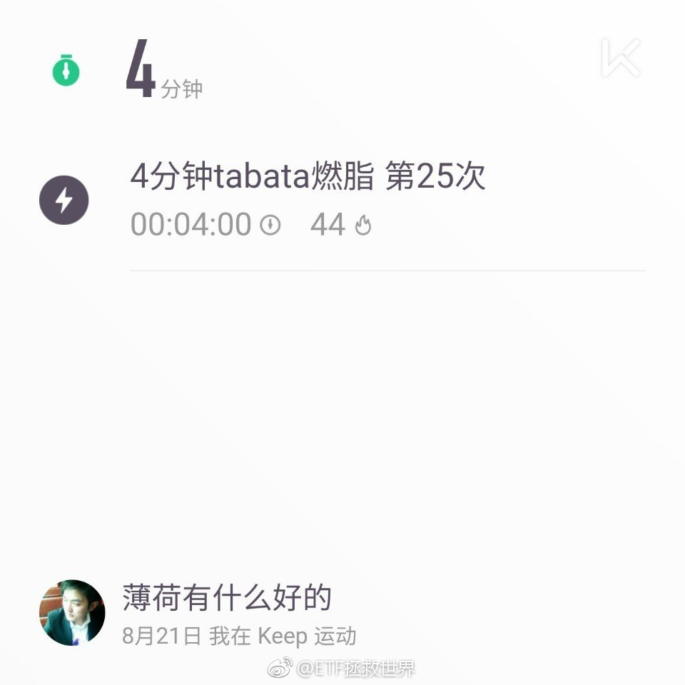

## 2018-08-22 09:30

高盛策略师本·斯奈德（Ben Snider）在周一的“对冲基金趋势监测”报告中表示，今年截至8月17日，股票型对冲基金平均下跌1%，而标准普尔500指数的涨幅为8%。

——美国收取高昂管理费的对冲基金继续被指数碾压。 ​​​

## 2018-08-22 16:33

今日A股全市场估值再创2012年11月以来新低。 ​​​

## 2018-08-23 07:03

再加老百姓就真没钱消费了

## 2018-08-23 07:21

截至今日，养老产业80家成分股中有33家披露半年报。

33家中只有5家利润下降。

静态PEG已经=1……当然剩下的40多家业绩不会这么好。我估计整体增速在15%+。

还有8天。 ​​​

## 2018-08-23 08:09

接受道歉，但建议五年不能坐高铁。或者尽快把这样的惩罚措施纳入法律法规，严格执行

## 2018-08-23 10:15

太便宜了，随时受不了 ​​​

## 2018-08-23 12:28

谁能想到原来是跌的受不了了

## 2018-08-23 12:41

交朋友，做生意，结婚，一定要找有底线的人。一个人的底线接触久了，会体现在一言一行中。劝各位离没有底线的人远一点，真的，是为自己好。否则早晚倒霉。

## 2018-08-23 13:08

回复@sashanana:不是缺钱，很明显，做这种事对他来说是一种乐趣。我怀疑这个人童年有过阴影。//@sashanana:这个博士是有多缺钱才会如此算计

## 2018-08-23 14:01

太舒服了，你舒服不舒服。 ​​​

## 2018-08-23 14:05

回复@Eyo-Tan:凭能力借的钱为什么要还？做为借出方，应该有的觉悟是：借给亲戚朋友钱就该当丢了……//@Eyo-Tan:有些人是真恶心，我就遇到个一人：刚开始TMD成天兄弟兄弟的，借了钱就开始玩失踪，电话不接，信息不回，各种借口。涉及到钱财方面的真的不能信任何人，搞到现在好像我在求着他还钱一样

## 2018-08-23 14:14

回复@李国辉00650:对。只要借，我就没打算要回来了。能还意外之喜，不能还意料之中。否则不仅钱没了，亲戚朋友也没了。所以，我，轻易不跟亲戚朋友有金钱来往。//@李国辉00650:你借给亲戚朋友的钱就当丢了？

## 2018-08-23 14:32

硕士毕业论文：《法治建设中的法律与道德》 喷了。

## 2018-08-23 14:53

再说一条拒绝借钱的终极方法吧。

你去球球，经常有那种卖惨帖，里面会有账户截图。你找个惨的，赔80% 那种，把图存下来。以后有人借钱，你不想借就发给他。。或者你自己找个假交易软件弄一张，还能带你的名字，那些大v能把账户P的赚钱，你为什么不能P赔钱？

一般这种图发过去，说被套了，就没人借了吧。

另外说一个让你们失望的，人家妹子按时还钱了……我想了想，这个世界上能让我放心借几十万的应该不超过5个人，可能不超过3个。其他人一般我不会借。你得真的知根知底，对方也绝对有能力还才借啊。

## 2018-08-23 16:02

回复@黄连树:呵呵。//@黄连树:回复@远见至胜:百度是没有的。。益达这里很可能算错了，实话实说。虽然暂时不影响大局势的判断。

## 2018-08-23 16:15

谁再在我的评论里给网站做广告一律拉黑。

抄我的思路就算了还来做广告。 ​​​

## 2018-08-23 19:10

“以后上车大家想坐哪儿就可以坐哪儿”。神了！

## 2018-08-23 19:17

回复@徐小自言自语者:@ETF拯救世界: 世界不是白的你就要在肮脏的猪圈里生活？身边的肮脏事多就是你也去干脏事的借口？辣鸡。//@徐小自言自语者:不违法就是不违法，哪那么多矫情，不要以为世界理应是白色的，看看自己身边那么多肮脏事吧，能别那么玻璃表吗？

## 2018-08-23 19:46

有一次去美国，在纽瓦克机场，航班有问题，我去咨询台问。

咨询台前，排了很多人，我和同伴觉得自己的这个问题比较简单，一句话就能解决我们的疑惑，就直接去最前面工作人员那里问。

我至今还记得那个黑人女性工作人员是怎么用坚定的眼神和语气告诉我们，去排队。大家都在排队，你们也要排。

后来有一次，在前门肯德基，我在排队，到我点餐的时候，后面直接来了一个某地人，开始点。我说，这儿排队呢。这个插队的人和肯德基的工作人员都挺惊讶，看起来是感觉：插个队有什么好废话的。

我的感觉，不遵守规矩的人，哪儿都有。不懂规矩的人，也很多。问题在于，你管理者能不能严格执法？你说没法，不排队，可以；不按照车票坐座位，也可以？我们的社会到底为什么到处都是不讲规矩的人？管理者的不作为因素特别大！

辣鸡。

我们这些遵守规矩的人，在那些人眼里就是sb。他们会一边占着你的便宜，一边嘲笑你。

在这样的世界生活，常常会有窒息感。

因为那些破坏规则的人，因为那些不作为的执法者，因为那些“这有什么至于生气吗”的围观者。

都是辣鸡！！！

## 2018-08-23 19:52

回复@站在空气稀薄地带:一个社会普遍不遵守规矩，没有契约意识，会让社会运行成本大大提高。每个人都会活得特别累，时时刻刻提放别人占自己便宜，想办法占别人便宜。累！

## 2018-08-24 09:26

中概出什么事了吗。阿里为什么放量大阴线。 ​​​

## 2018-08-24 09:42

回复@李国辉00650:有啊，未来我们会买啊。再多跌点就买了//@李国辉00650:中概对我们有影响么？开不了港股

## 2018-08-24 10:08

木老师v5，写的真不错……

## 2018-08-24 10:36

更新：37家公布业绩，6家下滑。多了一个华谊。整体增速依然维持在20%+。

## 2018-08-24 10:52

你说这是谁呢，盘中一次次的往上拉。拉的太做作了。 ​​​

## 2018-08-24 13:21

下周要上右侧仓位吗。

好刺激啊。 ​​​

## 2018-08-24 13:44

确认趋势转折的一个标志是大部分宽基/行业趋势走好。

目前没有任何宽基及行业走好，所以不用着急。价值仓位已经买的差不多了，所以更不用急。 ​​​

## 2018-08-24 13:50

万万没想到涨了一天全指金融就要盈利了。 ​​​

## 2018-08-24 13:58

是不是底呀，是不是反转了呀，抄不抄啊。

累不累啊。

便宜了你就买，根据便宜的程度，多买点或者少买点。

买到一定地步就停，为可能出现的黑天鹅做点准备。

再然后就静静的等着。

趋势不是一天反转的，从大底那天到大幅拉升至少有几个月时间让你上车。

急什么啊？

我是没见过见底后一路就涨上去的牛市。你见过吗。

相反，熊市中极速反弹换一批韭菜套的倒是不少。

踏踏实实的，别主观。根据客观情况执行策略不就完了吗。

## 2018-08-24 14:35

回复@monster的垃圾场:你错把估值当成唯一了。估值低不代表不会跌，反之亦然。何况500估值还是比50高啊。//@monster的垃圾场:为啥中证500现在这个估值下，还在跑输上证50

## 2018-08-24 14:39

说时迟那时快，手起韭落……涨跌家数1:2

## 2018-08-24 14:44

回复@早起拜瓶迁晚睡读益达:你离他远一点，他怎么也打不到你。所以，管不住手的就别看。//@早起拜瓶迁晚睡读益达:最近是左右打脸行情，打完左边打右边，拉上去掉下来拉上去又掉下来，揉搓韭菜包饺子//@ETF拯救世界:说时迟那时快，手起韭落……涨跌家数1:2

## 2018-08-24 15:07

按现有的条文，可能确实顶格也就这样处理了……这样的事例其实是提高全民素质的一个好机会，千万别像昨天说的“只是道德问题”那样处理，那就彻底完蛋了。

## 2018-08-24 15:27

今日再新低。虽然只比22日低了0.03……

## 2018-08-24 15:35

下周如果没有大的意外，会有两个新品种。

A股基本上就齐了。 ​​​

## 2018-08-25 15:47

你说揍人家就算了，还说人家“老”娘们，工作人员妹子受到了十二万点暴击

## 2018-08-27 08:46

更新：41家企业公布，8家下滑，依然保持20%+。医药157家公布，37家下滑，15%+//@ETF拯救世界:更新：37家公布业绩，6家下滑。多了一个华谊。整体增速依然维持在20%+。

## 2018-08-27 08:54

从整个A股看，目前公布半年报的1900多家里面，有1/3业绩下滑。总体增速保持在13%+。估计全部公布完毕后也就8%-10%。这个速度也算是合理的。 ​​​

## 2018-08-27 09:06

回复@国民偶像superIQer:500目前280家公布，27%业绩下降，增速在15%+。估计全出来以后在11左右吧。//@国民偶像superIQer:益达 500的增速预计有多少？

## 2018-08-27 09:19

一句话告诉你低位投资指数为什么大概率会赚钱：

低估值买入，未来估值不变的情况下，成分股业绩每年增长，带动指数自然上扬，你赚到指数增长+分红的钱（=全收益指数）

低估值买入，未来有牛市，那么，你赚到的是利润增长带动的指数自然增长+分红+估值增长的双击。比如牛市中估值从20涨到40，那么你赚到的就是利润增长*估值增长。

另外，一部分指数基金还会有增强策略。如果成功，还会在这些基础上每年有超额收益。但我希望这个超额收益不要太高，每年1%-3%就非常知足。

……数了数怎么是三句话

一切的前提是你买的不要太贵。

如果贵了，从高估到低估的杀估值，那点利润增长根本无济于事。比如120倍杀到20倍，利润要增长多少年才能补上？

股票也是这个道理。

## 2018-08-27 09:38

还是少说点那些有的没的，多说点投资吧…… ​​​

## 2018-08-27 09:45

总说美股涨了十年多NB多NB的，A股不行不行不能买，真的不是傻就是坏。

2008年标普500最低666点，你知道这个点位是多少年前的吗。

是1996年2月。

12年，没涨。

这才有了后面的十年长牛。

如果那时候美国人也喷十二年不涨辣鸡不能投了，各种吐槽，能赚到后面十年的钱？

今天中证500全收益指数和07、10年指数点位差不多。也是十年左右没涨。但是估值降低了2/3。你现在吐槽，辣鸡A股，赶紧割肉离场，未来牛市的钱你能赚到？

## 2018-08-27 09:52

回复@ETF信徒者:然后你注意，多少多少年不创新高的后面，全都是波澜壮阔的大牛市！波浪壮阔的大牛市后面，都是多少多少年不新高！

## 2018-08-27 10:22

精准数字：

2005-2018年，东二环内，南三环，房子大概涨幅都在十倍左右。

年化19%。

当然，房子大多数人是上杠杆的。所以实际收益率会更高。

未来十三年，我不敢想象还能涨10倍……

就看未来十年什么资产会涨幅比较大了。 ​​​

## 2018-08-27 10:27

回复@谷入峰出888:全指医药指数这个区间正好涨幅也是10倍。2015年到过20倍。//@谷入峰出888:同期除沪指以外的指数涨幅也不小！

## 2018-08-27 11:01

三年衰神 $中证传媒 sz399971$ 今日逆袭

逆袭半天也是好的。

该指数计划持仓部分收益率再次回到-15%之内……毕竟三年跌了73%要求也不能太高…… ​​​

## 2018-08-27 11:18

今年计划收益率再次拉回到-5%以内了。

还是觉得今年能正收益。

为什么。

蒙的。 ​​​

## 2018-08-27 11:24

回复@O_Zhong_O:3000新高差不多。为什么，是个谜。//@O_Zhong_O:回到3000点，今年跟的计划就创新高了，为什么 ？

## 2018-08-27 11:27

高考可能是咱们这片土地上最公平的事情了，相对来说。你要说各省之间还是不公平那也确实是，但好歹不会牵扯到财富，power之类的。

如果这块都要改，那就真把大部分阶层上升的机会堵死了。 ​​​

## 2018-08-27 11:31

评论里说涨了不开心的，不要抱怨了。赶紧把仓位加到涨跌都舒服的状态。

成熟起来，别像个孩子一样。 ​​​

## 2018-08-27 13:20

有点舒服   ​​​

## 2018-08-27 14:02

之前各种大事小事担心的各位，是不是涨了一天就觉得没那么严重了？

2%而已，涨20%你就会觉得天下太平什么事都没了。

这就是人性，心理。

真的，没那么好也没那么坏。

踏踏实实的。

看远点，指数会不断新高的。 ​​​

## 2018-08-27 14:28

回复@Henry00:反转怎么了。真反转趋势仓位加好踏踏实实等资产升值啊。没懂有什么担心的。。//@Henry00:有人担心反转了

## 2018-08-27 14:29

回复@Terry张_:第一，反弹还是反转和我们每个人的仓位，判断，毫无关系。市场不会听我们的。第二，世界上没有100%的事。//@Terry张_:还没买够，坚信这只是反弹，不是反转。

## 2018-08-27 14:32

放弃主观判断，对很多人来说真的太难了。

做一个只会执行程序，不主观臆断的机器人不是那么简单的。 ​​​

## 2018-08-27 14:36

一天过后，今年计划收益率能不能收回到-4%以内？

在A股赔钱很难的。 ​​​

## 2018-08-27 15:50

回复@猪一样的青年:这届博友不行。//@猪一样的青年:为啥今天评论数比较少呢

## 2018-08-27 20:06

谁能想到，我最喜欢的动画片是《樱桃小丸子》（凤凰卫视台湾配音版》……感谢作者，一路走好。

## 2018-08-28 06:44

超过半仓跌幅只有指数的1/4，是个谜 ​​​
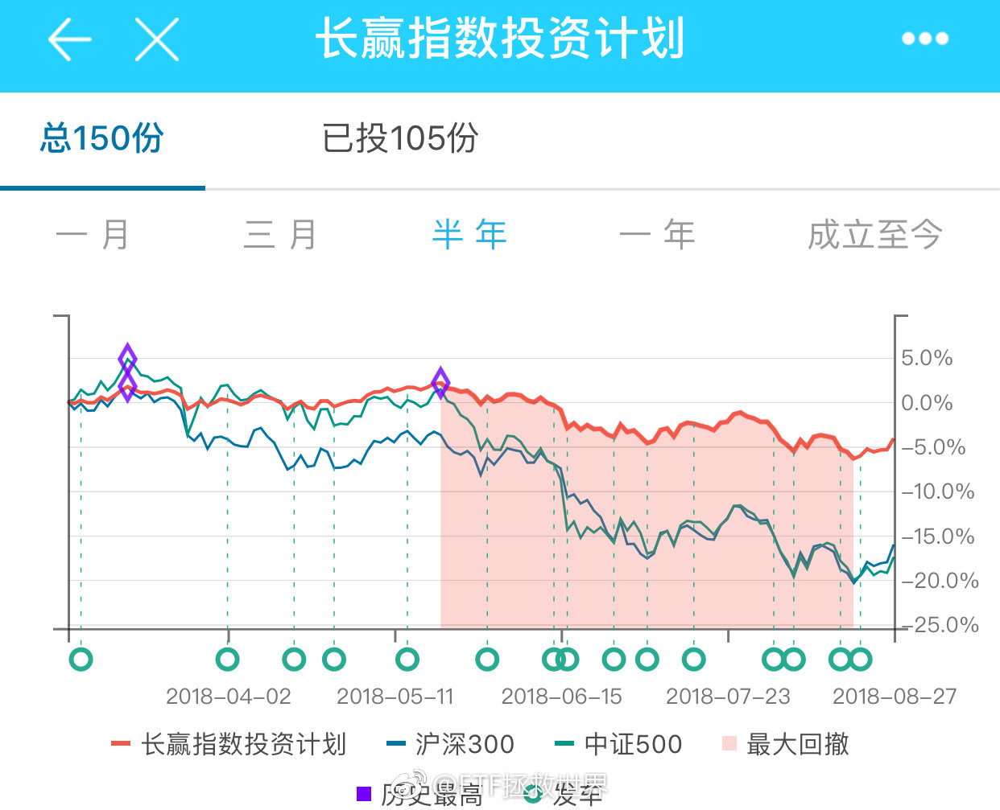

## 2018-08-28 09:02

更新：58家公布，19家下滑，整体增速下降至13%+。果然是越往后公布越烂。医药保持15%+。//@ETF拯救世界:更新：41家企业公布，8家下滑，依然保持20%+。医药157家公布，37家下滑，15%+//@ETF拯救世界:更新：37家公布业绩，6家下滑。多了一个华谊。整体增速依然维持在20%+。

## 2018-08-28 09:04

更新：500是330家公布，整体保持15%+。A股有2/3已经公布，整体维持在12%+。//@ETF拯救世界:回复@国民偶像superIQer:500目前280家公布，27%业绩下降，增速在15%+。估计全出来以后在11左右吧。//@国民偶像superIQer:益达 500的增速预计有多少？

## 2018-08-28 09:17

飞了，天意。

## 2018-08-28 09:20

创业50ETF今年以来份额增加了十倍，从3亿到37亿。有意思的是创业50目前37家半年报公布出来，利润增长还不到10%，甚至远低于全市场。

估值目前又是奔40去了。

凭什么啊。 ​​​

## 2018-08-28 09:27

5月10号还在历史新高，今年涨幅超过100%。

谁能想到3个月过去持有的话市值还剩10%。还卖不出去。

炒股风险太大了。不重仓赚不了什么钱，重仓了踩雷一辈子就这样了。。 ​​​
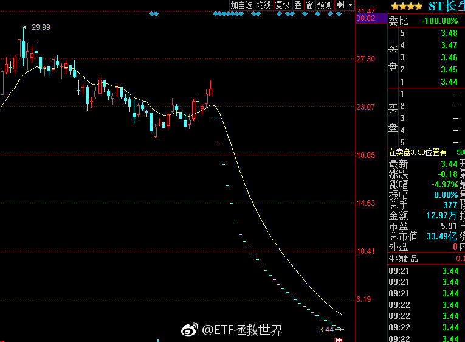

## 2018-08-28 09:49

回复@牡丹亭集小言:这就是群众基础。不要怀疑牛市会不会来，要相信国人的赌性。你信不信，我信。他们只是在等待50%的涨幅……//@牡丹亭集小言:办公室里的讨论变成了，不要买房，现在拿钱买股票闭着眼睛买都能躺赢

## 2018-08-28 09:51

回复@突然想要换名字:中证红利最好增速也就在10%左右。它基本不会太高增长。因为大量分红的企业已经是成熟期了。另外，它长期估值低，基本上也不可能是高成长股票组成的。。//@突然想要换名字:我猜红利应该是最好的吧？

## 2018-08-28 11:05

最近看电器，之前一直感觉国产白电已经领先世界了。怎么一看某排行排在前面的基本还全是日韩的货啊。。

洗衣机   LG 松下 三星 日立 博世 西门子

冰箱   松下  LG  日立 三星 夏普  三菱 东芝 博世

怎么回事。是排行榜不行还是咱们的机器不行。 ​​​

## 2018-08-28 11:10

回复@凯文山姆日记:窗式空调我看排行是LG 通用家电 海尔 北极牌 费里希 格力 肯摩尔，都什么鬼。//@凯文山姆日记:空调是啥情况？

## 2018-08-28 13:42

为什么感觉传媒在咱们最后一次加仓后有点风骚。 ​​​

## 2018-08-29 10:23

看了昨天昆山的那个视频，明白了几件事：

第一，小时候不知道为什么浩南哥要把手和刀绑在一起，现在懂了。

第二，性格决定命运是真的。

第三，以后在外面要别太嚣张，要猥琐一点活得会比较久…… ​​​

## 2018-08-29 11:37

在网上，有一种人投资是永远不会输的。

就是满仓买入。涨了赚大钱，跌了可以借到钱，融资，或者卖房子，再跌就卖第二套继续补。

最后涨了就又成了传奇…… ​​​

## 2018-08-29 11:45

“show me the money”虐电脑没什么了不起，怎么把有限的资源玩好才是咱们做投资最重要的事。

## 2018-08-29 14:02

每天上微博就感觉进入了大型魔幻现场。不懂你们为什么要追什么宫斗剧，这才是最精彩的好吗。好人！最后的主任也比较魔幻有没有。

## 2018-08-29 14:27

所以你看，一个反弹你着什么急。

不要预判，反弹还是反转。你让市场自己走，走出来你就知道了。你判断了就会错，错了就会赔钱。 ​​​

## 2018-08-29 15:41

谁能想到2015年115倍的创业板已经快跌破30倍了。

那时候买创业板股票的，80%的人20年内真的很难回本了。 ​​​

## 2018-08-29 15:56

回复@六六的名单:我个人推荐易方达的app e钱包，买它们的货币基金易现金增利货币B。目前年化还在4.1x。比余额宝的2.x强。央行新规之前，赎回1000万都能即时到账。新规后赎回第二天7点前到账。我不用的现金都扔在里面。//@六六的名单:现金除了放到余额宝还有什么比较合适的存放途径？

## 2018-08-29 16:06

回复@钟情嘟嘟哇:一个品种风险大不大你得看它的价格/价值，就是俗称的估值。没有不好的品种，只有不好的价格。创业板便宜了那才是钻石矿。//@钟情嘟嘟哇:创业板根本就不敢看，风险太大了

## 2018-08-29 17:17

回复@从前有个酱油叫小明:如果那样我会被微博销号的你信吗。没人知道是我自己写机器人程序评论还是别人。都这么干我就死了。//@从前有个酱油叫小明:回复@苏黎世投机者:我就说一句，老铁，机器人能不能分享一下，我也想抢沙发，以后老大下边评论都是机器人多棒

## 2018-08-29 17:40

回复@麦粒珠珠:40倍买的五年内肯定解套了。至少五年内一定有解套的机会。//@麦粒珠珠:40倍左右买了被套的20年内还能解套吗//@ETF拯救世界:回复@钟情嘟嘟哇:一个品种风险大不大你得看它的价格/价值，就是俗称的估值。没有不好的品种，只有不好的价格。创业板便宜了那才是钻石矿。

## 2018-08-29 20:34

刚又有人评论里喷我。

奇怪了，有人满仓满融跟我有什么关系，怪我？

如果不是计划这样一份一份的买，多少人早就满仓被套了，能像现在一样指数跌了40%我们才半仓？那些从3500就忽悠大家满仓的你不去喷，来喷我？

真是为了喷已经脸都不要了。

请为我们操心的这位朋友放心，即使所有人都要死，我们也会是最后一批。

还有，你这样熊市无限看空的，我在历史的几次熊市中见过无数。未来牛市中追涨，或者抱着现金每天盼着牛市回调的就是你。

我还会继续慢慢买不贵的东西，您继续等大多数股票破净。不过不要再来我这里喷。就酱。

## 2018-08-30 10:31

熊市中空仓，呵呵，说起来容易。

别说你能精确判断熊市，就说稍微有个反弹你心里不慌？我真不信。

慌了追不追？

大家可以想象一下，真的空仓会不会舒服。 ​​​

## 2018-08-30 14:11

这种情况还是少说话好。

你不怕这么关键的时候一张嘴就给奶上去了吗。 ​​​

## 2018-08-30 14:39

8月20日最低点加仓后，十天过去，一波上涨，咱们一分钱都没追。

该买了，又跌回来了。

是不是运气挺好的。

乘胜追击再主动择一下时，明天也许买也许不买。明天或者下周一吧。看明天上午的情况。 ​​​

## 2018-08-30 14:46

回复@鹅鹅鹅2898345891:什么时候我升级了。组织上同意了吗。//@鹅鹅鹅2898345891:f大够淡定

## 2018-08-30 14:48

回复@蜜糖即砒霜:没懂。打开跌停之前你已经准备下单了还是看人家涨停了才觉得应该买？我还可惜错过高圆圆了呢。//@蜜糖即砒霜:可惜错过了长生今天的涨停板

## 2018-08-30 15:27

震惊！再创六年新低！比24日低了0.18！当然，距离2012年11月还差2……//@ETF拯救世界:今日再新低。虽然只比22日低了0.03……

## 2018-08-30 15:41

回复@wangrui2885_89213:不知道。不过要到08年，还差8……//@wangrui2885_89213:那也就是说大盘还要再跌15%才行？//@ETF拯救世界:震惊！再创六年新低！比24日低了0.18！当然，距离2012年11月还差2……//@ETF拯救世界:今日再新低。虽然只比22日低了0.03……

## 2018-08-30 16:02

回复@为锅接盘:一般来说，A股历史上很少很少出现“全市场利润下降”。最多是增速下降。比如好的年份增长15%，坏的年份增长5%。所以很难出现估值变高，通常是变低快一些慢一些。//@为锅接盘:第三季度估摸着业绩都不会太好，这样的话估值会被动抬高吧。

## 2018-08-30 16:13

回复@桃李麻辣烫:全市场破净简直是不可想象了。历史最低2005和2008都只是1.5而已。//@桃李麻辣烫:E大，我认为，这个不需要多解释，他们好多人等着危机来呢  对于这些人来说，全市场等权破净他们也不会买，他们比谁都贪婪

## 2018-08-30 16:23

回复@Lo_诗和远方:立个flag，真能到1.5我上20%-30%杠杆。到1我上50%。//@Lo_诗和远方:万一破了呢，现在很悲观。//@ETF拯救世界:回复@桃李麻辣烫:全市场破净简直是不可想象了。历史最低2005和2008都只是1.5而已。

## 2018-08-30 16:30

可能很多人对全市场破净没有概念。

这么说吧，现在全市场还在2以上。如果要破净，不考虑增长，意味着大多数股票还要跌一半以上。

也意味着上证很有可能跌破1500点。中证500铁定跌破2500点。

我还可以告诉你，标普500PB是3以上，德国英国都在2以上，俄罗斯接近3，印度接近4。

所以说全市场破净，或者像昨天那人说的大多数股票破净，可能他们自己都不知道这是一种什么概念。如果真的全市场破净了，我建议你还是关心一下自己的存款吧。

## 2018-08-30 16:35

全市场破净，那其实想做实业的人根本没必要自己开公司了。直接去买行业的上市公司多好。行业龙头，比净资产还便宜，何必要辛辛苦苦再自己开公司？

## 2018-08-30 17:34

回复@山前水后0769:你说A股100家公司有假账我信，200、300家也没准。500、700家也不是一点可能没有。但你说3300家公司都做假账？那还不赶紧销户？//@山前水后0769:就怕净资产有水分或者有毒，一个突然巨亏就打没了，甚至会破产退市

## 2018-08-30 17:50

每天看两次，每次4小时。

## 2018-08-31 08:45

回复@Scout上善若水:没什么关联。可是以他的文学素养，想在一句话中更好的骂出你妹 你妈，同时表达出谁喷我谁是随地大小便很难，只好这样组织语言了//@Scout上善若水:回复@guru8:应该理解为，妈妈和妹妹对他说不能大小便，两个人的语气是不一样的。只是这有什么关联吗……确实需要去语文老师那回炉

## 2018-08-31 09:15

今天会很刺激啊。 ​​​

## 2018-08-31 09:31

浓眉大眼的伊利怎么也…… ​​​

## 2018-08-31 09:41

​​​
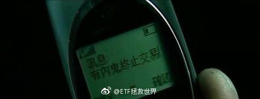

## 2018-08-31 09:52

我再说句可能招人烦的话。

其实大多数人，80%或者90%的人吧，不适合为别人做资产管理。

也可能你自己做的还行，但你也很有可能不适合给别人管理资产。更别说有好多人自己做的也根本不行。

所以，如果私募平台不管不顾只想多发展几个人来自己这里发私募，多募集资金，其实对于投资者来讲毫无好处。作为平台，也许一时可以做大，但最终会很麻烦，因为投资者都赔了。

从自身利益出发，还是从投资者能不能赚到钱出发，这是两种截然不同的思路。也许前者会做大，会赚很多钱，但我认为，真正有责任感的人，还是应该多想想后者。

## 2018-08-31 10:19

之前说过，我们的价值仓位已经买了很大了，不急着继续大力买。毕竟你家不是开矿的，资源有限，不像别人是无限资源买买买。好钢用在刀刃上。

趋势方面。

截至目前，所有指数趋势全部向下。本来有一只本周有突破的可能，但这两天又跌回下降趋势。各指数压力线压力极强，很难突破。所以趋势仓位也不会买入。

除非这一个小时有特大暴跌，今天中午大概率不会发，因为收盘后要看一下数据。

踏踏实实的。

## 2018-08-31 10:32

回复@LaOldCat:2008年伊利跌了67%，2013年 茅台跌了45%。你觉得鹅厂现在遭遇了当年这两家公司的困境了？我刚才那条说的是高科技企业，伊利和茅台是高科技？阅读理解能力需要提高。//@LaOldCat:e大，小粉关注你很久了，可你现在又是在教育刚才发了鹅厂那条的自己吗正反面都是你的立场，根本不败啊

## 2018-08-31 10:47

回复@愿赌服输K:无限现金流在这个区域每半个月买一次红利 300增强 500 医药 消费。之后视情况再增加创业和信息//@愿赌服输K:非杠精 只是想问一下E大 假如有无限现金流现在应该怎么买可以收益最大化

## 2018-08-31 11:55

回复@Henry00:且不说股票本身的问题，这样的，监管层怎么可能允许它爆炒。随时干你，敢火中取栗的可以说是人中龙凤了。//@Henry00:长生跌停了，昨天后悔没买的哪位不知道还后悔么

## 2018-08-31 12:03

喷了。以前我的数据、文章、计划，还有那什么被抄也就算了。

昨天发现已经发展到微博也被抄了。

而且是一个字不差的抄啊。

厉害了我的中文网路！ ​​​

## 2018-08-31 12:09

非常谨慎孙宏斌……

## 2018-08-31 13:45

回复@天生歌者不唱歌:这么良心的平台难道不应该支持一下，以后都在且慢申购吗。//@天生歌者不唱歌:回复@舍豆:基金现在手续费和管理费很低了，能拿出来分的已经很少了，而且蚂蚁财富那里分流特别严重，且慢的客户还是少数

## 2018-08-31 13:51

我说且慢良心，同意不同意。可以回想两件事。

第一个，当年合宜申购的时候。是不是全网热推，每家销售机构都在抢销售份额。

且慢发了个东西，跟你说，我们这里申购也可以，但是去兴全网站上申购费率更合适。

第二个，当年独角兽基金申购的时候。是不是全网热推，每家销售机构都在奋力宣传。

且慢发了个东西，跟你说，我这里申购也行，但可以谨慎一点。——说这句话压力很大你可能不清楚。

一个公司的价值观，从一举一动可以看出来。

核心是为了自己做大规模赚钱，还是首先考虑投资者赚不赚钱，这个区别还是很大的。

这些话我不太愿意说。但确实是真心的感受。

## 2018-08-31 15:28

回复@李蕾_小兽:明天肯定不跌。跌了请你吃饭。//@李蕾_小兽:e大今天不加仓，估计明天还的跌呀

## 2018-08-31 16:18

根据历史经验，最终的底部，还缺少一根月线大阴线……

历史还会重演吗？ ​​​

## 2018-08-31 16:22

2019年起，劳务报酬、稿酬、特许权使用费将合并计算个税。

## 2018-08-31 16:25

回复@黄连树:2005年5月8.5%，2008年10月25%，2012年11月创业板12%，2013年6月沪深300是15%。//@黄连树:过去熊市的月度大阴线出现在几月？

## 2018-08-31 16:29

回复@挖龙脉的超级鹿鼎公:94年7月下跌29%是最低。96年12月下跌13%；96-99一直涨没感觉99是熊市，全年上涨19%。05年5月下跌8%。//@挖龙脉的超级鹿鼎公:这个不一定，96年,99年，05年都没有

## 2018-08-31 16:33

不过中证500已经连跌五个月，本月下跌7%，估值是过去13年第三低。点位逼近我的理解极限4600-4700。半年报利润增速11%+。

综上，空间真的不会太大了。 ​​​

## 2018-08-31 17:58

回复@asekiyoshi:资本利得出来A股将再跌30%。我不太相信会出这个。房产我都信，不信这个。//@asekiyoshi:内部消息，资本利得税与房产税一起开征

