## 2018-09-01 18:26

影响中国的案例。 利好A股。

## 2018-09-02 23:21

这种事先别急着表态。先看看是什么情况。 ​​​

## 2018-09-02 23:43

每日打卡（198）

英雄难过美人关。 ​​​
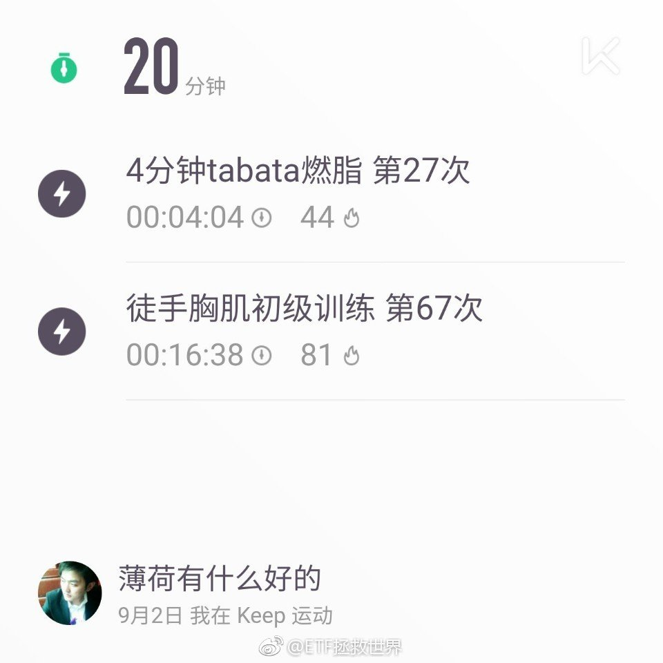

## 2018-09-03 00:32

阿里做空榜第三位，腾讯游戏控总量，东哥出事。

中概…… ​​​

## 2018-09-03 09:34

你觉得婚内出轨是不是确认渣男渣女，展开讲讲。

还是三石和查尔斯张潇洒啊，也不结婚，没有什么道德顾虑。。 ​​​

## 2018-09-03 09:41

今天会发车，想逆回购的可以忍忍。

我先去做图了…… ​​​

## 2018-09-03 09:41

PS：周五的择时看起来又对了。

## 2018-09-03 09:50

有人说我的择时是蒙的。

呵呵呵。

真的是蒙的。 ​​​

## 2018-09-03 13:20

不过有几个指数居然已经有走好的趋势。

50  金融  券商。

这个要周五才能确认。 ​​​

## 2018-09-03 13:46

什么玩意儿…… ​​​

## 2018-09-03 14:09

搞什么，500要红？

我只是举个例子啊，亲！ ​​​
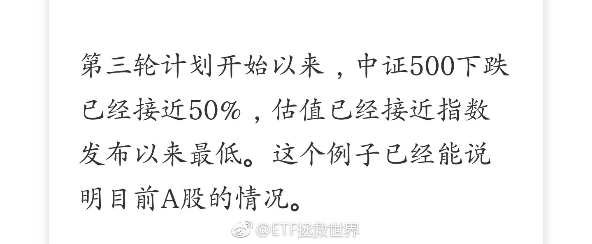

## 2018-09-03 14:29

20号一幕重现。

是巧合，一定是巧合。 ​​​

## 2018-09-03 14:39

想要放逐自己。

浪漫的土耳其，还有东京和巴黎。

人生不如意。

天意难违。

退博算了。 ​​​

## 2018-09-03 15:00

300: -0.38%

500: +0.5%

中概：-x%。

单方面宣布择时成功。  ​​​

## 2018-09-03 15:32

我选的BGM一开始听觉得还挺好听的。

单曲循环反复听之后发现，更好听了。 ​​​

## 2018-09-03 22:01

看了这个新闻，我问五岁的儿子，爸爸玩的打仗游戏可以跳窗户，你能跳吗。他说不可以，会流血会死。那是网络里制造出来的，不是真的。——五岁啊。十三还不明白？

## 2018-09-04 09:33

昨天跳车的朋友伸出你的手，让我看到你~~ ​​​

## 2018-09-04 09:40

“价投不择时”

真能扯淡。

巴菲特盯了30多年才开始入手买可乐和沃尔玛。

有钱就瞎买那叫败家子。 ​​​

## 2018-09-04 09:47

回复@会走路的鲨鱼儿:蒙的。//@会走路的鲨鱼儿:好像又开在阶段低点了。

## 2018-09-04 10:06

慢慢磨吧。牛市早晚会来，只是不知道什么时候。

钱少的你急什么，多给点时间你多投入一点以后赚的更多。

钱多的你更不需要急了。钱那么多你急什么！ ​​​

## 2018-09-04 10:43

国债什么时候买回来。 ​​​
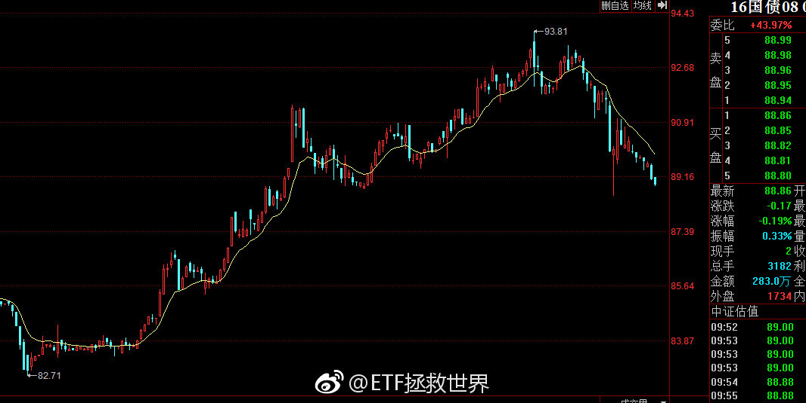

## 2018-09-04 11:05

军工继续炒，那就继续跌。//@ETF拯救世界:回复@23RRRR:军工信息不死，牛市不来。//@23RRRR:e大军工多少会考虑开始进//@ETF拯救世界:回复@ETF是什么:照你这个，军工还得跌75%，太狠了！

## 2018-09-04 11:37

下午出去视察工作，勿念 ​​​
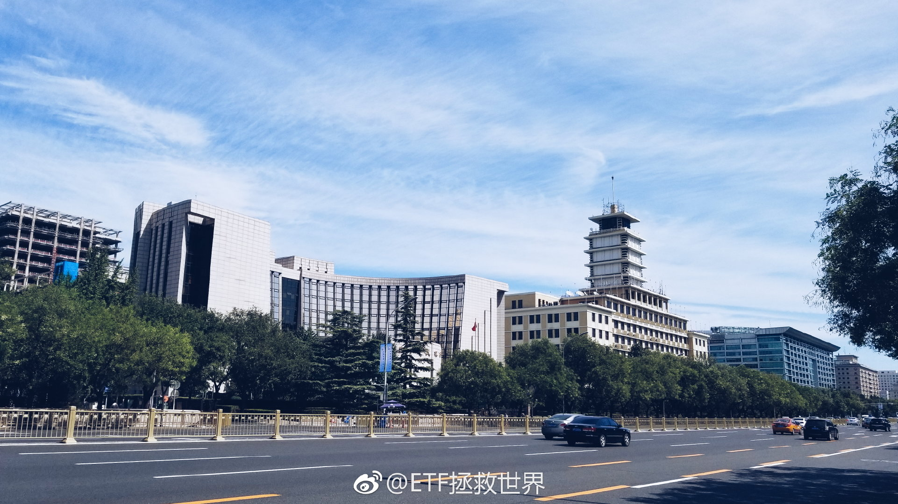

## 2018-09-04 15:22

老司机的车不要随便跳。一个想法，不一定对

## 2018-09-04 15:27

回复@唐僧用飃柔:哪有的事呢//@唐僧用飃柔:又去主持国家队救市工作了

## 2018-09-04 17:50

最近有一个苦恼，就是感觉好像没什么想吃的东西了。

人生第五大乐趣没了。

聊聊你最爱吃的东西。具体点，比如xx卖的xx。。 ​​​

## 2018-09-04 18:43

转型情感博主怎么样。现在有个情感博主离婚了，空了个位子出来，是不是可以试试。

据说男性情感博主受欢迎。

毕竟现在这情况财经博主没前途了。 ​​​

## 2018-09-04 19:31

回复@乔木:我想了半天，没想清楚这个是情感问题还是财经问题，我用哪个身份回答你比较妥当？//@乔木:没钱女朋友要分手怎么办

## 2018-09-04 19:33

回复@唐僧用飃柔:新女朋友还是新手机？//@唐僧用飃柔:女朋友把我手机摔坏了，最近打算换个新的，有什么推荐的吗？

## 2018-09-04 22:22

不要嘴炮，以实际行动支持东哥 ​​​
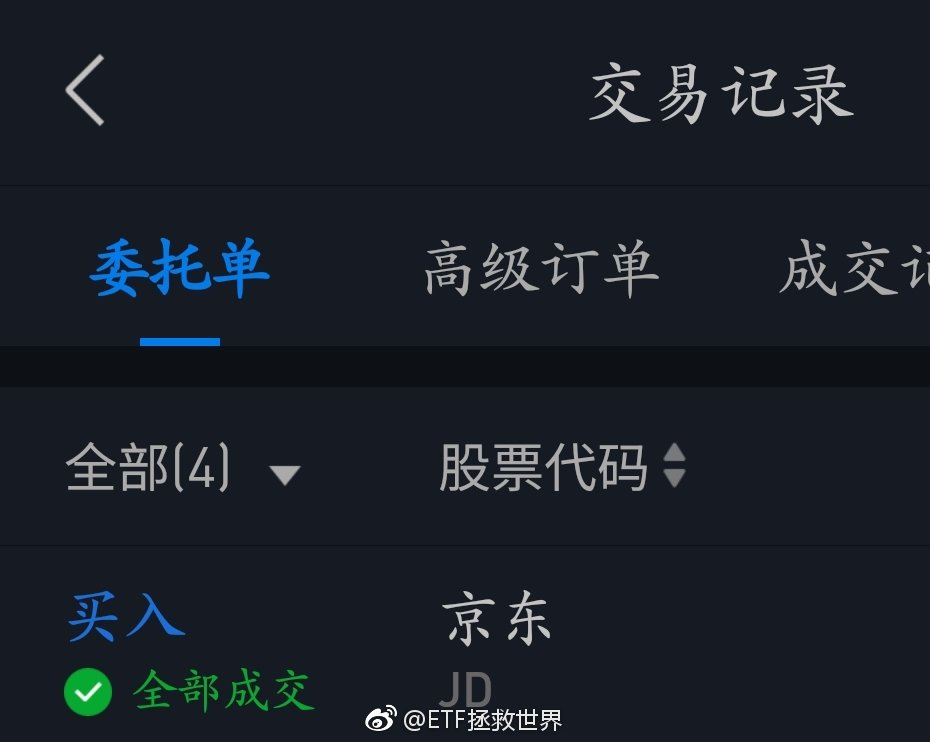

## 2018-09-04 22:27

回复@Kart老万:今天申购中概，美股部分几只价格是明天凌晨美股收盘的价格。腾讯是今天白天港股

## 2018-09-04 22:51

为什么喜欢京东，支持东哥。

是一种感激之情吧。

之前我也说过，没有京东之前，自己是怎么在中关村买电脑买的非常不开心。还得大老远搬回家。更别说质量，假货等等问题了。

这对于一个热衷于3C的男人是多么痛苦的事。

有了京东，一切相关烦恼都没了。

是，无论是京东还是东哥，肯定有各种问题。你告诉我谁没问题，这个世界上。谁没缺点。

谁都有。

别对别人要求太高。

我就是感激。别人要对我有一点好，我就一辈子都记着，想方设法要报答。

别说没有京东也有别人做。这样的话没有意义。我就知道在这个平行宇宙里，就是京东解决了我的问题。

对别人宽容一点。别人对你有帮助就念着别人的好。

就酱。

至于买京东股票赚不赚钱，我根本不care。退市了也无所谓。。

为什么，因为我就买了一点。。。

## 2018-09-05 08:56

有朋友跟我说，球球有位大V的基金净值跌破0.5了。

这种时候不要去嘲笑挖苦别人。落井下石不是什么好品质。

最重要的是，你能从别人失败的例子上学到什么。经验，不是一定要自己犯错才能取得。

这件事，从头到尾，可以总结的东西特别多。而且还不仅仅是投资本身的问题。

我只说一点，以后你看到满仓满融加大杠杆豪赌的人，无论他成功了还是失败了，离他远点，少看他写的东西。

## 2018-09-05 10:34

现在很多私募不设预警线和清盘线。

很多人说，因为是价值投资，没道理越跌越卖。设了预警和清盘线就没法价投了。

其实，清盘和预警对私募投资者来说，是挺重要的一个保护措施。

为什么。

因为私募基金对于私募基金经来说，是一个免费的杠杆。赚的越多，分的越多。所以他们天生有重仓满仓把净值做上去的冲动。

如果没有两条线，那么风控就很难保证了。上涨收益无限，下跌也没关系。投资者的利益如何保证呢。

## 2018-09-05 12:40

下午还出去不出去了。 ​​​

## 2018-09-05 12:42

目前仓位很合适。稍微放缓发车节奏。等空间。 ​​​

## 2018-09-05 14:18

谁能想到鹅厂也被东哥拖下水了。

鹅厂最近也是屋漏偏逢连夜雨。年初的利好怎么变成利空了。

游戏强劲+大范围投资其他公司…… ​​​

## 2018-09-05 14:26

熬过熊市的诀窍就是少动。还有，要动也要讲节奏。

你去翻2015年开始的第三轮。会发现，最多一个月动一次。有时候一个月动不了一次，两个月才上一次。动也是买1、2份

后来有时候一个月两次，三次。

上个月一个月四次。

频率加快，份数也在逐渐增加。

但是最多也就一个月四次。乱动不行。否则左边脸打一下，右边脸打一下。

踏踏实实的，别瞎动。

熊市不就一个字，熬呗。

## 2018-09-05 16:39

又跌！破产了，各位，再会！不要炒股！流着泪说。

## 2018-09-05 16:42

回复@何纯-员外郎:新低。因为总是新低就不说了。下次再说就是跌破2012年11月。意味着，再往前就是2008年11月了。太刺激了吧也。//@何纯-员外郎:E哥，估值新低吗？

## 2018-09-05 17:45

我再说一次，在我的评论里悲观可以。

说这次比2008更严重，也可以。

但是，好歹跌破我的预期你再来悲观好吗。

现在连我的底线都没碰，甚至还有25%的下跌预期准备，你天天跟我说会差到跌破08。纳尼？

我立个flag，全市场pb不会破1.5。

1.5我就满仓+30%-50%的杠杆。这个杠杆率还能再撑55%-70%下跌不平仓。（喷了！目前基础上跌25%以后再跌55%-70%！！！指数！！！上证1000点！我做好1000点的准备了！）

精彩了朋友们！这一把是过去十年积累一次清零，还是第四次资产飞跃？大戏准备开始直播了~~

## 2018-09-05 17:57

最近一定要控制节奏。不要太急，不要太激进。现在战场上战况混乱，先拿着手里的筹码认真观察一下。

## 2018-09-06 06:36

为了让大家了解炒股的风险，一觉醒来京东已经巨亏几百美元。

怎么办。今天早餐只能喝自来水了。

炒股害死人，不要炒股。血淋淋的教训。

众筹今天的午饭，一会发支付宝账号。 ​​​

## 2018-09-06 06:54

如果东哥真的是qj，我会认为他很渣，当然不会支持他犯法。

这个当然还能拎得清。 ​​​

## 2018-09-06 08:35

刚才认真看了看，美股账户资产占金融资产一个多不到两个点。

其中一半是美元现金，一半权益里面大部分是各国ETF。

其它是美股港股。包括京东网易AMD再生元四只股票。 

感谢 外 管 局和纽约花旗，美元汇不出去救了我…… ​​​

## 2018-09-06 09:38

未来牛市中最好笑的一句话是什么。

“赚了指数不赚钱。”

……

你直接买指数不就完了吗。。 ​​​

## 2018-09-06 09:40

现在最好笑的一句话是什么：A股还有牛市。

## 2018-09-06 09:41

这是今天我收藏进资本市场日记的第一条新闻。

## 2018-09-06 10:44

1月，两融余额在11000亿，目前8500亿。仅此一项，趋势扭转后就能带来1500-2000亿资金。

私募仓位30%，涨起来后又有几千亿资金。公募机构以及你的亲戚朋友都是低仓位，或者已经离开股市。

市场缺的并不是资金。 ​​​
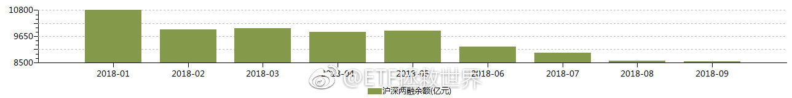

## 2018-09-06 10:52

回复@因为迷茫所以仰望星空:两融余额历史上2014年9月首次突破6000亿，至今从未跌破。2015年5-6月最高峰突破2万亿。//@因为迷茫所以仰望星空:两融余额会不会跌破6000亿呢

## 2018-09-06 10:59

回复@老顾例外:我只看融资余额/自由流通总市值（不是流通市值）。我这里有过去7年所有的比例数据。至于m2，房价，股市总市值，参考意义不大。//@老顾例外:两融是个绝对量， 要结合M2，房价总市值， 和股市总市值来看。 百分比更有意义

## 2018-09-06 11:03

回复@hongapplenju:代表自由流通的市值里，有多少市值是被杠杆资金操控。杠杆资金比例越大，闪崩的风险越大。2015年5，A股杠杆资金比例全世界股市最高。比第二名高很多很多。//@hongapplenju:融资余额/自由流通总市值这个值，代表的是，入场意愿开启之后的拉升能力？

## 2018-09-06 11:13

回复@my_skying:不一样。举例，中石油集团持有的中石油股票是可流通的流通市值。但实际上它不会卖，所以不是自由流通市值。//@my_skying:自由流通和流通不一样吗，有没有课代表解释下

## 2018-09-06 11:15

回复@老高GG:干货很多，目前已经说了将近1%了。//@老高GG:又上干货了 笔记本记录下来//@ETF拯救世界:回复@hongapplenju:代表自由流通的市值里，有多少市值是被杠杆资金操控。杠杆资金比例越大，闪崩的风险越大。2015年5，A股杠杆资金比例全世界股市最高。比第二名高很多很多。

## 2018-09-06 11:24

回复@老高GG:目前A股自由流通市值18.5万亿。8500亿两融余额占比4.6%。2015年6月A股自由流通市值26.6万亿，2万亿两融余额占比7.5%，最高应该是超过8%。//@老高GG:@ETF拯救世界 如何把自由流通市值从流通市值里算出来？股票实在太多了//@ETF拯救世界:回复@老高GG:干货很多，目前已经说了将近1%了。

## 2018-09-06 11:26

你们觉得咱们8800得国证食品到底还有没有希望买到…… ​​​

## 2018-09-06 11:44

一张图告诉你谁在卖。//@厚恩投资张延昆://@夜道://@不懂不做:炒股风险大,杠杆更要命……

## 2018-09-06 13:46

回复@ETF拯救世界:今天周五。如果最后一小时没有逆转，基本上弱势很确定。节奏一定要控制好。//@ETF拯救世界:最近一定要控制节奏。不要太急，不要太激进。现在战场上战况混乱，先拿着手里的筹码认真观察一下。

## 2018-09-06 13:55

穿越日期定错了！//@ETF拯救世界:回复@ETF拯救世界:今天周五。如果最后一小时没有逆转，基本上弱势很确定。节奏一定要控制好。//@ETF拯救世界:最近一定要控制节奏。不要太急，不要太激进。现在战场上战况混乱，先拿着手里的筹码认真观察一下。

## 2018-09-06 14:22

如果一会不反弹，今天pb在2-2.03之间了。 ​​​

## 2018-09-06 14:30

然而，成年人的世界里没有如果。一秒都不差。

## 2018-09-06 15:15

高难度拉升——反弹一半，让你猜猜能不能进2.03。辣鸡操盘手……//@ETF拯救世界:然而，成年人的世界里没有如果。一秒都不差。

## 2018-09-06 15:18

回复@爱探险的公伯千雁:1.5-2。A股钻石区域。我定义的。//@爱探险的公伯千雁:pb进入2以内，是不是就是进入钻石区域了？//@ETF拯救世界:高难度拉升——反弹一半，让你猜猜能不能进2.03。辣鸡操盘手……//@ETF拯救世界:然而，成年人的世界里没有如果。一秒都不差。

## 2018-09-06 15:26

没到。散了吧。明日再战。

## 2018-09-06 16:31

回复@LOOKING-In-your-eyes:我相信真正的超长线大资金现在一定是在布局。包括一部分外资，包括险资，其中就会有社保。就我这十几年对超级大机构的观察，几乎可以确定他们99%在干活。//@LOOKING-In-your-eyes:有消息说社保基金抄底了，是底部特征吗

## 2018-09-06 17:45

又有写东西的感觉了，周末想写。

不过可能没时间，我打算去大草原放飞一下自我……

随缘吧。

爱你。

以上。 ​​​

## 2018-09-06 19:51

回复@象牙塔事:刚看了十分钟，gja脸上的肉毒杆菌看不下去了//@象牙塔事:@ETF拯救世界    TBV新剧   ETF拯救世界 编剧 查看图片

## 2018-09-07 07:19

很多男人认为没有小鲜肉姑娘们就会爱上自己这种油腻男人了。

其实并不会好吧…… ​​​

## 2018-09-07 09:30

个人认为，养老金一定不会够用。即使现在整体来看够用，5-10年内也将大范围不够用。

三个方法延缓或者解决。

第一，加征。就是最近在干的。反对声音很大。

第二，延长退休年龄。还没干，可以预见的是反对声音会更大。

第三，国企增加分红，转入养老金。或者说，国企国有部分股权划转养老金。

我们养老金不够用，很大一部分问题是现在领养老金的人以前根本没交过，等于账户是空的，让现在工作的人来养他们。但这个问题又不是他们自己造成的。空账部分就应该Z F来管。怎么管，国企是国家的，就是全体人民的，那就应该用国企利润补养老金缺口。

还有就是，gwy或者sy单位能不能每年少招点人甚至一两年不要招人了。整体人数不要增加了。。

## 2018-09-07 09:35

回复@上山下乡的芝士青年:日本人均寿命全世界第二，80多岁吧，还好。另一位邻居男性人均年龄67也打算65退休呢……//@上山下乡的芝士青年:隔壁日本已经打算延迟到70岁退休了瑟瑟发抖……

## 2018-09-07 09:37

回复@球鞋酱Sneaker:看6，他脸上也打东西了。。//@球鞋酱Sneaker:听说此大叔最近比较火 查看图片

## 2018-09-07 09:40

最近一直在说，股市什么都不缺，利润增长不缺，资金不缺，估值不缺，缺的就是信心。 ​​​

## 2018-09-07 09:51

今天如果不是惊天大暴涨，趋势依然是down。（今天周五没错了吧）//@ETF拯救世界:回复@ETF拯救世界:今天周五。如果最后一小时没有逆转，基本上弱势很确定。节奏一定要控制好。//@ETF拯救世界:最近一定要控制节奏。不要太急，不要太激进。现在战场上战况混乱，先拿着手里的筹码认真观察一下。

## 2018-09-07 10:01

回复@卖面条的麦当劳叔叔:涨停不好吗，最近账户很受伤。计划年度下跌也6个多点了。差不多行了。//@卖面条的麦当劳叔叔:别说了再奶要涨停了//@ETF拯救世界:今天如果不是惊天大暴涨，趋势依然是down。（今天周五没错了吧）

## 2018-09-07 11:24

一张图每天贴都很合适。

## 2018-09-07 11:32

前几天某论坛的人喷我，一条罪名是：一会价值一会趋势。挺搞笑的，放在古代他就是剑宗气宗打架时候的小炮灰。内外兼修不可以吗？一定要把自己的视野放那么窄？//@ETF拯救世界:今天如果不是惊天大暴涨，趋势依然是down。（今天周五没错了吧）

## 2018-09-07 11:34

回复@陶陶滔滔涛:军工信息不死，牛市不来。这就是我的信条。//@陶陶滔滔涛:厉害了，军工，信息，传媒闪崩//@ETF拯救世界:一张图每天贴都很合适。

## 2018-09-10 10:28

现在回去翻这样的帖子，心里还是会堵得慌：

为什么几个月后看起来正确的东西，当时要被这么多辣鸡喷。为什么辣鸡可以有权利喷比它高很多的人。

微博也有辣鸡喷，我直接拉黑了。

ETF拯救世界: 恒生正在吹一个不输于2007年的泡泡。 嗯哼，没错，就是不怕对这么强的品种唱反调。不怕打脸。 然而别因为我扯淡就随便卖啊... ​​​

## 2018-09-10 10:38

对于投资，很多人最主要的问题是视野不够开阔。

比如，看估值，就只看估值。恒生便宜啊，H便宜啊，上杠杆啊，五倍啊，年内涨到48000啊。

投资是综合的。不是看看估值就可以搞定的。

恒生指数是一个波动极大的指数，这点很多人根本就没有意识到。它的波动幅度其实不输于A股。 ​​​

## 2018-09-10 10:40

信息挂了，军工还在扛啊。 ​​​

## 2018-09-10 10:43

可以的，奶到HK去了。

## 2018-09-10 11:01

谁能想到有望成真。

## 2018-09-10 11:03

回复@leletuzi:没有意外的话是周五。除非这几天特大暴跌。//@leletuzi:这周准备发车吗//@ETF拯救世界:谁能想到有望成真。

## 2018-09-10 11:40

如果这个月来一根长阴，那么，这个月，最多下个月，也就差不多见底了。

时间差点，空间就够了。 ​​​

## 2018-09-10 13:20

4690。$中证500 sz399905$   我的理解极限。

再低，就是500的钻石底。 ​​​

## 2018-09-10 13:42

一般来讲，一个指数，相同估值的情况下，会有一个比较固定的未来收益率。综合来看，正常买入，年化5%-11%是合理的。

但是如果你买的过高，就赚不到这个钱。会很低，甚至持有20年是负的。

相反，如果你买的特别便宜，则会很大概率超过这个收益率。

现在，特别便宜的情况，越来越近了。 ​​​

## 2018-09-10 13:47

中证500，目前的点位与2014年9月基本相同。也就是说，4年没涨。

然而，它的估值已经从4年前的35倍降至目前的21倍。

你买的高，持有4年不挣钱，很正常。虽然中间翻过一倍。

如果未来四年还是不涨，那么估值将从21倍降至12倍。

我告诉你，我不信。

不然，4年后你把这条微博翻出来打我的脸。

4年后，500一定比现在高。高多少，我不知道。

## 2018-09-10 13:57

想尽办法不让股价跌下去。重组。//@ETF拯救世界:果然，看了一眼大事记，5.8有股权激励。“本计划所采用的激励形式为限制性股票，其股票来源为美的集团向激励对象定向发行新股。价格28.77”。5.22回购预案。

## 2018-09-10 14:08

讲真，谁来都要扒你一层皮。。

## 2018-09-10 14:20

从历史看，如果这个月可以干10%以上，基本就差不多了//@ETF拯救世界:回复@黄连树:2005年5月8.5%，2008年10月25%，2012年11月创业板12%，2013年6月沪深300是15%。//@黄连树:过去熊市的月度大阴线出现在几月？

## 2018-09-10 14:23

回复@云易冷:中证500指数设立以来，只有2008年10月低于现在了……//@云易冷:08年10月也太可怕了吧，股民们不得被吓破胆？//@ETF拯救世界:从历史看，如果这个月可以干10%以上，基本就差不多了

## 2018-09-10 14:50

不错，光脚。毫无反抗，继续！ ​​​

## 2018-09-10 14:53

我毛估估，今天pb破2。到达2012年11月28日数值。

答案30分钟后揭晓。 ​​​

## 2018-09-10 15:27

想多了，没破。依然没到2012年底部。继续吧。

## 2018-09-10 15:29

现在你们能想到2005年和2008年是什么样的世界了吗。1.5！//@ETF拯救世界:想多了，没破。依然没到2012年底部。继续吧。

## 2018-09-10 16:07

回复@还没入门:不用回到高点。你现在又不是高点投。距离2015年，大部分指数已经跌了60%以上了。当年日本在这个位置大波段也有好几轮了。//@还没入门:就怕郭嘉走一段弯路，个人就耽误了一生。日本股票指数几十年也没回到高点。//@ETF拯救世界:现在你们能想到2005年和2008年是什么样的世界了吗。1.5！

## 2018-09-10 16:20

一位网友私信的，帮他问问。能帮就帮一把。 ​​​
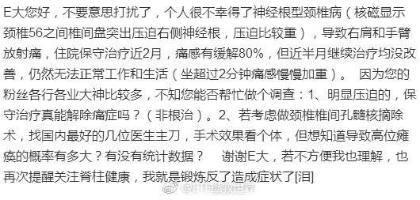

## 2018-09-11 07:36

30%破净是A股绝对大底，就是不知道能不能到了……

## 2018-09-11 08:57

回复@老顾例外:千万别因为我死扛。这一轮熊市下来a股整体跌幅超过50%，你浮亏5%就扛不住了，真的不要再扛，立即抽身离去再也不要回来。我是认真的。股市不是适合所有人的地方//@老顾例外:有点绝望了， -5%  ， 没有E大的话，自己很难坚持了。

## 2018-09-11 11:50

忙了一上午 ​​​

## 2018-09-11 12:21

回复@韩跑跑走一走:前几天我看了一个知乎问题:长期不上班会怎样。90%的人会空虚，甚至有抑郁的。//@韩跑跑走一走:整天忙啊忙啊，我们人生的意义在哪里。。。

## 2018-09-11 12:37

回复@老顾例外:闲庭信步是因为这样的局面我已经经历过三次，这是第四次。最坏会怎样，之后会怎样，心里大概有谱。放心，明明白白经历两次以后，你也会有谱的。踏踏实实的。指数不会死

## 2018-09-11 13:28

偶然又翻到了当时的这个帖子。幸亏及时叫停，否则将是不亚于中石油的惨案。

然而这样的事情都是怎么决策的。百思不得其解。就像好好的深成指，40只成分股，一定要在中小股票暴涨之后，换成500只成分股，从此一蹶不振。

为什么这么喜欢追最近表现好的东西？从上到下都喜欢？ ​​​
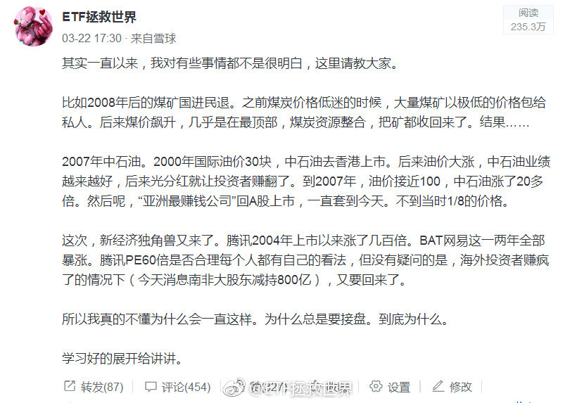

## 2018-09-11 13:45

回复@崔梓夜:没懂这个月配置中概互联有什么问题？帖子是3月发的，当时所有中概股全部在高位。现在网易腰斩，京东腾讯下跌30%，配置0.6%仓位有问题吗。我还要继续买到5%呢。//@崔梓夜:回复@ETF拯救世界:应该是想问你，为什么发中概互联网的车吧

## 2018-09-11 13:49

基金发行越“冷”，越是投资的好时候。反之亦然。

2007年四只QDII发行。当日每只热销百亿，摇号配售。到现在还有净值不到0.5的。

年初的合宜之类的就不用说了。还有前两年热发的定增基金。

前几天看说，有基金发行就卖出去2.5万。你就知道这是投资的黄金时刻了。

抢热门永远没什么好下场。 ​​​

## 2018-09-11 13:59

我用一句话解答“为什么明知下跌还要买”

两个字：概率。

你永远也不可能绝对性的预测未来的涨跌。所以你要用概率来判断。最主要的应用就是根据概率布置仓位。

比如这个月买中概，如果未来我打算给5%-6%的仓位，那么买入0.6%大概就是10%。

10%你可以大概理解为：我认为它有90%的概率继续跌，10%的概率会上涨。

又比如我们现在的A股仓位大致是55%。如果80%是满仓，也配置69%接近70%了。

这意味着，我认为，现在有30%的概率继续跌，70%的概率就是底部区域。当然，其实我认为跌的概率更小，但计划会更保守一点，不用多说。

再说一次，没有任何人能真正的预测绝对底部和顶部。谁说他能，他就是骗子或者傻子。那些喊xxxx点就是大底的人，要不就是无畏，要不就是无知，要不就是无畏以致无知了。

投资就是投概率。概率大就重仓，概率低就轻仓。这里的关键就在于你如何判断概率，又如何根据概率配置仓位。

是技术也是艺术。很有意思。

## 2018-09-11 14:07

中概互联这些公司，本身并没有太大问题。哪怕一家有，做为一个整体也没太大问题。

但是，非常关键的是，随着他们这个群体在国民经济生活中的重要性越来越大，真正的问题就出现了。

这个我不多解释，懂的自然懂。

所以，要不就是公私合营，要不就是想办法把你弄得小一点，分拆或者其它方法。

永远也不可能让你那么强大。当你们做为真正的数据公司居然掌握了那谁都不掌握的东西，你说你会怎样。

## 2018-09-11 14:18

再说一次。//@ETF拯救世界:最近一定要控制节奏。不要太急，不要太激进。现在战场上战况混乱，先拿着手里的筹码认真观察一下。

## 2018-09-11 14:36

关于概率的选择题：

1：有30%的概率下跌20%。

2：有70%的概率上涨无限。

你选哪个。你应该好好问问自己。 ​​​

## 2018-09-11 14:53

回复@纸上的长河:对每个人来说是不同的。有人害怕第一个发生，所以不买。有人不怕第一个，害怕第二个发生自己手里没东西，所以买。你好好体会一下。//@纸上的长河:回复@小牛乐乐吧:小伙子你没看出来这2个选项是一样的吗？

## 2018-09-11 16:25

汽车是真正的周期股。这个，林奇在第一本书里就开宗明义的告诉你了。

然而，只有当你一个上升周期赚几倍，或者一个下降周期赔得只剩20%的时候，才会真的懂。

当然，这个周期，一般人很难把握。太多人把汽车当成成长股或者价值股了。都不是。它是周期股。

BTW，感谢那次“捷达换宝马”。 ​​​

## 2018-09-12 08:06

刚看到有人说，我把前几年操作分级A/B之类的收益也算进第二轮计划了，这就算是造谣了吧。

如果我把分级的收益也算入计划那计划收益率可以简单再x2。2015年7-8月分级赚了40%多，如果加到计划上会让计划总收益变成17倍。更不要说之前的分级b了。

但这样玩有意思吗？计划就是计划，只有指数基金，只有ETF。

跟很多人不一样，我从来不愿意多谈以前的收益率。因为空口说白话有什么意思？

不过好在网络记录了很多东西。比如2012年12月初的计划，一次买入4.5份。这相当于现在的13.5份。买入后，计划仓位90%。中小指数大底。

再贴一张我2012年12月初大力买入后的仓位。我从来不会把什么分级，杠杆的收益率都算入计划，所以，我本人的投资收益率，比计划还是会高一点的。但说这些毫无意义，我从来不会多说。

当时60%股票+ETF。主要是计划。另外有20%分级B，3-4倍杠杆。8%转债。整体仓位超过100%。

就酱。

后来赚了多少，不用说。口说无凭。几年后你就能推算出第二轮了。
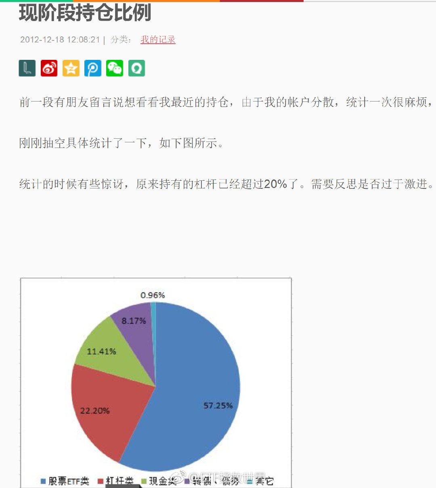

## 2018-09-12 09:09

我想拉黑两个凑个吉祥数…… ​​​

## 2018-09-12 09:46

至于第三轮的预期收益率，我每篇文章上面都写得清清楚楚：“无法预测”

你可以控制自己的成本，但不可能预测自己的收益率。你知道五年后，十年后各个指数多少点？谁能预测？谁说能谁就是骗子或者傻子。

我们能做的，只能是尽量在低位多买点便宜货。然后等着。小富由俭，大富在天。老天爷给你一个2年7倍或者3年5倍那是咱们运气好。如果不给你能怎样？

我预测不了。毕竟水货。

## 2018-09-12 09:59

军工这么NB，你说A股能涨吗…… ​​​

## 2018-09-12 10:05

深成已经-4%了。再来6%基本就是我定义的“长阴”了。。如果一个月-15%，那就确认了。

## 2018-09-12 10:08

新低不要着急买。控制好节奏。你家没矿，也不可能像别人一样无限借钱，无限现金流。把已有的资源分配好。不骄不躁，徐而图之。//@ETF拯救世界:再说一次。//@ETF拯救世界:最近一定要控制节奏。不要太急，不要太激进。现在战场上战况混乱，先拿着手里的筹码认真观察一下。

## 2018-09-12 10:20

再扛两天不好吗……//@ETF拯救世界:新低不要着急买。控制好节奏。你家没矿，也不可能像别人一样无限借钱，无限现金流。把已有的资源分配好。不骄不躁，徐而图之。//@ETF拯救世界:再说一次。

## 2018-09-12 11:00

回复@小五雀雀:富国红利2008年底成立。你2009年1月第一次投入，到现在，将近十年，总收益率58%。年化可以说非常一般。如果未来在这种市场环境下你退休，恐怕非常有问题。我坚决反对简单定投。尤其是A股。

## 2018-09-12 11:10

回复@梦游鱼生活在路上:当然不是。一开始我以为你真的是随口一说。但我看完你所有的评论，知道你是有备而来要搞事情了。我当然可以告诉你我在2005-2007/08-09,2010-2015，每个阶段的收益率。但是我告诉你后，你会不会要求看历史交易做出证明？我还是可以给你看，你会不会接着要求看交易截图？

## 2018-09-12 11:31

回复@William_SZ:给上传的图片加昵称水印？ 可以看2015年的交易记录。//@William_SZ:2015年7-8月正是股灾吧，E大怎么做到分级赚了40%多的？

## 2018-09-12 14:38

控制好节奏。没多大点事。//@ETF拯救世界:新低不要着急买。控制好节奏。你家没矿，也不可能像别人一样无限借钱，无限现金流。把已有的资源分配好。不骄不躁，徐而图之。//@ETF拯救世界:再说一次。

## 2018-09-12 15:17

各位放心，我没空为这点破事儿生气。。一大堆事儿呢。

今天五岁的儿子跟我说爱上幼儿园同班女孩了，悲喜交加啊！都哪儿学的乱七八糟的！

另外，做为帝都学区房接盘侠的我要开始装修了，有没有靠谱的全屋定制品牌介绍一下。 ​​​

## 2018-09-12 15:33

今天全市场PB再创6年新低，但依然没有跌破2，更没有破2012年11月底……

太顽强了。主要原因就是部分股票依然被不断炒作。

我的观点是，都死踏实了才见底。 ​​​

## 2018-09-12 16:23

真的非常有意思。

从过去二十年的情况看，发达国家股市估值基本是步调一致的。比如2008年，美德英大致都在10倍左右。

2011年欧债危机的时候，大家都在13左右。

到了2015年，三个国家都在21-23。

2015年后开始分化。

现在，只有美国一路上扬，维持历史高位22。德国英国已经回落到16、17的历史平均水平。

美国为什么这么牛，是道德的沦丧还是人性的泯灭？

拭目以待。

数据是标普500/dax30/ftse100

## 2018-09-12 16:35

没想到我都走了，大家还是这么有情有义。我真的非常感谢各位。虽然我知道很多圈我的朋友也没有来微博，也看不到这个。。

又得奖了。当然是老规矩，奖品还是送给大家。我无功不受禄。我先联系一下点赞评论最多的安娜，看她要不要。如果不要，我想个办法选一位微博粉丝送出。。虽然没有上次的华为手机好，应该也还可以。

http://t.cn/RsFOS9B

## 2018-09-12 17:06

回复@songxin6691:大家可千万别听我的乱割。我能说，军工是目前所有指数里唯一趋势走好的吗……太诡异了……//@songxin6691:军工再次益达喷，拿着睡不着，刚割肉了点换成了中证养老和富国500！

## 2018-09-13 10:43

喷了，大型诈骗现场 ​​​

## 2018-09-13 11:04

是这个点位。

## 2018-09-13 11:15

害怕的，想想三聚的伊利，塑化剂的茅台。

超额利润不会风和日丽让你拿到。 ​​​

## 2018-09-13 15:28

又忙了一下午。

反弹一个点有没有人觉得牛市来了。 ​​​

## 2018-09-13 21:07

太幸运的时候，得告诉自己别嘚瑟，别得意忘形。

福兮祸所伏，祸兮福所倚。

人生的不同其实就是几个关键点的选择。

选对了顺风顺水，选错了坎坎坷坷。

一方面只能寄望自己能够选对，一方面多行善事多积福德，还有什么更好的办法吗。 ​​​

## 2018-09-14 13:24

这几天看到几句话，很有感触，与君共享。

第一句叫做，除了死，都是小事。

第二句叫做，每个磨难都是命中注定，要欣然接受它们。

最近各种事情顺利的出奇，让我不免心生惶恐。居安思危，预先做一些未来遇到挫折的心理建设…… ​​​

## 2018-09-14 13:35

中午发车也不保险了。怎么办，14:58发吗！ ​​​

## 2018-09-14 14:41

我叫你一声军工你敢答应吗！$中证军工 sz399967$

## 2018-09-14 15:43

现在宽基里面，未来收益率低于十年期国债的，只有中小板和创业板了……

其它指数未来收益率全部高于十年期国债。

现在，买债券长期看绝对跑不赢买便宜指数了。 ​​​

## 2018-09-14 15:54

开始看留言，真是个挑战！

每次只能放100条，实在抱歉了~ ​​​

## 2018-09-14 17:15

有传言说平安主动投资资管部门集体解散。转型指数基金定投和量化。

真假不知道。

但是指数投资99.36%概率是未来机构转型方向之一。

其中原因很复杂，我不想说。没空。 ​​​

## 2018-09-14 17:45

回复@携风牧云:你有所不知。2014的深成和现在的不是一只。当时是40只低估大蓝筹，2015年高位换成了500只疯狂中小创。

## 2018-09-17 08:43

新的一周！人生有无限可能，充满变化！

唯一不变的是继续在A股赔钱。

真好。 ​​​

## 2018-09-17 09:25

我又认真看了看这一轮计划的情况，也没弄懂有什么可吐槽的。毕竟权益仓位已经那么大了，怎么可能一点都不跌啊。

总体看，熊市能不赔钱，保住上一轮牛市的收益，建立好仓位，等待下一轮牛市爆发。这就是总思路。到目前为止也做到了。要知道指数已经跌了将近50%了，保持盈利并不容易。

我是想不到更好的策略了。熊市空仓牛市来的时候满仓？你只能去找上帝了……
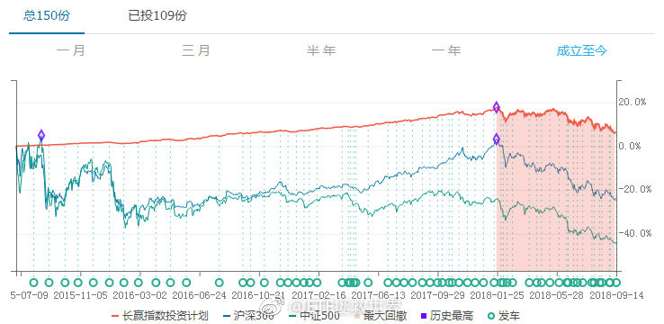 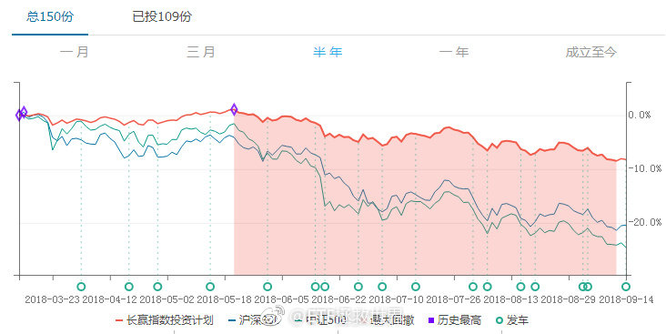

## 2018-09-17 09:33

知道为什么只买一份了吧…… ​​​

## 2018-09-17 10:11

最近三年，中证1000的跌幅是20%，17%，31%。

算上2015年下半年的19%跌幅，已经下跌了3年半。

最高点至今累计跌幅68%。

A股毫无疑问的处在一个底部区域。只是不知道这个区域到最低精确到还有多少跌幅，这个区域还要持续多久。

我们面对的恐怕是未来十年A股最大的机会。 ​​​

## 2018-09-17 10:31

之前说对标08年。我给几个如果真的到08年大底，各指数的预期跌幅。心里有个数。

全市场：28%左右。

沪深300：26%左右。

中证500：17%左右。

中小板：43%左右。

中证1000：30%左右。

医药：10%左右。

消费：11%左右。

军工：61%左右。

信息：49%左右。

红利：24%左右。

这是以2008年金融危机最低点给出的极限跌幅。再多我就无法想象了。

## 2018-09-17 10:34

另外，恒生是26%左右。标普500是53%。

## 2018-09-17 10:46

但是各位要注意，这个要跟时间结合。时间拖得越久，这个跌幅就越难达到。比如，全市场利润增长如果有10%，那么横盘三年就见底了。

## 2018-09-17 10:53

回复@陈治鸣:大部分指数的2012年底都已经被干掉了，除了那几个辣鸡……全市场只差一步之遥。//@陈治鸣:12年的底破了吗？//@ETF拯救世界:但是各位要注意，这个要跟时间结合。时间拖得越久，这个跌幅就越难达到。比如，全市场利润增长如果有10%，那么横盘三年就见底了。

## 2018-09-17 11:09

一个月过去，这个点位提升到7800点左右。

## 2018-09-17 11:52

刚才看了看，最近12个月里面，中证500只有一个月是上涨的。

这种事情最近一次发生是2016年2月以前的恒生指数。之前十个月只有一个月上涨。之后涨了83%。

就缺最后一根大阴线了。 ​​​

## 2018-09-17 12:51

翻了一下各指数历史，今年到现在为止是过去十几年，除2008、2011外最惨的一年了。

颇有赶超2011成为第二惨的态势。

如果你满仓，那确实比较难受。但如果你手里还有钱，那就是越惨越好。不信，你看看08和11年之后就知道了。 ​​​

## 2018-09-17 13:43

确认了一下，还能再战三百回合。 ​​​

## 2018-09-17 13:49

$全指信息 sh000993$   信息挂的很彻底。军工真顽强啊。今年涨跌幅榜居然还是前三。 ​​​

## 2018-09-17 13:57

回复@一指洞天机:全市场PB破2。A股历史只在2005、2008、2012年出现过三次。第四次很有可能就是在最近几天了。//@一指洞天机:大家，破2是个什么意思？

## 2018-09-17 14:37

回复@asekiyoshi:可能是我眼花了。我看wind给的TTM PE是136倍。140倍吧。//@asekiyoshi:科大讯飞作为全球领先的人工智能公司，为什么市场只给不到14倍估值，比FAANG低那么多？

## 2018-09-17 15:03

回复@jklsadly:股市做为一个整体，和个股、公司不同。很难出现利润大幅增长，同样，也很难出现整体利润下降。大概过去二十年，只有不到5年出现过小幅下降。之后就会继续增长。如果上市公司业绩持续下降，那基本上就是大问题了。

## 2018-09-17 15:15

回复@温暖的港湾12345:我刚看了一眼，2008年金融危机，上市公司利润增长依然在5%+。2009年更是暴增至25%+。//@温暖的港湾12345:上市公司再怎么样也是各行各业的龙头或者行业领先地位企业，要是上市公司都不行，那这经济也。。。

## 2018-09-17 15:20

大家都是江湖儿女，何须如此客气！请了！

## 2018-09-17 15:27

回复@愉悦老爹:喷了，2。//@愉悦老爹:破2了吗？E兄。//@ETF拯救世界:回复@温暖的港湾12345:我刚看了一眼，2008年金融危机，上市公司利润增长依然在5%+。2009年更是暴增至25%+。

## 2018-09-18 08:51

打吧。人家都把你按在地上抽你嘴巴，还警告你不能还手，你还真一点反抗都没有就认怂？ ​​​

## 2018-09-18 09:24

再说一次，控制节奏。//@ETF拯救世界:新低不要着急买。控制好节奏。你家没矿，也不可能像别人一样无限借钱，无限现金流。把已有的资源分配好。不骄不躁，徐而图之。//@ETF拯救世界:再说一次。

## 2018-09-18 09:33

回复@fang宝贝在路上:其实吧，要写有很多写的。比如我早就想把微博上的东西定期归拢一下，贴出来的同时认真展开说说。因为微博说不透。还有把以前博客的东西也整理一下做个回顾点评。还有我每天的投资日记，可以把几年前的放出来。一直没做，一个是太忙，一个是懒，没什么动力……

## 2018-09-18 09:44

帮一位私信我的网友问个问题：

女生，大三。学校某有点地位的老师经常找各种借口请她和另一位女生吃饭。还会有一些比较轻浮的举动，但还未上升到可以举报和报警的那个地步。

请问：

这两位女生该怎么彻底拒绝老师的饭局。怎么彻底让老师断绝可以超出师生关系的幻想。

注意，轻易不能影响师生关系，毕竟是学生。

## 2018-09-18 09:55

我观察球球上几个前期暴跌的私募，最近一两周净值平稳了很多，应该是减仓了……

说好的一起满仓到白头，你却偷偷焗了油。 ​​​

## 2018-09-18 09:57

回复@欢欢在山上追:可说呢。我可以假扮男朋友啊。就是怕姐弟恋显得不真实。//@欢欢在山上追:怎么没人说吃饭的时候带上E大呢

## 2018-09-18 10:06

回复@墨白113:因为你想不到的事：50已经比2008年底还便宜了。50最低点是2016年1月。//@墨白113:E大，请问你怎么没有列出上证50对标2008年估值差距值呢？上证50就是不破位，想买到好难啊//@ETF拯救世界:再说一次，控制节奏。

## 2018-09-18 10:49

$150023   0.15了……………… ​​​

## 2018-09-18 11:03

总有人说：

指数投资，赶上日本那样的怎么办呀。

拜托了好吗，人家日本从08年到现在涨了240%，又快创1991年以来28年新高了好吗。

日本怎么了日本……比你强多了好吗。。

关键在于，现在又不是2015年5月，你怕什么。有的指数已经跌了76%了，日本最惨时候也就跌80%。 ​​​

## 2018-09-18 11:15

特别狂傲的人最后都失败了。

不然你给我举个反例。 ​​​

## 2018-09-18 11:17

$中证军工 sz399967$   是不是要还债了。赶紧的。你不趴下兄弟们都起不来。 ​​​

## 2018-09-18 11:23

回复@Am_Nobody:不错了，心算一下，年化13%了。要知道日本存银行可基本是0利率。。//@Am_Nobody:十年240%

## 2018-09-18 11:28

回复@首体南路也没人:参看我昨天的帖子。跌到历史估值最低，中小板还要跌40%。等中小板跌过历史最低依然止不住再来说这些吧。

## 2018-09-18 11:31

是这样没错了。 ​​​

## 2018-09-18 12:20

另外我再说一句，预测大底这种事其实没有什么意义。

筹码的买入和卖出，重要的是区域。底部区域布局，顶部区域卖出。一个区域上下一二十个点是正常范围。最后的那个大顶点位和大底点位没意义。你买不到也卖不到。

给出一个极限位置，只是对极限情况有个准备。有个预案。不是说预测一定到，或者到了才买卖。那就比较菜了。

目前的区域毫无疑问是极有价值。慢慢买就对了。闲钱，买不会死的指数，最后胜利的一定是你。短期资金，借的短期钱，买未来一片未知的股票，都会让你心神不宁。最后也很难成功。

## 2018-09-18 13:34

什么意思又想让我把小尾巴改回来吗表脸。

## 2018-09-18 13:37

现在你可以不买，但是如果你还在卖只能说你脑子有包了。 ​​​

## 2018-09-18 14:03

全市场PB2真的是比较敏感的一个地方。//@ETF拯救世界:回复@愉悦老爹:喷了，2。//@愉悦老爹:破2了吗？E兄。//@ETF拯救世界:回复@温暖的港湾12345:我刚看了一眼，2008年金融危机，上市公司利润增长依然在5%+。2009年更是暴增至25%+。

## 2018-09-18 14:15

我跟你说啊。

你看，昨天说了，今年已经是近十年，除了2008,2011最惨的第三年。

但是，你去问问经历过2011年的人，那年虽然股债双杀，虽然跌幅比今年还大，但你问问他们，或者问问自己，现在对当时的痛苦还记得多少？

我相信没多少了。更别提2015赚大钱的时候。2011的痛苦可以说完全不记得了。

甚至，2008的痛苦，也应该没什么太大的感觉了。

没错，这就是未来你对现在的感觉。哪怕你现在仓位很重，或者满仓，浮亏不少，很难受。但是几年后，就全忘了。

也就是说：

现在你觉得天大的事儿，未来回头看，P也不是。

信不信由你。

## 2018-09-18 14:22

小尾巴先不改了。纪念那几个小时的钻石坑……//@ETF拯救世界:什么意思又想让我把小尾巴改回来吗表脸。

## 2018-09-18 14:37

如果继续反弹，周五加两个趋势品种。放心，踏空不了，多大点事儿。 ​​​

## 2018-09-18 14:40

回复@沪宁线上的男人:根本没必要。你心里明白很多事，急着和不明白的人争论，只是第一等级。再高一级，是静静的看着那些人犯错。不是你不想帮，是帮他们是浪费时间。

## 2018-09-18 14:41

谁能想到，7月份加的那份50还在赚钱呢…… ​​​

## 2018-09-18 14:46

回复@怡子_59052:涨跌都不怕。买个指数基金而已，站着把钱挣了，多大点事儿啊。//@怡子_59052:好爽，星期五可以上车了。以前没E大时，越跌越怕，现在越跌越期待可以买

## 2018-09-18 14:46

回复@一壹y:谁能想到为了照顾大家的心情我即将拉黑你呢……//@一壹y:谁能想到，之前没买，7月份一次性补齐的现在红了......

## 2018-09-18 15:02

一个字，舒服。

周五有没有机会干一票？ ​​​

## 2018-09-18 15:10

回复@奔跑的月光儿:我记得是“江湖救急”。是不是记错了？记得的同学补充一下。顺便说一句，这片子的节奏我很喜欢。但是香港江湖片节奏最喜欢的是“枪火”。配乐和节奏太喜欢了！百看不厌。几个主演也特别棒。//@奔跑的月光儿:为啥我关注的点是，这个是啥电影来着

## 2018-09-18 15:27

回复@一地鸡毛_26863:哈哈。因为他对我的体系不了解，这样说很正常。就像之前jsl说一会价值一会趋势是辣鸡一样。简单说两句。我的持仓里面，大部分是根据价值投入。小部分是趋势。我很难解释为什么，三个字黑天鹅吧。最大跌幅是每次计划里都有的，这是深入我骨髓的思考方式也是价值部分投入的节奏参考

## 2018-09-18 15:28

11年股债双杀，连分级A都暴跌，不是年底回暖当年真的要亏。//@挖龙脉的超级鹿鼎公:11年确实真心难做，比08年难做太多了，那年疯狂做T，才保住不亏本

## 2018-09-18 15:37

接上面，再说“预判”

不好意思，我从没说过我可以预判市场的走势。我预判不了。我只能根据概率下注。

价值是一种概率，趋势同样是。你不要因为你是价投就看不起趋势。大到这个宇宙，再到每个国家的运势，小到一个人的命运，都有趋势。顺势而为是一种大智慧。当然了，“势”很难判断，同时，我们来做投资，毕竟价值才是第一重要。所以，我们只是用趋势的判断，来弥补“价值”无法涵盖的那部分月之暗面。

很多东西市场的趋势会告诉你，但是“价值”不会。

谁说预测不了未来走势就无法赚钱，无法保住本金？我不信。我认为，在资本市场赚钱，不用预测走势，也能赚钱。就是根据概率下注。小概率就是轻注，大概率就是重注。概率极低就别玩了，收摊回家。

所以我不预测未来。从不预判。

至于阶段低点。这是一种本能。总是希望买在比较低的地方，所以通过一些雕虫小技稍微择一下时。比较幸运，绝大多数时间都成功了。算是个小乐趣而已。登不得大雅之堂。

这些话也本没必要说，你不懂我就是不懂，说再多也没用。至于是否真的淡定，如果从我的文字里感受不出，也就只能说并不在一个channel上啊。

## 2018-09-18 15:43

另外，我在各种论坛看了几年，有个体会，说出来你感受一下。

就是很多时候，我们觉得某个人很牛，值得关注，其实是因为他的思路和自己一样。比如我看多，某个人也拼命看多，我就会觉得他有水平。反之，我看多的时候你看空，我感觉你就是辣鸡。

如果我以前喜欢的人改变了看法，我看多他突然开始看空，我就会觉得他也变成辣鸡了。

又比如你之前是价投，我很喜欢你。突然有一天你说你还看趋势，那你不是辣鸡是什么？

其实呢，我给个贴士：

很多时候，那些与你观点不同的人，才是对你最有价值的。不信经历几轮牛熊后你再回头想这句话。

## 2018-09-18 16:57

回复@携风牧云:“趋势”其实就是国外量化策略中很重要的“动量”因子。这个因子是经过长期测试极为有效的量化因子之一。可惜，价投会说这是追涨杀跌的辣鸡……

## 2018-09-18 17:00

回复@求财不劫色:2015年崩溃前我是空头少赚了一点被人骂，现在是多头赔了一点又被人骂。可以说很难做人了。。

## 2018-09-18 17:14

回复@梁小雨:肯定当初没关注我球球。这个数据我从2015年就开始跟踪，并根据这个倒计时了2016年初的熔断股灾。但是目前没意义了，因为解禁股也不能随便卖了。//@梁小雨:回复@梁小雨:E大看一下这个数据有没有意义？ 查看图片

## 2018-09-18 17:32

回复@混在中国2012:今天话是有点密，但没感觉有营养啊。。都是随口一说……//@混在中国2012:谢谢今天这么多有营养的分享，让我学到了很多。

## 2018-09-19 09:47

回复@天外飞钳:是。日本央行买ETF简直丧心病狂，不输那什么。//@天外飞钳:日本是全靠央行在买买买，快到头了。//@ETF拯救世界:回复@Am_Nobody:不错了，心算一下，年化13%了。要知道日本存银行可基本是0利率。。//@Am_Nobody:十年240%

## 2018-09-19 10:02

一想起持仓、现金、仓位、目前股市的情况，心里就感到特别特别舒服是怎么回事。 ​​​

## 2018-09-19 10:16

回复@微言200112:金融圈太乱了！但是！试问，各位，哪个圈不乱你们说说。//@微言200112:方正饭局，E大怎么看

## 2018-09-19 10:16

回复@紧跟E大:周五是关键的时间窗口。//@紧跟E大:金融地产和上证50有走出趋势的趋势？

## 2018-09-19 10:18

回复@J-ToveLo:真好。拉黑你。//@J-ToveLo:新人  两天时间 补了61份 想起来就特别舒服 怎么回事

## 2018-09-19 10:29

为什么不要预判股市走势，这就是例子。要么你就根据价值高抛低吸，要不就等趋势走出来顺势而为。不断预测未来涨跌，不断预测高点低点，并根据预测交易，能挣钱就见鬼了。//@亟兮般若:还记得2014年也是靠这个看多的突然看空，我才敢开多一年啊//@丛林岗小学生:

## 2018-09-19 10:35

我有个疑问，前几天到处发帖抱怨参考我的计划浮亏几个点的人，

以后赚钱了，

他会不会到处发帖感谢我呢。

我觉得会。你们觉得呢。毕竟是个人啊！ ​​​

## 2018-09-19 10:45

今天最垃圾的辣鸡，有一天会变成闪瞎大家氪金狗眼的明星。

一个品种，如果你买了，等了五年，四年赔钱，第五年突然翻番，这是不是一笔好投资？

前四年所有人觉得是辣鸡，第五年你变成了巴菲特。

你变了吗？品种变了吗？谁都没变。

复利是这样的。

1涨1倍是2。2再涨1倍变成了4。4再涨1倍变成了8。8再涨一倍就是16。

这时候，已经比初始资金涨了16倍。

## 2018-09-19 12:28

刚看了一眼，500目前仓位已经占13%+了。对于单一品种来说，这个仓位已经不小了。一般单一品种配置最多也就给15%-20%。

无论是继续下探还是趋势转折，都不会加太多了。我估计最多再加6-7份吧。最多了。 ​​​

## 2018-09-19 16:52

回复@热爱过后:为什么一定要有巨头。无论是中国还是美国，历史上看都是小盘股弹性更大。上证就是中石油进去后一蹶不振的。//@热爱过后:回复@swimingcat:按500的编制方法 公司一旦大了就会调出500进入到300  这里面是不会有巨头的

## 2018-09-20 07:38

回复@多余的余2011:举个例子，2013年50 300跌十几个点，传媒涨超100%。买一只，你那只不被市场喜欢，可能十年不涨，了解一下。//@多余的余2011:既然指数终归能涨起来，又是定投不怕下跌，为何不单买一个指数而要配置很多很多的基金呢？

## 2018-09-20 07:43

到现在，还有很多人觉得指数就是上证，所有指数都差不多。

事实是，每年A股最好最差指数涨幅差距都有至少几十个点。 ​​​

## 2018-09-20 07:50

回复@柏川俊:深研和涨不涨没关系。你把一个指数研究的再透，市场不喜欢它就涨不起来//@柏川俊:低估分散不深研VS集中深研//@ETF拯救世界:回复@多余的余2011:举个例子，2013年50 300跌十几个点，传媒涨超100%。买一只，你那只不被市场喜欢，可能十年不涨，了解一下。

## 2018-09-20 07:51

再说一句很重要的:

指数基金不是目的，是手段。是做资产配置的最佳手段。

了解一下。 ​​​

## 2018-09-20 08:39

回复@ETF信徒者:计划下跌6%，被人发帖喷死//@ETF信徒者:格上理财8月份的业绩快报显示，今年以来大型私募业绩遭“通杀”。赵军的淡水泉投资、石波的尚雅投资、明达资产等知名私募今年亏损达20%，朱雀投资、源乐晟资产、翼虎投资、民森投资等亏损超15%，百亿股票私募中竟然没有一家是盈利的。

## 2018-09-20 08:55

回复@不要慌我来接盘:军工2008年19倍了解一下。现在将近60。//@不要慌我来接盘:回复@-反清复明-:那为什么军工的pe一直那么高？即使在历史最低位的时候

## 2018-09-20 09:00

融资一直在减少。目前已经低于16年初，回到14年了。较最高点两万多亿下降将近2/3了

## 2018-09-20 09:07

回复@不说的树:别。你买肯定有买的原因，别因为我说就卖。便宜并不一定涨，贵了也不一定跌。便宜和贵只是投资的一个维度而已。不符合我的要求不一定不符合你的。//@不说的树:持有军工屡被点名的瑟瑟发抖，准备趁这波反弹抛了

## 2018-09-20 09:13

冷萃咖啡是不是骗局？

喝起来和美式没有任何区别，然后还贵了9块钱。

咖啡界的世纪大骗局今天被我揭穿了。 ​​​

## 2018-09-20 09:18

其实我估计绝大多数人都想不到，投资指数基金，最大的难题并不是买。买很简单，低估买，趋势转折买。成本能差多少，差不了多少，因为无论怎么跌都是有底的。成本控制在底部区域不难。

难的是卖。

涨起来可是没有天花板的。

这已经第三轮了，我还没把卖的问题完全琢磨清楚。无论什么样的策略，总是不能保证卖在最高位附近。左侧卖右侧卖都不行。

真的难。

## 2018-09-20 09:33

回复@湘江边上2018:那你赶上0607就惨了。1200点成本，涨到2400点。眼睁睁看着涨到6100点。5900点回来接盘确认了。//@湘江边上2018:翻番就跑了，管他再涨多少呢

## 2018-09-20 10:03

太喜欢长期国债了，这波动不输给A股。 ​​​
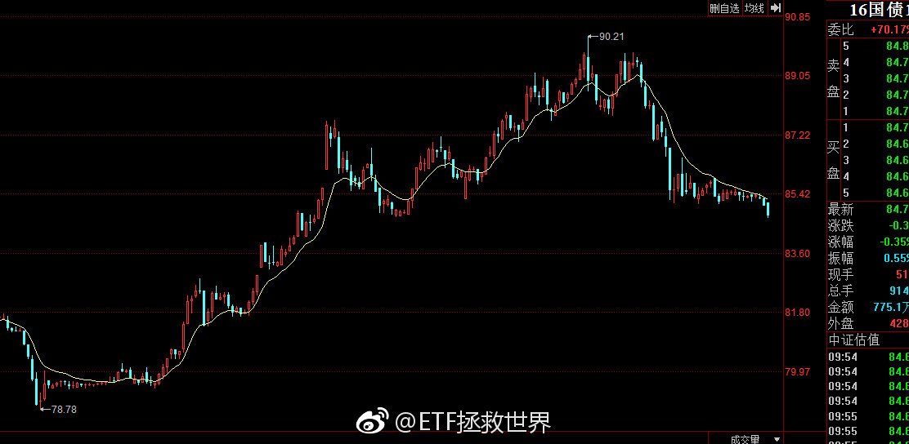

## 2018-09-20 10:19

我忘了以前说没说过了。投资这件事，不亏损，少亏损的意义远超你的想象。

一道简单的数学题：

第一年涨40%，第二年跌20%，如此往复，与每年涨6%谁赚得更多？

答案是每年6%赚得更多。因为别看前一种情况涨40%，跌只有20%，但长期下去，这样的账户收益率也只有5个多点而已。这与一般人直观的感觉，也就是40-20=20是完全不同的。

所以，有的基金，今年赚40%，非常NB，明年亏20%，你觉得不错。其实不是这样。算上管理费+业绩提成，你的实际收益可能甚至也就每年4%……

## 2018-09-20 10:41

刚看了一眼，2015年7月第三轮计划开始以来：

432只股票基金中，收益率超过计划的29只，排名百分比6.71%。收益率为正的68只，84%亏损。

1001只配置型基金中，收益率超过计划的249只，排名百分比24.88%。其中收益率为正的358只，64%亏损。

随着计划仓位越来越重，未来的上涨中一定会大幅度超越绝大多数配置型基金，在配置基金中的排名会大幅上涨。

长期维持在排名前1/4，将会是最佳状态。

PS，又想起某大v点评计划，说，年化收益率还不如去买货基。然而最近他自己开了个公开组合3个月已经亏损20%+。

## 2018-09-20 10:56

回复@我叫何有才的秘密:不是，我下午出去办事就不发微博了……一天的额度上午就用光了。//@我叫何有才的秘密:E大今天发言频率要创记录了，我掐指一算明天要有大卡车

## 2018-09-20 10:57

回复@天才布衣:这种结论不要在熊市下。一个品种一个组合好不好，你至少要在一个牛熊轮回后下结论。你不能因为牛市收益率高就觉得NB，也不能在熊市收益率低就觉得辣鸡。//@天才布衣:哦，那看来买主动的公募基金可能还不如银行理财了

## 2018-09-20 11:17

再发今天最后一条：

无论是选主动公募还是私募，有一种坚决不能买，就是在某个周期里排名特别靠后的。比如后25%或者30%。任何周期里排名这么靠后的都不能买。

排名第一的最好别买，激进。很可能接下来的周期就要吃瘪。大概率变成最差了。前5%-前10%的不是说一定不能买，多看两个周期。

也就是说，表现很好的可以观察，表现很差的直接排除。

最好的是那种，无论是上涨还是下跌周期都排名前20%到30%之内的。赚钱时候不少赚，赔钱时候赔的少。符合这种标准的可以说万中无一，非常难得。

## 2018-09-21 09:37

中国互联基本也回来了。

你发现没有。

只要不买A股，我们买什么都赚钱。 ​​​

## 2018-09-21 10:00

一个酒一个色。

太危险了！ ​​​

## 2018-09-21 10:17

军工磨磨唧唧不像个男人。

你一下子整5%能咋地？

别逼我打电话摇银儿…… ​​​

## 2018-09-21 10:21

回复@monster的垃圾场:无语什么。你没有50吗。我有8份，很开心。你为什么不开心。//@monster的垃圾场:500天天跑输50。无语

## 2018-09-21 11:46

太坏了。这谁啊这么坏。想骂人。 ​​​

## 2018-09-21 11:58

写完文章发现突然大幅拉升。如果是这样稍微等回调也行。不等也可以。自己定吧。一两个点的事。

## 2018-09-21 13:36

今天跳车不算错。 ​​​

## 2018-09-21 14:10

为什么  @飘仙的日记      这么讨厌那谁。

混迹雪球三年多，从牛市时候的群魔乱舞，什么手哥、根叔、偷腥、易碎品，骗子横行，到现在熊市退潮，发现一大堆牛鬼蛇神其实都是在裸泳。说实话，我相信以方丈的智商绝对能够分辨出谁是骗子谁是真有水平的，但他作为雪球的创始人，多少也会有自己的考量 ​​​

## 2018-09-21 14:15

天妒英才 ​​​

## 2018-09-21 15:01

服了，50+金融是今天最猛的两只。

到底是闹哪样啊亲。别这么玩好吗。 ​​​

## 2018-09-21 15:09

不用急。趋势变一个我们加一个。还有十几个品种未来可以加。

另外，这么强势的拉升，回调是大概率。跳车的可以到时候加，我也会提醒。

没跳的也没事。两个点。不是大问题。做好会回调的准备就行了。

所以你看，下跌可怕么。一点都不可怕。满世界的利空，涨两天就全没了。

这就是股市。以前这样，现在这样，未来还这样。

至于还没买的部分，会有机会。价值也好趋势也好，都有机会继续买。踏踏实实的。

## 2018-09-21 15:11

谁能想到，今天全市场股票涨幅大于50和300的只有不到10%。

涨幅大于500的大概1/3。

牛市来了指数涨幅没股票大？

你得多自信才能认为自己一定能选出比指数涨幅大的股票啊。 ​​​

## 2018-09-21 15:38

开始看留言。只有20分钟时间。 ​​​

## 2018-09-21 16:43

回复@霸气的april:必须卖啊。不卖跌回去了就亏了！//@霸气的april:我的500飘红了 好想卖啊

## 2018-09-21 16:49

转发微博

## 2018-09-21 17:41

今年计划浮亏能不能回到5%以内就看今晚了！

超过60%仓位指数怎么做到跌幅只有300的1/3和500的接近1/5的到底。服了。

PS：同期300跌幅15%；500跌幅23%。

我还是认为今年亏不了。 ​​​

## 2018-09-21 18:07

回复@种竹子的:你这是需要让我精确定义股市的时间和空间，我没这个能力。你打听到了记得回来跟我说一声啊。//@种竹子的:e总，什么时候能回钻石底？急。

## 2018-09-21 18:13

我看，很多人依然无法停止对市场的预测。比如，跌到多少点，什么时候能转折。

你能不能换个思维方式。

将市场和你持仓的品种最差的空间情况推演出来，然后推演最差的时间。也就是，时间空间最差的情况预计到。

然后做压力测试。然后根据概率分配仓位。

未来你 我 任何人都没法预测。更别提精准的定义时间和空间的具体数字。谁说自己可以全都是骗子或者傻子。

用数据定义时间空间的极限，用策略指导操作。就这么简单。天天没事儿猜什么啊？累不累？能赚钱？一次猜中了，次次都能猜中吗？

## 2018-09-23 09:32

需要学会在口水中游泳。还是觉得有点恶心。现在能想到的，没有口水的唯一方法就是隐形，让吐口水的人找不到你。

## 2018-09-24 19:59

谢谢大家私信和评论里的中秋祝福，没法一一回复，请见谅。

也祝各位中秋快乐！ ​​​

## 2018-09-25 11:06

$全指金融 sh000992$  5090点跳车的可以上车。

## 2018-09-25 15:20

这一天天瞎忙的，正经事发微博都耽误了。 ​​​

## 2018-09-26 09:34

踏踏实实拿着。等抬轿。

虽然抬轿的还不知道在哪儿吧。 ​​​

## 2018-09-26 10:06

其实各位真的要心怀感激之情了。

这样五年一遇的大底部，真的是咱们积攒廉价筹码的黄金坑。这一次出去后，下次就要等很多年了。当然，这次还要多久出去还不知道。

但这不重要。就是现在能让咱们买这些便宜货，就谢天谢地谢人了。

换个角度想，就像北京11万一平米的房子，打了5折变成5万多了。你说你多开心，买买买啊。至于它一两年涨不涨，你会天天看中介信息吗？肯定赚钱啊！

## 2018-09-26 10:18

回复@TB-ETF:如果你有10万，可以给它拉到涨停！不，5万就够了……//@TB-ETF:今天159940，怎么像停牌一样？益达@ETF拯救世界

## 2018-09-26 10:24

说时迟那时快，抬轿的来了，么么哒。

## 2018-09-26 10:31

大指数方面，目前价值仓位布置的差不多了。趋势仓位也进了一次，之后还有机会再进一点。基本上就配齐了。

大指数仓位包括50、300、红利、金融。

踏踏实实的，多大点儿事儿。 ​​​

## 2018-09-26 10:38

刚看了一下，目前大指数仓位19.89%，简直完美。标准以及经典的配置比例完成了！

## 2018-09-26 10:41

回复@狒狒女侠小马甲:我的这些“专业术语”什么书上都没有……类似于个性化的天王盖地虎。

## 2018-09-26 11:00

感受一下周围。是不是有人开始说牛市来了情绪开始激动起来了。认真感受。记住。

## 2018-09-26 11:01

再说一次，不要看不起50。

50，只要你会玩，真的是神器。

但前提是你会玩。长期持有可不行。波段神器。 ​​​

## 2018-09-26 11:08

回复@卤水凤凰:A股几乎没有。因为群众情绪波动太大，导致市场波动极大。在高位不卖出简直是暴殄天物了。//@卤水凤凰:有没有可以无脑长期持有的品种呢？

## 2018-09-26 12:55

未雨绸缪是对的，但不要对未来太过焦虑。

80%的焦虑没有意义。船到桥头自然直，直不了的焦虑也没用。

尽量考虑清楚细节，做好准备，然后听天由命。 ​​​

## 2018-09-26 13:16

这一波两笔加仓，一笔最低点当天，一笔启动日。如果第二笔下午不暴涨就是完美了 ​​​
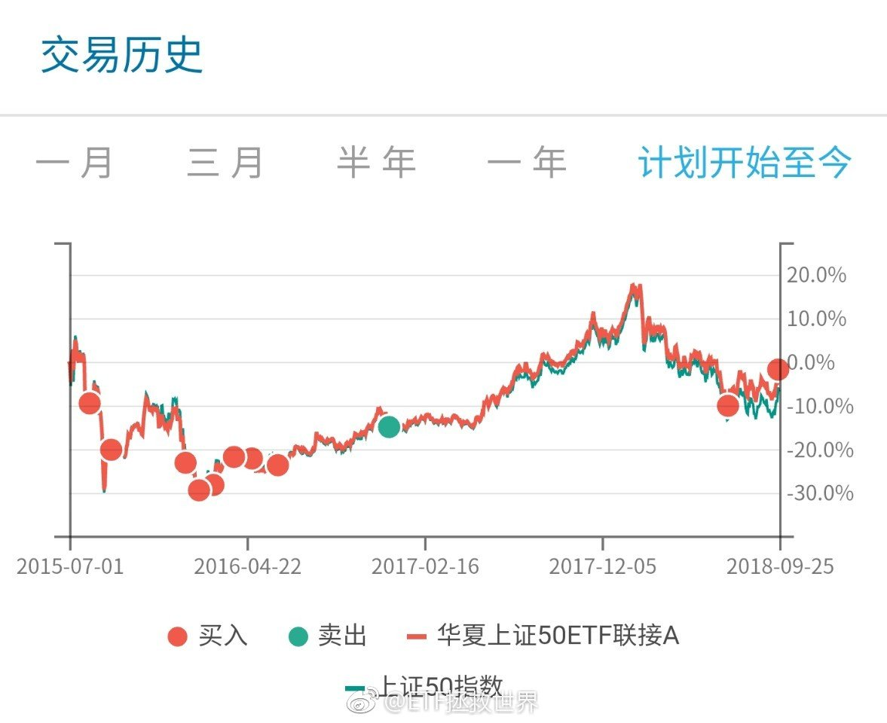

## 2018-09-26 13:42

目前涨幅大于50的股票有366只，跑输股票占比90%。 ​​​

## 2018-09-26 13:45

无论涨跌周五又有几只趋势仓位可以加。

踏踏实实的，多大点事儿啊。

踏空？呵呵哒。

不过讲真，现金只剩35份了。子弹也不多了。 ​​​

## 2018-09-26 13:51

什么叫做追涨杀跌和接盘？

一波行情，如果涨幅200%。你在100%，150%，190%追进去，那叫追涨，接盘。

你在比最低点上涨5%的地方买进去也叫接盘？

那什么不叫接盘，最低点才不叫接盘？

对别人要求有点高。 ​​​

## 2018-09-26 14:12

回复@骑着乌龟看海198605:什么时候才能不再预测呢。来，有来的预案。不来，有不来的。爱来不来。我预测不了。不过我认为大概率会来。要不空间，要不时间。//@骑着乌龟看海198605:E大，是否意味着钻石底不会来了？

## 2018-09-26 14:14

有人说500辣鸡。

你知道今天有66%的股票连500都没跑赢吗。你知道今天有1/3的股票还在下跌吗。 ​​​

## 2018-09-26 14:30

回复@江苏红石:案例：根据主观预测进行操作。供大家思考。无论卖出是对是错，这种交易模式的问题在哪里。//@江苏红石:回复@ETF拯救世界:向E大汇报下：前几日，我脑子坏掉了，把心爱的159938医药在1.2时减了半仓，当时觉得医药政策的利空会让它到1.0以下吧。。呜呜呜

## 2018-09-26 14:37

很多朋友没有明白一件事：

在股市上：

你认为的利好，未必会涨。你认为的利空，未必会跌。

推而广之：

大家认为的利好，未必会涨。大家认为的利空，未必会跌。

再推而广之：

你认为的小事，可能会是搅动世界的蝴蝶翅膀。你认为的大事，可能是历史长河中毫不起眼的尘埃。

“你认为”，并不重要。

一个根据预测投资的人，很难长期赚钱。有没有这样的？有。万中有一。

就这人中龙凤，还有一大半是运气好。

类似于两两猜拳的冠军。他不是猜拳猜的好，而是运气好。

人类没有预测的天分，施主，放弃吧。

## 2018-09-26 15:11

回复@梁小雨:今天涨跌家数对比是1870:1343。股票下跌很正常。指数方面，所有都在涨。无论大小指数。喷了。//@梁小雨:看看我手里的股票、还有中的新股今天居然跌得面目全非

## 2018-09-27 08:43

我觉得，微博这种被一位博主拉黑就禁止评论三天也不合理。

最好改成被3-5个10万粉丝以上的博主拉黑，禁止评论1-3个月比较合理。

如果球球是这样，估计也不会有那么多人被喷子喷走了。 ​​​

## 2018-09-27 09:23

A股指数基金的普及，以及纳入各种国际指数，是我预期中未来的长期特大牛市的资金基础之一。

持续十年以上的牛市对未来的A股来说不是梦。

当然，涨十年可能幅度也不会很夸张。有可能十年涨幅还没0607两年大…… ​​​

## 2018-09-27 11:30

明天又到了关键日。几个指数目前很微妙，可上可下。

也没几个钱了，还剩25%，无所谓了。慢慢耗着吧。 ​​​

## 2018-09-27 13:48

股票这玩意吧，你看别人买什么也去买，其实风险很大。

就像你看人家去走钢丝高空飞人你也去一样危险。

我观察的一个高手，收益率很高。但是他强力推的几个股票，你买了拿到现在巨亏的很多。

不是说人家不靠谱，而是说你没有人家的技术。

今天一只又暴跌50%。

但是人家赚了很多。

所以跟股票真的谨慎点最好。

不把买点卖点买卖时间都跟上，那就不如不跟了。

## 2018-09-27 14:01

回复@勤奋happyfire:不对。每一个人的风险承受能力和预期收益率以及各种情况都不同。不要看别人，问问自己。跌50%和涨50%现在舒服不舒服。舒服就不要改变。

## 2018-09-27 14:21

风骚的50难道又要红。

2800家下跌。 ​​​

## 2018-09-27 14:52

但是，有人所谓的“未来就是跟美股一样，是大盘股的天下，小盘股全完了”这种论调不仅无知，简直就是扯淡。

过去十年罗素2000小盘股指数和标普500和道琼斯工业的对比。

小盘股，永远不要看不起小盘股。无论是香港，美国，还是A股。

记住这个。

垃圾股和小盘股可不是一个概念。 ​​​
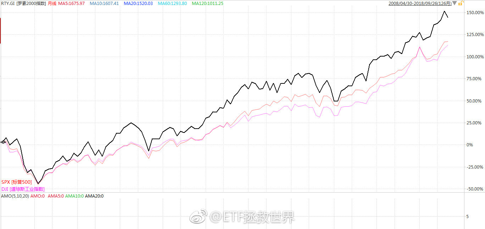

## 2018-09-27 16:49

等你。

## 2018-09-27 18:32

消费降级太可怕了，突然发现已经一年没买新手机了……

想买又不知道买哪个，好像都没什么特别的，不换又腻了…… ​​​

## 2018-09-27 22:16

刚看了一眼，仅美股市场上跟踪标普500指数的ETF规模就超过4万亿人民币。 ​​​

## 2018-09-27 22:29

我建议各位，无论看到谁说什么东西，都先去求证一下到底是不是，不要别人家说个结论你就随便信以为真。

很多人大概都没弄懂什么叫港股化就天天跟着别人喊A股要港股化。别人说美股小盘股不行你也跟着说。打开软件看看，长期，分阶段，多看几个大小盘指数，都看看再说。

要独立思考啊，朋友们。 ​​​

## 2018-09-28 10:50

嘀嘀。

我出去办事了。这一天给我整的，开个车四脚朝天了。 ​​​

## 2018-09-28 11:24

别再说“未来变成日本怎么办”了，人家三十年新高了

## 2018-09-28 13:07

又来？

心好累。 ​​​

## 2018-09-28 13:32

如果没有今天的大涨，300的形态是最完美的趋势转折最佳买点。

涨了就差很多了。稍微有点追高，不完美。 ​​​

## 2018-09-28 13:34

回复@haoren17:评论也要关上以后。//@haoren17:创业板没怎么涨

## 2018-09-28 14:49

好了，不要涨也不要跌，就这样静静的收盘。

答应我。 ​​​

## 2018-09-28 15:01

我去买杯咖啡，回来开始看留言。

500多条，还可以。一个小时就看完了。 ​​​

## 2018-09-28 15:28

回复@Costolo:人家辛辛苦苦一个字一个字打出来的留言，你连看都懒得看吗//@Costolo:为什么这么认真，观察情绪吗？

## 2018-09-28 17:18

50除非出现回调，否则绝不会再买。它已经脱离我定义的可买入区域。 ​​​

## 2018-09-29 10:26

有人吗，都干嘛呢。我在刷数据…… ​​​

## 2018-09-29 13:20

我看出来了，第一，今天都很闲，而且赌场不开门更闲了。我国社会劳动生产率急需提高。第二，说正经的没人回复，说不正经的大家都很开心的冒泡了。

## 2018-09-29 13:54

问个正经的吧。

橱柜台面客观原因不能太高，主要是窗台低了点，所以可能13套的洗碗机塞不进去。8套的是不是真的就不好用。有没有用8套的朋友展开讲讲。

要真不行台面做高点也勉强可以。 ​​​

## 2018-09-29 15:28

搞定了同学们，原来今年西门子新款真的是矮一些可以放入正常橱柜。不能做高台的原因已经说了，是窗台低。现在解决了。不过因为是国产的，不知道和以前西班牙进口的质量有多大区别。

## 2018-09-30 11:21

北京银行T+0理财今天还能做到3.9%……给力了…… ​​​

## 2018-09-30 11:47

回复@季明jimmy:北京的是R2.今天开始计息。我很少买理财，以后可以考虑买一部分。T+0赎回也比现在货基方便多了。//@季明jimmy:招行有3.9。不过是R3风险，R2风险的是3.5

## 2018-09-30 11:49

回复@黄土地的吃货姐:我182，太太168。感觉还可以吧，不算矮。//@黄土地的吃货姐:楼主家个子不高

## 2018-09-30 12:34

回复@醉翁得意:我买了十几年货基没听说过出事，银行理财倒是有出问题的。所以建议大家还是研究清楚再买。//@醉翁得意:银行理财和货币基金有什么区别，风险大吗？//@ETF拯救世界:回复@季明jimmy:北京的是R2.今天开始计息。我很少买理财，以后可以考虑买一部分。T+0赎回也比现在货基方便多了。

## 2018-09-30 20:04

校长肯定有不对的地方，但是也得教育孩子一件重要的事：不要嘴贱。以后会少吃很多亏……

