## 2018-12-01 23:24

不是我不明白，这世界变化快。连”男子汉“都z z不正确了。男女生而平等，但天生有别谁能否认？为什么泰坦尼克号下沉的时候要让女人和孩子先上救生艇？没有男子汉的担当，喊着男女平等一起往救生艇上挤吗。我个人认为，教育男孩多承担一些责任没有任何问题。

## 2018-12-03 06:47

这么说，一吨500面值的欧元钞票最值钱。进一步推理，你应该知道关键时刻身上应该带着哪种钞票了

## 2018-12-03 09:26

上周的五车几个品种买的还开心吗 ​​​

## 2018-12-03 09:30

就看下午德国表现如何了 ​​​
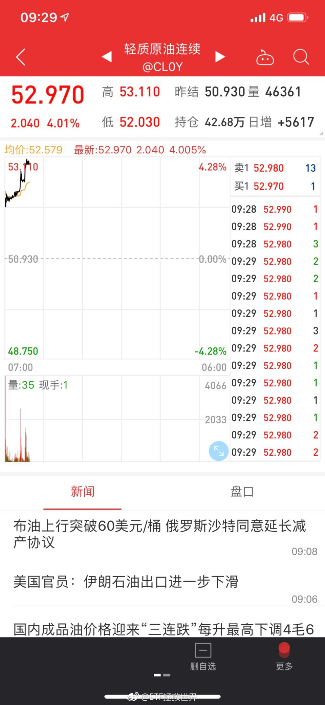 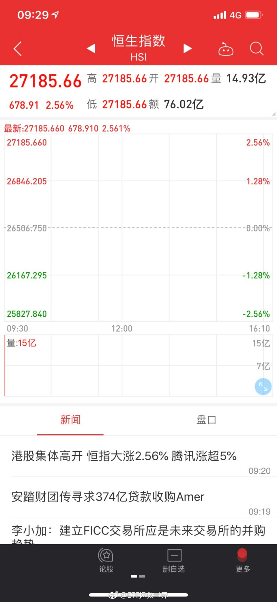 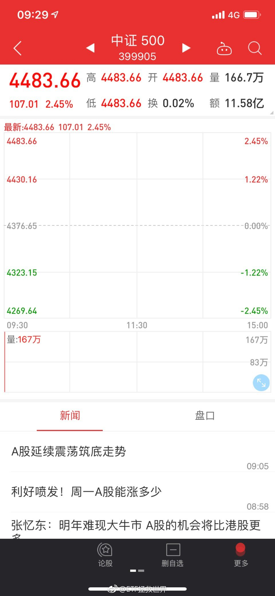

## 2018-12-03 10:41

这样涨真的好吗 ​​​
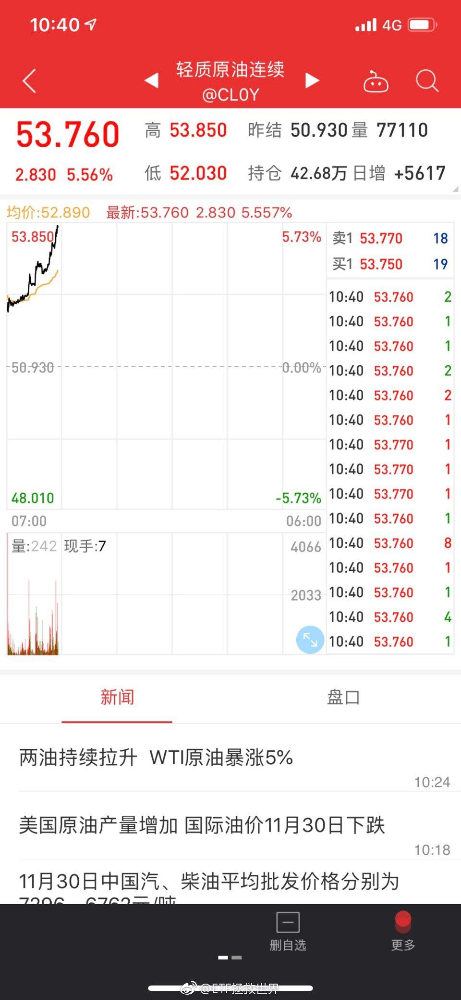

## 2018-12-03 11:37

多少钱

## 2018-12-03 12:42

一个数据：

目前录取比例是1 ：500 ​​​

## 2018-12-03 14:13

现在不会有人觉得仓位不够了吧。

现金只剩不到15%了。再次在熊市中顺利建好仓位。历史不断循环。

踏踏实实的，多大点事。 ​​​

## 2018-12-03 15:27

1：700。 有什么让大家误解的地方了吗。是不是都以为每天工作一小时月收入过万了……

## 2018-12-03 15:48

怎么感觉有加速的迹象…… ​​​
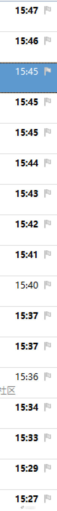

## 2018-12-03 16:30

德国 查看图片

## 2018-12-03 17:57

长赢已经受邀加入。

## 2018-12-04 09:29

早上好。昨晚睡得怎么样。

我没睡好，看了400多封邮件。

还有700封。 ​​​

## 2018-12-04 10:18

回复@龙水六队:给发达国家留了15%的仓位，目前才2%。越跌越舒服啊。//@龙水六队:今天还舒服吗？//@ETF拯救世界:德国 查看图片

## 2018-12-04 11:46

看了几百封，说说感受。

第一，很有趣。

跟以前单位招聘收到的简历不同。以前收到的简历，教育背景，职业背景都差得不是很多。这次真是五花八门干什么的都有，有些朋友职业生涯变化之大让人目瞪口呆。特别有意思。感觉经历了很多不同的人生，有趣。

第二，各位大学生们写简历要走心。

我不是说每个都不走心，绝大部分不走是没跑的。你把在校生和社会人儿的简历放一块很明显就能感受到了。也可能不仅是不走心的问题，是能力确实差很多。建议各位学生朋友以后给人发简历第一是走心，第二是赶紧提升各方面的能力，以后会更有竞争力。

第三：

清华毕业的比北大的多好多，结论：北大不行。[doge]

## 2018-12-04 12:56

回复@包子小婉:我看了的都不会发回执。周知。//@包子小婉:回复@策略晓浪:你是几点发的呀，我第一天晚上十一点发的一直没收到回执，好慌呀

## 2018-12-04 13:26

赶紧出个ETF行吗多简单的事儿

## 2018-12-04 15:09

医药总仓位13%够不够呢

$全指医药 sh000991$ $养老产业 sz399812$ ​​​

## 2018-12-04 17:38

回复@formulin-huang:有这么完美吗。 看了一眼，按照当天盘中算，真是30%。你问我为什么这么准——蒙的。//@formulin-huang:2016年1月11日，益达在球球说：养老指数极限跌幅也就是30%了。单从点位来说，当时大概8000点，2018年10月19日5831点

## 2018-12-04 17:39

万万没想到，红利真的把格力踢出去了。

## 2018-12-04 18:24

有人说，养老最后一次买你不说最大跌幅20%吗。

很多细节如果你不用心去体会，你根本理解不了。

你以为大家都对下跌毫无畏惧甚至满心期待的原因是什么？一点一滴的结果。

我用心做这件事，你用心体会才能懂。 ​​​

## 2018-12-05 07:10

又是暴跌。美股什么时候才能进射程啊。

## 2018-12-05 10:35

医药没券商那么猛。但是一步一步稳稳的往上走，喜欢。

## 2018-12-05 11:19

我理想中美股应该是8%-15%。欧洲应该是5%-10%。

目前标普500、纳斯达克、dax30都有产品。别管跟的怎么样，好歹是有的。

富时100还没有，目前英国德国都不贵。赶上脱欧又是乱哄哄的，正好可以买。希望赶紧出产品。 ​​​

## 2018-12-05 11:26

毒奶失效了。惆怅。//@ETF拯救世界:医药没券商那么猛。但是一步一步稳稳的往上走，喜欢。

## 2018-12-05 12:35

不说司机的问题。这个领孩子的家长问题也很大。这样都敢往车前面挤。在咱们这，不是该默认车不会让人吗

## 2018-12-05 22:28

今天就到这儿吧。还有500多了。

看完了就归到不同的文件夹。不知道你是在哪个文件夹里……

睡觉去了…… ​​​

## 2018-12-06 08:26

押金没戏了吧

## 2018-12-06 08:29

大事

## 2018-12-06 09:12

估计今天反应不会小。至少信息要跪吧 ​​​

## 2018-12-06 09:37

回复@远方诗集:一个炒作板块还不还和我有什么关系//@远方诗集:益达，军工会不会又还阳啊

## 2018-12-06 10:01

回复@龙水六队:如果我们被埋会让你开心，或者能让你兜里多几块钱…好吧，就当我们被埋了吧，你开心就好啊ᕕ(ᐛ)ᕗ//@龙水六队:上次发车的全埋了吧？//@ETF拯救世界:回复@远方诗集:一个炒作板块还不还和我有什么关系//@远方诗集:益达，军工会不会又还阳啊

## 2018-12-06 10:04

回复@梁书豪·:讨厌我的人多了，他算老几。//@梁书豪·:不认同别人理念不来看就好了啊，还搁这幸灾乐祸//@ETF拯救世界:回复@龙水六队:如果我们被埋会让你开心，或者能让你兜里多几块钱…好吧，就当我们被埋了吧，你开心就好啊ᕕ(ᐛ)ᕗ//@龙水六队:上次发车的全埋了吧？

## 2018-12-06 10:29

这次12月调整指数成分股，别的指数我没有细看，从中证500的情况来看，调出的大部分都是亏损股，还有中弘退这种。调入的大部分都是估值较低的股票。不好的就是钢铁多了点，不是大问题。

所以只要宏观不出大问题，指数一定是长期向上的，毕竟汰弱留强。

我们要做的，就是吃到基础的指数向上收益的同时，再多吃点波动收益，成绩是不可能差的。

## 2018-12-06 10:48

不知道有没有人跟我一样，今天早上看到这个新闻后，居然想以后买手机优先考虑华为了……

如果华为能把屏幕和工业设计做好的话…… ​​​

## 2018-12-06 13:04

$全指医药 sh000991$   看来还能继续买啊。 ​​​

## 2018-12-06 13:34

下次买入应该在7900左右。

## 2018-12-06 13:41

8月划定7700点，当时9200。最终这波大跌只有10月底两个交易日收于76xx，再未破过。这次再次划定7900。不解释。

## 2018-12-06 13:55

就这么点事儿。没什么大不了。 ​​​
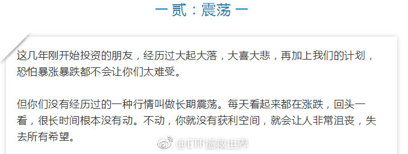

## 2018-12-06 16:09

回复@早起拜瓶迁晚睡读益达:安排的明明白白的。

## 2018-12-06 16:51

英德已经开始挑战欧债危机时候的估值了。如果到那个历史大底区域，大概要跌25%-30%（英国只有不到20%）。

真到了，一次配满。十年不用惦记了。 ​​​

## 2018-12-06 16:57

回复@GodLoveLBJ的战斧劈扣:当时英德在11-12之间。目前德国16，英国15左右。//@GodLoveLBJ的战斧劈扣:请问E大，欧债时期的估值是怎样的了？不太了解

## 2018-12-07 10:25

dax场内溢价接近5%，建议慎重购买 ​​​

## 2018-12-07 10:55

英国富时100，目前低于2000年点位。当然，这是不计股息的。计股息没那么惨。

指数这么惨，你都不知道有多少成分股更惨。20年估计还有不少下跌的。这还是大英帝国最好的一批公司。

但实际上，这二十年的低点算上来，涨了也有一倍。而且还是两次大波动。

我要说的，是，所谓股票投资超长期坚定持有，是不靠谱的。一定是根据情况有买有卖。

问题的关键当然是什么时候买，什么时候卖。这是需要进一步讨论的。但前提一定要明确，就是你的仓位要变化。高位仓位低，低位仓位高，千万别做反了。
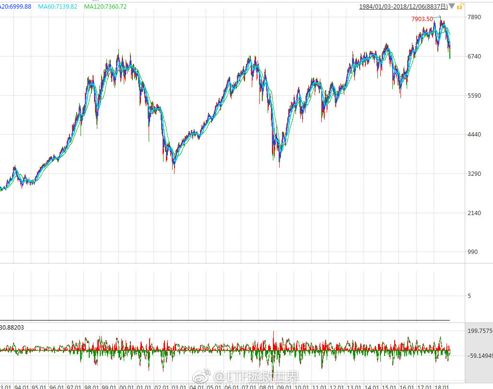

## 2018-12-07 10:56

为什么我笑了。

## 2018-12-07 11:01

回复@豪斯伪大叔:我个人认为英镑是在底部大区域了。 查看图片 //@豪斯伪大叔:但考虑到英镑汇率，用人民币看亏的不行吧

## 2018-12-07 11:03

回复@BreezeVivian:这不算黑天鹅。如果巨变，未来你会赚得更多。//@BreezeVivian:益达兄，类似集采政策这种医药行业的黑天鹅，会不会导致医药行业指数历史估值体系巨变？

## 2018-12-07 11:07

黑天鹅这个词我说各位是不是用的太滥了。。一致性，4+7……这都什么黑天鹅，都不是。一个行业发展过程中很正常的政策变动。

黑天鹅是那种你根本意想不到，认为不可能发生的事情。这种政策变化可不是什么不可能的事，都在考虑范围内。

我们组合中医药+养老有13%。养老成分中有40%是医药，加起来医药一共是10%仓位。我一直以来希望给到医药15%-20%。这5%-10%的空间，就是我预留给各种变动的。

这点预先准备都做不好，就别来投资了。

## 2018-12-07 11:25

做投资，有两点很关键：

第一，大多数人都是错的。你看太多声调一致的东西，相信了，就会出错。这个世界人云亦云的人非常非常多。跟大多数人站在一起，赚不到钱。

第二，最重要的是价格。一个利空或者利好都没那么重要。因为价格可能已经反映了这个利空或者利好。你赚钱还是赔钱，决定性因素是你买这个东西的价格。

## 2018-12-07 11:29

回复@求财不劫色:ETF不是LOF。ETF和场外连接基金是两个基金，净值当然不同了。//@求财不劫色:回复@哈哈大大地:咱们说的都是华安德国30，你说的是场外的，场外的一般跟的比较准，一个一个净值，我说的是场内的。代码是513030。为什么跟踪同一个指数，数值却不同，我也不清楚

## 2018-12-07 12:47

回复@老高GG:我现在用oasis2，东西还不错，性价比一般。买个带背光的基础款足够了。我喜欢用kindle看书，一个是轻，一个是标注做记号方便。除了很经典的书，我一般不买纸质了。最主要占地方。毕竟我是豆瓣断舍离小组的。

## 2018-12-07 13:32

今天冷的有点犯规了。 ​​​

## 2018-12-07 13:42

回复@MK_dwarf:你这辈子都不会见到我在金融市场上慌。//@MK_dwarf:别慌 医药会跌到7000以下让你一次加满

## 2018-12-07 14:06

回复@策略晓浪:2015年7月开始第三轮计划，一年半以后才买了第一份医药。2018年全年只买了三份。三年半才买了十份。赶紧跌，不跌还没法买呢。

## 2018-12-07 14:44

今天靠传媒环保红利撑场子了…… ​​​

## 2018-12-07 14:55

回复@rapuzal2016:这么坚定啊。那这些看空的，还有你的房子卖了没？还是说一直看空根本就没买过？//@rapuzal2016:那现在步调一致地唱空房地产尤其是三四五六七八线地产的呢？我个人觉得挺对，呵呵

## 2018-12-07 14:59

真看空一个东西，你就要大幅减仓。甚至加点有看空属性的品种。比如2015年上半年我看空，就把A股卖的7788再满仓分级A。3年多后的现在，终于在这几个月大买特买把A股买到了65%。这意思是没那么看空了。

你不能嘴上说看空博眼球，你自己的根本不卖。这叫什么看空，这叫嘴炮。

看空人民币的，你有没有把钱都想办法换成美元？至少换一半吧。看空房价的，你有没有卖掉你的房子，至少把除了自住的都卖了吧。您说是不是这个理儿？

## 2018-12-07 15:45

本周份微博聊完了！

欢乐的时光总是过的特别快！看看时间差不多又要说白白！

咱们下周接着聊不见不散！ ​​​
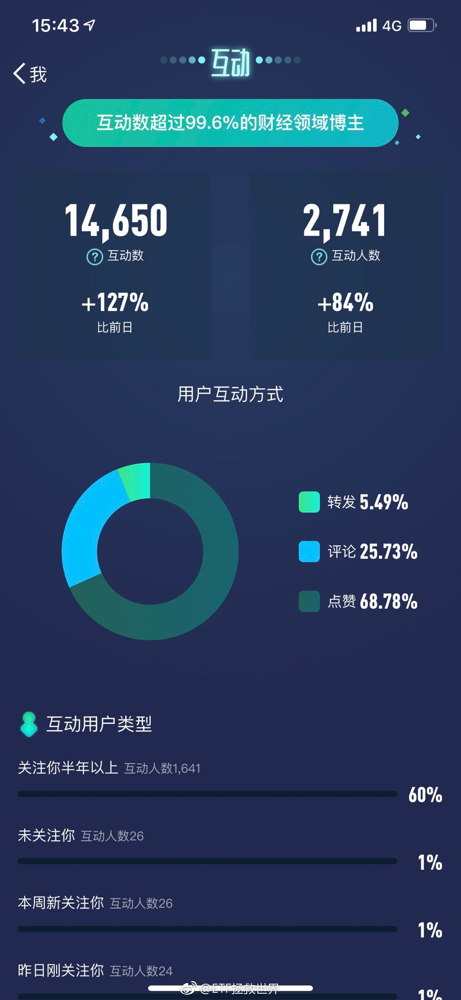

## 2018-12-08 17:46

打脸了，今天看了好几个北大的……我是从后往前看，原来北大的发邮件都比较早……

谁说北大不行的！

当然，毕业院校的因素基本没有任何权重…… ​​​

## 2018-12-10 10:12

不要急，控制节奏。 ​​​

## 2018-12-10 14:12

回复@画了朵花花:忙呢。再坚持几个月，明年开启全陪模式//@画了朵花花:刷新了一上午，是我心态不好了吗，冷宫的感觉了。

## 2018-12-11 16:11

对于同样一个职位薪酬，四个人中最多和最少的就有十倍的预期差…… ​​​

## 2018-12-12 08:55

富婆这几天是不是又开始给我买粉丝了。

有钱也不能这么糟蹋啊。

直接打我支付宝多好。 ​​​

## 2018-12-12 17:27

几乎每一个已经回复第二轮答题邮件的朋友都提到了一件事，即在整理资料过程中自己的进步。

要知道，第二轮的题目只是整理三个月的文字资料及2个月的发车数据。

可想而知，整理完过去十三年的文字及十年计划数据后会有多大的新感受。以及，各位未来看文章的时候也会有很多感悟。

确实是一件很有意义的事情。

## 2018-12-12 20:21

扔掉家里100件东西。你会发现不会造成任何不便。

区别是瞬间神清气爽了。 ​​​

## 2018-12-13 10:51

回复@乘凉的蜥蜴:chinaetfs//@乘凉的蜥蜴:请教大家一个问题 最近关注的Ｅ大 请问Ｅ大主要在哪里发文章呢 公众号我搜过etf拯救世界感觉不太对呢

## 2018-12-13 11:12

以后发车前涨不涨真的无所谓了。A股部分已经买的差不多，如果有深跌还能大幅加仓，没有基本就这样了。

踏踏实实的看戏。 ​​​

## 2018-12-13 11:30

回复@小狗上马路:还有S计划啊//@小狗上马路:请教一下E哥，如果不发车，维持目前仓位，那么，每月积存的现金是否一直留着？

## 2018-12-13 12:58

回复@淡如蓝2002:第一，股市并不是经济增长快就涨的快，增长慢就下跌。第二，股市是先行指标。等一切都变好，股市的牛市行情已经走了70%//@淡如蓝2002:请问一下，都说2019年甚至接下来二三年经济都不行，那么股市也一样没行情吧？那底部可能更长了吧//@ETF拯救世界:回复@小狗上马路:还有S计划啊

## 2018-12-13 13:14

回复@Compass_J:不贵的时候买，等着涨，是我能想到最靠谱的投资方式。总是想精准买在起涨点，不是说不行，风险很大//@Compass_J:先行指标也得讲点逻辑吧，，再不济也得讲点情绪不是，，不讲情绪也得讲钱啊，，，对不？

## 2018-12-13 15:48

99%的答题者计算收益率的时候都犯了一个大错。

所以我说细心、认真是最重要的。

路还很长啊。 ​​​

## 2018-12-13 17:34

聪明钱都在加仓指数基金。

## 2018-12-14 07:35

欢乐祥和的各位，看看今年发生了什么。你们这么开心是闹哪样

## 2018-12-14 13:59

不发车影响这么大吗 

国家就差我这几百块吗。。 ​​​

## 2018-12-14 14:19

回复@美味的葱油饼:看我说什么，同时也要看我做什么。看看下次计划加医药是何时。//@美味的葱油饼:医药的带量采购让医药行业估值重新洗牌，也就是以前的估值现在可能不适用了，7900可能打不住。

## 2018-12-14 14:55

就问你一句准不准。每天热热闹闹涨了跌了，回头一看原地没动。踏踏实实的，做好心理准备，做好吃波段的策略。多大点事儿。一切尽在掌握。

## 2018-12-14 15:08

最近承蒙新浪畀面，推荐了不少新朋友关注我。

如果您是刚关注我，欢迎。不过我建议你多看几天再评论。我的过去，以及我现在在做什么，弄清楚再说话。否则别怪我直接删评论&amp;拉黑，弄得您三天不能全站评论您说多尴尬。

弄清楚是怎么回事再张嘴，是现代社会最基本的做人准则之一。

同意不？

不同意拉黑。

## 2018-12-14 15:16

有没有一起的，明天见。

或者。

新闻里见。 ​​​
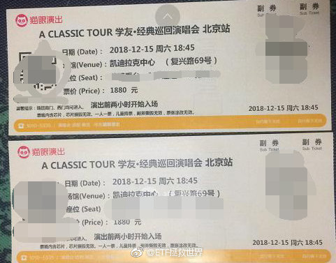

## 2018-12-14 15:26

回复@海文a:哪能港，要让大家都感受到温暖一刚。//@海文a:粤语说得好正宗，是因为广东人粉丝最多的原因吗？

## 2018-12-14 15:50

所谓定投，也就是定期定额投资。

我不是说好不好，而是十年前我就发现它的弊端。也在2008年写过一篇“定投未必如你想得好”这样的文章，现在还可以查到。

别急，明年这些东西都会重新发布，并加上最新点评。一切疑惑都会烟消云散。 ​​​

## 2018-12-14 15:58

回复@黑暗时代来了:“定期”是非常好的因素，这个不能变。因为定期才能保证牛市吃饱，熊市不死。至于定期的操作，则是从资产配置的角度出发。如果让我说，是一套3.0的系统了。//@黑暗时代来了:你这个也算定投的一种，可以叫:智能定投。

## 2018-12-14 16:08

回复@诸葛不亮_若如初见:下降不下降不重要。重要的是，如果真的下降了，是不是有预案？未来充满无限可能，是不是做好各种准备才是关键。否则，只是讨论术，而非真正的道。//@诸葛不亮_若如初见:又是估值中枢下降说，别说医药了，A股固执中枢都“被下降”无数次了

## 2018-12-14 17:56

投资最怕什么，最怕看得太近。

因为某个品种最近表现好就强力看好，最近表现差就踩在脚下。我不能接受这样的投资世界观。

有人说油气和油价没有相关性。

我把数据调出来后，迷惑了。

没有相关性吗？

无非是波动性不同，70%的相关性多明显啊。

为什么原油我们选择了油气。

第一，70%相关性足够了。

第二，我们不能选择南方油等投资原油期货的品种。长期损耗太大。不适合计划持仓。

更何况，在我看来，所有的品种都只是交易手段而已。我不求油气一定要100%跟上油价。毕竟——难道我能精准预测油价涨跌？如果不能，我找一个100%跟上油价的品种干嘛？

70%足够了。足够让我的组合多一种相关性很低的品种。

这段话不知道有多少人能理解。

很多人永远在纠结一些很细微的，长期看并不重要的东西。而忘了找到真正重要的核心。
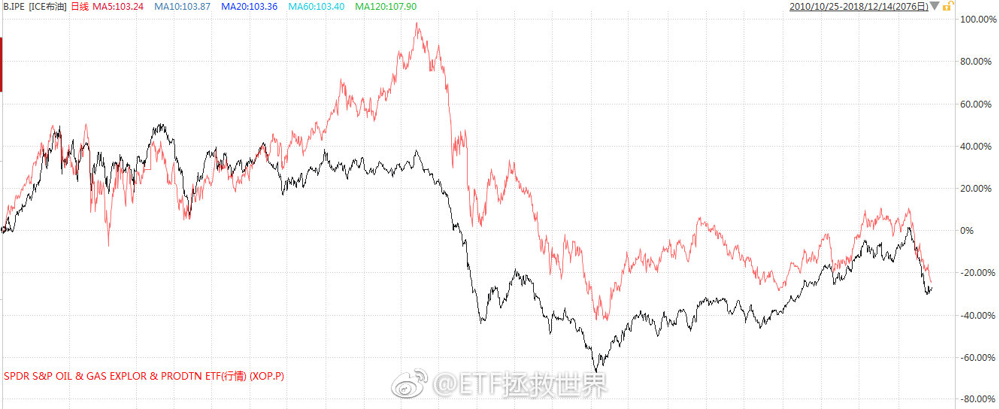

## 2018-12-14 18:33

生活小贴士：

你有没有发现，有时候你因为一点小钱犹犹豫豫，最终都会花更多的，甚至几倍的钱去达到同样的效果。

总结：

不要因小失大。该出手就出手。 ​​​

## 2018-12-14 18:56

回复@看我看我252:我觉得可以啊，我还可以现场讲解。有没有想看的。想看的人多就在微博上开一个。当然只能直播几分钟，注意素质。//@看我看我252:益达，明天去看演唱会，会给我们直播吗，想看。

## 2018-12-15 17:25

震惊！直播计划取消！

要追究法律责任的！ ​​​

## 2018-12-15 19:16

分享我的故事 微博视频 ​​​

## 2018-12-15 22:36

我其实不是很迷学友哥。

是送给太太的礼物。她是真爱粉。

有一半歌没听过的我，看着每首都能跟唱的她，气氛一度相当尴尬。 ​​​

## 2018-12-16 23:18

你为什么还不睡。

老实交代看这条微博前你在干嘛！ ​​​

## 2018-12-17 07:35

所以要审时度势。熊市亏的少，仓位越来越重，牛市吃得好才是人生赢家

## 2018-12-17 09:44

家里没矿的注意节奏。 ​​​

## 2018-12-17 10:11

评论里没完没了问医药的那些人我跟你说几点，你能理解就理解，不能理解赶紧取关走人。

第一，医药是我最看好的行业。

第二，目前计划内医药仓位9个多点（医药6%+养老3%），目标仓位最大给15%-20%。不跌我们永远没机会配满。

第三，目前医药估值过去十三年新低。

第四，目前医药跌至十三年大趋势下沿附近。

第五，今年医药下跌24%，最高点下来跌幅36%，我们持仓浮亏12%。后来跟车的朋友浮亏幅度更低。我不知道你自己炒股不炒股，你去翻翻你股票账户，仓位9%，浮亏12%，去年开始买的股票是不是已经基本表现最好的了。

第六，我的态度会在计划操作中体现。自己回头去看今年医药的操作。

第七，医药是我最看好的行业。

## 2018-12-17 10:21

赚了钱不卖就是过山车。乱卖又赚不到大钱。

事后看明明白白，当时看一片迷茫。 ​​​
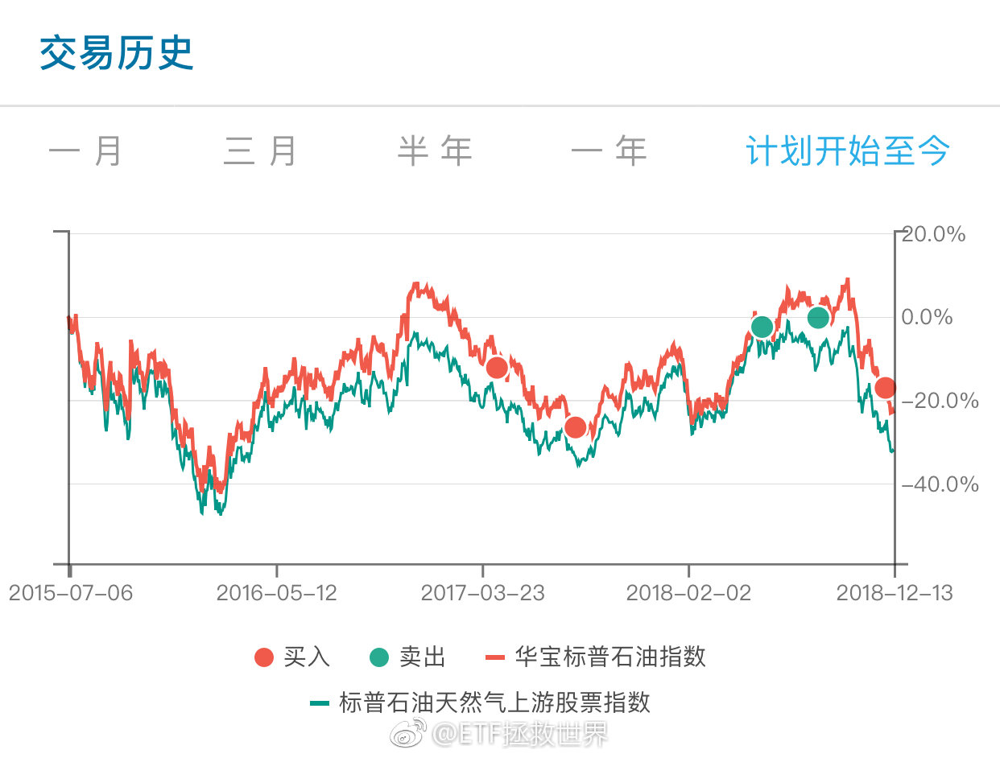

## 2018-12-17 10:24

回复@pby_1988:可以。只要你能保证你的股票不爆雷，而且一定能涨过指数。//@pby_1988:E大，请教个问题，既然医药是您最看好的行业，是不是可以去买全指医药里的股票

## 2018-12-17 10:30

当你有钱想买一个东西的时候，难道不是希望它雷越多越好，跌的越猛越好吗。

你以为超额收益是怎么来的？太平盛世你开开心心的赚的比别人多？

你什么时候对自己的运气有这么大误解的。 ​​​

## 2018-12-17 10:44

回复@胡鹏171:从那时候开始现在已经是第八轮了。一个品种历史最低位附近，却还能赚很多，说明一个好的策略是投资中最重要的。//@胡鹏171:E大，猜你又开了油气网格了吧？看你12年到13年的操作记录，真是太精彩了。

## 2018-12-17 10:47

回复@小明修炼中:这有什么不懂的。你能找到5只牛股就去买5只牛股。找错了的代价就是收益率远低于指数。很多人永远无法理解的是，并非甲能做好的事乙就能做好。所以鼓吹重仓2、3只甚至全仓一只的人，是对他人极度不负责。

## 2018-12-17 13:47

## 2018-12-17 14:51

回复@啊Allen个兄弟:吃饱了撑的吧。我买不买满，他到别的网站别人帖子底下回帖嘲讽？辣鸡。我不买满，能让几万人不死。他除了嘴炮还有什么功能。//@啊Allen个兄弟:回复@ETF拯救世界:图片评论 查看图片 //@ETF拯救世界:

## 2018-12-17 15:00

有了新的情况，你坚持大方向，有人说，逻辑变了，你这样坚持既定方针不会好。

有了新的情况，你技术性的微调，给出更大的安全空间，有人说，你当初怎么说的为什么不做。

你永远也没法让所有人满意。即使你闭嘴一个字不说也不行。 ​​​

## 2018-12-17 15:36

我说怎么今天估值变化不小呢，以为是wind数据又有问题了。

突然想起来今天调整指数成分股…… ​​​

## 2018-12-17 16:15

第一，该买的家电买起来。洗碗机扫地机器人什么的减少摩擦的机会。第二，小时工该请就请。第三，谁有时间谁就做，都有时间就一起做。第四，不管是谁放着一堆家务不干孩子不陪，去玩游戏或者刷剧都该骂。

## 2018-12-17 17:10

雪球确实不能去。

去了情绪受影响。

喷子极多。走了也没完。而且我跟你说，还真有那么一批人关注你。每篇东西他都看，然后喷你。

对于这些喷子到底是什么人，为什么喷，我一直相当疑惑：难道就没点正事干吗。

上次微博的一件事让我有了点认识。

记不记得上次有人在微博评论骂我家人。我急了，准备干他。

他所有信息五分钟之内全部查清。姓名，地址，职业，等等。

哥们马上给我私信，各种认错，之前的嚣张气焰一点都没了。

我这个人愿意与人为善。既然人家认错了，就算了吧。

但这件事让我知道了，喷子们躲在屏幕后面，活在键盘上，其实大部分都是现实社会中非常弱的一群人。

也许只有在网上喷，才能让他有可以发泄的机会。

毕竟，他们的人生太苦了。

## 2018-12-17 17:28

不过想了想，也是有点矫情。

上下五千年，古今中外，有没有一个人不被喷的。

我想了半天，没有。

包括特蕾莎。

所以就这样吧…… ​​​

## 2018-12-17 17:34

不过就像这次有一道题是算收益率。很多朋友发回来的邮件上都写，自己算了才知道有多麻烦，需要多么认真，要耗费多少精力。

是啊，很多朋友认为是被喷是小事不应该理会。其实你自己经历才知道是什么感觉……

越来越爱看马克吐温的东西了！ ​​​

## 2018-12-18 07:44

美股如果能从最高点回撤30%-50%买入，则5-10年收益率又可以保证

## 2018-12-18 08:14

为什么扣不回去了

## 2018-12-18 09:04

最后的零点几真难超越啊。 ​​​
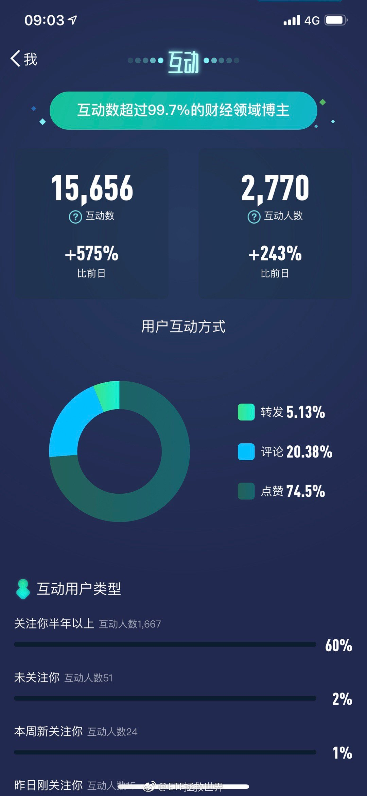

## 2018-12-18 09:10

回复@Nimo_oo:油气这次下去绝不仅只买一次。会买的比上次多。踏踏实实的//@Nimo_oo:华宝油气还会补一手么…大大

## 2018-12-18 09:12

回复@葫芦冲有倔酱:本人投资家训第一条，知道的朋友回答一下：//@葫芦冲有倔酱:问个小白问题，既然如此不看好美股，为何不做空美股//@ETF拯救世界:美股如果能从最高点回撤30%-50%买入，则5-10年收益率又可以保证

## 2018-12-18 09:24

主要是他们小时候物质太匮乏了。已经深深的写入基因，屯东西，抢东西，不排队都是表现。现在的年轻人不愁吃穿，以后就不会这样了

## 2018-12-18 09:27

回复@韭菜st:预告一下，下次发车会继续买。目前阶段，是攻守相宜的品种 查看图片 //@韭菜st:益达，社保在大手笔买转债，是什么因素？//@ETF拯救世界:回复@葫芦冲有倔酱:本人投资家训第一条，知道的朋友回答一下：//@葫芦冲有倔酱:问个小白问题，既然如此不看好美股，为何不做空美股

## 2018-12-18 09:36

做空有一个关键点：时间

你预测对了走势，但是时间不给你面子，你也会输的很惨。

还有一点：你永远无法理解群众的疯狂程度。

这两者叠加，让做空风险非常大。

做空不是不能做，要有技巧的做。保证不死，还能吃到收益。

我喜欢可以计算胜率的品种。有些做空品种就可以精确计算，非常好。 ​​​

## 2018-12-18 09:51

回复@菡园12580:所以我们高位清仓了，带着利润把筹码交给别人潇洒离开。现在是准备跌下去买回来。一个品种交易价值和长期价值是两回事。何况，未来未必如大多数人所预料//@菡园12580:2018年底 美国在75年来首次成为原油净出口国 实现能源自给

## 2018-12-18 09:58

没事少说别人坏话。也许当时人家没理你，但是会记住。关键时候背后阴你一把你可能就倒霉了。不一定对

## 2018-12-18 13:39

上周为什么不开车。

大概是蒙的。 ​​​

## 2018-12-18 14:27

功力不减

## 2018-12-18 15:21

现金分红的八万亿里面分给重要股东的有6万亿。

## 2018-12-19 09:48

回复@满仓割肉:把握好，波动就是机会，不是风险。没有波动的品种，怎么赚钱？//@满仓割肉:石油最近跌的可真厉害//@ETF拯救世界:现金分红的八万亿里面分给重要股东的有6万亿。

## 2018-12-19 10:03

500亿不大。spy单只基金规模就2000多亿美元，折合人民币一万多亿。A股的指数基金远未够班。加油吧。

## 2018-12-19 10:27

上周五闻不到危险气味的都不是合格的猎人。 ​​​

## 2018-12-19 10:38

回复@陈叔爱吃五花肉:价值趋势划不出来了。未来加仓医药逻辑将是另一套系统了。//@陈叔爱吃五花肉:医药要新低了，E大不再划一下

## 2018-12-19 10:43

很多策略回测看起来很美，但即使它未来还是会很美，也依然有可能不适合你。

比如，对于指数基金，越低买得越多。到最后甚至每次比一开始买的多4、5倍。

这不废话吗，肯定未来收益率好啊。

但是，你要知道，回归到现实，你能否这样做？你有没有资金实力在熊市中实现几倍于一开始的买入？

如果没有，再美的策略对你也无用。

资产配置难就难在这里。你怎么知道未来会跌而开始只买很少？你怎么知道要跌好多年，而把资金分配到这些年中？这才是硬核所在。

所以，如何应用一些看起来很美的策略，需要你好好审视自己，以及策略本身。看看怎么才能把它融入到自己的体系中。

## 2018-12-19 11:04

回复@丿小年青:我不是说判断逻辑变。是之前的左侧买入已经到了极限，接下来会用其它逻辑继续买。谁跟你说判断逻辑变了？//@丿小年青:E大说的我好方,上周五到现在我陆陆续续开了医药和养老十几车,心想着反正便宜,但是今天听了医药判断逻辑将会变,真的好恐慌,哎

## 2018-12-19 11:12

50和红利现在估值都在十倍左右。50在我的模型中首次跌破10倍估值。

当然，它们利润增长不高，但真的是便宜。

50 大概每年能分2%左右。红利成分股股息率更是有4%以上。

这两个品种，毛估估5-10年年化没有10%我会比较惊讶。

讲真，除非出什么大问题，目前这个阶段我是想不出还有什么比A股更值的投资了。

## 2018-12-19 11:33

回复@刘伶闯天台:从15年开始每次发车都把时间写清楚“3-4年”，空间写清楚，资产配置做好。没真正做过几轮，不会理解这些的意义。

## 2018-12-19 14:24

喝了黑咖啡容易饿。

一个人生体会。 ​​​

## 2018-12-19 14:43

还有15分钟，坚决不奶。 ​​​

## 2018-12-19 17:47

高手，套现走了

## 2018-12-19 17:57

所以《小鬼当家》那么多孩子丢一个在家里也是有相当可信度的。

## 2018-12-19 18:56

回复@CaHsuuu:我每年圣诞看《真爱至上》（(Love Actually）。非常喜欢导演理查德柯蒂斯编剧导演的几部电影。//@CaHsuuu:每年圣诞都看的电影//@ETF拯救世界:所以《小鬼当家》那么多孩子丢一个在家里也是有相当可信度的。

## 2018-12-19 19:00

这智商还是诈骗犯，到底谁被他骗了？

## 2018-12-20 09:43

控制节奏。一切尽在掌握。 ​​​

## 2018-12-20 09:47

回复@我说椰子啊椰子:这周大概率不发，踏踏实实去考试。祝考研的各位都顺利。//@我说椰子啊椰子:周六要考研，周五赶路一天，好怕错过。。

## 2018-12-20 09:48

回复@E粉pl:你不崩溃不是因为我的按摩，而是你的账户让你舒服。否则你亏得七荤八素我再按摩有什么用？//@E粉pl:感恩益达，按摩来的总是这么及时，不是你，我早崩溃了

## 2018-12-20 09:52

回复@美味o果冻o:巴菲特所有重仓股票买入后平均下跌都超过20%-30%。不影响最后他赚很多钱。9%仓位，浮亏10%，总浮亏0.9%。哭个屁……//@美味o果冻o:医药已经套了10%多了

## 2018-12-20 09:57

什么时候买回来。

这也跌的太惨了。

投资不就是惨的时候就去帮帮它，荣华富贵了就离开它吗。 ​​​
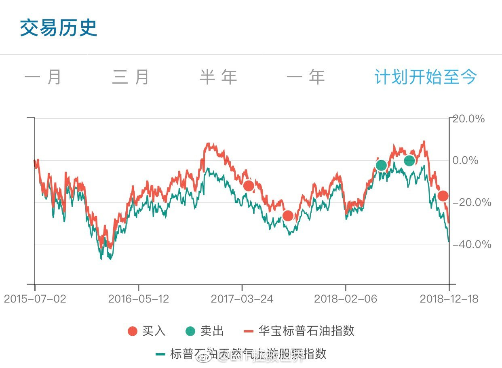

## 2018-12-20 10:01

前几天在球球喷我底部不敢发车的人不知道会不会跟我道个歉。

当然不会了。

你做的事他不理解，他就会喷你。

绝不会想想你为什么这么做。

下跌害怕？

呵呵。 ​​​

## 2018-12-20 10:13

其实资产配置到最后是数学问题。

如果你把所有大类品种弄懂，概率弄清，风险平价搞清楚。

最后就剩下数学了。而且是比较简单的数学题。

还记不记得之前我提的那几个数学问题。其实那个就是最后的关键。

比如去年底的这道题：

“再来做一道数学题。

800点买入证券指数，跌一半，400点再买入同样的金额。

你的成本是533，而不是你想象的600。

如果回到800点，你的盈利是50%。

如果800点就不贵，最后涨回1800，那么你的盈利是237%。”

## 2018-12-20 10:19

回复@Talpiot_Huo:哪有的事儿呢。//@Talpiot_Huo:我在基金公司做自营交易员，我们有各种博士，各种数学算法，上亿的资金，见过无数各色的投资人。  还是得说，E大作为独立的投资者，堪称专业的典范。足以吊打各类选手。

## 2018-12-20 10:20

回复@litterwitch:第二轮答题还在看的过程中。我以为一大半人不会回邮件，结果绝大多数都回了。一封封看工作量很大，正在积极推进。//@litterwitch:E大这两天微博发的多，是不是助理已经找好了？

## 2018-12-20 10:29

看新闻说最近裁员厉害。真的假的。

你身边有没有裁的比往年厉害，给大家展开讲讲。

得是真人真事，别道听途说信谣传谣的。 ​​​

## 2018-12-20 12:36

回复@o0乖乖O0o:喜欢什么类型。毕竟我也是阅片无数有点发言权//@o0乖乖O0o:E大能再推荐些电影不？//@ETF拯救世界:回复@CaHsuuu:我每年圣诞看《真爱至上》（(Love Actually）。非常喜欢导演理查德柯蒂斯编剧导演的几部电影。//@CaHsuuu:每年圣诞都看的电影

## 2018-12-20 12:48

日经接力。

下午估计我A要跪一波。 ​​​
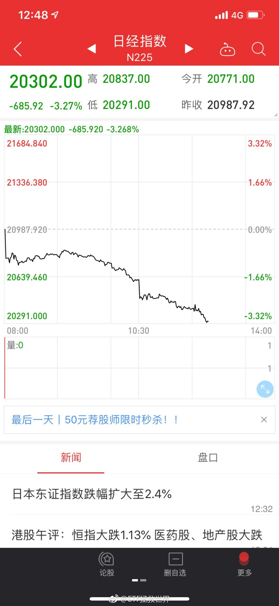

## 2018-12-20 13:10

我跟你说，熊市是这样的。

熊市开始的时候，你认为自己能扛住。毕竟是价投，毕竟了解自己买的股票，毕竟隔壁老王和大v都鼓励你熊市无所谓，拿着就肯定能赚钱，穿越牛熊。

熊市最黑暗的时候，你觉得自己扛不住了。毕竟各种坏消息，账户缩水，但如果现在卖还能剩点。

然后你会发现，熊市也就这样过去了。出于人类的本能，在熊市过去之后，你根本已经不会记得自己曾经的痛苦。觉得无非是那样。

你以为自己很坚强，后来发现并没有那么坚强。

你以为股市会毫无希望，后来发现希望就在那时候开始萌芽。

在资本市场，绝大多数人的各种各样的以为，全都是错的。

## 2018-12-20 13:23

很多不设清盘线的私募有机会见0.5了…… ​​​

## 2018-12-20 13:27

回复@求财不劫色:这是人类的特质。时间必然会冲淡痛苦，否则整天生活在过去的痛苦中，物种都很难延续了。痛苦可以记不住，但成功的经验和失败的教训一定要总结。//@求财不劫色:这就是传说中的好了伤疤忘了疼？

## 2018-12-20 13:40

之前的低点附近一定有一番恶战。守军一定不会轻易放弃。

挺关键，看戏。 ​​​

## 2018-12-20 17:07

80%定律再次发挥作用了……可惜国内没有正规交易所。//@亚东:信仰够不够？赶紧充值。。

## 2018-12-20 17:11

回复@ciahubin:不会死的品种从最高点下跌80%，通常就是大底了。//@ciahubin:80%规律：高点下来80%就是好机会？//@ETF拯救世界:80%定律再次发挥作用了……可惜国内没有正规交易所。//@亚东:信仰够不够？赶紧充值。。

## 2018-12-20 17:59

回复@慢等于快:理解能力。我什么时候说所有下跌必然到80%了。//@慢等于快:你就说证券还要跌到362呗//@ETF拯救世界:回复@ciahubin:不会死的品种从最高点下跌80%，通常就是大底了。//@ciahubin:80%规律：高点下来80%就是好机会？//@ETF拯救世界:80%定律再次发挥作用了……可惜国内没有正规交易所。

## 2018-12-20 19:33

疯狂的互联网资本

## 2018-12-20 19:36

我从未见过如此不走心的打码

## 2018-12-20 21:47

意不意外，开不开心？ ​​​

## 2018-12-20 21:48

#ETF拯救世界的红包#感谢大家对我的爱与支持！我往红包里塞了现金，特来为大家送上好运，领到红包旺上加旺！ ​​​

## 2018-12-21 07:57

美股公司回购的太厉害了。一个季度几千亿。

没跌多少，估值已经回到2014年了… ​​​

## 2018-12-21 09:20

回复@我还就不信起不到名字:这种广告跟我没关系。是微博自动加的//@我还就不信起不到名字:看到了左下角的免佣开户

## 2018-12-21 09:44

控制节奏。

即使所有人都要死，你也要最后一个倒下。 ​​​

## 2018-12-21 09:50

回复@泛舟当歌CountingStars:“空仓”。只能说，要么是钱太少，要么是投资的门都没入。话有点失礼，但99.9%没说错。//@泛舟当歌CountingStars:好的。昨天朋友晒2018，基本都空仓，都很开心，就我都不好意思说自己。没事，有2019，有你，踏实！

## 2018-12-21 09:53

现在难受的，好好想想之前自己到底有没有做到我说的跌30%，涨50%都舒服。

如果当时觉得没问题，现在又有问题，好好想想问题出在哪里。

想想你到底是不是了解自己。

如果不了解，相信我，我比你更了解你。

所以建议，认真看我说的。 ​​​

## 2018-12-21 09:55

我现在不会做任何心理按摩。

预防针是发病前打的。那时候打了针，产生抗体，真的病毒来了你就不怕了。

你都发病了还打什么预防针。

赶紧找个老中医看看吧。实在不行就放弃治疗算了。 ​​​

## 2018-12-21 10:01

回复@静静地顿河流:军工呢，还在40倍以上//@静静地顿河流:我觉得排雷基本上成功。银行下杀这一波，基本完成了全市场覆盖了。谁也都不高估了，图形都好看了。都是打折后再打到你骨折。市场上唯一的一个沙漠之花就是长电了，看看啥时候能落了。

## 2018-12-21 10:16

回复@没有资本也要长期投资:我给你个数。全市场极限应该在1.5倍左右。昨天收盘1.88。你先算算最大可能会跌多少，再多给10%空间，然后想想自己加不加杠杆。

## 2018-12-21 10:25

回复@醉空7:过于乐观的人早死了。过于悲观的人一辈子也就那样了。只有心里希望不灭，脑子里时刻谨记风险才能安全的赚到大钱。//@醉空7:老大真的好稳啊

## 2018-12-21 10:33

回复@HUNTER22210:所以要预先想象。你有10万块，全买进去赔3万，当然不舒服。你就调整到只买5万，赔1万5，还不舒服。就买1万，赔3000行不行了？行了？那就买1万。怎么会不舒服呢。//@HUNTER22210:益达，正常人跌30%都不会舒服的.....

## 2018-12-21 10:53

某只莫名其妙崩盘的股票看图真危险啊。

不知道发生什么了。 ​​​

## 2018-12-21 10:56

回复@guru8:所以要找到一个平衡点。只投入一万，涨50%，只赚5000，不舒服。那就投1万5，3万。这个点没人能帮你找，只能自己找到。//@guru8:这样的话赚的时候也不爽。。。。。。

## 2018-12-21 14:33

回复@A46a7E8e60693438:大家的语文阅读能力真的是神鬼莫测啊//@A46a7E8e60693438:回复@想变成苹果的orange:E大说医药的投资逻辑有变，先别投了吧//@ETF拯救世界:回复@guru8:所以要找到一个平衡点。只投入一万，涨50%，只赚5000，不舒服。那就投1万5，3万。这个点没人能帮你找，只能自己找到。

## 2018-12-21 14:40

现在你有没有稍微有点理解“定期”的意义。

熊市中的定期，可以让你管住自己不安分的手，别瞎动别乱摸。不至于早早套死。

同样，牛市中的定期意义更大。到时候你才懂。

说再多，你不经历一次，体会不到精华所在。

说起精华，我就想起了吸取日月精华的那只石猴。明年年初，中美合拍的西游记即将开机……

## 2018-12-21 14:58

回复@aszjx:美国、德国、英国的500、300、100指数最低10左右。目前50、300、500分别是9、15、18左右。自己算吧。目前英德和300差不多，美国500和500差不多。//@aszjx:e大，我想求教个问题，如果按照美股历史的底部估值测算，a股的极值在什么位置？

## 2018-12-22 11:10

回复@观音山上拜观音:人心难测，引以为戒。//@观音山上拜观音:@ETF拯救世界 东哥无罪释放，e大怎么看？//@ETF拯救世界:回复@aszjx:美国、德国、英国的500、300、100指数最低10左右。目前50、300、500分别是9、15、18左右。自己算吧。目前英德和300差不多，美国500和500差不多。

## 2018-12-22 16:01

转发微博

## 2018-12-22 21:16

任何事情尽量不要轻易被带节奏。

真相很难获得，不因为自己的好恶或者舆论导向或者别人怎么说轻易下结论。

理性。 ​​​

## 2018-12-23 15:21

回复@福喜加在线商城:我初恋是初二…情感博主表示，缘分不到不必强求，好的在后面。自己变得更好最重要。//@福喜加在线商城:今天被拒了，郁闷了一天，想知道益达是多大结的婚？是和初恋吗？没人告诉我，下个微博我还来留言，直至被拉黑

## 2018-12-23 20:15

我还有一点幻想是演的，谁能想到是真的。不知道该说什么，无论如何处理，孩子的人生大概率是灰暗了。

## 2018-12-24 10:35

今天心情怎么样。 ​​​

## 2018-12-24 10:44

回复@携风牧云:后来她做了电视台主持人。//@携风牧云:初恋不知道自己错过了什么//@ETF拯救世界:回复@福喜加在线商城:我初恋是初二…情感博主表示，缘分不到不必强求，好的在后面。自己变得更好最重要。

## 2018-12-24 11:00

回复@钱无殇:这有什么不好。你自己看看全球所有市场，有没有机会。除非你不玩。这样的市场，少赔当赚。亏损幅度在个位数就及格了。 查看图片 //@钱无殇:不好啊，今年铁定负收益了

## 2018-12-24 15:07

今天晚上怎么过，展开讲讲。 ​​​

## 2018-12-24 16:17

谁能想到油气姐是个男人。喷了。

再也不相信网络了。 ​​​

## 2018-12-24 16:46

不管什么节，礼物的话，送男人3C产品，送女人化妆品包包永远不会错吧。

注意，送女人的口红不要死亡芭比粉。 ​​​

## 2018-12-24 17:12

我去过节了。我是想帮大家让油气姐爆个照验明正身。人家爆不爆我就管不了了……大家开开心心的啊。

## 2018-12-24 20:38

#ETF拯救世界的红包#感谢大家对我的爱与支持！我往红包里塞了现金，特来为大家送上好运，领到红包旺上加旺！ ​​​

## 2018-12-24 20:39

刚才说喜欢现金的来领钱了

## 2018-12-25 06:54

昨天油气套利的抄到一笔大的 ​​​

## 2018-12-25 09:27

注意节奏。熊市有钱才是大爷。切切。 ​​​

## 2018-12-25 09:32

$160416 是不是乌龙指了。可惜晚了一步。 ​​​

## 2018-12-25 09:38

周四开车。不会多，最多4-5。踏踏实实的。 ​​​

## 2018-12-25 11:13

失乐园

## 2018-12-25 11:24

回复@慢等于快:找个理由自己乐呵乐呵，关文化侵略什么事？我建议你有点自信。不是说说，而是从内心自信。海纳百川，才能越来越强//@慢等于快:美国鬼子节日过啥？他们过春节吗？文化侵略了

## 2018-12-25 11:48

说起圣诞节。

从小学开始吧，圣诞节就跟同学们互相交换贺卡。买的时候分普通的和精美的。普通的送路人同学，精美的送好朋友。还会买两张音乐的，送喜欢的女同学……

长大了，青春期以后，就是和好朋友们以及妹子们多了个出去浪的理由。年轻的时候真的对这些节日特别看重。一晚上一晚上的在外面浪啊。有几年赶上大雪，在雪地里在街上走，自己会感觉很浪漫。其实冻成狗。

现在啊，在家里买棵小圣诞树，挂上灯饰，逗孩子玩是主菜了。这几年都会把买的礼物藏起来，25日早上叫孩子起床，让他去找礼物，告诉他是圣诞老人晚上偷偷送进来的，因为他很乖。只是已经6岁了，估计骗不了几年了。

你有没有发现，活着，很容易把每一天过成一个样子。我不喜欢这样。我喜欢总是有些变化。

当你老了，回忆往事，你不会记得那些平凡的日子自己做过什么。你会记得的，是那个平安夜跟喜欢的女孩一起走在雪地上把雪踩得吱吱呀呀的声音；也会记得那个平安夜点亮圣诞树时孩子高兴地跳起来的样子。

我不会管什么文化不文化，我只是喜欢那些不一样的日子。

## 2018-12-25 11:57

人长大了，就会觉得日子过得特别快。

那是因为没有新鲜感了。日复一日，都一样，就会觉得快。

小孩子就会觉得慢。因为总是能见到以前没见过的东西。

所以想要活得有意思，就得跳出总是一样的日子。多一些不同的体验比较好。

人生的长度很重要，宽度同样重要。 ​​​

## 2018-12-25 12:21

回复@投资于极寒之地收获于鼎沸之时:你这话先去喷那些公募私募好吗？他们不仅赚了管理费，今年普遍跌20%+。我自己的投资计划没有收一分钱管理费，没有一分钱提成，只是公布自己的计划，今年回撤不到10个点，开始以来跑赢指数50%+。买了三年只买了60%，而且大量是这两个月买的，我觉得挺好。

## 2018-12-25 12:35

这是今年所有品种的收益率。

美国欧洲全部10%+。

原油接近30%。

贵金属10%+。

A股30%+。

除非低点买点债券，否则几乎毫无机会。

债券，我们低点买了。跌30%的原油，我们获利20%+出场了。但是小部分获利品种肯定无法顶住几乎所有资产在跌的压力。

好在我们控制住了节奏，买了三年，依然有将近20个点的现金+债券可以买。

2015年高位清仓，开始第三轮，到上半年，依然有超过一半的现金。年初，无数人嘲笑我们太保守。现在，嘲笑我们保守的人已经死了，换了一批喷我们太激进的人。

有人觉得自己可以看一两年的走势，我如果说在2015年就看到了现在他们会怎么想？

我坚信的是，过一段时间，喷我们太激进的人又会哭着追涨。然后又换一批批评我们太保守。

有人在幻想涨之前买，跌之前卖。我不敢这么幻想，因为我不是XX。
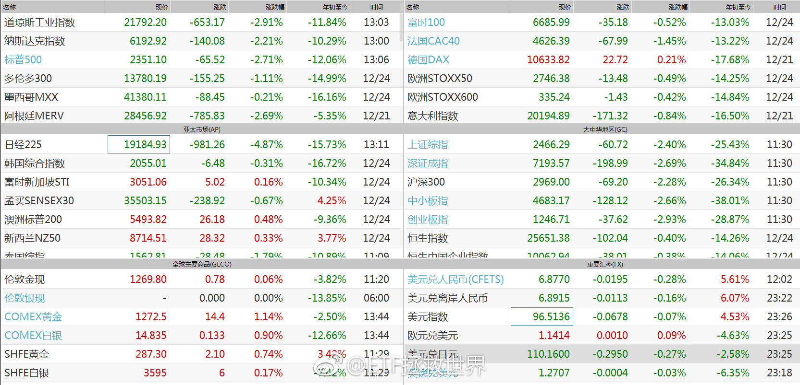 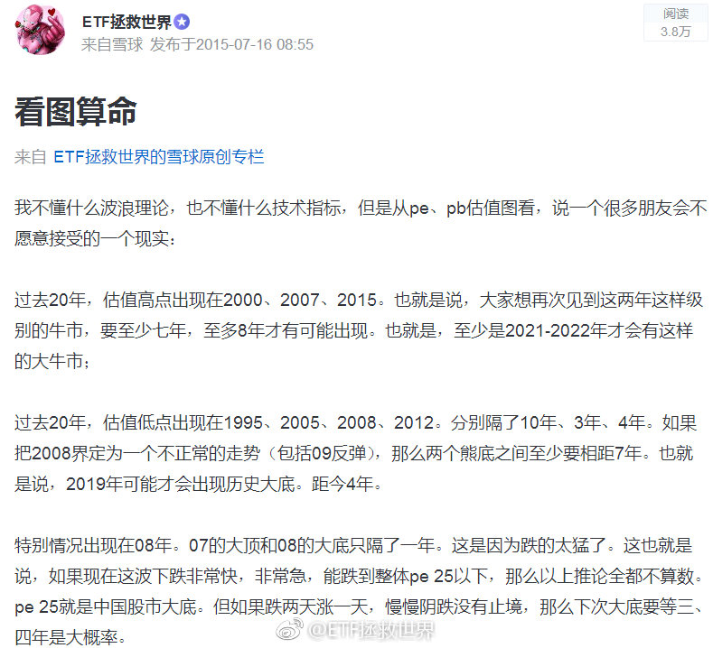

## 2018-12-25 12:39

回复@漠小北_:哪有的事儿呢。。//@漠小北_:E大真的是神预测，也是多年A股市场规律的总结吧，我总觉得，没有人比你更了解A股了

## 2018-12-25 12:54

说实话，一年到头，你回头看，这一年没挣钱，就是没挣钱。你说指数跌了30%、40%，你赔了不到10%，没用，那还是没挣钱啊。

没挣钱就是没挣钱，别找理由。

但是这个问题确实没法解决。什么问题，就是在深度熊市中一点钱都不赔，然后牛市中能赚大钱的幻想，我真的十几年了，解决不了这个问题。投资方面好多问题我都能解决，但这个问题我解决不了。

有个私募基金叫“星石”。多年以前，他们是以做绝对收益著称的。2008年他们居然没赔钱，你就知道他们有多稳了。

但现在他们不做绝对收益了。为什么呢。

因为2009年指数翻番，他们只赚了个位数，被投资者问候了——就像08年某七次郎赔的太多被投资者问候一样。

很多年后回头看，你总结一下，会发现08年之后赚了很多很多的基金，无论公募私募，在08年中跌幅都在30%多。不会太多，也不会太少。那年指数跌了60%多，大概就是一半左右。王亚伟的华夏大盘，以及后来很多净值涨了好几倍的私募，都是如此。

什么意思呢，意思就是，超级大熊市中的回撤真的不容易控制。你可以空仓，真的可以不赔钱。但你也基本上就放弃了未来的大收益。比如当年的星石。

你也可以满仓穿越牛熊。但是代价就是虽然未来的牛市你会吃好，但你先要涨100%回本。

我们不空仓，也不满仓。我们循序渐进。保证熊市中组合整体不大幅回撤的基础上，逐渐增加攻击性。以不减员或者极少减员的代价，赢取未来的真正胜利。

其实这个度很难拿捏，不信你自己试试就懂了。

回头看，我们都可以像神一样指点江山。但重要的是未来。关于未来，你真能预测准吗。

如果你还在预测点位，说明你连门都没入。更何况还要加上时间。

## 2018-12-25 13:24

熊市见底的一个标志是之前极度看多满仓的标志性人物突然有点害怕了，开始看空了。

那就差不多了。 ​​​

## 2018-12-25 13:52

只要你对未来“最差”的情况有个预期，很多涨涨跌跌就根本不会在意了。

比如你从估值看，之前说过，最差1.5。现在1.89。最差跌多少你自己算。

或者从点位看。最差跌80%。你可以自己看看15年至今跌了多少，最差还要跌多少。

做好心理准备不就完了吗。害怕长期低迷？你把日经、台湾走势翻出来看看不就完了吗。好好看看，别人云亦云。到底会发生什么，心里有个谱。

多大点事啊。后发优势在证券市场上也是有的。也就是说，大部分情况，人家发达国家上百年都已经出现过了。你没事儿好好研究研究就完了。

多大点事儿啊。服了。

## 2018-12-25 14:04

等到周四不行吗辣鸡 ​​​

## 2018-12-25 14:41

回复@佛系老股民:我想没几个人看不出来当时很危险吧。虽然说不应该择时，但好歹不能买了就暴跌啊。//@佛系老股民:E大能讲一讲为什么14号没有发车吗 ？怎么看的//@ETF拯救世界:回复@漠小北_:哪有的事儿呢。。

## 2018-12-25 15:01

我不懂，有没有懂的讲讲：如果事后调查确实是房间里的某个设施出现了问题，比如插座电路漏电或者灯掉下来之类的导致意外身亡，难道房东一点责任都没有吗。关键得弄清到底是怎么死的啊。

## 2018-12-25 16:05

回复@熙惯有伱:是。没出去。历史上最长一次是2005年5月到12月，7个月。所以不用天天问~//@熙惯有伱:E大，现在还是在钻石底吗

## 2018-12-25 16:16

回复@南海恶神的师傅:层肯定要分的。在一个小概率区间，不代表不会出现远离绝大多数数据的极值。比如1-100，其中1-10已经是很低了。从2-100，每个数字间隔10米。然而那个1却跟2距离1公里。这种情况可能出现。一个考虑概率，一个考虑极值出现自己会不会死

## 2018-12-25 17:14

回复@倦鸟公主:2008年危机A股跌了70%。然后一年翻番。这一轮2015以来已经跌了65%。至于是不是要发生危机我不知道，宏观的事情我没那么牛预测不了。我是来股市赚钱的，不是来预测宏观的。//@倦鸟公主:今年美国的黑色圣诞节，有人说一场新的金融危机又要来了，E大怎么看？

## 2018-12-26 09:49

今天JSL油气溢价数据错误，实际上是4个多点。 ​​​

## 2018-12-26 10:32

有负债支出大不是最大的问题，最重要最重要就是现金流要为正。尽量每个月现金流为正才安全。切切。

## 2018-12-26 10:35

回复@leegstar:如果跌到周四，周五涨，能不能吹一波。//@leegstar:e大一句话，今天就开始跌，估计真会等到周四

## 2018-12-26 10:42

这个位置，你可以不买，但千万别卖。现在卖极大概率是个错。

即使你卖了又跌了，你也很难更低买回来。 ​​​

## 2018-12-26 10:51

回复@佛系老股民:2008年10月更低。更何况，历史最低未必可靠。50都比08年10月便宜38%了。//@佛系老股民:中证500估值历史最低了，不知道我这边数据跟E大的数据有没有差别？

## 2018-12-26 11:03

坚持就是胜利。

我的一个股票经过我长期不懈坚定持有+3 6补仓，涨了50%。

终于回本了。 ​​​

## 2018-12-26 11:11

回复@随记心路:谁按摩了。我在分享股票回本的喜讯。//@随记心路:E大我正式求您别按摩了。你都开始喊“坚持就是胜利”了，我差点以为跌破2000了

## 2018-12-26 11:13

回复@用户bx24k4hvu3:分情况。如果你重仓一两只，向下补真的要小心，因为股票可能跌没。我的情况不同，我是为了打新拿10%金融资产买股票，分散在几十只上面。某只退市了也没多大影响。

## 2018-12-26 11:37

知道今年为什么感觉很难赚钱吗。

从A股来说：

今年是：

50、180、300、500、1000、深成、红利、医药、养老、信息

过去十二年中跌幅第三大的年份。而且跌幅与第二大几乎一致。

是100、中小、800、1000、上证、消费、创业

过去十二年中跌幅第二大的年份。

各指数跌幅最大的当然都是08年。

为什么08年最大？因为08年是将这一轮熊市从2015-2018三年的阴跌集中在一年了，所以幅度特别大。

2018很惨，但你死没死？没死吧。赔的多不多？不多吧。这样一二十年只有几次的熊市你都好好的扛过来了，你还怕什么。

反过来看，这样的熊市如果不吃筹码，未来我估计你大概率会后悔。踏踏实实的吃筹码，像超级大主力一样底部慢慢吸筹。这就是现在要做的事。

现在全市场依然没有到08年最便宜的时候。无论还有没有机会到，这不是你我能控制的。咱们能控制的就是最大限度吃最便宜的筹码。

## 2018-12-26 11:43

回复@愿赌服输K:情况差别非常大。有比08年低30%多的50，也有比08年高84%的信息和高100%以上的军工。目前的A股是极其复杂的。不过至少前1000家公司跟08年底差不多了。//@愿赌服输K:就估值来说好多指数是历史最低吗

## 2018-12-26 11:45

回复@Gary_Jo:圣光术了解一下。//@Gary_Jo:益达的治疗天赋点满了吧，一口奶满血

## 2018-12-26 11:54

回复@asekiyoshi:首先，从这两个行业利润增速看丝毫看不出除了炒作有什么可以支撑这样的估值。其次，一个行业发展的好不好，和投资者能不能挣钱是两回事。其中的关键就在于____（2分）//@asekiyoshi:不建议刻舟求剑，现在哪个国家不用我们的通信技术，不买我们军事武器，这是十年前你能想象的吗？

## 2018-12-26 11:57

刚才这道题换个说法就更容易理解：

2007年10月，如果你喊着“我们是全世界GDP增长最快的国家，我们的产品全世界都要买”，然后买入上证指数。

你现在亏损59%。

虽然11年后回头看你说的都没错。 ​​​

## 2018-12-26 13:10

今天累了，不想说话了……各回各家吧……

明儿见。 ​​​

## 2018-12-27 04:55

​​​
 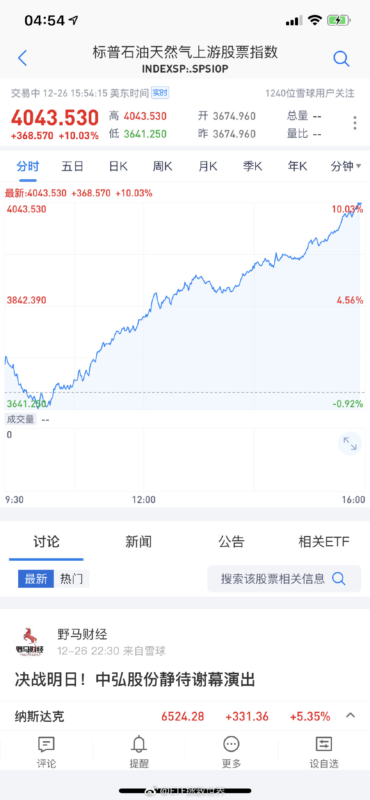 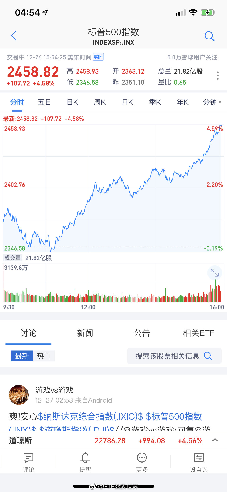

## 2018-12-27 07:51

油气跟油价有没有相关性？昨天美油布油涨8个点，油气反弹十个点。这一波下跌油气和油价都是跌三十多个点。你要每天严丝合缝跟当然跟不上，但你得想想你到底要用油气干什么。很多人投资总是陷入细枝末节看不到大的战略层面

## 2018-12-27 08:08

说油气套利亏的。

我不断强调的溢价6%套利还亏了的历史教训不是白说的。 ​​​

## 2018-12-27 08:24

回复@ETF信徒者:还没找好。这是在跟回来帮忙的初代助理说话。//@ETF信徒者:我就想知道那个助理是谁了

## 2018-12-27 08:47

教训1：不要攀比。教训2：小心骗子。但是对于拉别人进群就要被杀这个我不知道能想到什么教训了。只能说远离垃圾人比较安全吧。

## 2018-12-27 16:35

终于有时间开始看留言。为什么我这么忙，为什么。 ​​​

## 2018-12-28 15:08

十二月买了一次，是当月最低的一天。蒙的，不过是不是可以吹一波了…//@ETF拯救世界:回复@leegstar:如果跌到周四，周五涨，能不能吹一波。//@leegstar:e大一句话，今天就开始跌，估计真会等到周四

## 2018-12-29 11:02

刚才一手拿着速效救心丸，一手点了理财软件的数据更新。

一个月没更新，更新完一看，又少了一辆____。

踏实了。

明后天开始把所有账户一个个弄清楚。

起点这么低，明年要发啊。 ​​​

## 2018-12-29 11:59

回复@大都小都:当然不仅是股票账户。一堆银行账户，各行的活期，理财，各个币种的外币，银行贵金属。三个信用卡账户。一堆基金账户。两个普通股票账户，一个两融账户。期货账户。支付宝微信账户。保险账户。所有账户的收支情况，投资情况。

## 2018-12-29 12:04

怎样才能帮到这样的人。他们不应该是这样的结局。

## 2018-12-29 12:10

我还是相信善恶有报。 ​​​

## 2018-12-29 12:17

回复@XXXXXX434232:管不过来。但能帮一个是一个。你的眼中她可能是几亿分之一，但对她来说就是100%的人生。如果你有能力，你可以选择把下水道的一个叶子拿起来洗干净。

## 2018-12-29 12:31

这个世界不公平。

但是你有力量的时候，尽量做一些让它变得更公平的事，总不会错。 ​​​

## 2018-12-31 11:45

第二轮邮件终于在2018年看完了。

三百多封邮件，每份邮件好几个附件，大部分邮件正文还有几百上千的文字表达，每个认真看完，确实耗费心血。

还剩75位。会从中再选10-15位作为正式候选。一到两周内会联系，没有联系的就遗憾了，只能下次有缘再说…

顺便在这里祝大家新年快乐！无论2018过的怎么样，相信2019会更好。

## 2018-12-31 18:45

喷了，怎么微博红包这功能找不到了。

本来想跨年发一个啊。 ​​​
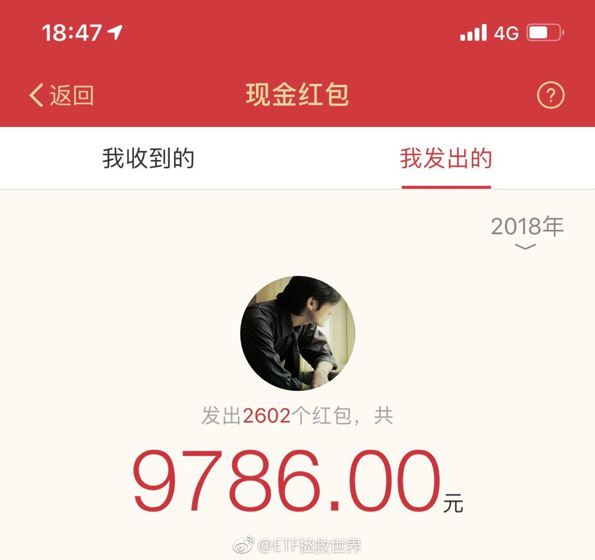

## 2018-12-31 18:58

#ETF拯救世界的红包#感谢大家对我的爱与支持！我往红包里塞了现金，特来为大家送上好运，领到红包旺上加旺！ ​​​

## 2018-12-31 18:58

新年快乐⸂⸂⸜(രᴗര๑)⸝⸃⸃

## 2018-12-31 19:12

回复@本宫就是爱菲:关注超过一年，又不取关，又常来看看的，都是真爱。谁爱我我也爱谁。今年过年的超大红包我决定改在微博发了。//@本宫就是爱菲:啊！为什么都是给老粉的呢？还是，新年快乐！//@ETF拯救世界:新年快乐⸂⸂⸜(രᴗര๑)⸝⸃⸃

