## 2019-01-02 08:41

徐总，如果这是你们公司投研部的文章，我建议可以全部开掉了。这是我见过抄袭最无耻的一次，全部格式文字原封不动的抄。

## 2019-01-02 09:00

遗产税我个人支持。问题在于怎么才能让这个从富人那里拿到的税真正用在穷人身上。

## 2019-01-02 09:09

回复@业余金融学者: 没事。就让贫富差距继续扩大吧。穷人越来越穷，毫无上升的机会，最终来一次gm，均贫卡一出谁与争锋，那样就都开心了。

## 2019-01-02 09:31

我立个flag。

2019年A股极大极大概率收红。不投机取巧，我说的是绝大多数指数。

甚至，有可能涨幅不会太小。

当然不排除中间继续挖坑，但年底看，形势一片大好。不是小好，是大好。 ​​​

## 2019-01-02 09:51

你可能不知道，去年我们第一重仓基金中证红利是所有我监测的十几只指数中涨幅第一的。

年涨幅是

-16%…… ​​​

## 2019-01-02 10:21

这股票前期低点撑不住的话就麻烦。权重又大，大指数又是一波。

## 2019-01-02 12:20

珍惜眼前人。

## 2019-01-02 13:33

回复@佳期如梦梦梦:这么明显的下跌趋势，当然是给空间了。2018年我们分别在2、8、10月买了三份。不能把建仓筹码聚集在一个区域，否则毫无意义。//@佳期如梦梦梦:很想知道E大啥时候买医药//@ETF拯救世界:下次买入应该在7900左右。

## 2019-01-02 13:39

回复@牙神111:我投资一个指数不会连基本面都不看。我对医药的策略中，已经考虑过去三十年日本医药行业变化的样本，考虑目前各国医药行业估值，考虑政策面影响。我不说，不代表我不知道。只看估值更是对我的极大误解。//@牙神111:E大，医药的估值基础已发生重大变化

## 2019-01-02 13:45

回复@目标300m:张嘴就来。医药从15500跌下来，我们的成本在这里，从未追高，太高之说从何而来？服了，扯淡之前先看看数据。拉黑为敬。 查看图片 //@目标300m:6000以下再买吧。你之前买得太高了。

## 2019-01-02 14:07

“这次不一样”。

这句在资本市场上经常会出现的话，有可能是对的。

但大多数时间，根本不会有什么不一样。

只要那些涨起来就找各种理由三万点五万点，跌下去找各种理由不行了完蛋了的人存在，就不会不一样。

我不需要那些在股市上根本没赚过钱的人来指导我，谢谢。我要听了你们的，一分钱都挣不着。

我能一次次底部越买越多，顶部安然撤退，最大的原因正是没跟你站在一起。

## 2019-01-02 14:48

今天不出意外会跌破10月底的全市场估值。

距离2008年最低点还有11%，距离2005年最低点还有17%。

2008年之后是一年翻番。2005年之后是两年六倍。

2019年之后会怎样，咱们拭目以待。 ​​​

## 2019-01-02 14:57

回复@追求确定性2:快吗？从2001年跌到2005整整4年。从2007到2012年底又是4年半。一轮牛市顶部到熊市大底都是4年起。你回头看觉得很快，当你置身其中，比如现在这轮才三年多，就感受完全不同了。//@追求确定性2:哦，我竟然不知道05年低于08年，那时一轮好快，节约时间。

## 2019-01-02 15:12

2001-2005，上证指数从2245跌到998，跌幅56%.

2007-2012，不用上证了，因为被大股票绑架。用深综指，从1500跌到770，跌幅50%。（08年底跌幅70%）

这一轮深综指已经杀了60%。如果到05年底估值，等于是从最高点杀67%。

你可以有一万种理由说这次不一样，你看我搭理不搭理你。 ​​​

## 2019-01-02 19:41

没为母校做什么，很惭愧

## 2019-01-03 05:50

平均跌幅超过40%，扛不住即将破功  ​​​
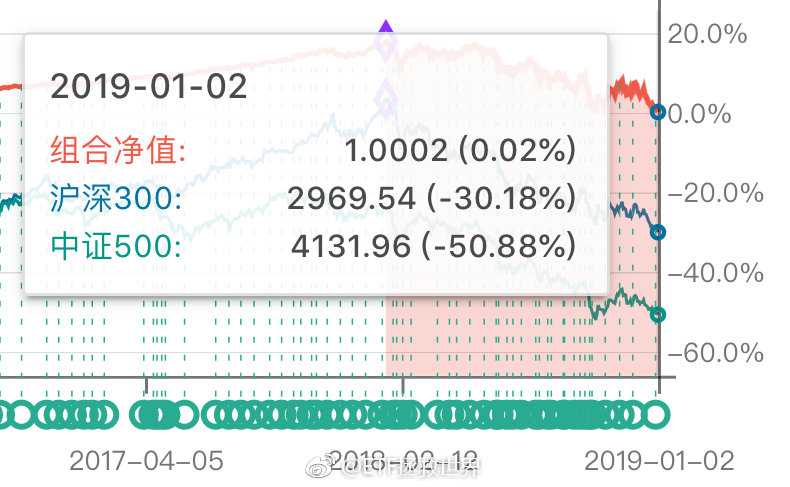

## 2019-01-03 06:17

敢不敢涨上去再让我们卖一次。 ​​​
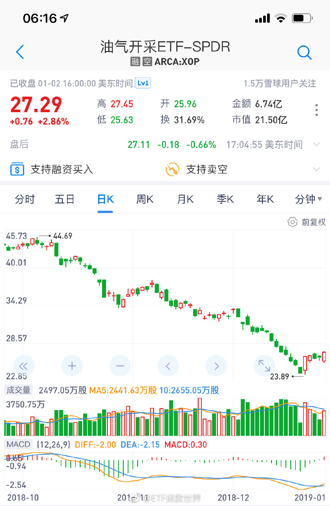

## 2019-01-03 09:40

回复@股票不赚钱:均值回归。不要抄近期表现好的作业，不要买近期表现好的产品//@股票不赚钱:不怪你，俺抄大V作业，抄一个废一个，紫薇侍郎、飘仙啥的……。抄你作业半年了……

## 2019-01-03 10:22

只要涨1%，30%昨天看空的人就觉得牛市来了。

涨10%，80%空头转多。

剩下的20%牛市快结束的时候去买单。 ​​​

## 2019-01-03 14:25

看着账户里100多万医药指数瑟瑟发抖中。 ​​​

## 2019-01-03 18:38

## 2019-01-03 22:17

有没有了解人体工学椅的朋友，有什么好推荐吗。 ​​​

## 2019-01-04 00:50

买了，谢谢各位！

## 2019-01-04 11:32

大奇迹日！ ​​​

## 2019-01-04 11:34

各位好好在各个网站观察，看看对不对。

## 2019-01-04 11:45

如果今天涨5%以上，我将停止抖动。

## 2019-01-04 17:58

新的一年了。

距离探索这个星球1%的目标依然非常遥远… ​​​
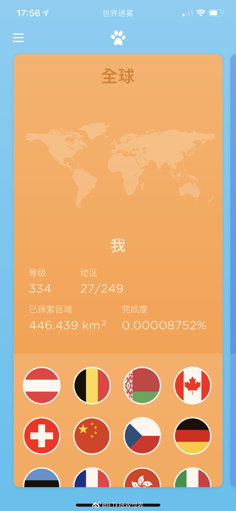 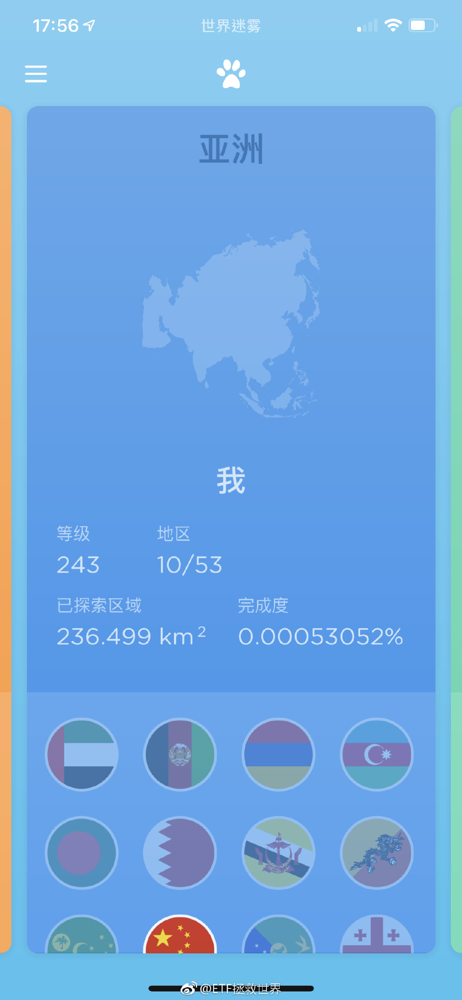 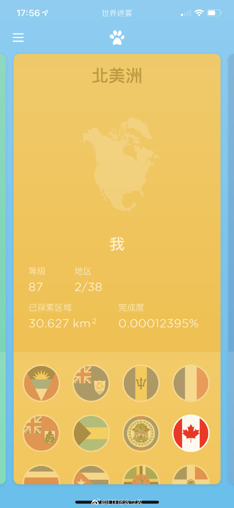 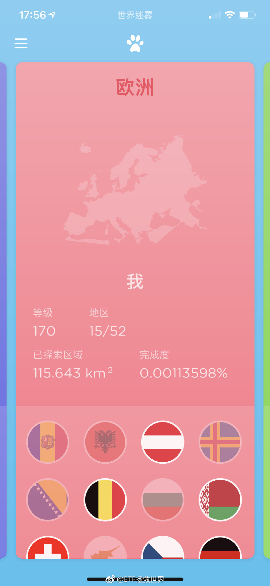

## 2019-01-04 18:06

回复@投资跑道上的一只小蜗牛:人类特别渺小，在地球上就是渣渣。地球在宇宙里面连渣渣都不是。你我又在整个人类中是渣渣。所以自己的那点不开心什么都不是，开心每一天最重要//@投资跑道上的一只小蜗牛:人类太渺小了

## 2019-01-04 19:12

说起时间成本，好好看这张图。

在上一轮把几乎所有持仓卖出，高位持有现金（深蓝色）后，我们用了多长时间才把这些现金换成资产。

第三轮开始两年半后，还有超过一半现金。你有没有见过这样的组合？我已经把时间成本考虑的比99%的人都足够了。也就是说，这两年半你的大部分资金根本不会被占用。

去年暴跌，我们的计划建仓加快。这部分资金也只占用了几个月而已。

我真的不知道牛市什么时候开始，所以不可能今天买明天涨。但我自己评估，资金效率这方面，我已经做的不错了。

说实话，我们大部分浮亏的品种，也就是2018年12月暴跌的幅度而已。一个月前，你都不会有这种资金无效的感觉。
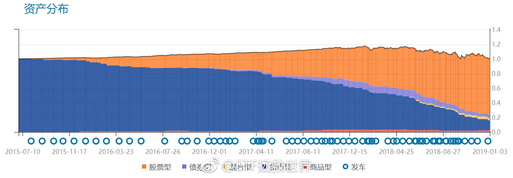

## 2019-01-04 21:51

何德何能 ​​​
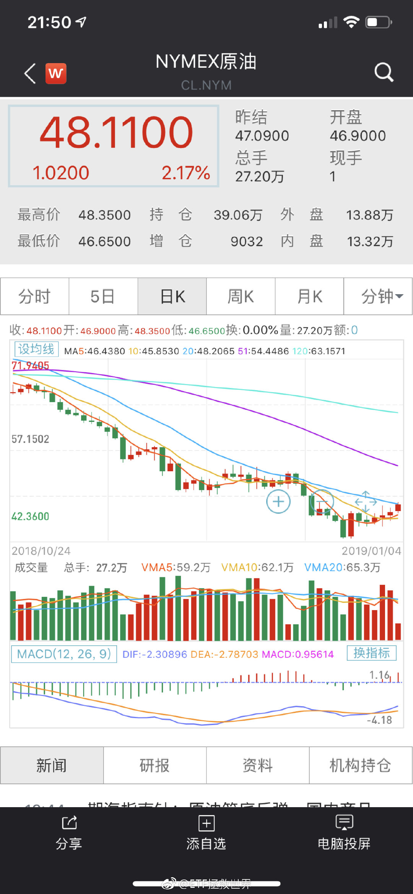

## 2019-01-04 22:37

明早看不要让我们失望 ​​​
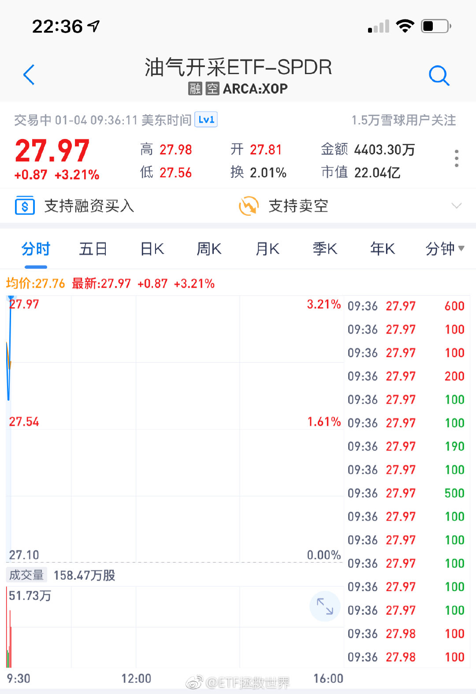

## 2019-01-05 08:02

都是轮回。跌了买，涨了卖。简简单单的。多大点事。 ​​​
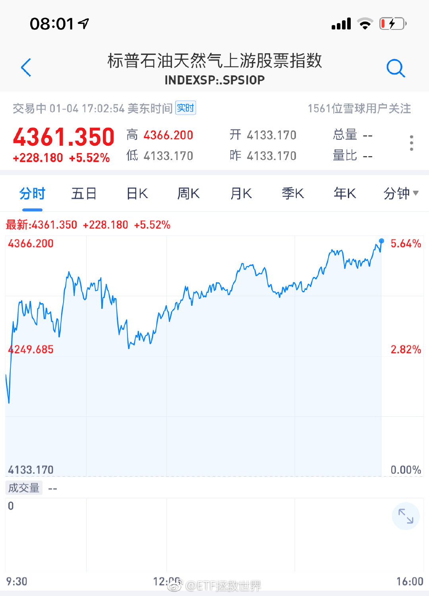

## 2019-01-05 08:17

昨天纽约油2个点，油气5个点。记得前一段有人说油气跟油价无关吗。再说一次，中长期70%跟上就行，不用每天严丝合缝。因为没意义。波动更大我更喜欢。

## 2019-01-05 08:24

证券市场的涨跌，波动，是你我都没法改变的。

除非你不玩了，否则你就必须找到适应甚至利用涨跌波动的方法，而不是怨天尤人。

有人认为波动是风险，我认为波动是机会。波动越大机会越大，没有波动就没有机会。

A股这样的波动，几乎每年都不是涨幅第一就是跌幅第一，简直是天堂了。 

只要你能记住那个涨40%跌20%的数学题。

## 2019-01-05 08:31

非常有意义。今天辉煌十年后未必，即使你根本看不出这家公司有任何可能滑落。十年后，现在的科技巨头还剩一半就不错。

## 2019-01-05 16:29

将近一个月过去，小助理第三轮笔试五分钟前已经有了结果。

这次是从进入第二轮的346位中选择10-15位，最终结果是选了16位作为备选人员。之后我会给这些朋友回信。

这一轮选择时间比较长，是因为每份答题中有好几个文件，绝大部分邮件还会写不少感受，一封封看非常耗费时间。毕竟每一位的答题都不能马虎对待，都要认真仔细看。

最后我要对没有收到我回信的朋友说，这次不能一起共事，真的非常遗憾。但我相信还有机会，各位的邮件和资料我也会妥善保管，以后有需要会直接联系您。也感谢各位认真答题。看答题的过程中，能够很明显感受到每位朋友都耗费了很大的心力来完成。非常感谢。很多朋友表示答题过程中自己有很大进步，也能让我略感宽慰。

这事儿就到此告一段落了。我预计春节假期后可以正式开始工作。感谢大家支持。

真心的。

## 2019-01-06 21:05

有点精彩。想看聊天记录……

## 2019-01-07 13:17

现在舒服不舒服。

## 2019-01-07 15:26

回复@追求确定性2:大网利润43%。每年可以吃两次。//@追求确定性2:我现在在yy油气出一大网。虽然还早。//@ETF拯救世界:现在舒服不舒服。

## 2019-01-07 22:17

回复@卡萨布兰卡de忧伤:它就是最近几年表现好。2003-2013它是最著名的毫无波动僵尸股，更别提怎么从2000暴跌下去。投资个股是真的难。//@卡萨布兰卡de忧伤:微软十年涨3倍这还是分红后 手机没搞成的情况下

## 2019-01-07 23:18

去睡了，不要掉链子 ​​​
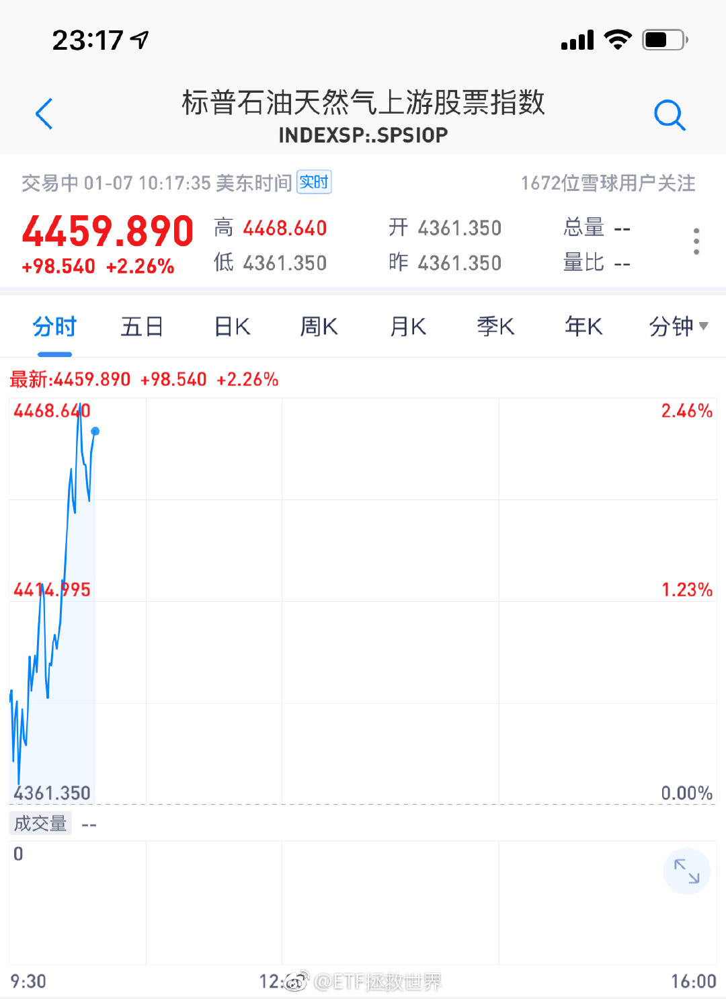

## 2019-01-08 06:05

提款机 查看图片

## 2019-01-08 12:12

资金宽松+避险思维=高等级债牛市。下一个阶段，没有意外就会进入股市与垃圾债的春天。只是具体时间不知道……

## 2019-01-08 13:25

新低了。//@ETF拯救世界:小米，年轻人第一支被套的股票……

## 2019-01-08 14:11

刚才你们说的两位V争论我去看了。技术方面没什么好说的，每个人都有自己的观点。

不过我其实想知道的是，否定别人的东西后，有没有提出更好的东西呢。

比如投资指数基金。我可以说长期定投会比牛市最热的时候一笔砸进去强。

那根据估值，低位布局，又比无脑定投强。

那接下来，更进一步，要考虑组合的平衡，放入更多相关性低的品种。

再进一步，是根据周期，动态平衡。

这里面每一步都是一个跨越式的进步。我看那位提出质疑的朋友，好像也没说清楚如果低估定投不行，那么对于想投资股市的人来说，到底应该怎么做。

如果这个问题不解决，仅仅是质疑似乎毫无意义。

## 2019-01-08 14:28

另外，咱们排除利益因素，就考虑讨论的技术因素。

太多人根本就没想明白自己到论坛干嘛去了。

人这一辈子，就这么几十年。找个有兴趣的事儿钻研一下，吃喝玩乐，泡妞亲子，你干嘛不行，实在不行你去赚点钱，非得上论坛跟人互喷吗……

首先人都要脸。你指着人家说你那套东西是辣鸡，还没完没了的说，谁也接受不了。人家接受不了就根本不可能跟你好好讨论。

其次你是来进步的。别人再烂，能混的好多人支持，总是有自己的优点。能学就学，看不上就算。看别人好就喷并不高级。

第三，真的要讨论问题，就心平气和的说。把自己观点说出来，把对读者有益的东西摆出来，自然会得到好的反馈和关注。我从未见过喷别人不输出自己东西能红的。

当然，某些地方的喷子确实太多了。我真不知道哪儿来那么多喷子。从v到素人全都那么爱喷。。无脑喷。。非常奇怪。。

## 2019-01-08 14:33

回复@早起拜瓶迁晚睡读益达:投资这件事根本就没有唯一的正确。太多人认为只有自己这样做正确。每个路子都适合不同的人，百花齐放才是王道。

## 2019-01-08 16:50

对孩子下手就是人渣中的战斗机，卢瑟中的极品。写到史书上传到任何年代都是万人唾骂。

一个是学校幼儿园肯定要加大保安力度。

另一个是咱们回家都要好好教育孩子怎么应对这种突发情况。 ​​​

## 2019-01-08 16:54

回复@橙子西瓜各有所爱:学校幼儿园没法少去啊。该教育就得教育。得多带孩子看看动物世界。看看里面的小瞪羚是怎么逃脱狮子毒手的……//@橙子西瓜各有所爱:以后这种恐怕会越来越多，唉，尽量少去人多的地方吧

## 2019-01-09 09:01

“今年最令人感慨的股票型基金当属东方红资管旗下的东方睿系列基金。2017年，该系列基金因集中重仓绩优蓝筹股而力压群芳，整体收益均位于股票类基金的前列，并遥遥领先同类基金的业绩。这一团队效应，导致他们之后发行的新基金一日就销售过百亿，创造了基金逆势旺销的奇迹，但是今年睿系列基金集体回落。除了原班人马大多离职的原因外，与绩优蓝筹股今年失去风采也有很大关系。今年该系列的基金在场内同类LOF基金中表现基本垫底，大多跌幅在百分之三十左右”

再说一次，不要买热门产品，热门公司，热门管理人。

## 2019-01-09 09:15

回复@微胖界的詹姆士叔叔:清盘不错勒，有的私募没有清盘线都0.2了//@微胖界的詹姆士叔叔:回复@爱爬楼的超音鼠:0.84不错勒。我16年投了一个私募已经清盘了。。。

## 2019-01-09 09:24

这一波油价反弹又有20个点了。你再回头看看一个月前那些在最低点疯狂看空石油的论调。

如果你被他们吓破了胆，就有可能卖在最低位。

我不是说油价未来的涨跌，我是说怎么看网上这些每天扑面而来的文字。

你要知道一件事，每天在网上慷慨激昂，指点江山的人，其实有一半以上可能未必有你懂得多。能写字的人未必投资水平高。

太多人就是从众的羊群和旅鼠，没有自己的理念。跌了就找各种理由看空，涨了就找各种理由看多。

所以你看的很多东西其实是辣鸡。我的建议是节省你自己的时间，尽快掌握识别辣鸡的能力。识别辣鸡，然后不要再关注，因为你的时间是最贵的。

## 2019-01-09 09:29

好像今天解禁了。//@ETF拯救世界: 新低了。//@ETF拯救世界:小米，年轻人第一支被套的股票……

## 2019-01-09 09:33

今天先不聊了。事情太多了。拜拜。 ​​​

## 2019-01-09 13:31

怕什么，这不12月份的跌幅就快涨回去了吗。踏踏实实的，做个金融投资就这么点事儿，低买高卖而已。 ​​​

## 2019-01-09 14:38

八成功力还在。放心了。

## 2019-01-09 14:49

回复@nfbbc:辟谣了。有空接着聊了。//@nfbbc:接近央行的人士//@ETF拯救世界:八成功力还在。放心了。

## 2019-01-09 21:49

没完没了了嘿 ​​​
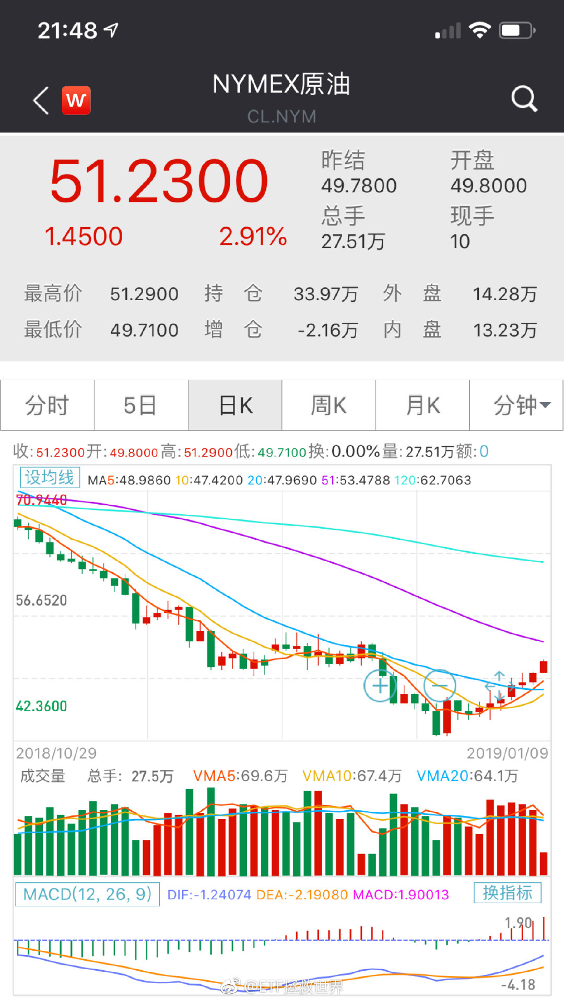

## 2019-01-10 06:03

别人都看衰的时候你肯帮一把，才有资格享受收益。 ​​​
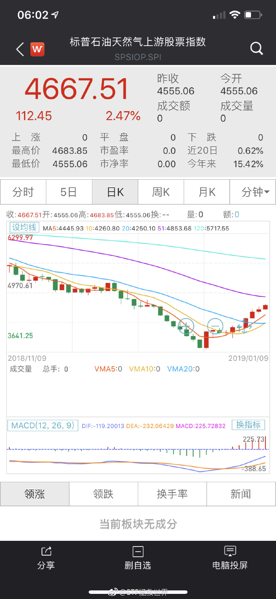

## 2019-01-10 08:43

回复@丫丫小屋06:压力不远了//@丫丫小屋06:竟然一直涨，会不会该休息一下喘口气？

## 2019-01-10 08:54

有没有感觉长得有点像向华强

## 2019-01-10 09:40

怎么我微博点过的股票就没一个让人省心的…不过长阴跌破平台的力量知道了吧…//@ETF拯救世界:好像今天解禁了。//@ETF拯救世界: 新低了。//@ETF拯救世界:小米，年轻人第一支被套的股票……

## 2019-01-10 10:01

$中证环保 sh000827$ 和$中证传媒 sz399971$ 良心发现了吗 ​​​

## 2019-01-10 18:24

踏空你的钱还在，资本市场之后所有的机会你都能参与。套牢倒也不可怕，可怕的是永久性的资本损失。那样，你就毫无机会了。这个问题其实是：失去一次机会可怕，还是永远失去机会可怕？

## 2019-01-10 18:35

回复@荣我陵南:是个有趣的人。有趣是很难得的品质啊。//@荣我陵南:想知道E大如何看大校？

## 2019-01-10 22:33

开除列车员

## 2019-01-11 06:58

关于那个“指数基金牛市中能否战胜大盘”的问题，我准备写个长点的东西说说。

欢迎有识之士微博问答提问。我会回答第一个提问的。要把那位朋友的原问题完全复制过去。

不知道谁的手快，反正你至少能挣超过1000块过年红包了。 ​​​

## 2019-01-11 07:12

好了，已经有人问对了，其它朋友不必再问。9点多发布答案。因为要写很长

## 2019-01-11 08:14

回复@In兴No1:我问答后台有几百个问题，敞开了回答我一年能挣二十万以上。你看看我一共回答了几个，再看看我去年给大家发了多少钱红包。说话要过脑子啊//@In兴No1:E大这是开始流量变现吗？好伤心[米奇大哭]//@ETF拯救世界:好了，已经有人问对了，其它朋友不必再问。9点多发布答案。因为要写很长

## 2019-01-11 08:18

变现？呵呵 ​​​
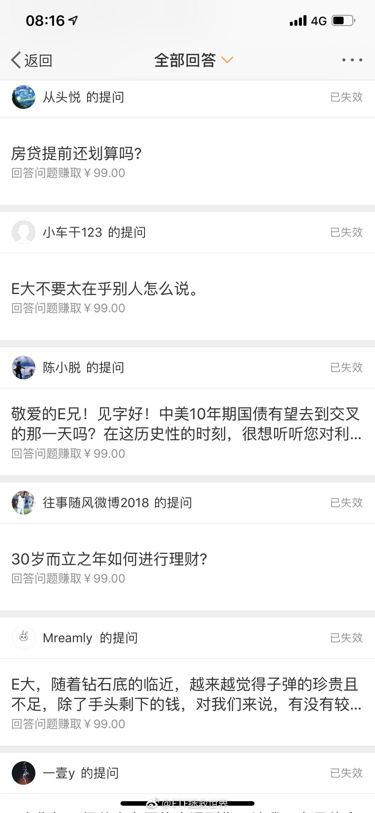 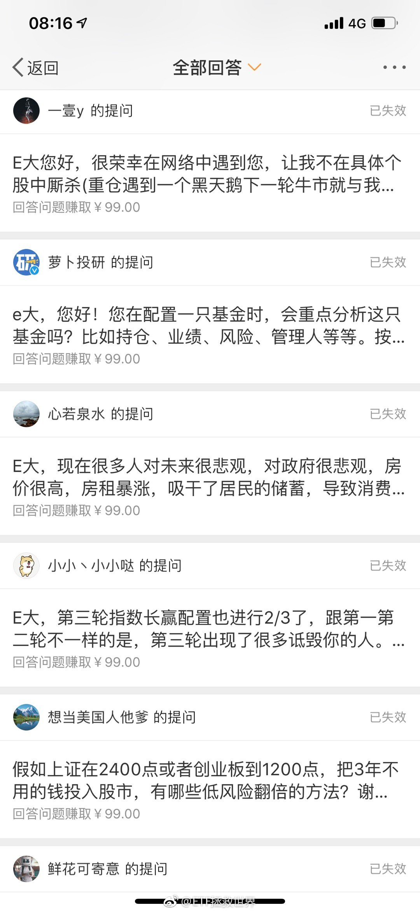 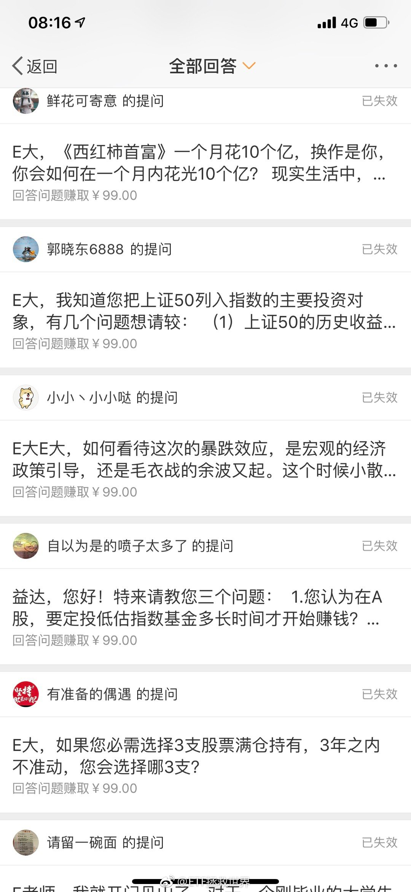 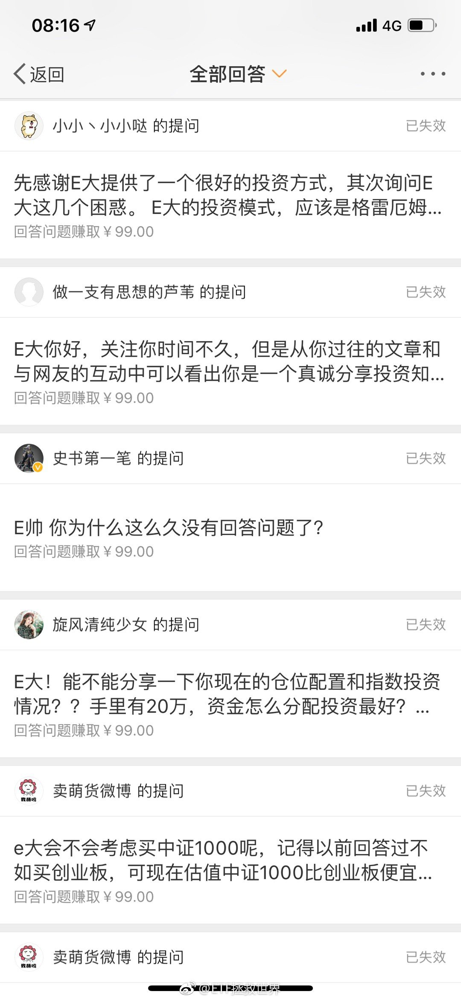 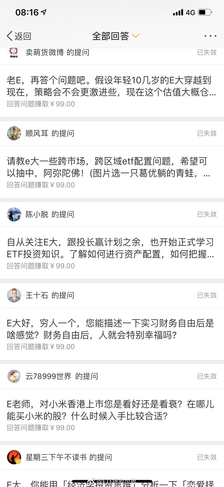 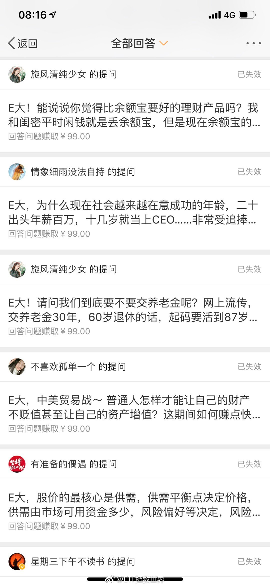 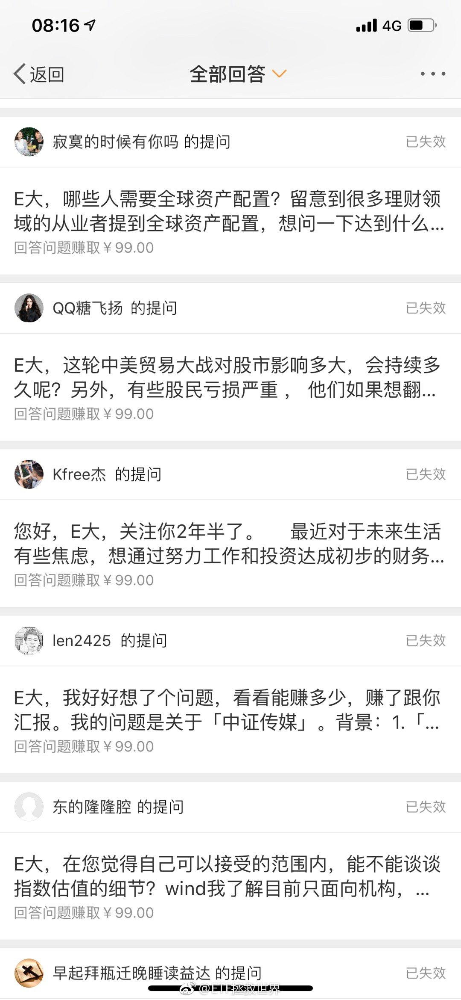 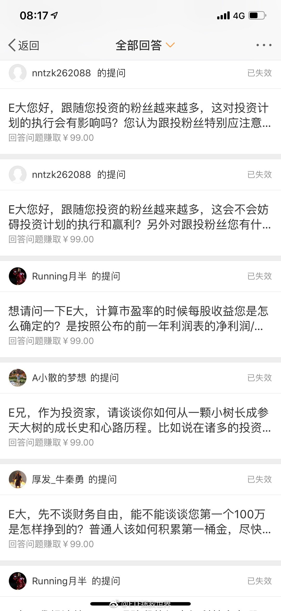 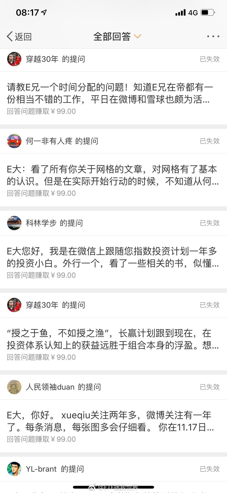

## 2019-01-11 09:23

写完了忍不住拍案而起，1块钱太值了！这应该是你最近半年花的最值的1块钱。为了说清楚这个问题，谈到了周期，谈到了品种配置，谈到了弹性……我回答了 @mccoymir 的问题，问题价值￥99.00，大家快来花1元围观~ 微博问答 ​​​

## 2019-01-11 09:34

十分钟，提问人投资收益率已经翻番。应该会很开心吧哈哈。

## 2019-01-11 09:37

漏了一句，收益率统计那里，500指数是5.18倍。在信息和红利之间。

## 2019-01-11 09:56

另外在这里跟各位说一下，知道各位的好意，但咱们尽量不要评论别人。

每个人都有自己的优点。咱们做好自己的事请，不在背后议论其它人比较好。

谢谢各位 ​​​

## 2019-01-11 11:15

不浪费。

## 2019-01-11 13:30

回复@这是我最后的波纹_JOJO:我从没这么说过。我对未来收益也没有预期。因为我根本不知道未来市场会怎么走。过去的数据能说明很多问题，但绝不代表未来也能这样。也许更好，也许更差。//@这是我最后的波纹_JOJO:如果能跟上e大的话，1万能变10万？

## 2019-01-11 13:34

很多事，你没有机会的时候不去做，没什么了不起。

你有了机会还不去做，那才让人敬佩。

世界上诱惑很多，财 色 权。

怎么面对这些，就得看，在你心里，最重要的东西是什么。 ​​​

## 2019-01-11 13:46

回复@驯马师Samson:先把自己照顾好。然后是家人，然后是朋友，然后是陌生人。如果你能为别人创造价值，真的服务好别人，这辈子不会过得很差。

## 2019-01-11 14:13

去年11月月中一车没有加仓黄金是个错误。 ​​​

## 2019-01-11 14:19

回复@张涛涛王子:汇率。//@张涛涛王子:哪位课代表回答下，问下今天为啥上海金价下跌，国际金价却上涨，两者最后价格会收敛一致吗？

## 2019-01-11 16:55

春天

想重新与世界打个招呼

一路向西

去草原，去五台山，去黄土高坡，去沙漠

如果成了

会给你们拍9宫格的 ​​​

## 2019-01-11 18:53

回复@微博客服:各位有出问题的就问客服吧。如果实在找不回来我自己掏钱退给你们。//@微博客服:回复@ETF拯救世界:您好，如果您发现您的粉丝付费问答无法正常使用，可以让您的粉丝通过自己的账号来咨询微博客服，我们需要核实购买问答的账号是否出现支付问题，感谢您对微博的支持。

## 2019-01-12 09:55

我的一点体会。

为什么有人家里东西看着特别多，但是不感觉乱。

为什么有人家里东西稍微多点就特别乱。

原因在于

东西多不显乱，是因为那个东西本来就设计放在那里。不是乱放的，是归位的。井井有条。

显得乱，是因为用完了随手一扔，东西不归位。 ​​​

## 2019-01-12 11:20

回复@熙惯有伱:公众号chinaetfs。真爱都知道。//@熙惯有伱:e大，你现在除了在微博发布东西外，还在其他平台上发布吗

## 2019-01-13 08:14

始终不理解世界上为什么有“私房钱”的存在。两个人在一起生活连这点生活费都要互相瞒着吗

## 2019-01-13 08:32

回复@ETF改变生活:+1。绝大部分钱我打理。家里支出我负责，她的收入她自己零花。自己要买什么互相不干涉，没工夫为了这个勾心斗角…//@ETF改变生活:我家里都是我管钱，我媳妇不操心，主动报账人家都懒得听

## 2019-01-13 08:48

不过每个家庭情况不一样。

我父亲就是花钱很随意，从年轻开始先后入坑摄影器材，发烧音响，计算机。每一个都是极度烧钱的，因为他不是买了就算，是不停的高买低卖换新的。

没有我母亲把控一下，很多钱就没了。两个人时不时为了这个闹矛盾。

所有找另一半，三观契合很重要。日常生活中会少很多麻烦事。

## 2019-01-13 09:07

很多人只知道摄影音响烧钱，可能不知道从苹果II开始  386 486 586 奔腾一路烧过来要多少钱，那时候中国人收入多少… ​​​

## 2019-01-13 13:23

对投资有兴趣的朋友，我特别鼓励刚开始的时候尝试各种投资方法投资模式。谁知道你是不是在某些方面特别有天赋或者有运气呢。

这个我一直在说。别限制自己的可能性。

但是对投资没那么大兴趣，没法舍弃其它爱好一门心思钻进去的普通人，或者虽然有兴趣但是经过很久承认自己确实没有天赋的，还是找一些难度小的，确定性大的投资模式进行下去比较好。

## 2019-01-13 16:19

今年股市跌这么多，整体环境又不怎么好，过年红包要比往年大一点，大家都沾点喜气。

 ​​​

## 2019-01-14 06:37

回复@猴子小星:加油，你是最好的！现在到2200有14%的空间，加油！//@猴子小星:今日已全部清仓，留了一点环保明天清。2200点以下再见面保重各位！

## 2019-01-14 07:22

不是说一定跌不到2200。不是这个思维模式。

而是说，你为了躲避14%的跌幅，放弃的是什么。

就像你找终身伴侣。你的满分是十分。这时候出现了一个9分的人。要么你选这个九分的，但是明天可能出现一个十分的；要么你继续等那个十分的出现，但是有可能一辈子也不会出现，你最终要么一直一个人，要么最后选一个三分的。

这就是机会成本。

我们的思路是，既然不可能精确预测未来，就做好继续下跌和从此反转的两手准备。按照概率布置仓位。

我们不能孤注一掷的玩俄罗斯轮盘赌。因为这样的机会十年只有两次，错过了，代价太大。

远远大于下跌14%。

## 2019-01-14 08:30

刚才看了看，上一个问题，提问人已经赚了三千多了。

以后要么不再回答问题，要么大幅提高提问价格。多出来的差价再发红包给各位。

要不然这也太暴利了！ ​​​

## 2019-01-14 09:13

回复@e急事缓办:因为出现过9分，你不会那么容易认错选87654。直到你意识到再不选就没了，才会随便选一个3分。就像你2400点不买，等2200。结果发现越来越高。你在2600 2900 3000都不会买。最后发现再不买就踏空了，3500买入。Duang，归你了！//@e急事缓办:为什么是三分的，不是87654分的

## 2019-01-14 09:23

回复@股为生:在这个指数跌了一半，一多半股票跌幅已经70%的情况下，无论如何看空，我至少都会留30%的仓位。30%仓位即使跌20%也才暂时损失6%而已。只能说清仓的人完全不理性，很难在市场上生存。

## 2019-01-14 09:26

回复@快乐行者9:不怪你。因为跌破1000点的时候，中金公司出了看到700点的报告。这个市场大多数人，哪怕是所谓的很多大行机构，都无非是追涨杀跌而已。//@快乐行者9:可说对了，05年1000多点，眼看着长上天，越看越不敢下手，最后也没下手。

## 2019-01-14 09:40

回复@该晓得该明白:1-2车吧。明天。不出意外的话。//@该晓得该明白:E大，月中发车吗？//@ETF拯救世界:回复@快乐行者9:不怪你。因为跌破1000点的时候，中金公司出了看到700点的报告。这个市场大多数人，哪怕是所谓的很多大行机构，都无非是追涨杀跌而已。

## 2019-01-14 10:04

这个世界上什么事情都可能发生。

无非是看你自己选择赌还是不赌。

成功了会得到什么，失败了会失去什么。

人生，也就是在这样一次次选择中走向了不同的终点。 ​​​

## 2019-01-14 11:42

回复@Joovei:债券已经飞了半年了。//@Joovei:回复@ETF拯救世界:一年半后翻看，E大还是很有预见性的，这不能说是纯猜的，谦虚了，还是有均值回归的理论依据的。请问E大一个问题，如果债券先于股票见底，那么会先于股票起飞吗？

## 2019-01-14 11:47

“失落的30年？？？”每年一个诺贝尔奖，国民过得其乐融融。

## 2019-01-14 12:11

回复@求财不劫色:目前处在钱很多，但风险偏好低，只敢买高等级债券的阶段。风险偏好上升后，股市和低等级债就要飞。//@求财不劫色:那么，问题来了，股票作为一种特殊的债券，什么时候起飞？//@ETF拯救世界:回复@Joovei:债券已经飞了半年了。

## 2019-01-14 15:19

这种时候，别看盘了。自己找点乐子去吧…… ​​​

## 2019-01-15 11:33

写完东西一看，什么鬼。

成心吧恒生。 ​​​

## 2019-01-15 13:49

希望昨天清仓的哥们先别慌。

有可能只是反弹一天。你是最好的。。

我去看留言了。又是快500条了。

很奇怪，公众号留言绝大多数都放不出来，可每次都是600以上留言。微博每条都能显示，每次都这么少。。 ​​​

## 2019-01-15 14:42

回复@未闻花名------:图片评论  拉黑。狗头也没用了。 查看图片 //@未闻花名------:你就吹吧，其实公众号留言每次你都一条不少的放出来了。加油，你是最好的十八岁少年投资者

## 2019-01-15 14:55

回复@777正义777:不懂了吧。为什么散户大量在熊市最低点，或者牛市刚来的时候清仓？因为短期记忆熊市太难受了。赔了好多好多，好不容易少赔点，当然马上卖出——等回调再买回来降低成本。谁能想到，终有一次买不回来了。//@777正义777:扛了一年，为什么要清仓？傻啊？

## 2019-01-15 14:58

一个战斗力非常强的大巨兽，最怕什么？怕的不是那些过来咬一口就跑的小鬣狗，而是一群一拥而上咬住就死死不松嘴的恶狼。

我看准你的弱点，大家一起上拼命咬住，无论你怎么震荡我都不出去。牛市不来，不赚大钱我就不走。这才是那些巨兽害怕的。

大钱，没有一次不是靠死死拿住赚到的。有点风吹草动就上蹿下跳的只配喝汤。

## 2019-01-15 15:29

回复@行高于人众必毁之:按理说不会。只是不要想还有过去一年这样的涨幅了。//@行高于人众必毁之:债市会转熊吗？我还有一些短债基金

## 2019-01-15 16:03

从2015年开始，每次开车前面都有这句话，不知道各位是否注意。

现在3.5年已经过去了。如果真的是4年熊市结束。

那说明4年前的预判精准命中。

拭目以待。 ​​​

## 2019-01-16 08:16

回复@硕仔满:2017年有100只股票涨，3000多只跌，跌幅中位数20多个点。如果你把这样抱团取暖的上涨叫牛市，那它就是牛市//@硕仔满:难道去年白马股那一波不算牛市吗我以为要剔除掉这段时间的基础上再算呢……

## 2019-01-16 09:01

我研究过过去100年各国的股市，几乎从未见过有所谓的只有1%“大白马”上涨，其它股票暴跌的牛市。

有过吗，有过。70年代美国漂亮50。最终结果如何？崩的买这些“蓝筹”股票的投资者多少年缓不过来。

所谓的牛市，就是要大多数股票都要涨。这才叫牛市。甚至在成熟市场，大部分时候，小盘股涨幅也大于大盘股。

几十只股票涨了，就吹牛市，不是傻就是坏；几十只股票涨了，就说未来永远是这几十只涨，不是傻就是坏；风口上在这几十只上赚了点钱，就像2012-2015炒创业板的一样误以为是股神，不是傻就是坏。

## 2019-01-16 09:15

“白马”“蓝筹”，大概率不是坏股票。长期看也能有不错的收益。但你不能吹世上只有白马好。什么是白马？每个企业，每个行业都有周期，生老病死。今天的白马明天未必是，过去的白马将来未必是。

如果投资就是不论价格不论成长不论未来买入几个耳熟能详的“白马”就能赚大钱，你不觉得哪里不对吗。

A股历史上白马套人的例子可不少，有空去研究研究。

## 2019-01-16 13:31

红利在挑战去年9月以来新高。 ​​​

## 2019-01-16 13:42

英国富时100目前股息率大致是4%。咱们的300大概是一个多点，50大概是2%，红利大概是4%。

换个思路。你买点这些有分红能力的品种，等于买了一个余额宝+未来牛市的上涨期权。只要你的钱不急用，看不出有任何必要担心。

指数基金分红并非简单意义上的“左手倒右手”。这点需要认识清楚。 ​​​

## 2019-01-16 13:48

再给个数据，上次中证红利全收益在目前的估值是2008年11月，点位是1997。目前是5885点，十年涨了195%，复合大致是11%。

11%说多不多，说少不少。但你要注意，这里是纯内生增长，不含估值波动。红利的估值波动大致在100%-170%之间。就是低估买入到最高估的涨幅会有这么多。加上内生增长，非常可观。 ​​​

## 2019-01-16 14:14

回复@潮起潮落已万年:本币来说能赚钱，但用美元衡量无意义。 查看图片

## 2019-01-16 14:20

昨天S买医药的不禁露出了满意的微笑。 ​​​

## 2019-01-16 15:07

回复@老浩老浩:上次说了。强于红利的还有医药和消费。500因为这两年太弱被红利干掉了，之前是强于红利。//@老浩老浩:建议楼主过一下其他指数的历史数据，我猜在相同的估值水平下，A股没有任何一个别的指数（全收益版本）能创造这样的回报率。

## 2019-01-16 16:12

回复@酣学者:你的意思是跌不到80%就不可能是大底，是这意思吗。还是说你理解这是我的意思？//@酣学者:不是下跌80%才是终极大底的吗?

## 2019-01-16 16:13

回复@悠哉主人76:这个估值，这个点位，你是从十年前开始跟踪的吗。我所有的数据都是一天一天积累下来的，回测的数据我不看。

## 2019-01-17 10:09

医药要不要奶一口还在犹豫中。 ​​​

## 2019-01-17 11:23

牛市是否就此开始，咱们并不关心。买够了，踏踏实实等着就行了。吃嘛嘛香。

但有些人就特别关心。不仅关心，还有点提心吊胆。

比如2500点清仓的人…… ​​​

## 2019-01-17 11:32

想要在资本市场赚钱，两个方面，第一个策略，第二个心理。

如果你的心理很脆弱，患得患失，就用强力的策略去弥补。把自己当作机器，完全执行策略。无论自己如何畏惧，贪婪，都坚定执行。干就是了。

反过来，很多时候，一个很好的策略也需要良好的心理状态去支撑。否则给你一把98k你也未必能打死人。

相辅相成，缺一不可。

## 2019-01-17 11:35

回复@In兴No1:当然是我们。手里还有债和钱，到2000买买买开心的不得了。涨跌都开心，怎么，不服吗。//@In兴No1:呵呵.2000点时大家看谁笑得开心

## 2019-01-17 11:38

2012年底看多，在某论坛被骂成狗。

2015年看空，在球球被骂成狗。

2019年看多，哪儿也不敢去了…… ​​​

## 2019-01-17 18:03

我再次请大家都长点心眼，这可能是我吗？

其它的我也不想多说了。 

我告诉你们这些骗子，你们冒充我我没精力跟你们干，劝你们冒充且慢工作人员招摇撞骗小心点，他们公司的法务人员正好派上用场了。

少干点坏事，踏踏实实过点好日子。 ​​​
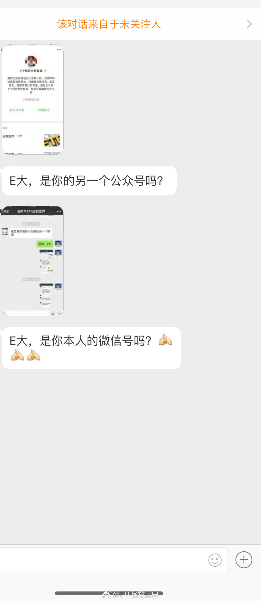 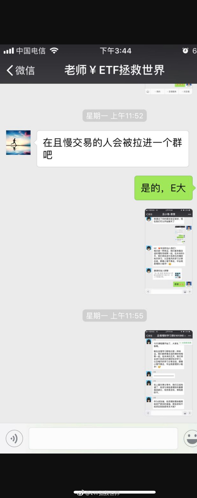

## 2019-01-17 20:50

好心人很多，但是这种事我不需要关心。也别在一个指数暴跌后来救我，都管好自己。 ​​​
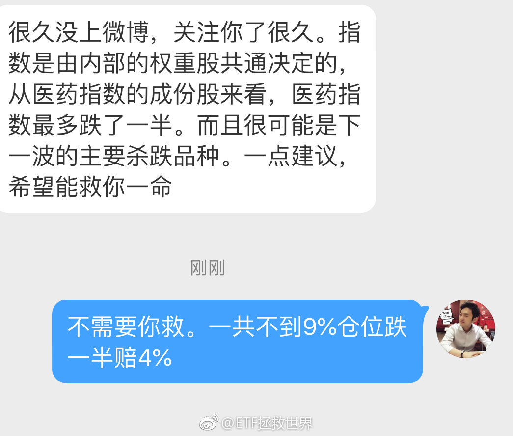

## 2019-01-17 20:54

全指医药最高到现在跌了54%。刚跌了一半怎么理解，是说一共要跌100%还是说还要跌54%？

再跌54%是3000多点，估值大概十倍。美国医药股估值25。

等着看看能不能到。 ​​​

## 2019-01-17 21:09

回复@多多100001:没事。去年全年我们买了三份，加仓不到2%。再跌50%，我再加5%。钱还有，就等跌了。//@多多100001:应该能到吧，医药那块又出政策了，估计还得跌跌。

## 2019-01-17 21:13

当时还在一万多点。所以之后我们只买了两份。趋势很差，一眼就能看出来，现在也没走好。所以我们依然不加仓。几个点的仓位怕什么，跌呗

## 2019-01-17 21:21

回复@慎独慎入慎犬儒:我倒觉得不是不可能。在我的字典里资本市场没有不可能，所以到了我也不意外。但是，即使到了我也不会死。这个可能会让很多人失望了。//@慎独慎入慎犬儒:我才不信，3000得多惨。。

## 2019-01-18 08:19

现在看空真不是什么珍贵稀缺的品质。

目前市场上钱很多，十年国债即将进入2时代。但是没人买股票，否则也不会跌成这样。

去年底私募整体仓位50多个点，比年初没跌的时候少了30多个点。

所以，你看空，当然不是说你肯定错，但是绝大多数人都跟你一样，所以你也不用到处蹦跶着告诉别人你看空——因为你没什么特别。

## 2019-01-18 08:54

其实一直对某家公司老板印象不错。但是从公司股票上市之前开始，感觉像换了人。

各位高管轮番上阵吹，然后是所谓的要让首日买入的投资者翻番，到股票大跌后开始感觉不淡定，到回购。

都让人感觉，特别害怕股价跌，特别希望股票涨。

是不是有什么对赌协议之类的东西。 ​​​

## 2019-01-18 09:41

种种迹象表明关键点不会太远。

因为很多人的心态都已经崩了。又或者，是看空的人开始嘚瑟以及要开始救我一命了。 ​​​

## 2019-01-18 09:57

回复@风湿膏_:你见过券商看空吗。两融余额现在是7500亿，是2014年以来最低。前几天第一次有人在我评论里说清仓不玩了。私募仓位50多一点，比一年前大降30%。

## 2019-01-18 09:58

$全指医药 sh000991$  未免有点不给面子。还干起了领涨的活？

当然，趋势还没变好，别嘚瑟。奶一口先。 ​​​

## 2019-01-18 10:03

回复@江湖人称再议哥:你没煎熬，是因为你一直在这里。2015下半年，股票中位数下跌31%；2016年下跌15%；2017年下跌20%；2018年下跌34%。对于大多数股票来说，这三年半就是炼狱//@江湖人称再议哥:这底部这么快就来了？感觉没怎么煎熬

## 2019-01-18 10:06

回复@高人藤:我真的不明白你们这些跟那些一点都不懂的人聊什么投资呢。我自己大家庭聚会从来不说投资。//@高人藤:这个微博我一定要转到我的朋友圈，妈呀太符合我的处境了，亲戚们都劝我，要救我一命

## 2019-01-18 10:19

很多专业的东西根本没必要和普通人聊。比如你是研究化学的，不可能春节饭桌上和大家聊分子式。研究物理的，不可能跟七大姑八大姨聊量子物理。

金融投资看似门槛很低，开个户就行。但实际上是很专业的事情。你怎么和这帮人聊体系，聊周期，聊估值，聊情绪，聊量化，聊货币环境，聊旅鼠和羊群呢？他们就是旅鼠和羊群啊。

你做的又是逆人性的事，这些事大多数人根本不可能理解。所以大家都开心就别聊了。也别想说服大多数人理解你，同意你，支持你。可能吗你自己想想。

## 2019-01-18 10:33

回复@爱发少年狂:看我博客的朋友都知道，十年前帮几个亲友打理过。最多的时候9个吧，加起来5kw左右。上轮结束后来就没弄过了，麻烦。他们都改成直接跟车了。//@爱发少年狂:好奇，E大有代亲友理财吗？还是说有智慧的亲友都直接跟从ETF计划了~

## 2019-01-18 10:41

自己的事情，还没干成的时候，不用满世界去嚷嚷，更不要跟人说你多么辛苦。

有百害无一利。

体会一下。 ​​​

## 2019-01-18 11:10

好了今天微博额度聊完了。干点正事儿去了…… ​​​

## 2019-01-18 14:34

有一个致命的心魔。这个心魔解开了，很多事情就顺了。

关键在于，你要知道，你来股市到底是干嘛的。

是赚那三瓜两枣的吗。

当然不是。花费了那么多时间精力，经过那么多痛苦煎熬，赚几个点就算了？

你要做的是大周期。大周期买入，大周期持有，大周期卖出。你跌，我源源不断绵延不绝的资金跟你耗。你震荡，我吃波段。你涨，我踏踏实实拿着赚足你的钱。

心里有了大格局，才不会被眼前的小大小闹，小涨小跌困惑。不会为了扭亏了跑不跑或者为了持股还是持币过节烦恼。

踏踏实实的，多大点事儿。其实真没多大点事儿。站高一点，看远一点，眼前这些未来都不过是笑谈而已。

## 2019-01-18 14:54

本周收盘，几个大指数已经站上趋势转折点，表现最好的是红利，已经连续第二周站稳。

大部分中小指数和行业指数还在弱势中。

股市难道不是最有意思的大型网游吗。 ​​​

## 2019-01-18 15:09

这次是真的。别想我。

## 2019-01-19 06:56

提款机名不虚传 ​​​
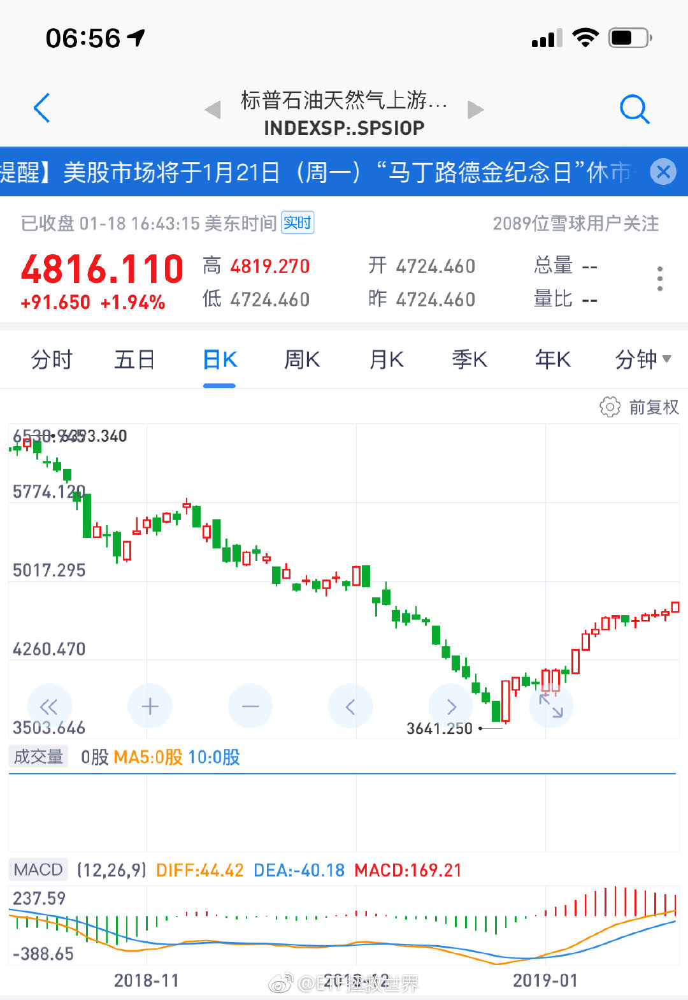

## 2019-01-19 21:27

稳定低收益。这就是大家对指数基金的认识吗。

不好意思，指数基金既不稳定也不是低收益。 ​​​
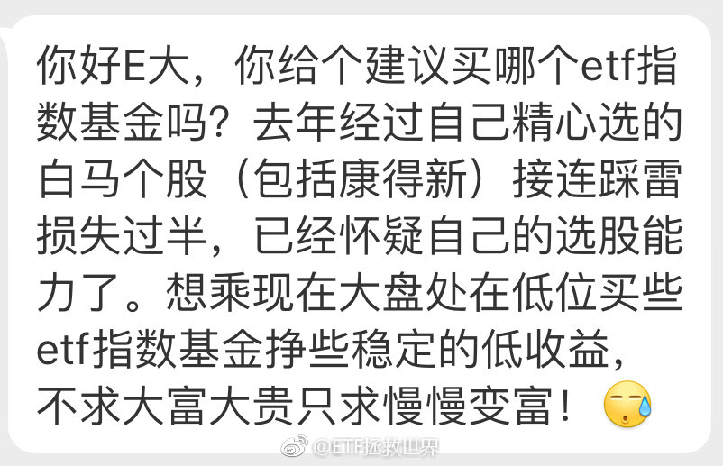

## 2019-01-20 06:30

跌58%。同期的计划还在盈利。

## 2019-01-20 07:20

回复@蜀中弟子:一个品种下跌70%买入，回到跌幅一半的位置，赚117%//@蜀中弟子:昨天看到一个有意思的东西，球球上有人分享了一只个股，前一天跌七成，第二天涨七成，结果你猜回本了么，就联想到咱们得一些指数，已经跌了七成的样子，未来即使回不到15年高点，哪怕只有一半，咱们也能赚不少，开心

## 2019-01-20 09:45

回复@Alex森岚:你是只知其一不知其二。2007年的高点，中证500在2010年就回去了，2015年已经比2007年最高点涨了一倍。沪深300在2015年也几乎回去了。//@Alex森岚:6124现在都回不去，不止10年了吧？

## 2019-01-20 09:57

回复@Alex森岚:我都不知道你在讨论什么。跟成分股有一毛钱关系吗？连日本这样的奇葩都回到1993年了。不解释了，拉黑。//@Alex森岚:回复@ETF拯救世界:07年的中证500，跟现在的中证500，有多少成分股是一样的？看看这次科创板出来后中证500要多少年回去咯。

## 2019-01-20 10:24

刚看下面有人说，随便拉黑和我“营造的形象”不符。

呵呵，我营造什么形象了？

我就是一个在股市上赚了点小钱的普通人。人类男性共有的缺点我都有，不比谁有什么高级的。跟大家一样，喜欢钱，喜欢看美女帅哥，有时候懒。

在微博上80%的时候怎么想怎么说，剩下的20%怎么想不能说，或者不合适说就不说。

营造个毛线。怎么，营造形象能挣钱吗，你有没有因为我营造的形象给我打钱？没有就别扯这种淡。

“营造”是什么意思？意思是本来不这样，制造这样一种印象对不对？能这样污蔑别人的你就是真坏。

拉黑一个人有很多种可能。有可能对方是喷子，有可能三番五次来抬杠却杠不到点上浪费时间，也有可能只是因为我心情不好。怎么了，拉黑人还要去查阅什么相关文件吗。不好意思，这是我自己的微博，我愿意拉黑谁就拉黑谁，看不惯的欢迎取关，我真不在乎。

## 2019-01-20 14:20

好不容易熬到大叔的年龄谁能想到大叔代言人崩了大叔不吃香了 ​​​

## 2019-01-20 18:06

说几条关于这种事情的三观。

第一，女朋友多几个少几个不是什么问题。最关键是要一个一个来，同时几个就不好了。不好是不好，谈恋爱的时候难免也有旧的没断新的就好上了，这个也不能完全避免，尽量吧。

但是注意，这条适用于单身。结婚是个分界线。

第二，婚后，没有极其特殊的情况，还是要专一。尽量不要瞎搞了。该玩的婚前玩完，婚后踏踏实实过日子。否则是对另一半的极大伤害。当然，下一条例外。

第三，有个例外情况是双方默许或者同意对方出轨，就无所谓了。人家夫妻的事外人不要瞎掺和。当然你可以在道德上谴责人家，其实没什么意义。但是，这里也有个关键。

第四，关键是这种情况下你也不能骗小三。不能骗人家你单身，不能骗人家你夫妻感情不和要离婚。什么事情说的明明白白，小三能接受就行。

第五，无论如何，婚后出轨都有极大风险。无论从各方面来讲都是如此。你做好所有准备再去乱搞，否则管好自己。

第六，我其实很理解大叔的做法。你情我愿的在一起，给你的物质也可以看出相当丰厚。你还狮子大张口，甚至毁了我的所有事业，想办法让你吃苦头也是正常反应。

第七，这件事本质上就是出轨男和小三反目成仇，互相置对方于死地。都不是什么好鸟，吃瓜群众也不必为谁不值。

## 2019-01-21 09:22

___场又要开门了。

真好。 ​​​

## 2019-01-21 09:34

别涨了，再涨空头过不好年了。奶一口，大家都开开心心的。 ​​​

## 2019-01-21 09:37

回复@老虎爱喝下午茶:只要你能想清楚，是要人、要财，还是要命就行。人这一辈子要面对的诱惑很多，能走多远要就看你能顶住多少了。//@若水涵泳:e大，话说18、9的小姑娘飞蛾赴火往你怀里钻你能顶住不

## 2019-01-21 09:43

看看灵不灵。//@ETF拯救世界:各位好好在各个网站观察，看看对不对。

## 2019-01-21 09:49

回复@C--1:希望他来又不希望他乱来。//@C--1:希望他涨又不希望他涨。横个三五年，让我这种迷你散多攒一点筹码。//@ETF拯救世界:看看灵不灵。//@ETF拯救世界:各位好好在各个网站观察，看看对不对。

## 2019-01-21 09:57

便宜的时候，给你很多很多时间和机会让你慢慢布局，你因为各种利空不敢买，又或者是特别贪，希望跌到2200,2000,1500。

涨起来了，贵了，你很着急。希望有个大回调自己好杀进去。

不好意思，真正的牛市没有回调。即使有你也进不去。最后你进去了，恐怕涨不了多少就要是大顶了。

这话还早，不过几年后你回头再看，到时候看看准不准。

有诗为证：

有花堪折直须折，莫待无花空折枝。

## 2019-01-21 10:44

大跌的时候跌幅只有1/3，上涨的时候大致跟上。大熊市不赔钱。

投资目标这一轮再次全部做到了。 ​​​
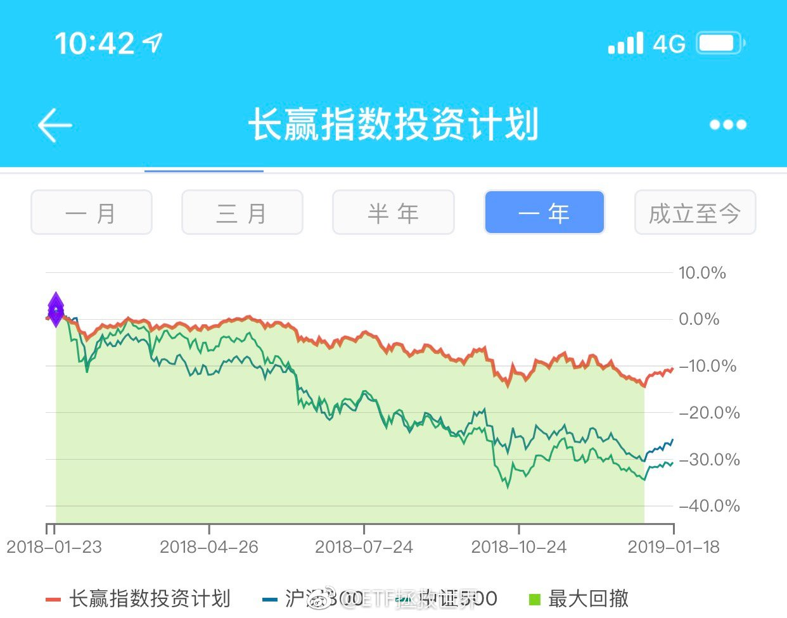 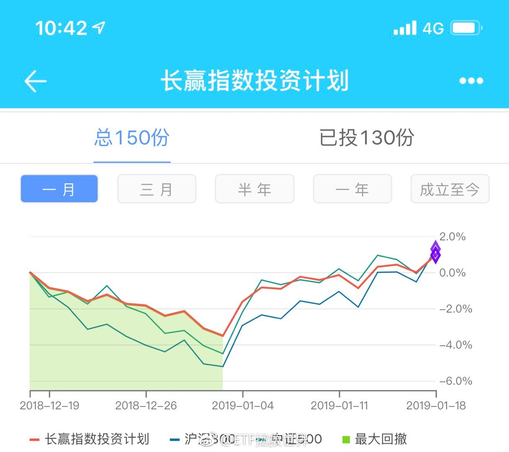 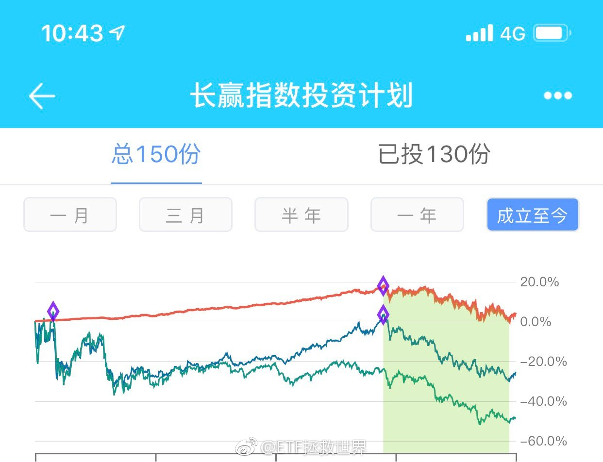

## 2019-01-21 11:12

今天还有700多只股票是下跌的。

未来的牛市中，很多股民会眼睁睁的看着指数涨上去不赚钱。 ​​​

## 2019-01-21 13:09

回复@花间且问道:加油。你一定能买到属于你的2个月翻倍股。你不适合我这里，拉黑。//@花间且问道:有不少个股跟10月份的底部相比股价都翻倍了

## 2019-01-21 13:35

10月底上来一共11只个股翻番。祝这位朋友买到。同期有951只股票下跌，这951只股票有5400万股东。我说很多股民眼睁睁看着指数涨不赚钱错了吗。//@ETF拯救世界:回复@花间且问道:加油。你一定能买到属于你的2个月翻倍股。你不适合我这里，拉黑。//@花间且问道:有不少个股跟10月份的底部相比股价都翻倍了

## 2019-01-21 13:39

“指数涨，很多股民也赚不到钱。”（事实是这一轮反弹确实有5400万股民持有的591只股票在下跌。）

“还有11只翻番呢。”

  这是什么逻辑链条？我确实特别害怕跟这样逻辑思维能力的人沟通。趁早一刀两断最好。 ​​​

## 2019-01-21 13:51

追求个股的超高收益没有问题。非常合理。

不过我的建议，是每个人的组合里至少给指数一点仓位。这样，如果你的个股在牛市表现不好，至少有指数仓位保底，不会颗粒无收。

个股表现好，指数也不会太差。

同时，你也能发现自己到底是不是炒股的料。多好。 ​​​

## 2019-01-21 14:01

回复@草稿师:请经常发言谢谢。//@草稿师:回复@_藍莓蛋撻:说的是我吗？刚才满仓干进去了。

## 2019-01-21 14:48

有没有手里资金还比较少的朋友想过一件事：

等手里有100万的时候，从银行取回家数数。

这样想过的举个手。 ​​​

## 2019-01-21 14:53

回复@超级宝宝0928:说多不多，说少不少。目前我国人均年收入不到3万，人均存款不到10万。//@超级宝宝0928:一百万算多吗

## 2019-01-21 16:28

回复@龙虎半天云:下决心不还了？//@龙虎半天云:去年开始有了百万以上的股票市值，不过有一半是借来的钱，今年终于变成自己的了。

## 2019-01-21 17:16

回复@俞小坏--亚克西:幸福来自超越昨天的自己，不幸来自于与他人比较。——某极有思想的投资者。//@俞小坏--亚克西:说实话就高兴了一两天。。然后看到别人千万，就觉得一百万算个啥。。。

## 2019-01-21 21:49

救急不救穷。这是救急还是救穷。另外，养老金全国统筹不是新闻了

## 2019-01-22 17:09

今天过得怎么样？

忙了一天，现在才有空上来给各位请个安。 ​​​

## 2019-01-23 21:17

对流浪地球有点期待啊。

三体是不是五年内拍不出来了… ​​​

## 2019-01-24 10:49

说起情感，其实我有个情感方面的问题，问问各位。

我看很多人对“相亲”特别抵触。长辈什么安排的都不愿意去。

相亲有什么不好的地方吗，吃顿饭聊聊天嘛。好就接触不好就不再联系呗。多认识点人也没什么坏处。

万一相到了吴彦祖或者高圆圆你说你不是赚了吗。 ​​​

## 2019-01-24 11:22

回复@NFHSong:不是。这个几乎是没有成本的。成本就是一顿饭时间，真的忙到一顿饭时间都没有吗。见完了不行就跟介绍人说感觉不太合适就完事了。收益却有可能是无限的。理性的看，这个风险收益比太棒了。//@NFHSong:E大你这想法遇到吴彦祖，和买到100倍股有啥区别。。。

## 2019-01-24 11:29

回复@Turanium中玉:违规T+0回转。跟咱们没关系。//@Turanium中玉:E大能不能说说这是怎么回事啊？4宗操纵ETF交易案披露 福建道冲等交易亏逾50亿被罚

## 2019-01-24 11:39

回复@寒山明月:是不是每次要完你电话都在夜深人静的时候打来深情的问：“你，知道安利吗。”//@寒山明月:真的被介绍去相的，有几个是条顺颜高的，遇到这样的概率是零。别说女的，男的有点型的都容易被搭讪，以前出去时被女的要过好几次电话。

## 2019-01-24 11:54

这种事情，我是这个意见。 ​​​
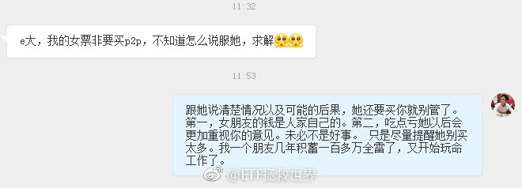

## 2019-01-24 11:59

回复@遥远的梦2018416:制止了，这个事情不发生，你不会觉得他好。而且如果没事，你还会埋怨挡了他财路。其实类似的事情每天都在发生，各位可以想想是不是。//@遥远的梦2018416:我老公就是这样对我的，我不听，吃亏了他也只是简单的讽刺我一下，我还埋怨他当时不严厉制止。

## 2019-01-24 12:14

其实金融投资，想要不被骗有几个关键原则稍微把握一下。包括，但不限于：

第一，正规。一定要正规，法律允许的，zf保护的。比如沪深交易所，各大期交所的产品。我有朋友玩现货，被卷款跑路。

第二，你要知道整个产品的原理。如何募资，资金投向，资金监管。比如指数基金最简单了，得到监管层批准的公募基金公司从投资者处募集资金，放在监管银行，以一定规则投向交易所的各种证券品种。整个流程清晰，可控，受到保护。是不是能搞清你的钱是如何运作的，很重要。我估计很多投资p的朋友根本不知道自己的钱被用来干嘛了，这个就很麻烦。

另外，尽量避免非常复杂的产品。

第三，承诺收益过高直接放弃。世界上不存在“绝对无风险”+高收益率的东西。想要高收益率，就要承担高的波动风险。如果有人告诉你，他的产品绝对没有风险，同时有年化10%以上的收益率，直接转身走人。一定是哪里有大坑等着你。

第四，只要是正规的产品，不存在卷款跑路的风险，就有研究的价值。只要你杜绝了卷款跑路的风险，剩下的赚钱不赚钱就是你自己的能力问题了。这就不是“骗”的范畴。

## 2019-01-24 12:30

回复@大号被狗曰的新蒗封了:为什么还有1%不赞同。拉黑。//@大号被狗曰的新蒗封了:回复@ETF拯救世界:E，我还算是比较喜欢独立思考的人，别人的话我都不会无脑信，但我发现你的话，99%我都认同

## 2019-01-24 13:35

没有发生过连续两任监管任期内都没有牛市的。

这次应该也不会例外。 ​​​

## 2019-01-24 13:54

不知道有没有受到帮助的学生去看过他。

## 2019-01-24 14:09

回复@葱葱AQQ:最长的尚是9年，其他最多没超过4年应该。//@葱葱AQQ:主要是看时间跨度。两任的任期是多少年？

## 2019-01-24 14:21

回复@乱喝茶:闲着没事儿看新闻瞎聊天。这样的话就没什么好说的了。我去分析100年的大数据了。有结果回来跟大家分享。//@乱喝茶:E大，一共就8个人就归纳出来规矩了？这样本空间有点低

## 2019-01-24 15:58

已经有不止一个人问过我这个了。

这个不是我，有空的朋友请帮我举报这个公 众 号。 ​​​
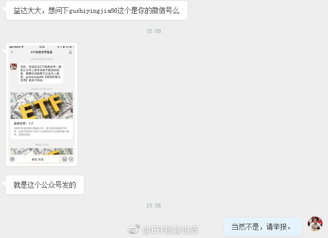 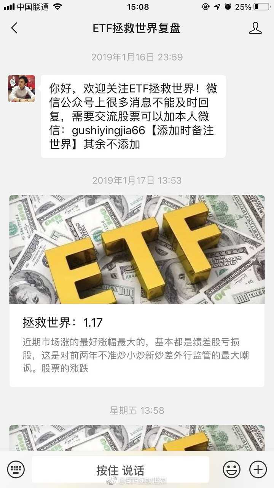

## 2019-01-25 07:10

以目前的国土面积，有6-8亿人是最合适的。提高人口素质，提高劳动生产率，提高科技化水平。每个人空间大一点，挺好。当然，一代人的痛苦不可避免了

## 2019-01-25 07:27

对于普通人，操心那些有的没的毫无用处，不必天天自寻烦恼。两点原则：

第一，事物的发展不是线性的。四十年前，二十年前，现在，你看到的人口问题都不一样。整个世界更是天翻地覆。不要用现在的情况线性推一两百年后。这个世界有它解决问题的方式。

第二，大致了解目前的情况和趋势，推演自己有生之年会发生什么。然后未雨绸缪早做准备。再差的时候，人的生活状态也不一样。有机会细说我的一点想法。

## 2019-01-25 07:32

回复@NFHSong:是吗。昨天十几亿基数的球队又被受到发达国家制裁的小国干了3：0。很多东西不是基数大就行//@NFHSong:回复@慎独慎入慎犬儒:不尽然，人多。。。按照比例来说，出人才就多

## 2019-01-25 10:43

继续新高

## 2019-01-25 13:26

多大点事，踏踏实实的。 ​​​

## 2019-01-25 13:52

回复@xixcgw6143100976:有。  低位买够，涨跌都舒服。说一万次了。//@xixcgw6143100976:老大，怎么克服想追高的心理，有什么经验么？虽然150份一直在跟车，然而还是贪心想再加点再多赚点，应该有不少人会有这种心理。

## 2019-01-25 13:56

昨天长信转债比几大宽基指数涨的都多。

为什么，因为它带杠杆。

别以为“债就一定干不过指数”。

很多事经历一次才懂我在干什么。 ​​​

## 2019-01-25 14:03

回复@就爱喝X:军工不  ，    不来//@就爱喝X:关注的ETF中，只有一个军工是绿的，其它都是涨，全市场股票一半涨一半跌//@ETF拯救世界:回复@xixcgw6143100976:有。  低位买够，涨跌都舒服。说一万次了。

## 2019-01-25 14:09

回复@南海恶神的师傅:赚了指数不赚钱不是开玩笑的//@南海恶神的师傅:今天竟然还有一多半股票是跌的，指数大法好//@ETF拯救世界:回复@就爱喝X:军工不  ，    不来//@就爱喝X:关注的ETF中，只有一个军工是绿的，其它都是涨，全市场股票一半涨一半跌

## 2019-01-25 14:23

今天连1000都没涨，可想而知后面的2400只… ​​​

## 2019-01-25 18:12

今年的货币环境是“松紧适度”

## 2019-01-26 18:08

很多人根本没搞清楚CDR/科创板是谁要上。

真心跟L没关系。

本条关闭评论。

另外，刚才拉黑了12个人，别感到奇怪。以后点赞要看清了再点。 ​​​

## 2019-01-28 11:13

沪深300十个月来第一次冲击半年线。

有些朋友现在会不会很慌。 ​​​

## 2019-01-28 11:37

等后续。直觉告诉我背后有故事…

## 2019-01-28 12:54

怎么感觉最近互动变少了。

同志们的工作积极性不高嘛。是不是都去准备过年了。

过年是好事，革命工作也不能放松。对，别看别人，就是说你呢！ ​​​

## 2019-01-28 15:17

感动，笔芯！人间自有真情在，股市跌了，心里还是暖暖的！忙了一天还在准备春节要发的东西，冲鸭~

## 2019-01-28 15:28

看PE或者PB投资券商的都是远未够班。要知道券商的资产可是没那么靠谱。

## 2019-01-28 18:04

“与此同时，“融资底”将现，直接融资发力将部分替代影子银行。&quot;

## 2019-01-28 19:37

看了一眼6.74了。//@ETF拯救世界:回复@98号元素:这里会有一场争夺战//@98号元素:E大，扔个骰子，觉得汇率会破7吗？//@ETF拯救世界:6.9附近开始出货说到做到

## 2019-01-29 11:24

真正的熊市会把绝大多数人的耐心和信心都消磨干净。

所以这种时候，该买的买好，再留点钱应对继续下跌。然后该干嘛干嘛去，别看了。找点有意思的事情做。 ​​​

## 2019-01-29 12:38

这就是我说的，踏踏实实的，多大点事儿啊……

## 2019-01-29 13:38

好好地咋红了呢，这不扯犊子嘛。这还咋玩，要脸，退博，匿了

## 2019-01-30 07:37

我没有集过五福。玩过的朋友说说，费半天劲能分多少红包。 ​​​

## 2019-01-30 07:43

回复@小号1234567小童鞋:他一个人抢了十几块。大家快过来打他//@小号1234567小童鞋:还不如努点力抢E大的新年红包，我去年一下子抢了十几块，集福才抢2块

## 2019-01-30 07:46

回复@归去来兮5100:情有独钟从何而来？50 300 红利仓位已经20%了，远超500。下结论之前先看看事实。另外，你看最近的表现评价一个品种好不好吗？可以取关了

## 2019-01-30 07:52

买东西看最近表现是极其短视的。

2014年7月，创业板比2012年底翻了两倍，50还跌了。那时候你会不会说50是辣鸡？

我特别讨厌谁好就追谁，谁倒霉了就假装不认识。

我就喜欢你落难我来帮你，你富贵我转身离开。做投资，做人，都是如此。

你感受一下。 

道不同不相为谋，以后理念不同的直接拉黑，各生欢喜。

## 2019-01-30 08:17

回复@guoqiao:刚才在外面没法查凭印象说，现在告诉你2012-2014.7创业板涨了155%。烦死了get不到重点。//@guoqiao:翻了两倍，指的是变成了原来的三倍，还是四倍？不是抬杠，只是人们的表述往往模糊。

## 2019-01-30 08:21

知道拉黑有什么好处吗。好处之一就是抢红包的时候坏人不会占名额了。就会多一位真正的朋友抢到…… ​​​

## 2019-01-30 08:23

十一年的老炮都要走了。这说明_____。（2分）

## 2019-01-30 08:45

关于这个问题，我这样回答。 ​​​
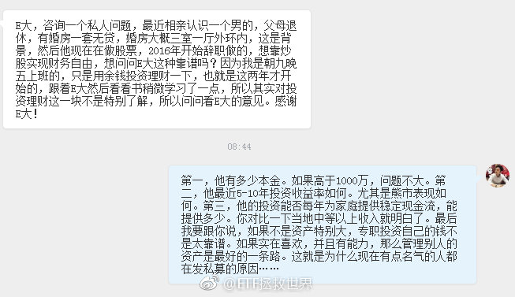

## 2019-01-30 09:34

正常的市场本来就应该有几百块的股票，也应该有大量几毛钱甚至几分钱的股票。

频繁爆雷，频繁跌停都是正常现象。 ​​​

## 2019-01-30 09:42

回复@小狗上马路:别嘴炮。让看空的把做空IC的图贴上来。//@小狗上马路:昨天雪球好多人担心中证500大跌，怎么今天没反应就等今明两天了，加油

## 2019-01-30 09:50

回复@某同学321:1-2，明天中午吧。明天大概率拉升，不过一两车问题不大。//@某同学321:E大，这次发几车呀//@ETF拯救世界:回复@小狗上马路:别嘴炮。让看空的把做空IC的图贴上来。//@小狗上马路:昨天雪球好多人担心中证500大跌，怎么今天没反应就等今明两天了，加油

## 2019-01-30 09:51

回复@愿赌服输K:在美国，在欧洲，长期看都是小盘股跑赢大盘股。凭什么未来A股小盘股无法重现辉煌呢？现在只是不够便宜而已。人云亦云真的非常可怕，我建议大家一定要有独立思考的精神。

## 2019-01-30 09:54

如果你看了3-5年财经论坛，微博之类的，还没发现一半（至少）财经类的v都是水货（包括我），那你就是水货。

水货说的很多东西能信吗你自己说说。

独   立   思   考   ！ ​​​

## 2019-01-30 10:21

钓鱼成功。说我不行的都拉黑了。

## 2019-01-30 11:10

好好的一个熊市，看评论被你们一个个整的跟个牛市似的。

喷了。

还有没有一点熊市样子了，一点尊严都没有了。 ​​​

## 2019-01-30 11:56

回复@一溜烟儿_:因为我是投资博主。感情的事儿问咪蒙和陆琪去了。//@一溜烟儿_:回复@Insulation_NS:不懂为什么相亲只谈钱？

## 2019-01-30 12:59

有没有复旦和浙大的录取比例。哪个学校不是本地生源多。

## 2019-01-30 13:33

回复@难道我是啊qiu:2018年，学校计划招生6410人，其中浙江省内计划招生3100人，招生规模与2017年持平。//@难道我是啊qiu:浙大对浙江人貌似一视同仁（一个杭州人的道听途说）//@ETF拯救世界:有没有复旦和浙大的录取比例。哪个学校不是本地生源多。

## 2019-01-30 13:40

回复@bear_宋:隔壁陕西还有8所呢。另一边隔壁河北是不是一所都没有，忘了……河北考生才是惨。//@bear_宋:所有学校都会对本地生源有倾斜，问题在于北京有26所211，而人口大省河南只有一所211。

## 2019-01-30 21:23

刚才又看到有人说，最近这么爆雷，500的数据会很难看。

把我吓得赶紧滚去算数据：

截至今日，中证500有287家公司公布业绩预告。

按照预告净利润增长下限计算，有134家业绩下降，有146家利润上升，其余不变。

按照净利润增长上限计算，有101家业绩下降，有186家业绩上升，

怎么看都是利润增长的公司多。不知道那些开心笑的牙都快掉的人那么欢乐的点在哪儿啊。

这次洗澡，是很多公司一次把商誉搞定，不用摊销退市。明年只会更好。

## 2019-01-30 21:32

11月5日： ​​​
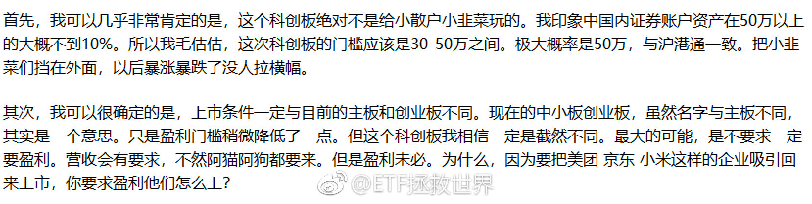

## 2019-01-30 21:55

现在还10送10的绩差股我真不知道是怎么想的。这种我觉得就是希望自己早日退市。 ​​​

## 2019-01-30 21:59

标普500pb大概是3倍多一点。纳斯达克100大概是5倍多一点。英国100两倍多。印度3倍。

中证500即将跌破1.5倍（历史最低1.3x）。连传媒都1.8了。我其实很好奇，这么洗传媒年报出来会怎样…… ​​​

## 2019-01-30 22:46

回复@化工_达人:500最高市值502亿，最低31亿。中位数115亿。500并不是单纯以市值为标准的。//@化工_达人:今天好奇中证500成份股的市值，印象中平均在百亿以上，刚随便看了几十只股票，发现很多都是60亿左右，最低的有看到40多亿的，是不是跌太惨了，按理说50亿很难进入指数了吧……

## 2019-01-30 23:15

回复@ETF拯救世界:资本市场就这么点事，只要知道对方想干什么就能猜出下一步出什么招数了。//@ETF拯救世界:另外，认为科创板会大幅拉低主板市场估值的，我觉得可能想多了。科创板一半以上上市公司我估计是亏损的，市盈率是负的。你想让他们拉低谁的估值？

## 2019-01-31 08:57

回复@w__rain:十几个点的仓位还用不着这么打气。踏实点。//@w__rain:如今商誉减值，中证500的pb一下子应该高出一大截吧，所谓跌着跌着，估值就高了。看来中证500还没走到下跌的尽头，还有很大的下跌空间，我们不要悲观啊。

## 2019-01-31 09:38

新闻和传媒，只会报道那些“不寻常”的事。有人为了抓眼球，有人为了其他的目的。

洗澡的，爆雷的有没有。有。

有多少，现在还不知道。有没有全部上市公司的10%？很难。

现在两市3600家公司，有没有360家爆雷？

冷静点。理智点。独立思考。 ​​​

## 2019-01-31 09:39

人生的无奈就是知道的太多。心累。//@ETF拯救世界:回复@某同学321:1-2，明天中午吧。明天大概率拉升，不过一两车问题不大。//@某同学321:E大，这次发几车呀//@ETF拯救世界:回复@小狗上马路:别嘴炮。让看空的把做空IC的图贴上来。

## 2019-01-31 10:13

任何一个市场都有辣鸡。你知不知道美股很多年份退市的公司比上市的多。

港股就不用说了，辣鸡遍地。

影响这些市场一路走高吗。

不影响。

有几个辣鸡有什么奇怪的？多大点事儿啊。

只是，那些重仓辣鸡的股民牺牲了。 ​​​

## 2019-01-31 10:30

回复@愿赌服输K:因为我遵守规则。这也是我开开心心在市场里活着的原因。//@愿赌服输K:不是抬杠啊…既然知道今天拉伸的概率大，为啥没有昨天发车呢…是因为今天要买的品种昨天买不确定性很大吗？//@ETF拯救世界:人生的无奈就是知道的太多。心累。

## 2019-01-31 10:54

想到不要脸，没想到这么不要脸。

NB你就拉5%。

 ​​​

## 2019-01-31 13:50

中证1000目前估值25，历史最低2008年是19倍。所以目前只是小盘股正常挤泡沫而已。

没什么好吃惊的。甚至连2008年都没跌破。 ​​​

## 2019-01-31 15:03

有件事忘了说。

爱你们。

 ​​​

## 2019-01-31 16:36

转发微博

## 2019-01-31 18:51

回复@陈中围脖:大家是谁？你要在股市和大家都想法一样了，那你得多平庸啊//@陈中围脖:看球球上，大家把500说的一文不值....//@ETF拯救世界:转发微博

## 2019-01-31 18:58

从现在开始，谁再没完没了的问500直接拉黑。

担心你就卖掉，不担心就拿着这不到15%的仓位等风来。

什么都不懂就去研究，看谁说不好就找谁报团儿去。

跟这么一帮人做队友一起打仗真是见鬼了。 ​​​

## 2019-01-31 19:45

截至今日，有295家中证500成分股公布业绩预报。

以上限计算，有181家业绩预增，增幅中位数50%。

有114家预减，预减幅度中位数83%。主要原因为有50家公司预减100%以上。

500是一个分布极其平均的指数，占比最大的成分股占指数配比为0.6%。第十位只有0.4%，大部分公司占比不到0.3%。

目前PE18倍，PB1.5倍。

我请你们记住这些数字，以及那些目前看衰500的大V和吃瓜群众。

你在他们那里，虽然看不到任何客观数据。但你可以看到情绪以及视野。

## 2019-01-31 19:50

回复@资本暴利狂徒:控制好仓位。目前计划里面的500仓位很合适。一个组合里面，大中小指数配置都不能太多，合适就是最好的。//@资本暴利狂徒:E大别理那些傻子，大过年的，讲点开心的，我明天就买三车500

