## 2019-02-01 09:29

有朋友在评论说，希望500大涨打他们的脸。

我不这么想。

咱们到市场上来投资，不是为了争谁更厉害，而是为了赚钱。踏踏实实把自己该赚的钱赚到，就够了。

能力不足的人，市场会教育他。不需要你我动手。以后无论如何，胜不骄，气不馁，继续开开心心做自己的投资。

我只是为很多人感到惋惜。

因为在他们的人生观里，世界上只有一种东西是对的。没有任何其他选择。我喜欢的，别人不喜欢，那他就是sb。我不喜欢的，别人喜欢，那他还是sb。我只买招行格力平安，你不买，你就是sb。我只买50和300，你要做资产配置，大中小都买，你就是sb。我是价值投资，你做趋势，你就是sb。

你这一生，能走多远，一定程度上取决于你的思维能开放到什么时候。知不知道人变老的一个重要标志是什么？就是不再接受新的事务。一个人愚蠢的标志，就是认为唯我独尊，没有任何其它选择。

## 2019-02-01 09:34

有些人的最大乐趣，不是研究怎么能让自己过得好，而是每天盼着别人倒霉。你说奇怪不奇怪。

## 2019-02-01 09:40

回复@fankezhou:暴涨。//@fankezhou:农历年最后一个交易日，蚂蚁积分怎么压@ETF拯救世界//@ETF拯救世界:有些人的最大乐趣，不是研究怎么能让自己过得好，而是每天盼着别人倒霉。你说奇怪不奇怪。

## 2019-02-01 09:46

回复@子晏_2016:只有小孩才纠结：我该买50还是500？作为一个成年人，我要说：“我都要！”//@子晏_2016:小孩眼里才有对错，年纪一大把还在分对错，只能说经历的太少，完全没有阅历。 世界是五彩缤纷的，为何总要盯着黑白呢

## 2019-02-01 10:08

回复@火尔亮:新朋友吧。我这里都是越跌越高兴的。不过最近好点了，老中医疗效不错，上涨也开心的人多了。//@火尔亮:回复@唐山黄金名表名包回收典当:你是脑子有问题吗

## 2019-02-01 10:23

送给大家的第一份春节礼物：

目前计划的三层资产配置图。

从图上你可以看出，500涨跌对整个计划来说并不是那么重要。未来就算雷个外焦里嫩，也无所谓。这个，可能很多看笑话的人要失望了。

另外，以后这个图会每个月发车的时候更新。在一定程度上，这张图已经触及到计划的核心。

感谢小助理zwt帮忙作图。

后续礼物正在赶来的路上。别急。

提示：手机版长按点赞可以打赏啊。哈哈
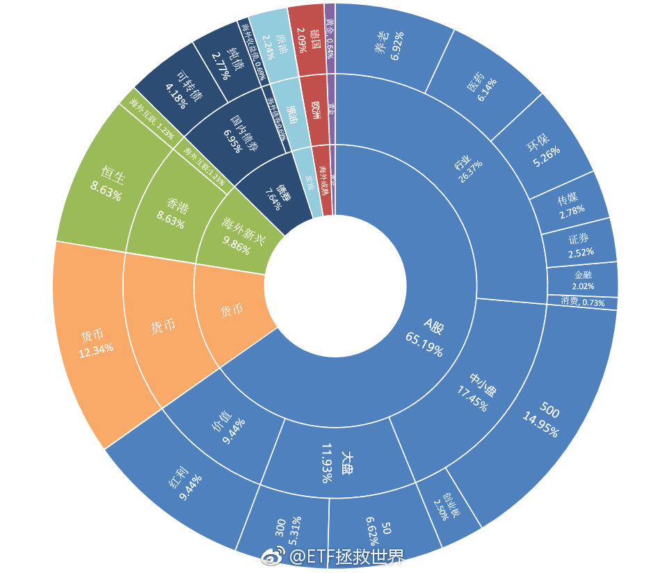

## 2019-02-01 10:29

回复@北京盛产义和团:500平均市值100亿，最大成分股市值300亿，最小30亿。目前是彻底的中小盘指数。主要是这两年跌的太快，调整指数成分都来不及把跌到几十亿的股票调出去。//@北京盛产义和团:E大，500能算中小盘吗？

## 2019-02-01 13:08

回复@morninggloy:不能。因为钱只够买一手。//@morninggloy:这就和以前一群人纠结是买格力还是美的一样，互相对杠，难道就不能一样买一半吗？

## 2019-02-01 13:18

这句话我看很多人还根本没理解。

## 2019-02-01 13:22

回复@A夜如故:很大。因为如果没差别了他们会太闲引起社会动荡。没事儿在球球吵架总比出去闹事强，利好社会稳定。//@A夜如故:美的格力在球球真的好多人争，买哪个好像差别不大//@ETF拯救世界:回复@morninggloy:不能。因为钱只够买一手。

## 2019-02-01 13:36

不够暴，很失望。对自己产生怀疑。//@ETF拯救世界:回复@fankezhou:暴涨。//@fankezhou:农历年最后一个交易日，蚂蚁积分怎么压@ETF拯救世界//@ETF拯救世界:有些人的最大乐趣，不是研究怎么能让自己过得好，而是每天盼着别人倒霉。你说奇怪不奇怪。

## 2019-02-01 13:48

回复@guderianlhx:为什么昨天发车呢，蒙的。//@guderianlhx:明明是长线投资思维，为啥看短线这么准，预测N次都是对的//@ETF拯救世界:不够暴，很失望。对自己产生怀疑。//@ETF拯救世界:回复@fankezhou:暴涨。//@fankezhou:农历年最后一个交易日，蚂蚁积分怎么压@ETF拯救世界

## 2019-02-01 13:57

另外我再跟你们说个一定要注意的，这条一定要收藏。

就是

在底部，无论是指数还是个股，跌了很久以后，很多很多时候会爆个特别大的雷。就是雪上加霜那种。

会让很多本来已经神经衰弱的人最终彻底放弃交出筹码。

而那天

有可能就是

世纪大底 ​​​

## 2019-02-01 14:00

回复@Hello我的001:一样，有时间的问问同花顺怎么回事吧。//@Hello我的001:借宝地问E粉们：有用同花顺APP看行情的朋友吧，为什么中证红利指数找不到了？输入399922，或者000922， 都找不到，是改代码了吗？先谢了。//@ETF拯救世界:回复@guderianlhx:为什么昨天发车呢，蒙的。

## 2019-02-01 14:19

3%算不算暴。你数学好你先说。//@ETF拯救世界:不够暴，很失望。对自己产生怀疑。//@ETF拯救世界:回复@fankezhou:暴涨。//@fankezhou:农历年最后一个交易日，蚂蚁积分怎么压@ETF拯救世界

## 2019-02-01 14:44

回复@Arthur向Dalio取经要靠谱:今天不涨你就不说了吧。小样儿。//@Arthur向Dalio取经要靠谱:环保和医药今天都大涨，爽爆！最近一个月，越发觉得底部临近，偷偷开了30多车，哈哈哈哈哈哈哈！！//@ETF拯救世界:3%算不算暴。你数学好你先说。//@ETF拯救世界:不够暴，很失望。对自己产生怀疑。

## 2019-02-01 15:22

红利已经快半年新高了。 ​​​

## 2019-02-01 15:52

回复@小五雀雀:我的建议，你实在不想出货也可以，但是高位把分红方式改成“现金分红”。分来的现金不要花掉，买货币基金。等低估的时候再买成红利指数。同时把分红方式改为“再投资”

## 2019-02-01 16:31

对于大盘或者是中小盘来讲，有两个策略我认同。

第一，是均衡配置，动态平衡。再高一点辅之以各种判断标准，动态均衡。

第二，是28这种择强持有。

相同点是不预判，不定调，不主观。区别是一个低买高卖，劫富济贫。一个与强者为伍。

不能接受的只有一种：

最近谁表现好，就踩另一种。认为未来永远是最近好的这种好，最近不好的永远不行了。

只要有这种想法，就已经可以断定，水平也就那样了。

## 2019-02-01 19:27

回复@黄连树:他的计算模型会导致的结果，与2008年美股大底pe暴增的错误是一样。他比不看数据的强点，但是没有再进一步往下走。不急，还有两个多月，到时候看我的数据。//@黄连树:益达，不知道这篇文章您看了没？算是雪球上第一个有数据的文章连续业绩暴雷后，中证500PE从16提高到21，创业板指PE从27跳到41.3

## 2019-02-02 07:54

2015年7月以来，只剩A股不赚钱。

而A股开始赚钱的位置，在这里。 ​​​
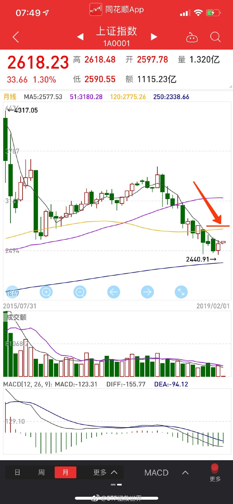 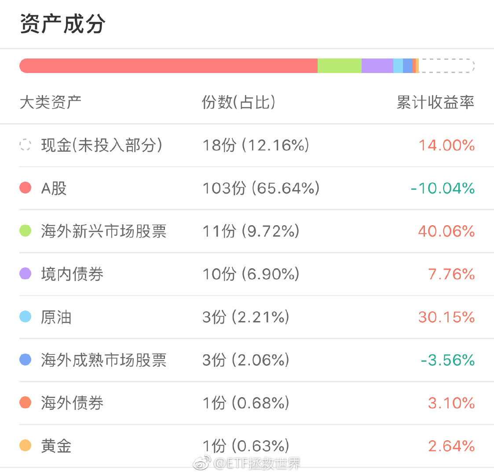

## 2019-02-02 10:31

回复@百里陌香:这不算预言。刚在做春节的东西，看到一段2015年7月的文字。看看会不会应验。 查看图片 //@百里陌香:预言家//@ETF拯救世界:回复@fankezhou:暴涨。//@fankezhou:农历年最后一个交易日，蚂蚁积分怎么压@ETF拯救世界

## 2019-02-02 11:31

回复@陈大致:又来了一个。mark。上一个是在最低点那哥们。//@陈大致:已经清仓，等待新低，新年快乐//@ETF拯救世界:回复@百里陌香:这不算预言。刚在做春节的东西，看到一段2015年7月的文字。看看会不会应验。 查看图片 //@百里陌香:预言家//@ETF拯救世界:回复@fankezhou:暴涨。

## 2019-02-02 17:55

回复@无心人lwy:再加两圈可以拿去看风水了//@无心人lwy:E大能否再加一圈，附上代码

## 2019-02-03 00:38

刚才有朋友评论里说又有人在雪球给我找事了。发帖攻击别人，拿我做对比给我招黑。

打开雪球一看，果然又是一堆评论提示。

饶了我吧，大哥大姐们。我已经离开七个月了，别再给我找麻烦了。

如果你是欣赏我，还请来微博或者公众号交流。不要拿我和别人对比，这是对我最好的。我不需要比谁好，不需要吸引粉丝，所以，我不需要出现在雪球。

如果你是故意拿我当枪使，一箭双雕一石二鸟，一个帖子让两个人干起来，那你还是省省。因为这样的做法太low，low到一眼就能让人看穿你的目的。

再说一次，我只想安安静静做自己的事。你们要挣钱的地方我不会出现，不会挡你们的财路，不会分流你们任何流量。所以就这样放过我吧，别再打扰我了。我自己要忙的事很多，到现在还在忙公众号的事，真心谢谢你们了。

球球是一个江湖。尤其是某个领域，更是龙盘虎踞深不可测。那个江湖刀光剑影，明枪暗箭此起彼伏。想要简简单单的享受人生，只能早早离开。因为在那里没有赢家——你成了武林盟主的日子，才是噩梦的开始。

不如归去。

## 2019-02-03 09:40

现在评论能贴图了。能不能拍点你觉得身边有意思的，跟过年有关的东西让我开开眼。顺便说说是在什么地方。。

祖国地大物博，没去过的地方，没见过的东西太多了…… ​​​

## 2019-02-03 21:09

别人发红包是转发关注抽奖赚新粉丝关注。

我发红包是谢绝新关注只给老朋友发。

但我非常开心！

怎么发明天看公众号吧… ​​​

## 2019-02-04 19:04

有没有搞错？38秒就能看完题输入口令？太牛了！

显示十分钟抢完，是从塞钱进去开始算的。题是7点整更新。 ​​​
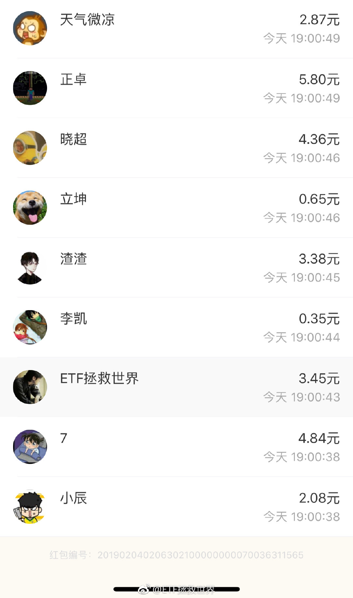

## 2019-02-04 19:08

回复@周军平1979:抢到的都是有麒麟臂的真爱。//@周军平1979:抢了3.82，谢谢E大！

## 2019-02-04 19:33

支付宝口令红包的问题是每次只能包300个。发的多要想很多问题。不过这已经是相对来说最科学的发送方式了。。看看明天微博红包的情况吧，那就完全是运气了。。 ​​​

## 2019-02-04 19:45

回复@周梦夏:我觉得明年也要换形式了，不知道有没有人知道答案后在群里分享，那样也不公平了//@周梦夏:今天抢了八块，期待明天

## 2019-02-05 07:46

请以下几位朋友联系我，有礼物送。 ​​​
 

## 2019-02-05 18:43

每天微博会有两个包。大点的是一年以上抢，小点的一个月以上。也就是说一年以上可以抢两次。

祝好运。 ​​​

## 2019-02-05 18:44

不知道为什么我的微博需要审核了。一会如果晚几分钟显示别怪我。 ​​​

## 2019-02-05 19:02

#ETF拯救世界的红包#感谢大家对我的爱与支持！我往红包里塞了现金，特来为大家送上好运，领到红包旺上加旺！ ​​​

## 2019-02-05 19:07

看来888个太多，明天金额不变，减少人数，人均多拿点

## 2019-02-05 19:12

#ETF拯救世界的红包#感谢大家对我的爱与支持！我往红包里塞了现金，特来为大家送上好运，领到红包旺上加旺！ ​​​

## 2019-02-05 19:14

这个太快了。好了，明天同一时间欢乐继续…大家新春快乐！

## 2019-02-05 22:42

前天刚把我爱我家全集40多G下回来准备开始重新刷。太喜欢了。小时候看不懂就觉得好笑，现在看觉得更有意思了。

## 2019-02-06 16:39

第二天，流浪地球从第四升到了第二。排片率也上去了。

看完感觉整体还是不错的，有些细节不喜欢，但是瑕不掩瑜，值得鼓励。

感谢用心做事的人，希望中国科幻片开始起飞。 ​​​
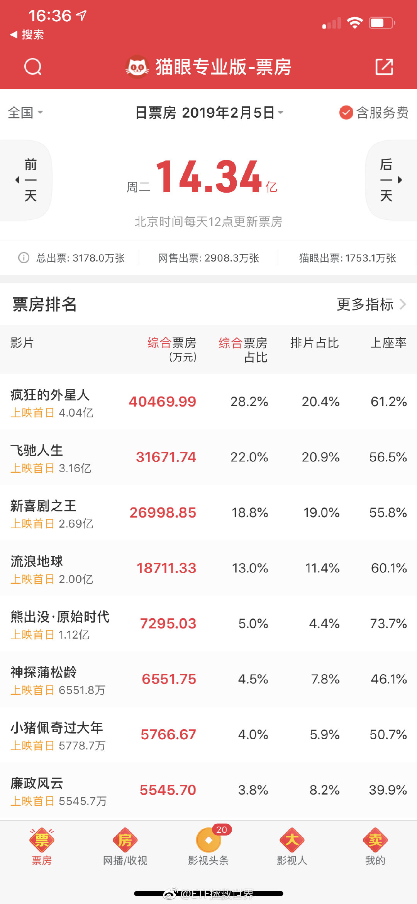 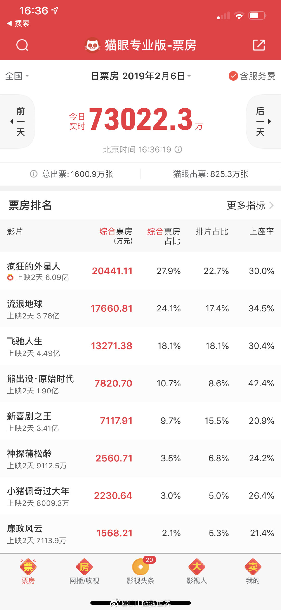

## 2019-02-06 19:01

#ETF拯救世界的红包#感谢大家对我的爱与支持！我往红包里塞了现金，特来为大家送上好运，领到红包旺上加旺！ ​​​

## 2019-02-06 19:12

#ETF拯救世界的红包#感谢大家对我的爱与支持！我往红包里塞了现金，特来为大家送上好运，领到红包旺上加旺！ ​​​

## 2019-02-06 19:14

今天两个已经发完了，大家新春大吉！

## 2019-02-07 19:01

#ETF拯救世界的红包#感谢大家对我的爱与支持！我往红包里塞了现金，特来为大家送上好运，领到红包旺上加旺！ ​​​

## 2019-02-07 19:07

#ETF拯救世界的红包#感谢大家对我的爱与支持！我往红包里塞了现金，特来为大家送上好运，领到红包旺上加旺！ ​​​

## 2019-02-07 19:08

今天两个包发完了，欢乐明年过年再继续！

## 2019-02-07 20:09

看某个论坛有些自以为是的喷子连电影带观影群众一个不落的喷，真是无话好说。

有时候真是细节能看出一个人的心胸。以前以为他们是只喷其它投资人，原来是只要做的好的人他们都要喷。

没有其它合理解释，就一句话：

羡慕嫉妒恨。

见不得任何人的好。

所以真是应该对很多事情释然：只要你做事，就一定有人喷。这跟你毫无关系。

## 2019-02-08 08:02

想去南方看雪//@中国气象爱好者:扬州、南通和崇明都下了中到大雪。这次杭州不在降雪带上，除西北部山区外降雪可能性不大。

## 2019-02-08 08:37

我建议，帮孩子建立财商，让他有理财意识的同时，千万要把一部分钱给他让他自由支配。

小时候过于缺钱，很大概率会导致长大后特别贪婪或者特别吝啬，对人生其实没有什么好处。

度要把握好。建议引导孩子将自由支配的钱拿一部分储蓄与理财。如果存下来的不多不少，会有奖励。过多过少都不奖励，一点都剩不下则会有惩罚。

储蓄的钱，超过70%就是过多，低于20%就是过少。 过多也不好，不能体会消费的乐趣，容易变成葛朗台。过少就不用说了，月光和过度消费还有什么前途。

## 2019-02-08 09:05

这不就是前几年流行的松糕鞋吗！话说做为一个直男，真的对松糕鞋这种东西接受不能…

## 2019-02-08 12:52

回复@一只咸咸咸咸的咸鱼王:说的没错。一定要电影中每个情节都符合现代人的科学理论，是不是脑残？去看论文不就行了吗？凡尔纳作品里面无数不合科学逻辑的东西，谁能质疑他的牛逼？在这个角度批评一个科幻电影就是对科学有点皮毛理解看不上普罗大众了

## 2019-02-08 13:07

不从众，独立思考，并不是“你们喜欢的我就要反对，以体现我的特立独行。群众喜欢的都是low货，只有我高大上。”

这样真的特别中二。真的。 ​​​

## 2019-02-08 16:41

真正的特立独行，是我不管别人喜欢不喜欢，别人说什么，只要我喜欢就是喜欢，不喜欢就是不喜欢。不因为害怕不合群而随大流，也不因为想显得独特而保持与群众的距离。别人的看法影响不了我的决定。

## 2019-02-08 17:03

关于流浪，我说最后一句，不再说了。

这部电影一定不完美。我评论的时候就说了，还不错。很多细节不行，但是瑕不掩瑜。

豆瓣观影1100多部的我，加上爱国因素也只给了四星。独立日我是给五星的。

我看不上很多喷子的原因，是在咱们这里做点事太难了。这个电影不用问就知道过程中一定克服了无数困难。成品虽然有瑕疵，但是很明显是用心的东西，完成度也非常高，整体水平在全球来看也是能拿的出手。这么难，又做的已经很不错的开创式作品，被这些喷子这么喷我就是看不过去。

用心做事，有底线的做事，在现在的中国真的是难能可贵，一定要鼓励。不是说不能批评，不批评很难进步。但是很明显，有些喷子是没有底线的。

希望各个行业都能多一些认真做事的人，喷子能少喷一点，有时间也去做点事就最好了。
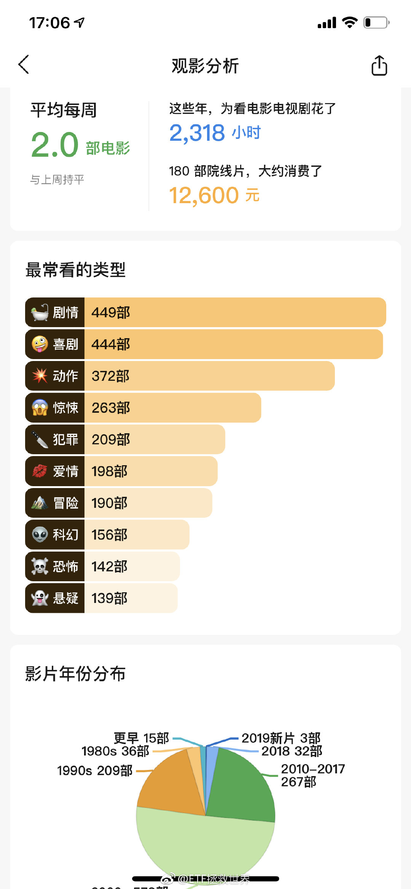 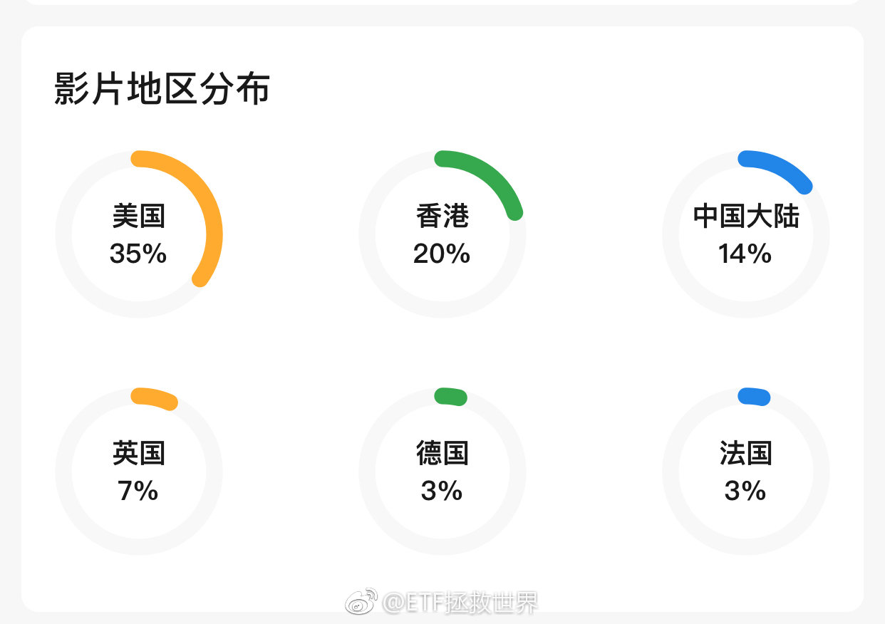

## 2019-02-09 09:07

愣着干什么，拜啊。 ​​​
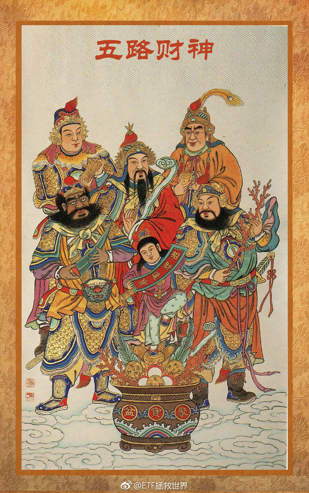 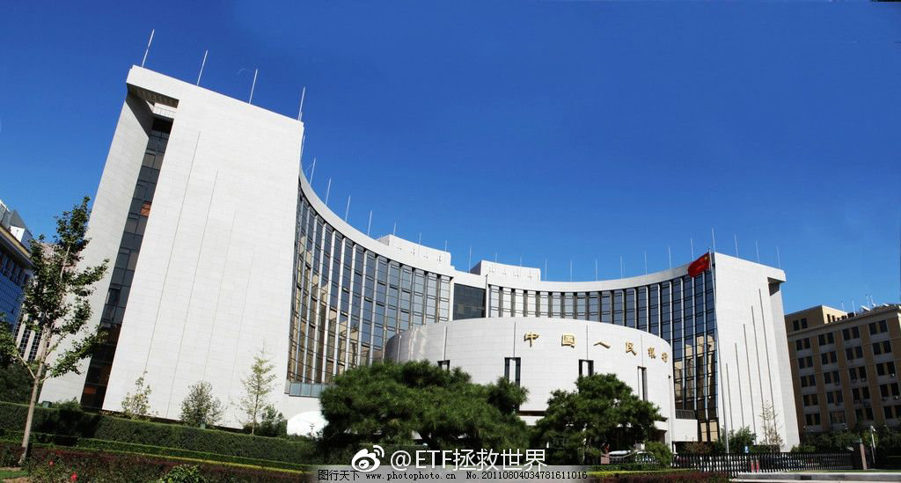

## 2019-02-10 19:51

回复@洗桐女史:…这剧里还有谁，提前关注//@洗桐女史:哈哈哈哈，这剧主题曲还是曲婉婷唱的

## 2019-02-10 21:54

今天🌍票房已经大于所有其它片子之和了。

喷子们万万没想到的是，正因为他们的喷引起的争论，让🌍的钱越挣越多了… ​​​
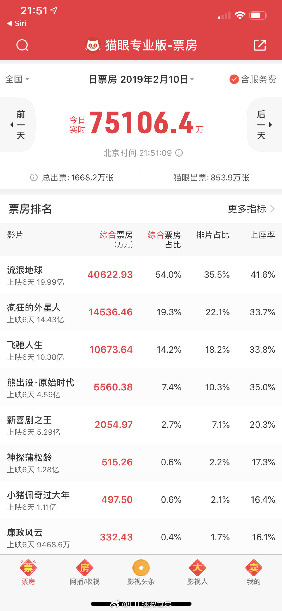

## 2019-02-11 09:33

别涨了，差不多意思意思行了。 ​​​

## 2019-02-11 09:41

尤其是500，你都“越跌越贵”了，还舔着脸涨呢。赶紧跌到1000点完事。

## 2019-02-11 09:47

说实话，很多人根本就没有弄清楚计算指数估值的意义到底是什么。

根上就没想明白的事情，只是在做无用功。 ​​​

## 2019-02-11 09:53

记录一下市场情绪：

目前，绝大多数人认为，未来的A股，是“核心资产”的天下，即，50或者300成分股。

中小股票没戏了。

2019年2月。 ​​​

## 2019-02-11 10:07

回复@尤其乐意:去球球观察大众情绪。非常管用。包括67.83%的大v情绪。//@尤其乐意:我是真的不明白呢，求教这是怎么计算的

## 2019-02-11 10:11

回复@Nothings2006:你说对了。我第一讨厌中二男主，第二讨厌他妹妹，第三讨厌那个混血mike……不过这倒不是因为所谓三观问题。一两句说不清。

## 2019-02-11 10:50

注意，目前这种市场情况，不要把精力过多放在关注市场走势上。很容易让你出现“终于回本了赶紧卖掉否则坐电梯怎么办”这种思维模式。

仓位买的差不多了，踏踏实实的该干嘛干嘛去。 ​​​

## 2019-02-11 10:52

回复@禕Yi:关注了几个博主，任何事情在他们眼中都是负面的。我也是非常敬佩了……//@禕Yi:真的，我就觉得，目前的🇨🇳有一个巨大的矛盾…很多东西都在发展，创造，革新的十字路口，但是网络上消极，极端的人太多，很容易将这种积极性打消。但是慢慢观察来看，最终还是接受，进步，鼓励的人居多…

## 2019-02-11 10:53

回复@zshixin:观察能力不行。第一天关注我就应该发现了。//@zshixin:哈哈，老大，我发现你挺幽默的，跟着你真是高兴每一天

## 2019-02-11 10:58

如果本周500能来一根放量长阳，那么______。（5分） ​​​

## 2019-02-11 11:11

回复@一场清风一场秋梦:亲，我这边建议你自动消失呢。//@一场清风一场秋梦:我将会爱上你

## 2019-02-11 11:13

不得不服。//@ETF拯救世界:回复@陈大致:又来了一个。mark。上一个是在最低点那哥们。//@陈大致:已经清仓，等待新低，新年快乐//@ETF拯救世界:回复@百里陌香:这不算预言。刚在做春节的东西，看到一段2015年7月的文字。看看会不会应验。 查看图片 //@百里陌香:预言家

## 2019-02-11 11:19

各位可以在网上非常直观的观察到情绪。

我这里来说，第一次是券商见底前一天那哥们粉转黑喷券商。第二次是10月见底前一天那哥们清仓。第三次是年前这哥们清仓。

什么是情绪，这些就是情绪。

我这里还好，理性的人多。（不理性的都看不上我或者都被拉黑了）球球其实是观察情绪最好的地方。因为那里并不是永远完全不理性。而是在极端的时候，非常非常有观察意义。

包括对人的追捧和唾弃，包括对品种的追捧和唾弃。真的特别特别的有意义。

在资本市场，观察人性是非常有意思的事情。不知道你能不能体会到。

## 2019-02-11 11:37

我的锁屏。

原图@夏阿 ​​​
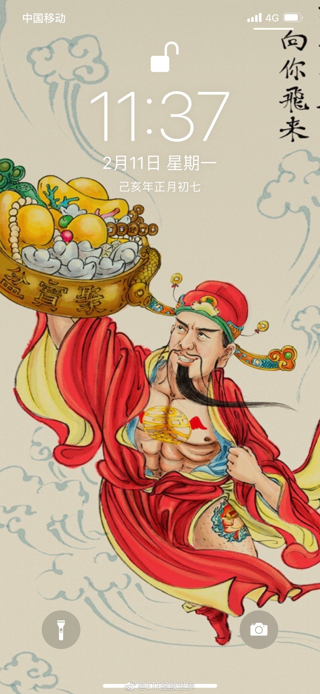

## 2019-02-11 13:06

还有10个月。别掉链子。

## 2019-02-11 13:18

回复@MrArtificial:我不太理解你说的筑底和我说的有什么不一样吗。//@MrArtificial:E大之前不是说19年筑底吗？还坚持这个判断吗//@ETF拯救世界:还有10个月。别掉链子。

## 2019-02-11 13:29

回复@沙河边行走:你是不是瞎了。我说的明明白白今年极大概率收红。这还叫两头照顾。我另一头照顾什么了？走好不送。//@沙河边行走:这种两头都照顾到的废话有什么意义呢

## 2019-02-11 13:39

回复@冰糖葫芦5加皮66:我是觉得这段话的意思简直再明白不过了，怎么还会有这种评论。我是真的不理解。//@冰糖葫芦5加皮66:益达应该是个老好人，不过是个苦口婆心，偶尔暴躁，倔强牛都拉不回的老好人

## 2019-02-11 13:58

回复@谷雨MIKI:是的。你知不知道我预测07 08 12 15这几个顶底用了多少马甲。排列组合一下这个数量吓死你。ps，虽然你是刚关注我，但是时候说白白了。

## 2019-02-11 14:06

我非常讨厌的是什么。

是关注你几天就来指手画脚的人。

你好歹耐着性子先看两个月再张嘴。这是对别人，也是对自己的尊重。 ​​​

## 2019-02-11 14:13

回复@奔跑的无常:是的。还附送一份拉黑哦。超值的。//@奔跑的无常:我是不是也喷一下e大就会回复我了？

## 2019-02-11 14:24

震惊！节前倒数第二个交易日之前，球球上到处都是喷500喷中小的帖子。各种数据分析中小股票“越跌越贵”。

涨了两天，形势逆转，开始讨论买什么中小指数了！ ​​​

## 2019-02-11 14:31

短短两个交易日，1月底那几天所谓的大面积爆雷的新闻你想起来是不是好像恍如隔世？这就是真实的金融市场。如果你整天被那些不重要的新闻不重要的消息以及不重要的人占据眼球，你就无法深入思考到底什么才是最重要，什么才真正能让你赚到钱。

## 2019-02-11 14:57

目前计划31只品种中，浮亏的还有12只。其中浮亏10%以上的还有6只。

这是4000多点开始，2600点的基本情况。

换句话说，组合盈利并没什么奇怪，指数下跌37%，90%以上品种都赚钱才是亮点。 ​​​

## 2019-02-12 09:27

我建议周二周三休息休息。周四周五拉一拉收个光头长阳就最好了。 ​​​

## 2019-02-12 09:33

## 2019-02-12 09:37

谁还记得“钻石坑”那篇文章是什么时候什么点位发的。

（图中黄线） ​​​
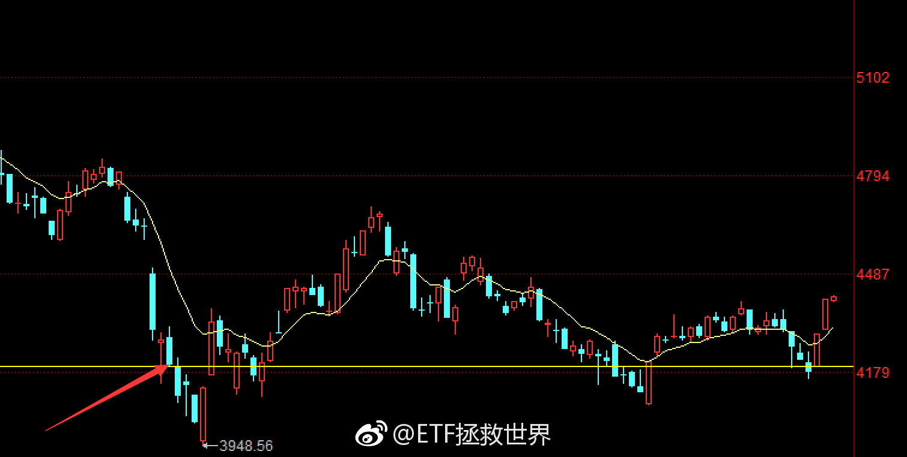

## 2019-02-12 09:41

中小指数调整的压力不是很大，而且正在冲击阻力线的关键时刻，再往上冲一冲也可以。

大指数之前拉的太多，建议还是调整一下，路太远，一开始跑太快容易岔气儿。 ​​​

## 2019-02-12 09:43

回复@Angela鹿小鹿:加个微信认识一下好吗。不是说为了钱，我是比较欣赏你这个人。//@Angela鹿小鹿:啊啊啊啊啊，别啊！动迁款还妹到账呐……给我继续跌啊

## 2019-02-12 09:57

假期中血液的事儿一出，很多人觉得医药又要凉了。

万万没想到。

$全指医药 sh000991$ 

这就是资本市场。你猜不到会突然发生什么事情，你更猜不到突然发生的事情对价格走势有什么影响。

应对之策就是：

别猜。

猜了也别照做。 ​​​

## 2019-02-12 10:18

瑞雪兆丰年。 ​​​

## 2019-02-12 10:40

一定要让价格远离自己的成本区。否则你总是处在盈亏边缘，这对你的心理或者整个体系都是极为不利的。

至于如何让价格远离成本区，可以先思考一下。 ​​​

## 2019-02-12 10:46

信不信由你，新一代股神即将批量涌现。 ​​​

## 2019-02-12 11:57

回复@RNG白泽:第二个低点如果加一份才算满分…//@RNG白泽:益达消费这个买点真是绝了 查看图片

## 2019-02-12 11:58

回复@陈方_LBJ:没有想象力。这波十年长牛我看到一万//@陈方_LBJ:球球上各种人都在喊牛市来了，而且还是7000点的历史性大牛市

## 2019-02-12 16:19

回复@投资跑道上的一只小蜗牛:太好了。我就怕“其它人”跟我意见统一。//@投资跑道上的一只小蜗牛:e大，其他人分析说长牛不可能，我想听听您的正经分析//@ETF拯救世界:回复@陈方_LBJ:没有想象力。这波十年长牛我看到一万

## 2019-02-12 16:28

回复@请叫我幸福鬼:建议清仓。挣点钱不容易，别再买股票和基金了。踏踏实实放银行吧。//@请叫我幸福鬼:E大现在可以清仓了吗，已经盈利了。不容易呀！//@ETF拯救世界:回复@投资跑道上的一只小蜗牛:太好了。我就怕“其它人”跟我意见统一。

## 2019-02-12 16:38

回复@仔帆简史:年化15%。能到你就烧香吧。如果十年内有两轮比较好，复利会更高一些。//@仔帆简史:十年四倍有点少//@ETF拯救世界:回复@投资跑道上的一只小蜗牛:太好了。我就怕“其它人”跟我意见统一。//@投资跑道上的一只小蜗牛:e大，其他人分析说长牛不可能，我想听听您的正经分析

## 2019-02-12 17:02

回复@SloveL:你不能这么算。我如果从2004年第一轮开始算那不更高了。不过15%也是没有什么根据的，听个意思即可。//@SloveL:考虑到前两年没怎么赚，想达到复合15%，后几年就得高于15%//@ETF拯救世界:回复@仔帆简史:年化15%。能到你就烧香吧。如果十年内有两轮比较好，复利会更高一些。

## 2019-02-12 17:59

回复@咬桌子干啥呢:我实现过，怎么会不可能。但我不会以这个推未来，因为这里面条件极其苛刻。需要十年内有一次至少4倍以上的牛市，还要有一次至少2倍以上的。然后，你必须要在牛市开始前买入，牛市结束前出来。两次都做到了，就可以10倍。这里面的关键不是自己，而是要有两次大牛市。

## 2019-02-12 18:07

你能保证自己在底部区域配置好指数基金，那你之后能做的事就不多了。

剩下的，就要交给市场。你能赚多少，除非你一定要提前下车，那么就是市场的事，没你什么事了。

当然，你可以根据策略做一些高抛低吸，稍微提高一下收益率。但，大的收益率是市场说了算。

能保证在底部区域进入，顶部区域出来，是你的聪明才智。但赚钱的过程不是你的，是市场的。

这跟很多人在牛市中觉得自己是股神，其实根本就是运气好碰到了牛市而已并不同。这里面是有技术含量的。含量就是进入和卖出的动作。中间的部分没你什么事儿。踏踏实实地拿着就最好了。

## 2019-02-12 18:34

刚才有朋友发了个帖子链接给我，里面有各种人对我的评论，里面有一条是这样的：

“E大水平极度的高，放心

就是微博感觉情商特别低。动不动拉黑怼人，明明是个网红，却没有网红的素质（但现实可能是个不错的人，网上拿来泄愤负面感情吧）”

不知道各位怎么看呢。

（话说我居然是网红了？？？有关部门怎么没有通知我）

那个帖子里，大多数人还是能够客观评论。当然，也掺杂着各种……没法评价的评论。还是那句话，最讨厌根本不了解就来喷的人。

拉黑，怼人，是为了节省我的时间。因为每个评论我都要看，没空看那些喷子的。怎么了，不服的赶紧取关。凭什么好言好语好酒好菜的伺候喷子？我欠你的？

## 2019-02-12 18:46

什么是情商。我来说说我的理解。

情商，在我看来，非常简单，一句话，“让别人舒服的能力”。

如果一个人说的话做的事，让你觉得如沐春风，非常舒服，那就是情商高。如果一张嘴就惹人讨厌，就是情商低。

另一个角度看，也是一种换位思考的能力。能站在对方的角度上思考问题，然后跟对方说话。

我很希望各位朋友都舒服。但注意，我说的是，“各位朋友”。你连朋友都不是，你一张嘴就让我不舒服，我干嘛还千方百计让你舒服？

我有病啊？

你谁啊？

以直报怨，以德报德。

好人，可不是天生让你欺负的。

## 2019-02-12 18:59

回复@喵希喵:有那么好笑吗！//@喵希喵:拉黑怼人是幽默感吧？看起来蛮好笑的

## 2019-02-12 19:08

有时候在微博确实很贫。有时候开点小玩笑，有时候自黑一下，有时候得瑟一下，时不时的再发点红包乐呵乐呵。

其实是为什么呢。

我以为大家都懂。

2015年以来这轮熊市，即使不是历史最熊也差不多。去年又遭遇历史第二熊年，虽然我们极力控制成本，也做到了指数大跌40%我们依然不赔钱，但毕竟有些品种跌幅较大，再加上外界环境极其恶劣，到处都是哀声一片噪音极多——

我是希望用我的方式让大家轻松下来。都能保持好的心态，熬到黎明。

我是觉得大家都理解，没想到还会有这么多人有了误会。

不过我觉得，大部分朋友能懂就行了。

我在中文网路上，还没见过有其他讨论A股投资的地方，是我这里这样的气氛，其乐融融，宾主尽欢颜。大家在这样的熊市中，丝毫没有任何痛苦的感觉。这不挺好嘛。

踏踏实实的，多大点事儿啊。

## 2019-02-12 19:32

立个flag。

第三轮计划回到20%收益的时候，（计划总收益1260%左右），我来一次微博抽奖。

抽到男人送一台PS4pro。抽到女人送一份等值的保养品/口红/包包。

意不意外，开不开心！ ​​​

## 2019-02-12 19:39

回复@亲爱的小土豆的粑粑:可以。我还可以亲自帮你涂口红呢。//@亲爱的小土豆的粑粑:嗯，抽到男人能不能也送口红/包包。

## 2019-02-13 08:52

伤心，平常那么多有用的东西没什么人评论。一个游戏机几支口红就把你们炸出来了。人心不古，世风日下，心已伤透，退博算了。

## 2019-02-13 09:35

市场开始上涨之初，最重要的任务就是把那些不坚定的投机分子完全清理出去。只有他们走了，行情才能走的比较轻松。

所以必然走出各种引发人性的走势。

你一次两次做短线赚点就跑，都对了。没事。市场会在某个时候给你的脸上来一记重重的铁拳，让你浪费几年的时间。

在一个牛市中，如果涨幅最大的10个交易日你不在场，那么70%的牛市利润将与你无缘。

最有意思的，是你根本不知道这十个交易日出现在哪天。

我不是说现在牛市一定就要开始了，我的意思，是最好做一条死死咬住对手的恶狼。只要你不弄死我，我就一定咬死你，绝不逃跑。

## 2019-02-13 13:32

舒服吗 ​​​

## 2019-02-13 13:38

记住他们了吗

## 2019-02-13 13:39

再回头看，是不是有新的感受？记住这些经验。

## 2019-02-13 13:40

回复@xuhuangkai:没有股市可以一路向上。战争刚刚开始。//@xuhuangkai:E大，如果现在股市就这么一路向上了，手上的资金还可以买指数吗？

## 2019-02-13 13:49

如果是趋势投资者，从之前的空头转多头，可以理解。

但如果是价值投资者，在2400依然无限看空，只能说还没入投资的门。

怎么分辨是趋势还是价值。即，如果他从基本面宏观面一通分析，认为2400依然高的一点都不能买，那实锤了。

无论你看谁的言论，这么往上套，一定准。

这种就是噪音。我建议你少看噪音。对你的投资没有任何好处。

## 2019-02-13 13:54

我这种就是嘴炮。结果一份信息都还没买。$全指信息 sh000993$ //@ETF拯救世界:回复@江河之走:下一次牛市是科技信息股领衔的牛市。//@江河之走:哪些指数为牛市利器?创业板?传媒?证券?信息?还有吗？//@ETF拯救世界:有几年没看见指数涨停了。来，朋友们一起来看牛魔王……

## 2019-02-13 14:05

如果信息科技能中期涨幅第一（短期涨不算），那就只能说明一件事：

________。（10分） ​​​

## 2019-02-13 14:14

回复@万绥:是的。记住。所以一定要空仓等军工跌了再买。切切。//@万绥:军工不死牛市不来

## 2019-02-13 14:25

投资是个概率游戏，你到底什么时候才会懂。

如何判断概率，是将各种观察因子放入你的判断模型。比如，估值，情绪，趋势，政策，货币等等等等。甚至包括一些历史现象，诸如“各行业估值见底的时候，才是大概率见底。”由此衍生出，依然50倍估值的军工不死，牛市很难出现这样一条因子。

将各因子代入模型，判断顶部区域与底部区域的概率。你用任何一个因子判断都不会全面，所以要综合看。

我已经将整个长期投资计划的资产配置明明白白挂出来给你看，代表我判断顶部底部的概率了。你依然念念不忘一个因子，天天跟我这念叨。

我该怎么评价你呢。

## 2019-02-13 14:41

回复@地火明夷虫:如果博友都是你这样的我就舒坦多了。//@地火明夷虫:由各行业估值都见底  可推测判断出  股市见底；股市见底  则不一定需要满足  各行业估值都见底

## 2019-02-13 14:42

每天一辆（）（），我有点顶不住了。 ​​​

## 2019-02-13 14:57

回复@sven119:我的所有判断都融合在计划里。一目了然。非常无脑。//@sven119:E大总说反话，还得判断半天，来点无脑的，哈哈//@ETF拯救世界:回复@万绥:是的。记住。所以一定要空仓等军工跌了再买。切切。//@万绥:军工不死牛市不来

## 2019-02-13 15:03

涨了半天才2700。

看看你的帐户，你能想象吗。

3000，3500，4000，4500，5000……

总有一天会到的。到时候账户有是什么样子。

我记得之前说过，很多人为了躲避10%可能发生的下跌，放弃了翻倍的可能。投资不是这么玩的。

概率。概率！ ​​​

## 2019-02-13 15:14

今日份聊完了。各位明天见。

好好开心开心。

毕竟明天就要跌了。 ​​​

## 2019-02-14 07:16

历史性的一刻。互动TOP10了 ​​​
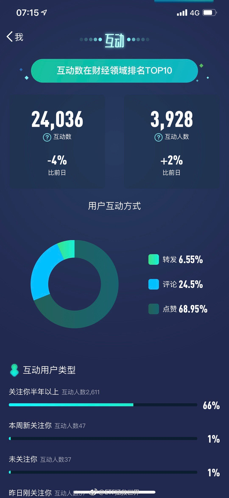

## 2019-02-14 08:47

回复@大鳄龟的小智慧:不好一概而论。主动也有牛基，但是有3000多只主动基，你不知道谁是未来的牛基……//@大鳄龟的小智慧:早上好啊，各位，现在是否大概率是主动基金转被动指数基金的好时机，PS：以前自己瞎买的主动基金成本太高，明显跑不过E大的指数基金

## 2019-02-14 09:00

回复@waslj0603:你用了“居然”，就说明你对A股投资者一点都不了解//@waslj0603:我觉得主动基金还是大有可为的，主要是中国散户太多还个个认为自己是股神。昨天向几个同事推荐了计划和指数投资的理念居然被嘲讽了

## 2019-02-14 09:04

快回到最高位了。

熊市有什么好怕的，没有熊市你能买到便宜货吗。

全国人民回本的时候（平均），你已经翻番了。

踏踏实实的，多大点事。 ​​​
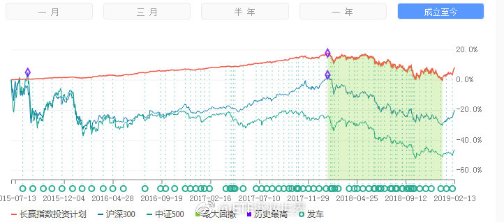

## 2019-02-14 09:27

回复@不愿做韭菜的小散:第三轮计划开始至今，两市股票跌幅中位数52.8%。90.1%的股票下跌。跌幅最大的股票98%。我说全国人民回本的时候计划翻番没有问题。//@不愿做韭菜的小散:全国人民回本时候，看图好像挣20%

## 2019-02-14 09:47

最近微信上有20多个朋友问我买什么，要入市。

场外资金看起来在拼命抢筹。 ​​​

## 2019-02-14 09:53

我经常说不要做旅鼠，不要做羊群。你是不是以为永远不要跟群众站在一起。

错了。

大多数时间，你必须跟群众站在一起，否则他们会把你踩成肉酱。

疯狂的时候，你要在狂欢的人群中一起high。但你的心里要知道，几点钟马车会变成南瓜。玩的差不多了，你就要先走。

不能群众一买你就卖。是，你赔不了钱，但你这辈子也别想在市场上赚到大钱了。

## 2019-02-14 09:58

回复@好心情S65:行情永远是在犹犹豫豫中起航的。如果所有群众都看多，那也就差不多到顶了。反之亦然。//@好心情S65:我身边的朋友看多看空各种看法都有

## 2019-02-14 09:59

回复@股舞人盛:白酒厉害意味着全面牛市没有开始。//@股舞人盛:白酒，食品饮料今天很强，尤其是白酒还是那么厉害

## 2019-02-14 11:11

关于择时：

在A股，我信奉的是择价值。A股波动极其巨大，历史估值可以在1.5-7之间不断波动。这种情况必须择时。但是周期一定要长，空间一定要大。

即使历史取得了不错的成绩，择长期时的风险也不小。主要是盈利风险，也就是说，有可能会在某个时间段会少赚。当然，没人能从鱼头吃到鱼尾，所以这个可以接受。

但是很多人短期择时我就不懂了。我们有时候发车会稍微择时，那跟我说的短期不是一回事。

我说的，是很多人居然以为自己可以预测短期涨跌，然后“先卖掉，再低位买回来”，如此反复。

这可能吗。

我建议放弃幻想。踏踏实实的低位买入，踏踏实实的长期持有，踏踏实实的高位卖出。当然，用一部分资金做短差不断提款完全可以。千万别大仓位短期择时，会有一天你痛不欲生。

## 2019-02-14 11:13

怎么回事，最近又有富婆帮我买粉丝了吗…… ​​​
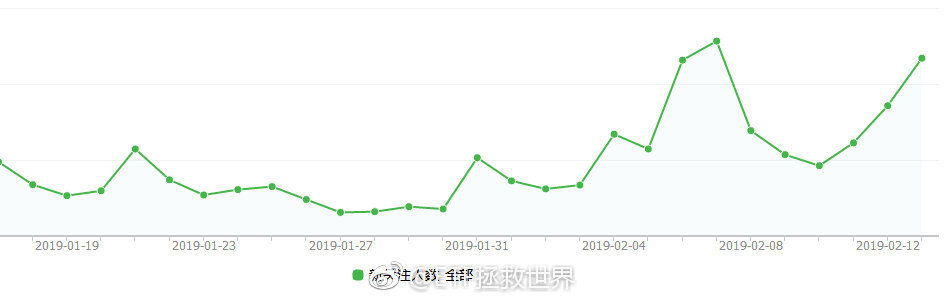

## 2019-02-14 13:39

看着账户里的品种一个个翻红，内心毫无波澜。

你会为明天太阳又升起来了激动不已吗？ ​​​

## 2019-02-14 13:44

感情的事儿吧，肯定没有统一的答案。一样米养百样人，只是从整体讲。

对男人多点尊重，多给面子。对女人多点重视，多点体贴。日子就能过的好点。

一个想法，不一定对。 ​​​

## 2019-02-14 14:12

之前清仓的那两个哥们买回来没有。我还挺想知道的，方便就回复一下…… ​​​

## 2019-02-14 14:23

为什么牛市中，大多数人干不过指数。

第一，指数本身就是股票组成的，简单来说，一定有一半股票跑不赢全市场指数。如果是权重股行情，那就不用说了，80%股票跑不过大指数。

第二，大多数人都是不停的交易。你自己看成交量。牛市换手率在100%-200%之间。半年所有股票就能换手一次，你就知道多少人在不断的买进卖出了。一般都是买进强势股，卖出弱势。按照均值回归，可想而知大概率是买了就跌，卖了就涨了。你不换？你不换你手里的就是不涨。服不服？你换了才涨。

第三，低位是没人买的。大多数人是越涨越兴奋。场外观望的也是越高越买。买当然要买强势的，结果就是gg。

所以很简单，选错股，拿不住，一会儿满仓一会空，你当然跟不上。

为什么拿不住？

因为你根本不知道手里的股票到底值多少，你怎么会拿的住？

## 2019-02-14 14:29

回复@电烙铁2012:印花税就吃死你。指数没有印花税。//@电烙铁2012:跑不过指数是因为不懂个股，来来回回频繁交易，手续费损耗，加上本来指数就有一半个股是跑不过的，你仔细算个账就知道了。

## 2019-02-14 14:44

雪下得太美了。 ​​​

## 2019-02-14 15:10

回复@没坐标的星LL:支付宝赢了，账面市值还增加了。完美！//@没坐标的星LL:E大真厉害，支付宝积分到手

## 2019-02-14 16:59

大家能不能想一个古今中外从没被人喷过的名人说来听听。 ​​​

## 2019-02-14 17:31

回复@宫商角徵羽1010:所谓第三轮，就是已经有两轮落袋为安的历史了。2015年6月第二轮计划卖掉80%多以后，于7月开始第三轮。所以，第三轮当然也会卖。//@宫商角徵羽1010:E大，我有个问题，买股票会随时空仓，长赢计划会有计划让收益落袋为安吗

## 2019-02-15 13:53

今天有事没空发微博，行情也没什么好看的，大家自己找乐子去吧… 

周末可能写点东西。 ​​​

## 2019-02-17 08:47

我突然想到一件事，以后的红包啊游戏机啊护肤品啊手机啊之类的不能简单抽奖了。

因为很多坏人盯着这个微博，甚至天天来刷。他们红包一个不落的抢，然后转身骂娘。

我要把钱给他们还不如捐给腾讯公益。

怎么把真正的好朋友鉴别出来，各位有没有好办法。 ​​​

## 2019-02-18 09:02

杀不死我的，使我更强大。

既然黑天鹅事件无法避免，那就想办法从中获取最大利益。

每一件事情都会从波动得到利益或承受损失。

脆弱是指因为波动和不确定而承受损失。

反脆弱则是让自己避免这些损失，甚至因此获利。

——反脆弱。 ​​​

## 2019-02-18 09:23

刚才，又有一位朋友告诉我，有个人在微博上喷我了。

我去看了看，原来是之前一直在我评论里做广告，拉人进qq群的一个人。最终我只能把他拉黑。恼羞成怒，开始喷，甚至造谣。

但是非常奇怪的是，这次我是笑着浏览他微博的。以前遇到这种事，心情都会很不好，觉得委屈啊，觉得受到不公平的评价啊，blablabla……

但这次没有不开心，甚至觉得有点好笑。

是不是更强大了？

不知道。

但是，我建议关注这个人的朋友，一定要非常非常非常小心，其人心术不正，你跟他走得太近一定会吃大亏。比如，他造谣的一条是：

某些我发车的时候，场内价格会波动。所以，我会提前埋伏套利。即，先买入，再发车，等价格波动再卖出。

这样的造谣，实际上已经触碰到法律的边缘了。

熟悉我的朋友都知道，我每次发车都会提醒：场内交易千万不要抢，不要把价格抢上去。价格一定会跌回来。如果场内品种成交量小，就非常建议申购场外品种。一定不要在场内把价格买高。

另外，为了规避这种道德风险，过去几年，我从未在任何发车前买入要发车的品种。这个可以接受最严格的审查。如果这种基本做人的道德准则都做不到，还想活得长久？

所以喷子已经发展到下一阶段：造谣。

这种事情本来不用多说，但我建议，这种人，你一定要离的远一点。因为他会千方百计思考这种歪门邪道的东西，来获取利益。并且，最关键的，是为了达到目的，不择手段。

谁离得近，谁倒霉。

切切。

我再说一次，发车的时候建议各位在场外交易。毕竟现在很多场内品种成交量太小，有时候交易不太方便。

## 2019-02-18 09:33

回复@fankezhou:不好意思，且慢虽然方便，但有人会说你做广告（做了怎么了，就是好用）；你买哪个基金，有人会说你收了基金公司的推广费。即使你为了避嫌，一个指数买六家公司的品种也不行。这世界真神了！//@fankezhou:怎么感觉，且慢无脑跟是不是更直接呵呵

## 2019-02-18 09:34

500今年新高了。加油吧，今年可落后300不少呢。 ​​​

## 2019-02-18 09:39

回复@西歌笑:正常现象。多大点事，踏踏实实的。//@西歌笑:报告男神，我的账户红啦红啦

## 2019-02-18 10:19

A股是一个70%的人赚不到钱的地方。那么你要解决的第一个问题，就是，要赚钱。

只要开始赚钱，无论多少，都是成功。

第二步，多赚点。

有20%不赔钱的人其实赚不到什么大钱。因为很保守，赚点就跑了。

对于绝大多数人来说，多赚点就是在上涨的牛市中大致跟上指数。跟上70%以上吧。除去鱼头鱼尾，跟上70%已经非常棒了。

第三步，不要赔。

赚完了不算成功。不要赔回去。你赚了100%，跌50%就回到起点了。

在熊市中，尽量不要赔钱，或者少赔点。你要注意，熊市周期不要想赚钱，就像冬天不要想收割庄稼一样。你只要尽量不赔钱的同时，把仓位建立起来，准备迎接牛市即可。

所以，这个周期就非常明白了。

熊市不赔钱+建仓——牛市跟上70%以上指数赚钱+实现利润——熊市不赔钱+建仓——……

如果这个大周期你能持续几轮，你就会成为真正的大赢家。至少在你目力所及的范围内，不会有人比你做得更好。

一定要注意几个关键点：

第一，熊市中不要追求收益。保本，建仓。第二，牛市尽量跟上指数。

这两点说起来简单，其实真的特别特别难。第一个难，你可能懂了。但第二个难，你将会有所体会。

第三轮计划开始的大熊市中，熊市目标基本已经再一次完成了。

如果在这个70%的人都会赔钱的市场上，计划能让90%的人都赚钱，有60%的人赚到大钱，我觉得就是成功的。

各位意下如何？

## 2019-02-18 10:34

是聪明钱还是傻钱在买？几年后你就知道了。///【风格转换：南方500ETF连获十日净申购 规模直逼50ETF】2018年出现的罕见“ETF”热度到了2019年有增无�.....原文:网页链接 (分享自@微博搜索) ​​​

## 2019-02-18 10:36

回复@JYou-JasonKidd:不好意思，150不是定投。s是择时定投。

## 2019-02-18 11:01

很多人看不上熊市不赔，牛市跟上70%。2005-2015年，如果按照这个节奏，投资中证500的收益率是1800%。18倍。不算股息。这里面的关键是熊市不赔。太难了。

## 2019-02-18 11:03

回复@小小果的小彬彬:清。follow your heart。真的。怎么想就怎么干。//@小小果的小彬彬:e大，现在好想清仓吃个波段//@ETF拯救世界:回复@JYou-JasonKidd:不好意思，150不是定投。s是择时定投。

## 2019-02-18 11:04

回复@swimingcat:如果你是这个目标，请立即离开。谁是这个目标，都赶紧走。我不知道未来A股怎么走，我只能尽量不赔钱，赚多少要看天。//@swimingcat:反正我的目标是跟着你10年10倍

## 2019-02-18 11:13

回复@你在红楼我在西游V:有时候两周。我不能保证100%正确，但我反复说的极大概率不会错。//@你在红楼我在西游V:牛市来了一个月回本，这回我信了。//@ETF拯救世界:回复@swimingcat:如果你是这个目标，请立即离开。谁是这个目标，都赶紧走。我不知道未来A股怎么走，我只能尽量不赔钱，赚多少要看天。

## 2019-02-18 11:41

投资股市到底该有多少年化收益，这个你理智想想就能大致有个数。

一般来说，优秀的企业ROE在10%以上。你作为股东，按理说你拿到的ROE不会比这个高很多。

但是，有几个问题你要注意：

第一，你很难在净资产附近买入优秀企业的股权。简单来说，你如果2倍以上PB买入优秀企业，那么你的长期收益率有5%就不错。

第二，你投资的不是企业，而是企业股票。这就有意思了。你想提高收益率，就想办法利用牛熊做到“低买高卖”。你可以大波段低买高卖，也可以十年如一日的持有以后低买高卖。无论如何，低买高卖的差价，就是你多出来的利润。

所以你可以建立一个投资思维的大方向：

找到一个长期不会死的品种，在相对低估的时候买入，如果有牛市，就吃增长+低买高卖。如果不涨，就吃增长。

所以，未来能赚多少，你要看有没有牛市，要看牛有多高。这是天意，不是你能左右的。

我说的，是绝大多数普通人。那些总是能挖掘到牛股的人，不在讨论范围内。

## 2019-02-18 12:11

回复@ING-d201705:群众不是不买股票，而是等身边的人都赚钱了才会进来抢股票。到那天，有人抢，你就做做好事给人家。等群众不要的时候再做好事买回来。踏踏实实的做好事。//@ING-d201705:吃饭时候 隔壁及隔壁的隔壁 都在谈论股票//@ETF拯救世界:回复@好心情S65:也不想想自己为什么资金量小。

## 2019-02-18 12:29

回复@彤彤别吃凉:前面的我不评价。最后一条：我这里难道不是即使在最低点都很高兴吗。//@彤彤别吃凉:1，外资真实性存疑 2，逼空后主力马上有大幅度抛盘3，1月社会融资结构不好，中长贷款并不多，反而库存量很大，往后去库存抛盘压力大4，看粉丝们高兴的样子，熊市自古没有这么多上车的，钱有这么好赚？

## 2019-02-18 12:32

为什么总是有人想等所有宏观微观都变好再去抄底呢？

第一，永远也不会有“所有情况都好”这个时间出现。

第二，大部分情况变好，凭什么你能买在最低点？凭什么？

只有在别人都忧心忡忡崩溃的时候，才是最好的投资机会。 ​​​

## 2019-02-18 12:39

回复@玉飞天:我请你认真看看，这三年大熊计划什么时候亏钱了？或者，你把计划里的品种和计划本身分不清？你要求一个组合里所有品种任何时候都不浮亏？你去找上帝吧。 查看图片 //@玉飞天:可第三轮计划2015-2018，到18年末计划最高亏了10几啊，这叫不亏钱？

## 2019-02-18 12:43

依然有人不明白，为什么要有一个150份的组合。

实质的意义，是进行资产配置示范。买什么东西并不是最重要的，最重要的是进行资产配置。

你观察计划，要从整个组合的角度去看。这才是你的资产状况。

浮亏不浮亏，不是看你买的个别品种，而是你的整个账户。暴跌50%的熊市，你想买入任何品种任何时刻都一点都不浮亏建好仓？

上帝真的帮不了你。

拉黑。

A股平均跌幅50%以上，这样的成绩就是做到了熊市不亏。
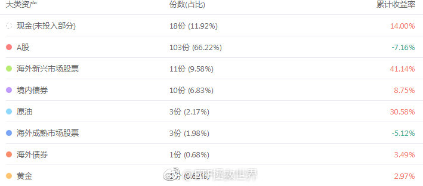 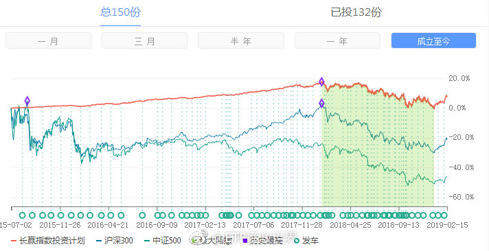

## 2019-02-18 13:01

回复@风湿膏_:你知不知道05年大熊市上海机场中集集团涨多少？甚至08年都有大涨的股票。这一轮事实是过半股票腰斩92%股票下跌。

## 2019-02-18 13:19

各位以后自己建立组合，应对熊市，达到“不亏”目的的时候，有几个问题一定要注意。

第一，熊市不亏很简单。买个银行理财或者货币基金能稳稳的。但是，如何在牛市到来之前建立好仓位的同时不亏，需要非常重要的平衡能力。熊市结束了，你没有仓位，毫无意义。你赌某个点位空仓变满仓，这个能不能成不说。你成一次，很难两三次。你错一次，就失去十年的机会。

第二，过于激进，则会亏得太多，回本困难，赚大钱不易。过于保守，仓位太低，吃不到牛市。这里面的节奏一定要把握好。

第三，想起来再说。

## 2019-02-18 13:26

回复@携风牧云:第三轮计划开始两年半以后到2018年上半年，A股也才买了20%多。已经极力压缩区间了。

## 2019-02-18 13:36

回复@ETF未来富婆:是你的证券公司。//@ETF未来富婆:阿E，快看看你的证券公司//@ETF拯救世界:回复@携风牧云:第三轮计划开始两年半以后到2018年上半年，A股也才买了20%多。已经极力压缩区间了。

## 2019-02-18 13:38

回复@waspjia:因为资产从2010到2015是50份-150份。//@waspjia:回复@Erzat_skr:50份理解的。但直接跳到150，而不是100，我这个强迫症总是有点犯……

## 2019-02-18 13:44

这种时候，投资指数的另一个好处就显现出来了：

拿着个股，大多数人会非常慌乱：怎么回事，卖不卖。到底值多少钱，现在高不高了。不卖利润没了怎么办，爆雷怎么办。

拿着指数：踏踏实实的，多大点事儿…… ​​​

## 2019-02-18 13:53

回复@雨天就要睡懒觉:别怪她。正常人类在股市就是这样才正常。不这样的都不是正常人类。比如你我。//@雨天就要睡懒觉:和我妈讲了千万别卖，上周五她又瞒着我卖了，又刚刚赚了几个点啊，怎么就不听呢

## 2019-02-18 14:02

再看看有没有一点道理。

## 2019-02-18 14:24

我倒不是说“死了都不卖”。如果这样，还没卖呢就要死了。

第一，你要弄清楚你来股市干嘛。是不是为了解套还是赚那几个大子儿改善一下生活。不是，你是来挣大钱的。至少幅度要很大。

第二，现在刚刚爬出钻石坑，还在黄金坑。着什么急？贵又不贵，趋势又不错，拿着呗。跌回去又怎么了？早晚有大牛啊。你愿不愿意为了10%波段利润放弃100%的大牛？

第三，实在忍不住就卖点。别学别人动不动就清仓。你又不是只有100股，干嘛一会满一会清。节奏掌握好，踏踏实实的。

## 2019-02-18 14:30

回复@佩清06587:费在哪儿呢？就剩陪聊了啊。//@佩清06587:付费陪聊

## 2019-02-18 14:33

回复@满眼星河GZ:区别是我买好了。//@满眼星河GZ:老大，这行情和去年开局有何不同呢？会不会竹篮打水一场空。卖是不会卖的，踏踏实实的等风来～🙋

## 2019-02-18 14:34

回复@D8奇迹:今天每三只里面有两只跑输500。个股在牛市里想每天跑赢指数非常难。//@D8奇迹:妈蛋，今天手里的二个票都跑输中证500指数大法好。

## 2019-02-18 14:56

今天就聊到这吧。

熊市最黑暗的时候帮大家打气，黎明到来的时候鼓励大家不要因小失大，以后还有更远的路要走，还会一直唠唠叨叨。有人因为我的唠叨喷我，但我知道更多朋友需要。

且慢中午发给我的数据，现在已经有50%-60%的朋友开始盈利了。没有盈利的朋友里面，有20%是放弃了，没有一直买。

其它30%左右还没盈利的，今天收盘浮亏额度基本都在5%以内。

5000多点跌下来，现在2700多点，这个成绩，不容易。A股大多数投资者赔钱的历史，我不信会是永恒。

我只能说，我尽力了。这条路不好走，很多非议和责难。我会坚持走下去，也希望大家都能取得满意的收益率。

## 2019-02-18 20:40

压力测试。概率。希望各位体会一下。

## 2019-02-18 21:10

回复@Avril拉维妮:之前一直空仓突然变成满仓赚了大钱的出来没有？//@Avril拉维妮:又被E大言中了，一大波“股神”浮出水面

## 2019-02-19 06:43

TOP5了。

不能再涨了，再高的话喷子们眼睛里面冒着火要来砍人了。

今天少说几句，毕竟下跌也没什么好说的。 ​​​
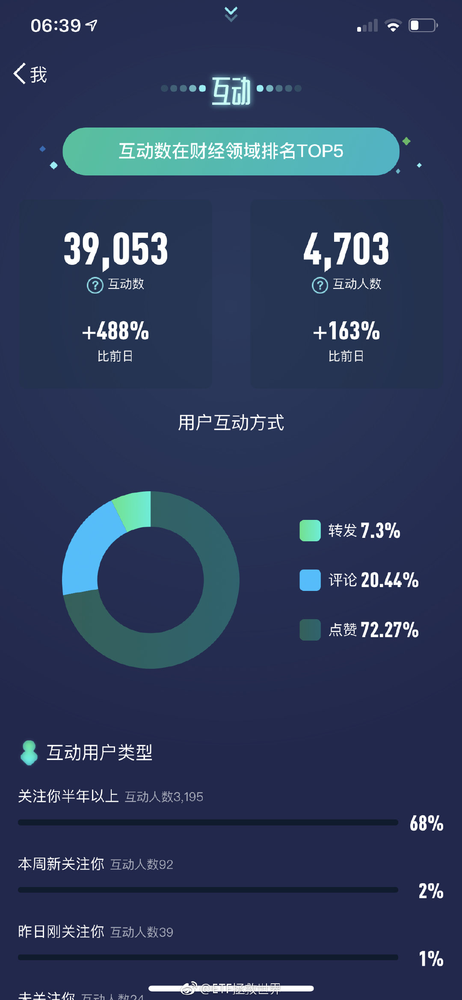

## 2019-02-19 10:30

$159939  溢价3%。疯子们又回来了。 ​​​

## 2019-02-19 10:33

有人焦虑吗。无论是焦虑持仓少想买，还是焦虑怕坐电梯想卖。 ​​​

## 2019-02-19 10:53

焦虑的，你过来。我问你，当时你为什么不听我的。听了你还会焦虑吗？金融投资就这么简单，舒舒服服，踏踏实实把钱挣了。干嘛老搞得自己很焦虑？

## 2019-02-19 10:57

各位，请记住自己目前的情绪。最好在什么地方用文字写下来。

几年后回头体会一下，就明白为什么说大多数人在牛市中赚不了几个钱。 ​​​

## 2019-02-19 11:07

回复@投资跑道上的一只小蜗牛:投资不需要有感觉。一个机器人赚多少赔多少都不会有感觉的。最好做个机器人。情绪在这里是最没用的东西，不如把情绪留给风花雪月。//@投资跑道上的一只小蜗牛:大哥，我被你带的，一点情绪都没有，不知道多少收益才会有感觉

## 2019-02-19 11:15

现在，你大概也知道了，A股并不是没有规律的火坑。理性就能挣钱。

但是我建议，熊市里跟别人聊天的时候，有人说别炒股，都是骗子的时候，你别反驳。静静的听着就行。

过一段时间，应该有人开始吹炒股赚了多少了。你也别说话，微笑着看着他们就挺好。

都是给你送钱的，对他们好点。 ​​​

## 2019-02-19 12:28

只有我觉得不好看吗

## 2019-02-19 14:36

回复@zp0int:还没收盘先别吹。否则场面会很尴尬…//@zp0int:为神马益达猜涨跌命中率是100%

## 2019-02-19 14:49

很多朋友跟我说，这几天都加大了投资，加了很多仓位，增加了每份金额。

我没法评价太多，只能说，先尽量悠着点。

明明是别人给咱们抬轿子，别变成了咱们给别人买单。

你的心不能动得比幡还快。 ​​​

## 2019-02-19 18:55

回复@原创聊聊虫:以后买卖不要告诉我。告诉我干嘛//@原创聊聊虫:益达，今天我2个账户都减仓了5成，等黑周四再买回来

## 2019-02-19 19:17

每个人操作模式不同，适合自己的策略也不同，买卖都很正常。市场怎么可能只有一种模式呢。

我不鄙视跟我不同的，但你真没必要跟我说你怎么操作的。为了以后低位接回来显得自己牛吗？不可能的，只要有点常识的人都知道，今天卖了，明天低位买回来没什么了不起。除非你能连续赢100次。

连续赢100次也说明不了什么。做个游戏，你找1000个人，每天一半人猜涨，另一半猜跌。最终会有一个把把连胜的人出现。问题来了，他是猜涨跌大神吗。

网络世界就是这样。总有牛人冒出来。为什么，因为基数太大了。总有人能在某段时间表现特别好。

比如你去查查每年私募第一名的收益率，能吓死你。

但问题是，能持续吗？还是去看冠军私募第二年的成绩，你就懂了。

很多人会混淆运气和能力的概念。这个各位真的要仔细思考。

## 2019-02-19 19:36

回复@美家优团团长群:表现最好的一定是非常激进的。激进的在风口会特别好，一旦出问题就是灭顶之灾。所以尽量不要碰短期最好的。长期在前列，能力强的概率大点//@美家优团团长群:这好像也是买鸡不买最顶最底，买长期靠前的原理.....

## 2019-02-20 07:41

这几天在考虑怎么区分好坏人，方便以后发红包送礼物的时候，才第一次真正意识到“知人知面不知心”的含义。

公众号和微博不用说了。很多人讨厌你，恨你，然后天天关注你，认真研究你的每一句话。这种有受虐体质的人，我一分钱都不想让他从我这里得到。

且慢跟车也不行。今天又看到一个喷子说自己在且慢投了，喷计划仓位只有1/3。这种熊市帮他保本牛市赚钱一转身还睁眼说瞎话到处喷的，怎么能送他礼物？

太难了。谁是朋友谁是中山狼根本分不出来。几万块钱真的无所谓，但是有一分到了喷子兜里我都觉得恶心。

继续想办法吧。不为别的，就是希望真正的朋友能多开心一点。

坏人你就不能取关吗？天天看着讨厌的人说话你不难受吗？心情总是压抑很容易生病啊，为了自己的身体，赶紧走吧！

## 2019-02-20 08:06

来了老弟？

## 2019-02-20 08:12

这几天大家才发现社融量大了，其实一个月多月前YH已经告诉你今年货币政策转向了//@ETF拯救世界:今年的货币环境是“松紧适度”

## 2019-02-20 09:33

今天就不要猜涨跌了，难度有点大 ​​​

## 2019-02-20 09:42

追大指数一定慎重，压力位到了 ​​​

## 2019-02-20 09:55

回复@ETF复兴号:什么时候能不给自己贴标签，放开思维束缚，张开怀抱拥抱世界？//@ETF复兴号:价值投资者也看K线，技术分析吗

## 2019-02-20 12:40

回复@翟翟翟翟丶瑞:2400不买，2700买也不是说一定错。就像第一次开会的只有十三个人。这是抄大底的。但你等到抗日战争甚至解放战争看清形势再加入，也有好日子过。甚至更安全。好好体会一下。//@翟翟翟翟丶瑞:2400的时候不敢加额，2700的时候反而戏剧化了

## 2019-02-20 12:48

回复@年轻的真的:看对方向，打着打着阵亡了没有任何用处。第一，方向对。第二，活下去。才能胜利。//@年轻的真的:E大说的生动形象，想靠打仗发财，看清形式再搞真不错，比如美国打二战……

## 2019-02-20 12:56

回复@侠家军-小美:最讨厌用美女头像的骗子。 不光骗钱还骗感情。//@侠家军-小美:回复@侠家军-小美:每天盈利一支板。实力说话，不盈利直播剁吊@好股金盘//@ETF拯救世界:回复@年轻的真的:看对方向，打着打着阵亡了没有任何用处。第一，方向对。第二，活下去。才能胜利。

## 2019-02-20 13:25

碰到压力就回调没有什么问题。很健康。进二退一。只要支撑不破趋势就延续。踏踏实实的。再说了，就算趋势又变差了，多买点不是更好吗。月中那车还攒着呢。

## 2019-02-20 18:20

今天有空接孩子。下了校车四个院里同龄的小女孩抱着他不撒手。还有两个小女孩为了抱他的事打起来了。

你肯定认为我是扯淡，我也希望自己在扯淡！愁死我了… ​​​

## 2019-02-21 09:02

今天可以正常发微博。

其实这几天经历的一些事，让我有了思想上的一些变化。

我现在承认，金融投资只适合一部分人。很多人无论从悟性、逻辑思考能力、理解能力、记忆力、性格等各方面，都不适合投资。

我想，过去自己是太理想化了。

但我也不认为自己过去做的事情是没有意义的。至少让很多人了解了正确的投资方式。

## 2019-02-21 10:05

说好的回调呢！账户市值又要增加了好烦。

奶一口还有用吗。 ​​​

## 2019-02-21 11:18

昨天在且慢问答回答了一个关于“突然有大笔可投资资金如何补车”的问题。

我觉得微博也有很多朋友有这个情况。

那篇文章很长，我简单总结成一句话吧。

如果你有年终奖/压岁钱/之前犹豫后来坚定信心想加大投入：

在150亏损的情况下，调高每份金额，根据补仓提醒全部补足低于我成本的。

在150份盈利的情况下，将资金分成若干份。分多少份看这个资金的性质。比如是按年发的年终奖，那么就除以15或者16，然后每个月一份参考S。

参考S的时候如果150份又亏损了，则把剩余的放入150补仓。

问题的关键是，你150盈利的时候，不要大笔加仓。否则计划设计的再好，也很难让你有满意的收益。

这就像你1000点买了1万块，6000点心情激动加了10万一样。

## 2019-02-21 11:20

回复@追求确定性2:昨天表现很差你怎么不吹呢。//@追求确定性2:500还是一马当先

## 2019-02-21 11:38

回复@老乡别跑00发:做投资是否赚钱，与这个人是否银行/券商/会计师事务所/投行/保险/基金的人毫无关系。与他懂不懂财报也基本没有太大关系。

## 2019-02-21 11:42

很多人2500点看着自己的账户痛不欲生，看一次心里颤抖一次。只希望历史重演，自己从没开过户，从没买过。

2700多又觉得买少了，拼命想加仓。

说的是不是你，自己检讨一下。 ​​​

## 2019-02-21 11:55

回复@广州嘉爸:错。他们只是在讨论。等他们真的加了杠杆才进入最后疯狂阶段。昨天两融余额只有7500亿，等风来吧。//@广州嘉爸:周围的人已经在讨论卖房加杠杆了，看来这轮行情走不了多久

## 2019-02-21 11:57

回复@谁煮牛肉:其实这些例子是给各位上课最好的素材。投资真的不是靠猜的。有趣的地方在于，不用知道明天怎么走就能挣钱，你说多开心。//@谁煮牛肉:不知道前天减仓50%的接回来了没

## 2019-02-21 11:57

回复@vior女神:那3.6%下跌真的对你那么重要？真的吗？//@vior女神:其实我是等跌的。我以为会破2440。心想既然要跌到2440我何必现在买那么多呢，当时是2530点左右。。。。

## 2019-02-21 11:59

回复@i云腾致雨:2万3000亿。//@i云腾致雨:最高时有2万亿？//@ETF拯救世界:回复@广州嘉爸:错。他们只是在讨论。等他们真的加了杠杆才进入最后疯狂阶段。昨天两融余额只有7500亿，等风来吧。//@广州嘉爸:周围的人已经在讨论卖房加杠杆了，看来这轮行情走不了多久

## 2019-02-21 11:59

回复@求财不劫色:你有这个思维，下轮很可能死于杠杆。//@求财不劫色:我检讨，我错了。我现在很后悔为什么2500的时候没有上杠杆

## 2019-02-21 12:02

我不想告诉你们，月底我想加传媒的。

辣鸡。

$中证传媒 sz399971$ ​​​

## 2019-02-21 12:35

悬念一：

仓位里的波段500C什么时候出。 ​​​

## 2019-02-21 13:02

500收复十月以来失地，人家300都收到六月了，你可长点心吧 ​​​

## 2019-02-21 13:07

今天S计划基本实现盈利了。同期800下跌19% ​​​

## 2019-02-21 13:14

回复@盛时不重来:150从未亏损//@盛时不重来:150是整体亏损？还是某个要补仓的品种亏损就可以？

## 2019-02-21 13:17

空仓等回调的朋友请好好体会。很多东西你回头看才知道价值所在。

## 2019-02-21 13:22

底部为了保住几个点胜利果实卖出实现利润的朋友，很可能就是未来高位接盘的朋友。

我说这个，不是为了再次打击你。而是提醒你，不要犯第二个错误。尽量不要追涨为别人接盘。 ​​​

## 2019-02-21 13:24

有这种感觉的朋友，请记住2700你的感觉，你的心情，你的想法。未来如果再次跌回去，请不要再害怕。再说一次，你买的是指数，只要买的不高，就极大极大概率涨起来。你的所有担心都毫无必要。现在再体会一下。你已经有经验了。

## 2019-02-21 13:25

今天必须发一篇文章了。 ​​​

## 2019-02-21 13:32

表脸。GJD是不是想要我的PS4 pro？？？ ​​​

## 2019-02-21 13:40

回复@安乐健:投资这个东西，本来就应该是开开心心的。根本也没多大点事，别给自己整的上蹿下跳一会哭一会笑。很多时候赚钱就是副产品，这个游戏好玩才是真的。//@安乐健:这里太欢乐了，真好。

## 2019-02-21 13:57

## 2019-02-21 14:17

今天有没有人连续犯第二个错误。就这么点事儿。看明白了怎么会上当呢。//@ETF拯救世界:

## 2019-02-21 14:21

回复@请叫我幸福鬼:以后评论有这种都拉黑。这是第一个。//@请叫我幸福鬼:还好清仓了，不然跳水 少了5个点的利润！//@ETF拯救世界:今天有没有人连续犯第二个错误。就这么点事儿。看明白了怎么会上当呢。//@ETF拯救世界:

## 2019-02-21 14:41

风云突变。不写了没意义了。各位晚上自己找点节目吧。

## 2019-02-21 14:49

回复@简单发呆1818:看错什么？涨高了想写一篇建议不要追高的，现在跌回来不用写了。看错什么？//@简单发呆1818:老司机也有看错的时候吗？//@ETF拯救世界:风云突变。不写了没意义了。各位晚上自己找点节目吧。

## 2019-02-21 14:59

明天开始，会少发一些微博。

一个是去多做些研究，一个是有不少自己的事情要处理。

该说的也说的差不多。关键时候还会继续按摩，一般的小风小浪我看各位都没问题。

多大点事，踏踏实实的。 ​​​

## 2019-02-21 19:35

刚又有人跟我说，球球上又开始说我了。

我过去看了看。

没什么别的感觉，就是特别感动。

那么多真的懂我的朋友留言，而且一看就知道是真的了解整个计划情况。特别好。

第二轮计划清掉绝大部分仓位的时候单轮收益率超过100%，那是2015年6月。7月股灾中，第三轮计划开始。从那时候算，300和500平均跌幅30%多。艰难的情况下，计划依然从未浮亏，目前收益率10%左右，跑赢指数40个点。

喷子不会想为什么第二轮是牛市最顶峰清仓的。只会喷第三轮收益率低……

你从第三轮本身的情况看，年化收益率当然不高。因为这是从牛市顶峰开始到熊市大底。只要熊市不赔钱，就完成我们的目标。赚钱，是牛市的事。这样一轮轮下来，财富才会飞跃。

幸亏他们2012年底不认识我。否则我要被喷死了——那时候第二轮计划账面的收益还是负的呢。

你从牛顶要求到熊底有很大收益，没有分级A这样的对冲工具，只凭着指数基金，不好意思我做不到。水平有限。

另外，我做这个组合，不是为了显示自己的收益率有多高。所以没有用到的资金，全都是用收益率最低的货基计算。别说分级A，连逆回购都不算。所以整个收益率极度保守。

还有，从各位朋友的真实情况出发，限定金额，绝不会假定各位家里有矿无限投入。如果无限投入，真的会简单不少。

这其中的难度，其实你自己在2015年7月建立一个指数基金组合就懂了。

上面说的这些，特别欣慰那么多朋友都明白。

有人懂你，有时候是最幸福的事。你有没有这种感觉？

## 2019-02-21 21:29

今日开始正式回归Keep。

每日打卡（1）

欢迎各位监督。赶紧动起来，夏天不远了！ ​​​
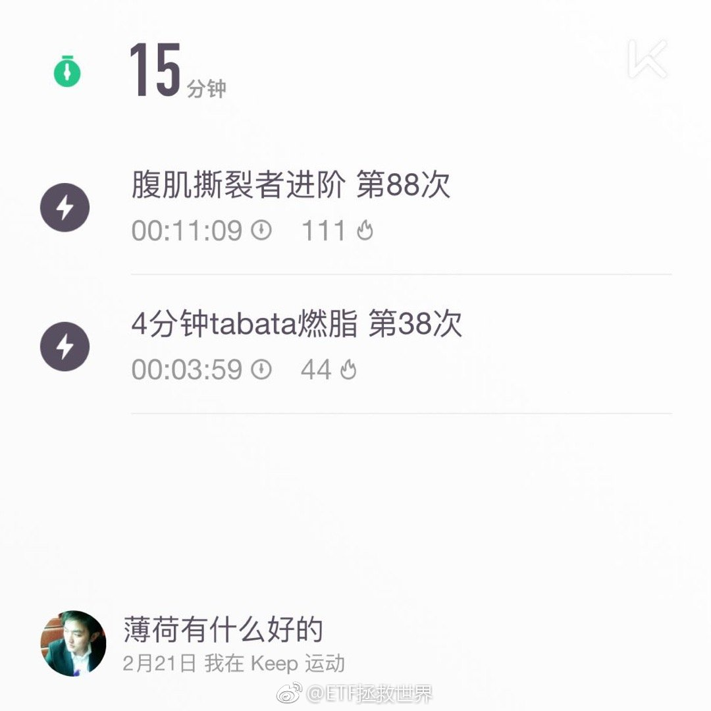

## 2019-02-22 09:46

各位感觉计划中的券商指数持仓会怎么操作。

今年涨幅第一的指数，有点刺激啊。要平衡吗。 ​​​

## 2019-02-22 10:26

我说你们这些在keep关注我的朋友能不能多发点照片大家互相鼓励一下。

## 2019-02-22 10:27

看评论感觉券商要埋一波啊。

## 2019-02-22 11:04

S的传媒已经回本，150的遥遥无期。

这指数是这波熊市最符合我“80%定律”的指数，之后会怎么走，大家都围观一下。 ​​​

## 2019-02-22 11:08

回复@lollyshop:“任何不会死的品种，从最高点算，下跌80%是大底的机会极大。”——E首发//@lollyshop:80%定律，是什么？求科普

## 2019-02-22 11:11

回复@Eda_fans:交易券商，不能看它本身的估值。而要看全市场估值——E首发。//@Eda_fans:在蚂蚁上提示券商已经处于高估阶段了

## 2019-02-22 11:18

回复@锡爷要消业培福:它说的是最高价腰斩再打两次八折。也就是下跌2/3。我认为这个不对，下跌80%才是极限。//@锡爷要消业培福:半値八掛け二割引//@ETF拯救世界:回复@lollyshop:“任何不会死的品种，从最高点算，下跌80%是大底的机会极大。”——E首发

## 2019-02-22 11:20

我的投资小窍门有600多个。每两天在微博发一个可以发五年。小本本要准备的厚一点…… ​​​

## 2019-02-22 11:22

再说一个：

“券商之所以每次牛市都是反弹利器，并不是因为它本身的原因。而是因为大家都认为它是反弹利器。所以即使知道最后还会挂，依然会往上干”——E首发。 ​​​

## 2019-02-22 11:29

回复@寒山明月:不要神化机构。当年zx证券自营部门巨亏30亿全部门解散的事忘了吗。//@寒山明月:券商之所以是反弹利器，是因为券商对行情先觉先知。。。。牛屎来时，自然券商最先知道。。。

## 2019-02-22 11:36

回复@ffxua:潜伏在群众中的券商ETF你给我站出来。//@ffxua:图片评论 查看图片 //@ETF拯救世界:回复@Eda_fans:交易券商，不能看它本身的估值。而要看全市场估值——E首发。//@Eda_fans:在蚂蚁上提示券商已经处于高估阶段了

## 2019-02-22 13:17

想给500发个奖状。希望再接再厉，不要辜负我。

$中证500 sz399905$ ​​​

## 2019-02-22 13:28

用高德的，推荐使用马丽语音包。

喷了。 ​​​

## 2019-02-22 13:50

空仓的心急如焚，等着调整就是不调整。

其中一部分忍不住追进去，duang，套了。

另一部分忍着不追。duang，还是不敢买。 ​​​

## 2019-02-22 13:56

回复@原上孤烟:很好的观察方式。建议大家也多观察类似的群众情绪。//@原上孤烟:我有个同学群里现在正在热烈讨论股市，有几个的言论就是牛市来了，但是都不敢买。明确说要买的只有一个人。

## 2019-02-22 13:59

回复@土掉渣儿要励志当学霸:到每个区间都不能用“定投”的方式买。不知道谁注意去年10、11月每次都是五六车的发。后来节奏又慢了。要体会一下。

## 2019-02-22 14:14

$证券公司 sz399975$   有你的！ ​​​

## 2019-02-22 14:17

建议再好好看看这段话。经历一次，我相信你的体会又不同。

## 2019-02-22 14:23

$中证传媒 sz399971$   你跟着凑什么热闹   ​​​

## 2019-02-22 14:31

回复@南海恶神的师傅:不知道有多少人能学到“风格切换”这一课。我个人认为，去年底到今年过年期间，是不是极力吹捧蓝筹，贬低中小创，是一个投资人是否成熟的标志之一。我建议各位用这个去套一下。//@南海恶神的师傅:夹头今天哭晕在厕所 查看图片

## 2019-02-22 14:39

回复@萩落依零:不拉黑对不起我的鼠标……//@萩落依零:益达，我想告诉你，我年前跟计划买的券商指数，今天一看54个点了。

## 2019-02-22 14:45

回复@萩落依零:开玩笑呢。你们多赚点我最开心。每个人都赚500万最好。//@萩落依零:别拉黑我，我都不想说我54个点就赚了一千五百多块钱，刚好是我家娃几个月的尿布钱，我买的场外基金还在跟大家伙共进退呢。//@ETF拯救世界:回复@萩落依零:不拉黑对不起我的鼠标……

## 2019-02-22 14:59

回复@狂奔笨狼:今天又是只有1/3的股票比500涨幅大。我建议各位再认真考虑一下，一般人何德何能一定能在牛市里坚定持有比指数涨幅大的股票？你买过牛股，但随时跑了没有一点用。//@狂奔笨狼:今天没有涨幅超过512880的股票，涨幅超过500的800来个

## 2019-02-22 15:16

我觉得是故意的。要受苦了。

## 2019-02-22 16:18

第一个层次，你也不懂，大家扯淡你也跟着扯淡，大家冲进去你也冲进去，大家被套你也被套。

第二个层次，你懂了点。天天想给别人上课。大家用异样的眼光看你，说你买指数基金是碰到骗子或者进入传销了。

第三个层次，你懂了不少。深藏功与名，做个扫地僧。看样本们每天叽叽喳喳，只是随口附和。你的心里很清楚，但是已经不再说话。表面上你很普通，其实已经比95%以上的股民赚的多。

你是哪个层次。

## 2019-02-22 20:51

每日打卡（2）

本来今天不想练了！结果有人催！“E大该锻炼了！”

喷了，为了面子只好练！

生活太难了！ ​​​
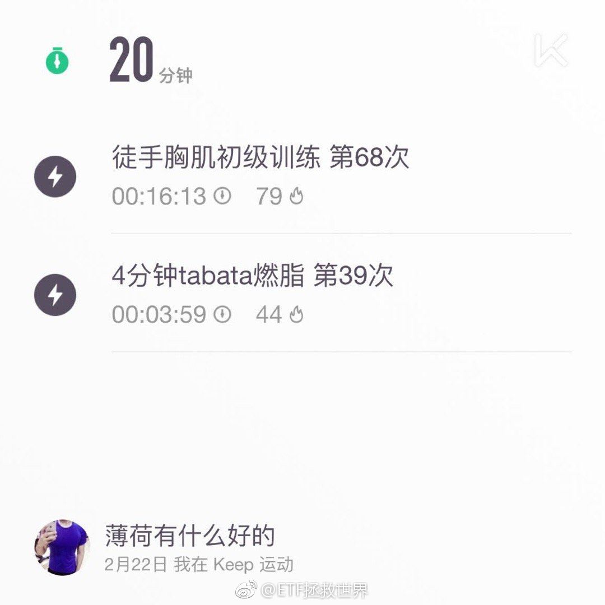

## 2019-02-22 23:16

还差6个点就可以新高，沪深300新高需要涨20%，中证500新高需要翻番。下跌是好事，各位应该有体会了。

回头看，计划还有很多需要反思的地方，也有很大进步空间。虽然熊市不赔的目标完成，也建立起了满意的仓位，但是其实还可以做的更好。有一些机会没有抓住，有一些失误其实可以避免。

这就是成长。虽然不是最好，但会越来越好。

加油。
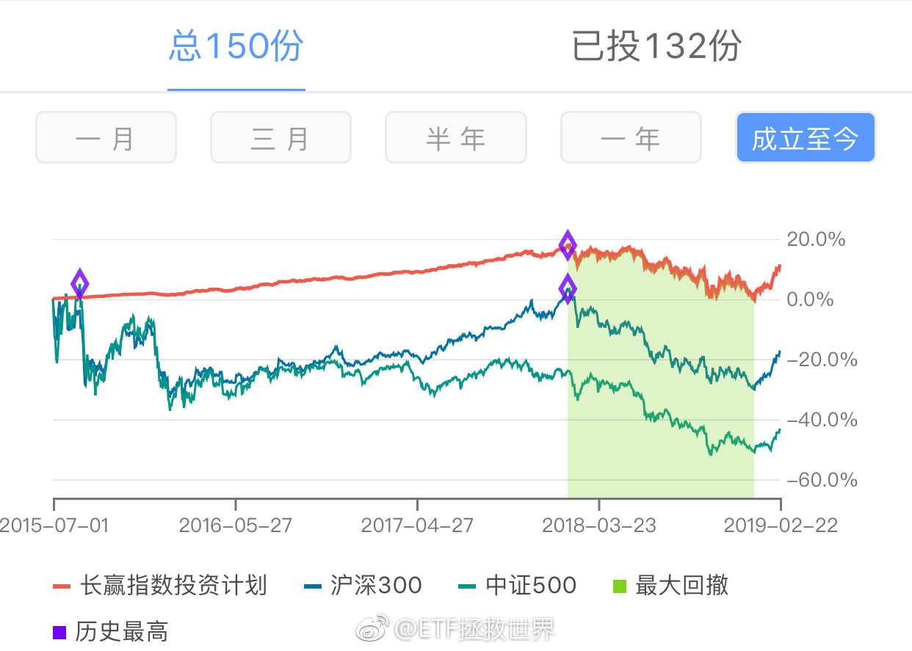

## 2019-02-22 23:31

我特别希望有一个能体现我所有能力的组合。不仅是长线建仓，还有各个品种的波段，熊市中的对冲，选股打新，对无风险收益率品种的选择…很多东西确实只能自己操作，不能那么多人一起玩。这个很遗憾。话说回来，看了看5100以来的收益率，已经80%了。当然，主要是分级A的功劳…

## 2019-02-22 23:52

回复@Angela鹿小鹿:这个就是分级a 查看图片 //@Angela鹿小鹿:e大，没看到你在分级A的风骚操作，新粉表示很遗憾....

## 2019-02-23 00:01

截至今日，

S里面的15个品种还剩4个浮亏；

150里面的31个品种还剩10个浮亏，浮亏幅度大于10%的还剩5个。

一个组合，无论是哪个市场，无论是哪个大类，不管股票债券黄金原油欧洲美国，所有品种都要赚钱，这就是目标。 ​​​

## 2019-02-23 07:32

确实太惨了。 查看图片

## 2019-02-23 13:39

玩实况，被韩国人虐了。

灰溜溜的去写文章了。

PS：

0:4！怎么讲，玩到后来我笑着玩的。输一个两个会想拼命追，0:4以后我就笑了。舒舒服服躺下享受了！不挣扎了，放弃了。 ​​​

## 2019-02-23 13:54

回复@李想宁:那是个骗子。千万不要关注，还可以顺手举报。正版是“chinaetfs”//@李想宁:请问公众号是 etf拯救世界复盘?

## 2019-02-23 19:00

每日打卡（3）

腰酸背痛腿抽筋，今天简单练练。 ​​​
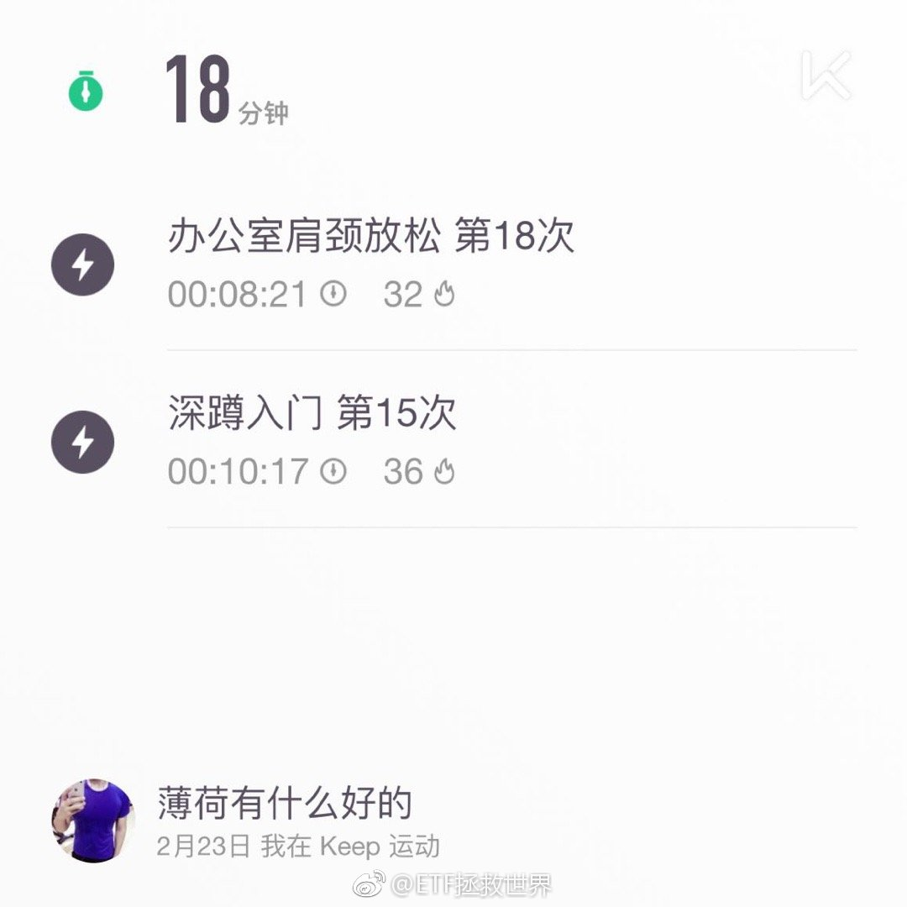

## 2019-02-23 20:07

开始看。一条10秒，1300条需要多少秒。

回复一条30秒，100条回复需要多少秒…… ​​​
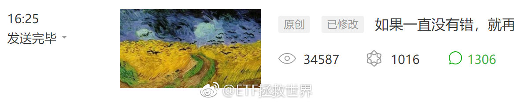

## 2019-02-23 21:43

精选一条：“你的可能情绪需要心理治疗师的帮助，自上一次被他人诟病影响情绪以来，未见进步。这样的情况可能会造成你的焦虑，甚至失眠，以及更严重情绪问题。国家精神心理临床重点专科医院医生愿为你提供帮助，解决这些问题，增强心理抗性。电话136……”完了，确诊了……

## 2019-02-24 16:16

请依法严惩。

## 2019-02-24 18:56

以后别人关于我的帖子不要给我看。

谢谢，我不关心。 ​​​

## 2019-02-24 21:22

每日打卡（4）

前几天练猛了，还没缓过来，简单练练 ​​​
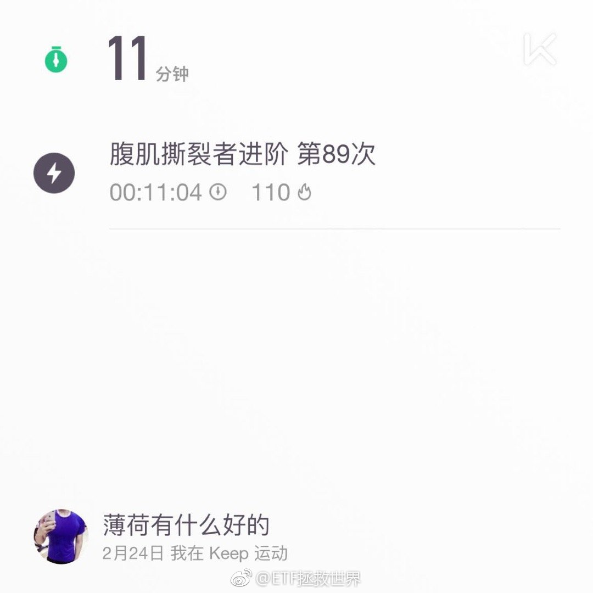

## 2019-02-25 07:44

不嫉妒不怨恨是第一长寿秘诀。意味着如果你天天嫉妒怨恨，那么…

## 2019-02-25 08:13

看了华为折叠屏的发布会，感觉触屏非常不灵敏，按几下都没反应，是错觉吗。 ​​​

## 2019-02-25 08:22

看了这个表情丰富的杨幂，竟然有点想路转粉了…

## 2019-02-25 08:33

回复@花开花落95708:手上有1000w+，只要不沾上黄赌毒，不乱投资，一般可以安度余生//@花开花落95708:回复@东指海云生:多少富翁壮年倒下//@ETF拯救世界:不嫉妒不怨恨是第一长寿秘诀。意味着如果你天天嫉妒怨恨，那么…

## 2019-02-25 09:26

再看看加深印象

## 2019-02-25 09:29

你有权利这么做，但没必要这么狠

## 2019-02-25 09:47

赚钱快乐吗。

尤其是踏踏实实的赚钱。

知道为什么赚。

人生很美好。 ​​​

## 2019-02-25 09:54

有没有发现这波行情，你手里好多股票几乎没涨，甚至还跌了 ​​​

## 2019-02-25 10:46

回复@假如鲸鱼有爱情:会有人往下压的。他们手里有上万亿筹码，会控制节奏//@假如鲸鱼有爱情:@ETF拯救世界 E大，我怎么觉得这个涨法，中国不能有长牛，人性就这样，一窝疯。

## 2019-02-25 10:56

踏踏实实的。

买入的那一瞬间你已经赢了。 ​​​
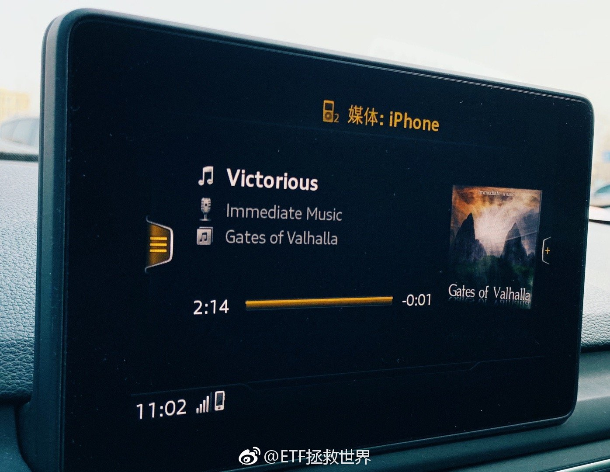

## 2019-02-25 11:35

反正我尽力了。从股灾前到钻石坑。

人各有命。

哪怕只帮了一个人就行。 ​​​

## 2019-02-25 12:18

这个市场疯子很多。

有人钻石底不断割肉，有人哈迪斯大顶不断加杠杆买入。

你要做的其实很简单。

理性。低买高卖。买入，持有，卖出。

很多话一直说，你觉得有点啰嗦，很烦。经历过整个周期后你再看，又有不同的感受。

前路依然很曲折，还会有很多麻烦。但你应该懂了理性的重要性。

好好感受股市这该死的，无处安放的魅力吧…

## 2019-02-25 12:29

回复@想减肥的蜗牛:破案了。是不是你孩子注册小号来喷我的。//@想减肥的蜗牛:衷心的说声谢谢！全职妈妈啥也不懂，就跟着益达老老实实买，跌的时候不看，涨的时候不卖，感觉可以给孩子报好多培训班啦！哈哈哈

## 2019-02-25 13:18

回复@只为悠闲的活:都有什么项目。不要太低俗。//@只为悠闲的活:来宁波请你玩一个月

## 2019-02-25 13:19

这么搞收盘要跳啊 ​​​

## 2019-02-25 14:23

每天好几辆（）（），随时受不了。

一看刚2900，嗷的一声昏古七了。 ​​​

## 2019-02-25 14:31

两周。//@ETF拯救世界:谁能想到，两天过去，券商的浮亏已经收窄到10%以内了。你要知道这个指数跌了70%多。以前我跟你说，你的那点浮亏，牛市来了，两周就会转盈利，然后就是资产飞跃之旅。你不信，现在有点信了吗。记住，熊市只要做到不亏或者少亏，同时拿够筹码，你就是未来的王者。

## 2019-02-25 14:48

刚才且慢给我一个数，这一轮底部区域，计划外赎回大概3.8%。也就是90%多都坚持住了。

为大家感到骄傲。你们是坠吼的。你们不赚钱A股不会有人赚钱了。 ​​​

## 2019-02-25 15:02

回复@李白先生vip:虽然有人喷我废话多，唠叨。但我知道绝大多数人需要这个才能坚持下去。骂就骂吧。//@李白先生vip:如果没有你的发言，我不会这么平静。

## 2019-02-25 15:32

我再提醒一下。

之前低位很多人不敢大力投入。涨起来了加大资金，补仓提醒会给你补仓建议，但你已经失去了低位筹码，未来如果赚不到钱不要埋怨我。

我还是那个建议：整体亏损再加钱。否则你越涨投的越多，神仙也救不了你。 ​​​

## 2019-02-25 16:07

现在上面也很为难。

希望牛市来，又不希望牛市乱来。

投鼠忌器，出zc会比较小心。

GJD的筹码这时候应该发挥一些作用了。但是砸多了可能又出问题。

难受啊。 ​​​

## 2019-02-25 17:45

除海外成熟市场外，今日过后，所有大类全部盈利。盈利幅度从3%-45%不等。

金融投资真的没那么可怕也没那么难。

不到3000点。 ​​​

## 2019-02-25 20:04

人类是非常善忘的动物。

浮亏的痛苦，回本后就会很快忘记。

曾经那么让你夜不能寐的痛苦，几个月后你回想一下，都已经记不起那时候的感觉了。 ​​​

## 2019-02-26 06:52

150部分，还差一个多点历史新高。300新高还需要十几个点，500还需要90%。

除德国所有大类盈利。

所有参考S的人全部盈利，组合即将新高。 ​​​
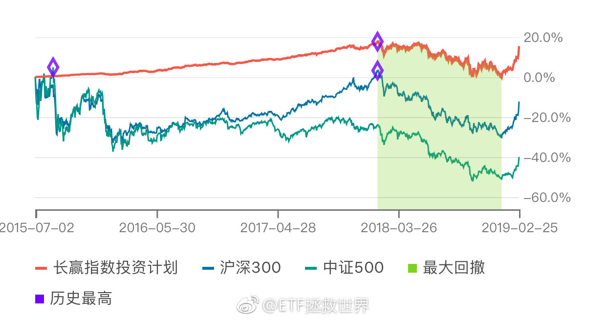 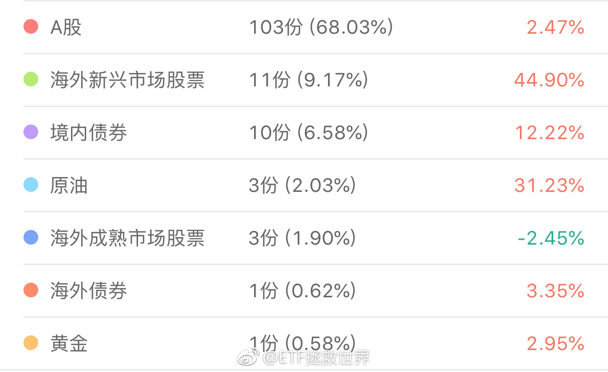 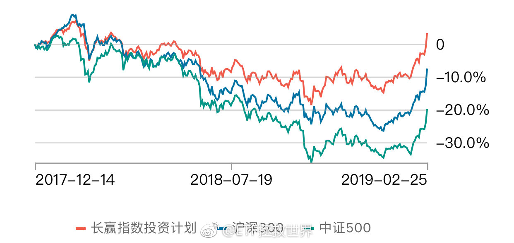

## 2019-02-26 08:18

回复@LightFISH:你把所有500看成一个品种：500。我如果买一只，有人说我是为了利益推一家公司产品。做人很难。//@LightFISH:建信500还亏16%，是不是买的略高了？

## 2019-02-26 10:03

$全指医药 sh000991$ 起飞了。牛市你还怕有轮不到的指数吗。 ​​​

## 2019-02-27 07:39

不用盼着牛市继续或者盼着熊市归来。

牛市？很好，赚大钱。

熊市？很好，以后赚更多。

波动市？更好了，提款机。

舒服。 ​​​

## 2019-02-27 07:52

回复@djndnehwbbf:太热了，要布置一下工作，稳一稳。//@djndnehwbbf:请问益哥，昨天忙什么去了？

## 2019-02-27 08:23

回复@某货wow:大家都没有卖一定是个错觉。连续两天成交万亿了。卖的人太多了//@某货wow:回复@一生只爱ETF:我觉得涨了38%已经很多了，这些是跟车以外自己在支付宝买的，在且慢的那些都没有卖。但是我发现大家都没有卖，就觉得好像不对？

## 2019-02-27 09:00

回复@qqttccvv:最新公众号文章有答案，忘了吗//@qqttccvv:那到底应该卖么//@ETF拯救世界:回复@某货wow:大家都没有卖一定是个错觉。连续两天成交万亿了。卖的人太多了

## 2019-02-27 09:27

回复@qqttccvv:调整到舒服仓位永远有效。不清仓持续有效。85 60持续有效。不可能每天都有新策略。给时间和空间让小树苗长成参天大树吧。

## 2019-02-27 09:31

回复@jackfish:阅读量低于5万的都是假的记住这一条就不会错。//@jackfish:@ETF拯救世界 公众号是哪个？假的太多了谢谢//@ETF拯救世界:回复@qqttccvv:最新公众号文章有答案，忘了吗//@qqttccvv:那到底应该卖么

## 2019-02-27 09:39

回复@小贝和皮皮:不建议给别人出任何投资股票的主意。买入卖出持有都不说话。百害无一利。//@小贝和皮皮:我同学说准备卖套了几年的股票，我说要么在放一会，要么卖了别再回来//@ETF拯救世界:回复@qqttccvv:最新公众号文章有答案，忘了吗//@qqttccvv:那到底应该卖么

## 2019-02-27 09:42

什么时候应该回头审视自己的投资策略投资体系呢？

表现不好的时候当然应该回头反思，但是更应该警惕的是表现好的时候。

应该在表现好的时候开始改变风格。主动让自己的组合和策略在当前的时点变得平庸一点。

这个值得好好思考。 ​​​

## 2019-02-27 09:47

回复@云飞KZ:我完全不理解你是怎么看出这个的。另外，建议重温去年底的文章。看看“看涨”是随大流还是提前于市场。//@云飞KZ:E大的意思是，现在要适当的随大流看涨了

## 2019-02-27 09:52

回复@浪迹天涯0216:承认自己“不知道”，很多人觉得弱爆了。其实只有内心深处知道自己不知道，然后勇于承认，才是真正的大赢家。连自己“不知道”都不知道的人，很难从市场赚钱。但有可能从别的地方赚钱。

## 2019-02-27 10:15

有一个小孩居然从他前面若无其事的过去。家长怎么教育的。安全永远最重要，遇到这种事情一定要离得远一点。

## 2019-02-27 11:12

昨天清仓的股神是不是又变成满仓了 ​​​

## 2019-02-27 13:05

再体会一下。现在要重点体会后半句。

## 2019-02-27 13:07

回复@老脸儿通红:下次碰到他记得说：“多大点事儿”。看他什么反应。//@老脸儿通红:一个普通朋友，说自己不懂，就每月存点钱投基金里，当存钱了。遇到这种人我都不敢在聊了，怕是高手。//@ETF拯救世界:回复@小贝和皮皮:不建议给别人出任何投资股票的主意。买入卖出持有都不说话。百害无一利。

## 2019-02-27 13:09

回复@老高GG:怎么这次群众情绪起来的这么快？值得观察。//@老高GG:@ETF拯救世界 刚接到身在外地老丈人的电话 话说近期股市大好 想把暂时不用的工程款转给我做一把行情  我心想 你为何去年第四季度不打我电话啊//@ETF拯救世界:再体会一下。现在要重点体会后半句。

## 2019-02-27 14:43

终于回调了。但要说到发车，这点跌幅远未够班啊！ ​​​

## 2019-02-27 17:06

记住这个。3、5年后回头看准不准。而且应该是很大的那种。

## 2019-02-27 17:42

信托产品包括公募与私募，可以面向不特定社会公众发行公募信托产品，认购起点1万元。 ​​​

## 2019-02-27 22:07

每日打卡（5）

满血复活，练完去做功课。 ​​​
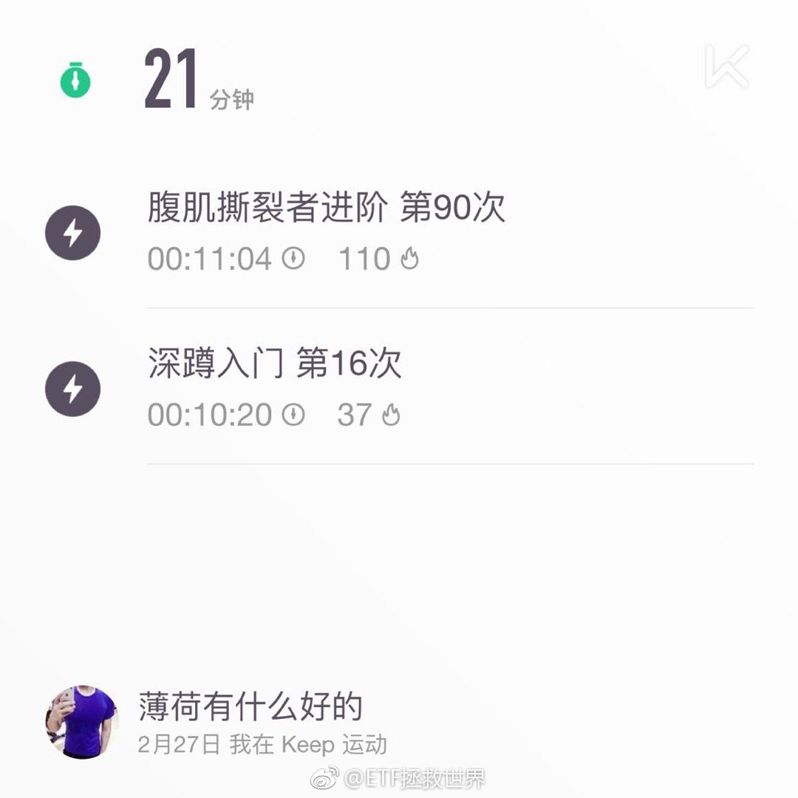

## 2019-02-28 10:11

刚登陆公众号一看，这几天新关注人数是平常日子的三倍。

怎么回事，是不是又有人在哪儿骂我了。

别骂了，越骂关注的人越多，好烦。 ​​​
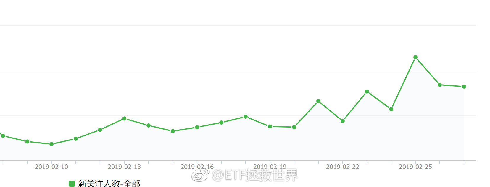

## 2019-02-28 10:20

再来一口？

## 2019-02-28 14:59

这位朋友刚刚联系我希望我帮忙转发。转发当然没问题，不过大家如果要资助一定要调查清楚。希望病人尽快好起来。如果还有类似的，只要是一直关注我的朋友我都可以转发。我愿意帮这个忙，但是真实性没精力一个个调查，大家自己判断吧。 查看图片

## 2019-02-28 15:08

回复@卖面条的麦当劳叔叔:每年两个旗舰机，用一年就淘汰，有点浪费，不买了。（过两周：呵呵，真香）//@卖面条的麦当劳叔叔:e大是不是过两天搞个s10+的评测 毕竟要全方位发展//@ETF拯救世界:再来一口？

## 2019-02-28 15:44

回复@魏大明的生活:我都忘了，你能记得我就觉得没白做。这种事情作为我，帮忙了没有什么好处，如果碰上信息不实的我还有很大风险。但还是能帮就帮着转一下，当事人已经很不幸，别人帮一把就会好很多。但是，只要我知道转过的有一次出问题的，就不会再转。//@魏大明的生活:谢谢e大之前也帮了我类似的忙

## 2019-02-28 20:29

每日打卡（6）

完成。明天准备休息休息。 ​​​
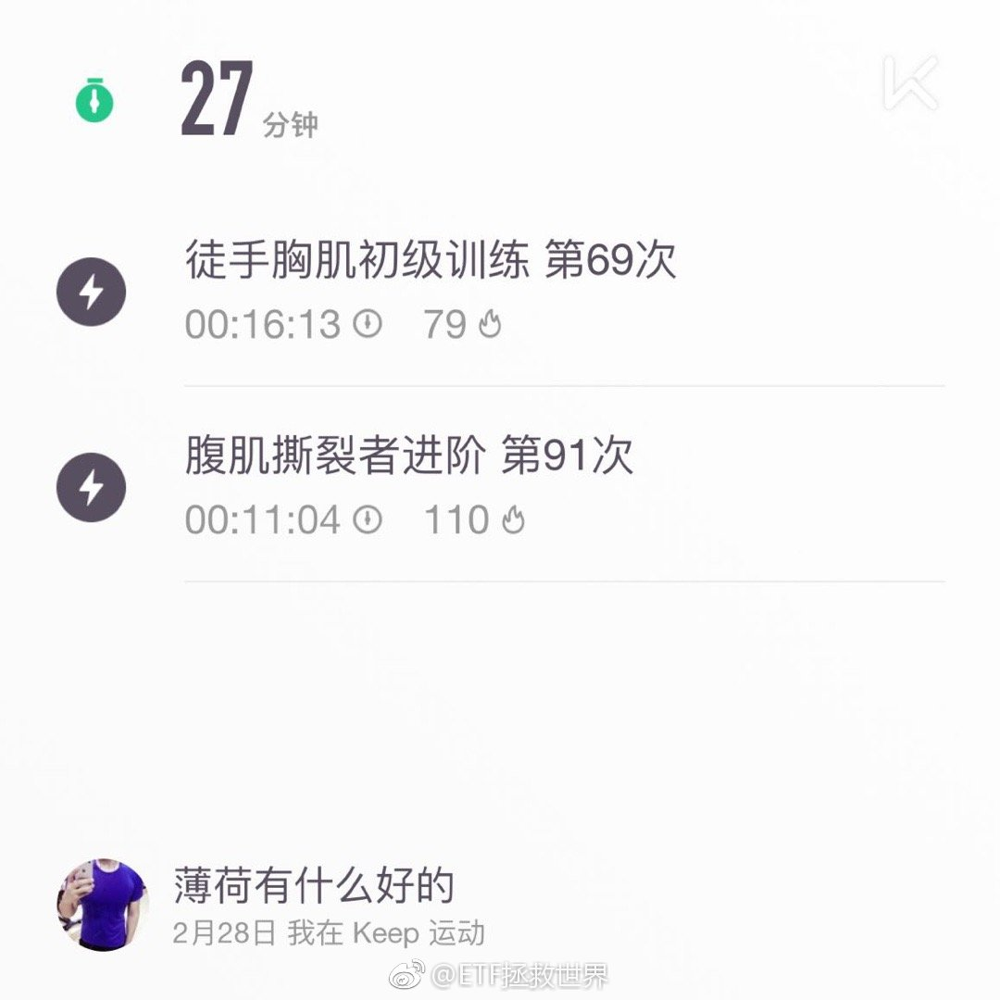

