## 2019-04-01 07:21

这么看同事孩子考上康奈尔真是很出色。

## 2019-04-01 08:28

回复@aaronnju:股票市场绝大多数时间是先行指标。对于经济最敏感的是债市，其次就是股市。//@aaronnju:话说我们现在经济貌似也没好转呀，还在不断地裁员。难道是说，股市都提前预报市场么？

## 2019-04-01 08:49

最新150配置图。成熟市场和商品开始增加。买的还远远不够。

A股部分除非再次出现钻石买点，否则不会再加。但是有可能会进行调仓和平衡。 ​​​
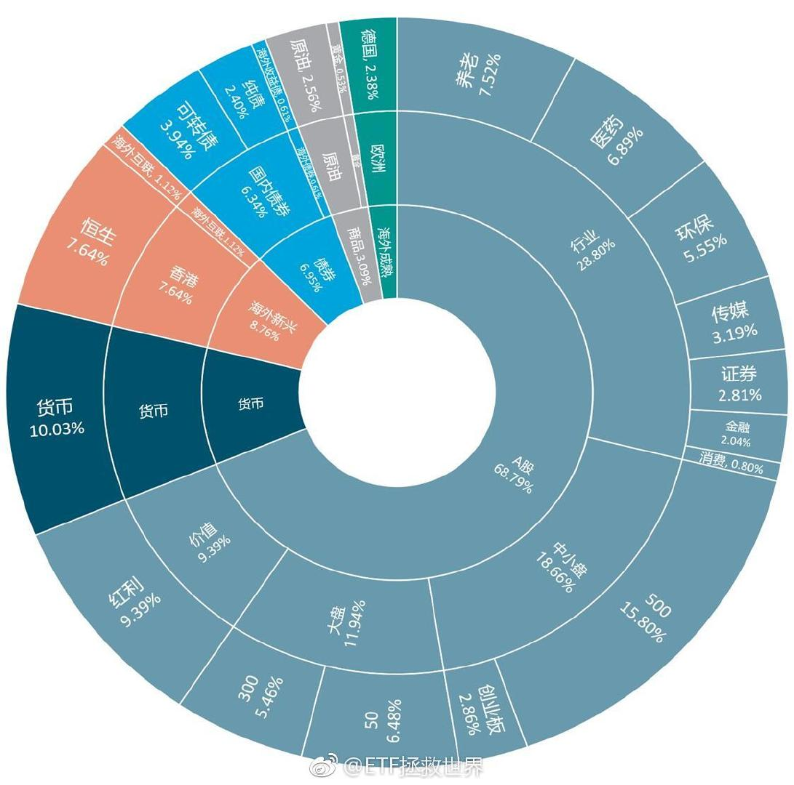

## 2019-04-01 09:18

回复@sven119:本质上没有区别。只要是投资，本质上就是赌博。但我们之所以投资指数基金而不去澳门的原因，是因为指数投资可以计算概率，绝大多数赌博不能。所以我们在胜率大的时候买指数基金，很难不赚钱。//@sven119:媳妇问我 指数基金和赌博有什么区别，一时间竟然不知道该怎么回答

## 2019-04-01 09:34

什么事情不是赌博呢，几乎你只要做任何事情都是赌博。

小到出门还是在家更加安全，大到你做什么职业，与哪个人结婚，你的钱是存在银行、买债券、买股票、买期货还是买p 2 p。

都是在赌博。

有的人之所以人生比较顺，很大原因是在每个十字路口愿意理性思考哪个选择获胜的概率大一点。然后，根据规则，行动。而有的人就不会去分析，所有决定都来自于感性，这就比较麻烦。

狭义的赌博，比如赌大小，老虎机之类的，很难计算怎么做才能胜率大。事实上赌场已经计算好了，平均来说，赌客是必输的。这样的事情我们就不要做。

包括这几天说的P，它的风险你很难控制。因为规则的问题。

在赚钱这方面，计算胜率也非常非常重要。是成功投资的第一步。

无论是价值投资（分析企业，找到优秀企业，寄希望于它继续优秀的赌博）；趋势投资（找到趋势良好的股票，希望它的趋势延续）；又或者是量化投资（根据量化因子找到一批符合标准的标的，寄希望于它们平均会表现好），都是相对理性的投资方式。从理论上说，这些都是可以高胜率赚钱的。

对于投资股票来说，指数基金几乎是完美的品种。它没有个股甚至行业的风险，独有的系统风险也可以依靠各种策略和体系大部分消化掉。很安全，收益率也不会差。

所以，如果你要投资股票，那么选择指数基金是普通人最好的选择。它的胜率计算，要比个股简单的多。个股最大的问题是不确定性，指数基金好得多。

当然，指数基金，包括股票投资，绝不是每个人都适合的。有些人天生不适合，有的人是知识水平不太够，有的人是情绪性格不好，有的人是理解力和逻辑思维能力比较差。总之，不喜欢金融投资也很正常。保本的银行理财是他们最佳归宿。

概率，概率。希望各位真的能理解这两个字的伟大意义。

## 2019-04-01 09:36

继续新高，即将回到10000点。

## 2019-04-01 09:45

回头看，几乎每个品种跌到大底的时候，都会有非常非常多的噪音出现。有时候我会拉黑一些人，我不是说你没有提出反对意见的权利，而是对我来说，你是噪音。除了耽误我的时间没有任何意义。最重要的，你的存在会让很多本来可以赚钱的朋友在底部被你吓得卖掉便宜筹码。我不能不拉黑，也请这些朋友理解。

## 2019-04-01 09:57

回复@深白浅黑NestoR:一个人被拉黑，就很容易“恨”你。如果有人恨你，你就要小心，不知道会在哪里给你扎刀子，射冷箭。而且，恨的时效性比爱要久。我们很难爱一个人一辈子，但很容易恨一个人到有一个人先走那一天。我不希望有很多人恨我，所以希望他们理解。

## 2019-04-01 10:05

回复@可能是个最差的程序员了:“创造价值”，包括通胀，也都是指数投资增加胜率的因子。你还没有思考到本质，还在比较浅的地方。继续往下想。//@可能是个最差的程序员了:赌博和投资有本质区别，赌博只是资产转移，投资可以创造价值

## 2019-04-01 10:09

今天又是72%的股票跑输500。

不知道大多数认为自己选股能力强的朋友自信来自于哪里。 ​​​

## 2019-04-01 10:11

回复@萩落依零:不知道借了多少。不过我认为你不应该那么轻易帮着把钱还了，想办法让你弟弟知道问题的严重性再帮他。希望你不要成为樊胜美。

## 2019-04-01 10:29

建议不要看账户了。

没意义。

反正每天多那么多钱，大家都麻木了。

想想怎么花吧…… ​​​

## 2019-04-01 10:30

回复@贸易小哥:雪球很有价值。但噪音的数量是有价值声音的10倍。评论里噪音更多，是100倍。//@贸易小哥:那段时间确实很黑暗，雪球上也是一堆不看好医药行业的，还好有E大

## 2019-04-01 10:50

很多人认为在牛市里赚大钱是必然发生的。

sorry，真不是。记不记得前几天我统计，三个月换手150%？

进进出出，错过了几个大涨的日子，很多人这一波根本没赚几个大子。信不信由你。 ​​​

## 2019-04-01 14:22

这种事情少干 ​​​
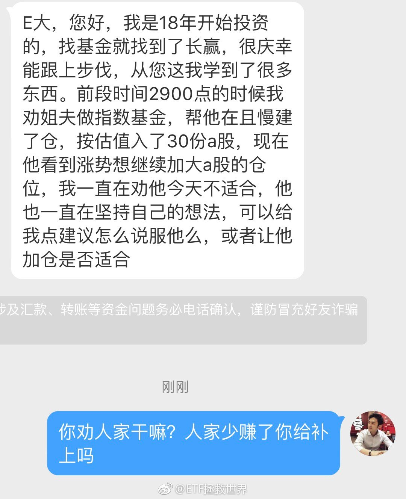

## 2019-04-01 14:31

回复@谁喷益达我抽谁:付费提问才是发财机会吧。如果我回答谁的问题谁至少赚3000，可惜，我一年只回答两个。//@谁喷益达我抽谁:中奖了 啊  免费提问被EDA回复  正常100多块钱吧

## 2019-04-01 14:38

我总是忘不了这些底部清仓的朋友。

真的很可惜。

我尽力了。

 ​​​

## 2019-04-01 16:30

账户多50万不如多一块腹肌 ​​​

## 2019-04-01 16:38

好讨厌，买了就涨嘤嘤嘤 ​​​
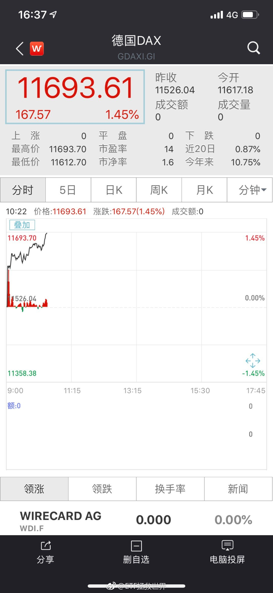

## 2019-04-01 16:44

回复@吴荻_上海:最好言，不言我catch不到呢//@吴荻_上海:我靠，我看了今天你的更文实在忍不住留言了。。。。你忒搞笑了吧。顺便告诉你，你真的改变了我的人生。毫不夸张。大恩不言谢。

## 2019-04-01 17:24

回复@一只爱笑的考拉:上次不开心是有人组织一帮喷子喷我，再上次是儿子病的比较严重，其它的这些年真的没什么不开心的事。跟周围的人关系都很好，家庭事业都很好，投资不用说了。

## 2019-04-01 18:48

太酷了。//@数知实验室:#数知生活# 亚马逊放大招啦！//@李昂达: 这是神族母舰啊！#星际争霸#

## 2019-04-01 20:17

有一件事我不能再隐瞒了。

必须坦白了。 ​​​

## 2019-04-01 20:34

回复@地球流浪找太阳:想卖就卖，不要憋着。//@地球流浪找太阳:E大，从微信追到微博，想问下去年跟你买的有些基金已经盈利超过20%了，可以卖掉了吗？我在且慢跟着买的，大部分时候是提示买入，卖出的少，卖出是基于什么原则啊

## 2019-04-02 10:57

今天有朋友发给我一张图片，上面是某指数投资星球号，用了我的LOGO，请各位朋友擦亮你的卡姿兰大眼睛，不要认错人。

我过去没有，现在没有，未来也没有计划开星球。 ​​​

## 2019-04-02 11:41

4300点开始第三轮计划，目前3100点，跌幅28%。

第三轮已投入资金年化收益率昨天超过+10%，迈向+15%。看看能否到+20%。

如果能长期保持年化收益率20%，你就是这条gai上最靓的仔。

我不行，长期15%+我就很开心了。 ​​​

## 2019-04-02 17:49

去年四季度整个A股利润都在下降，医药真牛，截止目前披露的公司还是10%+……

当然不知道未来会怎样。但是消费和医药是A股有史以来最牛的两个板块是有道理的。 ​​​

## 2019-04-02 18:17

晚上油气不表现一下对不起我 ​​​
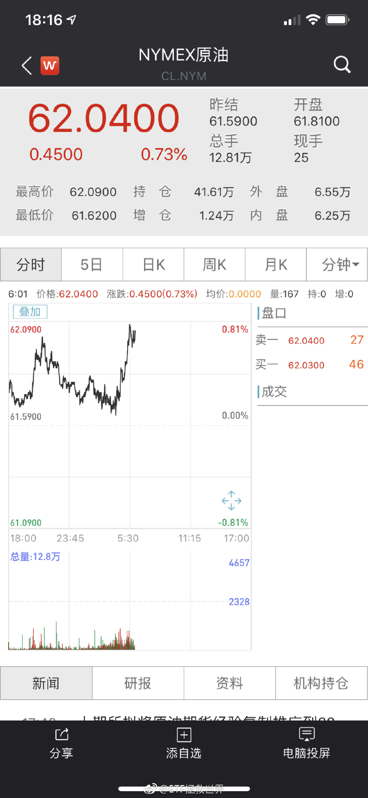

## 2019-04-02 18:24

今天听人说阅读量不如长赢的一个理财公众号一年广告费有700、800万。

我承认，我了……

鬼知道这些年我放弃了什么…… ​​​

## 2019-04-03 05:43

据我对油气的了解，一段时间跟的差就会有一段时间超预期。不用急，等等看 ​​​
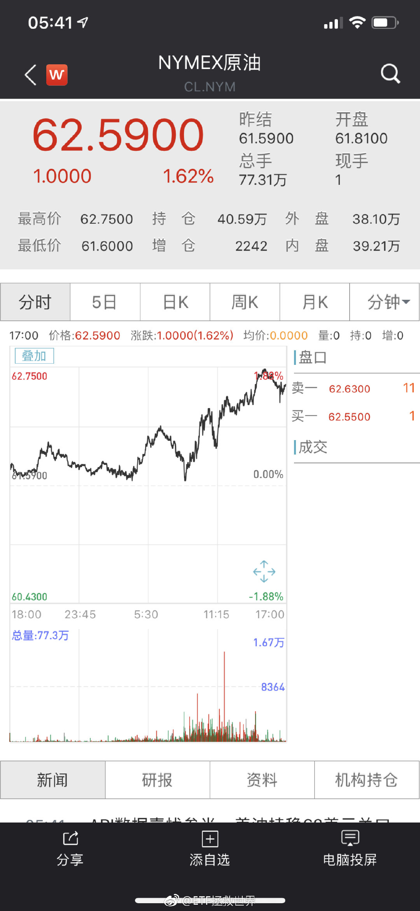 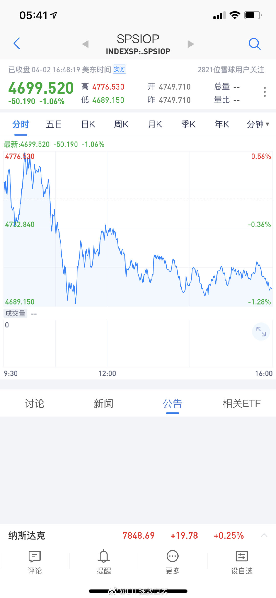

## 2019-04-03 15:36

大概你稍微能体会到“不要卖”三个字的重量了。 ​​​

## 2019-04-03 15:37

我等的是欧元和德国的双击。 ​​​
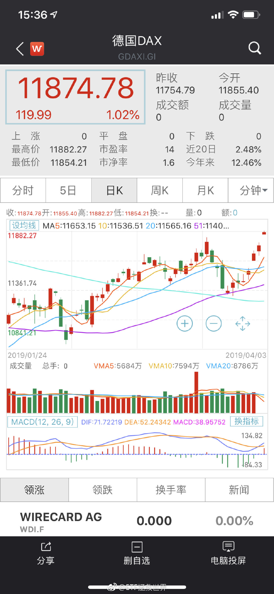 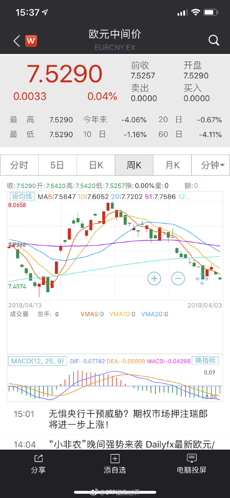

## 2019-04-03 17:17

很多人跌下去难受，涨上来更难受。

赔钱心慌，赚钱心更慌。

你说逗不逗，他来股市就是为了难受吗。

踏踏实实的，涨跌都舒服。 ​​​

## 2019-04-03 17:24

回复@投资跑道上的一只小蜗牛:你下次亏大钱的种子已经埋下了//@投资跑道上的一只小蜗牛:我自己也挺恨自己超级低位为什么不果断上杠杆，不过下次有经验了。资本市场机会不会少的吧

## 2019-04-03 17:31

记住，投资这件事千万不要用上次的经验推导下次。

比如上次顶部没跑，就觉得要随时跑锁定利润。

比如上次随时跑没赚钱，下次打死也不卖。

比如上次胆子小买的少，下次疯狂加杠杆。

如果这样做，你会非常惨。

这条微博值500万，不信你十年后回来看。

当然，你永远不知道那个没看过这条微博的你是什么结果。

## 2019-04-03 18:02

回复@尿意盎然:你知道吗，去年最低点附近，有朋友私信我，说家里有人病了急用钱要赎回。与他比一下，你还难受吗？接受不能改变的事，努力去改变可以改变的。难受有什么用，这个情绪最没用。//@尿意盎然:我是真难受，因为一笔计划外的急用钱，今天赎回了一部分

## 2019-04-03 18:13

各位用过去这几年的时间，能完整体会一次顶部坚决卖，下跌过程不着急买，底部区域坚定多买，上涨趋势不着急卖，这样一个完整赚大钱的过程。

相信对一辈子的投资之路都会有益。毛估估，可以节省3-4轮超过十年的试错成本——对于有天赋的朋友来说。没有天赋的，要试一辈子。 ​​​

## 2019-04-04 06:23

涨幅1.7，叠加欧元上涨0.4，按理说昨天德国净值应该涨2%，今天晚上看。

油气跌了，但是只持有1.6，希望暴跌多买点。 ​​​
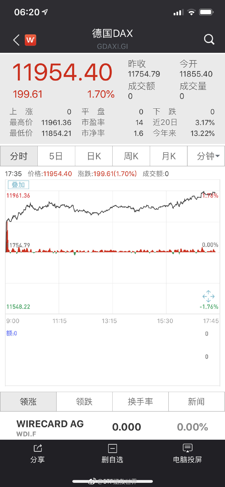 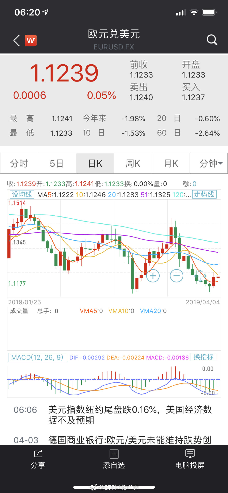

## 2019-04-04 11:00

今年有不少地方做的不足，整体也一般，总之是对自己并不满意。

之后这段时间尽量减少发微博次数，认真反思总结，努力提高。

在市场面前，永远是个学生。 ​​​

## 2019-04-04 15:06

回复@广Ling儿:请把持仓和历史交易记录贴上来。//@广Ling儿:回复@广Ling儿:收益率只跑赢45% 的用户

## 2019-04-04 15:10

这是s和150的一年收益率，跑不赢沪深300，只跑赢40%用户这种事情怎么发生的 ​​​
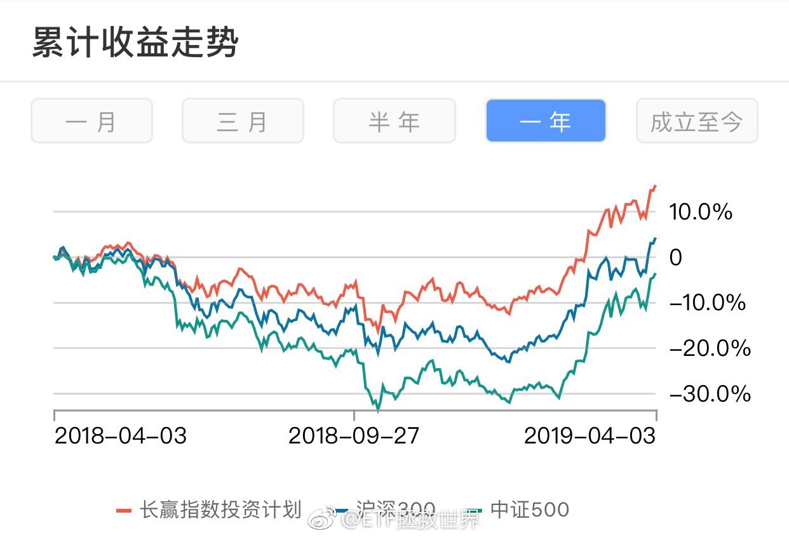 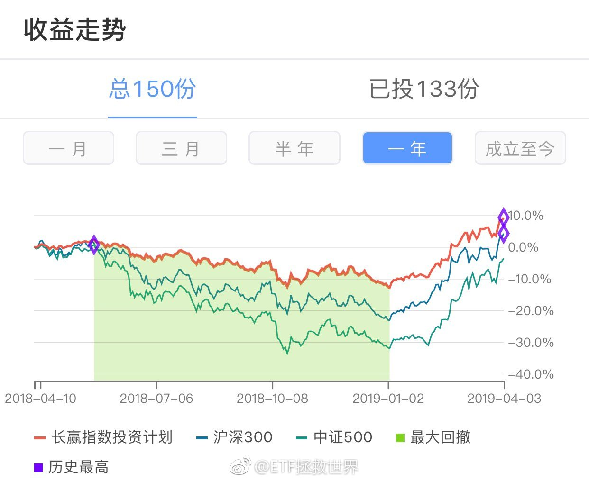

## 2019-04-04 17:36

向不满意的朋友说声对不起。

虽然第三轮计划跑赢300一直在35%以上，虽然去年大熊市跌幅只有300的不到1/3，虽然在300远没回到去年高点的时候你的账户每天都在新高。

但是，对不起，这两个月跑输300了。我们这样的资产配置模式，必然无法在每个时间段跑赢每个品种。让你失望了，对不起。

我请你立即把所有计划品种都换成300，来跟上它。

另外，不知道你给我的公众号文章打赏过没有，虽然我估计没有，但如果有，请告诉我打赏了多少钱，我马上三倍还给你。

其它估计我们之间也没有任何利益瓜葛了。

咱们从此一别两散，各生欢喜。

我不适合你，你也不适合我。我不欠你任何了。

## 2019-04-07 15:01

​​​
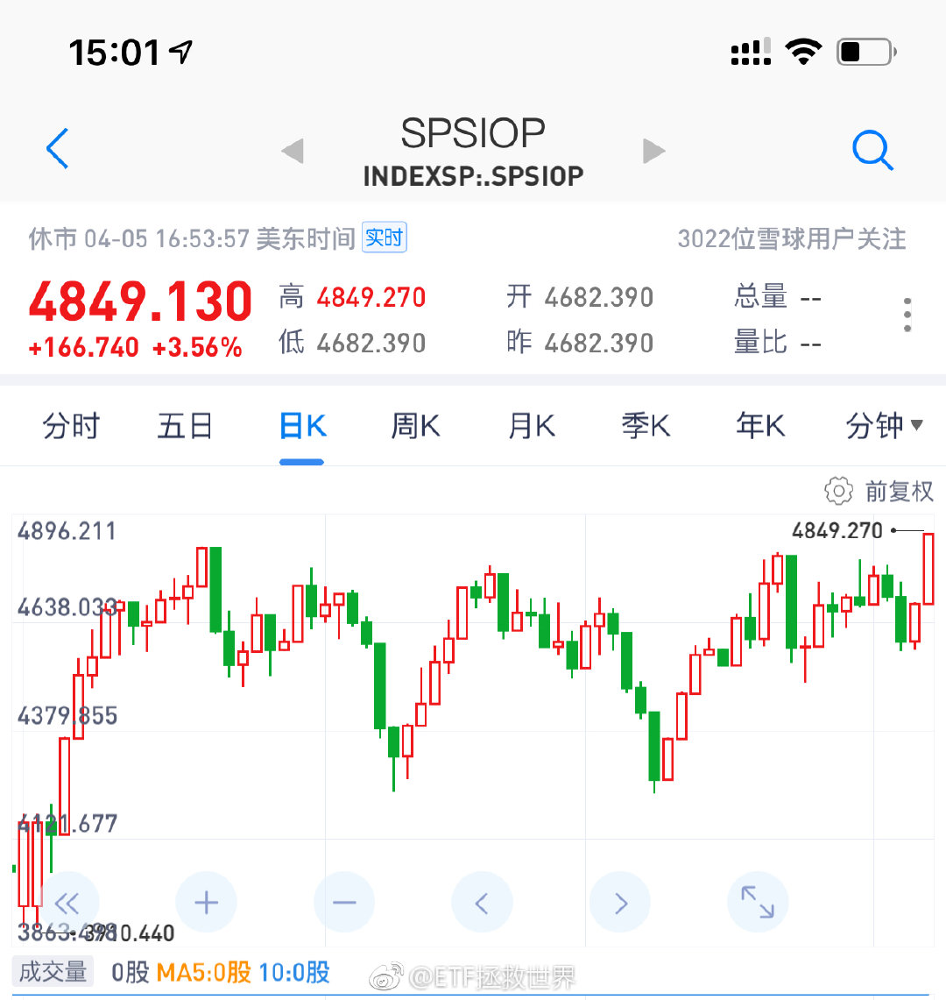 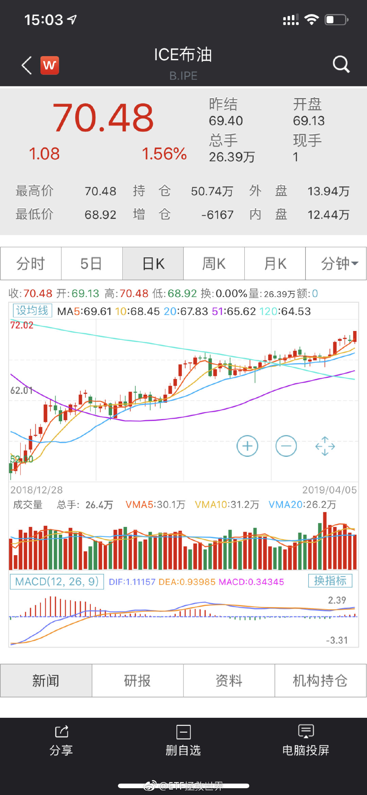

## 2019-04-08 06:59

意念盘化工涨停利好中证500。 ​​​

## 2019-04-08 07:36

昨天跑步脚受伤了，所有健身和出游计划要搁置一个月。

健康比什么都重要。 ​​​

## 2019-04-08 09:46

已经回到10000+

## 2019-04-08 09:56

国债趋势改变了。最好不要拿太多。 ​​​

## 2019-04-08 10:03

从极度低估回到目前价位，大致已经到了合理，同时叠加大压力。最好的情况是沿压力线持续小幅上涨。极度高估点位在15000左右。//@ETF拯救世界:已经回到10000+

## 2019-04-08 10:07

最近两个月指数涨幅太过凌厉，导致我们持仓的不少指数基金都跑输指数5%左右。

计划收益率也一定程度被拖累。

长期看绝大多数指数基金不会有问题，毕竟这样的暴涨不可能长期持续。 ​​​

## 2019-04-08 21:35

突破了就别掉链子，继续。 ​​​
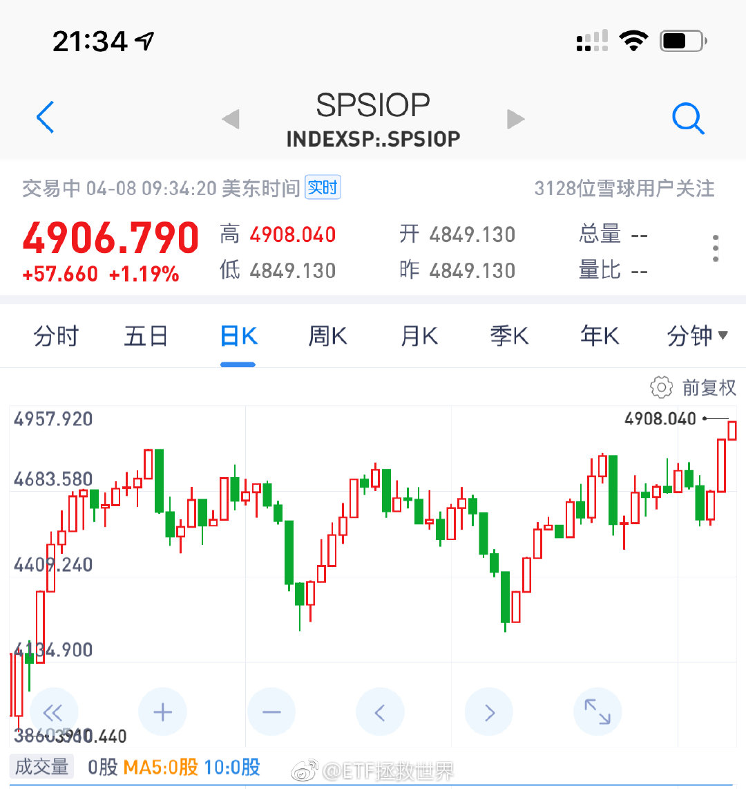

## 2019-04-09 07:20

不跌不买，逢高减磅，不赚不出…有没有发现你已经跟社保基金一个水平了

## 2019-04-09 10:41

球球已经快一年没发言了，微博每天发言。

一个悬念，谁先突破20万关注…… ​​​

## 2019-04-09 10:56

不知道你们喜不喜欢收集什么东西。

其实买指数基金也有收集东西的快感。

就是你知道它未来一定能给你带来很不错的收益，然后低位不停的买。就会有你在抄底你喜欢收集的东西时候那种快感。

然后你就看着账户里的它们，怎么看怎么喜欢。想起来心里就踏实——真好啊，特别好那种感觉。

不想卖，怎么也不想卖。就希望它别涨到一定要卖出的那个价格。或者跌回能继续抄底的价格让你继续买。

总之就是收集的快感有了。不仅是赚钱的问题，光看它们你就能特开心。

没有这种感觉那你还远未够班啊。

## 2019-04-09 13:14

每天涨一点新高引发舒适。//@ETF拯救世界:已经回到10000+

## 2019-04-09 15:09

第三轮计划中第一个60%的品种应该是它。

但是只买了一份找谁说理去… ​​​
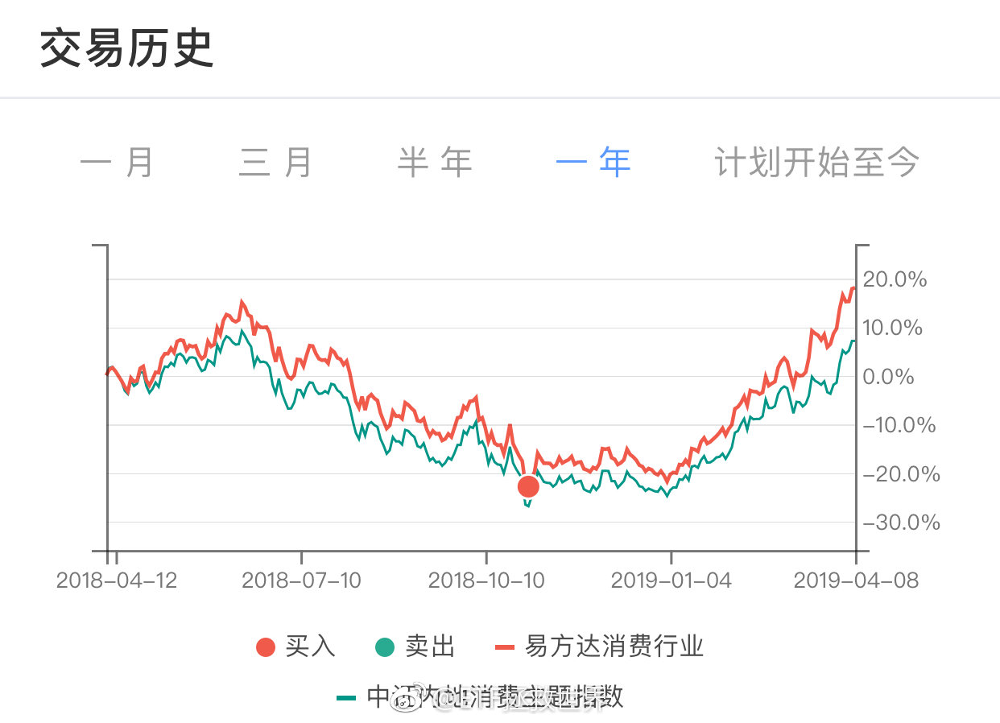

## 2019-04-09 15:25

不对，记错了，去年恒生到过60%…看看第一个70%是谁 查看图片

## 2019-04-09 17:48

看了眼账户，成功停止抖动。发帖日是最低点。

## 2019-04-09 21:39

全指医药上一波在10000点是2015年3月，那时候估值62倍。四年过去，指数没变，估值降至36。

而十三年前的2006年6月估值也是36倍，当时点位是1407点，十三年上涨620%，年化接近17%。

这就是长期指数投资能够赚钱的秘密。 ​​​

## 2019-04-09 21:47

回复@莲花卷子:2005-2015十年涨了20倍。当然未来这样的情况几乎不可能发生了。//@莲花卷子:果然是十倍指数

## 2019-04-09 21:50

真.疯王啊……搞完我A搞德国……NB你就把德国干到10倍我梭哈…… ​​​

## 2019-04-10 06:57

这个有懂的吗 ​​​
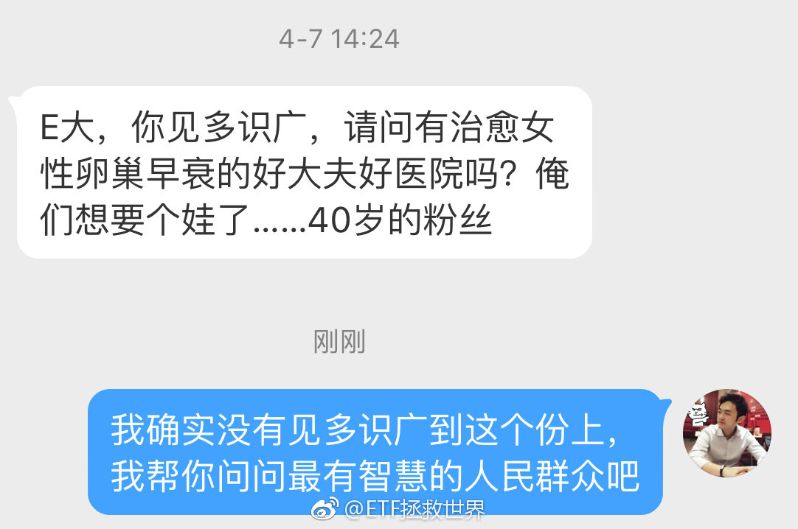

## 2019-04-10 07:41

回复@峰沐:十年一倍年化是7.x%。如果安全性和流动性与货基一样，那就是稀世奇宝，绝对可以买。但如果是必须十年后才能拿回本金，那就没那么好了。//@峰沐:E大，10年翻一倍的投资，可以投吗？安全性如果余额宝

## 2019-04-10 07:44

“有钱了找小奶狗”对于女性来说也并不是什么好事。只能说明除了有钱自身毫无吸引力……//@挖龙脉的超级鹿鼎公:哈哈哈，真相了

## 2019-04-10 07:46

现在这个世界这么专一的人不多了。

## 2019-04-10 07:49

回复@岚之一夕:长期年化10%你可以进入华尔街大师系列。//@岚之一夕:感觉十年年化10%左右是普通人的水平，再往上就看老天爷和自己的努力了//@ETF拯救世界:回复@峰沐:十年一倍年化是7.x%。如果安全性和流动性与货基一样，那就是稀世奇宝，绝对可以买。但如果是必须十年后才能拿回本金，那就没那么好了。

## 2019-04-10 08:15

客观预估自己的投资收益率有意义吗？

非常有意义。

最大的意义在于，可以让你从投资目标反推需要投入多少本金，有助于你达成目标。

无论是未来的教育费用、养老费用或者是实现其他的目标，你都可以叠加时间+收益率来反推需要投入多少本金。

在此基础上，你可以设定乐观、中性、悲观三个条件。比如，乐观设置10%-15%，中性设置7%-9%，悲观设置4%-6%。

10年后你需要200万或者2000万，客观理性的看，现在大致需要投入多少本金？每年需要多少？你都要知道投资收益率。

我不是说你把预期收益率调到20%不行。只是到时候目标实现不了千万别哭啊。

最有意思的，是很多人希望每年翻番来买股票，最终发现自己的年化收益率是10%。负的。

## 2019-04-10 08:30

我知道很多朋友很焦虑，特别希望我说年化20%很简单，又希望我赶紧说说第一个一百万怎么赚的。

我当然可以打开word洋洋洒洒说一大篇，但我不能。

我可以跟你说20%很简单，二十年后你发现没赚到又不会来找我。一时说一时爽嘛，一直爽一直说。但sorry，我不能这么做。

我也可以跟你说100万很容易啊。我是怎么攒钱的，怎么投资的。我有自信写一篇这样的东西轻易10w+，但这样真的不负责。时间不同，空间不同，所有情况都不同。我害怕自己的经历对你产生不好的影响。因为所有外在情况都不同了，真不能乱说。比如，0607的两年六倍大牛市，你还能赶上吗？

我不能不负责任的告诉你，我的成功你也可以复制。我不能告诉你只要如何如何，就能如何如何。

你很焦虑，我不会去收割。

过不了自己这关啊。

## 2019-04-10 08:41

去年的事情好像对东哥影响很大啊……

## 2019-04-10 08:46

回复@资本暴利狂徒:答案：只要不上杠杆，永远亏不完。//@资本暴利狂徒:问题来了，每年亏10，几年亏完？

## 2019-04-10 08:55

近期有公司增持，也有减持。本来所有股票一起上涨和下跌就完全不合理。那些不值钱的公司最好全部减持跌到仙股才好。

## 2019-04-10 09:24

回复@hei-jude:心算一下，10年后200万，年化9%，本金需要84万。另外，也可以是每年投入12万。//@hei-jude:10年后娃读书需要200万，用7-9%的收益率，需要投多少本金呀？//@ETF拯救世界:回复@资本暴利狂徒:答案：只要不上杠杆，永远亏不完。

## 2019-04-10 09:40

越说越来劲。//@ETF拯救世界:每天涨一点新高引发舒适。//@ETF拯救世界:已经回到10000+

## 2019-04-10 09:47

在这个时候我又想起去年底那些唱衰医药的人，又想起那个说医药刚跌了一半，要救我一命的人。

我想起他们，不是要嘲笑他们。而是特别感动。

感动于各位的信任，感动于出现噪音的时候各位与我站在一起。绝大多数朋友是第一次和我一起经历那样的至暗时刻，但你们都选择了信任。

信任是最难得的。所以我想起来就会觉得很感动。有人又会说我戏多了。我知道这种感受不会每个人都能体会到，但这是我最真实的感受。

## 2019-04-10 10:12

跌一点就吓得到处问反弹是不是结束的朋友。

恕我直言，你还没做好到股市投资的准备。 ​​​

## 2019-04-10 10:19

今天涨5%才算你狠。//@ETF拯救世界:每天涨一点新高引发舒适。//@ETF拯救世界:已经回到10000+

## 2019-04-10 11:20

回复@唐山黄金名表名包回收典当:不懂你为什么克制。难道你真的没钱连一点股票都买不了了吗。听我的，想做就做，不要让青春留白。//@唐山黄金名表名包回收典当:看着股票如此疯狂 好想操作一把  克制克制//@ETF拯救世界:今天涨5%才算你狠。//@ETF拯救世界:每天涨一点新高引发舒适。

## 2019-04-10 14:22

希望各位通过这半年经历体会两件事

第一，否极泰来

第二，投资不是投票，大多数人说什么，大V说什么根本不重要，绝大部分你听到的都是噪音。坚持做正确的事。 ​​​

## 2019-04-10 14:36

对不起我笑了

## 2019-04-10 16:11

竞猜：

今天还能继续新高吗？ ​​​

## 2019-04-10 16:14

青岛好玩吗。是不是可以去看看。

## 2019-04-10 16:27

回复@静待晚秋:跟车就像闹GM，太早风险大，太晚没肉吃。只有最合适的时候进来肉才最多。什么时候是最合适？得看命……谁去年钻石坑进就是命好……//@静待晚秋:回复@温柔的臭臭:感觉后来跟车的同志们没什么机会了

## 2019-04-11 08:47

自己多攒点是王道。

## 2019-04-11 09:02

回复@无比的谋略:喷了，哪个APP？//@无比的谋略:这是什么鬼？@ETF拯救世界 查看图片 //@ETF拯救世界:回复@静待晚秋:跟车就像闹GM，太早风险大，太晚没肉吃。只有最合适的时候进来肉才最多。什么时候是最合适？得看命……谁去年钻石坑进就是命好……

## 2019-04-11 09:39

我不信你一点都不想卖出一部分锁定利润。

想卖一点的举手我看看。 ​​​

## 2019-04-11 11:23

既然这么多人不想卖，市场就会教育大家。你卖了继续涨，不卖就调整。反复摩擦，反复蹂躏。

## 2019-04-11 16:21

被各路神仙吹的也想去买个P30 Pro玩玩了。

唯一的问题是我对屏幕要求特别高，不知道华为的屏幕能达到苹果和三星的水平吗。反正前两年玩过一台那屏幕拖影完全受不了… ​​​

## 2019-04-11 20:31

内事不决问群众 ​​​
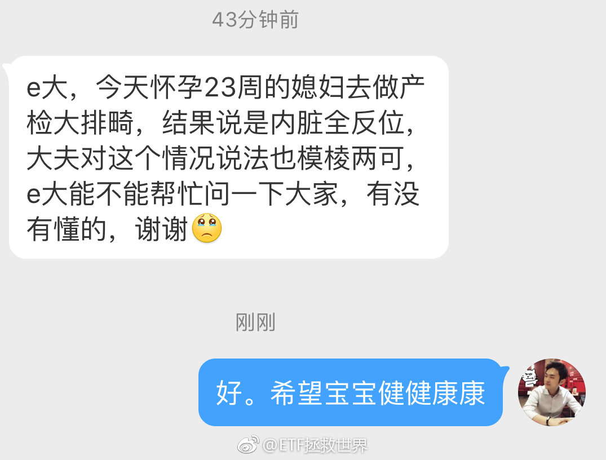

## 2019-04-12 08:20

回复@耿浩Gorf:我们已经两个月没买了。//@耿浩Gorf:怎么办，三天前最高点买的指数基金，10万跌了2000多

## 2019-04-12 08:36

早上想明白一件事：如果为了拍照（视频素质还不行）买一个六千多的手机，为什么不去买个黑卡或者微单呢。踏实了。

## 2019-04-12 10:22

之前有人在评论里说Dax基金每年跑输基准6%，我不知道这又是从哪个大V那看到的数据。

华安dax确实表现一般，年年跑输dax。之前每年跑输2个多点。不过每年跑输程度越来越少，去年只有1%了。

很多原因。管理费等等。还有Dax本身就是包含分红的全收益指数，跟上确实也很难。

虽然是稍微差点，但有什么办法呢，现在就只有这一家Dax指数基金。

## 2019-04-12 10:54

不追涨是美德。

涨两个月，很多人就忘记了现金的可贵。手里有点钱都觉得烧手，要投出去。

跌了又后悔。

心魔。 ​​​

## 2019-04-12 17:02

回复@法国梧桐树NJ:过去十年不好才是我买他的理由。你体会一下。

## 2019-04-12 17:14

不对，说错了。DAX过去十年不能说不好。2009.4-2019.4涨了192%，年化收益率接近12%。

最有意思的，是2009.4和现在的估值几乎一样。

DAX不好的是过去19年。2000年就已经7600了，现在才12000，19年涨了58%。年化不到3%，这是加上股息的。如果不算股息，估计1%都不到。

这才是我看好它未来的原因。

你知道不知道，再往前推20年，1980-2000，德国涨了1700%？

有朋友总认为，只有A股值得买，其他波动太小没意义。记不记得咱们买债券的时候也有人这么说？那你又记不记得之后2018年除了债券涨了10%，其他所有品种都暴跌？

不要以为都买波动大的品种你的收益才会高。这是绝对错误的想法。好好做资产配置，你的收益不会差，但是波动性会降低至少一半。

降低波动性没意义？

你大概没有过打开账户资产腰斩的感受吧。

## 2019-04-12 17:17

另外，当然也有我个人的喜好在里面。从小就对有组织有纪律严谨的人有好感，德国人无疑是这样的民族。更别提30里面的企业了。西门子，宝马，奔驰，阿迪达斯……目前这么便宜买这些企业，我心里踏实。

## 2019-04-12 17:23

回复@海底两万八千里:我觉得未必是自己受伤后才能学到东西。看别人的经历也一样能学到。最重要的是把自己代入对方，想象对方的感受。感受到他人资产大幅下跌的绝望，加上基础的数学知识，就知道拒绝大幅亏损的重要性了。何必要自己经历过呢。

## 2019-04-12 17:31

回复@耐心是投资第一要素:等你听到知更鸟叫时，春天已经快过过去了。股市是先行指标，等宏观经济数据走好再买股票的人远未够班……//@耐心是投资第一要素:看了3月经济数据，下周估计要继续涨

## 2019-04-12 17:36

回复@乄Chaos:我自己除了怎么也无法代入喷子，无法体会喷子们到底是什么感受外，大家的感受都能代入……//@乄Chaos:所以同理心真的挺重要的。

## 2019-04-12 17:50

万万没想到， 我那个一个月更新2次的公众号，被腾讯认定是“优质公众号”，让我去开座谈会…… ​​​

## 2019-04-12 21:59

一买就涨好烦 

 ​​​
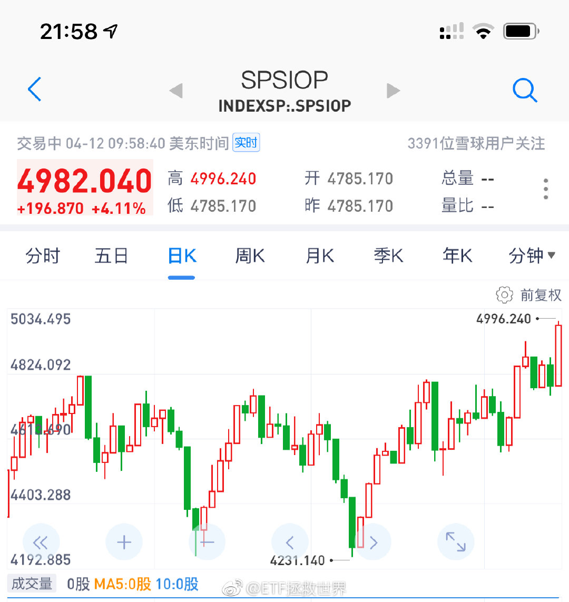 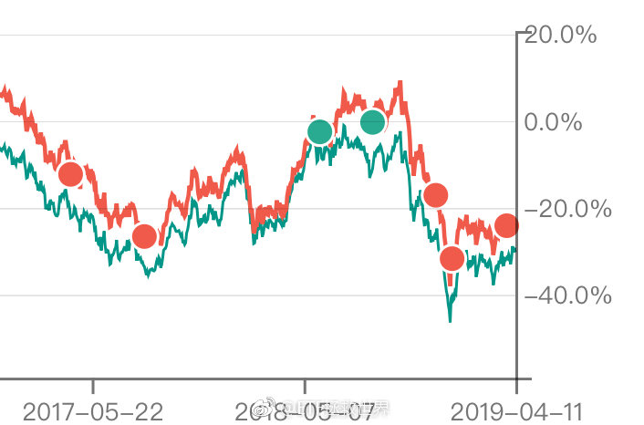

## 2019-04-13 09:25

昨天暴涨，再看看这条微博，说的对不对。这个世界太多人短视，用一段时间的表现定义一个人或者一个东西。其实，花开有时，春兰夏荷秋菊冬梅，很多时候只是时间没到而已。路遥才能知马力，日久才见人心。

## 2019-04-13 09:30

回复@lei_xu:把股市收益率与GDP挂钩，只能说远未够班。我A过去二十三十年GDP增长如何，投资人整体收益如何？以后这种问题我不会解释

## 2019-04-13 09:39

听说球球七天无法发言。

虽然球球对我一般，但我真心希望球球能顺顺利利，并且越来越好。

@雪球 ​​​

## 2019-04-13 09:47

再有人教育我什么该买什么不该买直接拉黑。 ​​​

## 2019-04-13 09:54

回复@风云又起17725:我每天都在拉黑，但我不可能保证没有漏网之鱼。我有自己的生活自己的家庭自己的事情要做。我没钱请助理帮我打理微博//@风云又起17725:益达为什么不把那些说 财经界只认您和某某某的人拉黑？

## 2019-04-13 09:56

回复@桃李麻辣烫:它不鸟我是它的事，我希望它好是我的事。有什么问题？//@桃李麻辣烫:但是球球并不鸟你。。。。。。

## 2019-04-13 10:11

很多人总觉得别人做的有一点不好就是对不起自己，心生怨念。

我不是。我经常想别人对我好的地方，经常心怀感激。

别人对我有帮助，有机会就会报答，即使别人并不是有意识的对我好。

很多人把很多事视为理所应当，其实，未必。 ​​​

## 2019-04-13 10:20

所以前几天有个大机构跟我说，把我的话选了52条，做了个精美的周历想印1000册送给大家，我没答应…因为不知道怎么报答人家…

## 2019-04-13 16:00

回复@雪糕w:为什么每集吃这么多还这么瘦//@雪糕w:这是哪儿的方言，笑死我了。我有微博啦，不是假的！

## 2019-04-13 16:10

回复@打浦桥麦当劳:日本的数据特别难拿。德国的通过彭博和wind还能拿到，日本真是找不到。因为我要自己计算，所以都是历史基础数据，很难找//@打浦桥麦当劳:回复@ETF拯救世界:日本也是这样的民族，买日经ETF?

## 2019-04-13 16:40

每天都有很多重复的问题，我统一回答一下，然后会置顶：

第一：谨防骗子。

我只有这一个微博账号。绝对不会主动私信你，更不会要带你操作股票。我没有任何股票或者投资群，绝对不会要求加你微信或者QQ。

如果有类似情况，马上拉黑对方。

分辨真假最简单的方式是把鼠标挪到头像上，看看对方有多少人关注。没有富婆为骗子买20万关注者是吧。

第二：公众号。

我的公众号是长赢指数投资（chinaetfs）。就这一个。其他使用我的ID，我的头像的全是假的。

无论如何，我都不可能公开谈论任何股票信息。只要你看到在微博或者公众号荐股的，都是假的。

第三：指数投资计划。

我的比较长的文章和第三轮指数投资计划每个月发布在公众号上。补仓或者最方便的跟车方式是且慢。下载且慢APP或者公众号“且慢管家”都可以。

我的计划不收费，免费公布。所以你看到任何收费的都是骗子。

## 2019-04-14 19:53

有个问题，问问关注我的，工作也是996的朋友：

你们，或者说你的家人996，年收入到底是多少。 ​​​

## 2019-04-15 08:14

今天上京东，发现前几天买的一个小东西降价了。随手点了保价，二十秒后处理完成。现在等退款。

这种体验非常好。总让我想起当年在中关村买电脑的痛苦经历。

以后我的快递都会尽量交给京东发。 ​​​
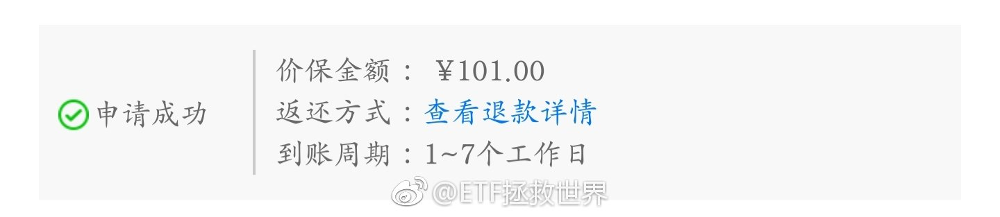

## 2019-04-15 08:27

回复@小倪3070:关注我的人里面，所在地依次是北京 广东 上海 浙江 江苏…一线二线应该占了70%以上。关注这个领域的人，都是有点家底有点闲钱的。手头太紧也没功夫想理财的事//@小倪3070:基本上还是一些经济发达城市的发言，二线以下基本没什么声音

## 2019-04-15 08:37

回复@阿笨的微博:事实证明多刷我的微博有好报…//@阿笨的微博:感谢E大，刚去看了最近买的东西，一共3件退回240，可以带女儿去吃顿牛排了

## 2019-04-15 08:38

回复@我又又又又改网名了:想发，但今天有可能大涨，我择一下时//@我又又又又改网名了:15号了，今天有车么//@ETF拯救世界:回复@小倪3070:关注我的人里面，所在地依次是北京 广东 上海 浙江 江苏…一线二线应该占了70%以上。关注这个领域的人，都是有点家底有点闲钱的。手头太紧也没功夫想理财的事

## 2019-04-15 08:49

到了 查看图片

## 2019-04-15 11:30

千万别以为债券的波动小 ​​​
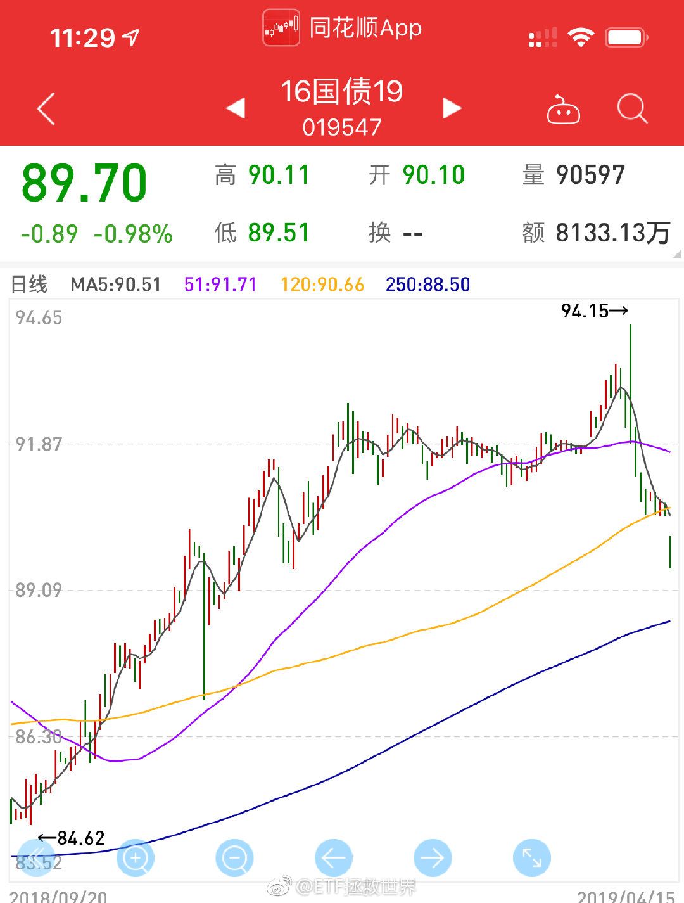

## 2019-04-15 11:33

老歌好听是因为80 90年代大部分是翻唱日本流行音乐。日本人的旋律非常在线。//@八大山债人:我娃和我一起听周华健。。。//@乐音悦酒: 回复@期货实盘志:你儿子00后？//@期货实盘志:文艺这几年衰败的很厉害，国内几乎没有创作歌手了，我儿子00后都觉得80-90年代那些老歌好听。

## 2019-04-15 11:46

不知道你有没有感受，我们好像非常缺乏对“美”的认知。

无论是建筑，城市规划和景观设计，各种产品的工业设计，甚至各地新修建寺庙里面的雕像，再到大街上店家的招牌，人们的穿着，超市门口摇摇车的造型…

到处都体现一种迷样的审美。 ​​​

## 2019-04-15 12:04

回复@一个风向:我第一套房子上过装修杂志。现在没心气儿也没精力拍了//@一个风向:不用说那些大的，就看看家里的装修就知道大概了，E打装修完了晒图吗

## 2019-04-15 15:13

回复@硕仔满:巴洛克也好，歌特又或者维多利亚也好，都挺美。中国的传统风格也非常美。美不仅是流行，更是经典。

## 2019-04-15 15:18

本来以为是一周行情，谁知道是周一上午行情。

下半月随时发车。不会多，一两车。 ​​​

## 2019-04-15 16:22

欧元继续 ​​​
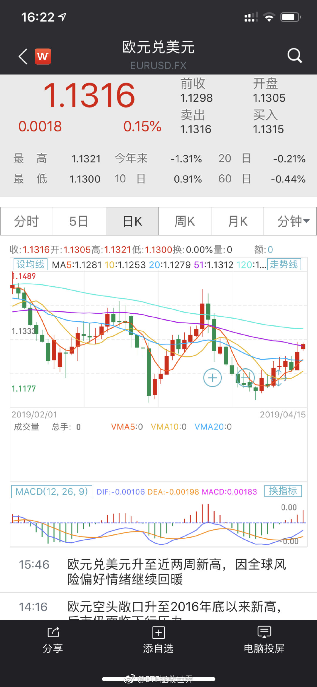

## 2019-04-15 18:40

回复@琴宣月柳:不是。我是说我们的Dax会不错，没说换欧元//@琴宣月柳:换了点欧元，不知道是不是合格的学生

## 2019-04-16 07:08

有美感的城市规划

## 2019-04-16 07:34

回复@秋声如许:昨天刚看到一篇新闻说卢浮宫要和故宫加强古迹修复方面的合作，晚上就…//@秋声如许:昨天E大刚聊到建筑美，聊到法国小镇，今天巴黎圣母院就烧了。好伤心，还没进去看呢。

## 2019-04-16 07:41

其实万事万物诞生之日起就已经注定要消失。

所以哪天你心爱的东西不小心坏了丢了，如果实在无法挽回，就随它去吧。

都是必然发生的。 ​​​

## 2019-04-16 12:21

踏踏实实的。也许有调整，但是无论从估值 趋势 还是先行指标看，没有道理在这里下车。

有调整就继续买点，没有就继续等新高。

卖，当然以后要卖，但总要有个理由吧，不能看心情卖你说是不是。 ​​​

## 2019-04-16 14:24

来了老弟？但是不出意外这个基本不会买多少。有交易价值，没有太多长期持有价值

## 2019-04-16 16:39

中欧两开花 ​​​
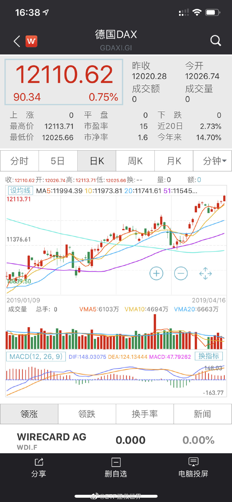

## 2019-04-16 16:47

最近出轨的瓜有点多啊，吃不过来了。

大家还是要管住自己啊，不展开说了。 ​​​

## 2019-04-16 16:54

我能看出，很多朋友投资经常陷入的一个误区就是：

这个东西没有长期投资价值，或者长期投资价值很低，为什么要买它？我就不买。

投资品种有两类，一个叫做有长期投资价值，一个叫做有中短期交易价值。

很多“价投”只买前者，很多短线客只做后者。

我不这么做。小孩子才选择，成年人都要。

很多品种长期看确实价值一般，但我并不想长期拿，我只吃它上涨的这一段。你非要跟我说——它长期不行，不行不行。这就有点鸡同鸭讲了。

所谓长期投资好像听起来要比短期投资高大上？这就是又有了执念。

哪里有机会，哪里能赚钱，哪里就应该有你的身影。至于长期短期，并不是最重要的。该长期持有的好东西就踏踏实实拿着，该做波段那就吃完就走。

千万别把自己局限起来。任何事情都是如此。

## 2019-04-16 17:06

回复@别拿你屁股对着我:十年后如果中证500低于10000点我会非常非常非常惊讶。//@别拿你屁股对着我:万一这是近十年的山顶呢

## 2019-04-16 18:12

看评论可以了解我们的语文教育多么失败。真的。//@ETF拯救世界:回复@别拿你屁股对着我:十年后如果中证500低于10000点我会非常非常非常惊讶。//@别拿你屁股对着我:万一这是近十年的山顶呢

## 2019-04-17 10:23

回复@么么在浆糊:谈自己的爱情故事就像在社交平台晒娃，自己津津有味，旁人只觉得平平无奇。//@么么在浆糊:想听E大的爱情故事

## 2019-04-17 10:28

回复@湛江街拍:我推荐经常坐飞机地铁或者公交的朋友试试降噪耳机。我这两年买的比较满意的产品。//@湛江街拍:想听e大推荐好用东西，大家才有动力赚钱买货//@ETF拯救世界:回复@么么在浆糊:谈自己的爱情故事就像在社交平台晒娃，自己津津有味，旁人只觉得平平无奇。

## 2019-04-17 12:03

不懂就不要乱投资。

买个债券都可能赔钱你能想到。 ​​​
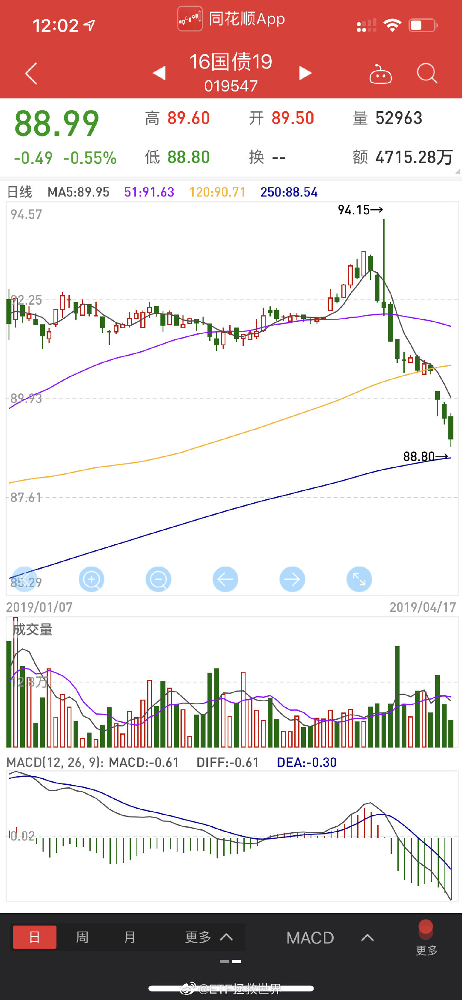

## 2019-04-17 12:45

回复@发生这种事我要粉碎你:震惊。//@发生这种事我要粉碎你:历史还真是简单的重复 这次也一样

## 2019-04-17 16:06

回复@Fund_Study:真的吗。那要去哪里交流//@Fund_Study:听说微博要下架1个月？没有e大我们怎么办//@ETF拯救世界:回复@发生这种事我要粉碎你:震惊。//@发生这种事我要粉碎你:历史还真是简单的重复 这次也一样

## 2019-04-17 16:38

我看很多朋友分不清债市走势和转债的关系。极简说几句。

其实各位每次打的转债，不应该算是债券范畴，它的走势跟股市关系更大。目前的情况不用犹豫，每只都打就对了。

很难破发，即使破了也问题不大，因为你不会中太多。另外你持有很多只，资金分散，也不是大问题。

我不想说转债没有风险，毕竟之前辉丰跌到70。但是可以说，转债从整体看，风险不大。绝大多数转债都会在100以上，最终，大多数转债甚至至少能见到120-130。

所以你只要不重仓单只，风险不大。我自己是每只必打，打到了也不会去研究，到了120-125就卖出。除非它出了强赎公告，就会赶紧卖掉。我没空研究每只走势，所以是120-125。如果你有精力，可以认真研究，有的会涨的更高。

## 2019-04-17 16:48

目前A股收益率再次低于十年国债收益率。

本次股票收益率高于国债收益率周期为7个月，与2005、2008、2012三次大底持续的时间基本相同。 ​​​

## 2019-04-17 17:21

回复@吧嗒木:A股历史上还没有过出了钻石坑再回去的情况。有几次在黄金坑里面调整。如果这次出现了，那又是一个新纪录。//@吧嗒木:说不定又掉回坑里

## 2019-04-17 18:07

最近文章写得少，BGM攒了一大堆了！ ​​​

## 2019-04-17 19:07

每天涨得是不多，架不住天天涨啊。

以为梅赛德斯的事能压一波呢。 ​​​
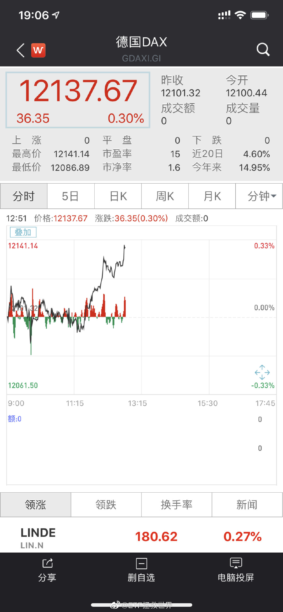

## 2019-04-17 19:09

一天到晚没完没了的折腾。没事，还有12年…

## 2019-04-17 22:19

回复@天生不是情人mallee:别教育我用什么方式给A股估值好吗？服了

## 2019-04-17 22:25

我计算A股估值的模型，是我自己开发的，已经用了十年，并不断进化。

精确判断2007 2010 2015大顶，以及2008 2012 2018大底。

2015年开始为大家所知的时候，无数人和大V嘲笑我的系统，后来事实一次次把他们的脸都打肿了，教育我怎么估值的人越来越少了。

我只希望，你教育我之前，先了解一下我和我的系统好吗？你连了解一下都不愿意就来教育我，你是怎么想的？

## 2019-04-17 22:28

回复@特色小挣:去公众号看首页菜单春节特辑//@特色小挣:精确判断，精确到什么级别啊？

## 2019-04-17 22:33

目前A股市盈率18倍。你信吗？

马云马化腾和98个贫困山区的人站在一起，100个人平均都是亿万富翁？得出的结论是大家都很有钱？ ​​​

## 2019-04-17 22:39

回复@索菲小娅:实际上去掉几个富豪，小部分人只是中产阶级，大部分人都是贫困人口。这就是A股估值现状//@索菲小娅:意思是说，实际上远不到18，整体还比较便宜吗？

## 2019-04-17 22:49

回复@蓝色彼得潘的小窝:为什么我算的是26，你能把纳斯达克100去掉巨头市盈率90倍的计算过程贴一下吗//@蓝色彼得潘的小窝:纳斯达克去掉六大巨头剩下市盈率90几倍//@ETF拯救世界:回复@索菲小娅:实际上去掉几个富豪，小部分人只是中产阶级，大部分人都是贫困人口。这就是A股估值现状

## 2019-04-18 08:01

希望桥水是对的。美股如果能用一两年跌40%，我们成本控制在30%的地方，再用3-5年涨回来，收益率翻番问题不大。问题是能跌40%吗…

## 2019-04-18 16:04

这位母亲把车停在路中间，跟孩子说了什么，刺激到孩子毅然跳桥，我自己脑补了一下。然后告诉自己，以后无论如何都不能对孩子说这样的话。

## 2019-04-18 16:22

这样的好天气我竟然在家养伤。 ​​​

## 2019-04-18 16:56

回复@潮水18:所以家长才需要给孩子一个底线——无论外面的世界如何黑暗，家里永远会让你感受到温暖。有这最后的温暖孩子就有希望。

## 2019-04-18 16:58

这也是我每次都能迅速从各种明枪暗箭又或者是喷子的吐沫中迅速走出来的原因，因为能感受到更多的爱啊……//@ETF拯救世界:回复@潮水18:所以家长才需要给孩子一个底线——无论外面的世界如何黑暗，家里永远会让你感受到温暖。有这最后的温暖孩子就有希望。

## 2019-04-18 17:26

目前已经有一半500成分股公布年报，从四季度单季看，整体利润依然在增长。

远远好于全市场，甚至好于300。

1月份说500越跌越贵的人太坏了。 ​​​

## 2019-04-18 17:30

更要注意的是，我预计2季度，最迟3季度，500将恢复高增长。

## 2019-04-18 18:13

小样儿 ​​​
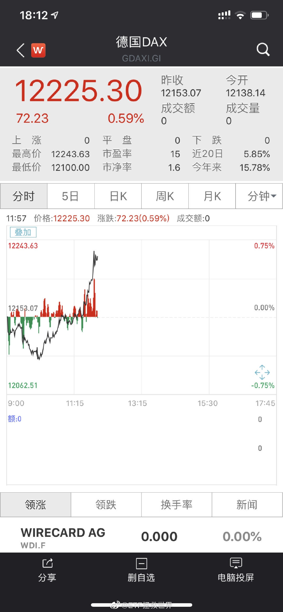

## 2019-04-18 18:37

回复@1818就是我:涨了不开心，难道跌了开心吗？启动前又买了，不应该开心吗？建议你有机会就让自己多开心一点，人也会比较健康//@1818就是我:为什么每天涨这么一点就这么开心。。

## 2019-04-18 18:46

给各位一个数值：

5%。

如果一个品种在你的配置中超过5%，就可以影响你的组合净值了。不到5%很难影响。

记住这个数字，并应用它。 ​​​

## 2019-04-19 16:59

A股历史上除了2008年底开始的上涨，从未出现过类似这波行情的毫无回调的情况。

果然历史没有简单重复的啊。 ​​​

## 2019-04-19 17:21

各位还是要在每个阶段清楚自己在赚什么钱。

从底部到顶部，三部分的钱。

第一，估值修复的钱。

第二，正常增长的钱。

第三，疯狂泡沫的钱。

目前依然在第一阶段。 ​​​

## 2019-04-19 17:59

这才是蝴蝶效应。我的一点想法：第一，欠钱和维权是两回事，要分开说。维权的事情100%支持，也非常敬佩。第二，欠钱的事也建议双方追到底，如果是造谣，把造谣的人和幕后黑手全部绳之以法。如果是真的，该还钱还钱。这个世界上，没有圣人，别觉得做了好事的人就一点错不可能犯。你认识圣人吗？我不认识

## 2019-04-19 18:05

回复@谁喷益达我抽谁:你的想法和我的观察不谋而合。继续观察吧。我不信长牛会这样一路下去。所以，要么是我错了，不是长牛。要么就不会这样涨下去。//@谁喷益达我抽谁:我在想，如果像09年那样没有夯实底部就急涨的话，那么涨幅肯定不会像07年和15年涨幅那么大了

## 2019-04-19 18:26

回复@l水平不行l:把所有可能性列出来，然后分析发生概率，然后制定对策。这样的逻辑思维体系你能理解吗。理解不了就继续去感觉怪怪的吧。//@l水平不行l:要么这，要么那，好像很有道理的样子。怎么感觉哪里怪怪的？

## 2019-04-20 10:04

回复@WatererX:太对了。最关键要在别人的基础上再思考，再提高。这是最最关键的。我不反对别人参考我的东西，但一定要有创新和提高，我本身也能反过来学到东西。

## 2019-04-20 10:06

懂法律的说说。 ​​​
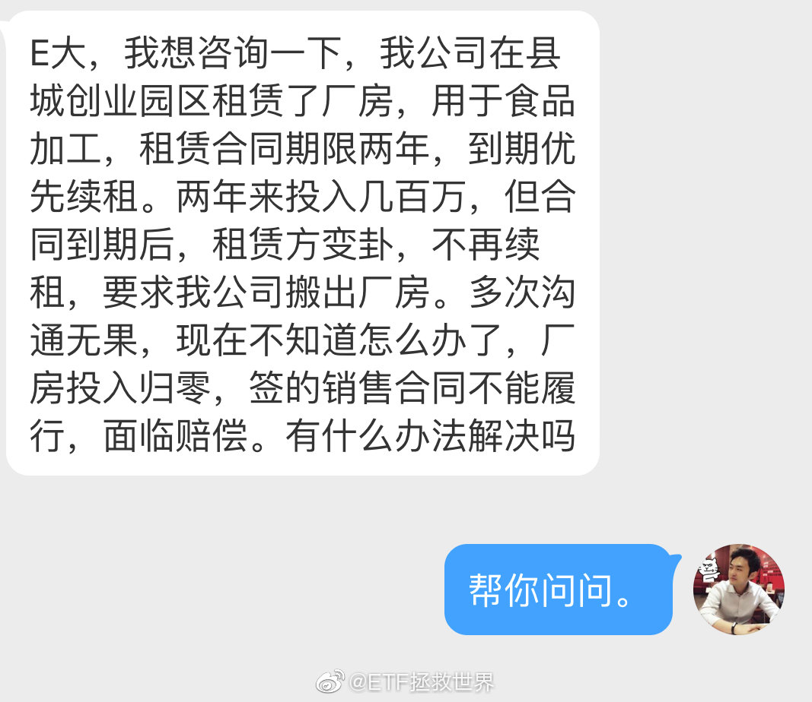

## 2019-04-20 19:44

对不起，收回去年微博上发的“支持东哥”那四个字。

网站好用，不代表我能认同这么下流的行为。如果起诉书都是真的，我只能说感到恶心。

万万没想到啊。 ​​​

## 2019-04-21 11:07

昨天那个帖子大家也别吵了。其实很多事情我们永远也不会知道真相。翻开历史书，上面有多少真相？

咱们大家看这种远隔千山万水的事，其实都是带着自己的主观判断个人喜好个人立场的。也不是说不能表达自己的观点，我是觉得为了这个看不到真相的事情，带着自己的情绪争论，意义不大。

我本人从这样的事情上也会学到很多东西。有些坑就不必自己掉一次了。这个，对于围观的吃瓜群众来说，可能才是最重要的。

至于正义的裁决，交给美 利 坚的司法部门。对他们，还是应该有点信心的，对吧。

## 2019-04-22 09:31

好消息是脚伤应该快好了，可以出去浪了 ​​​
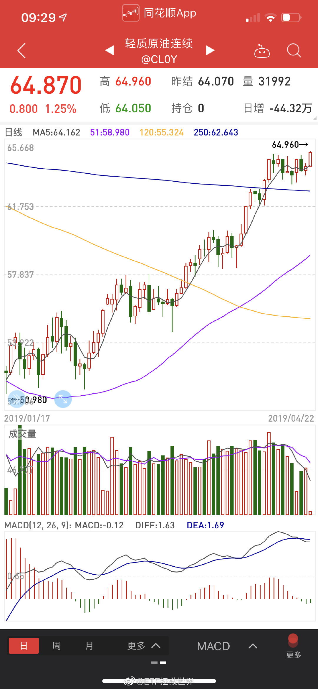 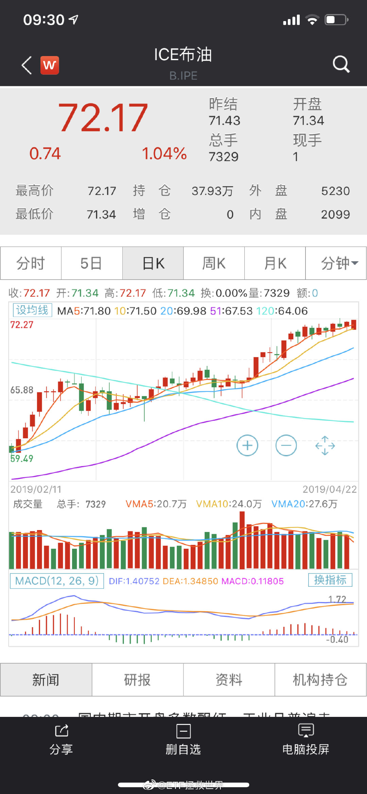

## 2019-04-22 09:34

旁边奥迪招谁惹谁了

## 2019-04-22 09:36

需要注意的是，政策面有微妙变化。 ​​​

## 2019-04-22 10:11

回复@未尽的梦2510426195:你们高兴早了吧。伤好了要马上恢复训练，买的课再不上就要罚款了。然后9月前也有事不能走太远，只能短途出行。一个月的世界之旅要过几个月了……//@未尽的梦2510426195:总算盼到你出去了

## 2019-04-22 10:23

油开始浪了。正好本周且慢问答回答了一个关于NOPEC、油价和油气的问题。周三可以观摩一下。

## 2019-04-22 10:48

分享图片 ​​​
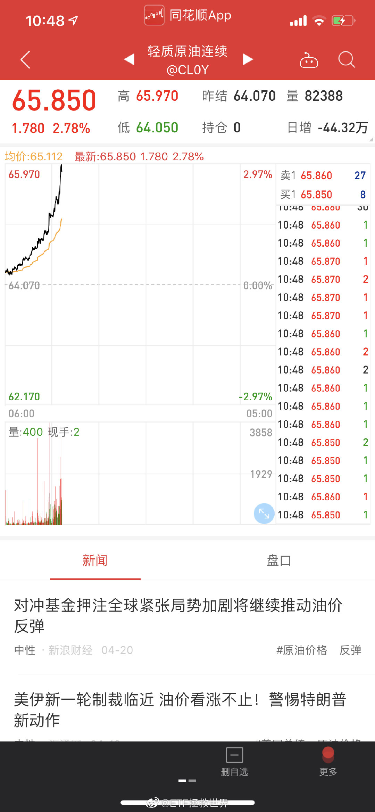

## 2019-04-22 11:03

之前有机构的朋友问为什么发车油气。我给出了标准答案： ​​​
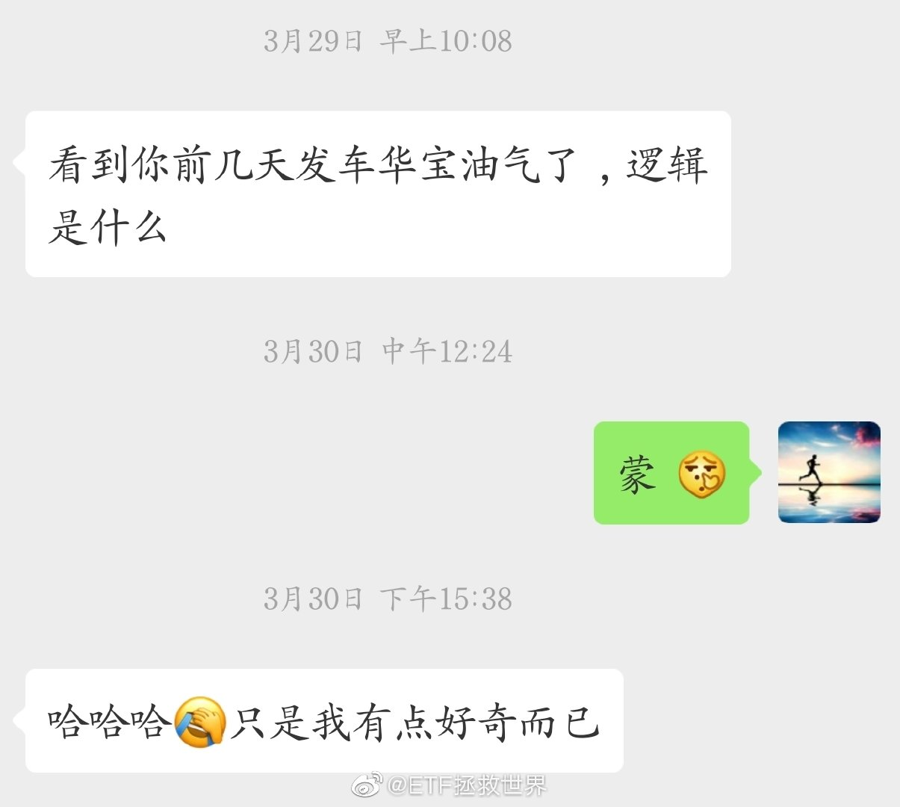 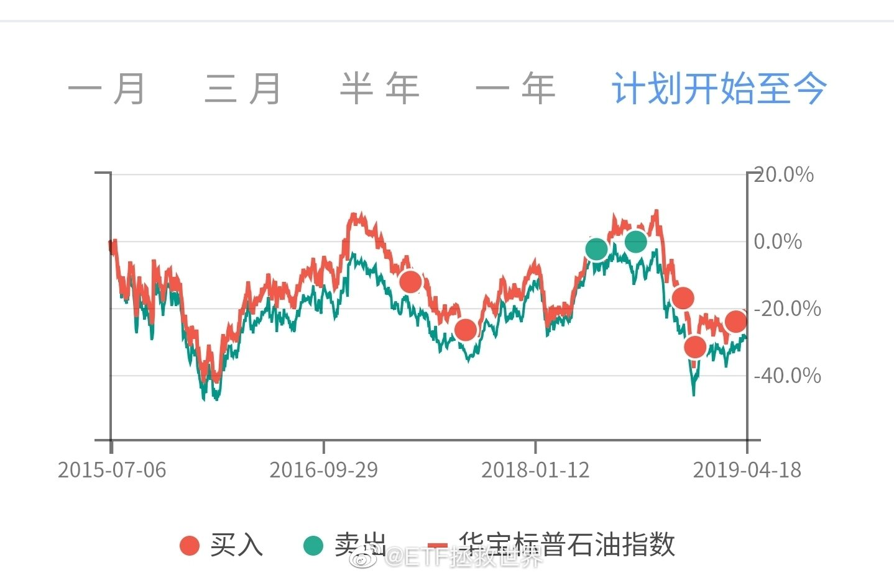

## 2019-04-22 11:15

注意，场内油气已经溢价接近3%，情况不明了，谁爱追谁追，反正我不追 ​​​

## 2019-04-22 11:17

感觉这样的人多了的话，以后女性找工作难度会上升

## 2019-04-22 11:39

感谢大家信任，但是鉴于问题类型已经从投资扩展到健康、亲情、爱情、司法、社会、娱乐、婚恋、职业生涯、亲子、游戏、报考学校及专业等问题，实在能力有限，很多问题都解答不了，就没有回复，见谅了各位… ​​​
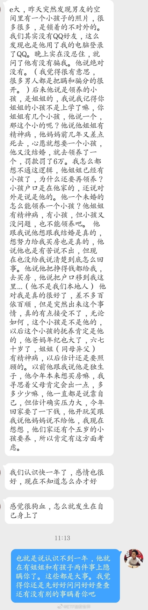

## 2019-04-22 13:18

我部门手下的女性员工，有怀孕的，我都会主动通知她们每天可以提前下班半个小时。早上晚点来也可以，避开交通高峰期。有身体不好需要休息的也直接休息，请几天假不会记请假。

产假期间，本来规定有些福利不能享受了，我还是会向人力部门争取，尽量都给她们保持。

产假之后开始上班也是，需要的方便都给足，我知道绝大多数妈妈不容易，所以从来都非常照顾。

在这方面，我相信没几个领导会做的比我好。

但是今天这条新闻，我个人认为人家公司做的没错。现在企业都已经很不容易了，招你进来试用期都没过你说怀孕，这就等于未来一两年都没法好好工作。你是老员工毫无所谓，为公司做了贡献，照顾你给你什么福利都是应该的。你还没正式入职，为公司什么都没做过，凭什么公司要给你做贡献。过几个月还要再招一个人做你的工作啊。

更别说有人刚上班就怀孕休完产假就辞职了，这种事也见过。

这位老板迫于压力和法规也许最后不会辞退这个姑娘，但我相信他未来招人的时候会有一些改变。

## 2019-04-22 13:42

市场还是很敏感的。先考验支撑位吧。这一路上来一次支撑都不碰也太说不过去了

## 2019-04-22 16:42

## 2019-04-22 16:50

无话可说。如果视频是真的，这女的以及幕后团队到底是怎样的决心要搞死京东才会那样写起诉书。继续吃瓜，先确认视频是不是真的再接着吃。

## 2019-04-22 17:02

回复@love明媚冬日:起诉书里说，晚宴9：11分结束。视频里的时间是9：50左右。如果视频时间没有作假，就是晚宴结束后。//@love明媚冬日:这是不是晚宴前的视频？

## 2019-04-22 17:17

酒是穿肠毒药，色是刮骨钢刀。之前我说黄赌毒别碰，很多朋友评论说，黄没事啊。

很多时候真有事啊。

当然，只要你做好了承担一切后果的准备，碰也没事。就怕这个后果远超你的想象…… ​​​

## 2019-04-22 17:42

回复@潜水隐身不要注意我:我现在已经不站队了。我站中间踏踏实实吃瓜……昨天就说了，离得千山万水，这事不是咱们能看清的。认真吃瓜保平安。东是否被人陷害都好，要怪自己意志不坚定，也算是应有的惩罚。我只是不希望为了利益扭曲事实造假的人笑到最后。无论是哪一方。

## 2019-04-22 17:49

回复@轻升语:我平常不喝酒，更讨厌谈点什么事情都要喝的你死我活的规则，比如昨天那个地铁喝的躺地下回不去让他媳妇来接的业务员。酒应该是亲人朋友聚会的时候让大家放松开心起来的东西。//@轻升语:不知道E大对酒，对中国饮酒文化是什么态度，希望不吝赐教。

## 2019-04-22 17:52

回复@Blackoba:打仗不能一波把火力都打出去。一波波的打你，越到后面武器威力越大，最后打得你怀疑人生，不知道我手里还有多少王牌才是王道啊。//@Blackoba:为啥视频不早点出来

## 2019-04-22 21:36

又仔细看了看一分钟开始的后半部分。两个人的肢体语言真的让人一言难尽。认真感受一下。

## 2019-04-22 21:49

回复@猫猫的未知旅程:呵呵，不爱看就取关。我关注什么不需要你同意。//@猫猫的未知旅程:益达，你过于关注这件事了//@ETF拯救世界:又仔细看了看一分钟开始的后半部分。两个人的肢体语言真的让人一言难尽。认真感受一下。

## 2019-04-22 22:09

我说一下，请各位也了解一下。

我就是个普通人，我有自己的喜怒哀乐，有自己的优点，缺点更多。

我从来不为自己设计什么人设，在微博上怎么想就怎么说。也许我不会把所有想法说出来，但我说的都是真就这么想的。

有朋友关注我，我非常开心。多一点朋友关注当然更好，但少几个也无所谓。球球二十万人关注，互动长年排在前三，那也说走就走，我真把这个当回事吗。

所以我的意思，是你如果关注我，就得做好我哪天会说让你不高兴的话的准备。二十万人关注，我的每句话都有人喜欢，也有人不喜欢。很可能你原来觉得我还行，但是因为我的一句话就让你讨厌我。

我知道啊，但无所谓啊。这就是我，你要讨厌我也没办法。我不能为了让你喜欢戴面具不是？

就像谈恋爱，为什么一开始都如胶似漆，情人眼里出西施。相处几年眼里的对方全是缺点怎么看怎么烦？

有缘就聚，无缘就散。在一起就接受彼此的优点和缺点。世界上没有完美的人。

你要真讨厌我我也没办法，讨厌我的人多了，你算老几。

## 2019-04-22 22:24

我对你都好失望嘅… ​​​
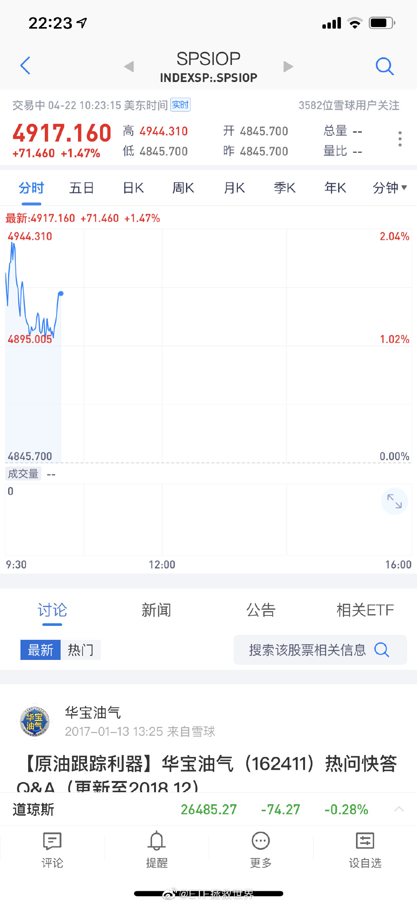

## 2019-04-22 23:47

不骂不行 查看图片

## 2019-04-23 00:12

你这么涨我可不睡了啊  查看图片 //@ETF拯救世界:不骂不行 查看图片

## 2019-04-23 08:06

场内今天也涨不了多少。昨天溢价，今天折价，最多也就一个多点。 ​​​

## 2019-04-23 08:44

回复@江西各噢殷山宁:我说我不喜欢这种谈生意的方式，没说看不上那个人，有什么肉糜不肉糜？这都什么理解能力？//@江西各噢殷山宁:说这话有点像古代那个啥说“何不食糜”

## 2019-04-23 09:04

我再说几句可能有很多朋友，尤其是女性朋友不爱听的吧。也有可能有人骂我直男癌之类的，whatever。

昨天有评论说，挽着胳膊请你一个人陪我回公寓也不代表要跟你xx啊。

我只能说，妹子们，有时候男女对待这件事的看法真的不同。尤其是一部分男性，别说你第一次见面就邀请他大晚上回闺房，走着走着还主动挽起他的胳膊了，你就是多看他一眼，他都觉得你喜欢他，甚至可能连你们孩子的名字都想好了。

你还真别不信。

所以，其实无论男女，如果你不想与对方发生感情纠葛，不想跟对方ons，不想搞暧昧，就一定不要让对方有任何误会。简单说就是不要说一些让对方有念想的话，不要做一些让对方开始幻想的事。否则，遇到一些极端的人，会有无穷无尽的麻烦。

很多人，尤其是一部分男人，非常容易误会。所以姑娘们，你们跟男人接触的时候，如果没有别的想法，言谈举止真的要注意了。

不信你问问身边的男人，问他：如果你在酒桌上遇到一个女孩，第一次见面，晚上吃完饭大家都要去另一个地方，她却提议你跟她回她的宿舍。旁边没人的时候，主动过来挽你的胳膊，带你回到她的房间——

这时候，男人是认为她想跟自己发生一些不可描述的事情，还是要跟自己一起下跳棋？

不卑不亢，保持适当距离，是对你自己最好的保护。不要随便玩暧昧，后果也许不如你想的那么好。

你如果非说我是直男癌，非说你自己有权说想说的任何话，做想做的任何事，男人自己误会是他们下流，与你无关，那我就没有什么好说的了。不过你应该知道，我是为你好。真的。

## 2019-04-23 09:35

不许你再涨了，不然又要打脸… ​​​
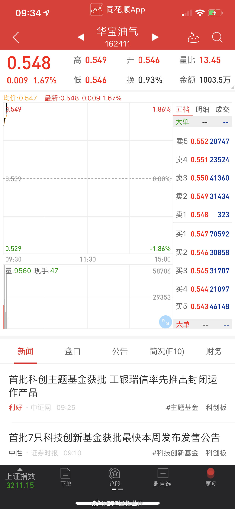

## 2019-04-23 10:18

就像咱们过马路，咱们遵守交通规则，绿灯过马路。你就可以不两边看看了吗？

真有司机闯红灯，冲过来把人撞死了，这时候去追究司机责任，哪怕枪毙他，哪怕赔1000万，有用吗？没用了啊。人没了啊。

你说，我又没错！我绿灯过马路，你干嘛教育我要两边看？你为什么不去教育司机？我就不看，我愿意这么走，你不可以撞我！

是，正常情况下，司机不会闯红灯。但这世界上几十亿人，有1%不正常的让你碰上你都很麻烦不是？

所以自己小心点没错啊。

有时候，你占理没错，但最后可能最吃亏的还是你。所以没事发生才是最好的。这个遇到事你就懂了。

## 2019-04-23 10:52

涨的时候很多人觉得自己买少了，赶紧取出存款买买买。

结果一个小调整居然账户又开始亏损了！

WTF，宝宝心里苦啊。 ​​​

## 2019-04-23 11:00

继续有效。

## 2019-04-23 13:49

回本就跑。什么时候追回来

## 2019-04-23 13:57

什么叫屁股决定脑袋。

就是你加油的时候心里骂，怎么又快涨到70了。

当你买了点油气，看着行情想：

怎么还没到100？ ​​​
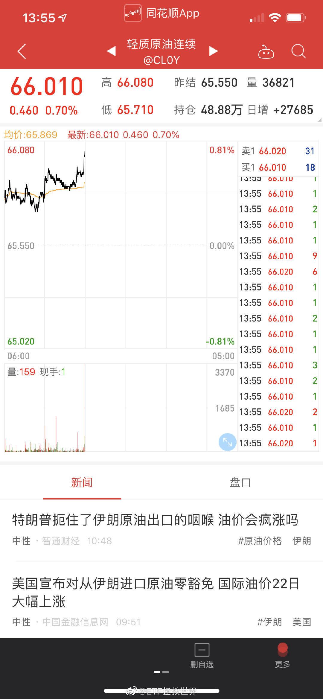

## 2019-04-24 09:19

不出事，你永远也看不清一个人的真面目。

出了事，你会发现有人客观追求真相，有人基于自己的立场抛弃客观，有人跟着蹭热度…

不能说这些人谁对谁错，只是经过这样的事情，就会更加明白这世界的复杂性。

客观真的不容易，我也要反省。无论是投资还是生活，永远都要客观，才不会离正确越来越远。 ​​​

## 2019-04-24 10:26

有调整，太正常了。没有调整才不正常。甚至这样的调整幅度太小。历史上没有一两次月线级别的调整都不敢说自己是牛市。

## 2019-04-24 15:18

无论什么品种，趋势都很重要 ​​​
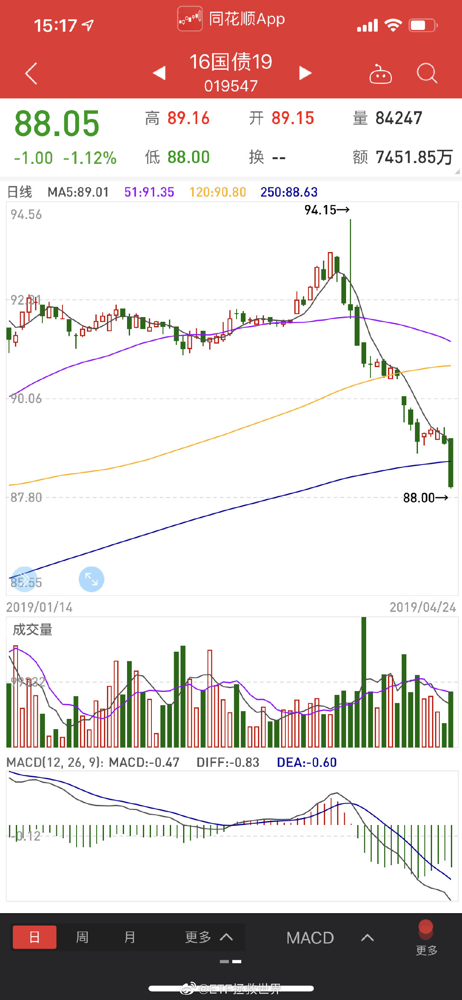

## 2019-04-24 15:24

回复@留下唇印:当然会开。咱们之前卖掉的都会买回来，还会买更多。//@留下唇印:向他开炮？

## 2019-04-24 15:27

又想起年初评论里有人教育我仓位里面债券配的太少……

## 2019-04-24 15:36

回复@树苗儿想要喝水:债券走势第一取决于货币政策。//@树苗儿想要喝水:是不是市场认为未来的投资收益率应该会更高，所以之前国债逼近3%的收益率太低（国债价格太高），所以现在都在抛债买别的。//@ETF拯救世界:回复@留下唇印:当然会开。咱们之前卖掉的都会买回来，还会买更多。

## 2019-04-24 15:59

上午有朋友问，为什么你认为要调整不减仓。

有两个原因：

第一，历史上熊转牛初期，出现大幅调整的几率大。但并不代表必然出现，比如08-09那一波。不是100%的事情，你就要权衡一下利弊得失。如果调整，你会得到什么。如果不呢，你会失去什么。

第二，有些品种是所谓的投资品种。即，可以超长期持有。除非极贵，尽量少去打扰它的成长。比如成本低廉的优质股权。有些品种有交易价值，长期投资价值会差一点，比如债券 黄金 原油等。所以我们想办法做交易赚利润，但不会超长期持有。

## 2019-04-24 16:17

回复@胡鹏171:第一，A股是全市场收益率低于债券，但很多股票和板块预期收益率高于债券。第二，长期称重，短期投票。如果投资只看预期收益率就可以来回切换那就太简单了。//@胡鹏171:既然有货币收紧的预期，为什么投资者更多的抛售收益率高于股票的国债？目前国债有3.4，股票才3.0几吧

## 2019-04-24 16:25

回复@叛逆的阿波罗:新浪问答的人找我说，你问答效果这么好，财经领域只有极少人有这么好的效果，但你为什么每年只回答两次，我：//@叛逆的阿波罗:良心大V，回答的这么清楚，还免费。

## 2019-04-25 07:48

其实有时候说“我不懂”或者“我不知道”真的没什么丢人的。

想帮别人没错，但也要考虑自己的情况和历史进程。

少做那些对了没好处，错了挨骂的事。 ​​​
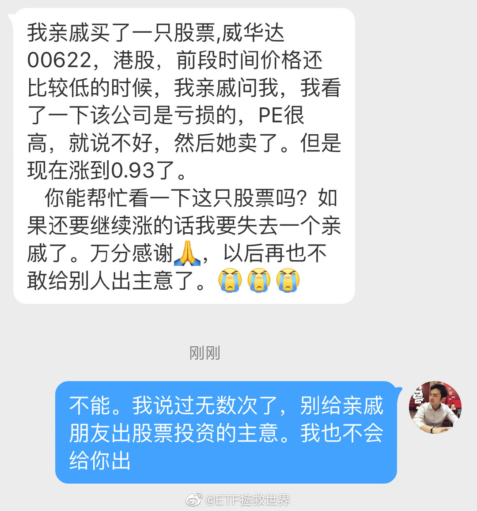

## 2019-04-25 14:26

现在你有点明白为什么这两个月不买了吧。

急什么？钱烧手吗。 ​​​

## 2019-04-25 14:38

最低2400，最高3288。

很多今年入场的人吃惊的发现，自己居然在3100又开始亏钱了！ ​​​

## 2019-04-25 15:04

回复@打火机儿:喷了。平行宇宙的自己并不给力呢……//@打火机儿:2600进的，基金赚的钱目前有一半亏在个股了

## 2019-04-25 15:06

回复@解毒汪:你想想，为什么会有不败之地的感觉。如果你能永远不败，你是不是这条gai最靓的仔？//@解毒汪:这两个月涨跌你都有道理嘛，立于不败之地。

## 2019-04-25 15:14

回复@大象下象棋:今年上证25%。500是31%。你是不是一定要所有时间段最牛逼才能夸一下？不会的，你永远只能看到不好的地方。赶紧买上证去吧。//@大象下象棋:五百是真的弱，五十三百不说了，上证缺口都没补呢，五百已经到了，上证都跑不过，重仓五百的真是哭晕在厕所了。

## 2019-04-25 15:18

喷了。

他可能不知道一个问答就能收入5000，如果开个V+，一年…

这种人怎么出来做生意的。 ​​​
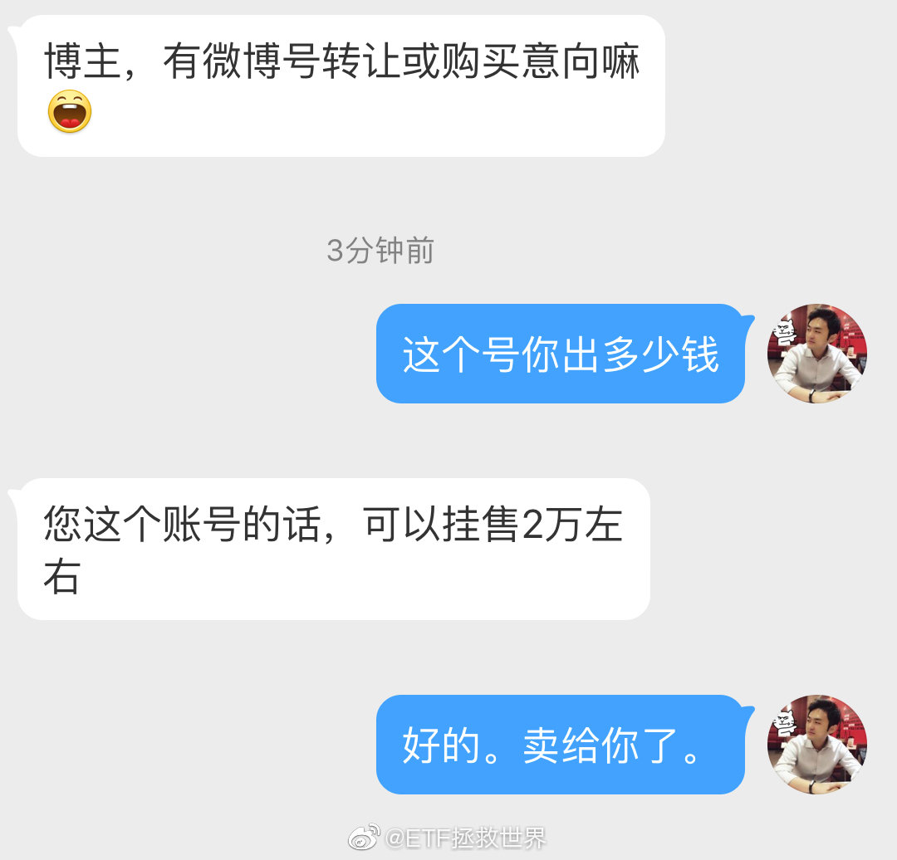

## 2019-04-25 15:21

明天或者下周一开车。不会多，意思意思。 ​​​

## 2019-04-25 15:52

发车的时候上证如果能调整到3050左右就非常完美了。 ​​​

## 2019-04-26 12:11

为什么皱纹和表情都没了。amazing！

## 2019-04-26 13:22

​​​

## 2019-04-26 13:57

## 2019-04-26 18:01

四分之一炷香时间到了 ​​​

## 2019-04-26 21:37

TAO同学是整个事件逆转的关键。

## 2019-04-26 21:47

回复@褶子动:其实整件事已经非常明白了。很多人只是不愿意相信真相，只愿意相信自己希望的事实而已。不过，无论结果如何偏离真相都好，强子无论受到怎样的惩罚，都源于他自己的不忠，咎由自取。

## 2019-04-26 22:08

一个普通留学生的爱情有可能改变整个中国互联网电商格局，这可能是我亲见普通人瞬间改变世界之第一次。

上次是塞尔维亚青年和斐迪南大公… ​​​

## 2019-04-27 07:07

回复@钱添昱:呵呵。我会让你看到什么叫做真正的诚意。//@钱添昱:随意说说，不必当真

## 2019-04-28 08:50

工作日又没法看盘亏钱的各位是不是无聊透了。 ​​​

## 2019-04-28 10:30

大家这么无聊，我写了点新的赔钱技能给大家解闷，希望你喜欢。

## 2019-04-28 11:42

我不太敢开玩笑的原因… ​​​

## 2019-04-28 13:55

照着这个名单等权买，十年收益率就会很差。不信，你买了试试就知道了。

## 2019-04-28 14:51

有在日本工作的朋友吗。敢问一件事：

现在日本公司里的氛围真的是新剧《我，准时下班》（わたし、定時で帰ります）里面那样吗。 ​​​

## 2019-04-29 10:45

这两个月觉得仓位不够的终于可以继续加了。

没白等吧？

但是要注意节奏，注意，保持舒服的状态。 ​​​

## 2019-04-29 11:14

看情况，也许明天还有车，也许没有。

目前的位置是最敏感的位置，不好确定。

薛定谔的发车。 ​​​

## 2019-04-29 15:07

再回头看看，是不是有了更深的感悟。

## 2019-04-29 15:34

上次卖出500C效果还可以。接下来考虑看看是不是加更多波段策略仓位到计划里。 ​​​

## 2019-04-29 16:22

我想了想，刚才这么说也未必合适。

这么说吧。

世界上没有最好的策略。是长期持有结合波段好，还是满仓长期持有好，谁也不能说谁更好。

就好像你不能说哪个妹子是世界上最漂亮的。

关键是适合不适合你。

适合你，哪怕是第二或者第三漂亮，也行啊。别老想追求最漂亮的，你们未必能幸福一辈子啊。

趁年轻，你可以试试到底哪种投资方式更适合你。小马过河，不要别人说什么好就什么好。你要自己试试。在不会死的前提下，去试试没错的。

## 2019-04-29 16:37

回复@木草非人的世界:不会。多出的利润平摊到接下来要投入的份数里面。//@木草非人的世界:波段赚了的钱会不会认为是多一出份？以后这份资金继续用来做波段？原先只有150份的长赢，会不会慢慢变成155,160,170？

## 2019-04-29 16:51

汇报一下最新数据：

去年四季度除创业板外，全市场利润增长同比几乎没变。

今年一季度，全市场利润开始恢复正增长。增幅个位数。

还有一天，等一千多家公布季报后就清楚了。 ​​​

## 2019-04-29 17:59

还是头条的运营识货啊…

之前都不知道有这么一个奖… ​​​

