## 2019-05-04 19:07

好久不见啊各位，过节都干嘛了说来听听？ ​​​

## 2019-05-05 14:46

对于巴菲特和芒格的股东大会，我其实只想问，你们是怎么做到快一百岁了还那么有精神，脑子也还好用的。

至于他们投资的事情，看三本书一个合集就够了：

滚雪球

穷查理宝典

巴菲特估值逻辑

以及过去几十年致股东的信合集

说真的，我确实没从每年的大会以及问答环节得到什么新东西。当然可能是因为每次开会我没认真追过吧…

## 2019-05-06 08:57

今天支付宝积分怎么压你心里还没点数吗。 ​​​

## 2019-05-06 09:28

今天发《二》

正在作图，排版，BGM，封面。

非常应景。 ​​​

## 2019-05-06 10:22

我依然不相信会回到钻石坑。因为历史上真的没出现过，我认为这次概率也不大。

如果真回去了，留的那点现金就能派上用场了。 ​​​

## 2019-05-06 10:32

本周极大概率可以买回上次卖出的500C。如果有机会，会加大波段仓位的配比，应对只有波幅没有涨幅的可能。 ​​​

## 2019-05-06 10:54

太残暴了…… ​​​

## 2019-05-06 10:57

回复@ETF跟着E大笑哈哈:1月底以来，计划就买了一份A股，还卖了一份，你也应该想想为什么啊。//@ETF跟着E大笑哈哈:枯了。。。。黑车开多了，被埋得难受😖 😖😖😖

## 2019-05-06 13:45

说说你现在看盘的真实感受。 ​​​

## 2019-05-06 14:08

怎么个意思，大盘要跌停吗。

A股投资者是真NB啊。 ​​​

## 2019-05-06 14:27

只要你不急，你就有机会赚大钱。涨上去就害怕踏空，最终很可能接盘的就是你。这些东西你每隔一年回头看一次，会有不同的领悟。

## 2019-05-06 14:41

服了你们了，看你们的评论以为今天涨了6%。

也太欢乐了吧我说！今天你们账户都缩水了喂！ ​​​

## 2019-05-06 17:04

虽然国债今天止跌，但目前A股整体再次跌回到比债券值得买的区域，所以债券依然没有吸引力。充其量利率债只能作为风险对冲工具而已，长期收益率依然不行。

更别提那些优质指数和行业的值博率已经远大于债券。 ​​​

## 2019-05-06 17:09

我应对暴跌的妙招：

不更新理财软件的收盘净值，假装自己依然不算穷人。 ​​​

## 2019-05-06 17:25

再次提示：

某个不死品种暴跌后开始唱空甚至建议你割肉的，一定要特别关注。

赚钱全靠他了。

反着做就行。 ​​​

## 2019-05-06 18:56

今日最新数据出炉，距离钻石边缘还有8%……出坑后就不会回去的历史会改变吗，拭目以待了。 ​​​

## 2019-05-06 19:30

终于忙的差不多了，准备去看留言。一会各位可以去观摩一下，我估计会有一些策略具体问题我可能会回答。

今天大跌，看来大家心情一般，只有800多条留言…… ​​​

## 2019-05-06 21:56

人家只跌1.2%。

这仗打的。 ​​​

## 2019-05-07 07:25

一睁眼发现美股暴跌0.4%，深感欣慰。还好没有翻红——我生起气来捅自己7刀，你身上一点血都没溅到我就太没面子了吧。

越来越深刻的体会，玩A股的就是一帮神经病。

好消息是，你跟神经病在玩斗地主你说你有多幸福。 ​​​

## 2019-05-07 07:29

不知道到底是素质教育没跟上，还是乱扔烟头罚的不够狠。

## 2019-05-07 07:54

你什么都可以不信，但这句话希望你相信。

目前这个位置，以及更低的位置，是值得坚定持有绝大多数指数基金的位置。

不要在意中短期的波动，那一点都不重要。除了给你提供波动利润外，没什么好在意的。

五年十年后你再回头看这篇微博会有恍如隔世的感觉。 ​​​

## 2019-05-07 08:12

这是中证500全收益的走势图。不用更深奥的数据，你就能看出很多东西。

长期看，指数一定是向上，即使短期波动巨大。就算是被斥为“赚不到钱”的A股，也是如此。

底部不断抬高，顶部不断突破。

跌幅巨大的时候买入，若干时间后会取得非常好的收益。

怎么样才能让自己淡定起来？你站的高一点，看得远一点，眼前的这些你就不会在意。
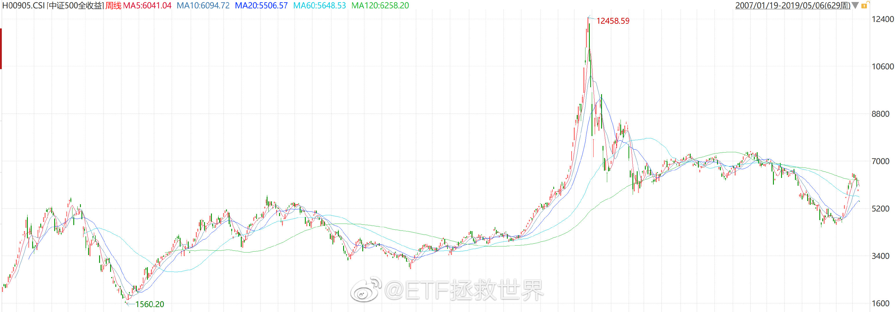

## 2019-05-07 08:20

本月我希望出现的，最完美的走势，是目前基础上再跌个3%-4%，持续到月底。

堪称完美。 ​​​

## 2019-05-07 09:00

看图突然发现，2015年到现在居然已经四年了…太快了…

## 2019-05-07 10:29

回复@烟花看烟火:第一，传媒一季报利润增加6%，五年百分位4%，十年百分位6%，PB五年十年百分位8%。第二，以后谁再拿不知道从哪儿看的数据来我这里问，我直接拉黑。你先问问是不是，再问怎么办行不行？第三，前有医药500，现有传媒，只要哪个指数跌，就会有人开始黑。我什么都不会说，时间会给出答案。

## 2019-05-07 10:33

回复@上证五菱:不要神话百分位。百分位解决的是历史观看现在，解决不了投资者的未来。我说某个指标，不代表我只看某个指标。说的多不代表知道的多，说的少也不代表不懂。排名不能给，会引发歧义。//@上证五菱:e大大，目前按照综合百分位，能给个top10排名吗？

## 2019-05-07 10:39

观察一个投资者的水平，很大程度上你要观察它在某个品种暴涨之后和暴跌之后的态度。

如果一个品种短期暴涨后，他依然在给暴涨找理由，告诉你还能涨10倍，现在还很便宜，赶紧买；

一个品种暴跌后，他头头是道分析半天，告诉你赶紧卖这东西不行，完蛋了。

我不能说他一定是水货，但如果这样的次数多了，对他的水平你就要产生一些疑问。

另外有一点你需要注意。

有些人写字，是，我写我自己的想法，有人看当然好，没人看也无所谓。

有些人写字就是为了让更多人看，为了实现这个目的，会不择手段吸引注意力。有了注意力，就有了生意。

## 2019-05-07 11:29

无论是买卖，你都最好有个理由。

什么理由都可以，只要是客观的，最好是可量化的。

“我觉得可以买/卖了”可不算。 ​​​

## 2019-05-07 12:51

如果家里没矿，没有无限可用现金流，就不要太着急。

控制节奏。

还是那句话，有时候有钱才是大爷。你手里的筹码不少了，不用那么急。 ​​​

## 2019-05-07 17:44

对喜欢看指数PE以及PE百分位的朋友，我不管你是从哪儿看，我给你一条贴士：

看PE的时候，同时观察PB、PS、PCF和股息率及它们的百分位。

你只看一个数据，港真有点naive。更何况有的数据错到离谱。错的原因不是计算错误，而是计算数据的人没有想清楚自己到底想得到的真相应该怎样获得。一句话形容，就叫做照本宣科，书读死了。

观察这个世界，要从不同角度全面观察，然后综合考虑。千万不要盲人摸象，更不要让盲人摸完了再告诉你。

## 2019-05-08 08:18

特别励志。不放弃就有可能出现奇迹。

## 2019-05-08 09:23

还是那句话，不要急于加仓，你的仓位够，给时间和空间。

有钱是大爷。 ​​​

## 2019-05-08 09:42

只针对150和S计划，其他每个人的情况我不知道也管不了。

## 2019-05-08 09:45

除了指数，一定要买个股，我建议普通投资者也别买乱七八糟各种概念。

就是八个字。

吃喝玩乐，生老病死。

在这里面找赚钱的概率大很多。 ​​​

## 2019-05-08 10:09

回复@小新o_o晃晃悠悠:很难讲具体点位，随着时间这个点位会上移。所谓钻石坑，就是A股大多数股票已经跌到很值得买的区域。从历史以及全球的双重维度看，这个区域遍地钻石。//@小新o_o晃晃悠悠:请问下为啥说2800是钻石坑

## 2019-05-09 07:56

最后一秒改变命运。只要不放弃就有希望！坚持！

## 2019-05-09 09:51

节奏控制好

## 2019-05-09 10:08

什么叫活着最重要。

就是人家不让你聊，你就别聊。因为你的命在人家手里，一时痛快一时爽，好多人给你鼓掌，一会儿号没了，死了，什么也说不了了。

只要活着，就有希望。死了，什么都没了。 ​​​

## 2019-05-09 10:21

现在你回头再看，去年底大量买入后，从1月底以来不再投入A股（3月初卖出一份500，前几天买入一份传媒），只买德国、黄金、原油这一系列操作。

可能又会有不同的感受。 ​​​

## 2019-05-09 10:24

我们每个人手中的资源都是有限的。如何在保证安全的情况下，尽量高效的利用好这些资源，是最大的挑战。

这几个月，甚至包括这一两年，S部分也为这些没有积蓄的朋友攒下了一大堆没有种下去的种子了。这个未来都会发芽开花，不用急，我能帮你攒下来，不追在高位，就能帮你把它在低位买进去。

多大点事。

## 2019-05-09 10:37

回复@努力12367:过气了。（从来就没红过好吗）//@努力12367:为什么e大近两条发言总回复才100多点，以前没这么少啊。不少人跌怕了吗

## 2019-05-09 10:39

这一波上涨，长期持有搭配做网格就会非常舒服。否则电梯做一波就有可能心情有点不好。 ​​​

## 2019-05-09 10:40

不会成真吧。

## 2019-05-09 10:45

A股就是一帮神经病在玩。

他们1月认为A股值2400点，到了4月又认为值3300点，现在又觉得可能连2000都不值。

很多朋友也一样。

1月觉得70%仓位太高了，4月觉得太低了要上杠杆！5月又想，我要是空仓就好了。

喷了。 ​​​

## 2019-05-09 15:34

震惊！在家养了一个月的伤，出门一看，新买的皮衣还没穿过就不能穿了，要直接穿短袖了！

还有没有天理了！

北京的春天比牛市还短！ ​​​

## 2019-05-09 15:54

饮食清淡，不熬夜，保持心情愉快。

第四个未来十年愿望：

不脱发。

 

第三个是腰围保持90以下… ​​​

## 2019-05-09 16:10

男的，保持发量，剪的利落点，身材练好点，穿有质感的白色或者浅蓝色衬衣

相亲成功率增加二十六个巴仙。 ​​​

## 2019-05-09 16:23

你以为港股跌起来会比较温柔，哪有的事儿呢。 

好在汇率有点对冲。 ​​​
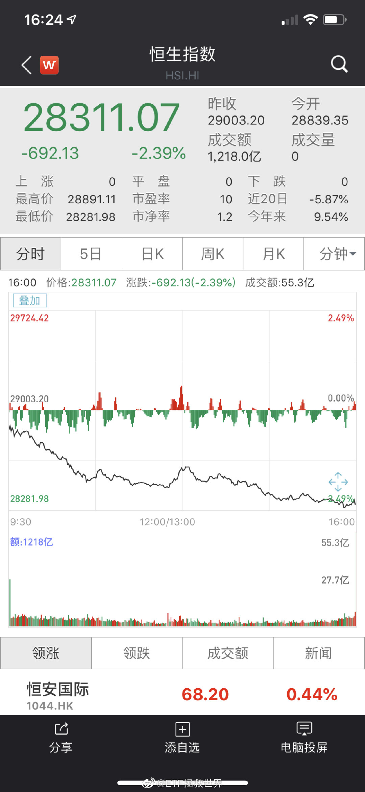 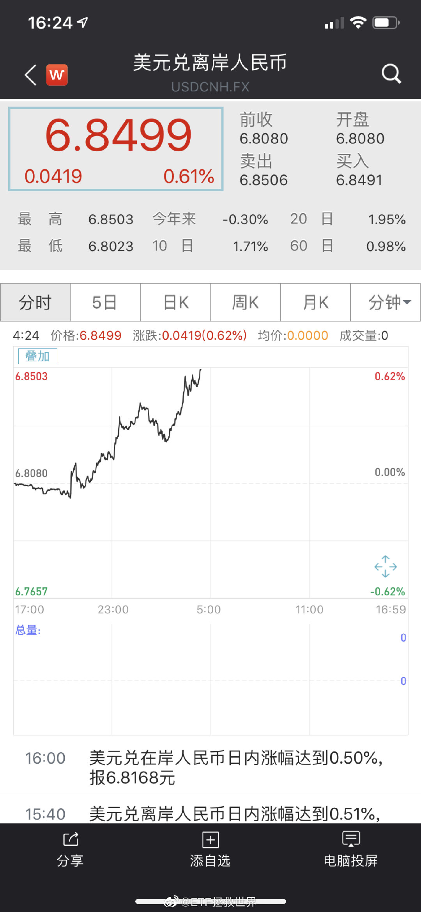

## 2019-05-09 16:43

这汽车吧，你遵守交规停一下等人家过去也行，不遵守交规踩一脚往前再上点让开也行，为什么要正好停在人家路线上……说回来这摩托车也不是善茬……

## 2019-05-09 17:13

回复@犬次郎不是二狗子:前几天看新闻不是说身高的一半吗…//@犬次郎不是二狗子:腰围不应该是80以下吗

## 2019-05-09 18:43

回复@达令家grent:不好意思，我特喜欢看这种东西。因为能从里面学很多。这样，就不用自己亲自出事才能学了。//@达令家grent:人家犯事，我们少抄心

## 2019-05-09 21:58

掐指一算，明天盘中各路豪杰聚齐，必有一番大战。

我选择吃瓜。

你们战完了我捡装备。 ​​​

## 2019-05-09 22:13

## 2019-05-10 07:25

昵称里带这些的博主，我一般不太敢关注，特有实力的除外：

大型猛兽猛禽类：

龙、虎、鹰、鳄、豹……

亲戚类：

哥、姐、叔、婶、二大爷、嫂子……

也不是说不好，就是有点想绕着走……个人喜好，又得罪人了…… ​​​

## 2019-05-10 10:15

先把安全垫做出来，免得中午群众情绪坏了摔得太狠。 ​​​

## 2019-05-10 10:31

13：00-13：30才最精彩。

## 2019-05-10 10:36

回复@瀚海拾贝:随便猜不违法，根据猜去操作就犯罪了。//@瀚海拾贝:回复@芒果糯米鱼:减仓

## 2019-05-10 10:46

这个市场上有三种人

精神病患者，医生，正常人。

正常人能赚多少钱，取决于精神病患者的多少。

精神病患者的多少，取决于行情的高低。

医生不希望精神病患者太多，因为太多就管不住了。但也不能没有，没有就失业了。

极少一部分精神病患者可以被治好，变成正常人（但并不是医生治好的，一般是自愈）。取决于每个人的基因。

正常人一般不会变成精神病患者。

一般来讲，正常人除了基本面，还要观察情绪和ZC。

观察情绪，主要是观察精神病患者的行为。

观察ZC，主要是观察医生的行为。

## 2019-05-10 13:01

没懂，明明是确定的结果为什么大家好像刚知道。//@ETF拯救世界:13：00-13：30才最精彩。

## 2019-05-10 13:22

就问你精彩不精彩//@ETF拯救世界:13：00-13：30才最精彩。

## 2019-05-10 13:49

回复@锦瑟_五十弦:可以，但没必要。可能号没了//@锦瑟_五十弦:老大把过程推演一遍更精彩！//@ETF拯救世界:就问你精彩不精彩//@ETF拯救世界:13：00-13：30才最精彩。

## 2019-05-10 14:14

只有一句，无论多么绝望，这个位置以及更低的位置不要放弃希望，坚持。

就像利物浦和热刺一样。 ​​​

## 2019-05-10 16:13

不考虑资源、背景、智商等因素，真想做成一件事，我觉得坚持可能是最重要的。

虽然吧，坚持了你也真不一定能成。毕竟成功需要很多因素，比如天赋、比如运气等等。

但是不坚持就毫无成功的希望。

在坚持很久还是没见到成功的时候，反复审视自己的路走的对不对，是不是跑偏了。如果发现自己走的路没错，那就坚持下去。

反正啊，闲着也是闲着，继续往下走呗。

## 2019-05-11 12:59

回复@维京的孩子:你去问提出这个问题的人，为什么要来问我？他说好你就买，说不好你就卖就完了，不用来问我。

## 2019-05-11 16:40

跟有些人千方百计想多几个粉丝，多几个人关注，多几个人跟着他买不同，多点人关注我少点人关注我，我根本无所谓。

更多的人关注我当然开心，人之常情。但是人越来越少也无所谓。所以你在微博上看不到我宣传计划，从不尝试让更多的人参考计划，只是想到什么就写点什么当跟老朋友聊天了。你也看不到我公众号每天发东西，现在的频率是每个月四五篇。

我不知道你能不能感受到我的那份不焦躁不急切。我没有其它人那样迫切要把各位变成人民币实现收益。私募？不做。广告？不接。星球和V+？不开。书？不写。音频视频开课？不好意思，没有。有一个每天的投资日记会给一部分朋友分享，但你试着找找，能找到在哪里加入吗？早关门了。

你以为我不知道每一项都是年入几十万几百万的生意吗？我当然知道。我也不是觉得这些有什么问题。只是一方面，觉得人生在世，钱这个东西，多少是多？每个人能承受的财运有极限，小心太贪反而易折。一方面总有一些无谓又可笑的坚持，觉得能在市场上赚点钱就感谢财神爷了，其它的还是尽量别考虑了。

所以，我的意思，是你如果觉得我的三观也好，投资水平也好有问题，请赶紧取关走人。看到别人质疑我你就也跟着怀疑，甚至来质问我，也请你赶紧停止参考。朋友多你一个少你一个我真无所谓。第二轮计划我是后期锁死在很小一部分朋友之间分享，不再让更多人看到你知道不知道？我跟有些人真不一样，可能一部分的人不参考我的东西我更高兴。

人这一生，潮起潮落，如梦似幻。所谓荣华富贵，几十年后不过黄粱梦一场。我只想与志同道合的朋友把酒言欢相携共进，其他非我同道中人还是早早散了去吧。

## 2019-05-11 17:04

这个聊天群的内容信息量非常非常大。

## 2019-05-11 17:12

回复@海狸克里特:第一，告诉他谁欺负你就打回去，打成什么样我都不会批评你，但你不许先欺负别人，否则我会让你很惨。第二，找老师了解情况，同时告诉老师孩子的描述，看看真相是什么。第三，与对方家长沟通，协商解决问题的办法。第四，如果都解决不了，就发微博请正义的各位主持公道…

## 2019-05-12 06:53

在我的内心中，对个体的公平，以及事件真相是特别重要的。

我总是不希望好人蒙冤，不希望坏人逍遥法外。如果真的这样，我心里会非常不舒服。

我不知道那些对着新闻叫着“杀的好”的人，有没有想过，哪怕是1%的可能：

如果那个男孩真的如其他家长以及他父母同事所说，并不是个坏孩子，真的只是“抱着亲了一下”（再次强调，不一定是真的，但如果是真的），就被一个残忍的成年人捅死，

他是不是太冤了？抱着亲，当然不对，打一顿我都觉得没有任何问题。但是，杀了？那是一条人命啊！只是一个十岁左右的孩子而已！他如果真的是长期霸凌，我也没什么好说，恶人自有恶人治。但如果不是呢？他的在天之灵知道这些人对他的评价，能安然往生吗？

还有他的父母。中年丧子，这种打击我想都不敢想。这也许是世界上最大的痛苦。我还是说如果。如果微信群里的说法是真的，前一天刚知道有这个事情，真相还没了解清楚，第二天孩子就被捅死了，如果是你，你会有什么样的感觉？

更何况，全网都在鼓掌叫好，说“杀的好”，说你知道事情一年多不闻不问，是个罪有应得的家长，

你会怎样？

哪个孩子能永远规规矩矩，一点都不打闹？如果你的孩子在校园里不小心打了一下别的小朋友，就被捅死，你会作何感想？

也许这个孩子真的是无恶不作的小恶霸，也许家长真的是知道孩子欺负人也不管的垃圾。

但是，有没有1%可能性，事情的真相不是这样？有没有可能是行凶的家长情绪过于激动，有没有可能是他有什么问题？

如果杀个小学生，只要说因为他欺负我家孩子，就能被全网施加压力请求轻判，我已经看到了黑暗的未来。

无论如何，我都希望每个人都能得到公正的对待。如果不能，我会非常难过。

## 2019-05-12 11:27

有一位券商的副总裁看到昨天微博，给我发了这样一句话。

我也想明白了，之所以有人不断跟你没完没了，就是把你当成标杆了，你才是他潜意识中最厉害的。只要干掉你，他认为自己就有可能登顶了。

喷了，可能吗。就算没我了怎么也轮不到你啊……光说人品就不可能是你啊……

一个人能做多大的事，不是看他多能忽悠多能踩别人，而是看他自己有多高。无论是专业还是做人。

每个人的一举一动，一言一行，别人都会看在眼里。这个世界虽然时而混沌，但最终公道自在人心。
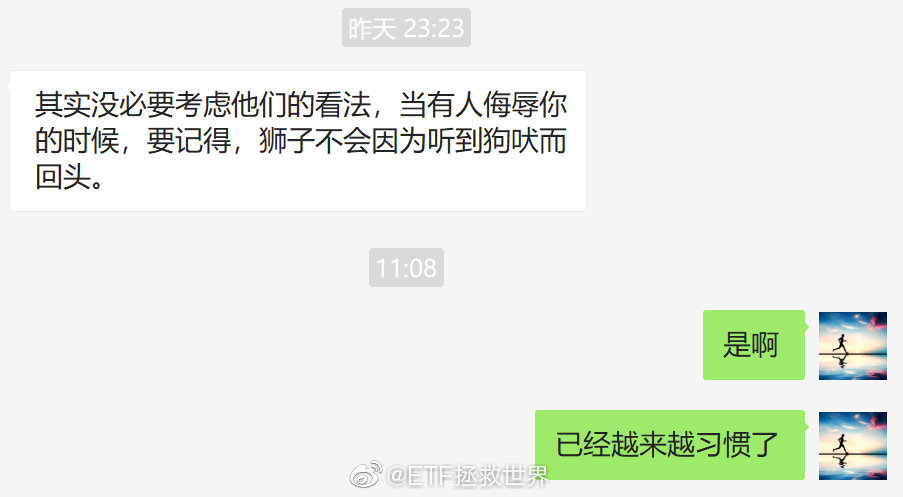

## 2019-05-12 12:52

前几天有朋友问的那个，所谓指数中的成分股会变动，所以以前的数据现在没意义了。这种说法，我不明白道理在哪里。

我是真的不明白。还让我发表看法。我发表什么看法啊。

是不是说一句除了沪深300其他所有指数都是辣鸡就可以了？

一个指数有进有出本来就非常正常。你现在买的标普500，道琼斯30，纳斯达克100，恒生与十年前二十年前也差别很大了，难道说当时因为便宜买的就没意义吗。

在这个市场上待得越久，就越能感受到所谓的人情冷暖。一个指数最近涨的越好，看好的人越多，看涨的理由越多。

一个指数短期表现不好，就会有越来越多的脚踩上来。而且是各种理由，真的是各种理由。然而这些理由，你在2010年500就突破了07年高点，15年甚至比07年高了一倍多的时候你看不到。

是因为高位低位中证500编制规则变了吗？

不是。

是因为人心变了。

## 2019-05-13 09:02

周五下午的四两拨千斤加情绪激动后，今天大概率认清现实回归理性吧。 ​​​

## 2019-05-13 11:19

现在有三个利空。

第一个，众所周知中长期会有压制作用。

第二个，开始有指数趋势再次变差。

第三个，目前看多的人太多，几乎找不到看空的。

继续暗中观察。 ​​​

## 2019-05-13 15:42

回复@withTink:我关注的人很杂。但不代表我一定认同对方或者喜欢对方。微博只是我观察这个世界的一个窗口而已。//@withTink:E大为啥还关注了凤姐

## 2019-05-13 15:58

上一条吧，我说有几个利空。就有朋友蹦出来指责，甚至什么为了要更低筹码的话都出来了。

我想说的是，朋友啊，咱们能不能别这么狭隘，把眼界打开，把思想打开。

我最怕的就是禁锢思想。一旦形成什么思维定势，就不再思考，不再观察，然后永远不会提高。

观察这个世界，随时发现变化的问题而已啊。古人说知己知彼，百战不殆。真的因为自己“看多”，又或者“看空”，就不再观察了吗。就好像打仗，我分析一下对方的实力，看看对方在哪些方面比较强，有什么新的情况，你就说我是叛徒内奸，这合适吗。

我说现在有几个利空的点，意思是我观察到的客观情况。它没有改变我的投资模式，你看我们的计划卖出了吗？别说卖了，明后天我们还要继续买呢。

世界每天都在变。我就是喜欢不断观察不断思考，然后把观察到的东西分享出来而已。有时候对，有时候不对，至于扣帽子吗。

看到一点点跟自己的想法不同，就不爱听，就打压，这种风气太差了。有时候真理正是藏在不一样的声音里。

我的几句话就能把股市打下去捡便宜筹码？你是不是稍微有点高看我了？笑死。

## 2019-05-13 16:10

这个有懂的吗？  

都不容易。 ​​​
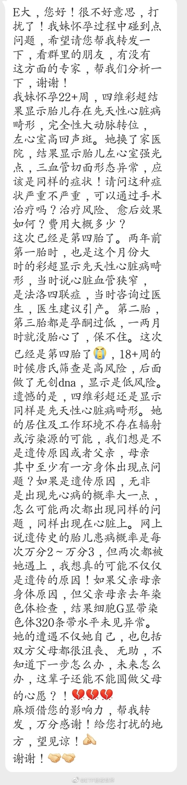

## 2019-05-13 16:37

根据最新数据的A股仓位建议：

从保守到激进：

59.6%——79.6%。 ​​​

## 2019-05-13 16:49

美股一季度利润下降。

我对美股才叫一年如一日的唱空好吗。

主要目的是真想买点便宜货啊…… ​​​

## 2019-05-13 21:16

回复@与魔鬼做对手的人:看空是看价值与价格的对比。做空在这之外还要加上时间。我把握不了时间因素，所以永不做空。//@与魔鬼做对手的人:你微博上说过你的家训是永不做空美股！

## 2019-05-14 05:40

美股一般情况自最高点调整幅度最多20%-30%。碰到经济危机会超过40%。

这里是让大家先有个概念。 ​​​

## 2019-05-14 05:54

想说说这次和去年下半年有什么不同，但不能说。各位好好看新闻好好思考一下。

交易的时候注意节奏。 ​​​

## 2019-05-14 09:07

谁在买500都快买成最大ETF了

## 2019-05-14 09:43

今天护盘的人这么多我们就不发车了 ​​​

## 2019-05-14 17:06

明天来一次低买高卖。 ​​​

## 2019-05-14 17:13

回复@shown龙:150有资源限制，必须卖出才能买入。S还没到卖出的时候。你就把S当零存整取就对了，放心。该卖的时候会卖的。//@shown龙:S版是不是没有卖出操作通知 从来没收到过啊

## 2019-05-15 12:18

突发：

BGM又不够用了。 ​​​

## 2019-05-15 12:24

回复@Stark冰原狼2019:今天正点。另外卖出的一份今天涨得比买入的更多， 多好啊//@Stark冰原狼2019:回复@barryallen1:只是昨天说护盘很多没发车。今天涨起来了却不得不发车，有一点点择时失败的赶脚

## 2019-05-16 09:36

我在想一个问题：

昨天卖出的内地消费，有多大几率在未来一年中自目前价格下跌10%-20%。 ​​​

## 2019-05-16 18:16

这个我想了半天也没有答案。大家有什么看法吗。 ​​​
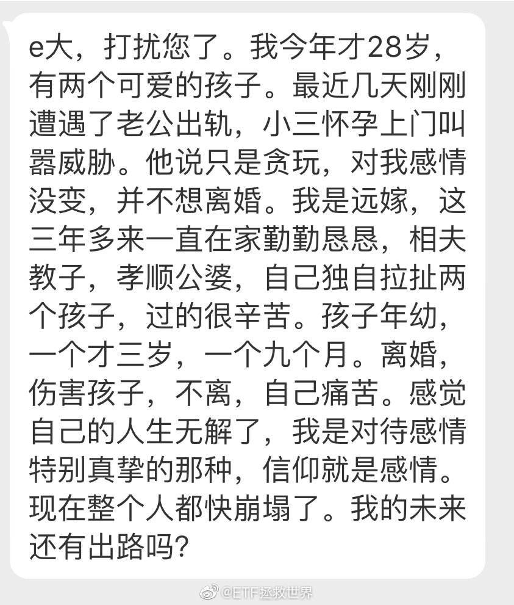

## 2019-05-16 19:16

结论：

男人靠不住。

尤其是人到中年突然开始健身的男人。

 ​​​

## 2019-05-16 21:38

转发微博

## 2019-05-17 07:29

家里有点钱最重要是教育好孩子，否则黄赌毒分分钟给你败光…

## 2019-05-17 08:24

分享图片 ​​​
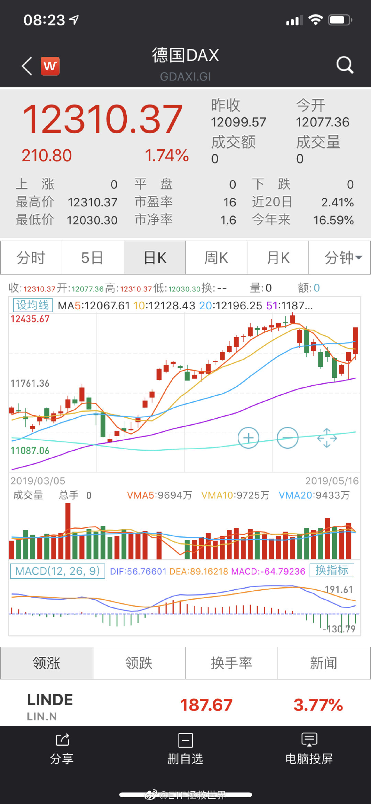 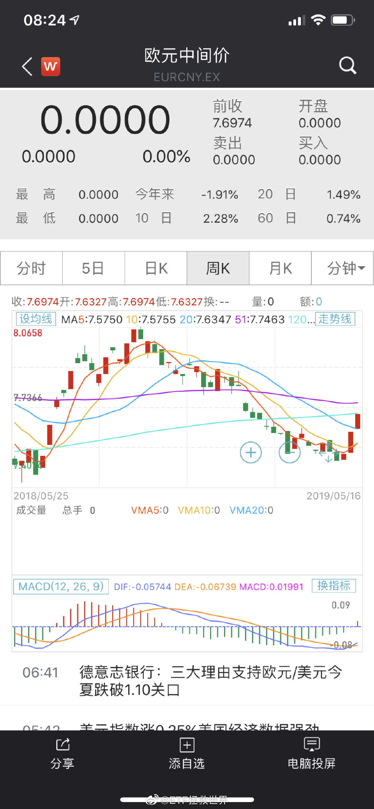

## 2019-05-17 08:33

不确定永远是市场最不喜欢的。

最佳买点是好苗头出现的时候。

感情充沛对提高收益率没什么用。 ​​​

## 2019-05-17 11:02

看看每天的新闻，什么变了。变得我有点不安。

## 2019-05-17 11:15

最近四个月，实际上没有增加仓位。

500高卖低换传媒。

消费高卖低换300。

只加了一份低仓位可转债。

其它加了黄金油气Dax。

代表了我的态度。

目前仓位很合适，注意节奏。 ​​​

## 2019-05-17 11:32

每次晚上不关窗户都嗓子发炎然后感冒。

这是什么道理。因为晚上身体抵抗力弱吗。 ​​​

## 2019-05-17 14:48

最近把这本书拿出来又翻了翻。 ​​​

## 2019-05-17 18:25

我最不理解的就是动不动就“清仓”“满仓”。

你就算再不看好，留20%没事吧。A股就算腰斩你资产也只减少10%啊。

你0%仓位的代价是什么，是心神不宁坐卧不安以及经常性的挫败感以及长期看必然收益率降低的结果啊。 ​​​

## 2019-05-17 18:35

特 别 棒 ！ ！ ！//@曹增辉:赢了

## 2019-05-18 07:32

## 2019-05-18 11:08

周末没事学着做个大阪烧，工具不够，蛋黄酱挤的不好看。

是时候转型美食博主了。 ​​​

## 2019-05-19 10:16

台积电会怎么做？考验他们的时候到了。 ​​​

## 2019-05-20 09:52

俾面 ​​​
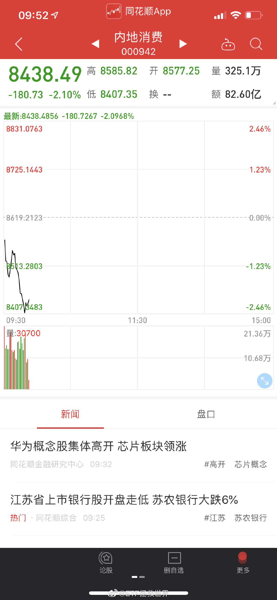

## 2019-05-20 11:02

再说一次，手里有钱不是你投资的理由。

好机会才是。 ​​​

## 2019-05-20 15:32

打开微博一看评论数吓我一跳，以为我红了。还好没有，松了一口气。

## 2019-05-20 20:23

我总觉得美股不应该反应这么弱。 

是不是花街大佬们还没有意识到问题的严重性。 ​​​

## 2019-05-21 16:16

一切都好，勿念。

就是忙。

今天过的怎么样？昨天你有什么特别的事发生吗，展开讲讲。 ​​​

## 2019-05-21 18:43

这几天看到好几次评论里讨论“精神出轨”。

能不能精确的定义一下什么叫精神出轨，尤其是妹子们，你们觉得到底怎么样算精神出轨？ ​​​

## 2019-05-21 20:55

华为这件事让我意识到一个虽然一直有意识但是从来没有系统考虑过的问题：

目前对我很重要的事情如果出现什么即使概率极低的不好的变化，我有没有plan B应对？

比如工作，比如投资，比如健康，比如很多同样重要的事。

如果没有，重大变化发生的时候就容易出问题。 ​​​

## 2019-05-22 18:53

刚才有朋友跟我说，我的所有雪球文章都看不到了。

我几年前建过一个小号用户名和密码都忘了……也没法用小号上去看，谁帮我看看文章是不是都看不见了…… ​​​

## 2019-05-23 09:32

不要情绪化，控制节奏。

这件事短期解决不了，也暂时没有看到有解决希望的信息。目前还处在不断出坏消息的阶段。

不到孤注一掷的时候，控制节奏。 ​​​

## 2019-05-23 10:21

内地消费权重。

到底还有没有机会低位买回了。在线等，挺急的。 ​​​
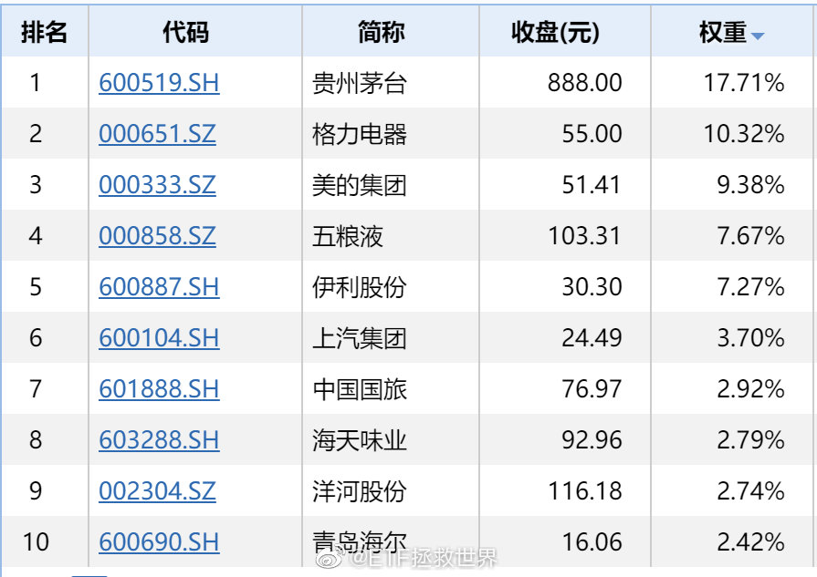 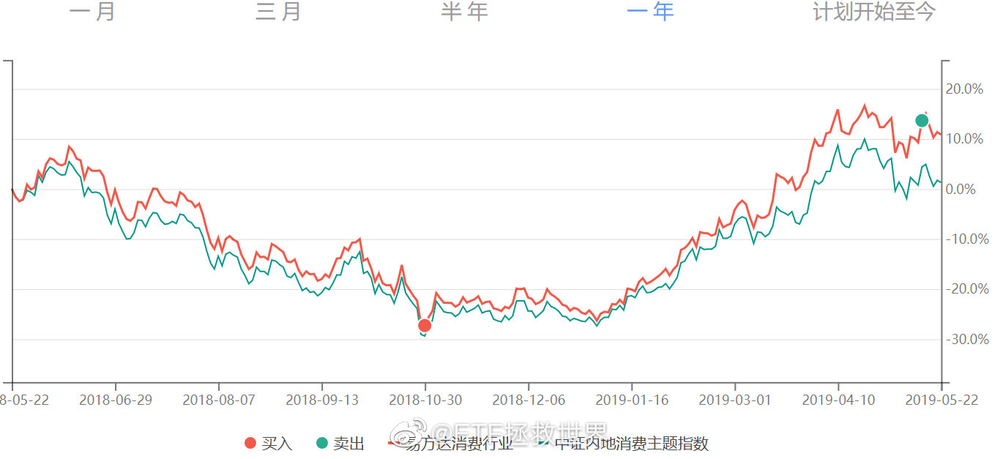

## 2019-05-23 11:15

台积电。

## 2019-05-23 13:36

如果你发现每天早上睁开眼睛都有坏消息，那你就要控制节奏。这里面牵扯到很多问题，不仅仅是坏消息包含的内容，也有心理学的因素在内。

一个接一个的坏消息，对心理的打击要比所有坏消息一起出的力度要大得多。所以你就能看到对方接二连三的释放坏消息打击你，这不是他每天制造一个，而是早已经谋划好，只是一个一个放出来而已。

在这种时候，如果要买，就要控制节奏。即使坏消息本身最终可以克服，但慌不择路的群众以及有避险需求的人踩过来的无数只脚也比较可怕。所以不要急，控制节奏，离远点，站边上盯紧了，别让群众把你踩死。

这一波下跌我没给大家喝什么鸡汤。因为经过去年一役，大部分人已经从感性和理性两方面得到了锻炼。经过训练的战士没必要没完没了的讲道理。

就这么点事，踏踏实实的。

## 2019-05-23 13:51

说真的，我们真的应该在世界上多交几个朋友了。

## 2019-05-23 14:29

回复@归来DFC:昨天收盘还差8%-9%左右。//@归来DFC:e大，这一次是不是真的要创历史跌回钻石坑了，距离很近了吧

## 2019-05-23 14:43

朋友们，低调很重要。

真的。

闷声发大财才是大智慧。

我的第二条家训。 ​​​

## 2019-05-23 18:06

今天收盘后还有6%-8%左右的空间回到钻石坑。这样的状态再维持一周，月底必然有车。这种时候，不买不是中国人。//@ETF拯救世界:回复@归来DFC:昨天收盘还差8%-9%左右。//@归来DFC:e大，这一次是不是真的要创历史跌回钻石坑了，距离很近了吧

## 2019-05-23 18:10

德国人不行。 ​​​
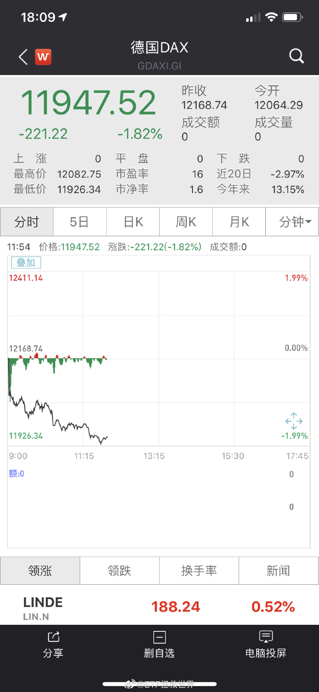

## 2019-05-23 18:57

我不知道你相不相信历史数据。

即使不信，参考一下也好。

当然，历史未必等于未来。然而我愿意给你下面这几个数据，让你有个参考。

下面几张图，是中证500的PB/股息率/PS/PCF对应的未来一年收益率。纵轴是收益率，横轴是各项数据。

怎么看呢。很简单，就是当500的各项数据在某个数值的时候买入，可以看到持有整整一年后，收益率是多少。

这种图，散点越规则就越有效。比如PB越低，收益率越高。PB越高，收益率越低。然后散点都是按照这个规则形态分布，那就非常有效。

接下来，好好看看吧。红线是目前位置。你可以看看，这个位置买，一年至少会涨多少。说实话，我都有点怀疑这么高历史还会重演吗。

记住今天，2019年5月23日。

2020年5月23日我会把这个帖子翻出来。咱们一起看看结果如何。

（这么好的帖子你居然不打赏？）

（我看评论有人说看不懂？很简单啊。比如第一张PB。目前红线周围有三个点，分别对应130%和45%左右的纵轴。说明历史上有过三个月与目前PB相同。那三个月买入，两次一年收益率130%，一次45%啊。）
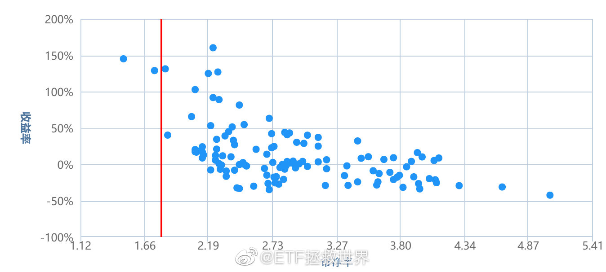 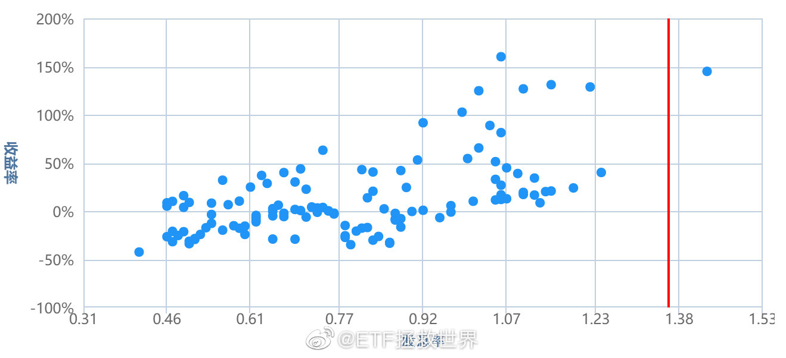 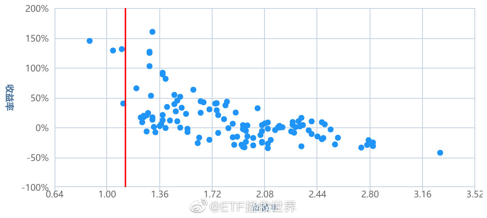 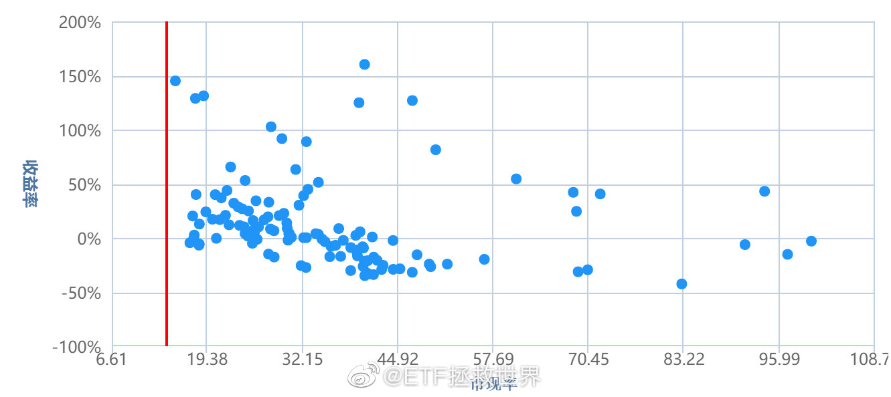

## 2019-05-23 19:13

回复@一只汪迎面走来:非常有趣。投资这件事需要考虑若干个层面。一个是事情未来的发展，另一个层面是你要买东西的性价比。只关注哪个层面都不行。这个一定要认真体会一下。//@一只汪迎面走来:之前看到老大说今年毛衣的情况跟去年不一样，不知怎的竟然有点悲观，现在看到你这么说，我又放心了

## 2019-05-23 19:56

我个人觉得吧

这场仗不管你愿意不愿意，已经开打了。

华为倒了，对每一个中国人都不会是好事。你说你跟华为没关系？南美的一个蝴蝶扇一下翅膀都能引起德克萨斯的龙卷风，怎么可能没关系？

产业链，税收，福利，这个国家的方向——是永远给别人做牛仔裤和打火机，还是能站的高一点……等等等等。

不可能无关的。

所以，即使你不喜欢，不支持这家公司，你也为这个国家这场战争做不了什么，能不能闭上嘴，不再冷嘲热讽？

几十年后，你孙子问你，爷爷，当年他们打我们的时候，你做过什么？你会不会很骄傲地说：你爷爷当年用键盘帮着对方喷我们自己来着？

## 2019-05-23 21:34

追剧。

## 2019-05-23 21:38

要崩一起崩，拉上欧洲一起跳~~~

## 2019-05-23 21:44

油崩了。周末我赶紧把2.0发出来。正用得上。

不是不发。你看了就知道走心的东西多难写了。 ​​​

## 2019-05-23 21:48

各位发生的好事都会让我很开心。

虽然不认识各位，但希望大家都能顺顺利利的。 ​​​
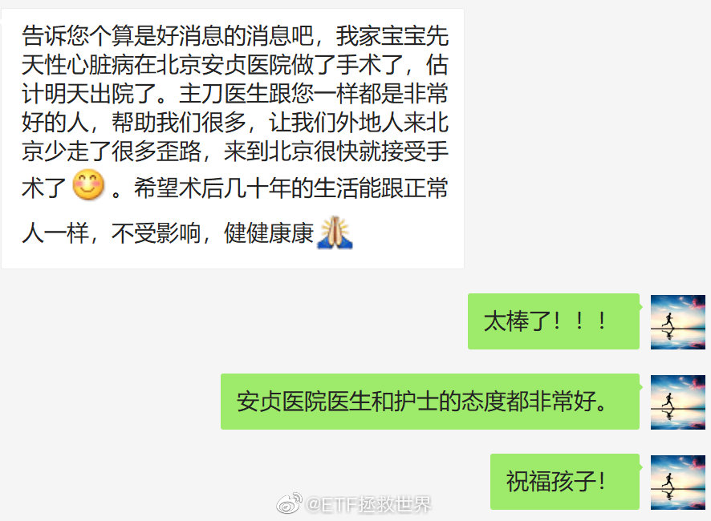

## 2019-05-23 22:03

中证500有这么好吗

## 2019-05-24 08:12

我相信加水就能跑的汽车是真的。有视频为证。

## 2019-05-24 10:24

买，没问题。但是目前这种情况，控制节奏的买。

同时不断问自己，最差情况再跌30%自己能不能扛住。能扛住就继续买，扛不住就停。 ​​​

## 2019-05-24 17:09

你说人这辈子，怎么才算活的值了。

就算马上离开这个世界也不遗憾。 ​​​

## 2019-05-25 09:17

某年生日随便拍的国家大剧院。 ​​​

## 2019-05-25 11:07

回复@谜之牌手:新朋友吧。我这里不是舔。我们这是夸夸群。互相夸，互相吹捧，最后大家都觉得人生很美好，每个人的脸上都洋溢着幸福的笑容。//@谜之牌手:这都有人舔

## 2019-05-25 12:00

会夸人是一种能力，鲁迅说过，嘴甜的人运气不会差。

我本人很不喜欢带有极强目的性的吹捧，为了得到好处就努力拍马屁的人也很值得警惕。但如果你时不时给别人一点带有敬佩又或者鼓励的真心称赞，相信人生会顺利很多。

很多人说，我就是很直啊，他们家刚生的孩子确实不好看啊，他/她的发型/衣服/鞋子/包包/车子/长相/身材/房子确实很差啊，他/她的工作/伴侣/孩子成绩比我的差远了啊，什么东西啊我必须指出来啊。我就是要说啊，我很直爽，我不虚伪。

对，你是爽了，别人郁闷了。

你这辈子能顺利？那才是老天不长眼吧。

不是让你说假话，但其实该闭嘴的时候可以闭嘴的。

## 2019-05-25 22:14

很多事情确实要讲天分。不服不行。

摄影这两个字都不敢讲。只能说照相。从小学就开始，那时候就拿着单反拍。虽然只是个理光的低端机吧。

后来断断续续也一直没完全放下。但自己知道，拍的不行。

第一个肯定是没用心，没有完全把精力放在上面。主要是不够热爱。

第二个就是知道自己没有天分。主要是没有感觉。很容易就到了一个瓶颈，突破不了。因为没有努力过，所以也不知道到底是没努力的原因还真的是没有天分。总之就是没感觉。

做事情没感觉就特别可怕。因为你能看到，有些人拍出来的就是有感觉。但你就是拍不出来。比如拍人，有人拍的人物片子你就感觉特别有故事感，感到照片不是静止的，有很多东西在里面。但你拍来拍去最多就是个糖水片。这就很无奈了。

这些年越来越懒，单反也很少拿出来了，照片质量更是不如从前。不过从小就拍有一点好处，就是平常记录生活的照片，好歹构图光线什么的不会太离谱。这也就不错了。

昨天整理旧电脑的硬盘，翻出来那张大剧院的，就放了上来。说是随便，其实很明显是扯淡。那个生日扛着1DS和三脚架，通宵跑了大剧院、央视大楼、三里屯和北京南站，记录下那个夜晚这些地方的样子。最后也就这张大剧院的还算可以，殊不知也使用了专业器材，后期也调了半天颜色呢。

以后还是要试试多拍，财经和情感博主都混不下去的话，希望艺术博主也能好歹挣扎一下吧。

## 2019-05-26 19:21

微博新出了一个“粉丝群”。我本来想开一个试试，不好玩就随时关。

但我想了半天，也没想出来除了好玩，为什么要开这么一个群。你觉得弄个群有什么好处吗。 ​​​

## 2019-05-26 21:49

看完这个视频我骂了一句脏话

## 2019-05-27 15:32

年初想买台品牌PC，先看了联想，然后看了看其他牌子，最后根据性价比原则买了HP//@挖龙脉的超级鹿鼎公: 转发微博

## 2019-05-28 10:00

NB你就冲过2940。

 ​​​

## 2019-05-28 14:41

## 2019-05-29 14:47

最近几天说话少，主要原因是目前状态混沌不清。

技术面，消息面都比较混沌。没有明显的趋势出现，价值的东西每天变化也不大，也没什么好说的。

目前这种情况，除非是专业投资者，否则建好仓位的朋友还是转移注意力做点更加有意义的事。 ​​​

## 2019-05-29 14:54

今天最高2934。NB你就周五收盘站稳它。

## 2019-05-29 15:17

我想啊，有些人要求一个贸易公司也进行高科技研发是不是过分了。人家就是做组装然后做贸易，别要求太高，它根本也没想过要做研发。主张做研发的内波人早就被清理出去了。你们生气是因为预期错配了。

当然，这个全球性的大贸易公司居然除了大中华区赚钱其他地区都赔钱这就很说不过去了。再看看价格，原来是卖给大中华地区的商品价格贵。拿我们的钱，尤其是zc的钱去补贴老外，有点不够意思。

总而言之吧，就是一家普通的，想赚钱的公司。没有什么理想，也没有太大能力。或者说，搞人的能力大于搞事情的能力，就是这样一家公司。是不是中国公司也没什么所谓，只是希望zc不要做冤大头，老百姓的血汗钱省着点花。

你说买不买它的产品呢，未来也许会买。当然，要等到它不拿我的钱去补贴老外的那一天。

## 2019-05-29 18:48

我怎么就不信美股还能撑多久呢。 ​​​

## 2019-05-29 21:49

WTF。//@财联社APP:【WiFi联盟、蓝牙联盟、JEDEC协会已恢复华为成员资格】继SD存储卡协会（SDA）之后，更多行业组织开始恢复华为会员资格。5月29日，记者发现，Wi-Fi联盟、蓝牙技术联盟和JEDEC协会（固态技术协会）等行业组织，均已恢复华为的成员资格。（澎湃）

## 2019-05-29 22:05

打仗就要打对方的软肋。节奏不能跟着对方走，要把对方引入自己的节奏。

打仗无论胜败，都不可能毫发无损。要真打就要做好有所牺牲的准备，无论是GJ还是个体，都要做好准备。

很多事，躲，是躲不过去的。当然要尽量不打，能谈尽量谈。但是躲不过去就得做好受伤的准备，抓住对方软肋狠狠的打。 ​​​

## 2019-05-29 23:44

这才像点样子。继续 查看图片

## 2019-05-29 23:50

我永远不会去蹦极的想法

源自于看过的一条蹦极绳子比蹦极高度长整个人拍在水泥地上的新闻

我是真不相信装备质量和操作装备的这帮人 ​​​

## 2019-05-30 00:04

虽然我也养狗，但这个情况我个人认为一分钱都不应该赔。出门遛狗不拴着还有理了？车主倒霉，狗也倒霉，凭什么让罪魁祸首狗主人挣钱？这种稀泥要和到什么时候。

## 2019-05-30 09:17

我怀疑今天要开车，但我没有证据。 ​​​

## 2019-05-30 09:45

还是那句话，买没问题，注意节奏。

保守到激进的A股仓位给60%-80%合适。最激进别超过90%，杠杆就更不用说了。 ​​​

## 2019-05-30 10:39

一般@ 我的我都看不到，因为真的太多了。今天小慢转发才看到。帮优秀的姑娘一个忙，有想法的加油了！

## 2019-05-30 10:49

贵市确实应该“普及科学知识”了。

## 2019-05-30 11:54

婚姻这个东西吧，也没什么发言权，毕竟只经历过一次，也不好给人瞎出什么主意。

不过啊，经常看到网上一些社会新闻下面，有些人总是说，你看，家暴了吧，还是不结婚好啊。你看，男的出轨了吧，还是不结婚好啊。等等。

其实吧，你知道，要上新闻，总是要非常特殊的情况才有机会。未婚的人，你得了解，这些都不是大概率的事。大概率是什么呢，是夫妻之间虽然平平淡淡，但都能爱着对方，照顾对方。

不要恐惧婚姻，婚姻不是爱情的坟墓。爱情这个东西，有没有婚姻该有坟墓都会有的，和婚姻无关。如果遇到合适的，喜欢对方，对方也喜欢自己，就好好的去谈恋爱。谈的差不多了，该结就结。

遇不到合适的，一个人也没任何问题。但我希望你了解的，是别被别人洗脑，认为婚姻是非常恐怖非常不值得。真不是这样。至少对大多数人来说，婚姻还是不错的。

最重要的，是找到对的人。

## 2019-05-30 12:24

韩国，一个神奇的国度。这些年文化输出做的太好了，全亚洲迷妹众多。但了解得越深，越感觉这是一个很难让人尊重起来的国家。BTW，知耻能后勇吗，我们。

## 2019-05-30 13:22

关于那台PS4 Pro的后续。 ​​​
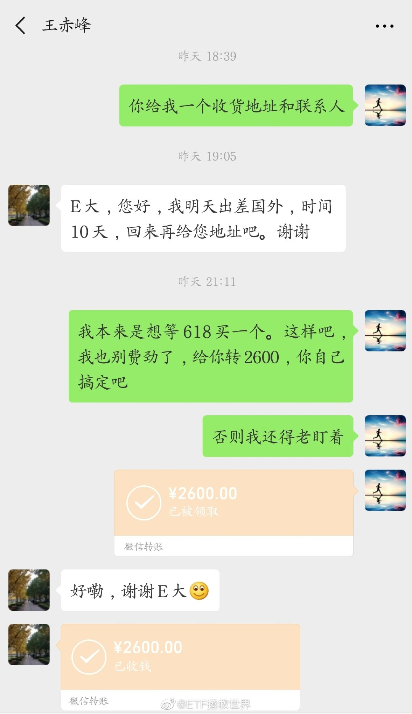

## 2019-05-30 18:08

北京的家长朋友，六一带孩子去哪儿玩比较好。

要求人少。最讨厌人多，最最最讨厌。人多出去玩还不如在家玩实况虐韩国人。

6岁孩子感兴趣的那种。 ​​​

## 2019-05-30 21:29

第一位归化球员入选国家队，李可。

前阿森纳青年队队长，曾入选英格兰青年队。

母亲是华裔。

我觉得挺好，有什么不好的。 ​​​

## 2019-05-31 09:05

出现第一条好消息前都要控制节奏。 ​​​

## 2019-05-31 14:25

相信我没错的

## 2019-05-31 18:15

全球一起跳，只剩黄金了。等黄金突破再继续买。 ​​​

## 2019-05-31 18:58

A国签证需要看近几年社交平台信息这个不奇怪。几年前就有过入境要看社交平台信息的事。（因此入境别国的时候我有朋友会把社交app都删掉。）

所以如果有想去那边的朋友，在社交媒体上发言应该要注意。

不过话说回来，不管去不去，在社交平台上说话都要注意。再延伸一下，在任何地方说话都要注意，甚至是独处的时候都要慎独。

一句话改变命运的例子太多了。

你可以骂我怂，但你要知道我是希望你好。

## 2019-05-31 21:30

你准备明天给自己买个什么玩具。 ​​​

