## 2019-06-03 10:37

不乱动。就这么简单。

无论多么有欺骗性的走势对你都没用。

还是那句话，在第一条好消息出来之前，控制节奏。 ​​​

## 2019-06-03 15:17

也不是不想说话，实在是没太多说的。

无非就是观察几个方面。

消息面和趋势面不好。趋势不好不用说了，所有指数全部处在下跌趋势中。消息面至今没有任何利好。

你要说这样的情况就该减仓吧，问题在于基本面还很便宜。绝不是最便宜，但真的相当便宜。

但这么便宜也不好加仓，原因是整体利润在下滑。真下滑十年，便宜也没用啊。所以还要回头看消息面有没有改善。

所以目前的状态就是混沌。没有太多说的。咱们来市场没必要预测未来，天下大势非人力所能变，作为个体，只能顺势而为。识别，然后顺应。

混沌的状态下，识别大势很难。那我们能做什么？

很简单。根据目前的状态和自己的具体情况，设置好基础仓位。具体的前两天说了。

然后设计适合震荡市的策略，坚决执行。无论你怎么走，我赚我的。小波动赚小钱，大波动赚大钱。牛市来了基础仓位没丢，熊市继续有钱继续买。

我们无法改变未来，但能改变自己的状态。

## 2019-06-03 15:22

发了一条微博，可能被限流了，阅读量50……没办法……

那就先不说了…… ​​​

## 2019-06-04 14:04

一天没看盘，打开软件一看觉得很好笑…… ​​​

## 2019-06-06 07:41

波动越大，利润越大。只要这个波幅已经在你的预期内，只要你找到可以通过波动获利的方法。 ​​​

## 2019-06-06 14:18

群众的信心又崩了啊。三个月一小崩，半年一大崩 ​​​

## 2019-06-06 14:35

几个月前，行情好的时候，好几位在私信问我，要买房的钱拿来投基金行不行。

所有这么问的，我只给两个答案。第一个是跨界问题没法回答，第二是买房。

后来有些我建议该买房买房的朋友，还是跟我说买了基金，房子可以等等再买等等。

这样问我的朋友，我之所以给出不能投资金融市场的建议，是因为你的钱不是闲钱。我不是看好房价，我不懂那个。是因为你的钱本来就准备干那个的。

投资金融市场的钱是不是闲钱非常重要。你有一笔钱，不确定时间或者1-3年内要用，因为市场好你来投资股市，那就是犯了大忌。

尤其是在三个月涨了30%-50%的时候，更可怕。

再次提醒，想要有好的心态，除了其它我一直在说的东西，闲钱是非常重要的。

现在，再问问自己，下跌27.8%和上涨52.4%会不会都开心？会，仓位合适。不会，调仓至满意为止。

## 2019-06-06 14:47

下周开车买回500C应该没有悬念了吧。

接下来会逐渐加大波段仓位的。

爱涨不涨  ​​​
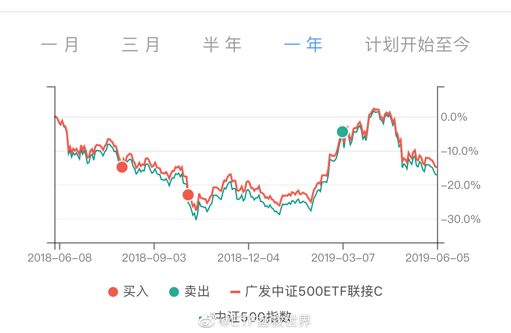

## 2019-06-06 17:24

据我测算，下周调整成分股后，500的估值会自然下降0.3-0.5。如果不反弹，重新回到过去十几年最便宜的位置没有太大问题。

1月上涨以来，我确实没有想到居然还有机会收集这么便宜的收藏品。

那种欣喜的感觉我估计你体会不到。类似于马未都逛潘家园，年初捡一次漏，年中又捡一次。哪能港，2019年没有遗憾了。

说了半天买便宜收藏品的感觉你们到底能不能体会到啊，体会不到吧，急死我了。

## 2019-06-06 17:41

好嘛，我刚看了看这几条微博，评论都是大几百啊。这么说其实每天少说几句也挺好，单条评论就比较多，热热闹闹整整齐齐的多好。

要不然每天话痨一样说很多，结果分散到每条评论稀稀拉拉的，没有互动的feel，差点意思。 ​​​

## 2019-06-06 18:06

其实有个道理你想想，是不是这样。

无论从哪个角度看，A股整体都不贵，甚至以历史的角度看，相当便宜。这个你不否认吧。

很多人无非是担心未来出现变故所以吓得不停的卖。

你从这个角度想：

你这一辈子，碰上这样机会的次数不会太多。算你25岁开始投资，二十年，到45，这样的机会历史上看出现3-4次，而且每次这样情况出现的时候，都是出现“大问题”的时候，否则也不会跌成这样。

所以你的选择是搏一把，就赌问题未来会解决，最终会走上正轨，那你的财务情况就会向积极的方向提升一大块。这样二十年中提升几次，人生可能就不一样了。

或者你选择谨小慎微离场观望，等一切都好了再回来。或者永远不会变好，出大事了，你一直拿着现金。这样在股市失败的危险没有了，但你的人生不会有任何改变。

输了会失去什么，赢了会得到什么。一切都想好了，这个选择题就不会做错。

人生其实平平安安过完就挺好的。但你抬头看看满天的星星。宇宙这么大，我们都是一粒小沙子而已。地球只是太阳系的一个小行星。银河系有几千亿颗太阳这样的恒星，而宇宙又有至少几千亿个星系。其实咱们连一粒沙子都算不上。

几十年而已，说实话，以后也没什么人会记得你我。那干嘛不试试让人生过得稍微不一样一点呢。

## 2019-06-07 06:03

谢谢大家。评论和私信都看了，没法一一回复，见谅。

这么高兴当然是再选几位幸运的朋友送礼物啊，不如众乐乐嘛。怎么选我先想想… ​​​

## 2019-06-10 10:12

今天全靠手里这几个QDII撑场子了 ​​​

## 2019-06-10 18:45

我走后门要了两件，质量真的不错…//@且慢管家:我们公司员工都开始自己找市场组买了。。。真的好好穿哦～//@1945的我: 我需要一只猫来加持法力

## 2019-06-11 06:50

这个有办法吗 ​​​
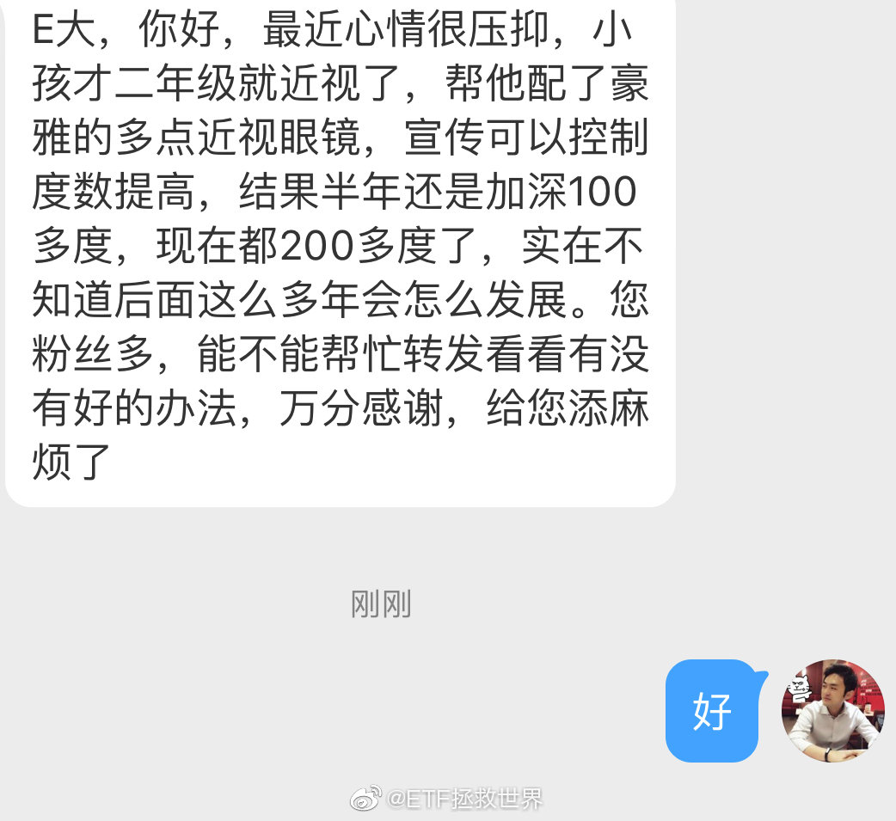

## 2019-06-11 10:29

什么玩意儿啊，生气٩(๑`н´๑)۶

## 2019-06-11 10:58

我买空调的时候真想过一定要买一台董小姐家的体验一下。然后买的时候怎么也下不去手。

所有参数都一样就是比别的大品牌包括日系贵30%-50%以上。

后来买了两台松下一台美的…可能董家的真的好用，用的料会好一点吧，但我怎么也说服不了自己… ​​​

## 2019-06-11 12:52

别一天到晚咋咋呼呼的。跌几天完蛋了不行了股市要关门了，涨几天谈妥了牛市了不买不行了。

没那么好，也没那么坏。

手里基础仓位踏踏实实拿住了，再加波段仓位吃波段吃完把利润留下转成长期仓位。

多简单啊，多好玩啊。多大点事儿啊。 ​​​

## 2019-06-11 13:05

体会到了吧

## 2019-06-11 16:39

今天开始计划内波段操作将不受时间限制。随时干。//@ETF拯救世界:什么玩意儿啊，生气٩(๑`н´๑)۶

## 2019-06-11 17:43

明天持仓的dax30就要今年新高了。 ​​​

## 2019-06-13 13:50

震惊，一天没发微博收到友人短信问候…

报个平安，人在呢人在呢。 ​​​

## 2019-06-14 07:59

因为调整成分股，所以预计月中发车在下周二 ​​​

## 2019-06-15 09:46

这么多年都是给别人面试，今天居然又等着交材料面试了… ​​​

## 2019-06-17 15:12

趁着618（刚才暴露了穿越的身份）正式入SONY无反的坑。以前一直是用尼康的单反，偶尔用佳能。

准备转型摄影博主了，以后多发片。

另外，今晚或者明天上午发车。 ​​​

## 2019-06-17 15:43

今日两市绝大多数指数调整成分股。由于指数编制机制以及最近行情走势的问题，几乎所有指数估值都上升了。

成分股越多的宽基指数受影响较小，比如500或者1000。成分股少的宽基，比如50，以及行业指数，影响较大。 ​​​

## 2019-06-17 16:48

钦定了，明天开盘前发。

## 2019-06-18 09:37

仓位合适是什么感觉，我告诉你。

就是

啊啊啊，涨了涨了，好棒啊哈哈哈

哎呦我去，怎么跌了！太好了哈哈哈

就是这样。

发车了都你还在这里刷微博？ ​​​

## 2019-06-18 15:02

我是不是过了一个假的618，最大的收获竟然是京东保价返了700块钱……怎么一天也没买到什么好玩意儿。

你都买什么超值的东西了，说出来让大家开开眼。

我说一个，现在PS4 pro只要2399，上次我给锦鲤的2600可以买双手柄了！ ​​​

## 2019-06-18 23:03

为什么要这样对我们，为什么=͟͟͞͞(꒪⌓꒪*) ​​​
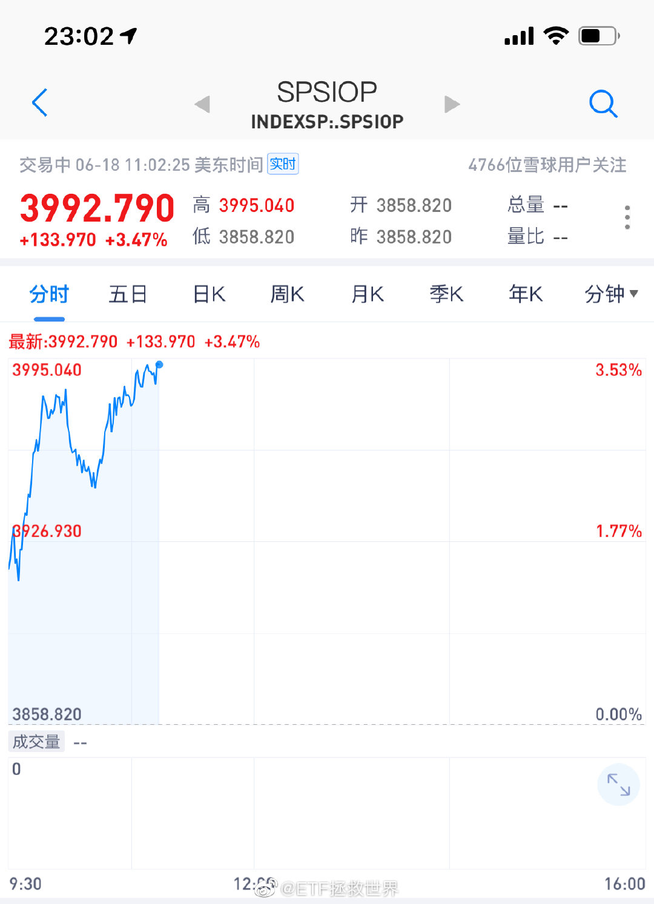

## 2019-06-18 23:19

难道500C又买回在最低了吗。不，这不是真的。 ​​​

## 2019-06-19 09:29

踏踏实实的。

大跌的时候别让别人把你的筹码骗走。

大涨的时候别让别人把你的钱骗走。 ​​​

## 2019-06-19 09:39

同花顺挂了…有这么火吗 ​​​

## 2019-06-19 09:41

普通人这样对待边检人员也是这样处理吗。真不懂，有没有明白人给说说。

## 2019-06-19 09:45

说新高就新高非常听话。 查看图片

## 2019-06-19 10:56

谁追谁被骗钱

## 2019-06-20 11:26

相信有不少朋友已经吃到网格的第一笔利润了。

慢慢的，你就会体会到波动带来的乐趣。

再说一次，波动不是风险，而是机会。只要你做好准备迎接它。 ​​​

## 2019-06-20 11:44

前几天不停看仓位配置图，总是计算还有多少仓位能加仓：7%的现金，一点点纯债、一点点海外债、如果还不行，也可以把一点点黄金卖掉。最后，真到了极端情况，可以砸锅卖铁卖掉可转债换指数。

算来算去，发现也没多少钱可以加仓了。

这么一涨，总算不用为这件事担心了。担心的倒不是别的，是极限情况出现的话，各位手里没钱会阵脚大乱。

好在，明明白白经历的越多，各位的心理素质也会越好。起起伏伏是金融市场的正常现象，只是A股散户交易量太大，导致波动比较大而已。

等你明白这一切，就不会为了极度便宜的地方手里拿了很多筹码而担心。

这世界没那么好，也没那么坏。多大点事儿啊，踏踏实实的。

## 2019-06-20 16:16

回复@猩猩点灯很紧张:涨跌当然都有可能。重注压对了也可能收获不小。但做投资始终要考虑的，是如果我判断错了会如何？不要让自己错一次悔十年。不如用概率思维指导布局。一个建议。//@猩猩点灯很紧张:回复@游闲公子连车骑:这次会很特殊，这次会再回到钻石坑的。2500点见！一起见证

## 2019-06-20 16:42

舒坦。 ​​​

## 2019-06-20 16:55

为什么我没有这样的好闺蜜！ 不过我感觉这应该是个假新闻……

## 2019-06-20 18:23

如果是真的油价还不搞到150吗

## 2019-06-20 21:05

我最爱看到各位的这种消息。特高兴。

好像每个人的开心或者难过都能感同身受。

因为每一个ID后面都不是虚拟的，而是一个个真实的人。 ​​​
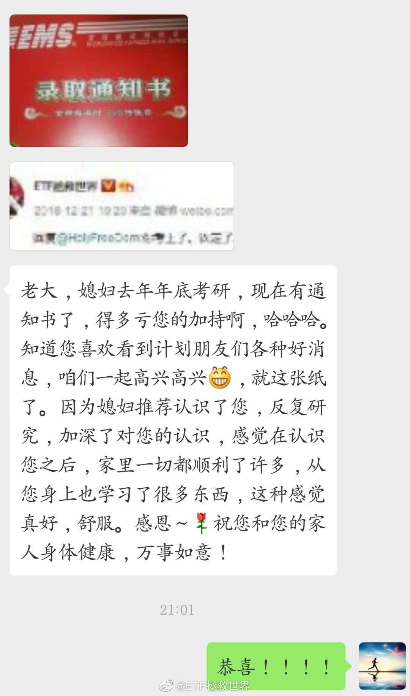

## 2019-06-20 21:30

这个世界上没有完美的人。只要是人，就一定有缺点。

所以，对别人要求不要过高。不要用圣人的标准要求他人，因为世界上根本没有圣人。

三七分。只要本质是好的，只要大方向没错，小问题该原谅就原谅。抓主要矛盾，解决主要问题。

水至清则无鱼，人至察则无徒。

吃瓜有感。 ​​​

## 2019-06-20 21:37

你还真来劲了是吧 ​​​
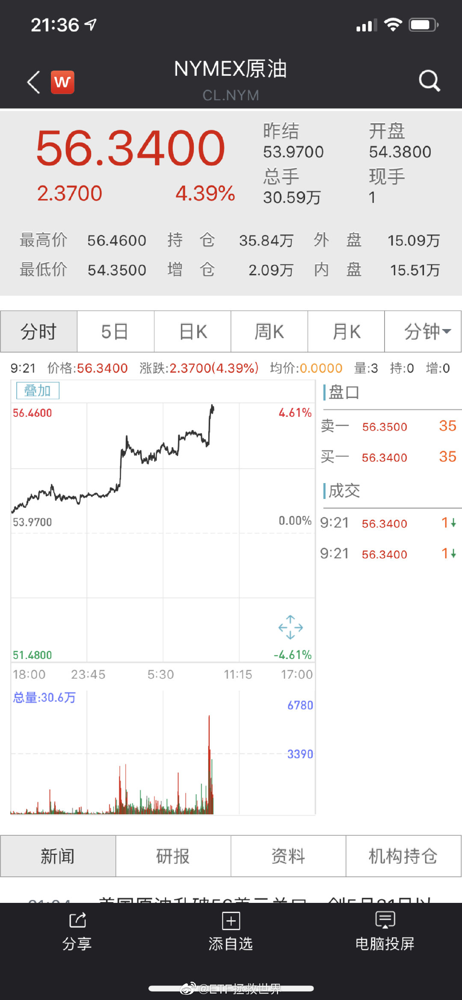

## 2019-06-20 22:27

15点前：计划干嘛加仓油气啊，看A股涨得多好。

21:30后：真香。 ​​​
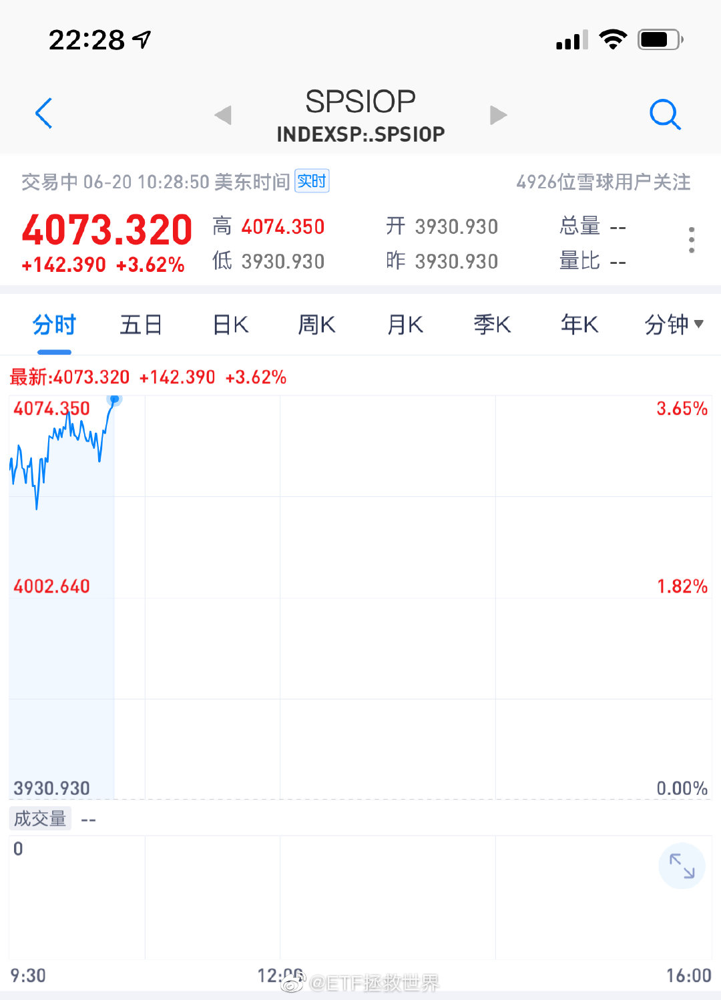

## 2019-06-20 22:39

只要今晚不掉链子，明天大多数人油气都能收一网了。但这里建议最好留点利润长线锁仓，至于为什么，以后你回来翻这条微博就懂了。 ​​​

## 2019-06-21 08:28

开始于3400点的S计划，在2900点的时候，持仓17个品种。

其中13个品种盈利。4个不盈利的品种中，3个亏损幅度小于3%，也就是说分分钟转亏为盈。要知道，这些还有浮亏的品种，2015年以来跌幅接近70%-80%。而我们的持仓只浮亏不到3%。

开始于4300点的150计划持仓31个品种。除A股外的14个品种全部盈利。盈利品种包括纯债、转债、海外成熟市场、新兴市场、中概互联、黄金、原油、海外债券。

持仓的17个A股品种中，有11个盈利，亏损的6个品种中，有3个浮亏程度低于5%。同样，分分钟扭亏为盈。

也就是说，31个品种中，浮亏大于5%的，只有3个。

也就是说，150里面有81%的品种盈利，9.6%的品种浮亏小于5%，9.6%的品种浮亏大于5%。

注意，这里是2900点。

说真的，在股市赚多少先不说，赔钱并不是一件很容易的事。只要你足够理智。

## 2019-06-21 08:48

6月各指数刚把垃圾股调出去，就可以炒壳了。成心的吧？ ​​​

## 2019-06-21 09:27

今天512980高挂的人赚到了。不知道谁乌龙指。 ​​​

## 2019-06-21 09:34

$中证500 sz399905$   你这样别人会以为你是垃圾股指数的……

收了神通吧，慢慢来。 ​​​

## 2019-06-21 09:55

今天收了3个品种的小网，留了3倍利润。全都是6月下的，资金利用率和收益率都很满意。

未来跌还是涨？

你在乎吗？

我不在乎。我是来赚钱的不是来算命的。 ​​​

## 2019-06-21 15:03

舒坦。 ​​​

## 2019-06-21 18:14

都没问题，我也继续把好运气分给大家。不过确实没法及时看到所有私信和评论，在这里就祝所有朋友各种心想事成！ ​​​
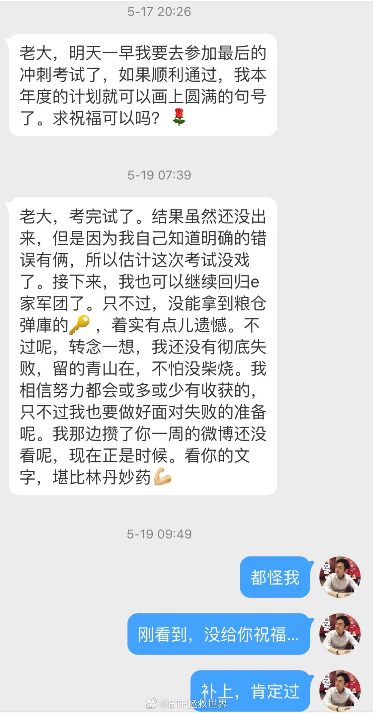 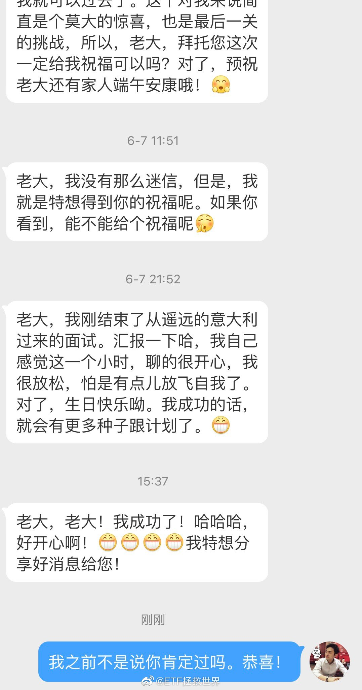

## 2019-06-22 23:06

一定可以吗？未必。因为宇宙真的太大太大了，想要发现一个星球的文明，恐怕就像我们发现在海滩上一颗沙子上面的细菌。太阳系=1/数千亿的银河系。银河系=1/数千亿的宇宙（最少。因为宇宙也许是没有边界的）。极大概率会有比我们NB的多的文明存在，但他们发现我们的机会并不大。

## 2019-06-22 23:13

回复@奇烜王:我想，大概率不会不在乎。要不就是发个二向箔毁灭你避免你成为未来的威胁，要不就是征服你拿走你的资源，要不就是尝试跟你接触。发现你然后不理你的概率太小了……//@奇烜王:可能他们发现我们了 但他们不在乎

## 2019-06-24 18:52

看眼神和面相性格也很好。

## 2019-06-24 19:19

回复@午餐肉可真好吃:这次拍的比较新颖，很舒坦，为你点赞。哈哈哈//@午餐肉可真好吃:E大能不能翻个牌！刚开始接触您的理论，受益匪浅，打算一直跟下去了。本人在英国留学读金融，说实话很多教授的思维深度和格局，远不及您。//@ETF拯救世界:看眼神和面相性格也很好。

## 2019-06-24 19:22

黄金突破了。你猜计划会不会继续追继续加仓？

## 2019-06-25 10:22

有不少朋友私信问我关于孩子报志愿的事情，实在抱歉我不能说。不是我擅长的领域，不扯淡，为了对各位负责。 ​​​

## 2019-06-25 18:39

这个月7号不是说要送礼物吗，现在差不多是时候了。

送两个吧。

第一个送本月互动前十名的某位朋友，前十的名单如下图。这里面小静姐因为上次拿过了，这次就把机会让给其它人吧。每次都那么靠前，真爱哈哈。所以顺延到第11位。

第二个送那个帖子里回复最早的前十位铁粉其中一位，名单如图。

具体是谁呢，还是明天上证收盘价。按时间顺序排列，从0-9。

我觉得这样很公平，祝好运。

礼物还没定，但价值达不到上次的Ps4 Pro，与上上次的Dior口红价值相当吧。
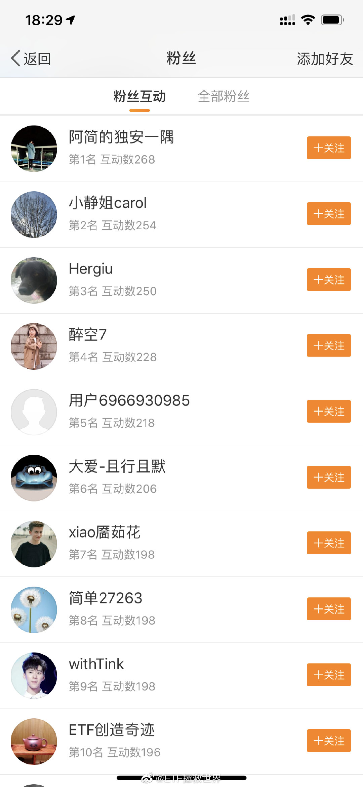 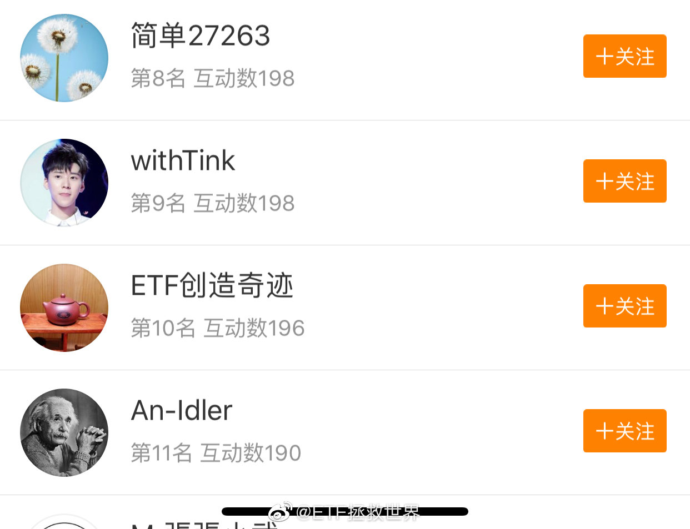 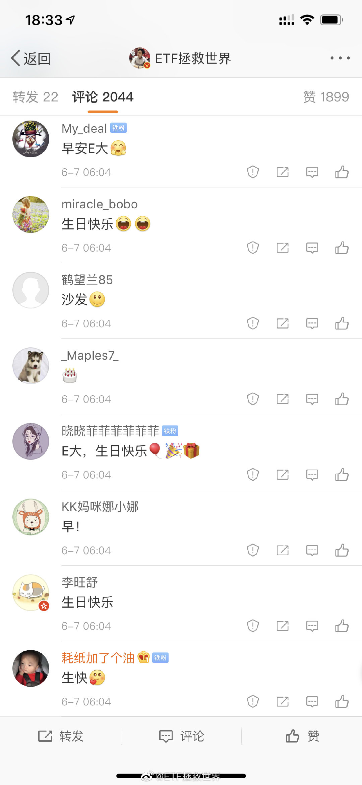 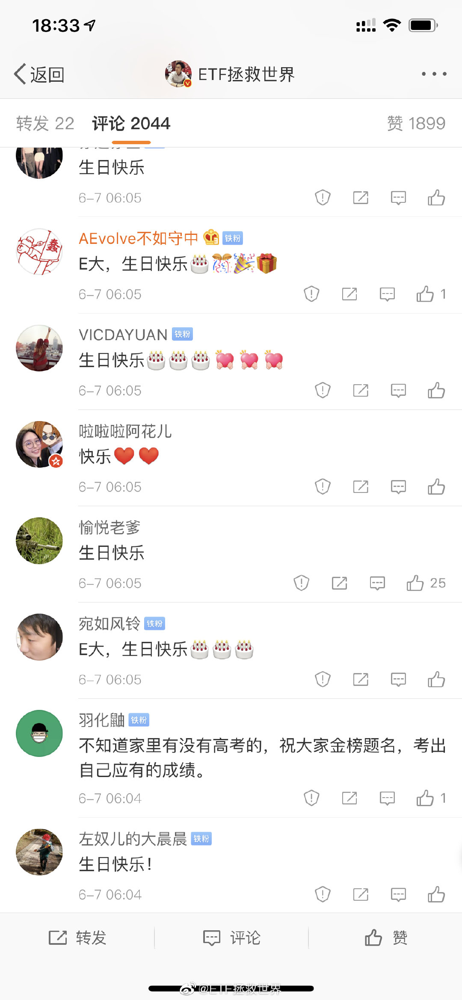 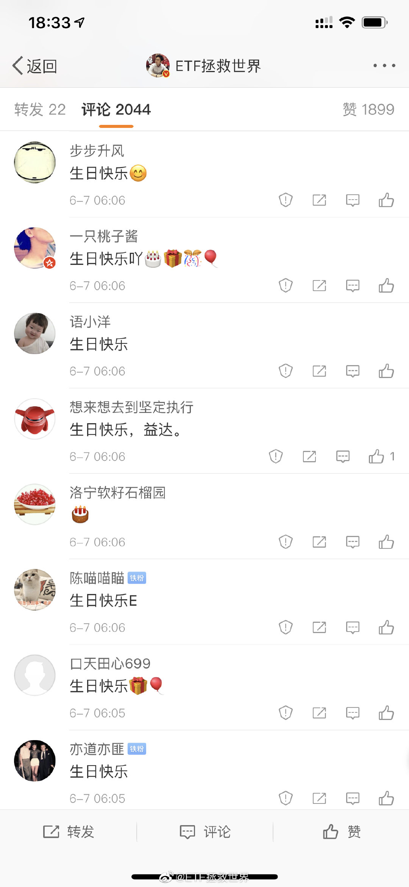

## 2019-06-25 18:53

你也做不好。想当年那么火的MSN让你们玩坏了。

## 2019-06-27 10:05

昨天收盘是2976点，那么就是两个第七位的朋友得到礼物。分别是“xiao餍茹花”和“VICDAYUAN”两位。请两位私信我一下。

## 2019-06-27 19:36

看评论可以知道我们要进入文明社会至少还要50年。另外，那么多人在外面讨厌小孩，完全是很多熊家长造成的。

## 2019-06-27 19:41

其实很多不文明现象的根源，都在于：

你的心里是不是有别人。是不是会意识到自己的行为有可能给别人造成麻烦和困扰。

这个“别人”，不仅是你认识的人，还有那些素昧平生的人。

很多人眼中的陌生人只有两种：第一种是对自己有好处的人，第二种是多余的人。 ​​​

## 2019-06-28 09:36

大概率周日晚或者下周一发车，踏踏实实的。

150也没几车了，且开且珍惜。 ​​​

## 2019-06-28 10:09

又被人喷了。这次喷点是文笔不好以及不分享核心投资思路…

还有，有人喷微博评论里彩虹屁太多。没错，就是各位害我被喷了！

虽然我知道大家都是朋友在开玩笑逗着玩，但有些人他真当真啊，喷了。 ​​​
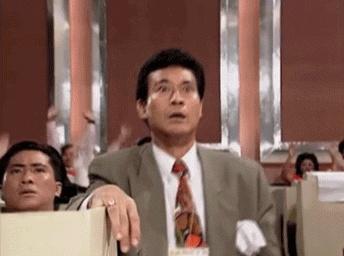

## 2019-06-28 11:03

回复@沙棘枝: 不会了。要不是偶尔上球球有人圈我，我根本看不到。看到了一笑而过也就算了，理解他们，为了多点人关注也不容易。JSL我不去了，球球我不去了，空间都留给他们，祝他们早日红起来~~//@沙棘枝:看到益达心态越来越好，再也不会随便被喷子影响心情了，真的很开心

## 2019-06-28 11:05

不就不发车吗，还闹小脾气了呢……乖，再跌一天我们就买了啊。别闹了。 ​​​

## 2019-06-28 14:19

回复@好好戴口罩:挺好。至少不是去年钻石坑里卖出，现在卖好歹是赚钱的。终点也是另一个起点的开始，继续赚钱，继续攒钱，继续投资。为下一个人生目标积累力量。

## 2019-06-29 13:01

周一早上暂缓发车。 

最终是否发周一中午决定。 ​​​

## 2019-06-30 14:29

礼物买好了，还要一段时间才能拿到，两位别急。

听BGM绝配。 ​​​
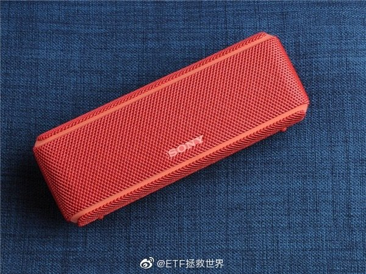

