## 2019-07-01 09:57

随时受不了 ​​​

## 2019-07-01 10:15

一个感想：

虽然涨跌都舒服，但

还是赚钱更舒服。 ​​​

## 2019-07-01 10:23

A股的成交量80%都是散户完成的。绝大多数散户非常不理性，这也造就了无论怎么样一点风吹草动都会造成暴涨暴跌。这对很多人来说是灾难，但对我们来说是最好不过的事。大是大非面前，不要做错。

## 2019-07-01 10:56

一张图告诉你为什么每次发车后都会累的休息半天。

每一个细节都是这样在意。

想送小助理一个4K显示器…… ​​​
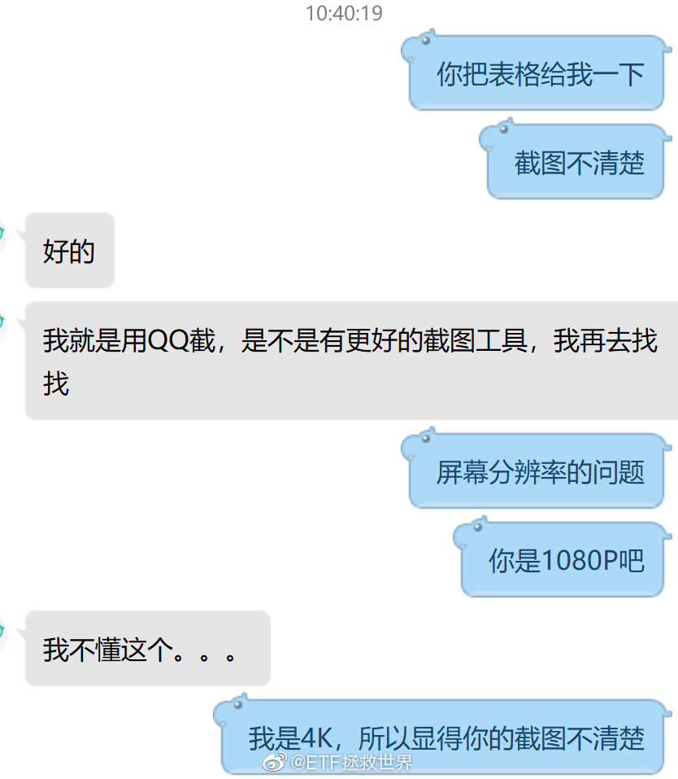

## 2019-07-01 11:33

一高兴又想送礼物。

不行，这是病，得治治了…… ​​​

## 2019-07-01 14:58

还剩10份，150是真的没钱了。这10份还有机会买进去吗？

我相信有。大概率有。

如果发生了小概率事件，也无所谓。

无论如何，想清楚“最差会怎样”，问问自己能不能接受。能接受，干就行了。 ​​​

## 2019-07-01 18:38

是不是要挑战历史新高了。

好消息不断。 ​​​
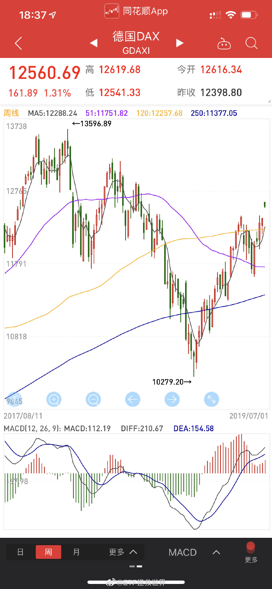

## 2019-07-01 21:37

分享图片 ​​​
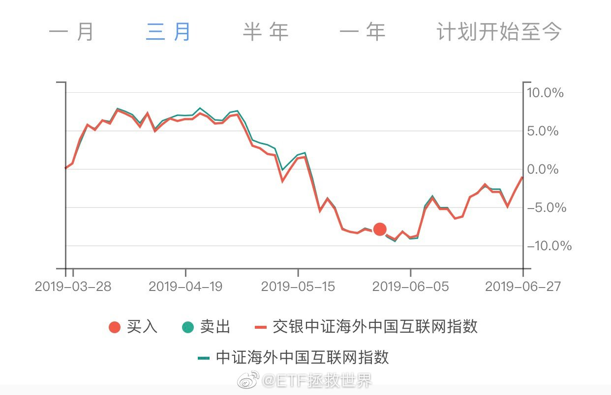 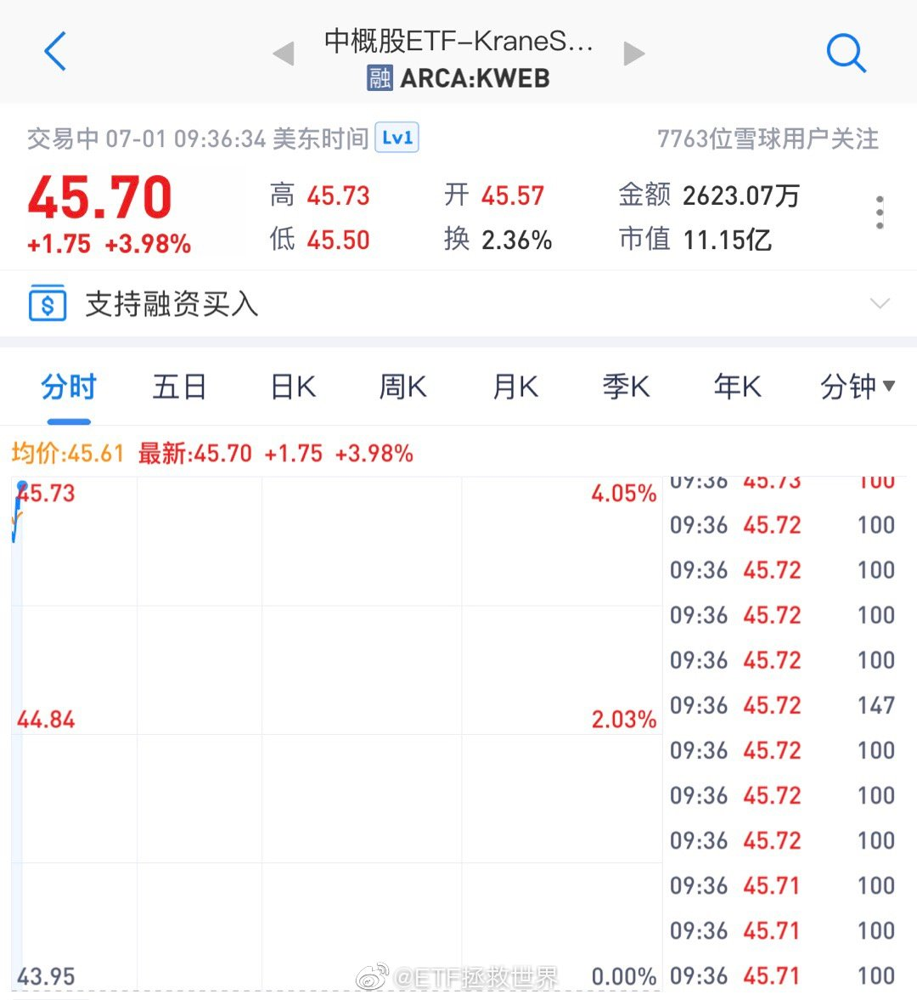

## 2019-07-02 13:30

懂我的人不多 ​​​
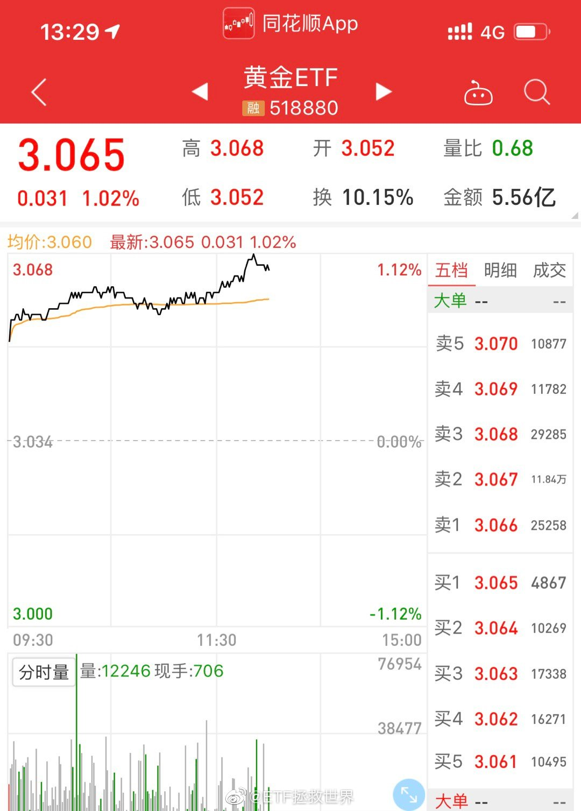

## 2019-07-02 23:27

不要这样，容易骄傲 ​​​
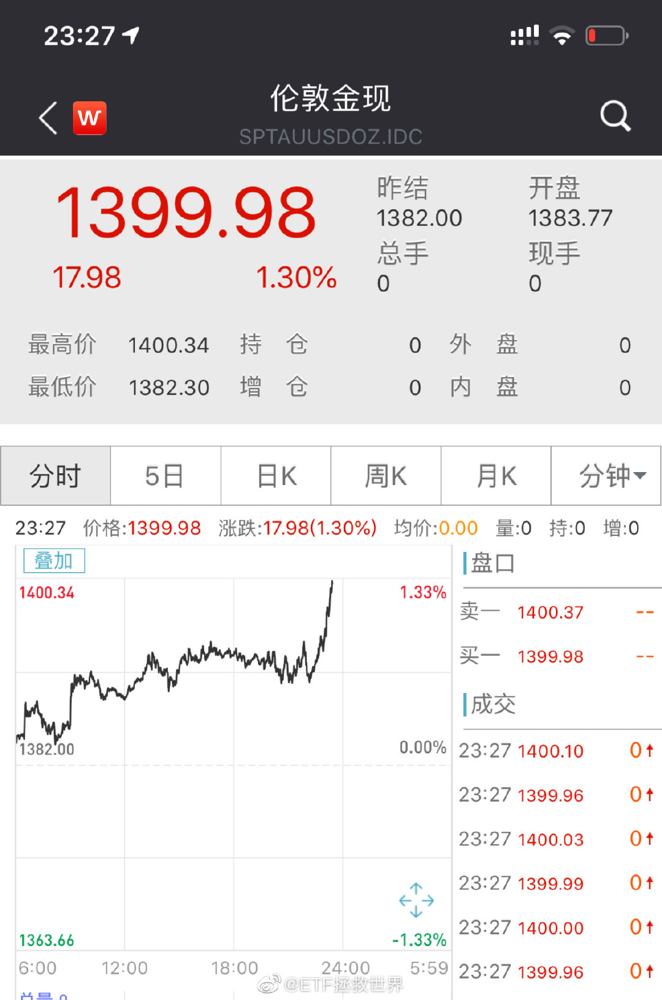

## 2019-07-03 08:58

上次发车，后台留言有一半质疑为什么买黄金的。

看到那些的时候我就知道，大概率买对了。 ​​​
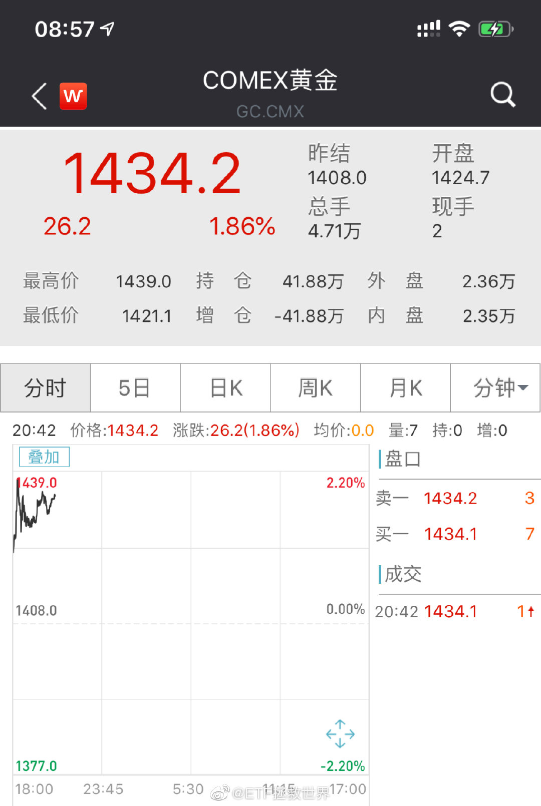

## 2019-07-03 09:06

回复@花开花落95708:千万别这么想我只是做大概率对的事，大概率就意味着也有可能出错。是人都会出错，所以我主要是靠蒙//@花开花落95708:E大这么谨慎的人买肯定错不了！

## 2019-07-03 09:52

特别有意思。

这个微博吧，是我个人的私人微博。也不是什么机构的官微，也不是什么营销号。

我在我自己的微博上，愿意说什么就说什么，又不违法，又不违规，到底碍着有些人什么事儿了？

我请个小助理有人喷，我谈论电影有人喷，我聊聊情人节有人喷，我蒙对了买在低点赚钱了高兴高兴有人喷……

我就想问问你们，我说什么你不喷？核心策略？网格策略写了整整三篇，上万字，事无巨细说得一清二楚。你打赏一分钱了吗？是不是看完了一声冷笑心里骂着“sx，居然不卖钱，拿来免费分享”，是不是骂完了又开始喷不分享其它策略？

我一向奉公守法，从来不阴阳怪气，从来不指桑骂槐，一心一意弘扬shzy正能量，为我国的现代化建设添砖加瓦，招你惹你了？

你们是不是闲的没事干了？有这精力干好你自己的事情不好吗？实在不喜欢就别关注了不就完了吗？你是不是受虐狂？又不喜欢又天天捧着手机开着微博刷我？刷完了拿起键盘就找个犄角旮旯蹲在地上抠着脚开喷？

真服了。

所有公共论坛我都不去了，我只在自己的微博公众号说点自己想说的都不行了吗？

赶紧圆润的取关出去可以吗？什么玩意儿。

## 2019-07-03 10:22

黄金前期高点1442是个压力，如果过去了，走好的概率就更大一丢丢。

如果死活突破不了，那就回家吃面吧。 ​​​

## 2019-07-03 11:34

不过实话实说，李彦宏51了，保养到这个程度，真的服。 ​​​

## 2019-07-03 14:59

没人比我更懂瞎蒙。 ​​​

## 2019-07-03 15:16

问各位帝都旅游达人一个小问题

北京周边有没有那种民宿，一住十天半个月，出门就能游山玩水，钓鱼捉虾，最好能种点菜至少挖个萝卜之类的地方。

住的干净有空调就行。

不用太便宜，也别太贵，别超1000一天吧。 ​​​

## 2019-07-03 21:53

你永远都猜不到个股的风险来自于哪里。

结论：

指数好。 ​​​

## 2019-07-04 15:54

羡慕。有孩子，没法环游世界……

## 2019-07-04 21:10

这个月争取看6本 ​​​
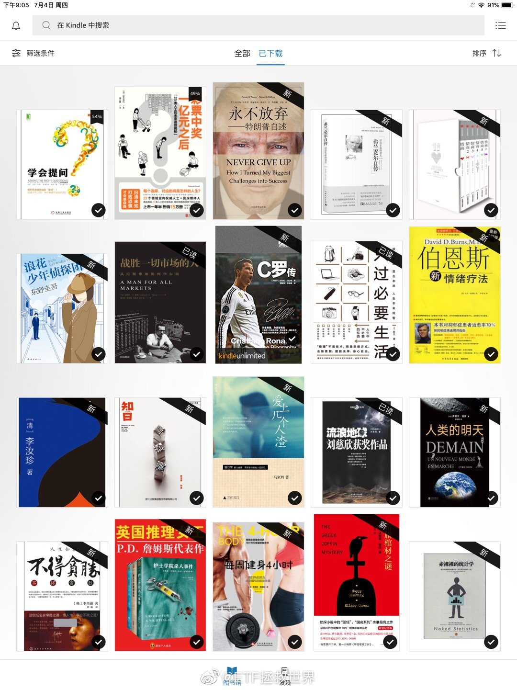

## 2019-07-05 11:10

看完了，两星。

一句话总结：没人比我更懂克服困难经营房地产。

不用浪费时间看了。 ​​​

## 2019-07-05 21:48

最高1441，回家吃面吧。

## 2019-07-07 20:55

第一次暴雨中跑步。

也是一种人生体验了。 ​​​

## 2019-07-08 09:50

与央行共进退

## 2019-07-08 10:03

到了我们买的日子，暴涨想让我们接盘，不买不完了吗。

还不是要乖乖跌回来？

踏踏实实的。 ​​​

## 2019-07-08 10:06

这种行情你就知道网格的好处了。

上上下下来回提款。 ​​​

## 2019-07-08 10:17

跟儿子在路上走。

“你老往后看什么呢”

“后面有个小朋友”

“小朋友怎么了”

“是个女孩！”

“女孩怎么了？”

“我不是跟你说过吗？”

“嗯？”

“漂亮女孩我都喜欢！”

……百感交集。 ​​​

## 2019-07-08 10:27

去年的钻石坑很难回去，除非流动性开始减少，但这个概率不大。

不过想要大涨，还需要宏观经济拐点出现。

流动性+宏观走好，才是真正大牛市的基础。

密切关注下个月披露完毕的半年报。 ​​​

## 2019-07-08 13:39

上次发车买A股的话赔5%，买黄金赚5%。喷了 ​​​

## 2019-07-08 22:49

请教各位虎爸虎妈一个问题，你们都给孩子报什么兴趣班了。包括才艺和体育的，孩子和你们对哪个项目最满意。 ​​​

## 2019-07-10 09:49

kcb新股破发是非常正常的。（身体却很诚实的点击了申购按钮） ​​​

## 2019-07-10 12:17

最近三只债基分红，全选现金即可 ​​​

## 2019-07-10 15:21

回复@勇敢而快乐:转债是再投资。纯债是现金分红。//@勇敢而快乐:兴全转债，主理人也是红利再投，要改吗？@且慢管家

## 2019-07-10 15:31

C罗传看了92%了。

不喜欢这个人，但是非常敬佩他对身体的自律以及努力。看了那么多传记，可以肯定的是，绝大多数靠自己成功的人，都是非常非常努力。

当然，成功还有天赋和运气的成分。但努力是必须的。

从来不喝酒，从来不吃油腻的东西，十点睡觉，每天比别人多训练几个小时…… ​​​

## 2019-07-10 21:45

如果标普上游继续跟踪不好，就要考虑换马了 ​​​
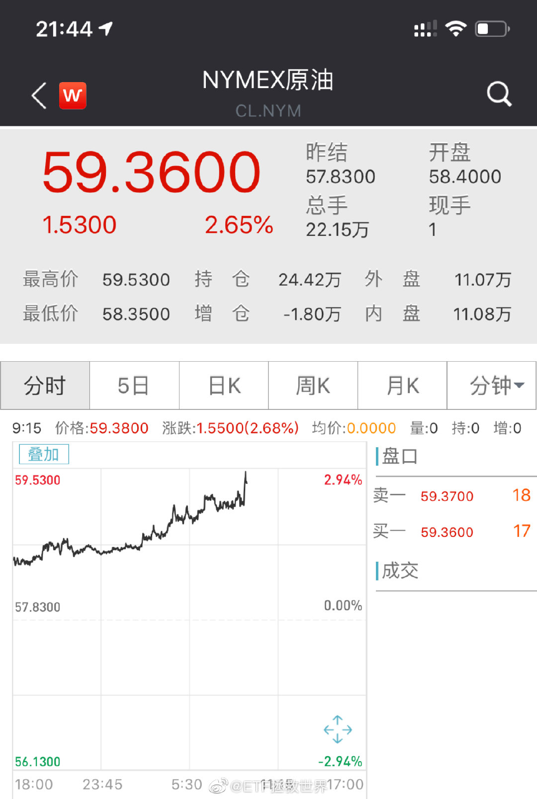 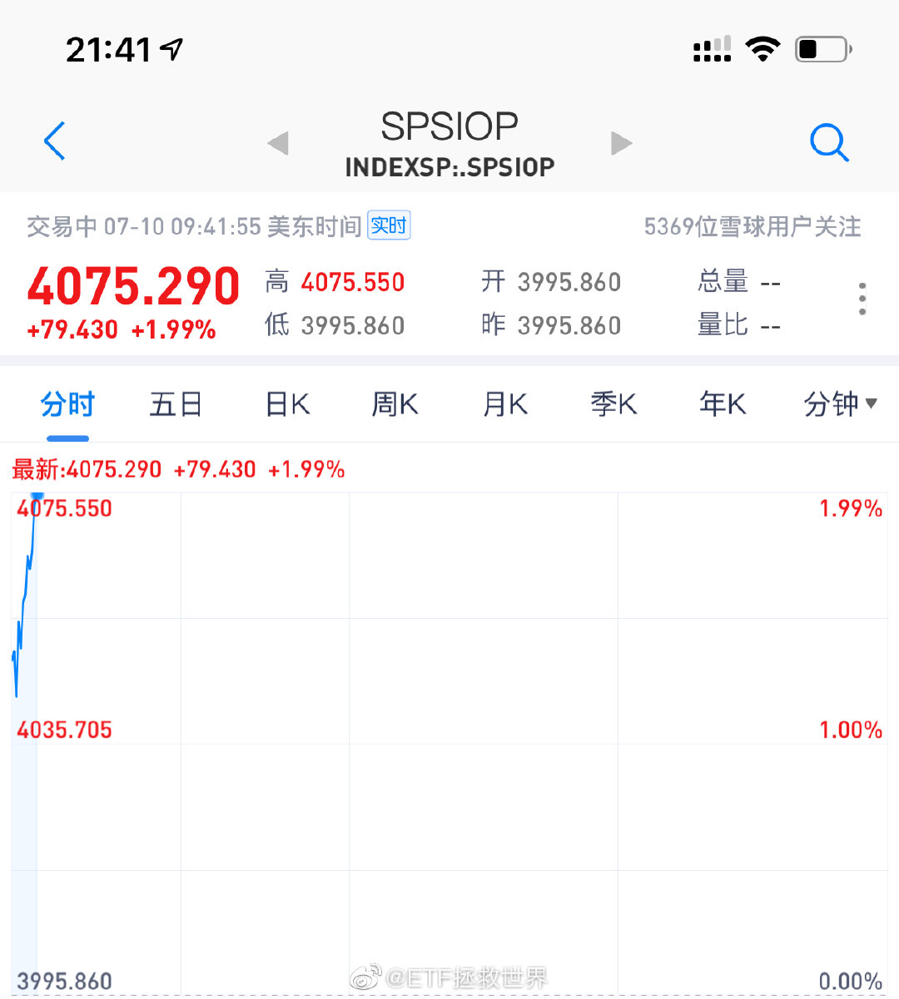 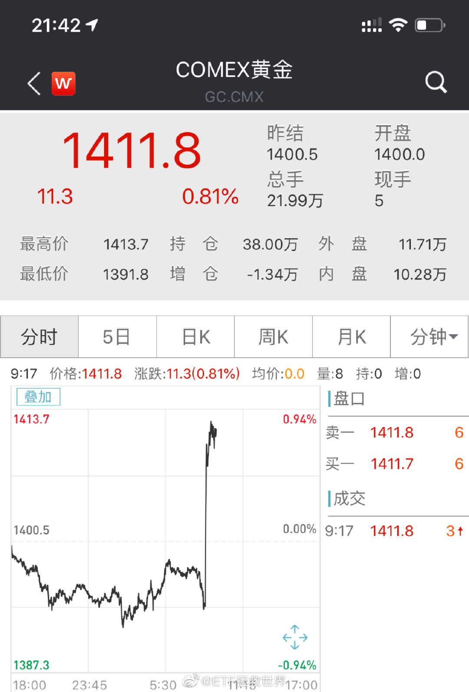 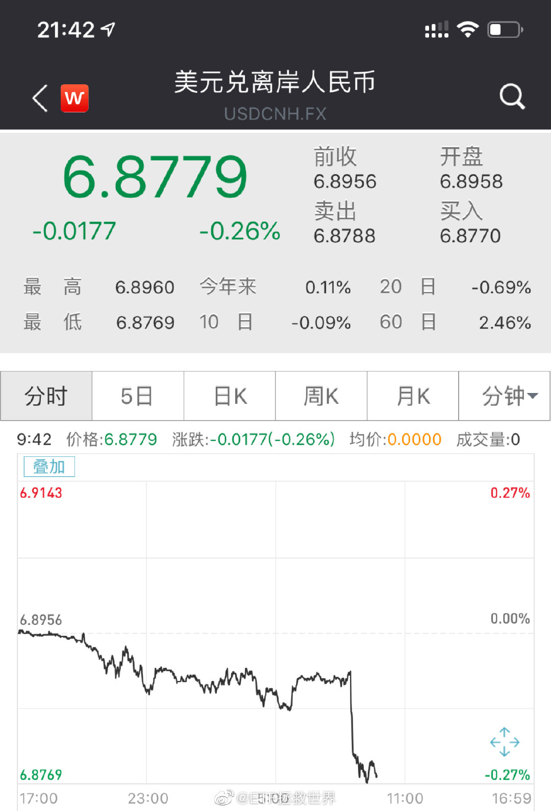

## 2019-07-10 22:44

//@落魄的三叔: 宝矿力，滚好。//@八大山债人://@曾鹏宇: 与宝矿力水特有代言合作娱乐公司已经宣布终止合作，这样的产品大家绝对不要买→_→   查看图片

## 2019-07-10 23:27

回复@weywong:趴体的时候C罗给别人买1000欧一瓶的酒然后自己喝红牛。//@weywong:搭车问下，类似的功能饮料，大家一般喝啥？//@ETF拯救世界://@落魄的三叔: 宝矿力，滚好。//@八大山债人:

## 2019-07-11 10:33

被A股气笑了。 ​​​

## 2019-07-12 18:06

非常忙。你这一天过的怎么样。有没有干点什么让自己更NB或者更开心一点的事。 ​​​

## 2019-07-13 22:09

整件事太诡异了，到底是怎么回事。

## 2019-07-14 16:46

张大妈要上市了，作为一个用了几年的用户，给你的忠告就是：

不要用，不要用，不要用！

因为你会发现居然有那么多以前不知道的好玩的东西，然后就全都买回来花了好多钱（本人是六位数）…

当然，如果你平常不刷，只是要买东西的时候上去看看历史低价等等还是挺好的…毕竟是我第一屏的软件… ​​​

## 2019-07-14 20:08

生日快乐。加油。

## 2019-07-18 11:36

在一个神秘的地方，上网不方便，勿念。

回见。 ​​​

## 2019-07-21 17:40

当代中国的另一面。有点好笑，有点感动，也有点难过。

## 2019-07-22 10:51

已公布的14家公司半年报，二季度平均利润增长超过30%。

但是家数太少，不具代表性。继续观察。还有一个月左右就能看出大致情况了。

根据历史，应该是二季度，最晚三季度上市公司盈利情况开始好转。 ​​​

## 2019-07-22 13:40

白银近期涨幅大于黄金，但年度涨幅看依然落后很多。A股市场上没有合适的白银基金，有的一只是做期货，损耗大，不适合持有。

想做白银比较好的途径是银行的纸白银，相对来说好一点。

如果银价也能突破几年的平台，那么后期在周期转换的过程中，贵金属的走势就会更多一点信心。

金银价格无法用价值衡量，只能看周期和趋势。所以走一步看一步是不可避免的。

## 2019-07-23 14:45

多看少动。

不看也没差。

找点别的事分散一下精力。 ​​​

## 2019-07-23 18:00

震惊！

过去13天我只发了10条微博！

这种亲者痛仇者快的事不能再继续下去了！ ​​​

## 2019-07-23 18:08

新裤子的彭磊当年不就是为了买房省中介费要去链家当中介吗……

## 2019-07-23 20:12

又想了想上一条微博的问题。

其实吧，也不是A股不行。不信？看三张图：

分别是05、09、13年至今，中证500与标普500、DAX30（DAX是全收益指数）的走势对比。

你会惊讶地发现，我A一点都不弱，05至今远远跑赢美国德国，虽然09、13至今大家走的差不多，但15年500可是一飞冲天发过大财的。

结论很简单，A股的特点和别人就不同。它就是上蹿下跳波动极大，其实最后大家都差不多。

所以有两点你要思考：

第一，如何利用这样的极大波动率提高收益率。

第二，如何不在波峰买入一套很多年，如何在谷底不要害怕坚定买入，坚定持有。
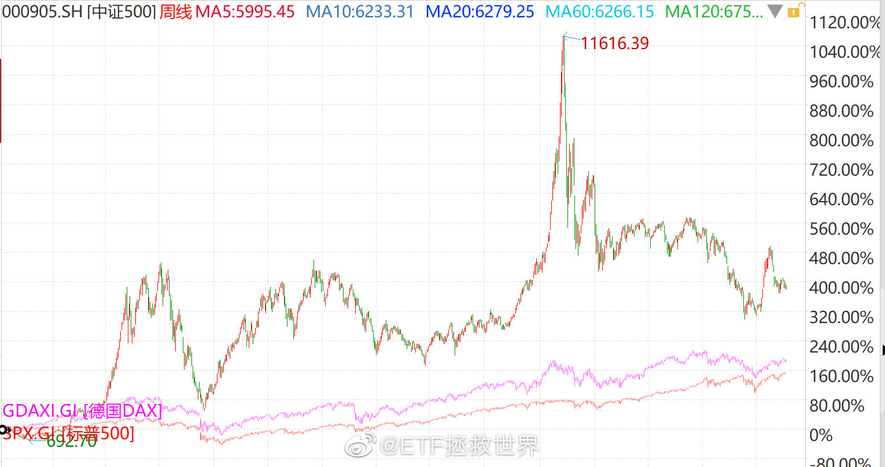 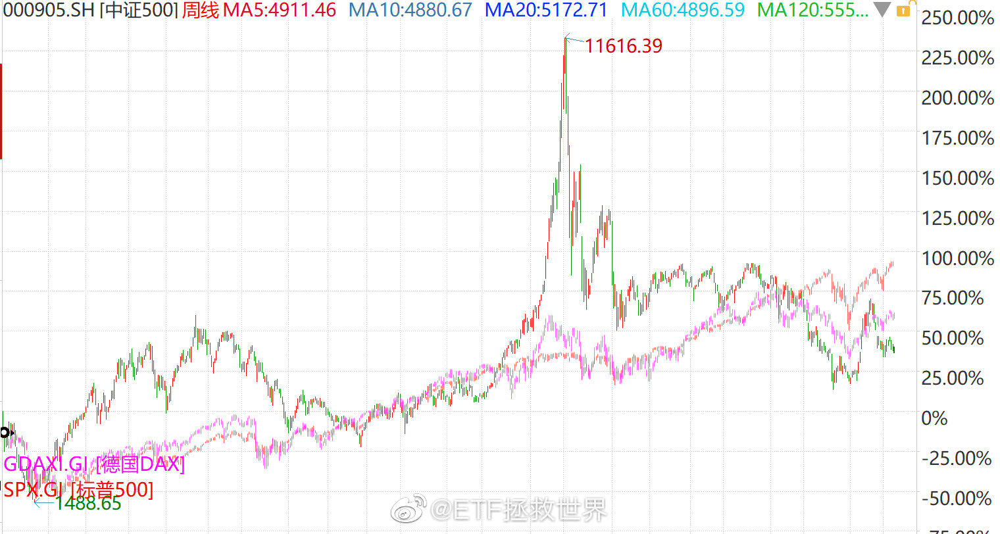 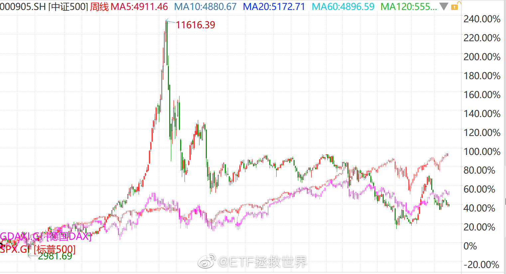

## 2019-07-23 20:42

白银继续反弹新高。

## 2019-07-23 20:53

还想去US的朋友慎重。美签的时候签证官会非常关注去过Iran这件事。

## 2019-07-23 21:56

去年跑赢20%不说了？谁能每个时间段都跑赢指数，上帝？

## 2019-07-24 14:36

钱不禁花。

一个感觉，不一定对。 ​​​

## 2019-07-26 15:59

喷了，转债指数长得比所有指数都多。

下一车要不要继续加。 ​​​

## 2019-07-28 19:08

哈哈哈 ​​​
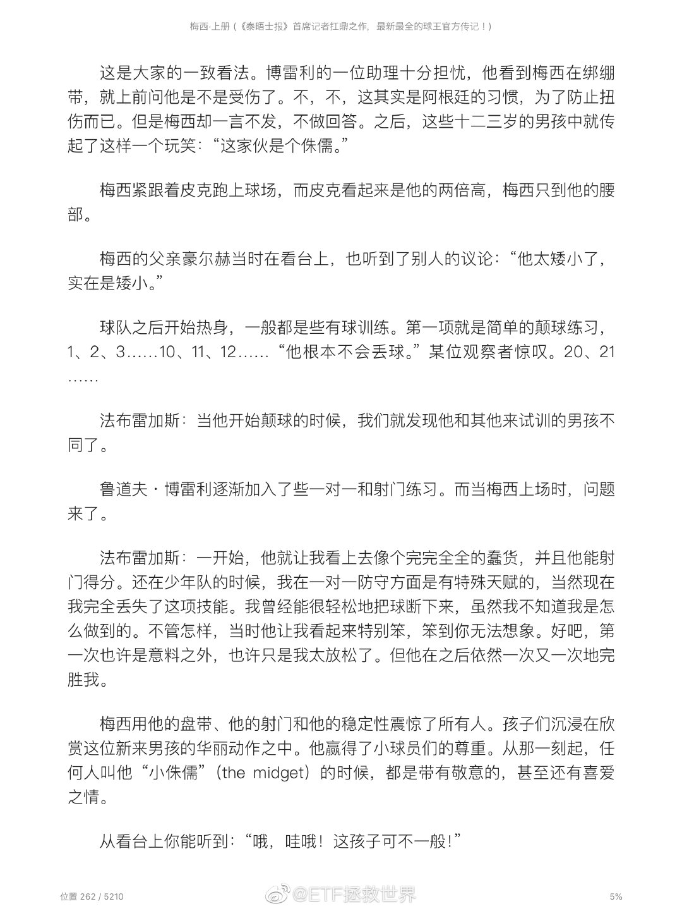

## 2019-07-29 18:04

忙归忙，总要抽出时间锻炼身体。

毕竟咱们还要再扛五轮牛熊。 ​​​
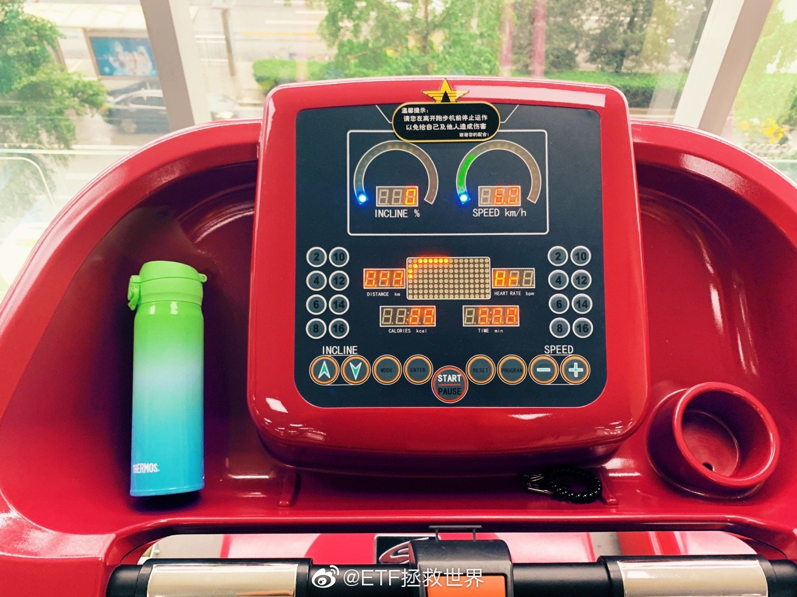

## 2019-07-29 18:15

回复@盛时不重来:里面是放了冰块的运动饮料，外面买的不够凉//@盛时不重来:回复@盛时不重来:保，保温杯？？？

## 2019-07-30 20:32

吃了吗 ​​​

## 2019-07-30 20:48

这样啊，发个投票，大家可以投一下。

因为之前有人抱怨我微博有时候会说与投资无关的事，他很不喜欢。然后我就想知道，各位朋友是希望我只说跟投资有关的事儿呢，还是我觉得有意思的事就发个微博说说呢。

我寻思好歹那么多朋友关注，总发一些打扰各位清净的东西也不好。耽误别人的时间等于谋杀…… http://t.cn/AiYv7oxq

## 2019-07-30 21:46

根据招行2018年年报，金葵花及以上的2%客户，占有80%资产。数学好的可以算算98%的人平均存款大概是多少。

## 2019-07-31 00:22

你说你这点了还不睡，难道也在操心世界和平人类命运。 ​​​

## 2019-07-31 09:47

$恒生指数 hkHSI$  下一个世纪最佳加仓点在21000。如果有危机就能到。 ​​​

## 2019-07-31 13:42

我不知道是不是我一毕业就没有过收入特别少的情况，所以我并不太理解“攒不下钱”这个概念。

我总认为，无论收入多么少，都能攒下来。很简单，任何收入，我是说任何，到手后，马上拿出20%-30%，再不行你就拿出10%，就当丢了，存到一个账户里。哪怕买余额宝，买了就不看。除非救命或者为了完成人生大目标，绝不拿出来。

就当丢了，丢了的钱你怎么花？

## 2019-07-31 14:27

辣鸡$中证转债 sh000832$ 又涨了0.1%。你跟着大伙跌一跌不好吗。 ​​​

