## 2019-08-01 16:05

绝大多数资产大类趋势都是向下，慢慢熬吧。 ​​​

## 2019-08-02 08:17

昨夜所有品种再次暴跌，除了它 查看图片

## 2019-08-02 08:40

现在再看有没有可能，还是有一丢丢可能的吧

## 2019-08-02 08:43

低调比黄金更珍贵。别嘚瑟。

## 2019-08-02 08:56

趋势不好，仓位合适，可以做的就是控制节奏，不要买太多。

你观察这几个月150计划怎么做的就知道。大底以来几个月只买了一两份A股指数，德国、黄金、海外互联买一点。转债多买了几份，防守性能比指数强。

我相信有机会把所有资金买下去，也有机会把组合里的防守品种换成进攻的。不急，控制节奏，趋势向下，机会很多很多。

投资其实你认真想一想，就那么几件事：估值、趋势、情绪、周期、流动性。掰开了揉碎了，没什么更多新鲜的。

至于一些具体事件，只是催化剂而已。

## 2019-08-02 09:44

如果日本跌的深，也可以成为组合中的一个选项。 ​​​

## 2019-08-02 09:49

虱子多了不怕咬，至理名言。

为什么，你现在能准确说出目前到底有多少亿美元的商品加了多少关税吗？

95%的人说不出来。

多好，麻木了。 ​​​

## 2019-08-02 10:29

转债指数暴跌0.38%，瑟瑟发抖中。是时候去找兄弟借钱了，不借就绝交。 ​​​

## 2019-08-02 13:23

还有个希望，把卖掉的消费以更低的价格买回来…… ​​​

## 2019-08-02 23:04

今天易方达转债下跌0.18%。

它应该是31日如果一定要买A股的最佳选择了……所以这次的转债和上次的黄金，截至目前为止都是正确的选择。 ​​​

## 2019-08-05 09:34

分享图片 ​​​
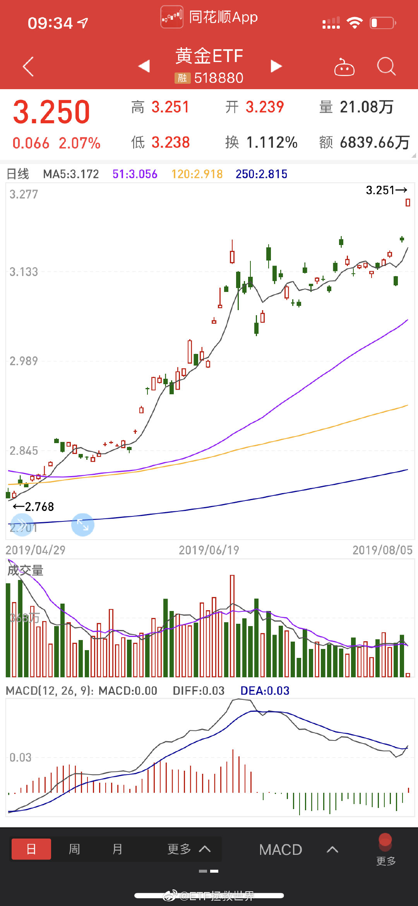

## 2019-08-05 10:27

前几天订机票还犹豫了是不是选HK中转，幸亏选了直飞…… ​​​

## 2019-08-05 11:01

未来我们买恒生的几个关键点位：

23000

21000

17000

随时间增加。 ​​​

## 2019-08-05 11:37

回复@网络观光者:你的风险承受能力一定程度上取决于你把最差的情况预估到哪里。尽量不要让未来发生“超预期”的事。//@网络观光者:还能看到17000.。。。这

## 2019-08-05 13:10

最近又把这本翻出来看。 ​​​
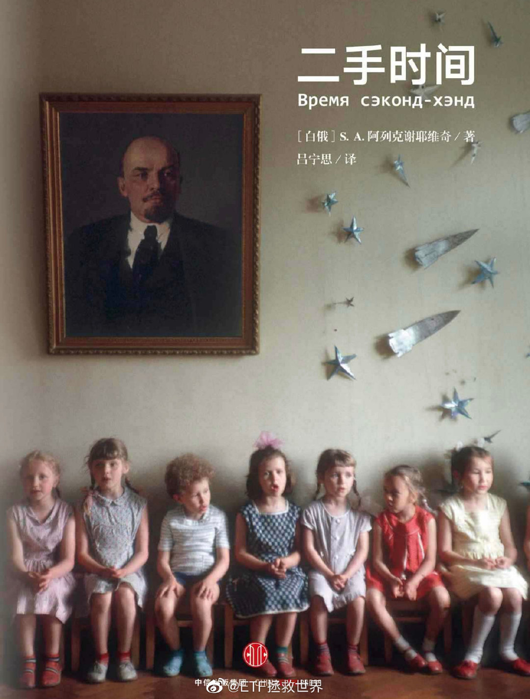

## 2019-08-05 13:17

“不淡定”都是来源于生活对你挥出一记重拳的时候，你毫无准备。

一拳过来，打懵圈了。生活太难了，你只能哭着做出错误的决定。

如果你早就做好了准备，那么这记重拳虽然也会打得你很疼，但你早就准备好了创可贴，也准备好了一根狼牙棒马上、立即、毫不犹豫的，狠狠的打回去。 ​​​

## 2019-08-05 14:26

17000是对标98亚洲金融危机、03科网破灭+非典、08金融危机。很难，但也未必100%不可能。真到了，有应对的对策即可。//@ETF拯救世界:回复@网络观光者:你的风险承受能力一定程度上取决于你把最差的情况预估到哪里。尽量不要让未来发生“超预期”的事。//@网络观光者:还能看到17000.。。。这

## 2019-08-05 14:35

韩国股市虽然2018年2月创出历史新高，但目前已经回到07年，也就是12年前了。

指数投资，长期持仓不动肯定不行。

那么，该如何做？

多看点各国走势，会有不小启发。 ​​​

## 2019-08-05 15:06

回复@千机幻尘:中证500早在2010年就回去了，在2015年已经是2007年的一倍多了。现在是2007年12月的点位。但是估值已经比当时下降了65%。//@千机幻尘:癌股什么时候才能回到07年..

## 2019-08-05 15:16

如果十年后500还是目前这个点位，那么PE将降至7-8倍，PB将降至0.5-0.6倍……（不出大事的情况下）。//@ETF拯救世界:回复@千机幻尘:中证500早在2010年就回去了，在2015年已经是2007年的一倍多了。现在是2007年12月的点位。但是估值已经比当时下降了65%。//@千机幻尘:癌股什么时候才能回到07年..

## 2019-08-05 20:35

看到国旗这样被扔到水里心里很难受。//@挖龙脉的超级鹿鼎公: 转发微博

## 2019-08-06 00:11

被限流了一条…… ​​​

## 2019-08-06 08:20

共克时艰吧 ​​​

## 2019-08-06 09:45

趋势这么用 ​​​
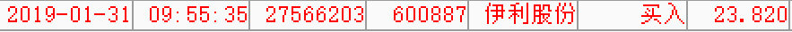 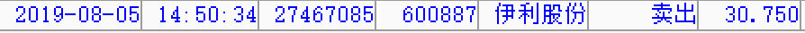 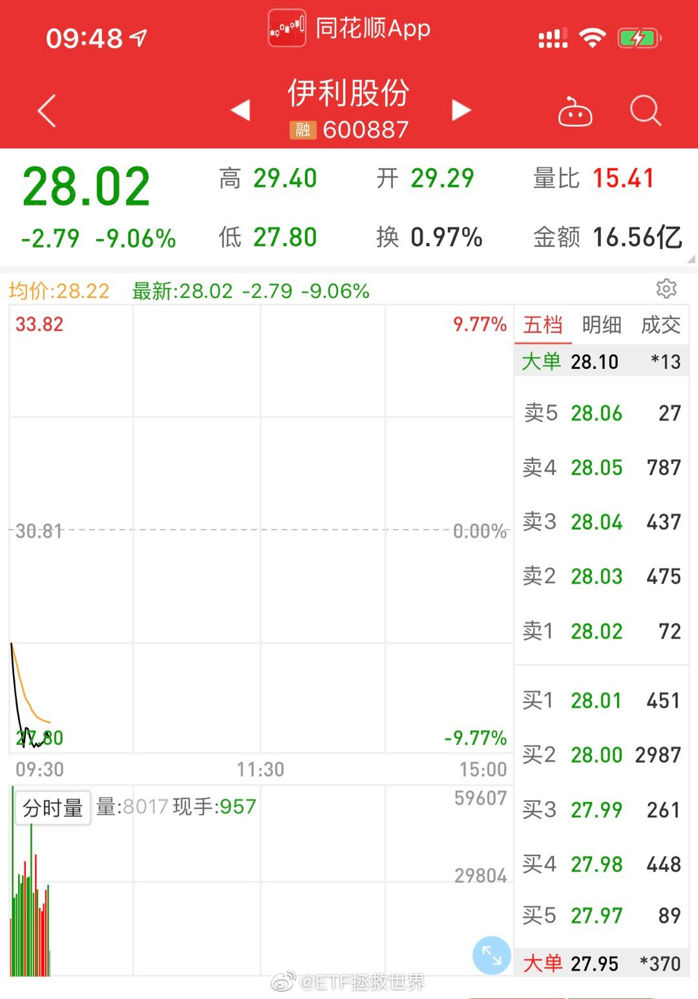

## 2019-08-06 09:57

最近开始把压箱底的货基和银行理财转入证券市场。

准备留2、3年生活费，其它慢慢转入。

这十几年，积累一些财富虽然不易，但这种时候不买，总是无法说服自己。

不希望自己未来会后悔。做大概率的事。

踏踏实实的，多大点事儿啊。 ​​​

## 2019-08-06 13:26

有一网没吃上，心都碎了 ​​​

## 2019-08-06 17:05

讲真，韩国人的个性真是刚。这种个性做很多事确实让人不待见，但有时候也让人有点佩服。

## 2019-08-06 20:41

回复@cumberawesome:我不针对个股，只说普遍情况。A股目前有3668家公司。//@cumberawesome:完美世界那么大商誉1倍pb也贵

## 2019-08-06 22:25

写了一篇关于投资本金的回答。

明天发且慢。

写这个还是很惶恐，很怕误导各位。

不过还是希望对你有些帮助吧。 ​​​

## 2019-08-07 09:42

金价突破1500

很多价值投资者看不上趋势交易。

说白了，恐怕是不懂。并且，从未尝试去弄懂。

被自己的执念禁锢起来了。 ​​​

## 2019-08-07 10:18

无论是向上还是向下，趋势一旦形成，就很难改变。

所以不要随意的去猜测哪天趋势会变。趋势当然会变，但一千个日子里，只有那一天是趋势改变的日子。你每天猜，成功的概率有多大？

所以不要猜测。

另外，趋势形成很久后，就不要再进入。趋势形成越久，你进入的那天就越有可能是改变的日子。

你也不想买在最顶卖在最底是吧。

所以最佳的趋势进入点只有两个。第一个是形态改变，第二个是回踩确认。除此之外，绝不再追。

## 2019-08-07 20:00

图片评论 查看图片

## 2019-08-08 09:21

伯克希尔现金储备创下1220亿美元新高

现金从来不是辣鸡。 ​​​

## 2019-08-08 09:31

“2”很精彩，看不懂的可以再看三遍。//@放牛娃想宅在冬天里: //@兽爷:应莹说是爱马仕，不是阿玛尼//@来去之间:那件衣服是爱马仕。

## 2019-08-08 17:27

男人不要说女人“难看”（包括各方面的难看）。女人不要说男人“你不行”（包括各方面不行）

## 2019-08-08 20:26

如果最近各个品种大幅下跌，让刚开始做网格的你觉得非常痛苦。

那一定是你哪里做错了。

怎么办？

再回去看公众号的几篇网格文章。

你会发现有那些我反复重复，反复强调，你却没有注意的细节多么重要。

我能帮你的，除了数据、模型、策略、体系外，最最重要的就是经验。

让你节省十年试错成本的经验。

## 2019-08-08 20:29

80年代初开始，达里奥就已经是我们的朋友了。

## 2019-08-09 10:02

转债指数已经涨回去了。 ​​​

## 2019-08-09 11:08

小贴士：

给孩子报音乐兴趣班，1v1，你也要进去听。

这样，一小时300块，两个人学，约等于150/人。

不仅如此，你的音乐素养也会提高。2/4拍4/4拍如数家珍，军鼓地鼓叮叮镲不在话下，一弦二品和弦指弹堪比岸部真名。

最后你和孩子组了一个band合奏一曲雨夜曼彻斯特。

其乐无穷。 ​​​

## 2019-08-09 12:58

什么叫一个人有价值？

就是每天打开股票社区的网站看一篇小说连载就关上…

这个小说作者就是有价值的… ​​​

## 2019-08-10 16:39

记得涂防晒啊 ​​​

## 2019-08-10 16:56

身材 头发，非常重要。

看了当年长得像王力宏的大学同学近照有感。 ​​​

## 2019-08-10 17:17

对我估值系统实力不了解的推荐看这个：

网页链接 ​​​

## 2019-08-10 17:29

在资本市场，如果你发现绝大多数人都是同样的观点，那它极大概率就是错的。

大V并没什么了不起。不信你看看今年微博红人夜财经类十大榜单。

我不会因为谁的粉丝多就觉得他牛x。只要他能有理有据条理清晰，我就重视他尊重他。哪怕没有一个人关注他。

大V什么都不是。 ​​​

## 2019-08-10 17:34

回复@啵波啵波啵波啵:趋势不好肯定看空的多啊。问题是对你来说，看多看空重要，还是该买该卖重要？//@啵波啵波啵波啵:那最近各大v都在看空，是不是大概率是错的？

## 2019-08-10 17:38

巴菲特1.6开始买中石油，最多浮夸30%，一路买一路跌，买成了第二大股东。

那时候你会不会觉得他是傻X。

几年后他12清仓，然后涨到21。

你会不会觉得他是傻X。

反正ys觉得他是，逼他上电视认错。

昨天中石油再创十年新低，不到四块。

看多看空，很重要吗？

谁赢谁输，是看下个月你对不对吗？ ​​​

## 2019-08-10 21:48

钓鱼成功，几个月来第一次又拉黑几个 ​​​

## 2019-08-10 22:12

不清楚这次台风到底有多严重，只希望我的各位博友以及你们的家人平安。

正好耳机盒在手边，这四个字送给各位。 ​​​
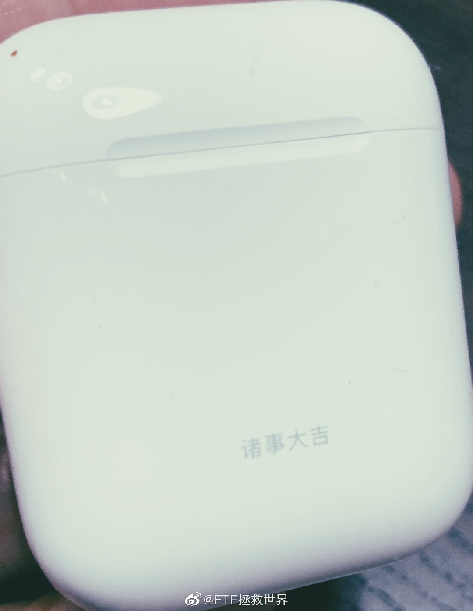

## 2019-08-11 00:28

shbl是不是真的那么差。

大家都说差，我反而想去看看到底有多差。

要不看过的朋友说说，看这个电影是不是浪费宝贵生命…… ​​​

## 2019-08-11 17:35

你跟他谈价值，他跟你说趋势。

也不知道这个脑回路是怎样的。

你知道吗。 ​​​

## 2019-08-11 17:45

回复@信仰MEe:一样一样分开聊。聊完一样再说一样。别掺在一起，那是脑子不清楚。有没有价值，有多少价值，值得给多少仓位？趋势如何，好还是坏，上不上右侧仓位？全盘考虑，概率下注。//@信仰MEe:暗示现在是价值区域，而不能盯着趋势，只是一个想法，不一定对

## 2019-08-12 10:46

电影不好看，男一被全网喷让我感觉也挺可怜的。毕竟电影好不好也不是一个演员能决定的。

但是看到拍电影的时候他通宵玩游戏，导演一喊咔就继续玩游戏，甚至连发型都不愿意换一下。

瞬间觉得挨骂一点都不冤啊。 ​​​

## 2019-08-12 14:50

别人都说好，你也说好，不代表你是没有主见，不代表你没有独立思考能力。

别人都说好，你说不好，不代表你比别人高，不代表只有你会独立思考。

你说好还是不好，完全来源于你自己的内心，这才叫NB。你觉得好就好，不好就不好，完全不被别人的说法影响，这才叫独立。

不因为怕被孤立而从众，不因为要标榜特立独行而唱反调。

当然，你现在的想法，几年后回头看可能自己会觉得很可笑，很二。无所谓，不断觉得以前的自己二是好事，说明你成熟了，你在成长。但这并不应该影响你在当下的独立思维。

投资也好，其它也好，大都如此。

## 2019-08-12 14:57

十二号了，再等三天会死吗。

什么玩意儿啊。 ​​​

## 2019-08-12 15:09

订了日落水上villa的我心里只有一句… ​​​
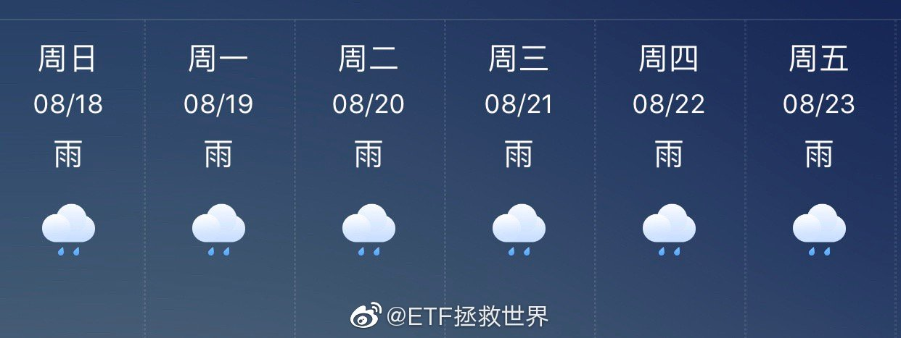

## 2019-08-12 16:35

跌两天看到2500，涨一天看到3100。

你说你来股市干嘛来了。 ​​​

## 2019-08-13 14:35

突破1530。聊趋势我也没在怕的

## 2019-08-14 08:29

想说点什么，又不知道怎么说。

希望这片土地越来越好。 ​​​

## 2019-08-14 08:39

之前一直说的，右侧只有两个买点：突破和回踩，就是防止追高出现昨天黄金这种冲高回落走势。

一个品种在上升趋势，你买进去大概率当然是赚。但也随时就是套在最高。最稳妥的办法就是突破以及回踩的时候买，再之后怎么涨都不动心。

赚钱固然重要，安全才是第一。没有100%的安全，但要尽可能低成本持有。

## 2019-08-14 10:58

## 2019-08-15 09:21

跌破25000，距离第一目标位23000不远了

## 2019-08-15 09:28

恒生有一个失误，没有在2019年4月30500附近卖出一份。

从我的系统来说，那里卖出一份是可以的。

又成长了。 ​​​

## 2019-08-15 09:59

回复@芒果糯米鱼:你补仓的策略是什么？是看心情补吗？//@芒果糯米鱼:油气一路补下来，已经补成了重仓，亏损十点。已经不想补了，躺倒。

## 2019-08-15 10:01

回复@婉儿哈士奇拉布拉多:网格一开始就做好压力测试，在每个价格都应该提前知道自己买了多少，有多少仓位，怎么会“不想补了，卧倒”呢？“不想”是个关键词，如果严格按照策略，没有“想”和“不想”。一切都应该是买之前就知道的。//@婉儿哈士奇拉布拉多:网格吧

## 2019-08-15 10:09

指数投资与股票投资最大的不同，是有一个大致可估算的区间。

无论你从价格也好，价值也好，都会找到一个模糊的顶和模糊的底。不会很精确，但控制在十几个点之内是没问题的。

比如之前说的下跌80%原则，就是价格区间。比如钻石坑或者哈迪斯顶，就是价值原则。

知道了顶和底，你就可以开心的设计你的策略了。如果你知道它极大概率不会跌破某个价格，你就可以以那个价位为底，设计一整套或者几套长期或者短期交易的策略。

尤其妙的地方，是你可以写好表格，将每个价位你有多少仓位你该买还是卖持有了多少亏损多少盈利多少事先全部列出来。你说，你已经提前列出来未来各种可能，那么这些可能发生的时候，你还会有任何情绪波动吗？

不会的。你不会有任何情绪波动。你只会按照当初的设计，打开软件交易而已。

## 2019-08-15 14:03

历史总是不断重复。

带头人去彼岸名校了，被忽悠的人准备罢课。

看过一个N H K的纪录片，很多年前，这样的一幕也发生过。

看过那部纪录片，会明白很多事。

如果有些事不发生，很多事情本来可以变得更好，也很庆幸，很多事情没有变坏。

祝福这片土地。祝福我们自己。 ​​​

## 2019-08-15 14:08

$中证红利 sz399922$ 

你XX是不是在逗我。 ​​​

## 2019-08-16 13:46

$中证转债 sh000832$  反弹新高 ​​​

## 2019-08-17 12:43

最后两分钟的总结亮了

## 2019-08-18 04:29

你是不是失眠了 ​​​

## 2019-08-18 05:27

生活小贴士：

不要觉得某件事不可能就不去试试。

试了就有机会。

去试试，万一老天不长眼让你做成了呢。 ​​​

## 2019-08-18 05:35

喷了，一天时间就过气了 ​​​
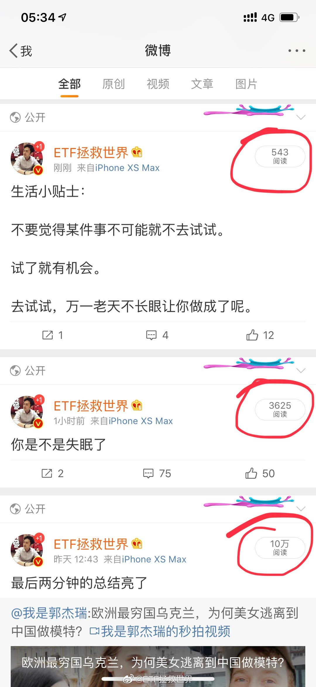 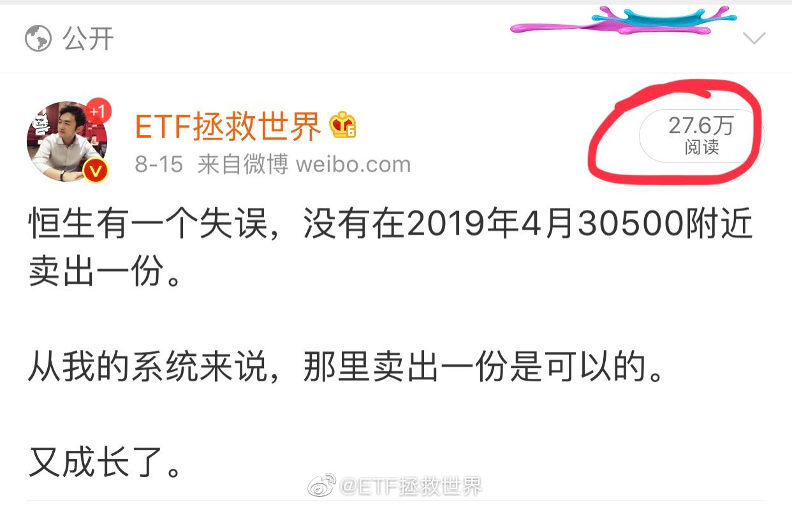

## 2019-08-19 10:07

早上起来出出汗 ​​​
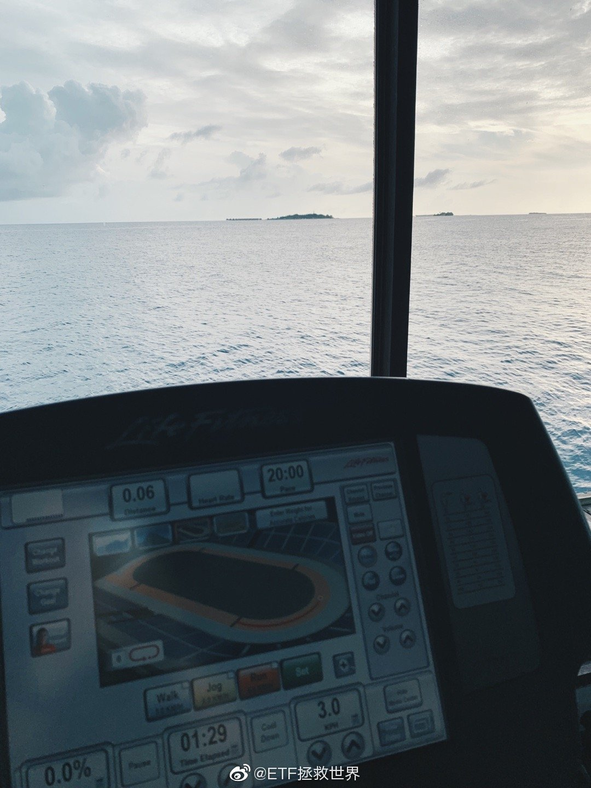

## 2019-08-19 11:09

这一网吃上的话已经可以出了。几天时间六个多点

## 2019-08-19 13:55

我们是中文网路唯一涨跌都舒服的群体 ​​​

## 2019-08-19 15:37

扯淡。绝大多数北京孩子进公立小学都是看房子。另外，从孩子的角度讲，上各种兴趣班根本不觉得累。奥数不知道，没上过…

## 2019-08-20 12:08

早上睁开眼睛打开阳台的门直接下海浮潜。

儿子一开始怎么也不敢试试，结果试了一次，跟小鲨鱼亲密接触后就不想上来了。

可惜没有水下相机，没法拍下水底的美景。

十三年前第一次浮潜后就爱上了这项运动，在水里可以忘记一切烦恼，跟各种奇形怪状的鱼一起随波漂流。 ​​​
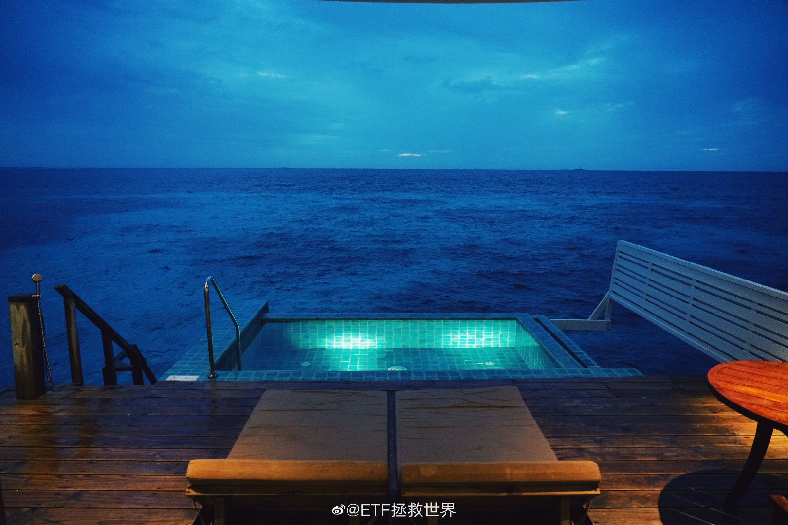 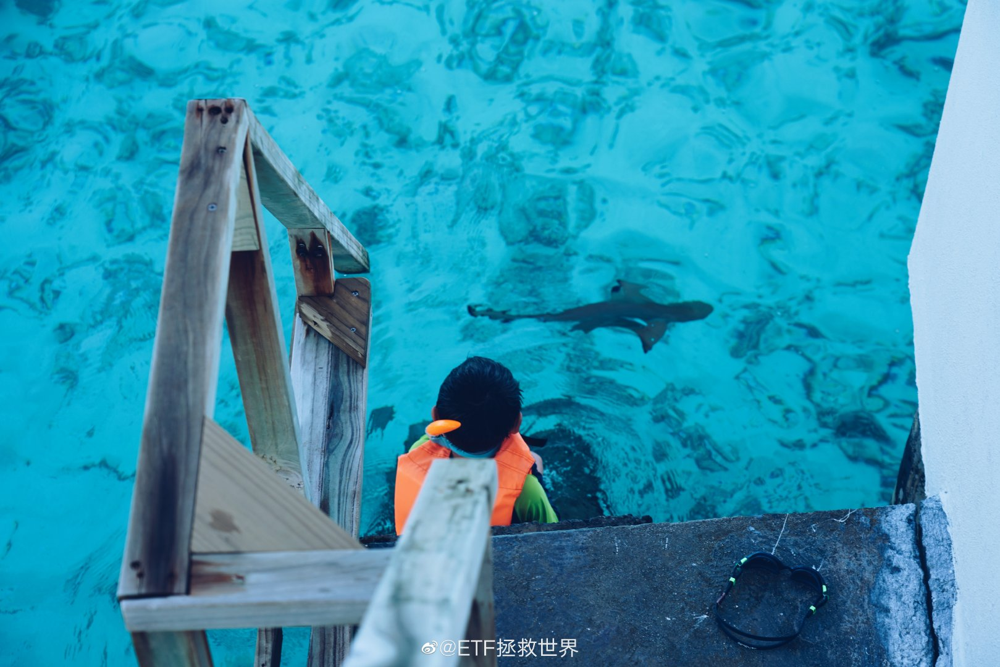  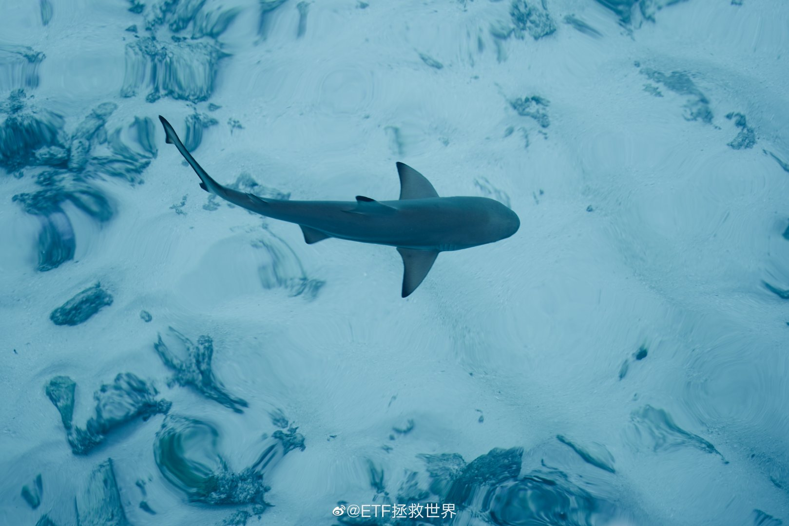

## 2019-08-20 14:25

回复@心想事成2028:这样的 查看图片 //@心想事成2028:作为工程人的我，在想这个房子应该怎么建，才可以推开阳台的门直接下海，很好奇房子是建在中间，还靠近海岛上。

## 2019-08-20 21:27

日落床照 ​​​
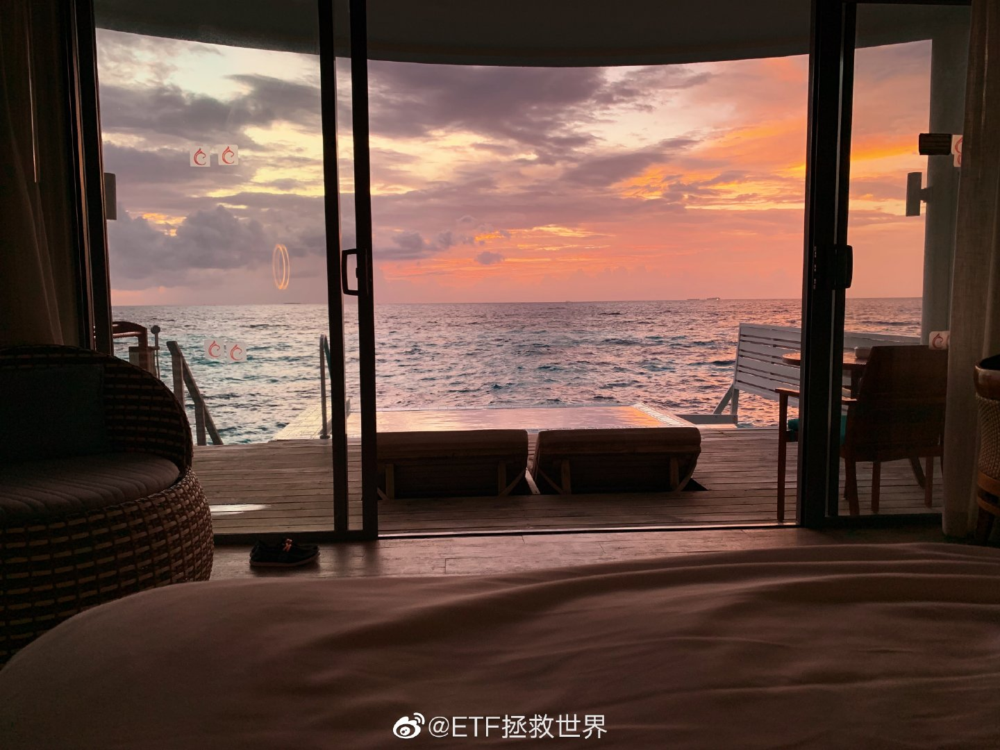 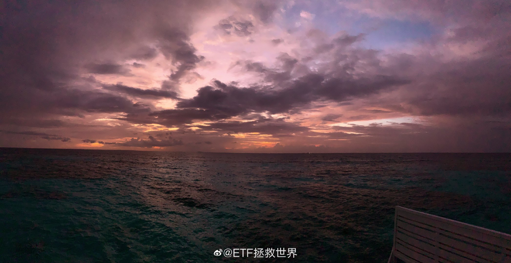

## 2019-08-21 22:17

被健身房的老外熏了出来。

在沙滩上跑两公里，去酒吧喝两杯鸡尾酒，看着相亲相爱的一对白人老夫妇拉着手坐在海边吊椅上晒太阳，心情大好。

儿子看着穿着泳衣，身高168，体重100斤的妈妈说：“妈妈你真漂亮啊，就是有点胖。” 万万没想到，比我还严格！喜欢瘦难道是人类的基因。 ​​​
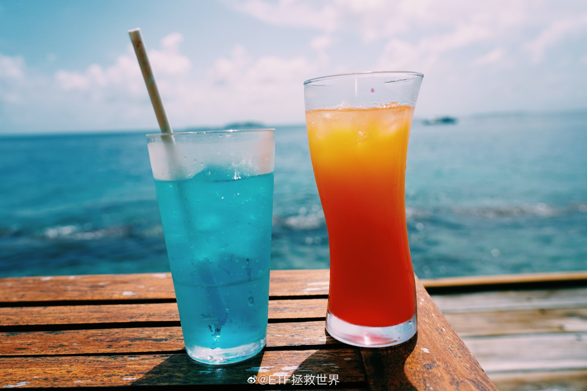

## 2019-08-22 13:22

算了手机不要了拍一段海底吧。

晃的比较厉害，因为今天风大浪大。最后十秒有小鲨鱼，一激动刚要追上去，鲨鱼妈妈在后面把我脚咬断了。

不说了我去医院了。 ETF拯救世界的微博视频 ​​​

## 2019-08-22 14:56

用评论里一位朋友推荐的色彩还原软件还原了一下，确实不错。

准备下午多拍点。各种颜色各种样子… ETF拯救世界的微博视频 ​​​

## 2019-08-22 15:04

看样子医药有走好的迹象。 ​​​

## 2019-08-22 21:33

再发一个，这几天就不发了。

去搬砖买新手机了。 ETF拯救世界的微博视频 ​​​

## 2019-08-23 10:49

下一个压力位10400

## 2019-08-23 11:09

投资，上上下下的享受。

别人晃的头昏眼花，你账户里的钱越来越多。 ​​​

## 2019-08-23 11:13

那天到现在5%，把压箱底的钱又拿回银行了…

## 2019-08-24 08:30

看样子又有机会拿出来了//@ETF拯救世界:那天到现在5%，把压箱底的钱又拿回银行了…

## 2019-08-26 08:01

好消息不断，网格提款机 ​​​
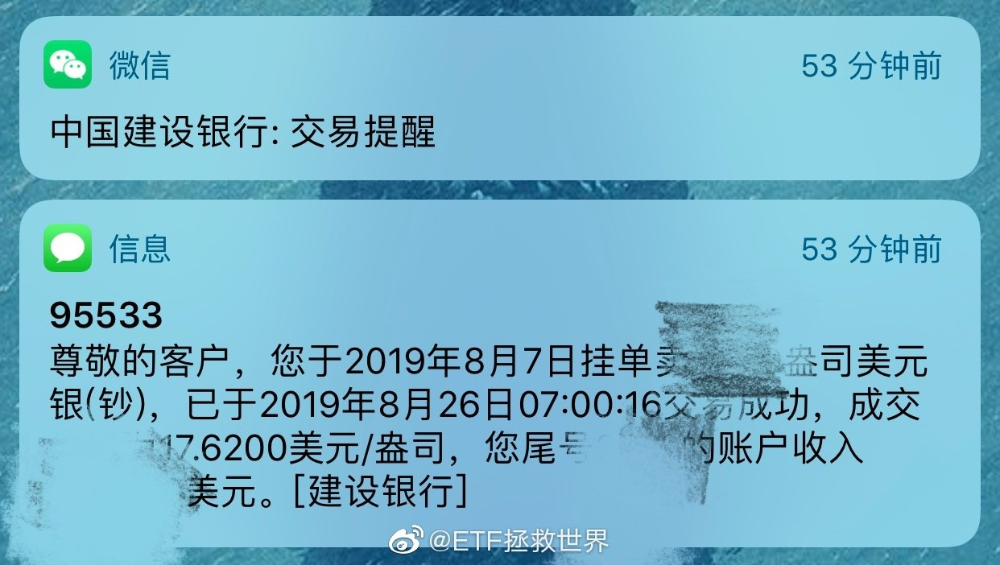

## 2019-08-26 10:06

$全指医药 sh000991$ 过于暴躁

## 2019-08-26 10:08

预告一下。

150会在23000以下买1-4份恒生。21000以下买4-10份。

S会在23000以下持续买入。 ​​​

## 2019-08-26 10:12

恒生从33000跌到25000，计划持仓的部分依然有45%的收益率。

一方面当然是汇率给力，一方面再次证明买的低有多重要。

你的成本低，它再怎么涨跌你就不会乱。如果市价总在你的成本附近，那你就很容易心浮气躁。 ​​​

## 2019-08-26 10:45

四大发明吧，我觉得极大概率都是中国先发明或者发现的。

虽然有几个受制于客观因素——比如中国文字雕版远比活字效率高——没有大范围推广应用。

这个当然应该自豪，但也应该看到，华夏文明几千年，实际上开创性的发明其实确实不多。这个不用详细说，你抬头看看周围你用的东西，再到孩子们上的各种课，除了筷子和语文，有多少是咱们发明贡献的。

也没见英国天天念叨“四十大发明”或者美国念叨“四百大发明”啊。

各自努力为现在的中国多出点力气做点贡献吧。

## 2019-08-26 10:52

趋势这个东西，有时候，不服不行。 ​​​

## 2019-08-26 20:00

实在对不起大家，私信太多了，我看不过来，所以很多朋友的我没有回复。

很多开心的，悲伤的，困惑的问题，我也希望能一一回复，但是精力真的不够，还希望各位别见怪。

祝福每位朋友都顺利，好人一生平安。 ​​​
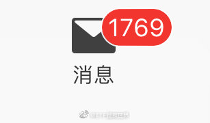

## 2019-08-26 21:03

现在北京跑步很舒服。就是这个moment。

不信你出来试试。 ​​​

## 2019-08-27 09:38

快了啊//@ETF拯救世界:下一个压力位10400

## 2019-08-27 09:42

这种品牌名字一听就够够的了怎么会有好感

## 2019-08-27 09:57

特别好，特别舒服 ​​​
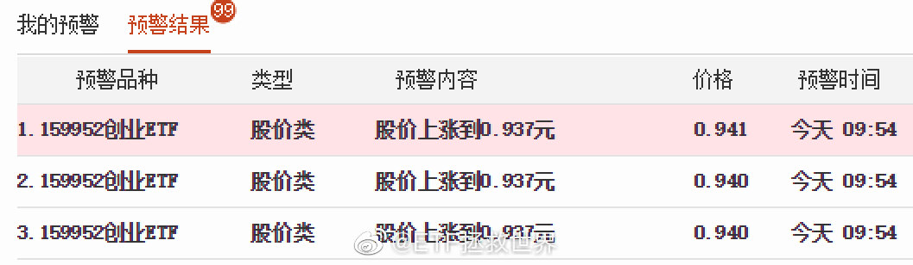

## 2019-08-27 10:17

别得瑟。真的。

## 2019-08-27 10:26

@彭磊新裤子《没有理想的人不伤心》 没有理想的人不伤心 ​​​

## 2019-08-27 12:31

为了孤独的美食家，我，充值了。

## 2019-08-27 16:47

处在这样的环境里我会非常非常焦躁。别说就便宜一点了，就是免费发东西，那我……我可能也会去看看……

## 2019-08-27 16:52

非常喜欢梦姐是怎么回事。 ​​​

## 2019-08-27 18:34

北京命案和抢劫破案率100%，90%命案一天告破说真的还是让人有点吃惊的。为警察叔叔点赞。

## 2019-08-27 20:20

关于上次的礼物，两位别急。

喷了。 ​​​
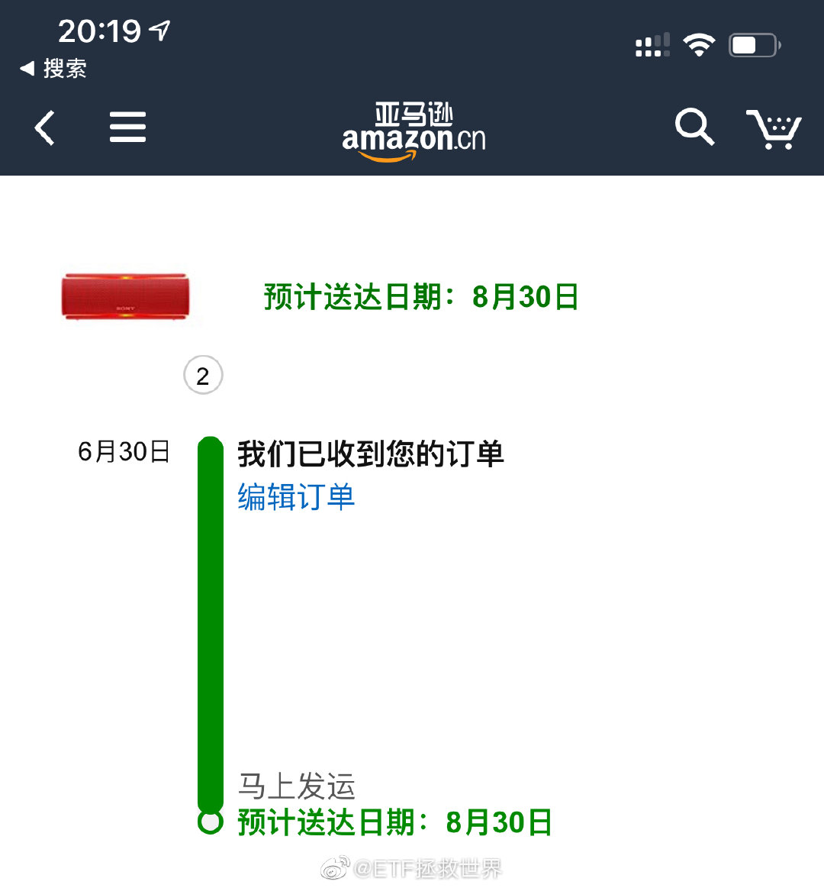

## 2019-08-27 20:55

突破18 查看图片

## 2019-08-29 20:55

你这是闹哪样。 ​​​
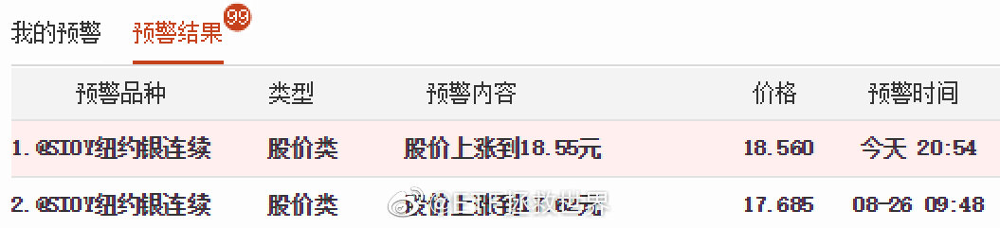

## 2019-08-30 00:48

​​​
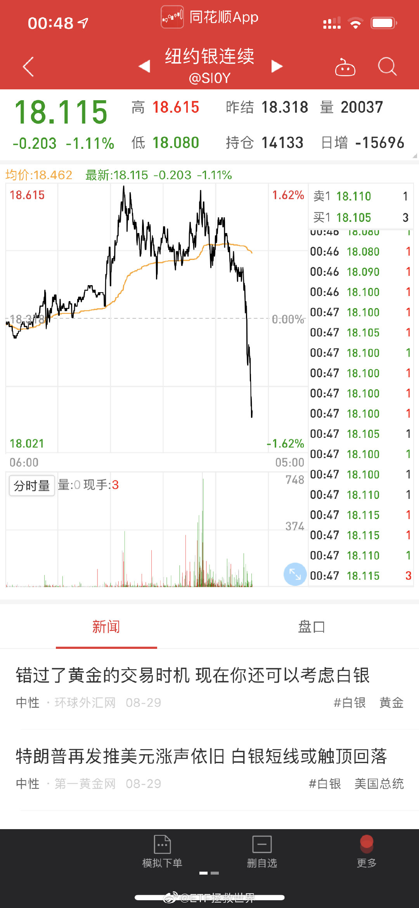

## 2019-08-30 09:16

上次的礼物还没到，我已经开始计划下次的了。除了之前说过的手机，现在还有两个选项：

戴森airwrap吹风机和茅台。

你选哪个。 ​​​

## 2019-08-30 09:39

一曲肝肠断

天涯何处觅知音 ​​​

