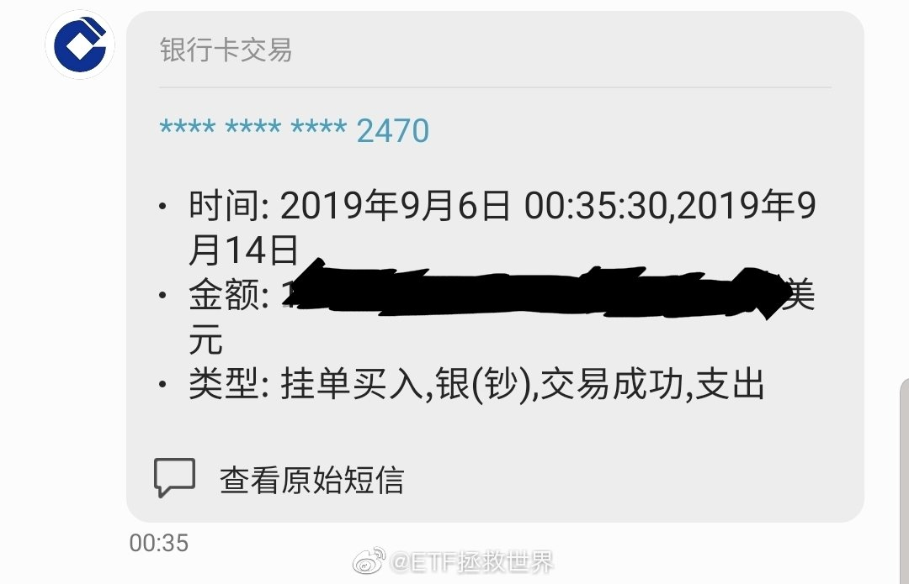
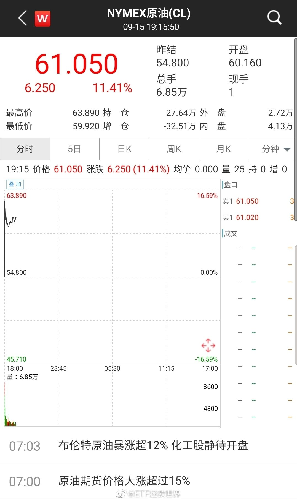
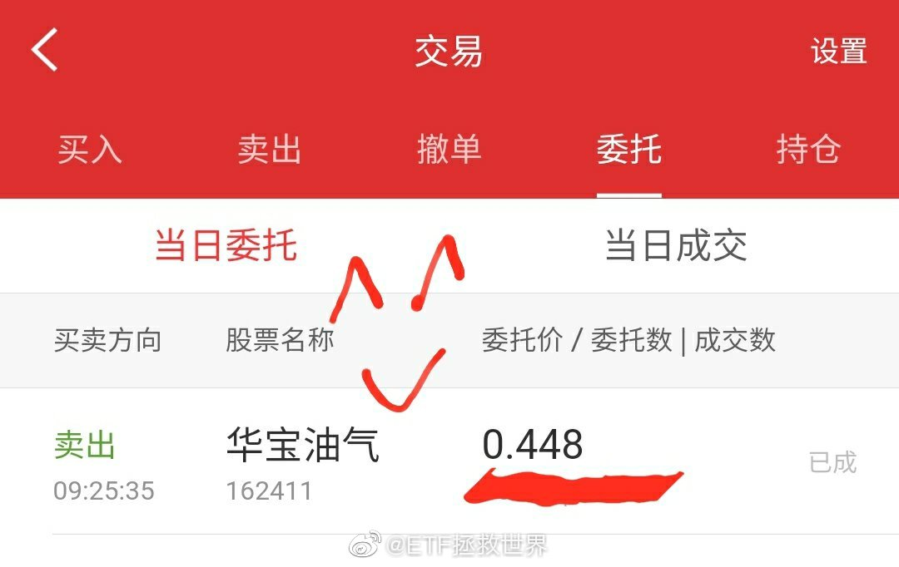
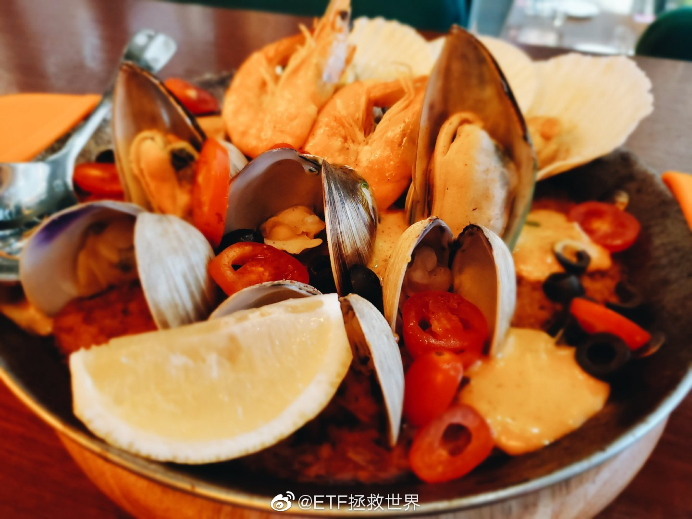
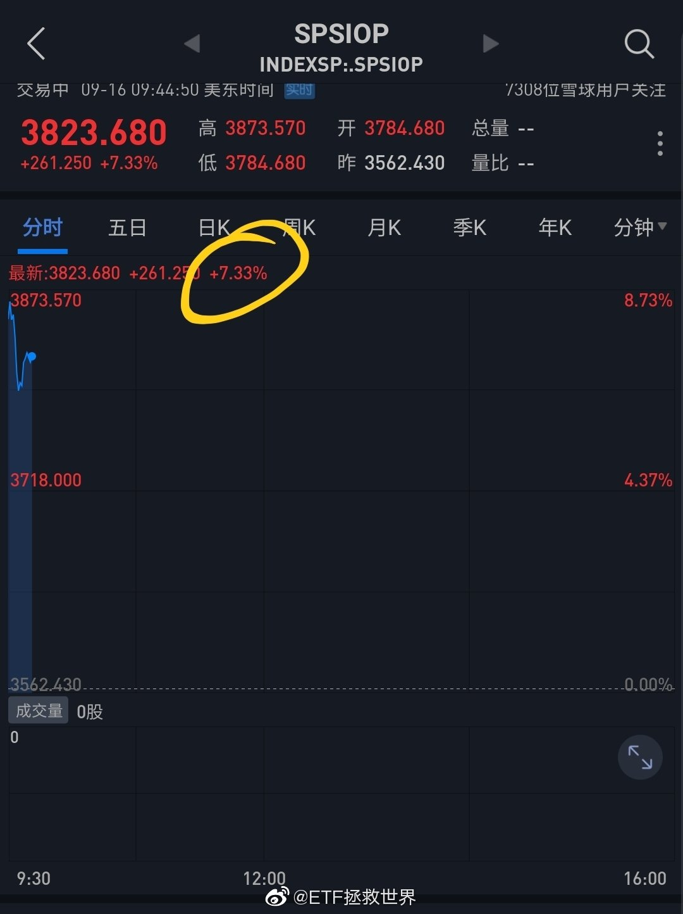
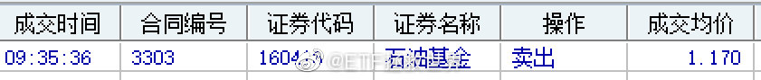
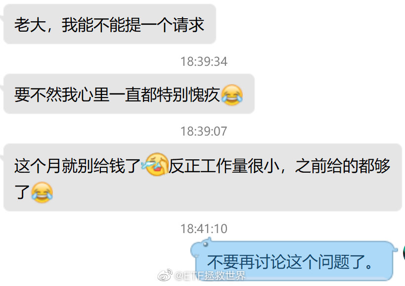

## 2019-09-01 08:58

辣鸡。

## 2019-09-02 10:58

遍绿野

嘻游醉眼

莫负青春 ​​​

## 2019-09-02 13:21

难道A股不是提款机吗 ​​​

## 2019-09-03 09:37

舒服吗 ​​​

## 2019-09-03 11:37

舒服你就不会被吓唬出去

## 2019-09-03 22:13

炒股害死人。拒绝炒股，从我做起。

## 2019-09-03 22:21

突破19 查看图片 //@ETF拯救世界:突破18 查看图片

## 2019-09-03 22:28

我有一个某品牌的钱包。有一天让水泡了，结果居然泡发了。莫名其妙的鼓起来了。

请问，这皮是什么皮。怎么一泡水还能鼓起来呢。

懂的说说。 ​​​

## 2019-09-03 23:34

人生至高境界：

揣着明白装糊涂。

如果能用在投资上：

太糊涂，你就是提款机。

太明白，赚不到什么大钱。

只有揣着明白装糊涂，才能泡沫中起舞，买单前悄然离去。 ​​​

## 2019-09-04 09:52

不说你不知道，前两天S发车的恒生一个多点了。 ​​​

## 2019-09-04 14:26

不好意思，看错了，是4%。

## 2019-09-04 14:36

计划持仓31个品种，浮亏的品种只有五个。

华宝油气，之前低买高卖，盈利20%出局。跌回来继续买，目前总浮亏9%。仓位1.21%，对你的资产造成的伤害是0.1089%。

为了这0.1089%，垃圾不说有26个，84%的品种盈利。不会说大仓位的恒生、50盈利超过40%，不会说消费盈利超过55%。

对，它会找一个近期跌幅最大的恶心你。我们持有各个大类的品种，一定有近期表现好的，有不好的。你猜它会不会找近期好的黄金来表扬你？当然不会了，为什么？

因为这是一帮垃圾。

垃圾的特点就是觉得所有人都欠它的。如果你给他100块钱，他会心里恨你，为什么，为什么你不给我1万块？

幸亏你没收管理费，如果收了它的管理费，它已经开始骂娘。为什么骂娘？因为这个占了资产1.2%的品种，跌了9%。

大垃圾！

一天的好心情就让这些垃圾破坏了。

非常好，你们达到目的了。

我会把你们这些垃圾，尽我所能，从我的世界全部拉黑。微信微博。我永远不希望再跟你们这些垃圾有任何交集。

对，别看别人，说的就是你！

垃圾！

## 2019-09-04 14:42

请那些评论“在等恒生23000”的人好好看看我的微博。我们现在持仓9%的恒生，仓位已经不小。23000以下，我们是在9%的基础上继续加仓。能到，我们就买。到不了，就踏踏实实持有目前的仓位。到不了23000，你就来骂娘，你是不是脑残？我前几天S加仓你瞎了？真服了。

## 2019-09-04 14:48

有些人继续表演，就只会让我越来越不敢在微博说话。

我说某个点位之下继续加仓，就有人能理解成一定会跌到那个点位下。我说我已经做好跌到某个点位的准备，如果到那个点位，我也会有预案应对，他也能理解成一定会到那个点位。

然后，跌的时候不敢买，涨了就来怪你：

不是你说要到多少多少点吗？

如果微博上22万人都是这种理解力，我请问，我到底该怎么说话以后？

谁能教教我？

国家越来越重视语文教育，那真是太英明了！

当然，有些人不是语文不好，而是做错了需要找一个出气筒。

怪别人，是最轻松的转移痛苦方法。但是，所有的错都是别人的，你虽然心里舒服了，但你这辈子也就这样了。

## 2019-09-04 14:53

算了，今天又涨不少，不跟喷子置气了。

买个包包奖励自己。

 ​​​

## 2019-09-04 15:01

关于为什么前天S买恒生，

我准备观察几天，如果稳住了没跌回去，

就写篇东西吹一下。

 ​​​

## 2019-09-05 09:37

高位追涨低位割肉的人，是不是给你送钱的。

你数学好你讲一下。 ​​​

## 2019-09-05 09:39

股价预警没完没了的往外蹦，好烦。  ​​​

## 2019-09-05 09:41

转债指数准备突破上半年高点。我们不断加仓的易方达转债已新高。 ​​​

## 2019-09-05 09:52

回复@空谷覔幽兰:目前的情况可以多留几份利润//@空谷覔幽兰:出了四个品种的网，今天够了

## 2019-09-05 09:54

做悲观的乐观主义者。

对于这句话是不是感触越来越深。 ​​​

## 2019-09-05 10:03

回复@Share新奇:新朋友吧。//@Share新奇:牛，特别佩服，E大的伊利买点卖点，还有黄金的买点，恒生的买点。几乎是精准打击。太牛了

## 2019-09-05 10:08

如果你的钱真的不是少到只能买一点点点点，不是动不动就满仓动不动就空仓那种股神，那么你完全可以：

黄金-钻石坑一线买入一部分，一大部分筹码等待超级大牛市的喷薄。那当然一定肯定会来。

但问题是，不确定时间，不确定中间的波折。

所以，为了收益率以及心态，你需要有一部分资金，一小部分，做中短线波段。

无论你做什么，目的只有一个：

保证自己在大牛市中吃饱吃好的同时，在等待牛市的过程中不会饿死或者悲观到放弃理想。

为了达到这个目的，设计你的体系和策略。

如果你想满仓吃到震荡市中每一个波段，空仓面对每一个下跌，然后满仓牛市从头到尾，那你的下场大概率是会比较悲惨。

## 2019-09-05 10:20

有些朋友可能看到我微博下面有些评论，出于各种原因非常不舒服……看着有些“吹捧”之类的评论不喜欢。

是这样，主要是你不了解我们这里的气氛。无论是所谓的“吹捧”还是“拍马屁”，绝大多数都是大家在开玩笑。熊市中大伙都没挣大钱，凑一块乐呵乐呵，我们都没当真，您也别当真。

我们不当真，您当真了，生气了，不开心了，对您自己的身体不好，是吧~人生在世，能找点乐子不容易。

多开心，少生气，不要浪费大好青春啊。

## 2019-09-05 10:34

永远别问“今天为什么涨了？”“今天为什么大跌？”。

一点儿都不重要。真的。 ​​​

## 2019-09-05 10:38

回复@ZZ是粽子啊ZZ:说明我仓位重了。不像前两年，每次暴跌恨不得发100条……//@ZZ是粽子啊ZZ:老大的发微博频率和上涨幅度成正比哈哈哈哈

## 2019-09-05 10:47

其实投资A股，最重要的就是做大周期。保证熊市不赔或者很少很少浮亏（这里的关键是你如何保证在收集到足够筹码的情况下不赔钱，否则买个货基或者理财不就完了吗）。

保证牛市大致跟上。

周而复始。

这样有个3-4轮，就会非常NB了。

其他的都是细枝末节。比如牛市指数涨了100%，你只赚了80%。这重要吗，其实并不重要。

重要的是熊市跌50%的时候，你还能赚10%。

这样，下一轮开始的时候，指数没动，你已经赚了98%。

## 2019-09-05 13:21

大多数指数本周趋势应该会变好。仓位不够的朋友，后面还会有一次回踩确认，那将是一次不错的加仓机会。 ​​​

## 2019-09-06 07:36

千万别把生命交给司机，别觉得每个司机都会让你。

## 2019-09-06 09:38

有多少人觉得“大牛市来了！再不买就晚了！”

举手示意一下。 ​​​

## 2019-09-06 18:03

iPhone11 
mate30 pro
note10+

选哪个 ​​​

## 2019-09-09 10:07

浮亏别难受，浮盈别得瑟。

都是平常事，踏踏实实的。 ​​​

## 2019-09-09 11:39

在证券市场，成功还是失败，不是看你这一把赚了多少

而是你有没有投资逻辑，有没有体系，有没有策略。

如果都有，而且都对，那赚钱这件事只是捎带脚就完成的事，迟早都会发生。

几年一个轮回，从未改变，从未缺席。 ​​​

## 2019-09-09 14:52

你持仓的品种大涨也别得瑟。攒人品。 ​​​

## 2019-09-09 15:09

之前我说，野百合也有春天。我又说，杀富济贫雪中送炭。

你可能不信，认为我是为持仓中表现不好的品种找借口。

现在你有点相信了。

我说的很多东西，未来都会验证。只是需要时间。

回望过去，绝大多数时候时间都站在了我这边。希望以后也是。

也有些朋友喜欢为现在发生的事情做出“合理”解释，认 ​​​ ...展开

## 2019-09-09 23:57

送个贴士给你们：

如果你看到某人因为某个品种骂我或者嘲笑我，

那么那个品种极大概率已经是底部区域了。

根据过去几年的观察，这个策略成功率大概86个巴仙。

如果是大v骂我，则成功率上升至98.385个巴仙。 ​​​

## 2019-09-10 11:09

$全指医药 sh000991$  喷了，每天一款给你惊喜。 ​​​

## 2019-09-10 11:49

“女孩母亲听说蹭的是奔驰拒绝露面”。辣鸡。

## 2019-09-10 14:34

不知道怎么回事，每天都很舒服。

你说是不是很奇怪。 ​​​

## 2019-09-10 18:51

从今天的数据看，建议不要再买创业板指数基金。已经持有的可以继续拿。 ​​​

## 2019-09-11 06:40

果断下单_____。 ​​​

## 2019-09-11 10:05

带西瓜榴莲臭豆腐去迪斯尼玩是什么操作

## 2019-09-11 10:13

去过美国日本香港的迪斯尼，去过美国环球影城。都挺好，除了游乐设施，更是梦幻世界。

上海的迪斯尼我估计应该不会去，主要是人太多，乱。人多的地方再好也不去。

几年前去的香港迪斯尼人最少，好多项目不用排队随便玩。现在人应该更少，不过我也不会去了。 ​​​

## 2019-09-12 07:37

今天押涨还是押跌。

你是赌神你先下。 ​​​

## 2019-09-12 12:27

不清楚真相，关注。希望有部门把事情弄清楚，别让好人受委屈，把坏人都干掉。

## 2019-09-13 11:44

中秋快乐。 ​​​

## 2019-09-13 19:58

回复@Invincible-Su:原来是这样出去的。不知道该评论什么……//@Invincible-Su:图片评论 查看图片

## 2019-09-13 21:57

其实决定公众号发文量的一个很大因素是阅读量。

每次都是那几万人看，连10w+都没有，做事就很难有积极性。毕竟写篇东西累的半死不活图什么啊… ​​​

## 2019-09-14 06:08

哈哈哈。

波动的乐趣。 ​​​

## 2019-09-16 07:34

可惜油气明天才能完全反映。如果大致跟上，一天出两网你能想到。 ​​​

## 2019-09-16 08:01

回复@KK_Litchi:这种事情不算黑天鹅。黑天鹅是根本预计不到的事情，油田被袭击预计不到吗。如果这个算，那么黑天鹅就满地跑了。//@KK_Litchi:讲道理其实这算是黑天鹅

## 2019-09-16 08:18

今天油气涨幅跟不上油价，因为基准晚上才在美国开盘。但不会一点反应都没有，涨4-6个点也很正常。

有网格的该出就出，不舍得就多留点利润。你知道人家那边设施什么时候就修好了啊。弄不好一两天就又跌回去了。

跌了害怕，涨了贪心，投资最怕这个。你就是个机器人，无感情的执行策略即可。执行策略的时候，根据心态适当调整操作细节，这个没有任何问题。

## 2019-09-16 09:30

开盘上涨6%，一切尽在掌握。

## 2019-09-16 09:33

这网利润十几个点 ​​​

## 2019-09-16 09:37

回复@游进大海的鱼_:场外今天卖，价格是今晚美股的价格//@游进大海的鱼_:场外今晚才开盘，是今天15点前卖还是明天15点前卖？

## 2019-09-16 10:51

开盘6%，现在4%，别问为什么这么准。问就是蒙的 //@ETF拯救世界:开盘上涨6%，一切尽在掌握。

## 2019-09-16 12:49

关于香港的消息，我一点都不想看了。 ​​​

## 2019-09-16 13:04

挣钱了不吃点好的，赔钱的时候还能有心情吗？ ​​​

## 2019-09-16 13:18

回复@小小单酒窝:感觉不到什么短板，相反黑科技挺多，比如接根线就变台式机。我最喜欢的是笔有不少好玩的应用，比如直接在日历上写字，很有感觉。电池续航一般，所以充电速度很快吧…//@小小单酒窝:E大说说现在用的三星，也想买这款

## 2019-09-16 15:42

富国300要分红了，目前的情况，当然是分红再投资不用多说。 ​​​

## 2019-09-16 21:48

如果这个涨幅坚持到收盘，今天场外赎回的朋友会赚的比场内多。

这就是乐趣啊。 ​​​

## 2019-09-17 06:26

太准了吧！ 查看图片

## 2019-09-17 09:26

你的有效和成功经验越多，就会越淡定。

为什么界定有效和成功？

因为无效的，失败的经验完全无用。

当你非常明白，清楚的经历过波动，并且不断取得成功，原来模糊，怀疑的东西开始清晰，坚定，你就level up。

如果在波动中，陷入惊慌，迷茫，完全不懂为什么会这样，发生了又该如何应对，那么一次次的失败带给你的只会是抱怨、苦闷。失败的烙印打在身上，完全找不到正确的方向，最终在下一次波动中继续失败。

潮起潮落后，花开花落时，你只会记得一句话：

踏踏实实的，多大点事儿啊。

## 2019-09-17 09:36

这是闹哪样。不说那么多先走一波。 ​​​

## 2019-09-17 09:41

又买回来了。成本再降5.5%，中午又可以去吃海鲜饭了……  查看图片

## 2019-09-17 09:47

回复@collin87:这是计划里面长期持有的石油基金。由于溢价过大，我卖的时候溢价18%，没有理由不卖。跌落后溢价回归正常，再买回来。这不是网格。//@collin87:不懂就问。不是在华宝油气上做网格吗？不是说相关性太强的品种选一个就可以了吗？

## 2019-09-17 13:06

回踩也许会迟到，但从未缺席。 ​​​

## 2019-09-17 13:14

回复@锅边糊6000244828:计划长期持仓不动收益率37%。稍微做点波段收益率超过50%。我本人收益率就不说了。不好意思，让你失望了，拉黑。//@锅边糊6000244828:亏了多少走的？

## 2019-09-18 09:11

&quot;你知道人家那边设施什么时候就修好了啊。弄不好一两天就又跌回去了。&quot; 沙特宣布恢复石油产量，油价大跌。哈哈哈，莫名其妙的赚了一笔，跌回去继续买。

## 2019-09-18 09:17

我真的不懂，为什么一个足球游戏的服务器也要屏蔽。

为什么，它只是个足球游戏啊。 ​​​

## 2019-09-18 10:14

微博网友太牛逼了，真心的。

感谢！ ​​​

## 2019-09-19 17:27

忙了一天，你怎么样，过得舒服不舒服。 ​​​

## 2019-09-22 18:14

不好意思，这几天忙着练功，没时间发微博。

好消息是已经练到了第七层，神功将成！ ​​​

## 2019-09-23 08:55

这周市场大概率会走的很无聊。 ​​​

## 2019-09-23 09:41

又快出了吗，好烦

## 2019-09-23 10:12

本周将考验支撑位。能撑住就是健康回踩，继续上扬。撑不住就继续寻底吧。能不能撑住我没有观点。不猜，顺势而为。

## 2019-09-23 14:55

相当无聊的第一天。

## 2019-09-23 22:08

内心毫无波动的机器人 查看图片

## 2019-09-24 11:20

今天不舒服。

剪衣标把衣服剪了个口。

我大概是个智障。 ​​​

## 2019-09-24 11:22

今次能冲过去吗。//@ETF拯救世界:快了啊//@ETF拯救世界:下一个压力位10400

## 2019-09-24 14:26

昨天先跌，把你打一顿吓出去

今天先涨勾引你回来：客官别走嘛再进来玩玩

你禁不住诱惑又进去了。再打一顿

太坏了 ​​​

## 2019-09-26 11:51

好像也不是那么无聊啊 ​​​

## 2019-09-27 08:21

哈哈，今天可以买回来了

## 2019-09-27 10:51

把握住两点设计你的投资体系：

第一，指数长期向上。

第二，指数中短期会有波动。A股波动尤其大。

这两点真正理解，融入你的体系，基本上长期赚钱不会有问题。

牛市跟上，波动提款，熊市不赔。 ​​​

## 2019-09-27 14:58

服了 查看图片 //@ETF拯救世界:内心毫无波动的机器人 查看图片

## 2019-09-29 07:54

工作使我快乐。 ​​​

## 2019-09-29 19:14

每次发钱的时候都说给多了，这样的员工哪里找。

哪儿多了，我感觉一点也不多啊。 ​​​

## 2019-09-30 01:15

跟自己孩子在一起的时候是最快乐的时光。

## 2019-09-30 10:42

…… ​​​

## 2019-09-30 14:40

内鬼开始行动了！

## 2019-09-30 14:41

烤鸭不是火车站买的吧……

## 2019-09-30 15:00

一切尽在掌握。 ​​​

