## 2019-10-01 22:25

一栋楼阻挡了我躺在阳台上看烟花的梦… ​​​

## 2019-10-03 09:26

美股大跌两天，现在相信这两句话了吧。

一切尽在掌握。 ​​​
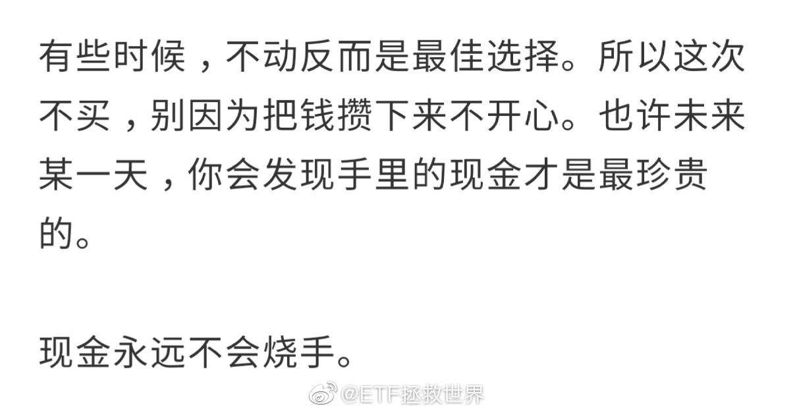

## 2019-10-03 10:17

我不喜欢那种根本不愿意全面看我东西，断章取义的人。

微博就那么几个字，我想表达的东西你不全面看根本不知道我到底是什么意思。比如上一条微博，你不结合十月第一次发车怎么会理解我们在说什么？

但我对每天紧密跟踪我，然后想方设法扭曲事实恶意抹黑的人是真的痛恨。

前一种只是不熟悉的人而已， ​​​ ...展开

## 2019-10-03 17:39

天真活泼和有素质有家教应该不矛盾。

另外，很多时候身教确实比言传有效。有一次我为后面一位推婴儿车的妈妈拉着酒店的大门被孩子看到，那以后他就经常为我们拉门，很欣慰。 ​​​
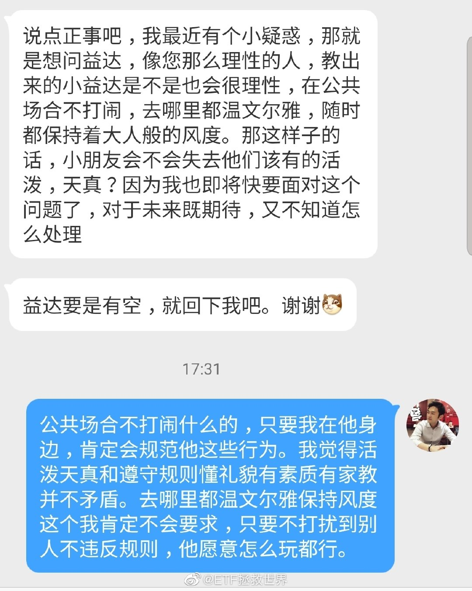

## 2019-10-03 21:30

独立思考才是最终王道。

否则网上这样风向变来变去你就容易被整晕了。

冷静，客观。 ​​​

## 2019-10-04 15:22

这种项目以后就别玩了。尤其是在一些可疑的小游乐场

## 2019-10-04 16:46

长假漫漫找点乐子，下楼给自己和儿子买点玩具。

先搭哪个？因为这个问题我和儿子打起来了。 ​​​
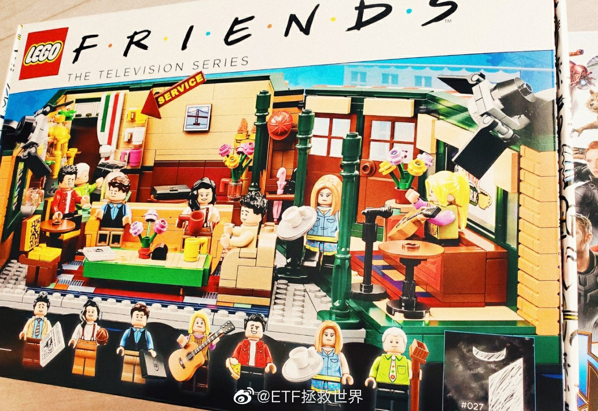 

## 2019-10-06 10:57

其实扔个ipad就可以安静一路，主要还是有没有“不给他人添麻烦”这个意识。如果大家出门都有这个意识，不仅咱们自己的生活质量能上n个层次，出门在外也不至于被那么多老外不待见。少数人的锅，真的要所有中国人来背。

## 2019-10-06 11:41

小孩在外吵吵闹闹到底能不能管住？应该不应该管？

别人的孩子吵闹，是不是我的孩子就应该吵闹？别的国家孩子也有闹的，是不是中国孩子就必须闹？

这些问题都决定了家长的态度。

我的观点是，只要家长有意识，就一定能找到不让孩子吵闹的办法。绝大多数吵闹孩子的家长，根本就没有想去管。因为他们觉得：“孩子就是这样啊，天真可爱活泼。你有孩子就知道了”。

这就跟养狗不栓一样：“我家狗不咬人”。就是因为你根本没站在别人的角度想过问题。

孩子也没错，狗也没错。错的就是那些不讲规矩的成年人。

你孩子活泼，你的狗不咬人，没有问题，回家爱怎么样怎么样。你别在公共场合给别人添堵。

相信我，除了特别小的婴儿，大一些的孩子绝不是“应该”一出去就吵闹的。不信，下次你试着管管。

PS:本人养了十四年狗，六年孩子……应该是有发言权的……

## 2019-10-07 01:04

本来给两位买的是SONY的音箱，谁能想到亚马逊海外购6月下单9月还没发货。只好买两只Dior 999顶着先……另一位是男生，用不上，过一段找到合适的礼物再补。剩下的999以后有机会再抽。话说那个音箱真是不错，辣鸡亚马逊。顺便祝所有朋友2019剩下的三个月里都一路长红~~

## 2019-10-07 19:06

十年前吧，跟这个情况一样。一辆奥拓在二环最内侧车道走，突然跳出来一个人，躲不开，撞死了。最后判奥托赔了十万。注意，这种情况车辆一定要做出反应，比如鸣笛，用力踩刹车等行为。如果有这些反应，即使撞死了责任也不大，赔点钱。如果什么都不做撞上去，会非常麻烦。

## 2019-10-07 21:30

特别喜欢 ​​​
 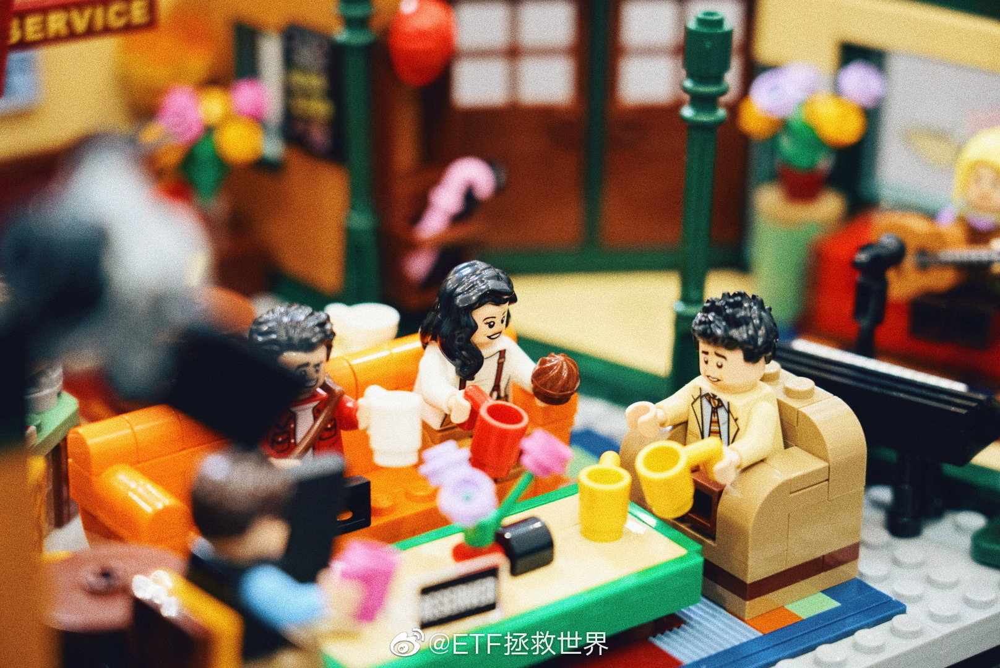 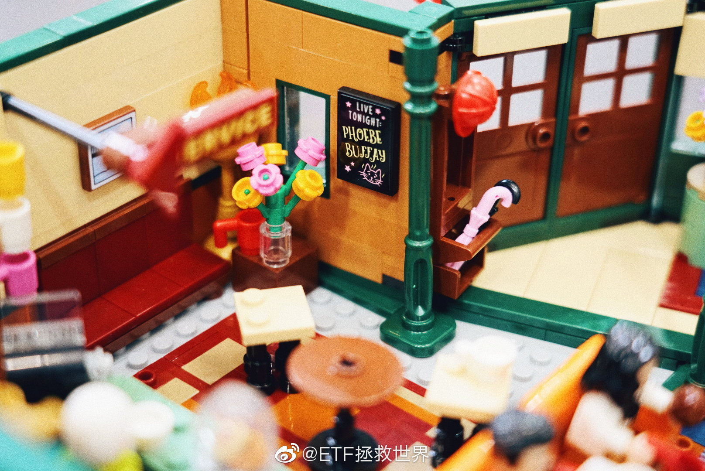 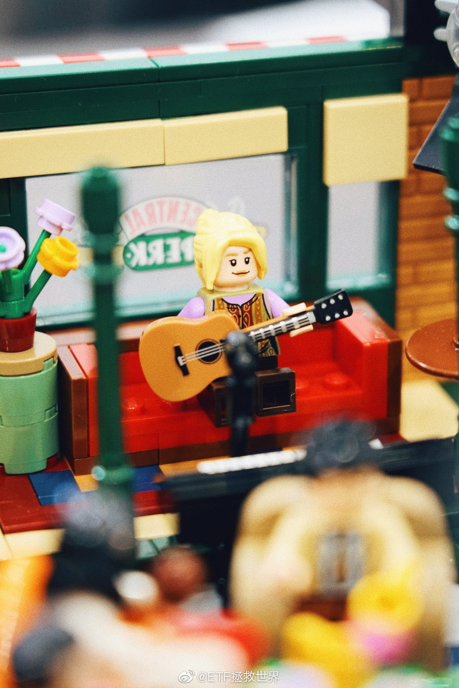 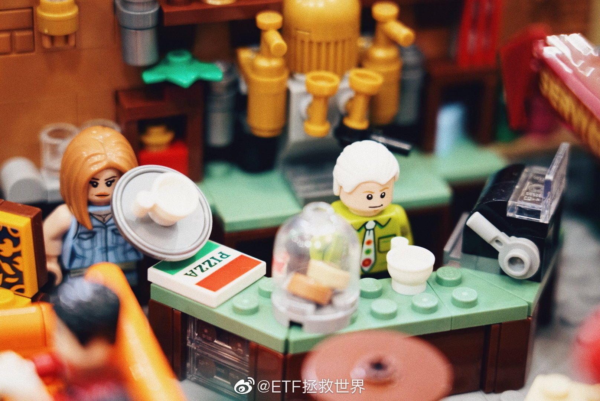 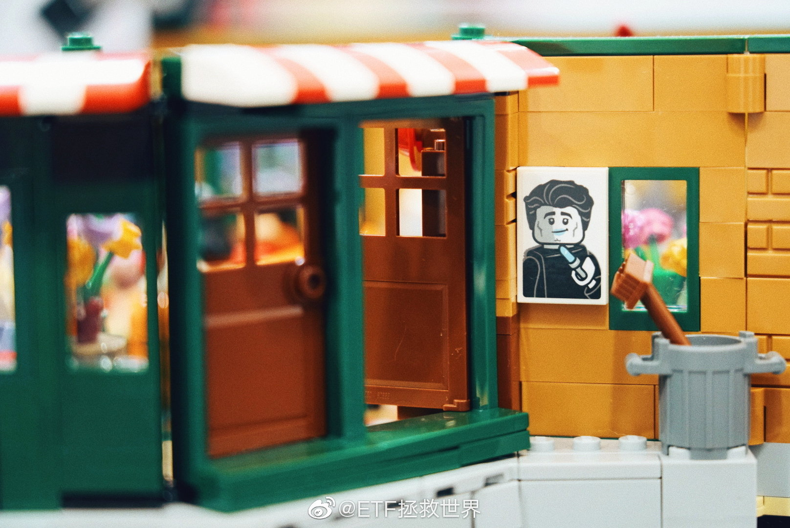  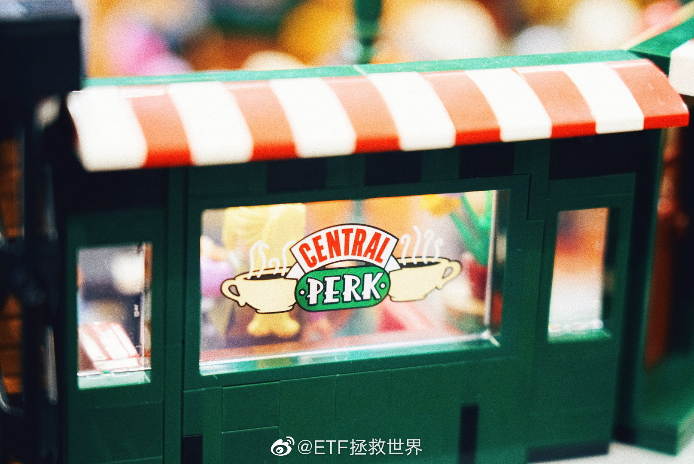

## 2019-10-08 18:13

仓位非常够，手里有现金很重要。谨慎投资，尤其是大额投资决定。

关于最近的形势，打了很多字，又都删掉了。希望一切都好。 ​​​

## 2019-10-08 18:22

回复@Halle噜呀:重点是：从计划来说，仓位已经非常足了。留好的是剩下的现金。//@Halle噜呀:标重点：形势不稳，留好现金！

## 2019-10-09 18:21

日本最近十几年每年一个诺贝尔。 ​​​

## 2019-10-10 13:13

昨天差一厘没有吃到一网医药的我，目前有点怀疑人生。 ​​​
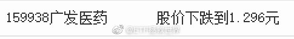

## 2019-10-10 13:24

明白了，好久没去拜拜了。运气有点顶背离。

下周去，给自己谋福利的同时，照例会为各位求个好运气，也加大力度求个国泰民安。 ​​​

## 2019-10-10 13:40

我相信每个人的人生都会有几个关键点。运气再差的人，也会有几个点可以让人生变得更好。

勤奋、努力的，或者性格好，本性善良的，又或者老天爷比较青睐，天生智商颜值之类比较高的，这个关键点就会比一般人多。但是一般人也有这个关键点，至少来说一辈子两三次问题不大。

所以，在人生的关键点，第一个是能不能抓住机会。很多机会需要主动去抓。第二是自己是不是努力，让关键点出现的多一些。

而有些就很难通过自己努力出现了，比如生命中的贵人，比如自己都不知道为什么就被大机会选中莫名其妙的成了。

很多东西不能改变，不能改变的，不用怨天尤人。努力改变能改变的。改变人生的机会就会多一些，成功的概率也就大一些。

比如高考，比如工作，比如婚姻，比如投资，比如买房。这些都是。都是可以改变人生的。

资本市场有一点特别好，这里的机会比人生的机会要多很多很多。错过了一个两个，错过了一波两波，没有关系，抓住下一波照样翻身。最关键是：别死。只要不死，赢的大机会过几年就有一次。

什么是资本市场的死，就是你的本金损失三五十，而且这个损失很难通过别的方式弥补上，这个基本就病危通知了。

保住本金，大机会来的时候买东西拿好了。几年一次，就这么简单。

## 2019-10-10 15:41

差一厘吃不到确实很遗憾，尤其是一网利润够买很多很多送大家的礼物情况下…

但是另一个角度，人不能一直运气好。这是我一直以来的理念。

我相信均值回归，运气也是如此。所以运气好的时候千万不能得瑟，容易乐极生悲。另一方面偶尔运气不好应该高兴，这是对冲了一直的好运气，避免大的不幸发生。

如果一段时间持续运气不好，更要充满希望。均值回归，相信即将苦尽甘来就对了。

保持一个积极的气场非常重要。好人 好事 好运，都会聚集在正向气场周围，坏运气则反之。 遇到一点挫折就抱怨 戾气冲天的人，一直都不会有好运气，就是这个原因。

## 2019-10-11 17:39

万万没想到，有人要在医药救我一命之后，我们的医药基金已经涨了将近40%。

其实那位朋友的思维代表很多人：

出利空了，非常危险，很危险，要跌很多。

我不能说出利空不危险。但看事情不能只看表面。

第二层思维是：

目前的价位是多少？现在的价位是否已经将利空反映出来？

第三层思维是：

我们以为的利空，真的是利空吗？投资的世界，并非出现1就一定会出现2。利好未必真的是利好，利空未必真的是利空。不仅利好利空对基本面的影响很难判断，你要更进一步判断对价格的影响，不是难上加难吗？

无论如何，不会死的东西，跌了很多，跌了70%，80%，你告诉我赶紧卖，

我是不会理你的。

## 2019-10-11 17:50

目前仓位建议依然不变。保守到激进60-80。最激进不超过90。这个范围内，以自己舒服为准。

## 2019-10-11 17:55

非常刺激。这个月三季报全部披露完毕，全市场估值如何变化很期待。 ​​​

## 2019-10-11 17:56

你有没有发现，网络世界好像和现实世界特别分裂。

看了微博再看现实，完全都不是一码事儿啊。 ​​​

## 2019-10-14 12:56

债券又回到一年前了，想找机会再配点。 ​​​

## 2019-10-14 13:21

这几年，被喷子喷的精神上有了问题，整个人感觉越来越精神了

## 2019-10-14 13:27

最近两条人生感悟：

第一，晚上一定要睡足。睡足了一天精神焕发。怪不得古话说“不看美股寿与天齐”。

第二，为了转型美食博主，研究了一下中国菜。发现“葱姜蒜爆香”是80%菜品成功的基础。 ​​​

## 2019-10-14 13:38

A股第四大仓位50创出今年新高，2015年7月以来，收益率冲向50%。

但它绝不会是组合里面未来A股部分最猛的品种。 ​​​

## 2019-10-15 17:25

陪儿子打篮球，旁边一小屁孩 ：

“叔叔，你是篮球运动员吧。肯定是。”

4S店试坐按摩椅，推销员：

“你适合这种力度大的。你是专业运动员吧。你还年轻，要提前保养”

喷了，抑郁症什么的根本不会得好吗。全世界都是正能量啊。 ​​​

## 2019-10-16 09:53

为什么发微博少了

因为关于投资，目前阶段可以说的东西不多啊。

你看，钻石坑爬出来了，长期仓位建好了，网格吃短期波动也没什么说的，又不到贵的状态，群众情绪非常稳定，地里有庄稼手里有钱。吃着火锅唱着歌，舒舒服服的，说什么啊。

风花雪月说多了又有人说我不务正业，所以说的就少了。

其实投资这件事吧，很重要的是在几个关键时点不做错。其他时间大多数都是等待。有时候拿着钱等，有时候拿着货等。无非就是做生意，低买高卖，有时候钱有时候货的。

手痒痒就做点短期波段，买点喜欢的股票。有事情忙就拿着长期仓位忙自己的事情去。

多简单，多舒服啊。到时候一看，钱还赚了。多好。

## 2019-10-16 13:35

医药再上万点 ​​​

## 2019-10-17 12:45

我真的不懂公共交通上外放的人是怎么想的。你带个耳机，不仅音质好10000倍，还多少有点降噪效果，也不影响别人。嫌有线麻烦你就买个无线的，也没多少钱。服了，怎么想的到底。

## 2019-10-17 18:25

DAX 15个月新高。

英国脱欧协议都达成了，咱们的英国指数基金还没上。 ​​​

## 2019-10-18 09:39

恶人自有恶人治。

## 2019-10-18 12:31

回复@小w今天吃鸡了吗:我曾经遇到过这种事，收银员不仅不跟插队的说“请排队”，还一副“插个队嘛有什么大不了”的样子，让人非常生气。//@小w今天吃鸡了吗:收银员责任也很大//@ETF拯救世界:恶人自有恶人治。

## 2019-10-18 12:40

不过，这个女的这样做确实过分了。仔细看了看，这个看起来和正常的插队不同。短发女在用手机扫码付款，粉衣女是用现金，并没有影响她用手机付款。挨打的这个比较冤枉……论起来，收银员的责任是最大的。//@ETF拯救世界:恶人自有恶人治。

## 2019-10-18 12:46

不知道为什么，我对不遵守秩序的人特别讨厌，遇到了就感到很不舒服。

插队，上地铁不先下后上不靠两边站乱挤，开车不打灯乱并线，甚至随地吐痰，右转机动车不让绿灯行人，电梯抽烟，遛狗不牵，高空掷物等等等等。

可能是有什么心理疾病。 ​​​

## 2019-10-18 12:54

我觉得归根结底就是一句话：“你的心里有没有别的陌生人”。有，这些事你就能做好，就会注意不给别人添麻烦。心里没有别人，或者说，除了熟人或者有用的人，你觉得其他人都是无关紧要的，都是妨碍你的，那做出这些事就不可避免了。

## 2019-10-18 14:10

没几个人懂我为什么一个多月不买。 ​​​

## 2019-10-21 14:06

年少的我，竟然长白头发了。

子惊妻泪流。

为中国资本市场操碎了心啊，朝如青丝暮成雪。 ​​​

## 2019-10-22 09:32

又来了好烦。 ​​​
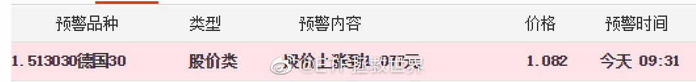

## 2019-10-22 09:36

回复@撩人的李琦:相关性低的，不死的品种都可以做。//@撩人的李琦:网格品种到底有几个啊？不会把长赢的所有品种都做了网格吧

## 2019-10-22 09:49

如何从不确定未来中，相对确定的赚钱，并利用不确定性赚更多，是我这个体系要解决的问题。

首先，承认未来不确定。

其次，在各个时间点赋予未来各种不确定以概率。

然后，根据概率实施设计好的各种投资策略。

最终，在不确定的未来中赚钱。 ​​​

## 2019-10-22 14:34

500不断考验支撑位，截止到目前，撑的非常结实。 ​​​

## 2019-10-22 21:51

如果你的电脑总是有MFC程序阻止你关机，那么很大可能是同花顺干的……

删掉同花顺安装目录的 sjsj.exe 就好了。不会有任何影响。 ​​​

## 2019-10-23 10:35

NB了，航空公司还能这么玩呢，现在怎么办。

@厦门航空 ​​​
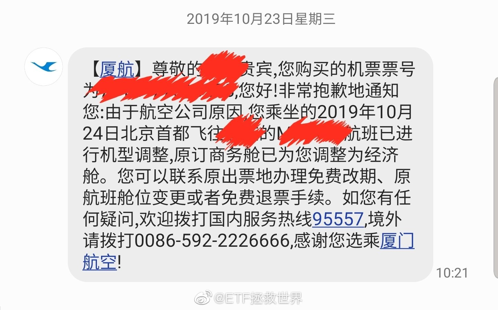

## 2019-10-23 14:03

解决了。要感谢某第三方订票网站（不说名字了，避免广告嫌疑），经他们协调后，航空公司同意换了同时间段其它航空公司的公务舱票。以后朋友们碰到这种事也可以争取一下。

## 2019-10-23 14:50

这个月必须有车 ​​​

## 2019-10-25 11:45

谢邀。

人在半人马座α，刚下飞船。

网不好，只有3G。

勿念。 

以上。 ​​​

## 2019-10-25 16:21

庙里，一位不认识的老大爷突然跟我说

祝你财源广进，娃儿，祝你发大财。

感动哭了。

人间自有真情在。 ​​​

## 2019-10-25 16:34

回复@变肥的公羊1:国泰民安 全家安康 财源广进 乘客大吉//@变肥的公羊1:去庙里的动机是什么？

## 2019-10-27 19:42

我有个朋友说，如果是他的孩子被人渣害了，他一分钱赔偿也不会要，绝不会和解。

无论过多长时间，无论多难，也一定要让那个小王八蛋凶手偿命。 ​​​

## 2019-10-28 09:29

野百合也有春天 ​​​

## 2019-10-28 10:01

这一网效率极高，只用了十几个交易日。

舒服。 ​​​
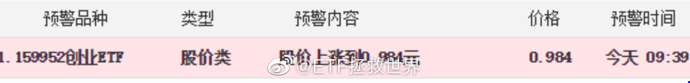

## 2019-10-28 10:09

回复@Ojilth:我已经把所有方法，细节，经验，需要注意的事情都明明白白写出来了。只要按照自己的情况设计一下即可。//@Ojilth:E大，你考虑一下公布所有网格，每次看你收网，只能干着急

## 2019-10-28 12:47

回复@颓废的猪头_Ju:你怕的时候我按，你贪的时候我还会按。舒舒服服的时候我瞎按什么。按摩也要讲规矩，不能乱按。//@颓废的猪头_Ju:回复@吧嗒木:他现在都不按了

## 2019-10-28 13:09

身材

发型（量）

中年男人减龄十五岁的关键

配合穿衣打扮

可以做到减二十岁

年化3个巴仙 ​​​

## 2019-10-28 16:05

传媒的波动太大了，网格利器。 ​​​

## 2019-10-29 10:19

再破万点，再到压力位附近。//@ETF拯救世界:下一个压力位10400

## 2019-10-29 13:55

我有个朋友说，

他想起了一些老朋友。

再也找不到的老朋友，

感到很伤感。 

为什么要给他推送《那些花儿》呢

他很生气 ​​​

## 2019-10-29 14:41

我们这个月还没买它敢涨吗呵呵你说是不是这个道理 ​​​

## 2019-10-29 16:14

你选哪个。  ​​​

## 2019-10-29 16:19

你们是不是逗我呢。第一次看98：99，第二次看188：189。实力这么接近吗

## 2019-10-29 20:46

90，85。

## 2019-10-30 13:48

我一点都不反对炒作，没人炒作我的网格怎么能出的这么开心。[爱你]

在市场上混，千万别看不上这个看不上那个。存在是不是即合理我不知道，我只知道找办法怎么在这些存在中赚钱。

瞎BB能改变谁？谁也改变不了。不埋怨，想办法，在乱中挣钱。

守正，出奇。守正是安身立命的根本，出奇是变富的捷径。

只有正，是老实人。只有奇，赚多少都会吐回去。

## 2019-10-30 13:56

几个月前开始吧，网易云音乐的日推质量断崖式下跌。

真的就是突然完蛋。差到让人生气。

以前的感觉是，啊还有这么好听的音乐。后来的感觉是，什么玩意这种辣鸡怎么有人听。

考虑不续费了。 ​​​

## 2019-10-30 17:55

我有个朋友说，小学生减负什么的他根本没在怕。

毕竟已经自己给孩子买了黄冈小状元和53天天练可以从放学做到晚上… ​​​

## 2019-10-30 18:12

我发现群众分两部分。一部分最喜欢桃色的东西，另一部分喜欢黄色的。

你有没有不同看法。 ​​​

## 2019-10-30 19:13

苹果的周边产品吧，怎么说呢，就是两个字：

真香。

watch也好，airpods也好，我都是出了很久很久都没买，也没别的，就是不觉得好。比如听说watch每天都要充电就觉得很麻烦很二。

然后某天突然心血来潮买一个试试，就离不开了。到现在以前的机械表也不戴了，大法耳机也不用了。

苹果的笔记本我根本用不惯，一直吃灰。手机除了有些独占软件外，也没觉得真的特别好用。但这些周边确实挺香的。

## 2019-10-30 19:42

回复@厦门一夜-fisker:这样的老婆哪儿还有，给单身的兄弟们来一打//@厦门一夜-fisker:确实是。我老婆说要给我买airpods说了好几次，我都说不感兴趣，然后上个月生日她偷偷买了送我。真香

## 2019-10-30 19:43

喷了

## 2019-10-31 09:45

不要问，不要说，明天才有车 ​​​

## 2019-10-31 09:51

别老盼着某些板块某些股票跌。

有些时候你觉得“贵了”“涨的多了”，赶紧跌吧，跌了才正常。

不好意思，你越这么想，它涨的越好。

虽然最后也许你是对的，但你对之前，疯狂的程度可能远超你想象。

你可以不追，但如果你手里有，别轻易下车。这才是关键。 ​​​

## 2019-10-31 10:01

三季度全指医药利润增速依然在两位数，是全市场的一倍。 ​​​

## 2019-10-31 13:43

慌什么，两个月不买，是有原因的。

现金是好东西。别急。 ​​​

## 2019-10-31 19:34

回复@卢日尼基的雨夜:照你这个意思100%现金才好呢？我说现金是好东西，是仓位合适的基础上说的。不要随意满仓，上杠杆，为所有可能的未来做好准备。//@卢日尼基的雨夜:那么E大为什么不卖点？这样现金更多

## 2019-10-31 19:38

金银又起来了，白银可以先挂个30天的卖单，万一成了呢。//@ETF拯救世界:服了 查看图片 //@ETF拯救世界:内心毫无波动的机器人 查看图片

