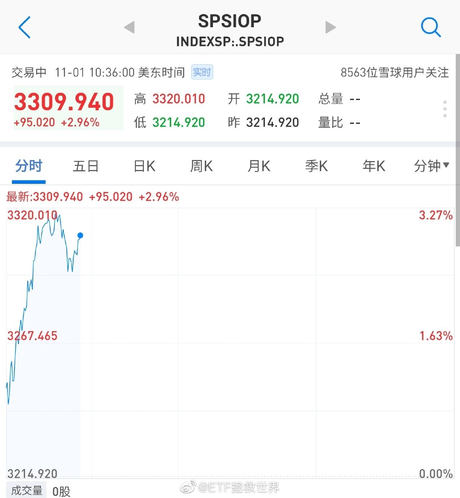
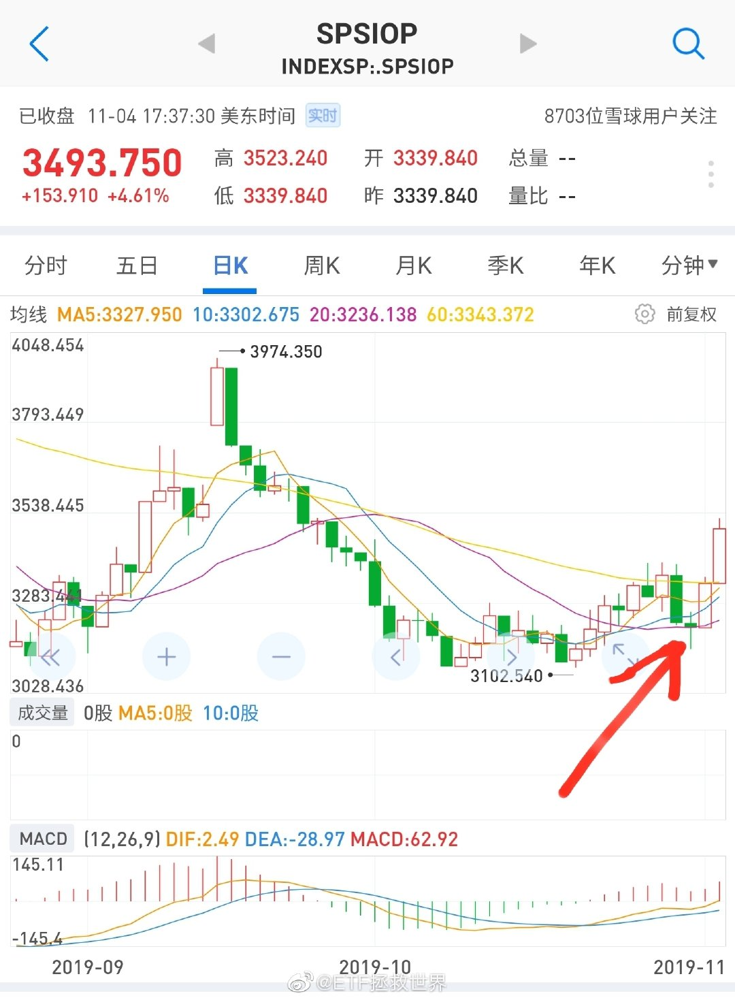
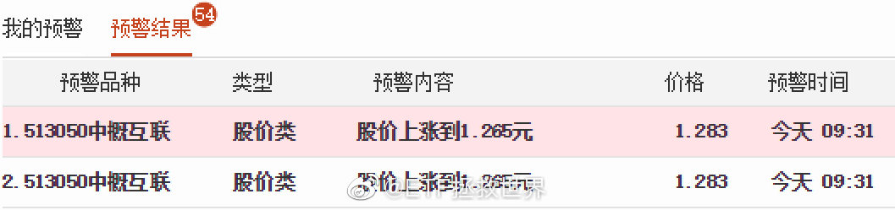
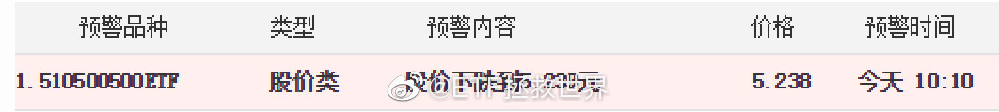
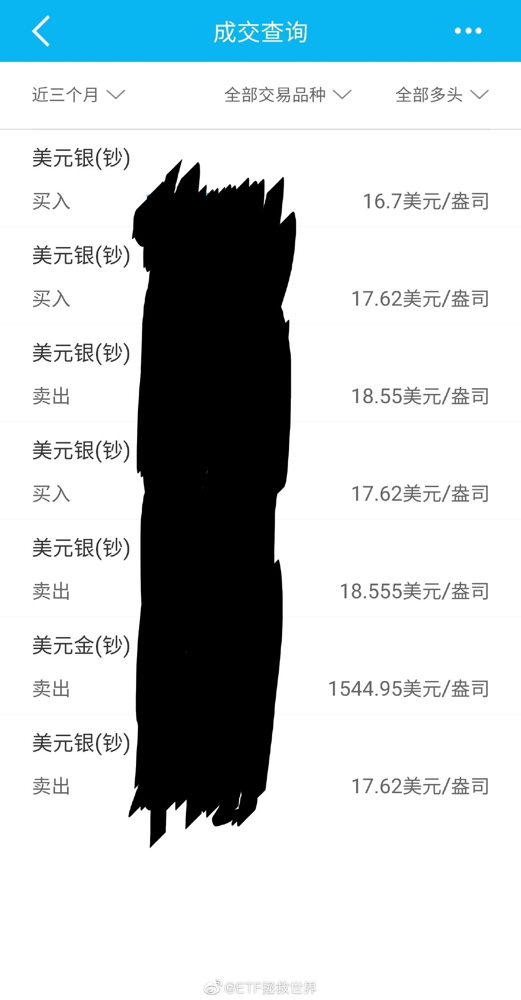
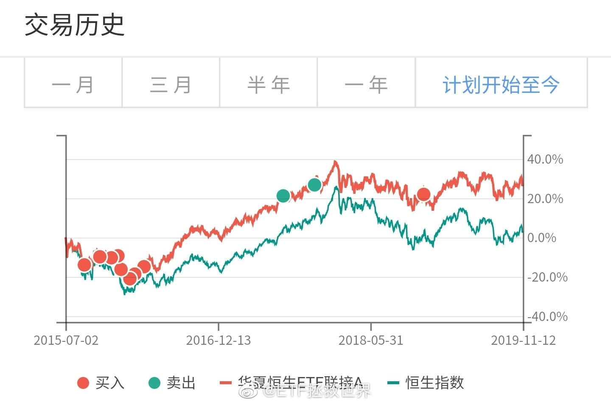
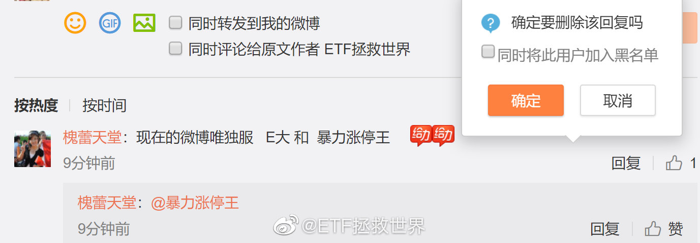
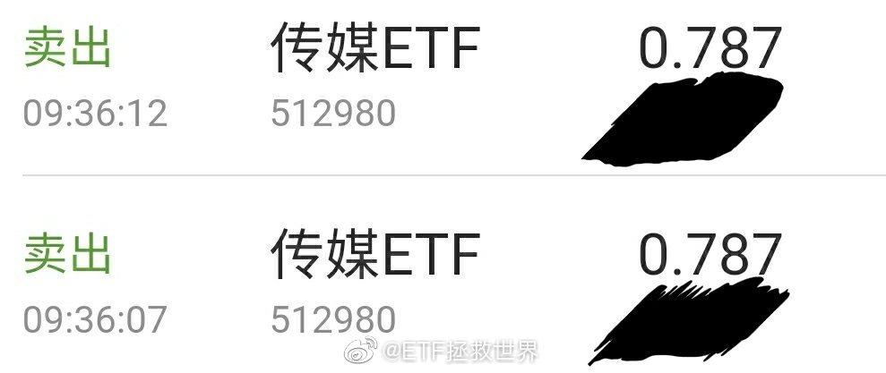
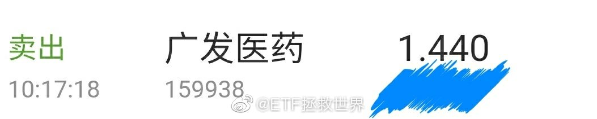
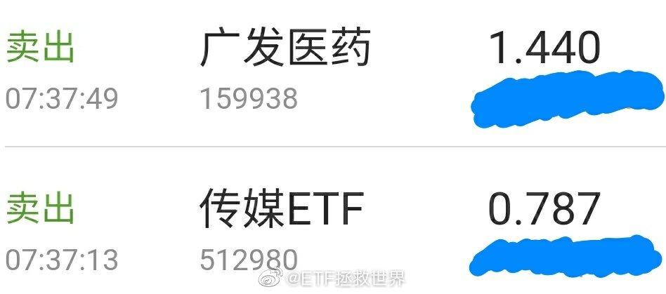

## 2019-11-01 09:20

震惊，美股暴跌0.3%，惨不忍睹！

## 2019-11-01 10:33

财新PMI真是不错。

PMI更类似于一个同步指标，虽然不先行，但不至于落后。所以是有些价值的。 ​​​

## 2019-11-01 12:07

推送的时候明明没动。

搞什么搞。 ​​​

## 2019-11-01 13:41

2012年11月，全市场PB与目前大致一样。但是7年来深综指涨了117%。年化当然不高，也就十个点出头。但是，

目前的全市场PB，在A股历史上，是非常非常低的水平。大致是钻石坑外一点点的位置。

十年后，哪怕还是这么低的估值，也会有很不错的收益。不过，我不信十年内连一次大牛市都没有。

真不信。 ​​​

## 2019-11-01 16:24

回复@淡然一笑201208:因为今天是一号，周五，无论怎么都应该是今天发这个月的车

## 2019-11-01 16:55

不过可以透露一点，今天的走势决定了发车品种。因为这个时间点很关键。//@ETF拯救世界:回复@淡然一笑201208:因为今天是一号，周五，无论怎么都应该是今天发这个月的车

## 2019-11-01 22:36

什么玩意儿啊 ​​​

## 2019-11-01 22:43

我劝你善良 ​​​

## 2019-11-01 23:04

回复@ETF有毒:我拉黑的都是做广告的。已经很久没有拉黑喷子了。//@ETF有毒:为什么微博提醒我谨慎评论

## 2019-11-02 19:38

A股最近20年有两次超级大牛市，06-07两年半六倍，12-15，中小股票两年半六倍。

这两次超级大牛市有一个非常有意思的共通点，就是之前经历了时长几乎一样的大熊市：

00-05，08-12。一个四年半，一个五年

这一轮熊市从2015年至今已经四年半。如果到明年年中还不结束，就是创了A股历史。

有人说，这几年不是熊市，很多股票涨的不错。

废话，那两次熊市中也有很多牛股，也有局部牛市。我说的是普遍的，大多数股票的情况，不是局部。

我的意思是，下一波大牛市不会特别远。也许我们现在就已经在其中了。我本人倾向于，去年钻石坑过后，熊市已经结束了。

踏踏实实拿着你好不容易买到的低成本筹码，别轻易下车。

## 2019-11-04 09:38

回复@ETF拯救世界:快了。还有2%。能突破吗//@ETF拯救世界:下一个压力位10400

## 2019-11-04 10:34

舒服就是涨了你赚钱，跌了你继续开心买筹码，以后赚更多。

难受就是涨了你没筹码，或者有筹码天天担心利润回吐。跌了你满仓看着资产不断下跌心如刀割，或者你满把现金却还要操心什么时候进场以免踏空。

舒服很重要。舒服了，才不会手忙脚乱，做出错误的决定。

一步错，步步错。市场还是哪个市场，你的思维方式和行为不一样了，世界就不一样了。

## 2019-11-04 10:52

回复@竹32161:给个群号啊。有钱一起挣！//@竹32161:益达的每一篇文字，都值得细细琢磨收藏

## 2019-11-04 13:55

这一生，想要不至于无聊，就应该不断去感受新的体验。

在安全的前提下。

日复一日全都一样，转眼就老了。 ​​​

## 2019-11-04 17:27

德国DAX即将突破历史新高。

富时100什么时候上。 ​​​

## 2019-11-05 07:22

两天8%，这个买点您还满意吗 ​​​

## 2019-11-05 07:44

回复@klkl231:别急，今天四个点起//@klkl231:E大，求科普，华宝油气与spsiop涨幅不一致

## 2019-11-05 07:49

回复@June的6月天:嗯，前几天打越洋电话的时候隐隐约约有听说啦//@June的6月天:美国要退出《巴黎气候协议》

## 2019-11-05 08:17

想买

## 2019-11-05 11:54

意思不大。 ​​​

## 2019-11-05 11:56

我说微博能不能别老给我加这些无聊的标签了？！

## 2019-11-05 13:33

回复@lwj牛牛牛666:挣钱意思不大//@lwj牛牛牛666:一顿大涨，直接上去了，还意思不大？

## 2019-11-05 14:49

我觉得吧，人生最大的成功不是功成名就，叱咤风云，王侯将相。

人生最大的成功是有趣。

自己活得有趣，也让身边的人，甚至更多的人生活的更有意思。

有趣不是滑稽，是一种很难表述的状态。英文应该是interesting，因吹丝挺。

最难的是自己觉得人生有趣。喜剧演员未必自己活得开心，抑郁症非常多。周星驰和沈腾一定经常开心吗，也未必。

有些人无暇有趣，有些人没有能力有趣。所以这个特质非常难得。

人生已经很难，得意需尽欢，不得意也要找乐子。但是任何时候都别得瑟，切记。

## 2019-11-05 19:25

“从核磁片子看，你儿子比我还正常。”

## 2019-11-05 20:59

友情提示：

车门上让人插了小广告卡片千万不要降车窗。

别问我怎么知道的。 ​​​

## 2019-11-06 09:34

17个交易日。效率极高。 ​​​

## 2019-11-07 11:47

第一篇《普通人的投资进化论》

第二篇《我的财富观》

看起来还可以吧。 ​​​

## 2019-11-07 13:55

医药增速快，所以涨的虽然多，并没有太贵。踏踏实实拿着。拿不住就用另外的资金做网格

## 2019-11-07 14:54

回复@看云的日子2019:我没有能力预测它会不会调整。我只能计算概率，得出目前拿着，长期看会是更好的选择这个结论而已。我会持有低成本长线仓位，未来跌的话就继续买//@看云的日子2019:谢谢，医药因为赚得多，本来还有点忐忑。现在定心了。打算做网格

## 2019-11-07 14:56

感觉今年的北京秋天比往年长了一些。

美。 ​​​

## 2019-11-07 16:38

欧洲这样涨，富时100出了也暂时不买了 ​​​

## 2019-11-07 18:38

我个人观点：

一个人，学会了独立思考，不被轻易洗脑，非常好。

学会了开眼看世界，也非常好。

但是，请注意，

无论你在哪里，看到了什么，都要坚持独立思考，客观论证。不能对某些人的话一点都不信，更不能对另一些人的话毫无置疑的全盘接受。

这个世界非常非常复杂。无论如何，不要轻易被别人影响你的判断，独立思考。

这条微博，是回复某个评论的。

最后说一点，独立思考，未必要寻求认同。你独立思考的结果，未必要让身边的人同意。要知道这个世界上大多数人并不掌握这项技能，没必要徒增烦恼。

## 2019-11-08 09:22

意思不大 ​​​

## 2019-11-08 09:26

回复@ETF资产配置:不是。按照剧本发展，没什么意思。//@ETF资产配置:哈哈，大大觉得要跌才有意思呢

## 2019-11-08 09:55

现在要做的很简单

攥紧你的长线筹码，有兴趣就用短线仓位做波段，没兴趣就歇着。

然后继续攒钱，等下次有机会继续多买。

雪球越滚越大你信不信。 ​​​

## 2019-11-08 09:57

回复@xiao靥茹花:尽量不要买场内的白银基金。一切与期货挂钩的指数基金都要小心。//@xiao靥茹花:今天白银etf刺激不 查看图片

## 2019-11-08 10:04

去年此时钻石坑，有人将信将疑不敢买，甚至被各种利空吓得清仓。

上半年一波大涨有人又捶胸顿足，后悔胆子太小错失机会。发誓再来机会一定买。

4、5月开始大幅调整，机会真的来了，又继续将信将疑。

再涨起来，又后悔。

这辈子也就这样了。 ​​​

## 2019-11-08 10:05

回复@ETF拯救世界:三个月前提出压力位10400，今日最高10336。一举突破还是被压制？这里的战斗会非常精彩。//@ETF拯救世界:下一个压力位10400

## 2019-11-08 10:09

回复@木酒酒-zl:非常好，情商很高。//@木酒酒-zl:办公室有同事天天高调等2440，我保持沉默。

## 2019-11-08 10:47

记得保湿啊

## 2019-11-10 12:11

双11不知道买什么。

总感觉吃亏了。

另外，领券是我能接受的底线了。其他各种促销抢红包什么的反人类手段我个人坚决抵制。

其实主要是智商和耐心都不够。搞不清楚到底是怎么回事…… ​​​

## 2019-11-10 12:38

回复@投资跑道上的一只小蜗牛:消费资金和投资资金永远井水不犯河水。否则要出大问题。//@投资跑道上的一只小蜗牛:明天指数打折的。你买淘宝就亏了

## 2019-11-10 23:53

准备动手了吗 ​​​

## 2019-11-11 09:39

强力压制。想突破没那么容易。//@ETF拯救世界:回复@ETF拯救世界:三个月前提出压力位10400，今日最高10336。一举突破还是被压制？这里的战斗会非常精彩。//@ETF拯救世界:下一个压力位10400

## 2019-11-11 14:16

波动产生利润 ​​​

## 2019-11-11 15:42

回复@跟车小号滴滴哒:恒生前几大持仓是汇丰腾讯友邦建行平安移动工行，阿里也会进去。前十大只有港交所，本地股比例有多大？当然，你想换什么我没意见//@跟车小号滴滴哒:E大，请教，是否应该将159920换成510900，香港本地股的比例让人害怕

## 2019-11-11 16:59

回复@Matrix_矩阵视效创意:是的，买了礼物。//@Matrix_矩阵视效创意:回复@颓废的猪头_Ju:买了礼物准备送我们~//@ETF拯救世界:回复@跟车小号滴滴哒:恒生前几大持仓是汇丰腾讯友邦建行平安移动工行，阿里也会进去。前十大只有港交所，本地股比例有多大？当然，你想换什么我没意见

## 2019-11-11 18:55

一年没穿，我的帅气皮衣竟然有点紧了。

怎么回事，是不是衣服缩水了。 ​​​

## 2019-11-12 10:19

好几天没见到网格预警小窗口了

想它 ​​​

## 2019-11-12 10:52

长线仓位已经足够，现阶段就是吃吃波段，提提款。

有没有牛市，能不能挣大钱，你我无法决定。自己无法决定的事情就不必焦虑。 ​​​

## 2019-11-12 11:13

从全市场PB的角度看，A股过去288个月中，只有22个月低于现在。

分别处于1995年、2005年、2008年。 

对了，还有去年底。 ​​​

## 2019-11-12 16:20

不是很理解现在还去旅游的人是怎么想的。 ​​​

## 2019-11-12 16:28

乱倒不是最重要的。关键是你去一个地方，别人都把你当Sb，谁跟你都没好脸，就算不打你，你还有心情玩？

## 2019-11-12 18:56

回复@小号1234567小童鞋:之前同事的孩子高考后复旦和港科大二选一，还好选了复旦……//@小号1234567小童鞋:唉，今年过去读书，现在学校都被人砸了//@ETF拯救世界:乱倒不是最重要的。关键是你去一个地方，别人都把你当Sb，谁跟你都没好脸，就算不打你，你还有心情玩？

## 2019-11-12 23:47

回复@ETF拯救世界:来了老弟 查看图片 //@ETF拯救世界:内心毫无波动的机器人 查看图片

## 2019-11-12 23:54

最近三个月白银网格是这样的情况（顺序从下往上）

等于筹码没丢，吃了两轮利润 ​​​

## 2019-11-13 12:18

现在计划里面有几个点的恒生。持仓的朋友分两种情况。

一种是从头开始跟的朋友，拿的多一点，但是利润接近50%。

另一种是后来跟车，虽然成本高一些，但是只有区区一两份。

无论哪种情况，都没什么好担心。 ​​​

## 2019-11-13 12:42

这种时候，再去翻翻历史书，很多东西看起来就跟以前的体会不同了。

历史，常看常新。 ​​​

## 2019-11-13 14:07

再给一个点位。如果真的搞大，让恒生崩到21000以下，是非常非常好的买入机会。我给个极限点位17000。万一真的到了，一把配满恒生指数，从那里算，不赚60个巴仙不再看。

## 2019-11-14 10:51

价值观和信念特别重要。

有了信念，才能把一件事坚持做下去。物质的东西很重要，但有时候精神上的信念更重要。

在暂时失败的时候，在看不到光明的时候，在孤军奋战的时候，只有信念能让自己坚持下去，梦想才有成真的机会。

为什么有人会在光明即将来临的时候放弃，有人会在钻石坑里清仓逃离，正是因为他没有信念。

同样，对于一个组织，一个国家来说，共同的价值观和共同的信念，才是让这个集体能优秀的原因。这样，这个集体才会有真正的凝聚力，才会做出不平凡的事。

所以，要做事，就要找到有共同价值观和信念的人。

## 2019-11-14 12:04

你说你们非得跟这打小报告。害得我回去看，一个没忍住发了个帖。

然后发现我这微博财经领域常年互动Top10的，回去以后帖子十几分钟评论才90个。

过气的感受你知道吗！感觉自己突发性抑郁症实锤了。 ​​​

## 2019-11-14 12:38

昨天晚上转了个帖子，评论了几句，后觉不妥，删了。

知道有一些在港上学的朋友关注我，虽然人数不多，但想跟你们说几句话。

你们都非常优秀，有希望成为这个国家的栋梁之材。无论以后你在哪里生活，做什么工作，我个人，希望你，多做对这个国家有益的事，别做损害国家利益的事。

因为，只有这个国家真正强大了，人民幸福了，你才大概率会受到世人真正的尊重。否则，即使到了很多人理想中的完美世界，你也只是隐形的二等公民而已。

每个国家都有问题，有能力的年轻人，应该尽自己所能让我们的国家变得更好，而非更糟。如果十几亿人乱起来，那才是修罗场。

明天会更好。希望你们一切顺利。

## 2019-11-14 14:19

不过说真的额，朋友们，我感觉自己确实成熟了。

一般的喷已经伤不到我了……

原来18到20岁，不仅皮衣会变紧，开始有白头发，思想也会更成熟，人也会更淡定。

真好啊。 ​​​

## 2019-11-14 15:55

小助理居然买了双11礼物送我。（初代小助理也送过好几次……）

这大概是我见过的最和谐的上下级关系了吧。 ​​​

## 2019-11-15 11:02

仓位可以舒服，但人生不能太舒服。

想要进步，就要跳出舒适区。尝试更多的可能，思考更多的策略。 ​​​

## 2019-11-15 14:30

未来一段时间还是别看盘了 ​​​

## 2019-11-15 17:56

我有个朋友开了一次顺风车，被女乘客加微信要请他吃饭。他没去，亏了500万啊

## 2019-11-15 18:55

重修中国近代史ing ​​​

## 2019-11-15 19:28

我们买好了，你们什么时候来接盘啊

## 2019-11-17 13:48

好多年了，不管国足成绩多差，我都不骂，不吐槽。

这已经是中国踢球最好的几十个人了。问题是教练吗，问题是一两个人用人失误吗。当然不是啊。

吐个槽，编个段子，骂这个骂那个没用。

看了很多世界级球员和教练的自传，最深的感受就是他们真的真的把足球当生命。踢不上球就感觉人生崩了。总感觉我们的球员好像对足球缺点热爱。

职业和梦想，差距还是很远的。

## 2019-11-19 10:05

转发微博

## 2019-11-19 10:34

越来越发现人生最宝贵的东西其实是希望。

有了希望，一切都有可能。丧失了希望，失去了梦想，这辈子也就这样了。 ​​​

## 2019-11-19 11:11

这周去华东某地度周末。

约吗。 ​​​

## 2019-11-19 12:42

回复@Karmen是好好孩子:缺钱当然是现在抛。不过这个事情再次提醒各位：权益类投资需要长期资金。哪怕少一点也没事，但是要长期。很重要。//@Karmen是好好孩子:老大，最近我要买房，缺钱，跟您买了两万多基金，近期什么时候可以抛？

## 2019-11-19 12:50

严格就近上学，是我能想到最公平的方法。只要有别的口子，就一定会被有特权的人钻进去。绝对公平的世界不存在。

## 2019-11-19 12:51

回复@明天就回火星啦:不可惜。还有去年年底要用钱赎回的。想想几个月之后的心情。现在卖，几年后也会比较难受。但是急用钱，没办法。//@明天就回火星啦:可惜了！

## 2019-11-19 13:05

回复@我心永Young:要搁以前的政策，我连房都不用买，直接上西城的学校。现在我花了1000万买了房才能上，但我还是要说一声公平。这是对大多数人的公平，住哪里就上哪里的学校。像以前一样，你根本不知道好学校都是怎么上的。//@我心永Young:回复@土77豆:这是因为他已经买了学区房

## 2019-11-19 13:15

朋友们，我微博下面显示的最近x天拉黑x人，都是这样的。

最近大半年心情不错，极少极少极少拉黑喷子…… ​​​

## 2019-11-19 13:16

我只希望传媒明天再哆嗦一下，让我出一网……挣点盘缠…… ​​​

## 2019-11-19 13:24

最近几个月，不禁让人对“媒体”，有了更深层次的认识。

由此更进一步，世界上真的有绝对客观的历史吗。我看恐怕没有。 ​​​

## 2019-11-19 15:02

医药基金再突破，开始冲击四年高点 ​​​

## 2019-11-19 15:21

回复@狂狮爱不可:要不你给我打赏一点，我每天什么都不干在网上陪你聊天好吗。我可以不可以有点自己的时间做自己的事。不就昨天出去忙没说话吗？//@狂狮爱不可:股市大涨，益达就出来了，为啥大跌的时候益达不这么频繁出来安慰一下我们。

## 2019-11-19 16:04

回复@渔樵耕读煮:不好意思，男的不陪//@渔樵耕读煮:这种人，如果你是男的，E大是不是还要陪睡你才满意？//@ETF拯救世界:回复@狂狮爱不可:要不你给我打赏一点，我每天什么都不干在网上陪你聊天好吗。我可以不可以有点自己的时间做自己的事。不就昨天出去忙没说话吗？

## 2019-11-19 17:22

回复@你看我_是男是女:医药当时96，目前32。我看不出有什么问题。//@你看我_是男是女:15000点的医药指数，也是醉了。对了，信息指数的pe这里看不到，我还是不想调坐标了，数值其实是186。。。186。。。金融依然不到最高。难道是等着牛市尾巴再补一刀？@ETF拯救世界 是不是验证了你的预言，牛尾补一刀。

## 2019-11-19 17:34

DAX反弹新高，距离历史高点一步之遥 ​​​

## 2019-11-19 20:11

有时候晚上睡觉前会打开ps4玩几把实况。MC模式，跟人踢。

以前踢输了就很郁闷。另外之前胜率高，更怕输，害怕胜率下来。

后来想明白了。

想明白以后，输了也不急。被人进一个也不急，两个更不急。每次被进球领先，重新开球心里都像刚开始0：0一样，心态极佳。不会在意已经几比几了，享受比赛，认真踢好下一脚。

想明白什么了。

想明白这是一场游戏。

游戏而已。

人生又何尝不是一场游戏。

过去赢了输了，有什么所谓。重新开始。踢好每一脚，享受每一天。

非常轻松。

## 2019-11-19 20:38

“再能跑些，再能战些，为了队友，为了家人，为了梦想！” 真的好。

## 2019-11-20 09:42

挂的有点多，只成交了一部分 ​​​

## 2019-11-20 10:12

有点舒服 ​​​

## 2019-11-20 10:15

相信医药在这个位置会遭遇抵抗，不会一路向北直捣黄龙。 ​​​

## 2019-11-20 10:21

又出一网。A股难道不是提款机 ​​​

## 2019-11-20 14:14

这两网出的价位喷了。不枉我7点起来挂单。

之所以每次网格都要跟大家汇报，是因为之前发了理论的东西，演示一下实践如何操作。

不是为了得瑟。

有些喷子省省键盘吧。你抽空也偶尔做点对人民群众有益的事不好吗。 ​​​

## 2019-11-20 14:19

回复@年少有为有不为:再说一次，这是挂单委托时间，不是成交时间。成交时间前两个帖子贴了//@年少有为有不为:为啥你7点半就可以卖出

## 2019-11-20 18:14

国与国之间，最根本的关系就是利益关系，就是竞争。

既然是竞争，就一定是不择手段。

所以很多事情出现就一点也不用感到惊讶。你强了，对它就是威胁。那当然就要不择手段的搞定你。

很多事实它并不是不知道。它需要的不是事实，而是机会。

所谓的ysxt，所谓的价值观，都是说辞而已。

就像前几天的视频所揭示：人家如何定义是bao luan还是heping 请 yuan。一条标准：是否符合它的利益。

就像这次人家说的，要么改，要么die。这就是对方的终极目标。不达目的，不会松开你。

当然，你真改了，它也未必会松手。

还是那四个字：国 家 利 益。

## 2019-11-21 09:24

是不是又有希望把出掉的接回来了。 ​​​

## 2019-11-21 09:41

这么准的吗

## 2019-11-21 10:08

为操盘手打call：

你们是最胖的！！ ​​​

## 2019-11-21 10:26

足球游戏又墙了。

也不知道该说什么。 ​​​

## 2019-11-21 10:30

PDD吧，有些东西不敢买。比如3C产品，我连在TB都不敢，更别说PDD。只敢在JD买。

但是有些东西可以。我在PDD买过一个粘毛的滚子，9.9，720撕，还送滚筒。喷了。太值了，至少可以用3年。

家里有猫狗的必备。 ​​​

## 2019-11-21 12:14

不说你不知道，今年，明明是指数涨了二十几个点，但是全部A股涨幅中位数是5%。

涨幅10%以上的股票占41.74%；

涨幅超过500的股票占30.87%；

涨幅超过300的股票占22.52%；

涨幅超过50的股票占21.53%；

涨幅超过医药的股票占16.64%。

考虑到很多人是年初一波行情之后杀进来的，

今年炒股的股民，大多数，过的很难……

## 2019-11-21 12:37

上次的耳机已经买了。那肯定还是不够啊。

我在考虑是不是加送一瓶茅台。正好春节可以喝你说是不是。

这个没定，还得考虑一下…… ​​​

## 2019-11-21 13:02

在这个状态下，对于资本市场不应过于乐观。做好长期波动甚至短期趋势向下的心理准备。

不是说肯定不大涨，是做好心理准备。涨了，更好。不涨，无所谓。 ​​​

## 2019-11-21 13:34

嫉妒是毒药。

妒意一起，害人害己。

没事儿别嫉妒别人。把嫉妒换化成动力，提高自己。

更要防止别人嫉妒。当然，各位都很优秀，优秀就必然招致嫉妒。那就尽量低调，不得瑟。情况就会好很多。

别总怕自己的好别人不知道。大多数人知道你过得好，不会为你高兴替你祝福，反而会有小人嫉妒你，找机会就给你使绊子。

害人之心不可有，防人之心不可无。坏人到处都是，要保护好自己啊。

## 2019-11-22 09:56

再次提请注意

什么时候我在什么品种上又被喷了

这个品种就要动了

屡试不爽，神奇。 ​​​

## 2019-11-22 10:52

万万没想到就快可以接回来了……

## 2019-11-22 10:54

医药第一支撑9850，第二支撑9550。先看看能否撑住吧。 ​​​

## 2019-11-22 10:55

回复@ETF拯救世界:8月提出10400，最高冲到10430开始调整。//@ETF拯救世界:下一个压力位10400

## 2019-11-22 10:58

医药分为两个区域。

第一个区域是8500左右-10450左右。这个区域是相对低估区域，也是熊市区域。

10450-15000左右，已经不是相对低估区域。也是牛市运行区域。

这三个数字会随着时间推移逐渐增加。 ​​​

## 2019-11-22 11:10

最佩服的是食品饮料。

我的系统显示8月开始就该调整了，结果依然这么强。失敬了…… ​​​

## 2019-11-22 13:06

上周五大部分指数重回下降趋势。今天如果不能大幅拉升，就已经是第二周确认。

## 2019-11-22 14:01

成交。两个交易日买回。交易部分成本下降5% 查看图片

## 2019-11-22 15:07

收工~

周一见。 ​​​

## 2019-11-25 08:38

今天港股会很精彩 。

谁说之前的预期买入点位不可能到。 ​​​

## 2019-11-25 10:07

谁能想到，对A股最有信心的是外资。 ​​​

## 2019-11-25 10:32

打扰了！

## 2019-11-25 13:38

三个交易日买回

## 2019-11-25 17:35

我一直说，做好人，不仅要有本事，还要够狠。

好人没本事，不够聪明，不够狠，这个世界就会被坏人占据。

赵辛楣评价方鸿渐“人不坏，但全无用处”。没有用的好人不会危害世界，但也无法制裁坏人甚至保护自己。

好人，绝不可以是老实人。 ​​​

## 2019-11-27 18:58

我亲见的唯一家暴案例，

是我表妹（像陈慧琳的那个）揍她老公。 ​​​

## 2019-11-27 21:16

如果一个人很害怕你，同时又看不起你。

我想，很难让他认可你，尊重你。 ​​​

## 2019-11-28 10:50

我估计80%的人没看过内容。 ​​​

## 2019-11-28 19:40

谢谢你。 ​​​

## 2019-11-29 10:14

这20万没5年要不回来。

## 2019-11-29 10:29

仓位很够，不用急。目前几乎所有指数趋势都不好，没什么好急的。

又到了广积粮的阶段。今年春节后，我们只发了区区几车，没有相对高位接筹码。

现金不是辣鸡。

下周一可能会有一车。 ​​​

## 2019-11-29 10:30

我有个朋友，他金融资产的10%都是美元形式存在。 ​​​

## 2019-11-29 10:32

开始考验第二支撑位。

## 2019-11-29 10:41

晚对总比不对好。目前我的思路根据现实状况发展有些变化，会体现在未来的计划操作中。//@ETF拯救世界:打扰了！

## 2019-11-29 13:54

趋势下行第三周。没有转好迹象。//@ETF拯救世界:上周五大部分指数重回下降趋势。今天如果不能大幅拉升，就已经是第二周确认。

