## 2019-12-02 08:02

听到什么事情先别急着下结论。

如果真的感兴趣，就认真搜集资料，理性分析，得出相对客观的判断。

世界很复杂。独立思考非常重要。 ​​​

## 2019-12-02 18:01

一语成谶 ​​​

## 2019-12-03 10:37

要保持每次差几厘就可以吃到或者出掉一网的时候还能舒舒服服的，

真是难啊。 

每到这种时候，我就会告诉自己：

为什么要着急赚钱呢。赚那么多钱干嘛呢？

要知道，世界是守恒的。得到一些东西，必然就会失去一些。

对，你赚了一点钱。但你有没有想过你失去了什么？

没错，你失去了烦恼。 ​​​

## 2019-12-03 10:46

想起了袁崇焕。

那个被老百姓食肉的抗金名将。

对手想做而做不到的事，自己的人民是可以做到的。 ​​​

## 2019-12-03 11:33

挂的比较多，只成交了一部分。

无论如何，我好了。涨跌随意了，舒服。 ​​​
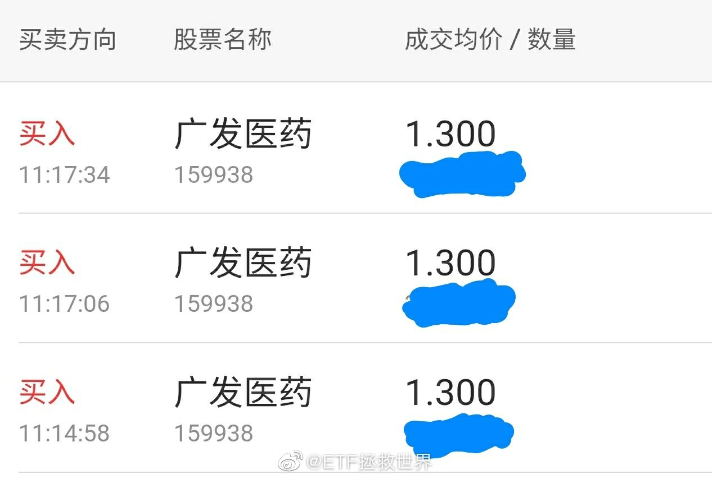

## 2019-12-03 17:00

我有个朋友说，

以前遇到误解，总想去解释。想把真相说出来，纠正别人对自己的错误看法。

现在不会了。

他说，

没必要。

懂你的人自然会懂，不懂的，一部分是不想懂，一部分是不能懂。其实都是没有缘分。

珍惜懂你的人就够了。不要希望全世界的人都理解你，爱你。你又不是美刀。

你懂我我很高兴，你不懂我又关我何事。

朋友说，

想明白这个以后，一下子就轻松了。

## 2019-12-04 09:47

how you doing ​​​

## 2019-12-04 19:25

我有个朋友曾经跟我说：

独立思考；冷静、客观；多看历史书，很重要。

基本上就不会被别人带着跑。

这是第一步，先有自己的思想。

碰到具体问题，从各个角度看。不因为自己处在某个阶层，就天然的相信某个论调。

当然，你希望为自己的阶层争取权益，就是另一回事。这时候你虽然很公众客观的思考，但行动未必与思维一致。

我要说的，是时刻保持清醒，不被别人轻易左右。

这一点在投资上当然非常有用，在其它地方也适用。

特立独行并非一种姿态，而是一种结果。甚至有时候你的外在越不特立独行越好。

最后，学会闭嘴。不要试图改变别人，希望别人与你一样独立思考。不然，弄不好要倒霉。

## 2019-12-04 20:31

看了B站的孙兴慜纪录片，说真的有点嫉妒啊。

音乐 电影 群众性的体育运动，真是文化输出的极好载体。 ​​​

## 2019-12-05 15:37

下一步的工作，我会尝试将趋势和价值如何量化结合，计算出合适的仓位。

趋势是我们的讲法，用华尔街的话来说是“动量”。动量投资最近十年在美国效果很不错，比“价值”的收益要高。

当然，我还是那个观点，过去十年好，未必未来十年好。不能用过去一段时间推测未来。但是将这两部分有机结合起来，对于平滑波动提高收益应该是很有益处。

这个理念过去一直体现在体系中，下一步的关键是“量化”。

## 2019-12-05 15:58

记得非常清楚。

当初我买创业板的时候，很多人嘲笑。

现在我卖一份去年底买的，已经赚了30%+的创业板，换一份更便宜的500，又有人嘲笑。

相同的是不管我做什么都有人说三道四。

不同的是我现在笑着看他们。 ​​​
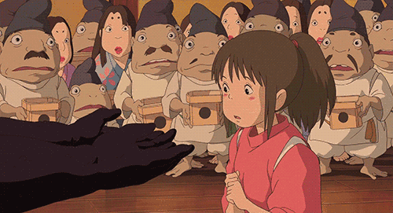

## 2019-12-05 19:29

没想到是中国人干的。

## 2019-12-06 13:50

有些人一边看着李子柒挣那么多钱酸：什么“不是真实生活”了，什么“有团队”了。

一边跟着别人抱怨“阶层固化”，“普通人再也不能逆袭”。

普通人当然有机会逆袭，没机会的是既不愿动脑子努力又总是在抱怨的人。

把嫉妒别人、喷别人的时间用来提高自己，想办法改善生活水平吧。别人真的不行了，你也不会过得更好。

## 2019-12-06 14:27

所谓跑赢沪深300。

第三轮计划开始以来跑赢30%多（跑赢500 60%多。这是在2015年第二轮精准逃顶的基础上），最近两年，最近三年全部跑赢。

只因为今年跑输，就叫跑不赢了。

去年跑赢了吗？跑赢了，但去年没人会提这个。

为了给自己挣点流量，你看你得瑟的，上蹿下跳。我叫你们几个一声辣鸡，你们敢答应吗。

你给我找一个熊市不跌，上涨的时候完全跟上指数的组合或者人。我把钱都投给他好吗。你行吗，你行我投给你，虽然你是辣鸡。

## 2019-12-06 14:38

天才啊。把一个牛市最高点建立的组合，和一堆熊市中建立的组合放在一起比年化收益率。

天才。 ​​​

## 2019-12-06 14:44

为什么不从2014年开始算年化呢。

图的出处。

ETF拯救世界: 《感恩，2015》 ​​​
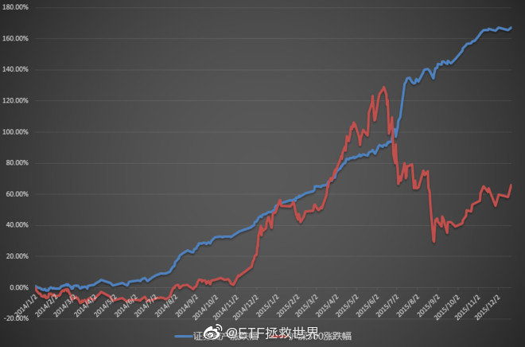

## 2019-12-06 15:07

今天500又跑输创业板0.1%。

枯了。 ​​​

## 2019-12-06 15:15

每个人擅长的东西不同。

我并不擅长在牛市中大开大合净值疯涨。大概牛市能跟上80%左右吧（300+500涨幅）。尤其是在牛市最后最疯狂的阶段，反而吃不到鱼翅。

但我擅长的是吃完了中间的硬菜先走，不为了吃鱼翅而买单。然后在暴跌中找到一种可以因为暴跌赚钱的东西，把最后没吃到的鱼翅再安全的吃掉。08和15都做到了。

然后熊市不赔钱，慢慢继续积累筹码，下一轮牛市继续争取跟上80%，周而复始。

特点是很难回撤，资产一路向上。但大多数时间都涨的很慢，熊市中很难赚大钱，只能尽量不亏的同时有小收益。只在小部分时间疯狂增长，然后保住财富。

基本就是这样。未来大概率也会这样。

## 2019-12-06 18:56

越来越觉得“商业化”才是推动人类发展的根源。

只有在物质上实现了价值，才会有人提供源源不断的，越来越好的东西给大家。

仅凭热情，信仰，爱心，恐怕很难持续有好东西诞生。

一个体会，不一定对。 ​​​

## 2019-12-08 00:26

孙兴慜连过八人。 ​​​
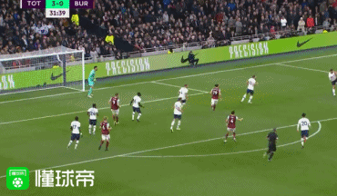

## 2019-12-08 12:40

很多朋友不懂为什么很多球迷看着孙兴慜感到[酸]，而看到梅西C罗没这个感觉。

很简单啊。你看到马云你会酸吗，不会。但你看到一直以来与自己差不多的邻居，他儿子变成了同位置世界最NB TOP5，再看看自己每次考试都不及格的儿子，说不酸是不可能的。

还有一个，更让球迷心情复杂。就是他的出现（包括之前的朴智星、车范根）证明了东亚人不是天生不行。身体，速度碾压欧美人也没问题。那为什么我们就一个都出不来呢，而且越来越差，有点绝望的感觉。

日本人证明技术、意识东亚人没问题；韩国人证明身体、意志东亚人没问题。那我们的问题是什么。

足球虽然只是一项运动，但反映的东西其实很多。

## 2019-12-09 10:24

10个交易日能不能再出掉，就差一哆嗦了。上上下下的乐趣//@ETF拯救世界:三个交易日买回

## 2019-12-09 10:30

市场免不了波动。我们身处其中，无法规避波动。

那么，如何将波动为我所用，才是我们应该考虑的。

而不是面对波动患得患失，心惊胆战，猜来猜去，底部丢筹码，顶部接盘。 ​​​

## 2019-12-09 15:08

今天跑赢0.6%。治愈了。

## 2019-12-09 19:50

想一想，分级基金其实是个很伟大的产品。激进投资者和保守投资者都适合。当初设计它的人是天才。

真不希望它就这么消失。 ​​​

## 2019-12-10 12:50

你现在最大的烦恼是什么 ​​​

## 2019-12-10 18:49

搞清楚了，关注我的朋友最烦恼的事情是“缺钱”。

那缺钱的朋友们，打听一下，你们觉得自己有多少钱就可以不为钱烦恼了。

拜托你们实际点……动不动就一个亿，极大概率你这辈子都要烦啊。 ​​​

## 2019-12-11 09:40

昨天我问的问题是，有多少钱你才不会觉得“缺钱”，才不会因为钱而烦恼。

结果感觉大家都奔着财务自由去了。难道只有财务自由了才能不因钱而烦恼吗。这其实是两个不同的事情，各位可以考虑一下。

另外，不少朋友觉得上班很烦，为了挣点工资，上班如上坟，非常烦。

这样，不如有空的时候你想一想，如果你有一天真的实现了财务自由，这份工作你不做了，那你想去做什么工作？

当然，很多朋友希望去环游世界。这很好，但你要知道，你不能环游几十年。在外面漂几十年，真没你想的那么有意思。

躺床上刷剧？玩游戏？有几个月你就又烦了。

所以，你还是得找点什么事做。

有些朋友当然有自己想做的事，有些其实也不知道自己想干什么。但我告诉你，即使没有经济压力了，你也肯定会找点事情做。那时候，你做的都应该是你喜欢做的工作了对吧。

那你不妨现在就想想，自己到底喜欢做什么工作？

想出来了吗。

好，那么，你现在为什么不可以去做？如果不能辞掉手上这份工作，为什么不能想办法先从兼职开始呢。

真的做起来，你才知道自己会不会真的喜欢它。同时，还能给你增加收入，何乐而不为？试试。

## 2019-12-11 09:41

回复@ETF拯救世界:12个交易日又卖出。喷了。//@ETF拯救世界:三个交易日买回

## 2019-12-11 09:56

我希望各位了解，我贴自己的网格交易记录，不是为了得瑟水平高，更不是为了显摆我挣了多少钱，我需要这些吗。

我是希望把自己的交易贴出来，抛砖引玉，为各位提供理论思路的同时，有一些实际操作记录，供各位参考。

帮各位解忧，能做的不多，尽力了。 ​​​

## 2019-12-11 10:00

网格是做网格，再提醒一次，这是整个体系的一部分，是为了应对震荡市。

这个策略，在震荡市光辉无比，在大牛市会变成渣。所以2.0的很多细节要注意。比如卖的时候留利润等等。

让自己低成本、0成本，甚至负成本的筹码越积越多，才是未来赚大钱的基础。 ​​​

## 2019-12-11 10:12

发现自己内心很阴暗。

总希望那些想买而没买，然后现在涨了好多的品种跌下去。

内心同样阴暗的打666。 ​​​

## 2019-12-11 14:10

我对别人生孩子还是不生孩子没有任何建议和意见。其实我自己特别年轻的时候也不打算要孩子，所以很理解有些朋友的想法。

但是有一点，其实很有意思的，不知道你注意过没有。

就是有了孩子的父母，虽然可能因为孩子增加了一些压力，但是，很少很少很少有人会后悔要了孩子对不对。

说明什么，说明人类一定是从孩子身上得到的乐趣比消耗的资源要大很多。所以有人会乐此不疲的又生二胎三胎。要知道在现代社会，已经不太需要养儿防老了。

这个问题，不要孩子的朋友可以考虑一下。自己的孩子真的能带来很多从未有过的感受。对，自己的孩子。我是一个不喜欢小孩的人，除了我自己的孩子，我基本上不喜欢任何孩子。但我自己的孩子，对我来说，是这个世界上最重要的人。

## 2019-12-12 12:37

一年前的一网中概互联，出完走人。

算上时间价值，多加了2%，这一网7个多点。 ​​​

## 2019-12-13 08:46

今天压涨还是跌。 ​​​

## 2019-12-13 09:41

群众怎么还没来。 ​​​

## 2019-12-13 09:45

没什么特别要求，今天能出几网就好了。

然后，事情顺利当然好。不顺利，好歹又提款了。

那边不出点幺蛾子才奇怪。 ​​​

## 2019-12-13 10:17

有些资金是贱取贵予；

有些资金是见风使舵；

有些资金，是肉吃不到，打一顿没少挨。 ​​​

## 2019-12-13 10:23

做投资，有的时候，其实知道的信息越多，反而可能越有害。

比如特别悲观的时候，坏消息满天飞。你看看这里，看看那里，觉得完蛋了没戏了。卖在钻石坑。

倒不如闭上眼睛捂上耳朵，该吃吃该喝喝，该买就买，踏踏实实的。反正你拿着的东西又不会死。

最终，不听不看，反而有可能比那些消息灵通人士做的好。

## 2019-12-13 10:53

外资不停买，公募重仓，依然涨不动。

很明显就是有人卖。谁在卖，等年报出来看。

不知道会不会有人4000、5000点疯了似的买，2000多点持续卖。

如果有，我也不敢评价。 ​​​

## 2019-12-13 11:12

恒生收益率又超50%了。到60%卖点。 ​​​

## 2019-12-13 13:21

北 清 目前自主招生比例有没有超过40%？ ​​​

## 2019-12-13 14:23

今天这么高兴买个健身环奖励一下自己。 ​​​

## 2019-12-13 14:32

回复@投资跑道上的一只小蜗牛:是啊。趋势形成就会影响几年走势。然而到了变化的时候就按周计算。今天大多数指数趋势都有变好的迹象。但是转折的时候反复很多，这也是为什么不能做纯右侧交易的原因。

## 2019-12-13 14:38

左侧好不好？好啊。

研究价值，对比价格。价格低于价值就买。以后肯定赚啊。

但是，1块钱的东西，你8毛买，觉得赚了，结果跌到2毛。你能扛住吗？

能，那你就适合左侧。

前提是，你真的能判断那个东西值1块。

右侧香不香？香啊。

左侧投资者熊市赔的欲哭无泪的时候，右侧空仓看着他们笑。

趋势好了我再进场呗——右侧投资者想。

然而判断趋势那么容易，世界上就没有踏空和震荡市反复打脸这两件事了。

左侧，右侧，都有优点，都有缺点。我个人的看法，想办法融合二者，才是大多数朋友应该努力的方向。

少数人呢？少数对价值有天分的，就去左侧。少数对市场走势敏感的，就去右侧。

所以，首先你得知道到底自己是哪类人。

## 2019-12-13 18:23

今天好歹收盘前一分钟出了一网。周末随便搞吧哈哈哈。 ​​​

## 2019-12-13 22:44

对于有些热门新闻，有点自己的想法。但是不太敢说… ​​​

## 2019-12-13 23:29

是不是要开始准备新高礼物了 ​​​

## 2019-12-13 23:39

平常心吧。持久战不会那么快结束。

该干嘛干嘛。 ​​​

## 2019-12-14 21:41

能力有限，只能做这么多了… ​​​
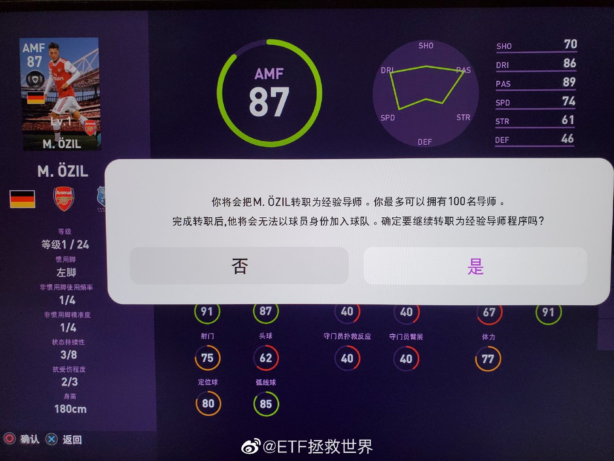

## 2019-12-16 09:59

涨不涨无所谓，动就行。

## 2019-12-16 10:10

什么玩意儿，还没发货。生气。

## 2019-12-16 10:13

看到有朋友说“卖飞了”，这个就要再次提醒。做网格的目的是降低持仓成本，同时，要不断增加持仓数量。仔细研究2.0。我的所有策略，都经过十年以上的实践，基本上所有坑都已经填好。所以我强调的东西一定要重视。不要再自己去掉一次坑了。

## 2019-12-16 10:27

浮亏觉得自己买多了，浮盈觉得自己买少了。

有这种想法的举手。 ​​​

## 2019-12-16 11:17

赚钱就是这么朴实无华，且乏味 ​​​

## 2019-12-16 13:28

论送货快，退换货方便，保真，国内还有没有比JD好的平台。 ​​​

## 2019-12-16 13:33

从上一波传媒被密集攻击算起，又有20%的涨幅了……

某个品种表现不好——被攻击——均值回归——大涨…… ​​​

## 2019-12-16 14:32

50、300涨的不好我也没什么高兴的，毕竟咱们也有不少……

但是消费跌我还挺高兴的……咱们的卖光了啊……

对，我就是这么狭隘，骂我吧…… ​​​

## 2019-12-16 14:43

人生得意须尽欢，莫使金樽空对月（但是要低调） ​​​

## 2019-12-16 15:31

今天成分股调仓日，基金涨幅大概率跟不上指数。 ​​​

## 2019-12-16 17:32

英国连续大涨，咱们的指数基金依然没上。

## 2019-12-16 17:34

目前不会再买的指数：

上证50、创业板指、深100 ​​​

## 2019-12-17 09:28

建议不要连续大涨，进二退一比较好。 

抄送xx同志审阅。 ​​​

## 2019-12-17 10:57

说话不好使了。退博。

## 2019-12-17 11:33

回复@蜀中弟子:别急，股票都能轮到涨。如果没轮到，等下次牛市。如果退市了，擦干眼泪攒钱再战//@蜀中弟子:e大好，我来做反面教材了，自己的证券账户满仓踏空，，，股票不好买啊，还是多配置指数基金，幸好股票只是玩玩，资金不大//@ETF拯救世界:说话不好使了。退博。

## 2019-12-17 11:54

回复@An-Idler:买了一堆股票，大盘涨它们不涨。赚了指数不赚钱。牛市赔钱的人有多少新朋友根本想象不到//@An-Idler:满仓踏空，是啥意思？//@ETF拯救世界:回复@蜀中弟子:别急，股票都能轮到涨。如果没轮到，等下次牛市。如果退市了，擦干眼泪攒钱再战

## 2019-12-17 13:13

又让老外抄底了。当然，老外没有我们成本低。现在就是等人来接盘了

## 2019-12-17 13:19

涨不是问题。问题是很多朋友重仓大涨心里乱如麻

卖不卖？卖了继续大涨怎么办

不卖一个电梯又回解放前怎么办

愁死了。天天愁。涨跌都愁。 ​​​

## 2019-12-17 15:18

这涨幅意思不大。

提哪辆。 ​​​

## 2019-12-18 09:47

最后一网传媒和恒生吃完。 ​​​

## 2019-12-18 10:06

波段仓位完成历史使命之日，就是长线仓位开始大放异彩之时。 ​​​

## 2019-12-18 10:10

说了无数次的，你现在懂了没。//@ETF拯救世界:看到有朋友说“卖飞了”，这个就要再次提醒。做网格的目的是降低持仓成本，同时，要不断增加持仓数量。仔细研究2.0。我的所有策略，都经过十年以上的实践，基本上所有坑都已经填好。所以我强调的东西一定要重视。不要再自己去掉一次坑了。

## 2019-12-18 10:17

看到传媒这样涨，总是想起一件事。

之前传媒最低点附近的时候，有个朋友跟我说，某个公众号又在喷我买的东西是辣鸡。我闲着没事就去看了一下那篇文章。文章没工夫看，看了一眼评论。

看到一个妹子问，买了传媒怎么办啊，浮亏十几个点了。

那位作者说：赶紧卖掉，传媒完蛋了。

从那时候起到现在，传媒30多个点了。今年最高曾经反弹到50%多。

好在他的阅读量低。

所以我常在想一件事，

水平有限的人掌握话语权的话，是不是危害很大的一件事。

## 2019-12-18 10:53

知道不知道你为什么会感谢一个人，因为你觉得这个人对你好，给你的东西超过了你给他的。

你又为什么会怨恨一个人。因为你觉得这个人给你的东西没有达到你的预期，给你的东西少于你给他的。

所以我经常会感到非常困惑。

有一些人，拿着从我这里学到的东西，得到的启发，自己包装一下去卖钱。结果反过来还要那么恨我，到处挤兑我，到底是为什么呢。

我从未向他们索取过任何东西，也从未从他们那里得到过任何，相反，给了他们很多，怎么就这么恨我呢。

这是我特别百思不得其解的一件事。

感谢一个人，还是恨一个人，应该看看这个人的出现，有没有让你的生活变好。如果变好了，就不要因为他只让你的生活变好了50%而没有变好100%而恨他。

## 2019-12-18 11:05

沪深300到了一个5年压力位。能不能过去？ ​​​

## 2019-12-18 14:23

对于普通人来说，我能想到的最好投资资本市场的方式，就是用一个完整的指数交易体系去进行指数投资。这部分是基石。

然后，买一些耳熟能详的，平常你经常会用到的消费品公司股票（5-15只）长期持有。这部分是锦上添花。 ​​​

## 2019-12-18 14:54

9：30-11：30；

13：00-15：00

这四个小时是每天的精华时段。 ​​​

## 2019-12-18 17:47

最近有不少朋友私信我关于找工作以及工作选择的问题，兹事体大，我确实不敢乱说，还望海涵。 ​​​

## 2019-12-19 09:37

我现在也同意他们说的传媒是辣鸡了。真的，我才发现他们几个大V真的水平高。

为什么，因为传媒不停涨，我的波段都没法做了。

太气人了。辣鸡传媒。 ​​​

## 2019-12-19 10:15

打开衣柜，70%都是优衣库。这种人算什么阶层，懂时尚的你点评一下。 ​​​

## 2019-12-19 10:52

百度不行真的是自己作的。

用百度app看贴吧，突然开始不能看回复了。必须下载贴吧app才能看。

WTF，我不看了还不行吗？一个破贴吧也要强制下载APP。

我连百度APP都删掉。 ​​​

## 2019-12-19 13:54

涨不涨全看指数不行，有时候指数不客观。

现在涨跌家数是2100：1400，结果上证深成300500中小创业都是跌的。 ​​​

## 2019-12-19 14:09

为什么给我的微博加股票代码。如果关注我的人因为这个买了，赔钱了，请问微博，你们给人家负责吗。

## 2019-12-19 14:26

意思不大。 ​​​

## 2019-12-19 15:40

汇报一下，最后还是没发货。说还要等一周。退款，楼下游戏机店买了//@ETF拯救世界:什么玩意儿，还没发货。生气。

## 2019-12-19 15:50

为什么老是耽误各位时间发这个，是想以后有机会送两套。毕竟赚钱重要，身体健康更重要。我先为大家试试效果…//@ETF拯救世界:汇报一下，最后还是没发货。说还要等一周。退款，楼下游戏机店买了//@ETF拯救世界:什么玩意儿，还没发货。生气。

## 2019-12-20 10:50

夸一下微博。晚上买一股微博股票支持一下。 ​​​
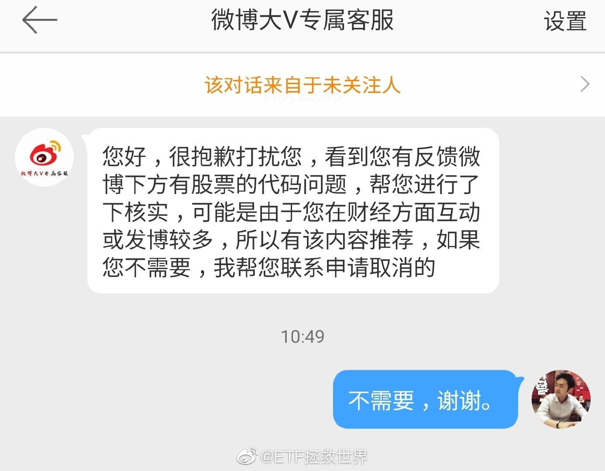

## 2019-12-20 11:14

找男女朋友很难吗，其实也不是很难啊。

第一点就是提升自己。由外至内。

首先就是外，因为无论男女，你首先得外在不让人抗拒才有下一步的可能。现在节奏这么快，内在再好也很少有人愿意停下来慢慢了解。

然后就是内。这个同样重要。这里有意思的地方在于，鱼找鱼虾找虾，即使你的三观一点都不正，也有可能找到伴侣。因为ta跟你一样不正。

所以最关键的是三观一致。

但如果你想找到素质高的，能与你一起经历风浪，一起享受美好人生的，还是培养正确的三观，提升自己的内在修养和水平，然后找到一个类似的人，这样一生会过的顺利很多。

这个内也包括职业，财务等等。不展开。

第二点就是，男的别太油腻，女的别太高冷。

这个就不展开说了。不油腻不是说一定要娘，不高冷不是说一定会撩。这个度把握一下。

第三就是扩大交际面。但是注意学会识人。不要只顾着找能力强的。你要知道，人品不行，能力越强，身边的人越惨。识人很重要。

最后就是缘分了，这个没法说。有人有缘一生，有人有缘几个月。做好自己，随缘吧。

## 2019-12-20 13:26

听到《All I Want for Christmas Is You》拿下billboard冠军的消息后，我就知道，又到了看《真爱至上》的时候了。 ​​​
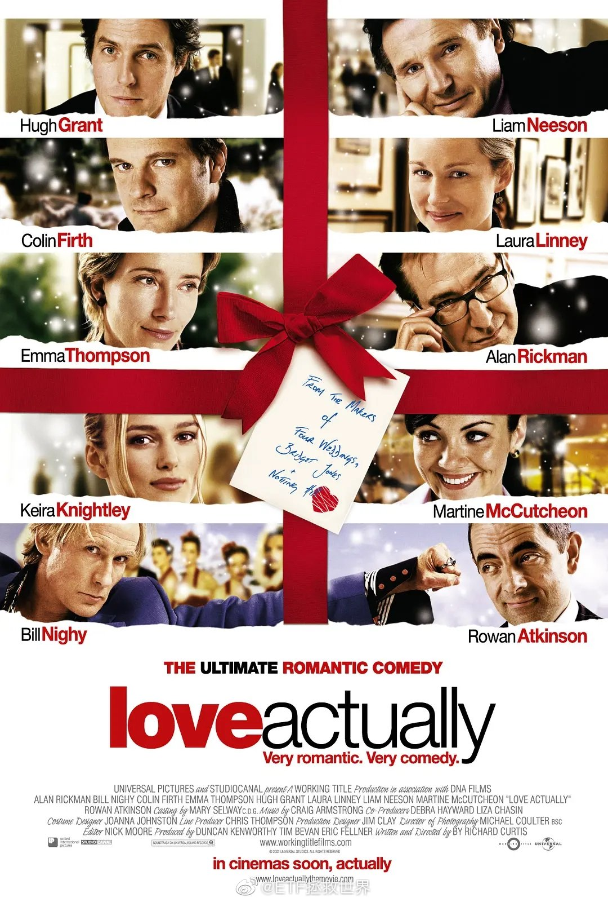

## 2019-12-22 18:26

亲测这个东西是有锻炼效果的 ​​​
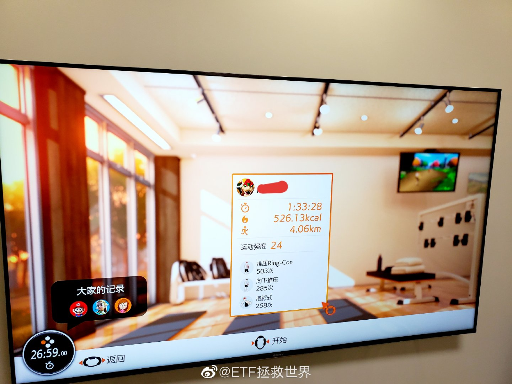

## 2019-12-23 13:20

跟各位大佬打好招呼了，关注我的朋友（除了极个别坏人）明年都顺顺利利，心想事成，财源广进，没病没灾。

放心，香火也上的足足的，都踏踏实实的。 ​​​
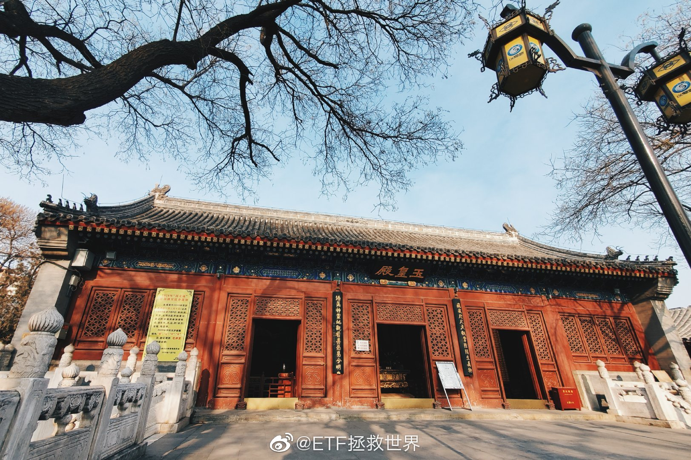 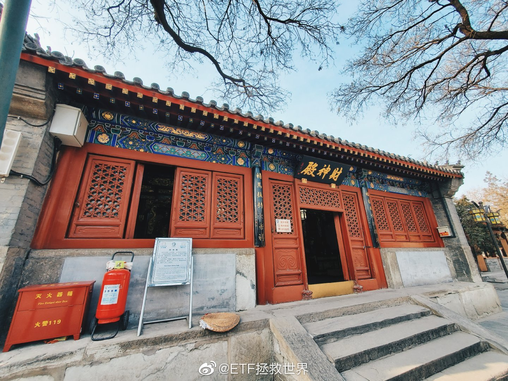 

## 2019-12-23 14:56

当你开始做波段，你就会发现波动的时候你不再像以前那样焦虑。

甚至有点开心呢。

所以世界并没有变，变的是你观察这个世界的角度，以及与这个世界相处的方式。

你变了，某种程度上说，世界也就焕然一新了。 ​​​

## 2019-12-23 15:01

我其实有点不理解点的外卖晚了几分钟就发火给差评的。

外卖小哥风里来雨里去挺不容易，晚几分钟吃能怎么着啊。

你对别人宽容点，别人对你宽容点。互相宽容理解，冲突就少很多。冲突少了，也能开心的活得久一点。 ​​​

## 2019-12-23 15:09

回复@xwzzzzzZ_:这句话是2010年说的。万万没想到真的十年还是3000点。计划也意料之中赚了大钱。所以投资指数，指数点位并不那么重要。重要的是你怎么做。//@xwzzzzzZ_:“现在上证3000点，哪怕10年后都是三千点，我相信我们的计划也能挣大钱”.By E大

## 2019-12-23 16:01

回复@Ulquiorra-L:因为计划第二轮在疯狂的2015年4、5月卖光了。//@Ulquiorra-L:为啥十年后3000点还能挣钱？中间有高点卖出了挣的？//@ETF拯救世界:回复@xwzzzzzZ_:这句话是2010年说的。万万没想到真的十年还是3000点。计划也意料之中赚了大钱。所以投资指数，指数点位并不那么重要。重要的是你怎么做。

## 2019-12-23 18:07

是不是有人总是办了健身房的卡，然后只去不超过10次甚至5次。

过一两年又办一张。周而复始的浪费钱。

这样，我给你个建议：

下次你再想办卡，你就先在家里连续锻炼两周。每天或者隔天练，每次半小时以内即可。

如果你发现连在家里练都坚持不下去，你说你还有必要糟蹋钱吗。 ​​​

## 2019-12-24 11:12

涨亦何欢，跌亦何悲。 ​​​

## 2019-12-24 13:32

要不怎么说是大佬呢。 ​​​

## 2019-12-24 14:02

今年突然对圣诞节没什么感觉了。

是老了还是对世界有了新的认识。 ​​​

## 2019-12-24 15:19

有朋友问，一块钱入股，年后5块钱香港上市是不是真的，能不能买。

这个我也不知道是不是真的。

但你要让我买，我不买。

主要原因在于，我审视一下自己，发现一直以来确实运气不错，但没有好到平白无故就能无风险一个多月赚5倍的地步。

要真运气好到这样，那以后得多不顺才能能量守恒啊，不敢买。

这辈子除了被女人欺骗过感情，还没被人骗过一分钱。首先就是不信自己运气能特别好，第二就是不掏钱。

你欺骗我感情和身体我认了，算了，不跟你计较了。你还骗我钱简直不是人！

## 2019-12-25 09:51

一个半月，又出一格。

## 2019-12-26 15:04

挣点钱而已，意思不大。 ​​​

## 2019-12-27 11:00

第一波新年礼物先送微博的朋友。

31日之前确认，过年之前拿到手。 ​​​

## 2019-12-27 11:08

儿子试穿我给买的新年音乐表演要穿的白衬衫，拿起琴的时候

我就一个想法：

比我小时候帅太多了…… ​​​

## 2019-12-27 19:21

又到了半年盘点财务状况的时候。

账户开太多，平常又不能做到每笔交易记账，这个时候就很头疼了。 ​​​

## 2019-12-28 19:43

请严惩凶手。再不想看到这样的事情！

## 2019-12-28 19:48

回复@frederick_999:一个微博号而已。如果这样的话都不能说，我还要它干什么//@frederick_999:以为E大担心号，就不发声了，//@ETF拯救世界:请严惩凶手。再不想看到这样的事情！

## 2019-12-29 21:59

说起荷兰改名，想起我在荷兰的一位朋友。

那是十几年前了，有一天我的邮箱里收到一封信，是一位女孩写给一位男孩的。

信中充满思念之情。

不知道出于什么想法，我居然回了那封信。

然后，又收到了回信。

（待续） ​​​

## 2019-12-30 10:15

遇到脾气暴躁，性格乖张的人，尽量离远一点，尽量不要正面冲突。

平常走路，尽量不要走楼下面。离远一点。大风天，离广告牌之类的远点。 ​​​

## 2019-12-30 10:49

今年之前，新年红包都是微博和公众号随机发。几千位朋友都能拿到。

今年初，我突然发现，不止是只有朋友关注我，还有辣鸡盯着我的微博天天挑毛病随时准备开喷。

让这些辣鸡抢到一分钱我都会觉得恶心，所以今年开始，由阳光普照，改成发给真朋友。

然而怎么知道这么多人里面谁是真朋友很难。我也只能尽量想办法。

今年微博送礼物规则是这样。

过去三个月，互动总分前十名的朋友可以获得礼物。

大奖依然是按照明天上证指数收盘最后一位数字定。十位朋友会按照分数有个排名，谁的排名与最后一位相同谁获大奖。剩下的九位朋友按分数从高到低获得其它奖。

奖品是：

大奖 京东购物卡 880

第二名 京东购物卡 500

第三名 京东购物卡 300

第四到十名 京东购物卡 200

本来想买礼物给大家，后来想还是各位喜欢什么自己买吧。

钱不多，主要是因为我穷。没有赞助商，都是自己掏腰包。拿到的别嫌少，没拿到的别生气，公众号还会发。公众号也没拿到也别生气，快过年了，开开心心的啊。

这是三个月的互动数据，之后会有个综合排名，明天与结果一起公布。榜上的朋友也可以自己算算，看会不会与我算的有差别。
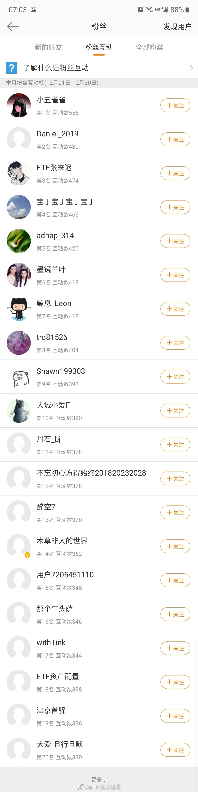 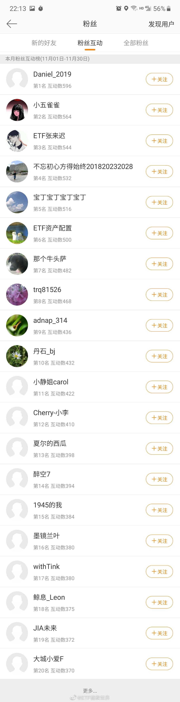 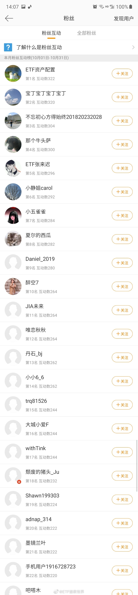

## 2019-12-30 14:12

回复@千年追寻:这不是基本操作吗…不要大惊小怪//@千年追寻:老大老大，你又蒙对了！神了神了如果感到幸福你就拍拍手 查看图片

## 2019-12-30 17:58

名次小助理已经统计出来了。

从上到下，分别是0-9。就看明天大盘收盘点位了。

1和2，8和9分数一样，所以如果明天大盘收在1、2或者8、9，两位还要通过某种方式再拼一次。赢的拿大礼，输的礼金在原奖金基础上再加200。 ​​​
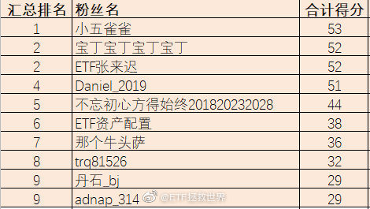

## 2019-12-30 18:36

（续一）

一来二去，几封邮件来回，我终于弄清楚了为什么邮件会发到我的邮箱。

发件人是一位中国女孩，在荷兰留学。

我的邮箱地址是“xxxxx20@sina.com”。前面的xxxxx，是我之前一直用的网名，20，是我注册这个邮箱时候的年龄。

而xxxxx，也正好是这位女孩的男朋友的网名拼音。

而20，则是她男朋友去世时候的年纪。

写第一封信之前的4个月，她男朋友在一个下雨的夜晚，为她去买吃的，结果遇到车祸，再也没能回来。

没错，当时我与你现在的想法一样，觉得这是个蹩脚的网络骗局。又或者是哪个身边人故意耍我呢。

谁能想到，这都是真的。

（待续）

## 2019-12-31 10:00

每天一款惊喜，款款都不同。 ​​​

## 2019-12-31 15:10

（续二）

女孩说她姓柳。很好听的姓。其实名字更好听，但我不能说。毕竟，这不是一篇小说，而是确有其事，确有其人。

后来女孩告诉我，之所以写第一封信给那个邮箱，是因为真的太痛苦了。太多的话想说，又不知道对谁说。所以写一封邮件给那个地址，希望天上的他能看到。

她说，从来没想过居然能收到回信。毕竟，就算有人收到了，也会被当做诈骗邮件直接删除。

其实有时候我也会想，为什么我会回那封邮件呢。没有答案。

记忆就像尘封已久的水墨画。轮廓还在，细节已经模糊。开始的几封邮件到底说了什么，已经记不太清。总之，是大概弄清了她的情况。

她的年纪与我相仿。家在北京，17岁就去了荷兰上学。父亲是做远洋贸易的，家境应该很不错。喜欢画油画，看过几张她的作品。以我业余美术爱好者的眼光看，画的倒似模似样。

后来渐渐熟悉，加了MSN。每天上线都会打个招呼，问候一声。有一搭没一搭的聊一聊。

这个时候，我心里又慢慢有了一些疑虑。白富美？给去世的男朋友写信，寄到了我的邮箱？

越来越明显，这是个骗子啊！到了这个地步，只有一个问题了：她是打算骗财还是骗色？

然而，所有的疑虑，在我那年生日那天，烟消云散了。

那天，我收到了人生中第一块OMEGA。

是她送的。

（待续）

## 2019-12-31 15:55

恭喜 @小五雀雀 ，实至名归，第一名叠加上证收盘3050点，拿到大礼京东购物卡880元（昨天发现没有80的卡，自动升级为900元）。请榜上所有朋友私信我处理后续事宜。

## 2019-12-31 16:36

打算怎么迎接新年，说来听听。

2020。

进入21世纪已经20年了！ ​​​

