## 2020-01-01 00:04

新年快乐！！！ ​​​

## 2020-01-01 10:05

新的一年，早上起来第一件事是锻炼身体

这一年，要更加善待自己和他人，要更努力的做事。 ​​​
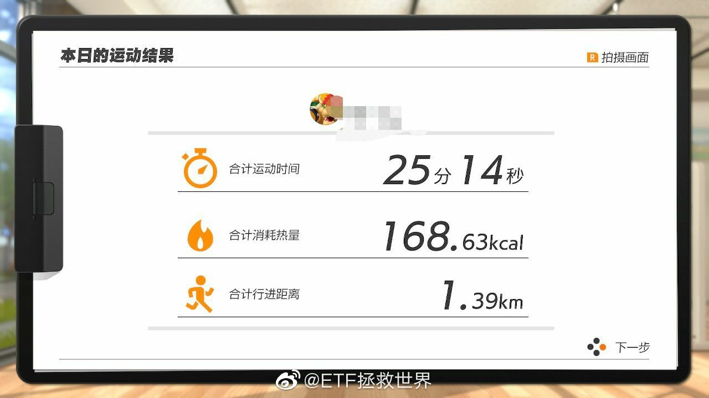 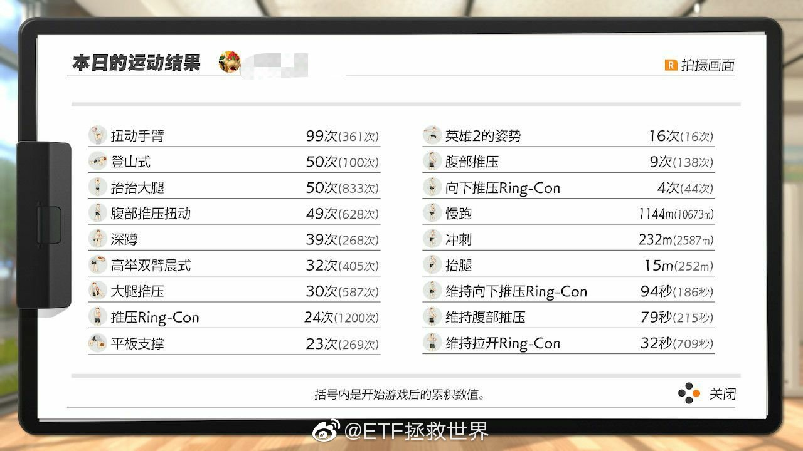 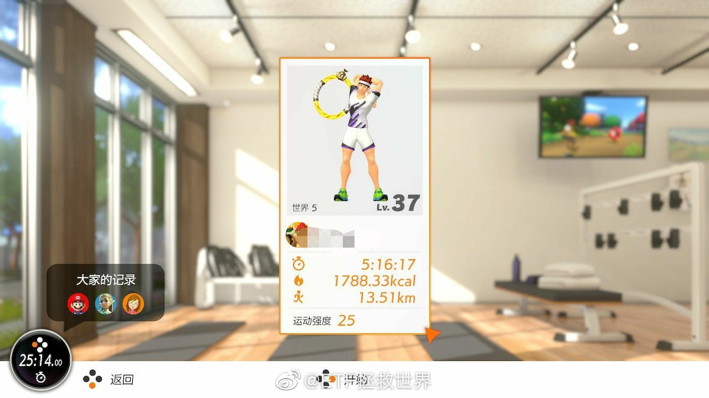

## 2020-01-01 10:31

统一回复，在家锻炼我买的是健身房那种厚垫子。瑜伽垫太薄，两个加起来都薄。

淘宝关键字应该是“舞蹈垫”“海绵垫”之类的。很厚，舒服而且没有声音。 可以对折，折起来更厚！ ​​​

## 2020-01-01 10:47

北京5G速度实测 ​​​
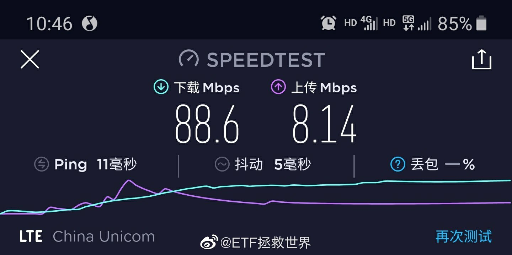

## 2020-01-02 08:30

今天押涨有风险吗 ​​​

## 2020-01-02 10:12

3000点，账户历史新高了吧。 ​​​

## 2020-01-02 10:27

听进去了没有。现在明白了吧。我说的一定要注意啊。

## 2020-01-02 10:39

春节前如果能维持涨势，春节后又要冲一把。 ​​​

## 2020-01-02 10:46

今年是大波动这个判断是不是越来越靠谱了。

如果全年大涨，就是又一个短命行情，明年又是万人坑。

只有大幅波动才符合长牛慢牛的要求。 ​​​

## 2020-01-02 10:52

不会有很多只看微博的朋友以为我们只做网格赚波动的钱吧。

我们是主力资金放在长期资金，这部分在2018年底基本已经布局完毕，不会乱动。少部分做波段降成本。

一定不要弄错。 ​​​

## 2020-01-02 14:34

挣点钱而已，意思不大。 ​​​

## 2020-01-02 15:04

说一个几周前你会觉得很可笑的事：

传媒ETF居然溢价了。

市场的羊群疯起来真是不看路的。 ​​​

## 2020-01-03 10:31

喷了。

好消息不断。 ​​​
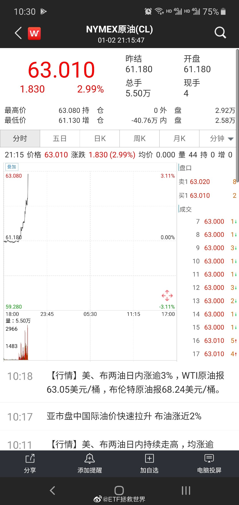

## 2020-01-03 10:35

熊市慢慢买，积累筹码。钻石坑布置完毕。

最好不赔钱。但是如果有点浮亏也没事，看都不用看。

牛市来了踏踏实实拿着。最后收割一把走人。

继续慢慢买。

说白了就这么点事儿。

一辈子，做几个轮回，基本就差不多了。 ​​​

## 2020-01-06 10:10

黄金原油500传媒环保

这些辣鸡这么涨让人感到有点不好意思了。 ​​​

## 2020-01-06 10:30

500上面第一个压力5650 ​​​

## 2020-01-06 11:25

意思不大 ​​​

## 2020-01-06 13:03

投资的时候，舒服重要不重要。

谁舒服谁发言。 ​​​

## 2020-01-06 13:18

再次推荐电影《迷雾》The Mist

没看过的一定要看看。看到最后。

每次最绝望，最坚持不下去的时候，想想这部电影，会有用。 ​​​

## 2020-01-07 09:21

又是一个好日子。

今天资产能继续新高吗。 ​​​

## 2020-01-07 09:46

去年春节，吃饭的时候你跟亲戚说，钻石坑，买股票赚大钱。

他们笑话你遇到了骗子。

今年春节，吃饭的时候亲戚跟你说，黄金十年，买股票赚大钱。

你笑着咬了口韭菜馅饺子。 ​​​

## 2020-01-07 09:58

回复@frederick_999:永远不要劝别人炒股或者不炒股，买基金或者不买基金，投资或者不投资。一个建议，99%对。//@frederick_999:我几个券商的朋友已经开始拉着身边小伙伴入伙准备在股市大挣一笔了，我劝了一晚上没劝住。

## 2020-01-07 13:03

你的东西涨了，你心里要清楚是因为价值还是炒作。

自己心里得明明白白的。 ​​​

## 2020-01-07 13:50

回复@姨夫劝你莫拒绝:拿回现金也不是真的。没准下一把就赔了。销户离场之前都是假的。//@姨夫劝你莫拒绝:账面上的是虚的，收菜拿回现金的时候才是真的

## 2020-01-07 13:56

回复@兔望雨停:赔了踏踏实实拿10年，赚了烫手拿不了3天。非常经典，绝大多数人都这样。//@兔望雨停:我感觉账户的收益让我觉得好不踏实 只有每天上班的工资让我觉得踏实，明明这几天的收益抵我几个月工资。不知道是怎么回事

## 2020-01-07 14:01

身边人都赚钱了——

股市都是骗钱的不买——

身边人赚大钱了——

可以买点试试——

我去我也赚钱了，多买！——

嗯？怎么赔了。割不割？——

算了，赔太多了。拿着吧，股市果然是骗钱的——

几年后——

回本了！清仓！再不清仓就跌回去又赔了！——

嗯，怎么还在涨，股市都是骗钱的，不买——

涨这么多了？长牛十年？再试一次！

## 2020-01-07 14:15

回复@1个吼猴:有些人炒股就是图个乐，跟打麻将似的。不炒股玩别的更闹心，孩子踏踏实实的。//@1个吼猴:回复@1个吼猴:但我爹不一样。我爹不相信市场，也不跟风追高，只相信自己天纵奇才。结果赔的比我妈还多

## 2020-01-07 15:07

传媒辣鸡。你给我赚那么多也是辣鸡。

## 2020-01-07 15:11

传媒上面的压力位在1630。 ​​​

## 2020-01-07 17:41

出门在外，尽量别跟人起冲突。因为你根本想象不到对方有多二。

## 2020-01-07 21:52

私信太多，不是礼物的事还看不到这个。

看完了心里很复杂。各种感觉一两句说不清。

祝大家都好。无论做什么投资，安全都是第一位，尽量买不会死的品种。

对于能帮助各位，无论是哪个方面，我都很欣慰，压力也很大。

咱们都要越来越好。 ​​​
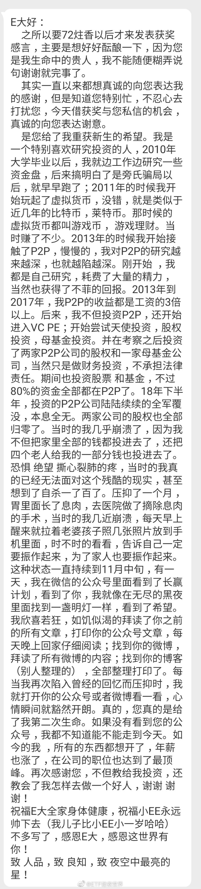

## 2020-01-07 23:45

早点睡，晚安 ​​​

## 2020-01-08 07:45

再走一个 ​​​
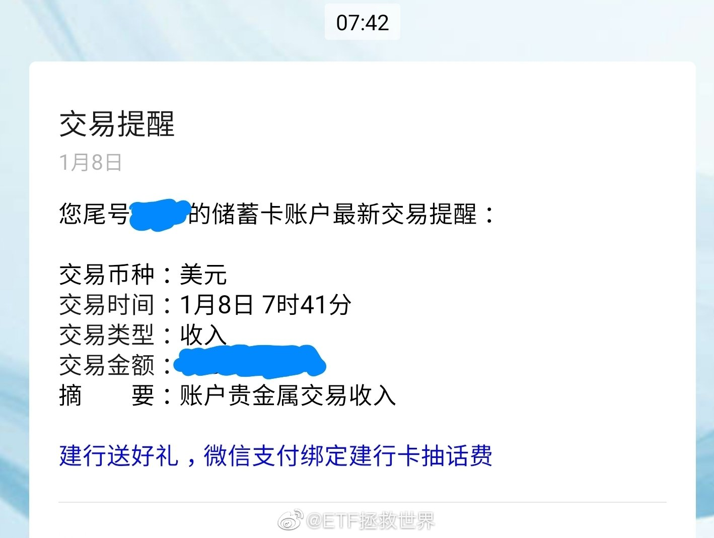

## 2020-01-08 08:41

截至目前，150的31个品种中，盈利的是28个。如果把500算做一个大类，则浮亏品种只剩环保和油气。环保6%，油气2%。

s计划18个品种中，盈利17个。只剩油气浮亏2%。

如果做了网格，这两个也基本赚钱了。

你的账户现在应该是满堂红。

其实金融投资只要理性，赚钱真的不难。赔钱很难。无论A股港股海外互联黄金原油德国债券，都是如此。

## 2020-01-08 12:49

所以每次去拜大佬的时候，我第一个都是许愿国泰民安。

这四个字没了，什么都是空。 ​​​

## 2020-01-08 14:18

160416 计划里的石油基金，场内部分可以先卖出，大幅溢价。 ​​​

## 2020-01-08 14:42

虽然挣钱意思不大，但是跟赔钱时候一点意思都没有比起来，还是有意思多了啊。 ​​​

## 2020-01-08 15:08

回复@江尼的小酒馆:WTF，场内挂单要赶紧安排上了。送钱啊这是。//@江尼的小酒馆:E大今天德国30不知道出了什么幺蛾子，我的场内网格提醒买入，应该是突然暴跌，乌龙指？

## 2020-01-08 21:20

白银出掉一网，原油场内溢价卖出套利。

现在金油大跌，这么给面子吗。 ​​​
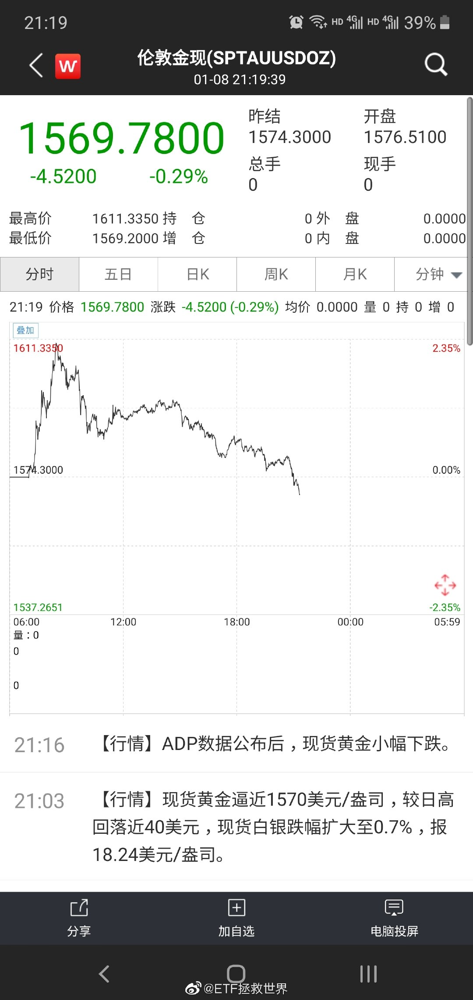 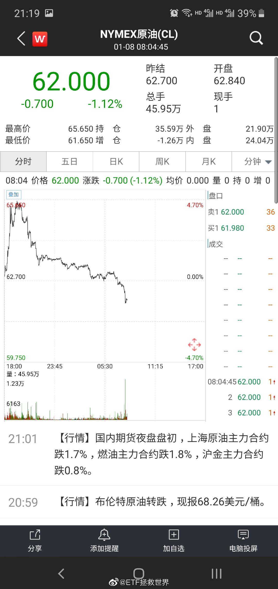

## 2020-01-09 09:31

不用谢 查看图片

## 2020-01-09 09:36

这个市场上充满了疯子和傻子。他们不会消失，所以理性的人赚钱就是必然//@ETF拯救世界:不用谢 查看图片

## 2020-01-09 10:22

回复@ETF拯救世界:喷了。跌停接回的朋友们，如果疯子们拉回-5%左右，可以再次卖掉，再吃5%。一天利润超过15%你什么感觉。T+0，当天买卖ok//@ETF拯救世界:回复@ETF虚一而静:可以。也可以再等等，目前还有点溢价，不过无所谓了，十几个点差价已经吃到了

## 2020-01-09 10:28

回复@最爱芝麻糖:QDII基金绝大多数都可以。包括标普500，DAX，恒生等等。//@最爱芝麻糖:新手想问下  这个石油基金是可以当天买入当天卖出吗//@ETF拯救世界:回复@ETF拯救世界:喷了。跌停接回的朋友们，如果疯子们拉回-5%左右，可以再次卖掉，再吃5%。一天利润超过15%你什么感觉。T+0，当天买卖ok

## 2020-01-09 15:52

今天还是有点意思的 ​​​

## 2020-01-09 18:08

DAX即将历史新高。 ​​​

## 2020-01-10 13:54

50岁女友，4000万。羡慕。

我也可以，不会赔钱！

不想努力了，私信我。 ​​​

## 2020-01-13 13:47

这年头资产不新高都不好意思上微博打招呼 ​​​

## 2020-01-13 15:10

别挣太多钱。

钱太多了就失去努力奋斗的朝气了。

你想想，天天躺在加勒比海边躺椅上，喝着加冰的鸡尾酒，跟比基尼美女谈笑风生，特别无聊。

真的。想想都可怕。 ​​​

## 2020-01-13 15:22

当你抱怨网格出早了的时候，

根本想不到的是，

如果没有那点网格先锋队的牺牲，

你的主力大部队根本拿不到现在的大胜。 ​​​

## 2020-01-13 15:26

所以说，有些朋友根本不知道另一个平行世界中的自己是什么状态。

我相信，只有真的经历过无论空仓、满仓、上涨、下跌、震荡、浮盈、浮亏都难受的朋友，

才能知道这份淡定从容舒服带来的越来越大的利润有多么可贵。 ​​​

## 2020-01-13 15:28

回复@傑杰2046:这种情况持续多久了，医生怎么说//@傑杰2046:我是怎样都难受，很难舒服

## 2020-01-13 18:59

今年微博礼物送完了，之后还有两次机会。估计那两次拿到要过年以后了。 ​​​
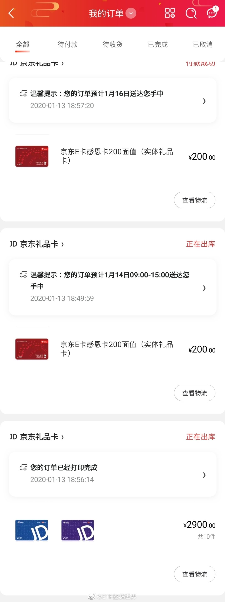

## 2020-01-14 08:38

今天买涨还是买跌

## 2020-01-14 10:15

找东西是最浪费时间的事情之一。所以，如果你把东西都放的井井有条，用完东西物归原位，那最后就相当于多活了好几年。

但是有一个方法可以让你把找东西浪费时间变坏事为好事。

就是你找东西的时候，把刚找过的地方清理干净。把三年五年没用过的，你总觉得以后会用到的东西扔掉，卖掉，捐掉。其它东西分门别类放整齐。然后，继续找下一个地方，继续整理。直到找到你要找的东西为止。

最后无论你的东西找到没有，至少你周围利索了。

干净，整齐，会让人心情舒畅，以及延年益寿。

## 2020-01-14 10:34

300今年才涨2%，你辣鸡环保凭什么涨8%。

太辣鸡了，果然是辣鸡，真让人。 ​​​

## 2020-01-14 10:46

接近压力区域，开始第一次测试。

## 2020-01-14 10:52

钱是好东西，多一点当然好。

但别太抠门。要抠，你在自己身上抠，别对别人太抠。

生不带来死不带去，把钱花在值得的人身上，不会错。

如果你觉得自己值，就花在自己身上。哪个家人、亲戚、朋友值，就花在他们身上。就这么简单。

当然，要保证花钱之前，所有收入20%-30%都攒起来投资……别自己没几个钱还穷大方就不好了……

## 2020-01-14 10:57

回复@淮南华安:没有攒不了钱的。你任何收入拿到后20%放进投资账户就当丢了，绝对不取出来，你看能不能活下去，生活质量也几乎不会降低。然后你打开投资账户一看：我去，真丢了！//@淮南华安:我怎么赞不了了

## 2020-01-14 17:19

回复@雨天就要睡懒觉:油气在150里面有3份，占比1.1%。在S里面有3份，占比4%。好不容易有一个浮亏的品种就被说是托，我太南了。//@雨天就要睡懒觉:E大，有人在华宝油气下面说你是油气的托

## 2020-01-14 17:49

说句实话，以目前我们这里的社会环境来说，我真不看好所谓的买方投顾模式。

为什么，因为这对买方投顾来说，道德品质要求过高。而能面对金钱不动心的人，不多。背后有利益相关，是能够想象的。

所以对于计划来说，一开始我就小心翼翼，如履薄冰。你可以说我水平不行，但我绝不给你机会说我有什么背后的猫腻。

不同于别人，我选的产品几乎涵盖所有国内的大基金公司。甚至一个品种买多了，我都要几家公司分散，避免某个公司的产品买多了落人口实——我买7、8家甚至十几家公司的产品，难道我能跟所有公司有猫腻？

所以有人嘲笑我什么都买，质疑我一个品种买好几种，我从不多说。这里面的苦心，没几个人能懂。

另外，你见过我分析推荐任何基金吗？我买也不会告诉你为什么买，卖也不会告诉你为什么卖。谁涨的好我也只说指数，不谈基金。油气？你见过我夸油气一句吗？我只是买了几个点，然后说它比较适合做波段而已。

分散购买，从不分析推荐，够小心的了吧？如果还有问题，那我希望自己以后能做的更好。争取关于基金品种一个字都不说。

还是那句话，君子爱财，取之有道。除了投资，我有什么能挣点钱的渠道，大家都知道。比如gzh文章每个月有几百块微信自带的广告费（0.1%的人会点广告），有几百人打赏（1%跟车的人会打赏）。且慢有点推广费。还有一点早就关闭的投资日记订阅。清楚，明白。

至于背后的交易，我不屑，更不愿意去赚那些钱。有证据你就拿出来，不能因为30多个品种，有一个浮亏不到10%就来侮辱我。我有点洁癖，受不了这个。我要真赚这个钱你说我我就算了，我又没赚你凭什么造谣。

我是没什么钱，但我有底线。虽然这个底线比较高，已经到了他们所能想象的上限了吧。

## 2020-01-14 19:09

一个人在家的日子，再次感受到了久违的单身狗の乐趣。 ​​​

## 2020-01-14 20:37

你以为是故事，其实是一段刻骨铭心的回忆。

回忆这种事，怎么能随便拿出来给人看呢。

我可是个很酷的人。 ​​​

## 2020-01-15 08:02

呵呵

## 2020-01-15 08:14

居然有这么多支持的？！

## 2020-01-15 09:50

医药总是在别人不行的时候嘚瑟 ​​​

## 2020-01-15 11:59

据说绝大多数人一辈子吃的东西是定量的，谁先吃完谁先走。 ​​​
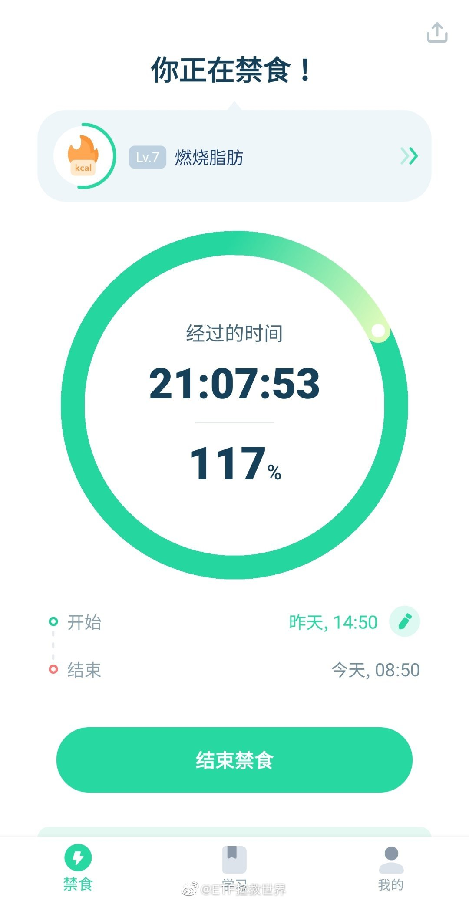

## 2020-01-15 13:32

回复@以后做快乐健康的小女人:饿一饿，激活免疫系统，淘汰受损细胞//@以后做快乐健康的小女人:回复@ETF拯救世界:ee，医生说身体里面只有宿便，没有什么毒素，放心哟

## 2020-01-15 13:36

回复@随记心路:现代人没几个饿病的，哪个不是吃太多吃出三高糖尿病。这些东西保留自己看法吧//@随记心路:个人反对这些理念。一日三餐，五谷杂粮，该吃就吃。肠胃又没得罪你，没事干嘛饿它。//@ETF拯救世界:回复@以后做快乐健康的小女人:饿一饿，激活免疫系统，淘汰受损细胞

## 2020-01-15 13:48

碰到什么与自己过去认识不同的东西，先别急着否认反对。

如果感兴趣，先去了解，研究，看几篇论文，再判断。

人这一生，每天都在接触新东西。你把自己的思维禁锢起来，就永远不会进步。

开放，包容，择善固执。 ​​​

## 2020-01-15 17:22

到底通过什么方式做公益比较靠谱呢。

这些年我捐的那些不知道到底用上了多少。 ​​​

## 2020-01-15 17:28

终于取消了。还是有点敏感度的。

## 2020-01-15 17:30

东亚几个国家关系搞好，对我们没有坏处。历史不能忘记，但不必每天宣传仇恨。

## 2020-01-16 10:52

今天我一直在想一件事，做为人类，我们是希望什么人挣钱。

亲戚吗，不一定。春节聚会的时候，有些亲戚跟你说他发财了你心里未必会开心。

朋友，同事吗，也未必。

相反，有些人赚钱你会特别生气，就是那些你讨厌甚至恨的人。

即使你不讨厌的一个陌生人，听说他赚钱了，你也可能会心里不舒服。

那么我们希望什么人赚钱呢。

第一个当然是自己，不多说。

第二个是那个人赚钱了自己能分点。有时候分少了也生气，得分的够多。

第三个，就是自己喜欢的人。无论这个人是不是自己的亲戚朋友同事还是陌生人。

只要你喜欢他，就会希望他多挣钱，过的更好一点。这种喜欢是真的喜欢，跟他能不能分点给自己，自己能不能获益毫无关系。

所以判断自己是喜欢，还是讨厌一个人，是不是真爱，看自己是不是希望他发财，过的越来越好就能判断了。

我说一句真心话：

我希望在座的各位（除了那几个坏人）都赚钱，赚好多钱。真的。 http://t.cn/A6twxyG0

## 2020-01-16 23:34

拍摄人的观察能力，推理能力，反应能力，语言能力都非常强

## 2020-01-17 07:42

回复@小智的马:只要前车不承认，而且没有摄像头拍到，就是后车全责。我遇到过，前车倒车把我撞了，不承认，一车人下来bb。警察来了，我把记录仪拿出来，都闭嘴了。//@小智的马:这个追尾要是没有行车记录仪和监控  要怎么算？  怕是要判特斯拉全责？

## 2020-01-18 08:02

停车等灯的时候被疲劳驾驶的司机追尾了。

人没事，车也基本没事，一个倒车雷达被撞进去了。对方保险公司说如果要换保险杠得上万，年后去4s定损吧。

各位出门都要小心啊。 ​​​

## 2020-01-18 08:41

两个素质很重要

第一是低调。

第二是从别人的错误中得到经验。 ​​​

## 2020-01-18 18:04

愤怒的根源来自于感受到不公平。 ​​​

## 2020-01-18 18:24

很少看国产电视剧的我觉得网剧唐人街探案有点好看是怎么回事。 ​​​

## 2020-01-19 08:35

从目前的信息分析，我个人觉得，最关键的是外界不知道每周一天闭馆到底是在干什么，博物馆也没有说清楚。

我自己瞎想啊，那天一定有一部分展出文物和场馆的保养 维护工作。这个在大家预期内。现在看，也应该有一部分大家预期外的活动。

比如vip参观，一些商业活动比如新品发布会，影视广告拍摄等等吧。这个过程中，一部分车辆被允许进入，通行。

有两个问题导致事情这么大。

第一个是之前调子定的太高，比如不能进车，外国政要要步行进入。结果发现不是这么回事。

第二个是碰到了敏感的G。名车，草根一步登天后的炫耀，特Q等等。

如果博物馆清楚明白说清楚闭馆日在做什么，如果之前调子不那么高，如果这位不那么嘚瑟…

我最大的感受，是微博和网络在历史进程中，确实能起到不容小视的作用。

## 2020-01-19 09:19

看唐探，前8集邱泽主演，81年的，今年也39了。

后四集跳着看了三分钟，看不下去。主演都是二十几岁的小鲜肉。

男人的魅力和年龄关系不大。

关键是不能胖，还有不能秃顶。 ​​​

## 2020-01-20 07:03

弄不好今天医药还得继续反弹新高。

不过已经到了压力位，看看谁的力量大吧。 ​​​

## 2020-01-20 09:23

万万没想到你是这样的小米…… ​​​
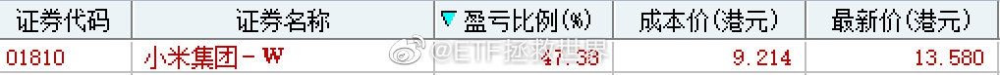

## 2020-01-20 09:26

下次小米发布新品手机，买一个送给微博的朋友。

## 2020-01-20 09:31

$全指医药 sh000991$   爱了 ​​​

## 2020-01-20 10:04

虽然计划里面有不少医药仓位，但我当然希望流感尽快被消灭。

大家都要做好防护措施，火车飞机一定全程口罩。 ​​​

## 2020-01-20 10:12

不知道春节还能不能去看电影 ​​​

## 2020-01-20 13:54

今年生肖鼠、马、羊、兔、鸡的朋友要更加小心，遇事心态平和，重大决定更加谨慎。

各位都顺顺利利的。 ​​​

## 2020-01-20 14:13

今天咱们持仓指数都涨的很好对吧，其实还有1400只股票在下跌。

炒股太南了。 ​​​

## 2020-01-20 14:47

再坚持几天。

## 2020-01-20 14:54

回复@大漠孤烟0130:你说的是2019年吧。2019年，两市3553家公司，涨幅中位数15%。翻番股票206只，占比5.7%。24%股票是下跌的。你身边人都翻番了，只能说你们都是人中龙凤。再说，我这条微博说今天下跌公司，你说去年，有任何关系吗。

## 2020-01-20 14:58

我实在搞不懂有些人的逻辑是什么：

我：今天有1400只股票下跌。

他：你不客观。去年我身边的人都翻番了。

我：？？？ ​​​

## 2020-01-20 15:26

又想了想刚才那位朋友，不认同“炒股太南”这个结论。

炒股难不难，你说了不算，我说了不算（我自己也是炒股赚到资本市场第一桶金，但我依然认为炒股不适合绝大多数人），这个市场上的股民说了才算。

过去二十多年，到底有多少股民是赚钱的？没人统计过，但我毛估估，不超过30%。

一件事，只有不到30%的人能做成，难还是不难？自有公论。

买指数呢。

第一轮，我自己做的。

第二轮，2010-2015，几个朋友一起，5年时间赚了几千万。（是不多，因为我们都是白手起家）

第三轮，2015年7月股灾中4000多点开始，到3100点的现在，跟车的人有99.9%（70份以上）都是赚钱的（数据来源：且慢）。同期炒股到现在的，有多少股民是赚钱的？

哪个难，哪个容易，还用我说吗？

## 2020-01-20 16:08

这件事过去后，请给这些英雄升职加薪。

## 2020-01-20 16:21

发现自己的家装维修战斗力只有5。

一个洗手池下水管都装不好，弱鸡…… ​​​

## 2020-01-21 09:33

$全指医药 sh000991$  别这样，求救命…… ​​​

## 2020-01-21 09:41

从那天到现在，已经50%+了。那天也是几乎最低点。投资就是这样，最黑暗之后就是黎明。目前医药仓位十几个点，可控。

## 2020-01-21 10:00

说明一下：

我们的医药筹码是拿了至少一年以上了，并非要炒作概念才买。

市场上有人愿意炒，我们可以把自己的筹码在适当时候让一些给他们，既然他们那么喜欢。 ​​​

## 2020-01-21 16:10

搞清楚了，不是我战斗力渣，是缺少一个巨大的扳手拧螺母，还少了一点生料带。现在已经完全拥有下水管安装能力，有需要水管工的可以联系我了

## 2020-01-22 09:30

最后一网医药出掉。

一中网+一小网。 ​​​

## 2020-01-22 09:41

这一网没有出在最高，水平还是不行 ​​​
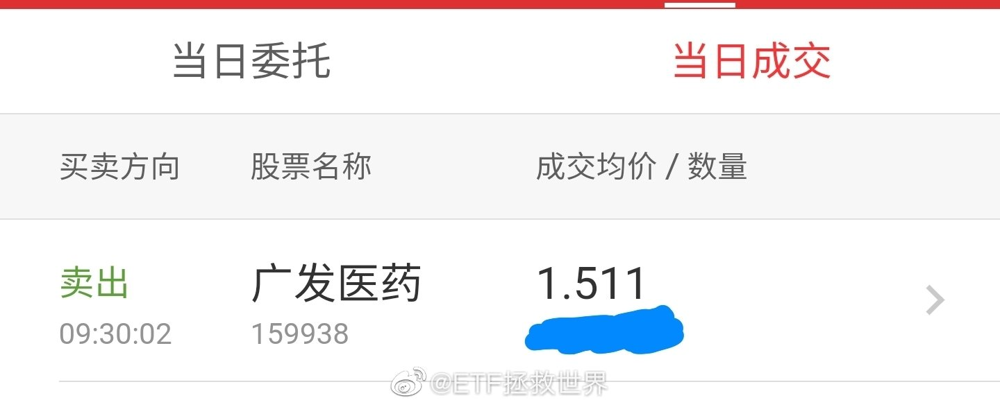

## 2020-01-22 09:50

这样的话可以准备布置下网了。

节后吧，最多5-6个相关性低的品种。不着急，符合条件就下。

不怕你涨，不怕你波动，不怕你跌。只要开市，怎么都行。 ​​​

## 2020-01-22 09:54

不懂就问，这种情况电影公司可以临时撤档吗。春节档先不上了，否则损失太大了。 ​​​

## 2020-01-22 11:27

how dare you!  ​​​

## 2020-01-22 13:05

这样会让人很尴尬你知道不知道。

## 2020-01-22 13:31

2019年1月，可以买入一份医药大网。

这几天可以出掉。一年收益率43%。 ​​​

## 2020-01-22 13:43

其实吃到大网真的不容易，天时地利人和。需要这个品种开网价格不能太低，还需要跌的够多（下跌30%）。还要买完后反弹43%。最重要的，是跌30%的时候你不害怕继续果断按照计划买入这一个大网。

## 2020-01-22 13:59

回复@开心快乐追求:你对大牛市一无所知//@开心快乐追求:感觉网格已经比计划收益高了，计划是假，网格是真

## 2020-01-22 14:29

什么玩意儿500还反弹新高了，找谁说理去 ​​​

## 2020-01-22 14:49

希望有些武汉的朋友们明白，真的没人歧视你或者什么别的。就是大家都希望传染的范围越小越好。大原则就是对自己负责，对他人也负责。

这都很正常。当年北京人到外地或者在北京的外地人回老家也是被严格隔离，这有什么啊。（当然这些我都是听说的，毕竟当时我才2岁）

我看到一条微博，有个人从武汉回家，约朋友吃饭，朋友说等情况缓和了再吃吧，毕竟饭局上还有孩子。这个人生气了，把这个朋友拉黑了。什么事儿啊，别人不说自己也应该主动提出来吧……

## 2020-01-22 17:40

回复@毛笔19487:不好意思，那一份确实半年赚了55%就走了。我本来也没说我能卖在最高点。让您失望了。取关我吧，省得天天看着我生气。您说好吗//@毛笔19487:涨了的就没完没了的装13 消费就买了一份然后早早卖了…到现在涨了多少只字不提//@ETF拯救世界:回复@开心快乐追求:你对大牛市一无所知

## 2020-01-22 17:45

我看了一下，内地消费指数我们卖了以后，到现在半年多又涨了11%。

因为少赚了这11%，不顾已经赚了55%，就来埋怨我装b。

如果跟车了，我说声对不起让您少赚了11%。如果没跟车，就是看我不顺眼，那我也没任何可以说的了。

大过年的，也祝你们几位过年好吧。天天看着我生气，也辛苦你们了。 ​​​

## 2020-01-22 17:54

回复@cestmoi1018:什么，你说卖掉的同时又买别的也赚回来了？我不听我不听，只有消费的利润是利润，300和安心债也配说是利润吗。 查看图片 //@cestmoi1018:虽然把消费卖了，但是买了300和安心回报债啊，也都各涨了11%，又不是卖了就亏了或者少賺这13%

## 2020-01-22 18:08

今天德国DAX历史新高。

很多朋友说我们买的德国30跟的不行。

确实没有完全跟上，我考虑有几个原因

第一，DAX是一个全收益指数，含股息，跟上它不容易。

第二，汇率问题。

第三，费率不低。

看下图，跟的不好不仅是A股的德国30，美股上市的EWG更差。

现在的问题是，市场上只有这一个跟踪欧洲的指数，不买它你也没的买。所以，希望以后有更丰富的品种吧。
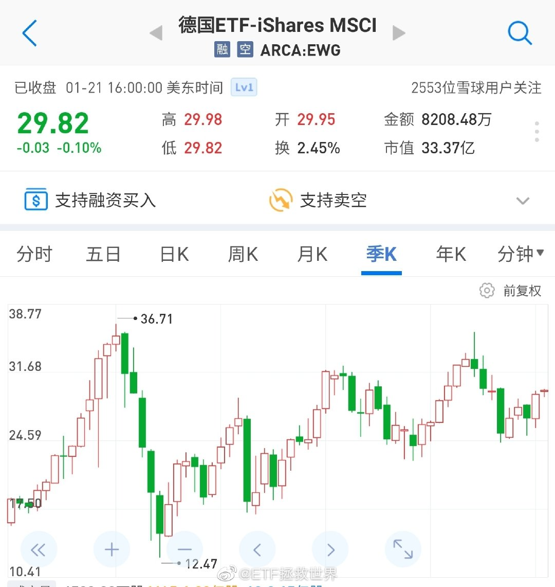

## 2020-01-23 14:04

一天接回来一个小网。喷了

## 2020-01-23 14:05

节后大概率可以开始了

## 2020-01-23 14:49

一月份波动就这么大。你能想象今年全年吗。

年底看看预判的对不对。 ​​​

## 2020-01-23 14:51

回复@热火风雨无阻:去年阅读量没达到预期，今年没心气儿弄了。特累。//@热火风雨无阻:E大，今年有没有春节专辑啊，期待中！//@ETF拯救世界:节后大概率可以开始了

## 2020-01-23 14:53

又猜中了。--【6部贺岁档电影先后宣布退出春节档】电影《唐人街探案3》宣布撤出春节档，至此，6部贺岁档电影《熊出没·狂野大陆》、《姜子牙》、《紧急救援》、《囧妈》、《夺冠》、《唐人街探案3》退出春节档。 ​​​​

## 2020-01-23 15:13

卖野味判刑可以吗。 

你肆无忌惮，法律不管你，大自然也会惩罚你。

这个地球上的生物不是生下来都是为了让你吃的。 ​​​

## 2020-01-23 18:36

关注我很久的一位朋友在这里工作，现在他们需要帮忙。

他说现在顺丰还能送货，我会买一些发过去。

能做的不多，希望一切尽快好起来。

向所有医护人员说声谢谢。你们太值得尊敬了！ ​​​
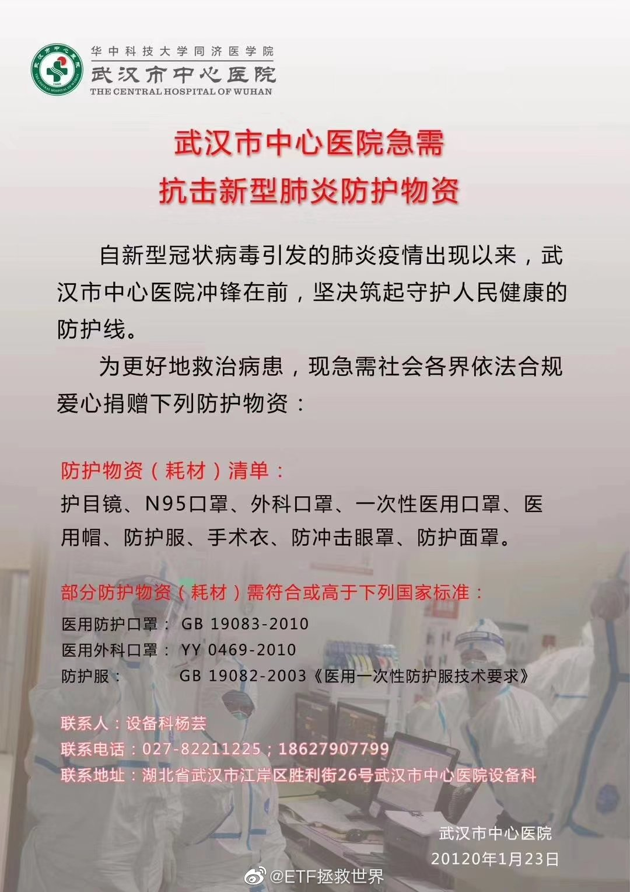 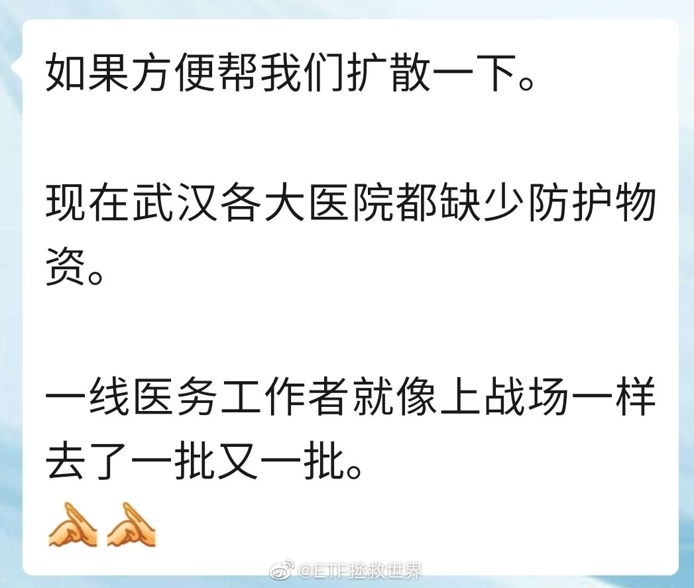

## 2020-01-23 20:56

放假了，也别每天在微博上泡着。微博上多了，焦虑情绪会变得严重。早晚看看新闻就行。

假期好好在家呆着，陪陪家人，追追剧，玩玩游戏，放松一下。 ​​​

## 2020-01-24 09:58

祝大家新春大吉，平安喜乐！ ​​​

## 2020-01-24 22:02

不说你不知道，我是佟丽娅的颜粉 ​​​

## 2020-01-26 19:42

不瞒你说，24小时没上网。

第一时间上微博看看。今天都干嘛了，实话实说。

我先说。玩了会健身环，看了会书，看了囧妈，弹会琴。

明天要干点正事了。 ​​​

## 2020-01-27 08:14

永远不知道明天和意外哪个先来。珍惜当下。

## 2020-01-27 17:53

别管做不做，人家话说出来了，意愿表达了，咱得说声感谢。再看看咱们自己的台湾同胞

## 2020-01-27 18:08

回复@babalu51:图片评论 查看图片 //@babalu51:e大今天干了啥正经事//@ETF拯救世界:别管做不做，人家话说出来了，意愿表达了，咱得说声感谢。再看看咱们自己的台湾同胞

## 2020-01-27 20:07

你焦虑吗。

一个月前就说了：今年大幅波动。

不波动怎么赚钱… ​​​
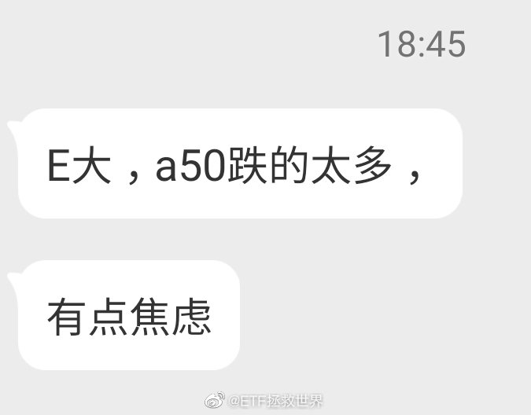

## 2020-01-27 21:31

你们这些看外盘预测A股的，还是有点naive。还有几个交易日，弄不好外盘在A股开盘前已经暴跌暴涨回去了。我个人没什么期待，涨了挺好，跌了赚更多。多大点事啊也值得焦虑

## 2020-01-28 09:19

回复@tasterOJwangc:可能你没有太关注我。我自己有长线的计划，有波段的网格。好几个品种的网格之前上涨已经出干净了，微博都有同步。大跌正好接回来，能不舒服吗。今年大幅波动是去年底的判断，今年也建议大家可以做波段降成本增利润。踏踏实实的。

## 2020-01-28 09:27

有些评论的人太讨厌了。你辛辛苦苦打半天字回复他，一转头他把评论删了，你的回复没了，别人也看不懂你的转发在说什么了。

什么玩意儿啊。 ​​​

## 2020-01-28 09:32

另外，大家是不是没注意，计划（包括s），已经多长时间没买了。

你以为攒钱干嘛呢。 ​​​

## 2020-01-28 10:34

10:30  真的开始做正经事了。 ​​​

## 2020-01-28 12:00

12:00。完成一项工作。还有三项。 我要去玩会健身环锻炼一下了……

## 2020-01-28 22:30

刚看了一下，经常看我东西的湖北朋友大概2500位左右。

大家都辛苦了，会过去的。坚持一下。 ​​​

## 2020-01-28 22:47

常读用户里面，有53%是26-35，27%是36-45。

大部分都是有资产的哥哥姐姐。 ​​​

## 2020-01-28 23:29

回复@ETF拯救世界:又买回来。 查看图片 //@ETF拯救世界:一个半月，又出一格。

## 2020-01-28 23:35

是这样的 查看图片 //@ETF拯救世界:回复@ETF拯救世界:又买回来。 查看图片 //@ETF拯救世界:一个半月，又出一格。

## 2020-01-28 23:40

这几年铂金和钯金涨的都特别好。 

这波就不追了，以后多关注。 ​​​

## 2020-01-29 18:44

我最近有个感想，不知道对不对，说出来共同探讨。

人类之所以能开枝散叶到现在几十亿做了地球球长，很大的原因可能是有天然的保护自己，维护整个种群安全的基因。

所以老话里面有“人不为己天诛地灭”。这句话听起来不是好话，但你到了这种时候，会发现其中也有合理成分。当你为自己拒绝与发烧的人坐同一班飞机，严格限制自己与疫区人员接触，其实你也是在为这个种群能够延续下去做了一点贡献。

绝大多数人都怕死。怕死才能保证整个种群延续。

据说人的免疫系统会疯狂攻击冠状病毒，攻击的时候，无法将病毒与细胞分离，只能一起干。所以患者肺里面会充斥大量白细胞，最终一部分人是被自己的免疫系统干掉的。我想，免疫系统不至于傻到不知道自己是在杀死人体的细胞，不至于傻到不知道再杀下去人可能就不行了。但是它必须杀——杀不死病毒，就杀死这个人，总之不能让病毒活下去，以致于威胁到整个人类的安全。我不懂医学，这是我浅显的理解。

所以我们会对很多普通人的伟大行为感动。他们为了他人，不顾自己的安全，舍己为人。一定程度上，这应该是不符合基因设计的。他们的心中有的是大爱，让人敬佩。

至于绝大多数普通人，保护好自己，就是为整个人类做贡献了。发现那些危害整个种群的行为，也要像免疫系统一样疯狂攻击灭之而后快——比如吃野味。

## 2020-01-29 18:50

回复@沐之以思:一部分人没有进化完全而已。身边这种没有进化完全的例子还少吗？哪年春天你逛公园看不见几个爬回树上照相的。//@沐之以思:吃野味到底为了啥，是为了那些虚无缥缈的“吃啥补啥”？

## 2020-01-29 18:56

回复@老实人的辛酸苦涩:装X就是进化不完全。进化完全的人谁会觉得吃点野味就是NB了。//@老实人的辛酸苦涩:回复@沐之以思:我觉得应该是装x的心理作祟

## 2020-01-31 04:04

转发微博

## 2020-01-31 18:45

是不是发现天天没事在家闲着无所事事没想象中的舒服。 ​​​

## 2020-01-31 19:27

如果你说是企业定向捐赠我还理解。啰哩啰嗦说一堆根本没提定向，这就有意思了。一线的医生没的用，你去给周围居民派发做广告，服了。这一个月真是刷新我对很多事情的认知

## 2020-01-31 20:03

不，这不是我想要的评论。感觉有被冒犯到。

