## 2020-02-01 09:03

我只是想知道，抑制病毒是什么意思。

是说可以抑制病毒在体内复制的意思吗。

至于什么药有效还是无效，我不懂，不乱说。 ​​​

## 2020-02-01 09:19

我想了想，所谓抑制，可能说是通过药物抑制病毒复制，使病毒量没这么大，免疫系统不再猛烈攻击造成器官损伤。剩下的就靠免疫系统慢慢清理吧。不懂医学，瞎想。

## 2020-02-01 09:41

去年底买了个品种，一个月涨了将近40%。

你猜是什么。

健身环。 ​​​

## 2020-02-01 10:08

回复@ETF创造奇迹:那时候估值比现在低20%。//@ETF创造奇迹:如果周一大盘大跌百分6（和港股同步），那么，有可能一步到位，跌出一个低点。这个估值，就和18年的2500点一样了！恐慌的尽头，是光明！ ​​​ E大，刚才看到的，是这样吗？

## 2020-02-01 10:44

一个新的体会。

比赛也好，考试也好，做其它竞争性的事情也好。做的时候专心致志尽最大所能，但是对结果看的淡一些。

这样，最后会比特别重视结果可能要好很多。心态完全变了，做起事来效果更好。太重视结果，有可能导致过分紧张，反而无法发挥水平。

另外，即使输了，也不会太沮丧。

这个道理以前看过很多次，但是只有自己经历了才能真正体会。

心态很重要。

## 2020-02-01 22:11

删了几条微博。

就这样吧。 ​​​

## 2020-02-02 21:42

明天应该在5%左右吧。毛估估。 ​​​

## 2020-02-02 21:56

左右的意思是上下浮动5%

## 2020-02-02 23:05

觉得跌了就难受的朋友，可能你还没理解，股市是一个会巨幅波动的市场。

这就决定了你的资产就是会波动，这个没有任何办法解决。

你要理解这一点，不要再因为波动激动或者难受。否则，你就不应该再玩下去。

从两方面做到这个。

第一，保证自己持仓成本低。或者持仓成本不低，但是有很多资金可以等跌下去加仓。

这样，波动只是影响你的利润或者给你提供买便宜货的机会，你当然不会难受。

第二，把波动从风险转换成利润。既然有人总是高位接盘低位割肉，那你可以不可以低位捡钻石高位获利走人？

当然可以，所以你要想办法利用波动赚钱。怨天尤人没用，想办法解决才是王道。

明天又要大幅波动了，你感觉怎么样。

## 2020-02-03 09:08

准备开工 ​​​

## 2020-02-03 09:27

刺激不刺激。 ​​​

## 2020-02-03 10:54

已更新 ​​​

## 2020-02-03 11:40

喷了，这波最高5597。压力位就是压力位，不服不行。

## 2020-02-03 13:36

消费买回来的日子不远了吧 ​​​

## 2020-02-03 14:29

今天买就买了，跟为国接盘什么的毫无关系。

国不缺咱们这点钱。

是为了自己挣钱才买。 ​​​

## 2020-02-03 14:57

三千只跌停的话，明天还是继续暴啊。 ​​​

## 2020-02-03 15:21

回复@不断奮鬥的丨眀丨天:目前的机制是，到达触发价即委托，但未成交则条件单失效。我个人认为这样不合理，按理说只要不成交条件单就不应该失效。未来这个问题会改进，已在日程表中。

## 2020-02-03 16:42

千万别救市。再救又是要好几年慢慢消化。

空间不够就要时间补。 ​​​

## 2020-02-03 22:59

今天大概率主要是散户在卖。

连天天都能卖崩了。

不知道我这个判断对不对。 ​​​

## 2020-02-03 23:27

今天3000多跌停+散户大量赎回基金，明天不乐观。所以——明天开个S车。

## 2020-02-04 08:39

昨天卖出以及今天想继续无论什么价格都要继续卖的朋友，我问你们几个问题。

第一，你是否能保证昨天开始A股一定一路下跌。

第二，即使大盘一路下跌，你是否能保证你的股票一定也继续跌。

第三，A股和你的股票都继续大跌，你是否能保证自己一定能在更低的地方接回来。注意，这个问题很关键。

第四，A股2005年至今的174个月里，只有14个月比现在便宜。分别是2005年2个月，2008年5个月，2012年1个月，2018年5个月和2019年1个月。这些比现在便宜的时间之后，A股都出现了大涨。现在疯狂卖出，踏空的风险大还是套牢的风险大？这是个概率问题。9:1的概率问题。

现在当然有很多风险，不然也不会这么便宜。我也不是怕你卖，说实话，你卖我很高兴。因为我还有很多现金等着买。你砸的越低，我的买入成本越低。

我是希望你问问自己上面几个问题，理性思考一下。不为别的，就是为了你自己。

## 2020-02-04 08:48

回复@梅川绔子:说实话，2月3日成交8000亿，你只是跑掉的几千亿里面的几万块而已。你对了，并不能说明什么。你错了，嘲笑你的人也不会超过10个。真的不用给自己加戏……

## 2020-02-04 09:02

经常性的一键满仓，一键清仓，只能说明两件事：

第一：钱很少。

第二：不懂投资。

老实人的真话，像饭里的砂砾或者出骨鱼片里未净的刺，会给人一种不期待的伤痛。

不好意思，但这就是真相。 ​​​

## 2020-02-04 09:23

你说我能不喜欢波动吗 ​​​
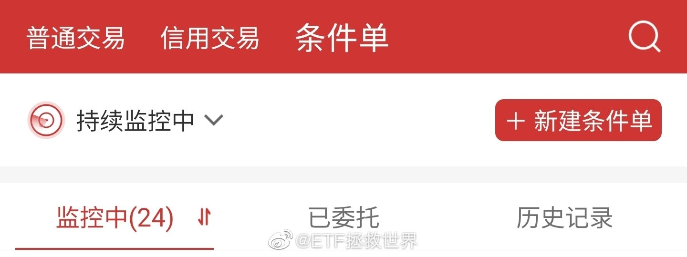

## 2020-02-04 09:30

今天很多ETF很奇怪，有资金溢价很多的买。 ​​​

## 2020-02-04 09:50

anyway，昨天买的两个网都在赚钱状态。至少现在看，这是个好的开始。

所以市场波动不是风险，别人的恐慌可能恰好是你的利润。

资本市场最有意思的地方根本不是赚钱，而是观察人性、战胜人性的乐趣。 ​​​

## 2020-02-04 09:52

回复@满眼星河GZ:我不明白什么意思。你不买，他也会卖。甚至，你不买，他就要更低的价格卖掉。难道你不是做好事？你有没有做任何不道德的事情？你是为资本市场的平稳做贡献，你做的是好事。希望你真的明白。//@满眼星河GZ:带血的筹码一点也不好，尤其现在

## 2020-02-04 10:31

几乎所有指数都在上涨。

而股票的涨跌家数对比是1400：2400…… ​​​

## 2020-02-04 14:15

现在指数涨成这样，平均两三个点以上了，股票涨跌比例依然是1500:2300……

## 2020-02-04 15:03

今天最大的问题是

家里食物即将吃完了。冰箱，终于快回到刚买它时候的样子。

发现超市的app也不给送货了，怎么办，去超市买吗。

各位都是怎么解决买食物问题的。 ​​​

## 2020-02-05 09:42

周一，也有一部分人赎回计划。

我给这些人的建议是，取关我然后永远不要再关注我。

不是一路人，何必一定要相伴前行。 ​​​

## 2020-02-05 10:11

看着这两天的上涨，周一清仓的朋友一方面感到绝望，一方面会说这是死猫跳后面还会暴跌。

后面当然也许还会跌，但你不适合投资这也是真的。 ​​​

## 2020-02-05 10:24

回复@Tak_CC:一番操作猛如虎，再看成本增加25%。//@Tak_CC:有个朋友，星期一跑了，还说继续看跌，到时候再买回来，结果今天就管不住手买了。。。。

## 2020-02-05 10:41

布置长线仓位后，你是不是盼着上涨，牛市来。

布置短期波动仓位后，你是不是又盼着赶紧跌一下好让你能提款。

你又希望涨，又希望跌，请问，你的心态怎么可能不好？ ​​​

## 2020-02-05 11:50

健身环，三国14，pes2020//@昆山法律:节奏光剑

## 2020-02-05 19:32

今日数据显示

医药已经算不上便宜。医疗已经即将算得上“贵”

不会再买。但长线持仓的肯定不会卖。 ​​​

## 2020-02-05 19:57

今天躺在摇椅上，看着窗外的雪景听本期BGM，很有感觉。你试试。 ​​​

## 2020-02-05 20:43

据说有些人是这样的：

事前：

“莫得事情”

事后：

“莫得办法” ​​​

## 2020-02-05 20:53

这位朋友是长期关注我的一位信阳市第二人民医院的医务人员。现在他们极缺N95口罩。如果有资源的朋友帮他们一把吧。//@银河系淂蜗牛:如果有任何渠道我们愿意有偿购买🙏🙏🙏

## 2020-02-05 23:33

总是这样我要不好意思了。 ​​​
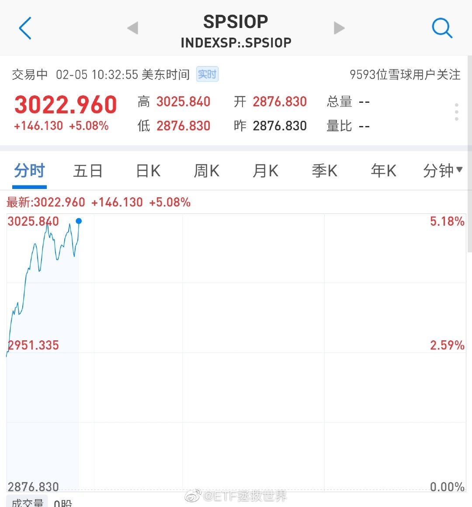

## 2020-02-06 09:57

3号上来这一波的波段利润基本都到手。

我好了。

现在涨开心，跌可能更开心…… ​​​

## 2020-02-06 10:03

截至目前为止，“一命”这个单位的涨幅是60%。 ​​​

## 2020-02-06 10:10

有一条请各位注意的，不要给别人的持仓做诊断，不要建议别人该买什么或者该卖什么。甚至不要劝别人应该还是不应该做金融投资。

一个是技术问题，一个是未来的不可知。上下嘴皮一碰，一个建议好做，但后面的责任你恐怕担不起。

对了又怎么样？一个东西现在2块钱，很贵了。你说卖了吧，危险。结果人家卖了，涨到4块。别人心里又急又气，3.8追回来。结果跌到1块。最后看，你没错。但你是真的做了好事吗？

更何况人性复杂。赚钱了是他自己的能力强。赔钱了是你乱指挥什么玩意儿。

你只要把自己怎么做的演示出来即可。

别人该怎么做，不要建议，不要建议，不要建议。

## 2020-02-06 10:35

意思不大。退博10小时。 ​​​

## 2020-02-06 10:37

这条最低点写的东西，请周一清仓的朋友再看看。再想想。对这一辈子的交易都有用。

## 2020-02-07 01:34

一言难尽。 ​​​

## 2020-02-07 10:07

今天就不发微博了。

一言难尽。

真的说不清楚。

向关心我们，对我们说真话的人们表达深深的谢意。

谢谢。

我会用各种方式回馈这份关心。滴水之恩涌泉相报。 ​​​

## 2020-02-08 09:41

有点意思

## 2020-02-08 14:21

wtf，翻番了

## 2020-02-09 09:19

我以后再也不因为喷子生气了。你们辛苦了//@半张废纸怪:有时候也觉得天天有时间在网络上喷脏造谣的人现实生活应该不太如意。一般人哪来那么多无聊时间族做这些

## 2020-02-09 17:51

我一辈子都不想尝试

## 2020-02-10 10:31

注意，上周一买入的网格到达价格卖出后要再次回去挂买单。

在条件单—历史记录中找到已经卖出的那网买入单，点击，选择重新创建。

然后就静静的体会跌了很开心的感觉。 

另外，再在评论里讨论具体品种的一律删评论+拉黑 ​​​

## 2020-02-10 10:34

感觉今天复工的人不多。高德上全是绿色 ​​​

## 2020-02-11 17:44

我们一衣带水的邻居，大多数人不像你从小被告知的那么坏，也并非就如天使这么好。

这个世界大多数时间是灰色的，不是非黑即白。

很多事情很难说清。所以还是不说了罢。

别人怎么说终究不做准，有机会还是去走一走看一看才好。 ​​​

## 2020-02-12 13:11

不能出门，被迫成长为米其林三星厨师是一种什么体验？

今日菜谱：

踏踏实实油焖大虾；时间紧急鲷鱼味增汤；每天新高秘制榄菜四季豆；多大点事儿拉玛西亚海鲜焗饭。 ​​​

## 2020-02-12 16:48

2016年12月，我们第一次买一份医药。当时是9608点。

今天收盘11000点。

从那个点位看，三年多只涨了十几个点，当然不算好。

但问题在于，当时的9608点估值是48倍（2015年最高96倍），而今天的11000点估值只有37倍。

越涨越高越便宜。

股票指数，便宜的地方买了，踏踏实实拿着就可以了。 ​​​

## 2020-02-12 17:06

购销差价15%？？？是不是疯了。企业没有成本的吗。还是说本意就是不想让口罩在市场上卖。不过这家企业不亏，几万块钱做了个大广告：都知道它是良心企业了。

## 2020-02-12 17:48

喷了，刚想起来。0.6进货，最高只能卖0.69。如果没有微信支付宝，付现金，这个没法找零。但是0.7又不能卖，卖就违法。所以只能卖0.6。也就是进价。也就是说，要赔上人工水电房租增值税所得税做慈善。

## 2020-02-12 19:20

两条规定：一：这种时候进价不可避免上涨，零售价不可以随之上浮。那么怎么做生意。二：购销价差额15%就不说了。这样一来，买不到口罩就太正常了。深深感觉在我们这里经营企业真的太难。以前我总感觉体制内大部分都是精英，经此一疫，有了新的认识。

## 2020-02-13 14:58

小米10今天出了。等能买到的时候送一个。//@ETF拯救世界:下次小米发布新品手机，买一个送给微博的朋友。

## 2020-02-13 15:17

我不喜欢前摄像头不居中。别扭。 ​​​

## 2020-02-13 16:36

我家健身环每天要运行2个多小时。每个人玩40多分钟，服了。 ​​​

## 2020-02-13 17:00

我感觉自己是个小白鼠，自己掏钱买各种东西亲身测试，觉得好的就说说。

不能保证每个人都觉得好，不会太差是肯定的…… ​​​

## 2020-02-14 10:23

今天怎么过。 ​​​

## 2020-02-14 16:39

油气。再说一次。

长线：

150仓位1.43%（有限资金模式）；S仓位5.33%（无限资金模式）。30多个品种几乎唯一亏损的。亏损没事，看看仓位多少。

网格：

三篇网格文章一再提示做好压力测试。仁至义尽。压力测试做好了，就算跌40%也是意料之中，完全心态平和执行策略。

总结一下：

长线仓位极低，波段压力测试做好，有些人到底在哭什么。

什么？你说你没按照我的长线仓位走？做网格前根本没做压力测试？

那你跟我这儿哭什么？关我什么事？你倒说说，我还能做些什么？接管你的账户？
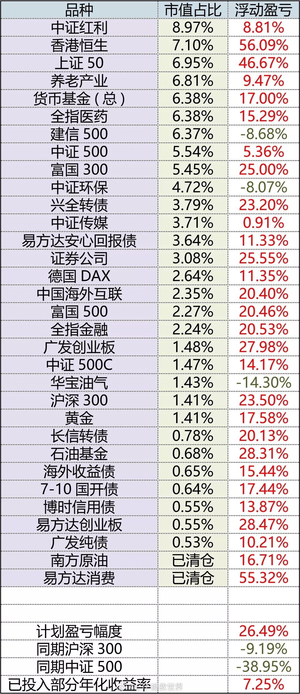

## 2020-02-14 18:42

人生真的是福祸相依，处处意想不到。

抚摸着前两年雾霾时候置办的两盒N95，我感叹道。 ​​​

## 2020-02-15 13:40

大事化小，小事化了。

心里堵得慌。 ​​​

## 2020-02-16 11:18

对我来说，养育孩子是一种很特别，很享受的人生体验。

所以我不愿意错过孩子成长的每一个瞬间。我愿意花费时间在孩子身上做很多事，比如出生到现在头发都是我剪的。上小学前出去剪过一次，剪的什么玩意儿比我差远了，主要是不够用心，所以还是我继续来吧。

其他的事就不说了，出生后几乎每件事我都会参与，做的也不会比任何人差。

孩子长的特别快，每个阶段用不了多久就过去了。所以很珍惜每一分每一秒，尽量多陪他，多为他做点事。

没有时间吗。很多事情不是没有时间，就看你愿意不愿意去做而已。除了那些真的忙的没时间和孩子相处的父亲，有时间却不愿意参与养育孩子，我是不理解的。

当然，人和人的想法不同，不评价。

## 2020-02-16 12:41

回复@微微吖0318:所以我说这样的父亲不会少。比如之前经常在这里发言的一位男性朋友，曾经给我分享过很多育儿的资料。详细规划孩子的教育路径，我自愧不如//@微微吖0318:我老公比我更上心细心，也比我更排斥二胎

## 2020-02-17 10:15

喷了。为了打新随便买点股票谁能想到。 ​​​
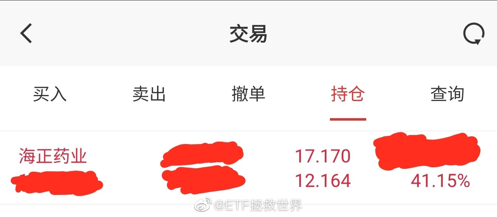

## 2020-02-17 11:39

辣鸡传媒又新高了，今年至今涨幅13%。

今年沪深300还是下跌的。

底部清仓的朋友找谁说理去。 ​​​

## 2020-02-17 13:44

机会都是跌出来的，风险都是涨出来的。

不停赚钱很开心是没错，但这句话永远不能忘。 ​​​

## 2020-02-17 13:47

回复@小鱼尛鱻:虽然我知道这是不可能的。但你们赚得比我多我非常开心。//@小鱼尛鱻:报告，我的传媒成本比老大低

## 2020-02-17 14:23

2900点，账户市值比3100还高，300和500都没新高，你又新高了你说是怎么回事。 ​​​

## 2020-02-17 14:45

回复@番茄老爷89142:不看。喷我的人多了，他不值得我拿眼角夹一下。//@番茄老爷89142:E大， 某录上有人喷你，亮个收益，闪瞎它的狗眼

## 2020-02-17 14:52

每次被人喷完，关注我的人都猛增一大截。

因为我从来不到各个网站去宣传，所以他们一喷就等于帮我宣传，说真的，好烦。

烦不是因为别的，是被喷完新关注的就增加一大堆，以前的老朋友也不会因为他们喷就走。

真让人绝望。

（我说怎么这两天公众号关注猛增呢……原来又被喷了） ​​​
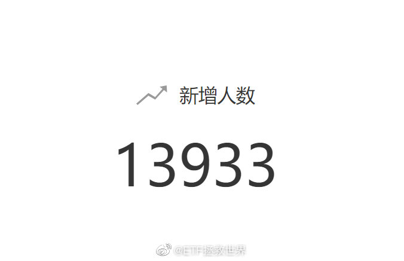

## 2020-02-17 16:09

目前A股整体不贵。当然个别区域已经过热，比如创业板已经回到了2015年初的热度。要知道，这个已经很热了，因为2015年初的创业板，已经涨了整整两年多。

其它的问题不大。50 300之类的，不便宜，但肯定没有到卖出的位置。500更便宜点，踏踏实实拿着，最多做做网格。

整体来讲，平稳可控。别挣点钱就拿不住，多大点事儿。扛得住钻石坑的亏损，你就应该享受的了疯子们带来的利润。

卖肯定会卖，以后把筹码在哈迪斯顶交给他们，你再等两年钻石坑再买回来。一轮一轮，钱不就都从他们手里到你手里了。多简单。

## 2020-02-17 16:14

回复@每天都有好天气:500压力位5630。看看能不能过去。过去了就舒服了。过不去更舒服。

## 2020-02-17 16:20

回复@尼古拉斯摩根:就是说，未来极度高估的时候你也不会卖对吗。如果你能做到，我送个锦旗给你。//@尼古拉斯摩根:我是来赚企业成长的钱。不是赚其他股民基民兜里的钱。。那样太残忍，破坏其他家庭幸福，于心不忍。

## 2020-02-17 16:28

有人说要“赚企业成长的钱，不赚其他股民基民的钱。因为那样会破坏别人的幸福，于心不忍”

拜托，其他人高位接盘，低位割肉，是你怂恿的吗？（我倒亲见过有人最低位指导粉丝割肉）如果不是，跟你有什么关系？

甚至，我告诉你。你低位接盘，高位卖出，反而是救了他们，他们才不会赔的更多！

为什么。

你想想。你低位不买，还有我，还有在座的各位，都不买。谁都不买，价格会不会跌的更多？跌得更多，他是不是要更低的价格卖？

反之亦然。高位，我们都不卖。他们依然会买，这样价格就越来越高，最终他们会买在更高的地方。

你在提供流动性，你在尽力的把价格控制在一个合理的范围内，你明明在做好事（虽然你的初衷未必有这么伟大），怎么还觉得于心不忍？

你买不买，我买不买，我们这里几万人买不买，或者卖不卖，都不能影响疯狂的人低卖高买。

如果你真的想做好事，帮别人，就像某些人一样，不遗余力的宣传正确的投资理念，把自己的知识、思考、经验，奉献出来给别人。即使你会受到很多人的攻击，依然一直向前。

这样，你才算真的做了好事。而不只是说一些漂亮话。我还真的不信A股被疯子买到70倍，你这样理性的人会不卖给他们。

## 2020-02-17 16:52

哎，兼职小助理回银行做认股权贷款了，特别认真细心又有能力的人。

可惜啊，估计太忙，以后不能帮我了。 ​​​

## 2020-02-17 18:56

之前我就说过，想要我炒币，不是不可以，至少要有一个官方认证背书的交易所。炒不赚钱是我的技术问题我认，安全出问题我无法原谅自己

## 2020-02-17 20:21

要不要下决心挑战一下自己给自己剪头发。 ​​​

## 2020-02-18 09:55

不可避免又是一次财富收割泡沫大破灭。

期限就是今年内。

大波动。 ​​​

## 2020-02-18 10:44

前提是冲的够疯。涨的越疯狂，波动越大。目前只是小波动级别

## 2020-02-18 10:49

最高摸到5652，第一次冲击失败。//@ETF拯救世界:回复@每天都有好天气:500压力位5630。看看能不能过去。过去了就舒服了。过不去更舒服。

## 2020-02-18 13:51

坐在轿子上等着别人抬，和做轿夫抬别人有什么区别 ​​​

## 2020-02-18 14:08

雪中送炭好不好。

## 2020-02-18 14:18

回复@机器猫是小叮当:我小时候最爱吃的菜之一。小时候我父亲开粤菜餐厅请了广东厨子。那个厨子三个细节我印象很深，第一个印象是90年代他就月薪上万，第二个和第三个是大良炸鲜奶和米粉好吃。北方人的我从没吃过这两样，当时我就震惊了。//@机器猫是小叮当:今天学做炸牛奶

## 2020-02-18 14:36

那家餐厅我印象不深了。

大厨是印象最深的，他的样子我也还记得。现在想起来，大概不到30岁，瘦瘦小小看起来很精明。做菜好吃。

另外还有印象，就是曾经有人来捣乱，几个人，每个人占一个桌子，要一瓶啤酒，一碟花生米，坐一晚上。父亲没有跟我讲太多，后来应该是给了点钱了事。不知道这个算不算BHF。

还有就是那什么你懂的。他们经常来弄饭局，吃完了不给钱，打欠条记账。后来直到餐厅关门他们也没把账结了。

后面这两个都是我听大人聊天听到的。所以别当着孩子什么都说，你以为他听不懂，其实他都记着。弄不好还记一辈子……

## 2020-02-18 14:54

回复@冬季物语89:过去了。要再观察几天看能否站稳。需要两三次回踩确认。//@冬季物语89:E大 500是不是妥了？

## 2020-02-18 17:06

只有我觉得QQ聊天比微信好用吗。

微信多平台信息同步做的比渣还渣。 ​​​

## 2020-02-18 18:10

不公平。可以在原有招生计划之外加分，分数够了就加学位。否则被挤下去的孩子太可怜了。

## 2020-02-18 18:14

市场根本不缺钱。坐稳了。

## 2020-02-18 18:16

为什么只有2020年参加的加分。21、22、23……参加中考的，他们的父母今年没有在一线战斗吗。你要加20年，就要每年都加。//@ETF拯救世界:不公平。可以在原有招生计划之外加分，分数够了就加学位。否则被挤下去的孩子太可怜了。

## 2020-02-18 18:30

回复@ETF拯救了我:不仅合宜，十几年来，但凡有爆款出现都是至少阶段见顶。睿远的第一只公募是去年3月发行，然后……你懂了。这次我不知道。只是说历史。//@ETF拯救了我:公募基金大热，会不会又变成公墓？就像兴全合宜等几个基金募集前后发生的事情那样。

## 2020-02-18 18:33

A股历史上第一次买公募要抽签是2007年10月。没错，就是6000点那个2007年10月。//@ETF拯救世界:回复@ETF拯救了我:不仅合宜，十几年来，但凡有爆款出现都是至少阶段见顶。睿远的第一只公募是去年3月发行，然后……你懂了。这次我不知道。只是说历史。

## 2020-02-18 18:35

回复@坚持做好三件事:我只是在陈述历史，没有任何预判。你该追就追，别因为我的微博改变主意，真的。//@坚持做好三件事:E大这个太及时了，我刚想割肉去追科技//@ETF拯救世界:A股历史上第一次买公募要抽签是2007年10月。没错，就是6000点那个2007年10月。

## 2020-02-18 19:05

我的很多微博只是提供一些思考角度。

在资本市场上，事情的发展往往并非线性，不是说A一定会立即导致B的发生。这一点朋友们一定要深刻理解。

不理解，就会在春节复盘那天清仓。同样的例子举不胜举。

综合思考多一点因素，每个因素视情况发展变换不同权重，赋予对应的概率，做出成熟的投资决策比较好。

## 2020-02-18 21:28

喜欢这个调调。甚至从来不听戏曲的我听一会越剧也没问题

## 2020-02-19 07:37

绝对公平很难，尤其是咱们这里，公平更难。

所以我特别珍惜中考高考这两个相对公平的战场。虽然这个战场也渐渐沦陷。

中考有多重要。其实对很多孩子来说，比高考还重要。高考考不好，可以去个差一点的学校或者复读。中考，有可能分流到连高中都没得上，连努力的机会都不再有，这一生就改变了。

太多人想到别人的时候，只是一个数字。但其实每一个数字后面都是一个真实存在的人。那个人和你一样，是自己世界的主角。他一生的幸福与否，有可能就取决于你。当你有了这样的领悟，做一些能影响别人未来的决定时就会更多一些人性。

我极度厌恶不公，虽然知道没有绝对公平，但我依然追求它。因为每一次不公，都有一个受害者的未来变的更坏。

## 2020-02-19 09:47

辣鸡环保也来凑新高的热度，喷了。 ​​​

## 2020-02-19 10:26

我以为配的转债基金算一半A股仓位。

谁知道涨的一点不比指数差。 ​​​

## 2020-02-19 10:33

回复@小不忍则乱大萌a:计划持有券商，目前收益率26%//@小不忍则乱大萌a:益达牛市来了，要不要买点券商

## 2020-02-19 11:24

今年的投资风格是：

看估值你就输在起跑线上。 ​​​

## 2020-02-19 11:50

有人重仓杀入，有人清仓，真的很正常。

现在不是钻石坑，满地钻石。那个时候清仓是脑子不太清楚。现在清仓就很难讲，因为目前的市场又回到了2013-2014的那个状态，整体可控，但部分开始疯狂。很难说未来怎么走，所以买卖都正常。

只是这里清仓的朋友还是要想清楚一点。行情几年才有一次，如果总是不断清仓，当然有可能会对，但如果错了，失去的时间和机会可能很久很久都不会再有。

没有对错，只是有个机会成本的问题。

## 2020-02-19 12:12

凭主观交易的人，无论是感觉要涨了买，还是感觉要跌了卖，都是因为觉得自己很聪明。我反倒觉得做投资，不如先承认自己不够聪明，长期看反而胜率更大。

## 2020-02-19 12:14

做一个酷炫厨师的第一步，是学会单手打鸡蛋。 ​​​

## 2020-02-19 13:06

新高不卖。 ​​​

## 2020-02-19 14:31

意思不大，提前收工。明儿见。 ​​​

## 2020-02-19 23:17

情感博主上线 ​​​
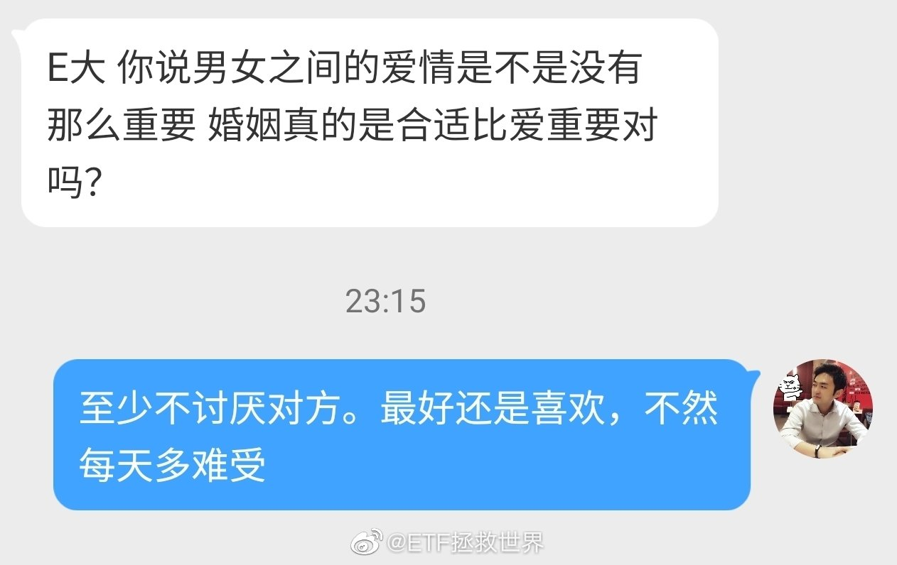

## 2020-02-20 00:03

一个中肯的建议 ​​​
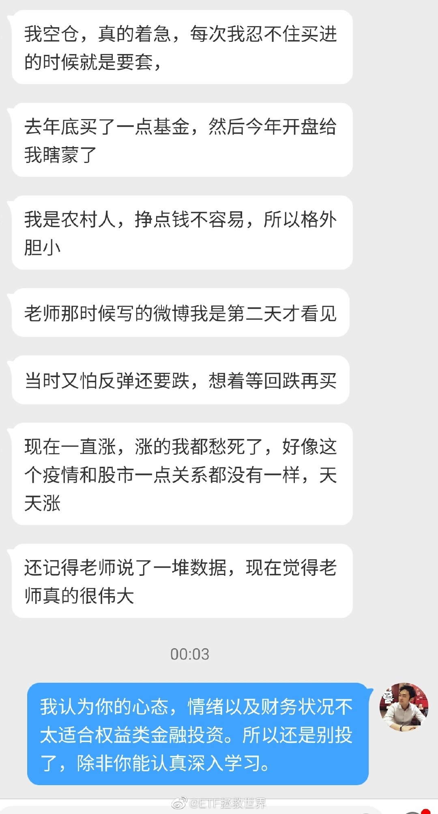

## 2020-02-20 08:39

来了老哥

## 2020-02-20 09:33

新高不卖是什么意思呢。买入看估值，卖出看趋势。如果因为一个东西稍微贵点你就慌着卖出，可能很难挣大钱。一个品种新高的当天，别卖。跌有底，涨起来是很难预测天花板的。不容易把握，以后慢慢说

## 2020-02-20 09:41

大熊市哀嚎遍野的时候敢买，上涨中风轻云淡持有，火热新世界能够不贪悄悄离场。

能够做到这三点就是人中龙凤。 

普通人就是全都反着做。 ​​​

## 2020-02-20 09:46

回复@一头驴的旅行:建议你翻翻我的微博，在大顶大底都在说什么。觉得多就看看公众号。我相信你会为这句话道歉。//@一头驴的旅行:能不能提前说  事后有毛用

## 2020-02-20 10:10

转给那位新朋友：

2018最低点我说了什么：

 ​​​

## 2020-02-20 10:11

转给那位新朋友：

2015年顶部我说了什么，做了什么。

 ​​​

## 2020-02-20 10:30

2005年1月至今，两融余额变化图。

目前是10781亿，过去五年多于现在的时间点是：

2017.11-2018.1 
2015年全年（除9月外）

2019年4月到过9900亿。

最高点是2015年4月和5月的：

2     万     亿 ​​​
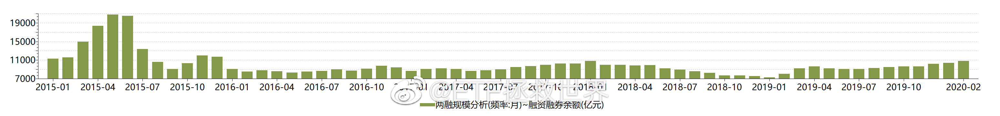

## 2020-02-20 10:35

回复@南耕82624:对不起，没创意，让您失望了。油气还那样，半死不活，持仓3个点的我每天看着这个唯一浮亏的心如刀割，您看您还满意吗。//@南耕82624:别人钻石底，你也钻石底，有点创意好不好，华宝油气怎么样了

## 2020-02-20 10:39

这届网友真的很让人感动。

以前他们关心传媒、环保，每天来问候，还有大V经常写文章问候、关心。

现在传媒环保赚钱了，他们又开始关心仅存的一个油气。每天他们都按捺不住内心的激动问：“你的油气怎么样了？”

我感动的哭出来了。你说为什么这些人这么关心咱们的账户里面亏损品种呢。

他们不拿一分钱，浪费自己挣钱、养家、亲子、谈恋爱、找小三、大宝剑的时间来关心咱们，你感动不感动？？？？

## 2020-02-20 10:57

市场想要上涨，就必须不停的震荡。

为什么。

清洗不坚定的叛徒。

做事情，不是说人越多越好。不是这样。

人少没事，历史上以少胜多的战例不胜枚举。最关键的两点：队伍有战斗力；意志坚定，团结。

后者非常重要。

你有多少人，一上战场就呼啦啦全跑了，那还不如小规模精英部队。

市场也一样。总有些人动不动就跑。那就必须把这些人洗出去。否则他们总是卖出，涨不动。洗的办法就是涨一涨，震荡一下，他们卖了价格马上拉高。人类是很难接受低卖高买的。这样他们就不会回来捣乱。

持仓的都是坚定的人，那价格就很容易上去。

高位也是一样的道理，不过是反过来。以后说。

## 2020-02-20 11:33

说得越多，错的越多。我说的肯定也有很多不对的地方。您自行甄别吧，批判性的吸收。

今天到此为止，明儿见。 ​​​

## 2020-02-20 12:52

所以说这个世界上还是讲道理的人多。大家心平气和的沟通，说开了就没事了。

坏人只是少数，人类整体还是好的，三七开。

怕这位朋友再被骂，赶紧上来说一声。这次是真的明儿见了！ ​​​
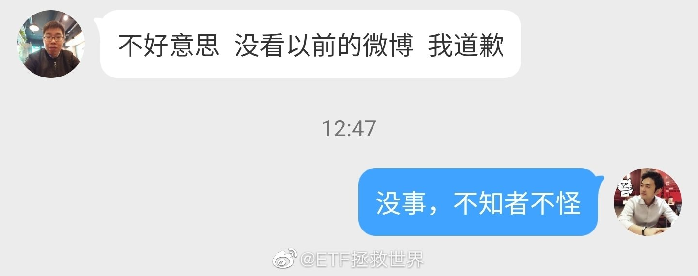

## 2020-02-20 21:22

每日劝退 ​​​
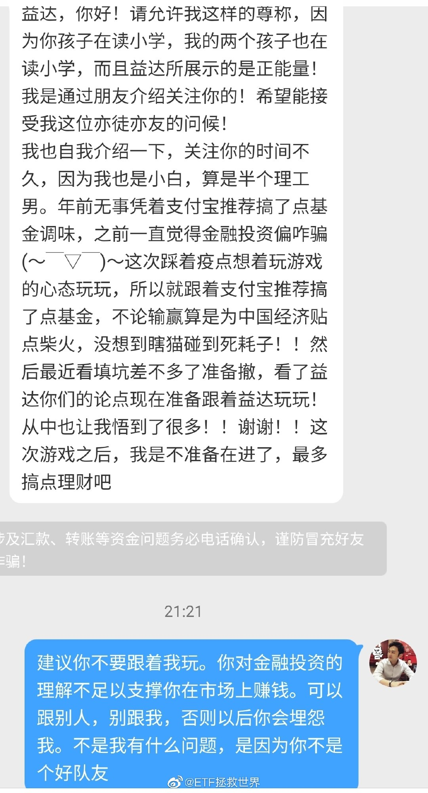

## 2020-02-20 21:27

可能有不少人讨厌我，也会觉得我的微博太多比较烦。

但是能帮助一些朋友，也值了。 ​​​
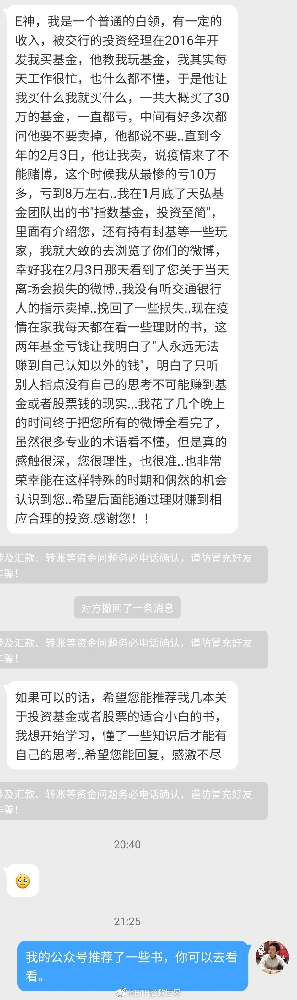

## 2020-02-20 21:36

知道我为什么设计150吗。就是保证各位能够底部有钱还有胆识多买。

但是，如果你底部设置的金额少，涨起来了就改成大金额，这就完全背离了我的初衷，也无法控制风险。

这就相当于底部少买，高位多买。

设计再好的模式，也很难帮助所有人。 ​​​
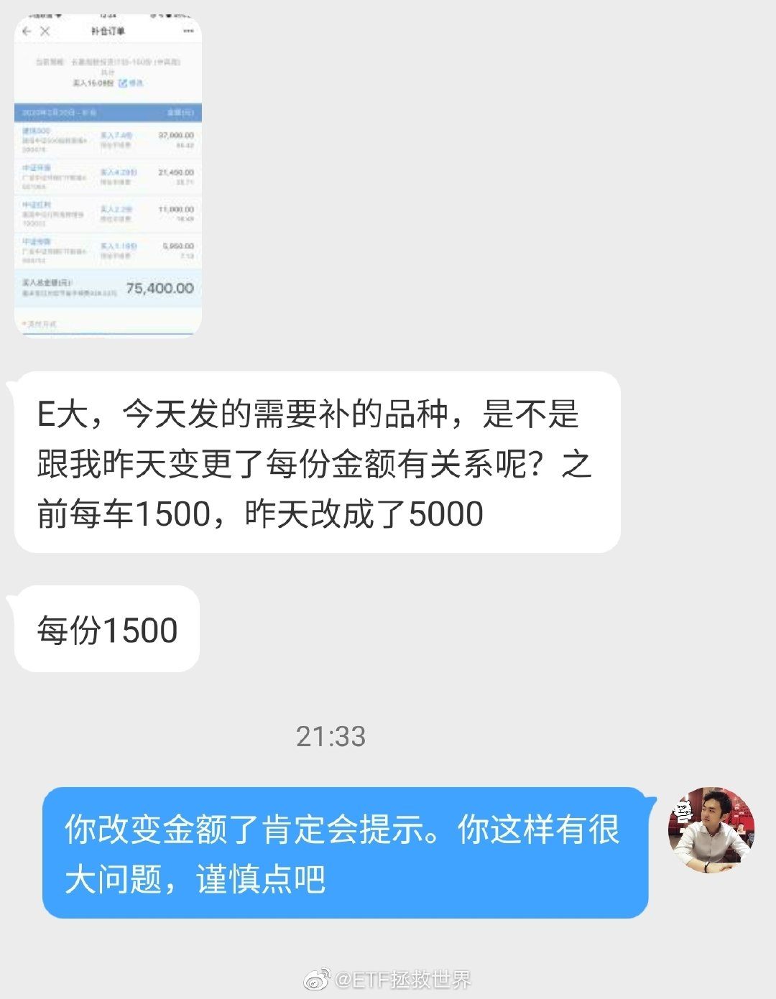

## 2020-02-20 21:48

本日情感问答 ​​​
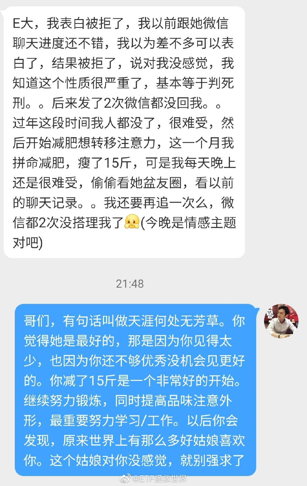

## 2020-02-21 09:32

有些股票和板块除了一路拉爆这种走势外，不可能有其它结局。 ​​​

## 2020-02-21 09:45

大盘领涨一天，小盘领涨一天。

怎样才能每天都幸福。 ​​​

## 2020-02-21 10:02

还记不记得最低点的时候，有多少人写财务分析文章，告诉你有些品种完蛋了，没戏了，赶紧清仓吧。

谁能想到从那时候起，一年多涨了50%+。

投资有意思的地方在于，很多人认为学一点财务知识就能做好投资。如果学点财务知识，会看点报表，会算个ROE就能做好投资，那么大多数会计都应该是好的投资者了。然而，事实是这样吗？

学点财务知识当然对投资有用，但这不是决定性的。只会看财报就开始判断未来走势，只能说，与成为一个合格的投资者还隔着8条街。

## 2020-02-21 10:54

所以你现在知道牛市的疯狂是怎么来的了：

涨——有了赚钱效应，金融机构发行更多产品——这些产品买入，涨更多——继续发行产品——继续买入，继续涨。

涨到什么时候呢。涨到能入场的资金都入场了，卖出的人开始多于买入。

开始跌就不会温柔。因为那些看着赚钱效应，申购产品等着赚钱的人，见到赚不了钱马上就会跑。

问题在于，绝大部分金融机构发行产品不会管这个产品是不是能挣钱。他们优先考虑的是怎么把规模做大，趁着这股东风多发产品。由此，申购产品的人最终大多数亏损。然后他们就会认为“股市都是骗人的，挣不到钱”

如果金融机构认为风险大，不发行产品。那么规模就会被别人超过，最后有可能就完了。

死循环。很难解决。

## 2020-02-21 11:07

150和S一共还有四份创业板。收益率从30%-50%不等。

这几份什么时候卖？什么点位卖？

可以明确的告诉你：

我也不知道。 ​​​

## 2020-02-21 11:15

这四个字在牛市中非常有用。建议长期以来虽然不怎么亏钱但是也挣不到大钱的朋友好好想想//@ETF拯救世界: 新高不卖是什么意思呢。买入看估值，卖出看趋势。如果因为一个东西稍微贵点你就慌着卖出，可能很难挣大钱。一个品种新高的当天，别卖。跌有底，涨起来是很难预测天花板的。不容易把握，以后慢慢说

## 2020-02-21 11:56

还有一点各位可以观察。

牛市新手一定赚的比老手多。包括新手基金经理。

但是最终能全身而退的，千里挑一。

准不准，走着瞧。 ​​​

## 2020-02-21 13:17

为什么很多人那么纠结“牛市”这两个字？

这两个字是否确认对你的操作影响很大吗？？ ​​​

## 2020-02-21 13:34

午夜前不聊了。太累。 ​​​

## 2020-02-21 22:22

波动是我们的朋友 查看图片 //@ETF拯救世界:是这样的 查看图片 //@ETF拯救世界:回复@ETF拯救世界:又买回来。 查看图片 //@ETF拯救世界:一个半月，又出一格。

## 2020-02-21 23:36

今日情感博主上线

对你好永远不应该是喜欢一个人的唯一理由。因为他可能明天就不对你好了。

如果运气差碰上不好的人，结束未必不是好事。因为结束你只浪费了几个月，不结束有可能痛苦一生。跟买了垃圾股一个意思。 ​​​
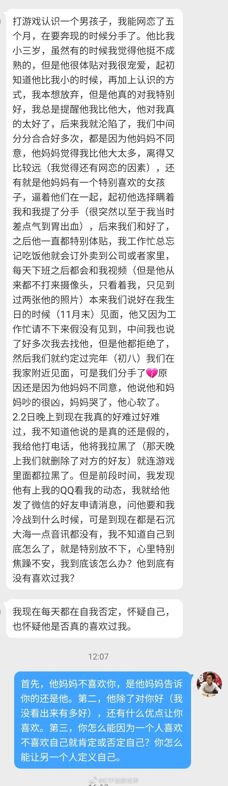

## 2020-02-21 23:50

请大家提高语文修养好吗。 ​​​
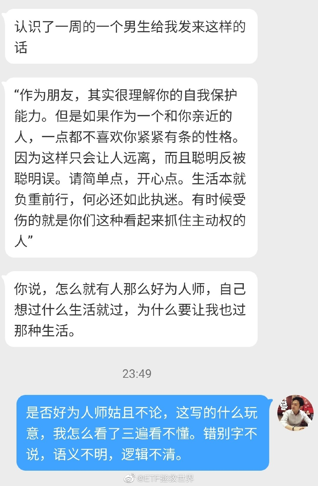

## 2020-02-22 08:55

一个月挣5000，工作6年手里只有两万多。买了三万的房，一个月不工作已经身无分文。一定要教育孩子任何收入都要存下20%-30%，不到救命的时候不拿出来。孩子会受益一生。

## 2020-02-22 09:28

回复@蘑叽小柚子:所以我不评论他为什么存不下来，而是说我们可以教育下一代做得更好。（年轻人可以从自己开始改变）//@蘑叽小柚子:这个话题昨天还被上升到了这个讨论层面 查看图片

## 2020-02-22 14:07

不写书，不开星球，不开V+，不接广告，不做私募。微博问答一个问题能挣好几千你看看我回答过几个，有多少年不回答了？

计划免费公布。场内场外两个购买渠道你去也行不去也行，不影响你看计划。这两个都是市场最低费率，你在别的地方费率更高。

我消费你，消费你什么了？你试试看你想掏钱被消费有没有地方掏？你再看看还有没有我这样的？你再想想如果你是我你会开多少渠道收钱？

不光是喷子，还是瞎子。

## 2020-02-22 21:00

这就是标准答案。以后不必问了。 ​​​
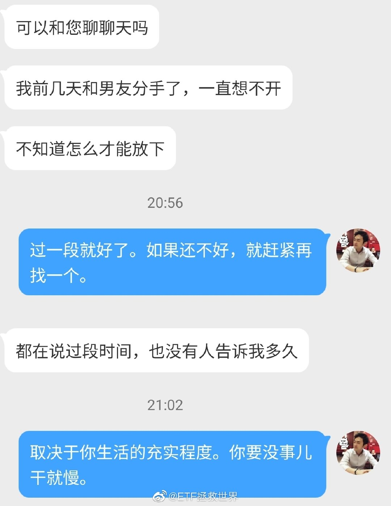

## 2020-02-22 21:27

最近经常发一些跟投资无关的事，是有两个原因：

第一，希望你了解生活除了投资还有别的。

第二，希望在赚钱的时候不要太关注投资本身。太关注反倒有可能做错事，降低收益率。

低位买完了，拿着。最多条件单设置好自动运行波段提款继续降成本。然后转移注意力，等着以后收割。

调仓的事我来操心。可能最近就会微调一下，多大点事。

## 2020-02-23 11:50

100级达成。只是开始。 ​​​
 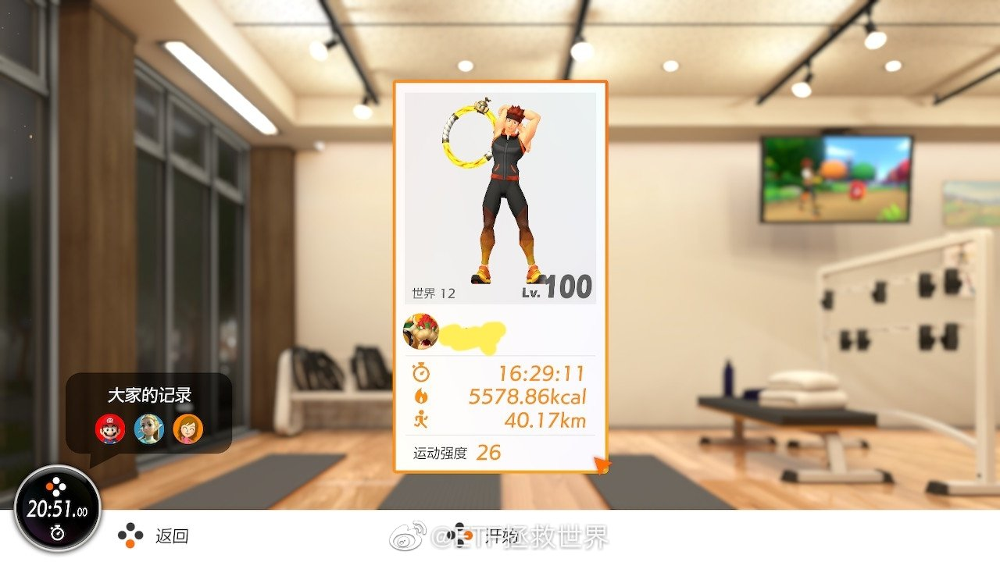 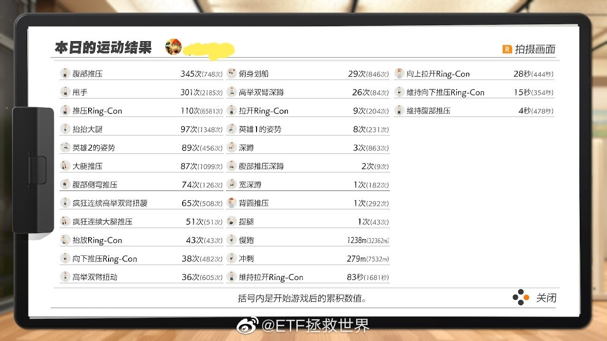

## 2020-02-24 09:19

今天是不是该休息休息了，不能再涨了吧。 ​​​

## 2020-02-24 09:53

传媒上方压力线1605-1610 ​​​

## 2020-02-24 11:36

为什么很多人感觉A股很难挣钱呢。

要知道，中证500过去15年有11年上涨，涨了600%。如果在2015年大牛市中看，收益率更可观。

这个指数基本上可以代表大多数股票的表现。

医药也是15年中11年上涨，涨幅1200%。

觉得A股挣钱难的，基本都是进场和出场的时间错了。

不是市场不行，是你不行。 ​​​

## 2020-02-24 12:01

回复@投资跑道上的一只小蜗牛:2005年底中证500估值23倍。本轮起点500估值19倍。仅做参考。

## 2020-02-24 12:04

回复@Anonymous80626:这两个比较的话，当然是等权800更能代表A股真实走势。我讨论“A股”的时候，就一定是大多数股票的表现。

## 2020-02-24 12:10

回复@约翰内夫:想追就追。如果货不够，过几天我们卖给你……//@约翰内夫:天呐，我想追创50了，买个两百块，能不能把它给奶下，记录下:谨慎乐观，按计划继续申购一点点创业板基金与可转债基金

## 2020-02-24 13:31

围在城里的人想逃出来，城外的人想冲进去。对婚姻也罢，创业板也罢，人生的愿望大都如此。 ​​​

## 2020-02-24 13:51

回复@迦叶和阿难:我不是忘了，我是对你的每一分钱负责。我自己不会追，就不会发车。//@迦叶和阿难:益达是不是把s定投给忘了！

## 2020-02-24 14:07

前两年500跑不过300，经常会有人对我提出灵魂拷问：

500ROE这么低，为什么要买？

今年500也好，1000也好，创业也好，表现远远好于300。我不是想讨论到底300好还是500好，我想说的是，投资不只是分析财务数据，从来都不是。

如果只看财务数据，你根本就不会懂为什么ROE只有10个点不到，PB接近7倍的创业板不停的新高，不停的涨。有人说，都是炒作，市场错了。

市场错不错我不知道，我知道的是这一幕注定会发生。不在现在，也在未来。

有人的视野很窄。最近一段时间什么涨的好，就认定它永远会好。不同风格就嗤之以鼻。有句成语形容他们非常合适：

坐井观天。

你要从井里跳出来，才能看到更大的世界。

## 2020-02-24 14:16

哪一种投资风格我都尊重。

我鄙视的是那种“除了自己的，其它所有投资风格投资方式都是辣鸡”的投资自闭症。 ​​​

## 2020-02-24 14:33

回复@xvbalance:难受你就换仓啊。为什么会纠结呢？把仓位调整到舒服就这么难吗。//@xvbalance:要做到没有情绪确实太难，看到不涨的仓位嫌弃太多，看到长的嫌少，其实就是贪，虽然我知道但是还是会这样想，难呐！

## 2020-02-24 14:35

有人看着有些品种涨的好心里痒痒，恨自己为什么没买。

我就纳闷了，你买不就完了吗，谁也没拉着你的手啊。

真让他买，他也不敢。第二天又开始看着难受。

要我说，你那不是真爱人家，你是馋人家的身子了。 ​​​

## 2020-02-24 14:50

你知道外围股市大跌有什么好处。

好处就是：

可以多开几个品种的网格了。

别急，开了我会说。 ​​​

## 2020-02-24 15:16

回复@我是杜晓宇同学:想出就出，要出的漂亮。//@我是杜晓宇同学:e大，中证500可以出了吗，我感觉到去年的高位了。。

## 2020-02-24 15:22

以后不要再问：买不买这个呀，卖不卖那个呀。

第一。你要信自己，就问问自己的内心，是不是真想买或者真想卖。真的想，害怕踏空，害怕套牢，就去买卖。把仓位调整到最最舒服的情况。什么是舒服，就是涨30%，跌30%都很开心。

只要记住一点，成年人做事，不要后悔。做之前想好所有后果，能接受就去做。不要做之前不思考，做完了到处找后悔药。或者干脆把锅甩到别人身上。

第二。要信我，就看我的公开操作。我有没有加仓，我有没有减仓。长线怎么做的，短线有没有交易。基本上能公开的我都公开了，这就是我的态度。

所以，问什么呢。你问我其实只是找个安慰。你自己心里已经有答案了，只是想找个人说说而已。如果我能给你点建议，你更高兴了。因为如果错了，以后就有背锅侠了。

## 2020-02-24 15:24

NB

## 2020-02-24 15:52

看到这条我真的气坏了。怎么可以这样。

我要有个女儿，肯定放在手心里当宝贝。生气！ ​​​
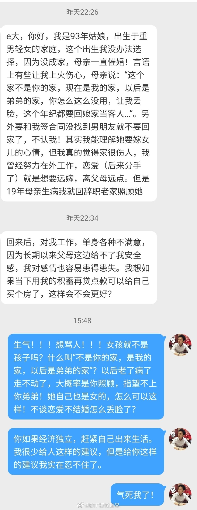

## 2020-02-24 16:17

我回想了一下，在我的成长过程中，确实没见过“重男轻女”

我的家族里，除了一个来往极少的大爷家是一个男孩外，除了我其它亲戚都是女孩。从小在院里的邻居也大多数是女孩。无一例外，这些家庭全都把女孩当成宝贝养。

父母平常对她们有多好我就不说了。印象最深的是我一个亲戚，曾经说自己的女儿要嫁给北京人的话，对方至少有一套房。如果嫁给外地人，对方至少要有两套房。最后，女儿嫁给了外地人，对方一套房也没有。我这个亲戚阻止他们交往结婚了吗？当然没有，还送了一套200平米的房子给他们！东二环，工体附近。值多少钱应该有点概念吧。（当然，我这个妹夫非常优秀，浙大本科，社科院研究生，家里背景也很好）

所以在我的印象中，孩子就是孩子，无论男女，都应该一视同仁。怎么还因为男的女的有差别对待呢？如果有差别，那就应该是谁对父母好，那父母也对谁更好！就这么简单。性别怎么能成为区别对待的原因。

重男轻女就是农业社会留下的后遗症。谁有这种思想就还不算现代人。就算被骂我也这么说。

## 2020-02-24 16:51

回复@小E达的花儿:在农业社会是能说得通的。因为儿子一般会留在身边，女儿嫁出去。这样养老就要靠儿子，所以重男轻女。另外，农村里如果你家儿子少，应该很容易被欺负。但现在已经是什么社会了，养老也基本上指不上孩子，靠的是社会养老。还有这种思想就不对了。

## 2020-02-24 17:08

回复@Ray被ETF拯救的灵魂:我觉得有些人亲情淡是因为牵扯太多利益。如果孩子不希望从父母那得到物质，父母不希望从孩子那索取物质，只谈感情，恐怕亲情会增加很多。//@Ray被ETF拯救的灵魂:社会越发展，亲情越淡薄，重男轻女自然少了，根本连婚都不想结！

## 2020-02-24 17:44

警告：随时发车。 ​​​

## 2020-02-24 18:36

喷了，原来是他。你说你有这么执着的精神，干什么不会成功啊老弟！

上次你喷到了券商大底，希望这次你功力没有减退！ ​​​
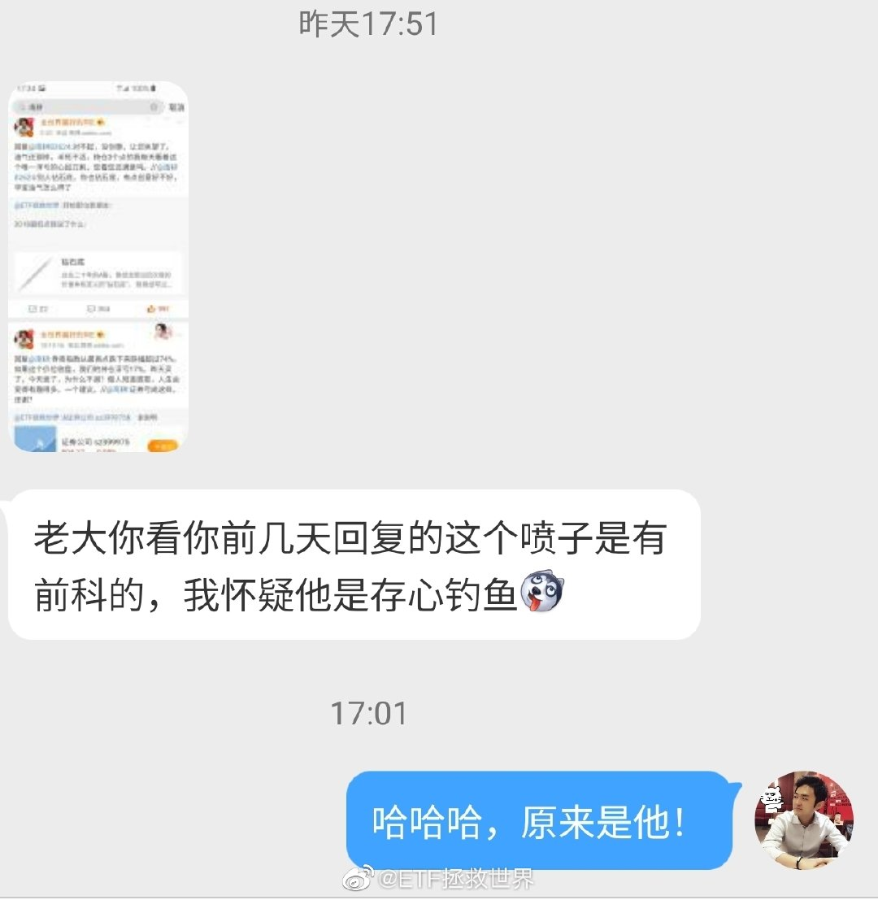 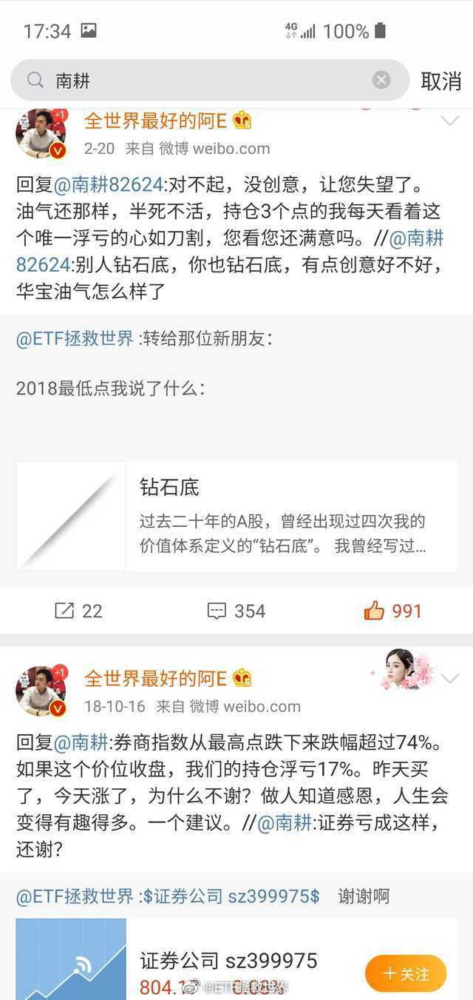 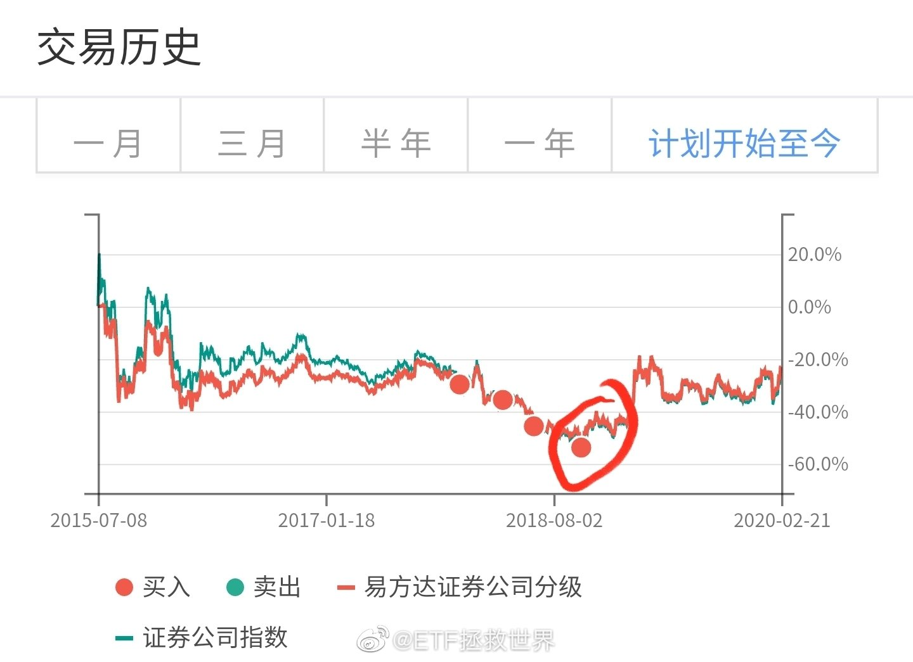

## 2020-02-24 23:50

明天如果暴跌，剧本和2.3可是不一样的。千万不可以生搬硬套。 ​​​

## 2020-02-25 08:17

基本上近期高点收益率也就这样了。做好波动的心理准备。 ​​​
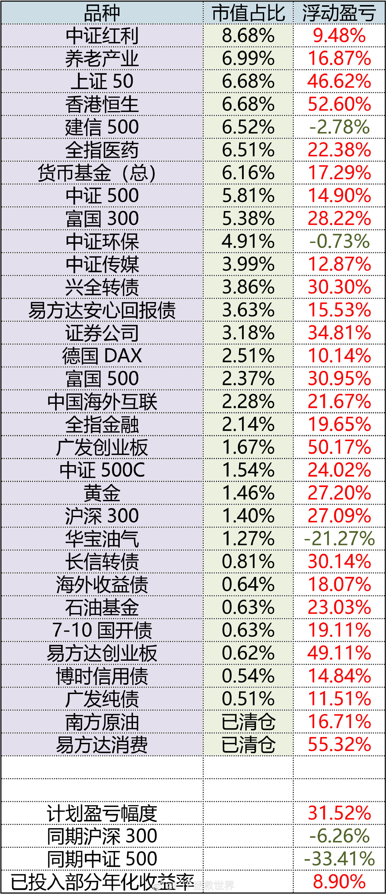

## 2020-02-25 08:24

回复@小城故事-201506:2.3卖出的人也是这么想的//@小城故事-201506:为什么不阶段性卖了，低位再买回来？减少损失

## 2020-02-25 09:00

这个逻辑没毛病吧。 ​​​
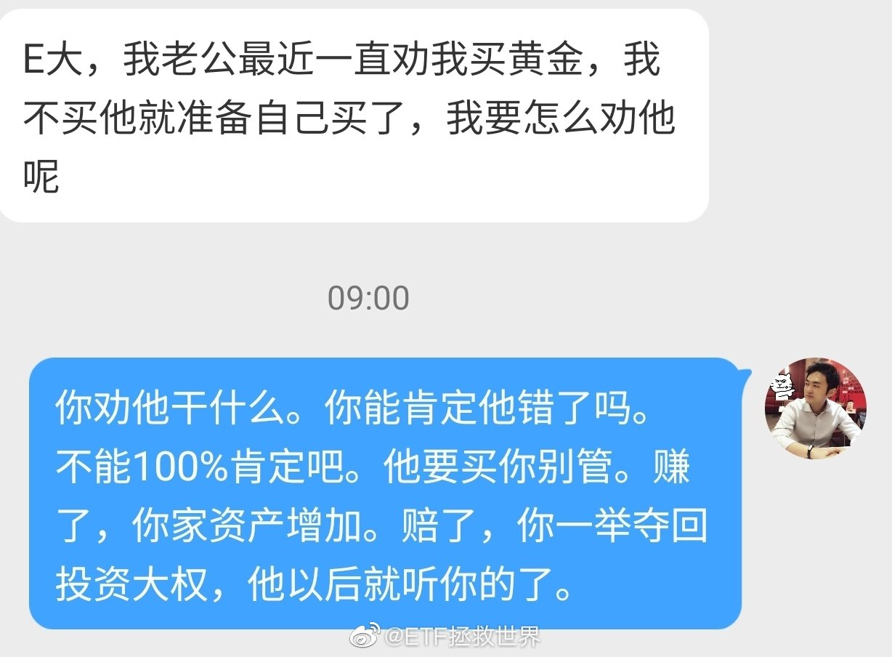

## 2020-02-25 09:14

如果家里夫妻两个人无法决定让谁来理财，很简单。

第一年，每个人拿一半的钱。年底看收益率。谁的收益率高，第二年操盘60%，另一个人40%。（注意，要完全向对方公布投资细节）

第二年也是如此。赢的人增加10个百分点，输的人减少10个百分点。

从第五年开始（如果五年还没离），计算五年年化收益率。谁的高，永久性增加10个百分点。这十个点每5年评估一次，决定归属权。

从第十年开始（如果十年后双方还说话）， 计算十年年化收益率，永久性增加20个百分点，每十年评估一次，决定归属权。

只要两个人都是理性的，一举解决投资决定权的大问题。 http://t.cn/A6tL2fpU

## 2020-02-25 09:32

舒服。

条件单是伟大的创新。 ​​​

## 2020-02-25 09:53

您是不是得换一个焊工了。这来来回回的几十次了，手艺不行焊不死啊。

## 2020-02-25 09:57

纳尼，医药又快新高了。

奶一下，收了神通吧。 ​​​

## 2020-02-25 10:07

你们不要总是黑大宵。

首先大宵的水平还可以。能够识别低估、高估区域，这已经比很多人强了。（尤其是部分经常和他互动的大V）

更重要的，我欣赏他的娱乐精神和表演天赋。这可太难得了。说实话，大部分时间非常好笑。精神紧绷的时候，看到他的视频和照片，起到缓解精神紧张的效果。

他的主要问题是喜欢精准判断顶和底。因为股市是不可能精准判断的，即使你知道大概是高估或者低估，也不可能精准判断，所以基本上必然会错。但是因为有着超群的娱乐精神，大宵错了也无所谓，继续判断下一个底。所以婴儿底，尿布底，胎儿底就出来了。这也是搞笑的一个梗。

这个问题大宵不知道吗？不，他知道。但他依然会这样做。不这样做，就没有话题，没有节目效果了。

没有思考能力的人看了他精准判断很容易被忽悠。还有一部分是自己做错了然后把责任推在他身上。然而总体来说，他还是有价值的。但前提是你得知道你该怎么从这个人身上得到正确的信息。

当然，对我来说，搞笑是他存在的最大意义……

## 2020-02-25 10:20

回复@肥硕的石头:他当然很聪明。各位看人聪明不聪明，有一个很重要的依据：幽默的人一定是聪明的。一定，100%。我说的是幽默，而不是尴尬搞笑。//@肥硕的石头:他不傻，反而很聪明。。

## 2020-02-25 10:23

我写了一篇卖出创业板的文章，等着趋势变差发出去。

结果这货每天新高。我那篇文章快烂在公众号素材库了。

跪了。 ​​​

## 2020-02-25 11:09

这么给面子吗，谁盯着我微博呢，喷了

## 2020-02-25 13:21

新的条件单已经更新，可以查看 ​​​

## 2020-02-25 14:00

场内账户里的资金，可以开通“余额理财”。白天可以交易，会在每天收盘后自动买货币基金，安全度很高，比放着现金收益率也高。现在年化2个多点。

这样，如果你一年能做一次上次的那种网格，一周时间5%，加上这个2个多点，这份资金的收益率也有7个多点了。

所以留够条件单需要的资金，只要一年内能做一网，收益率就可以接受。

不过注意，开通这个后，不能当日从账户转资金出来，只能第二天。因为持有的是货币基金。

## 2020-02-25 14:34

一个四个字的交易原则保证你没有卖在震荡最低位。

那四个字是： ​​​

## 2020-02-25 16:56

虽然科技和创业板已经接近癫狂状态，但大多数股票其实真的不贵。

所以那些动不动就清仓走人的，我不太清楚到底在怕什么。可能你怕坐电梯。对，你卖了，没有坐电梯的风险了。但如果继续涨呢。好多年可能才有一波行情，赚一点就跑了，是不是有点可惜？

我说这话是有风险的。万一明天开始跌，喷子以后就会翻出来喷。但我不怕，我是把心里的想法说出来。我认为，这个想法，至少对一部分朋友大概率是有帮助的。

未来我对也好，错也好，对我来说无所谓。能让一部分朋友不浪费很多年的时间，就是好事。

接下来是涨是跌，谁也不能确定。但我想，大概率来说，不贵的东西总会越涨越高的。

## 2020-02-25 17:12

举个例子。中证红利，这几年表现一般，现在依然不是热点。然而现在是真心不贵。用最严格的估值标准看，也与2014年3月相同。

估值相同，然后全收益指数5年多涨了142%。如果放松一点估值标准，价格涨了142%，估值其实比那时候还下降了很多。

所以，只要不贵，中长期看赚钱的概率真的很大很大。没必要动不动就清仓。

## 2020-02-25 17:31

说出来你可能不信。

很多人为涨的好的东西找理由。其实没那么复杂。

很简单，归根结底就是周期。有大盘股周期，有小盘股周期。有蓝筹周期，有科技周期，还有周期的周期。

大家预期一致了，手拉手往上干。干完了再找个理由制造个热点板块继续干。

风格转换，各领风骚数年。不能你天天吃饺子别人天天喝粥。轮着来。

当然，有些东西是长牛。过去是，未来也是。比如消费，医药。

## 2020-02-25 18:43

回复@幸福来临时12345:你知不知道2015年5月的时候，3月份追进去的人赚了多少钱？晒出来吓死你……//@幸福来临时12345:回复@放纵和骄傲:春节后第二周追涨科技股的，第三周继续涨也赚到了，看到一些网友晒单

## 2020-02-25 18:45

在一个上涨市场中赚点钱，不算本事。一点点都不算。运气还是本事，你自己都不知道。

在崩溃前你能把赚的这点钱拿出来，才算是稍微有点合格。 ​​​

## 2020-02-25 19:36

今天又学会了豆角焖面，好吃的不得了。

什么玩意儿啊，什么时候能恢复正常啊。真要让我自学成才去当厨子吗。

不过想想，尝试一下不同的人生也挺好玩的吧。 ​​​

## 2020-02-26 08:15

瞎忙活半天，又白焊了。 ​​​

## 2020-02-26 08:21

看看说的准不准。期待。

## 2020-02-26 08:31

回复@金色的甲虫:期待的是今天的走势和2.3之后那天不一样，昨天进去抄底和2.3结果不一样//@金色的甲虫:还期待个啥?你原文是24日发的，今天26日//@ETF拯救世界:看看说的准不准。期待。

## 2020-02-26 08:36

最好疫情早日结束。如果取消感觉日本和参赛运动员好可怜

## 2020-02-26 09:00

不说这么多了。预测短期走势就是个乐子，交易还是要按照计划和策略。

首先，看看能不能有机会把车发了。

其次，确认布好的条件单没有问题，准备继续吃波动。

怎么走都可以，都有预案。 ​​​

## 2020-02-26 09:15

回复@站在空气稀薄地带:小助理：表格这样可以吗。我：不可以，要这样这样改。要做到最清楚明白简单，要让最小白的人也能看懂//@站在空气稀薄地带:条件单看不懂  中国本科教育太差了

## 2020-02-26 09:53

依然没有触发卖出条件。一个字，绝。

## 2020-02-26 10:47

目前华宝油气场内溢价13%，网格操作也已经不再适合买入。暂停一下没有关系。

或者用其它溢价小的类似品种代替。但是这个要经过精确计算，一定要先算清楚涨跌幅再代替。 ​​​

## 2020-02-26 11:47

微调一下。 ​​​

## 2020-02-26 12:08

买股票也好，基金也好，买之前，不应该先想赚钱了怎么花，而是应该先想好如果跌了怎么办。

想好跌了怎么办以后，再想涨了怎么办。

涨跌都想好了，有了对策了，涨多少跌多少自己该怎么做都有计划了，再买。

我不喜欢别人问我：“我的股票套了，怎么办”“我的基金赚钱了，卖不卖”。这些问题是买之前就应该解决的，而不是买之后。

## 2020-02-26 12:30

不仅要每天创新高，大幅跑赢指数，还要保证没有一个品种浮亏，还要解释每一次操作，还要确保不能出现任何一次差价利润低于10%的波段。

会不会影响健康。 ​​​

## 2020-02-26 14:39

两融余额1.1万亿，上次见到是2015年底。

钻石坑的时候是7000亿。

加了杠杆买什么？反正肯定不是买那些不涨的。这是加了杠杆打板的节奏。 ​​​
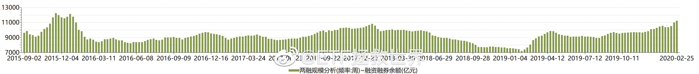

## 2020-02-26 14:44

能带走的人不多。

## 2020-02-26 14:53

很多人觉得：

有什么带不走的？我的股票又没跌停，卖了不就带走了吗？

对。就跟去澳门一样，你赢钱了，拿着钱走了，再不回来，那当然没问题。

但你问问自己，能做到吗。还不是卖了以后看着觉得差不多稳了，一个回马枪杀回来准备抄底或者再吃一波，结果结结实实被按在里面了？

很少有人套在最高的山顶，绝大多数人是按捺不住内心的空虚寂寞冷不停的杀进杀出被干掉的。

当然了，我绝不是说这里就是山顶。我只是在推演未来会发生的一些事。

我的意思是，别以为你跑的掉。跑不掉的，即使你是个风一样的男子，也会像疯子一样跑回来。

## 2020-02-26 15:15

回复@Acrab_jj:对，去年新高你后年也别卖好吗？以后我少说话，看你还能不能找到别的背锅侠。//@Acrab_jj:什么意思啊？ 不是说新高不卖吗？所以前两天新高没动啊！//@ETF拯救世界:能带走的人不多。

## 2020-02-26 15:18

我说的清清楚楚明明白白。“一个品种新高的当天，别卖。”你的新高管几个月还是几年？//@ETF拯救世界: 新高不卖是什么意思呢。买入看估值，卖出看趋势。如果因为一个东西稍微贵点你就慌着卖出，可能很难挣大钱。一个品种新高的当天，别卖。跌有底，涨起来是很难预测天花板的。不容易把握，以后慢慢说

## 2020-02-26 15:21

我再说一次，虽然我自认为说的话已经非常直白，怕你误会，也已经啰里啰嗦解释的非常清楚。但如果还是理解不了，请看操作。能公开的长线和波段操作都是公开的，操作就代表我最真实的意思。

太南了。 ​​​

## 2020-02-26 15:28

念叨着新高不卖四个字，你手里的品种收益率从1%、2%、10%、20%、40%，一直涨到了50%。

然后，因为在50%的新高没卖，收益率跌到了47%，你开始抱怨：

什么意思，不是说新高不卖吗。为什么跌了！本来我能卖在50%最高点的！

你当然能。不光你，所有人都觉得自己能卖在最高点。之所以没有，是因为听了小人的谗言。谁是小人？看一圈，对，就是你了！你废话太多我才没卖在最高，我本来可以的！

我不需要你给我提成，甚至不需要你说声谢谢，你别端起碗吃饭放下碗就抱怨甚至骂娘我就满足了。

未来，各位还能亲眼见到各种荒唐的，光怪陆离的事情。对这些事情，我早就有了心理准备，只是等着一件件发生。

人性这个东西，我自认为足够了解。很期待。

## 2020-02-26 15:42

回复@qingyanZ_:今天这架势，明天弄不好反弹呢。你可能塞翁失马也说不定……//@qingyanZ_:明天卖还来得及吗，今天看见的时候卖不出去了

## 2020-02-26 16:59

DAX又干了2%…… ​​​

## 2020-02-26 17:20

看了今天的公众号留言，我有点后怕。幸亏计划里的油气只有1个多点的仓位。如果有10%，会是什么情况。

我其实现在有点怀疑自己了。一开始，我是想证明普通人通过理性的交易指数基金也可以在A股挣钱，仅此而已。

但现在我怀疑这个结论。我想，确实不是所有人都适合金融投资。真的。 ​​​

## 2020-02-26 18:14

很多人并不懂为什么会有150这个计划出现。

很多年前，我就知道，你告诉一个人一个股票代码，即使那只股票最后涨了10倍，也不行。想要让那个人赚钱，你必须告诉他买入卖出的日期，买入卖出的价格。跌的时候要不断的给他打气，涨起来了要鼓励他拿住。

这样，那个人才可能在那只股票上赚10倍。否则，这只十倍股他会赔钱。

后来，我发现只有代码、交易时间、价格也不行。你必须精确的为他做好仓位配置。什么地方仓位是多少。只有这样，他才会真的赚钱。

这就是150的由来。

有人说计划收益率不高。是的，在目前的情况下，它不可能高。早在2016年买恒生的时候，就有人指责为什么建仓期的恒生浮亏十几个点。虽然后来涨了50%多，但我相信他们可能早已清仓。因为那些人的出现，我知道不能冒险重仓。因为一旦有一点波动，很多人真的会崩溃。

不重仓，怎么突飞猛进呢。所以你看，2015年我就告诉你我最爱的六个品种中有创业和信息技术（50、500、创业、消费、医药、信息技术），计划里有多少？我是真的不敢让你买这些大波动的品种。很多人会崩溃。（现在我才知道，1%仓位也会崩溃）

我只有选择小回撤，稳步上扬，不断新高，才会让绝大多数人真的坚持下去，坚持到收获的那一天。

其实你坚持不坚持跟我无关。只是我一直有个初衷从没忘记：

不让任何人因我而赔钱。

所以我为你设计仓位，设计交易时间，设计交易品种，设计交易份额。为了保证你所有持仓品种都比我低的同时还要拿到低价筹码，还与且慢设计了补仓系统，全是为了这个初衷。

这一切只有你真的用心去看，去体会，才能明白到底是为什么。

你还见过任何人这样做吗。我就设计一个组合，不管你什么时候买，什么价格买，买多少。或者每个月买一点S，不是更轻松吗？为什么要做这些？

我精心设计的体系，你照做了，赔钱了，是我的水平不够，我说声抱歉，辜负信任了。你不按照我的建议自己操作，赔钱了还来怪我，说真的，我无法接受。

赔钱的时候，找一个替罪羊很简单，自己心里也会舒服很多。但你舒服了，我会不舒服，真的。

因为我不想让你赔钱。

## 2020-02-26 19:39

不瞒你说，离我很近

## 2020-02-26 20:15

这么说今年欧洲杯悬了。 ​​​

## 2020-02-26 22:32

我想了想，争取以后会慢慢开始少说点投资的事情。如果你关注我是因为投资，那取消关注也未尝不可。

其它的，有就说两句，没有就不说了。

少说话没什么不好。就是怕做不到，尽量吧。

最终目标是把发微博的量控制在每天300条以内。 ​​​

## 2020-02-27 09:33

159940不要现价买！净值1.031！

（9:35更新：做市商出现了，2%溢价消除。本条作废。） ​​​

## 2020-02-27 09:59

这些新闻都是可以记录在资本市场回忆录里面的。

## 2020-02-27 10:08

QDII 折溢价实时更新页面：

网页链接

注意折溢价。溢价过高就不要买，有溢价低的类似品种。 ​​​

## 2020-02-27 10:12

回复@最近是努力kay:我不会再发表看法，只转发，发表一些客观存在的东西。同时，只在重要的时候做一些提醒。//@最近是努力kay:老大这是努力往300条靠拢啊，这节奏，太优秀了

## 2020-02-27 10:24

富国红利每份分红0.11元。

红利再投。 ​​​

## 2020-02-27 12:48

头发自己用电推子推了。

上面用18mm限位梳，边上用1-6mm，后面让家人帮忙。

效果比想象的好很多，居然剪出来时尚的感觉，打上发泥和干胶，还有一点国际范儿。

这让我怀疑每次去找海洋总监剪头发花的128是不是没必要。 ​​​

## 2020-02-27 13:13

红利基金分红让我想到一件事。

其实如果你持有的基金或者股票，每年分红金额可以覆盖你的生活支出，那么一定意义上说，你就不需要做自己不喜欢做的工作了。

剩下的时间，选择一些自己喜欢做的事就会开心不少。 ​​​

## 2020-02-27 13:30

红利基金的分红时点也很有意思。拿富国红利来说，2008年成立，至今12年，分红8次。

分别是2010年0.245；2011年0.13；2012年0.026；2015年0.056；2016年0.35；2017年0.3；2018年0.188；2020年0.11

都是年初分红。记住，都是这些年度的年初。这个很重要。

你会发现，2009年、2013年、2014年、2019年初，没有分。而这四年，竟然与我们定义的钻石坑神一样的重合了。

2008年底钻石坑、2012年底钻石坑、2018年底钻石坑。

也就是说，在钻石坑中，连红利基金都赔的没钱分红了。所以，红利基金没钱分红，是你判断钻石坑的又一个依据。

另外，分红越多，恐怕越应该警惕，你观察一下。

## 2020-02-27 14:09

回复@一米阳光的田野:2013是大盘股的钻石坑，不是小盘股和全市场的。//@一米阳光的田野:2008年底钻石坑、2012年底钻石坑、2018年底钻石坑，2013年底算不算？

## 2020-02-28 01:11

意思不大 ​​​

## 2020-02-28 07:46

前天卖一份500C和创业有人在评论质疑我涨的好好的为什么卖。

接下来看看会不会有人质疑我为什么只卖那么少。 ​​​

## 2020-02-28 08:00

有空写篇文章说说为什么波动仓位这么做。

哎，算了，直接简单点说吧。

蒙的。 ​​​
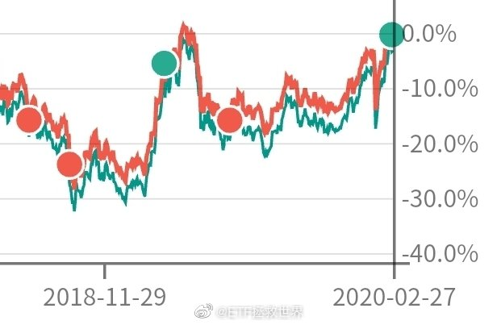

## 2020-02-28 08:08

我已经把买入标普500写在计划中，点位也已经确定，等着到。

美股未来十年不是赚一路上涨的钱，而是赚大幅区间波动的钱。2029年回头看，美股从去年起不会有多少涨幅，但是两三次大波动足够赚钱。

金融投资就这么大点事，没什么新鲜的。 ​​​

## 2020-02-28 09:30

未来科技股啊，芯片股啊跌的话，疫情啊，外围啊，最多最多占50%原因。

上百倍的估值才是致命的。

当然，你可千万别因为我的这条微博卖。过两天再涨你又要骂我，这也是为什么这一波疯狂中我不说话的原因。少说，少挨骂。

我只用自己的150行动告诉你我的看法。 ​​​

## 2020-02-28 09:38

回复@heartmate96:恒生挂条件单的话直接折价4%买入，一分钟爆赚4%。不知道哪位大神乌龙指给咱们送大礼。//@heartmate96:恒生呢 1.40 怎么样

## 2020-02-28 09:43

震惊了，一个价位要吃多少遍？提醒：做压力测试。不要孤注一掷。 查看图片 //@ETF拯救世界:波动是我们的朋友 查看图片 //@ETF拯救世界:是这样的 查看图片 //@ETF拯救世界:回复@ETF拯救世界:又买回来。 查看图片 //@ETF拯救世界:一个半月，又出一格。

## 2020-02-28 10:06

我看今天就这样吧。我还有个会，先走一步，你们再研究研究，下一步的工作抓紧落实。 ​​​

## 2020-02-28 14:52

神了。//@ETF拯救世界: 回复@ETF拯救了我:不仅合宜，十几年来，但凡有爆款出现都是至少阶段见顶。睿远的第一只公募是去年3月发行，然后……你懂了。这次我不知道。只是说历史。//@ETF拯救了我:公募基金大热，会不会又变成公墓？就像兴全合宜等几个基金募集前后发生的事情那样。

## 2020-02-28 14:57

低位不买。市场涨了追最热的热门基金，被渠道忽悠去申购明星基金。

然后赔钱了，得出一个结论：

中国股市都是骗人的，赚不到钱。 ​​​

## 2020-02-28 15:16

来吧，等你好久了。 ​​​
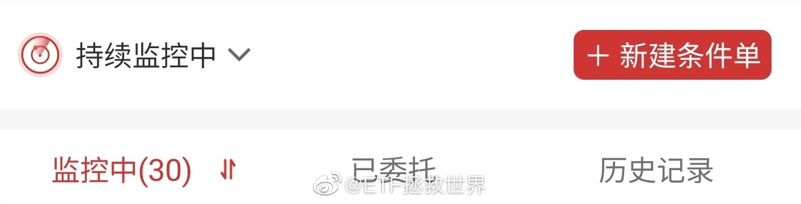

## 2020-02-28 22:49

大波动的意思，就是最后你发现指数没怎么变化，你的钱多了好多…别忘了，现在才2月

## 2020-02-28 23:12

不瞒你说，一个礼拜的时间，美股两年大牛市白涨了。 ​​​

## 2020-02-28 23:29

回复@杰西卡奈落落落落落:再说一次，你等所有事情变好再买，已经涨到天上了。什么事情都好好的，凭什么你能买到便宜货？//@杰西卡奈落落落落落:回复@身边的憨笑君:国外下周要进入疫情爆发期了，我对他们的组织能力没有信心

## 2020-02-28 23:33

不要盲目乐观，也不要太过忧虑。等到低位买点美国，欧洲，中国的指数基金，怕什么？

怕中美欧交易所同时消失吗。那样的话，你留着那些纸有什么用，什么也买不到了。赶紧再去玩玩This War of Mine学点技能吧。 ​​​

## 2020-02-28 23:44

长见识了。再次提示，做好压力测试，极限跌幅60% 查看图片 //@ETF拯救世界:震惊了，一个价位要吃多少遍？提醒：做压力测试。不要孤注一掷。 查看图片 //@ETF拯救世界:波动是我们的朋友 查看图片 //@ETF拯救世界:是这样的 查看图片

## 2020-02-28 23:47

不建议关注我低于六个月的朋友参考我的长线计划和波段。

老朋友没事，大多数经历过钻石坑，都已经相对来说成熟了，我基本不用操心，除了一些财商负数的。

新朋友不好意思我不想再那么累了，所以不建议各位参考我的投资。警告你，会赔很多，所以别参考！ ​​​

## 2020-02-29 10:30

有些事情外人永远永远无法知道真相。

所有的猜测都是带有主观判断的猜测而已。

你喜欢他，就觉得他一定无辜。你讨厌他，就觉得他一定有问题。而且所有人都能找到很多证明自己正确的论据。

但其实真相永远是个谜。 ​​​

## 2020-02-29 12:00

昨天数据出来了，我反复观察认真思考，结论是这个位置我不会大幅减仓，即使还要大跌。因为我无法说服自己。

目前保守——激进投资者的仓位在60%-80%之间，极度激进到90%，极度保守到50%是比较合适的。

也就是说，再保守，也不应该低于半仓。 ​​​

## 2020-02-29 12:11

回复@蓝莓小华夫Orz:你预计投入A股多少钱是分母，已经买了多少A股是分子。//@蓝莓小华夫Orz:回复@小夏万花筒:这个仓位百分比是怎么算的啊求解

## 2020-02-29 12:31

回复@招财进宝的婧宝:每一个人，每一个家庭的风险偏好、年龄、职业全都不同，无法给一个标准答案。如果一定要给，就是一个字：“五年内不用的闲钱”//@招财进宝的婧宝:那除了固定资产外，家里的钱，几成投入股市比较合适呢。

## 2020-02-29 12:37

今天看到有人说，病毒起源于灯塔，去年底那边流感死一万多人其实很多都是新冠。但是没有检测出来——一直到现在都严格控制检测人数。然后不知道通过何种方式弄到了武汉，咱们这边及时发现公布了。

也有一些医学证据之类的。

竟然觉得也挺合理的，说明我也是一个容易被忽悠的人…… ​​​

