## 2020-03-01 10:38

刚才那条删了，不是各位想的那件事。

说说另一件事。刚才看新闻，据说不让人肉搜索了。

两年前吧，有个人在微博评论骂我的家人。我第一次在网上愤怒了，五分钟内通过自己的渠道以及神通广大的网友搞清楚他的真实身份。

他怕了，马上私信我道歉。

这事老朋友应该有印象。

现在好了，喷子可以随意喷了。

## 2020-03-02 10:30

这条不知道为什么发不出去，截图看看吧 ​​​
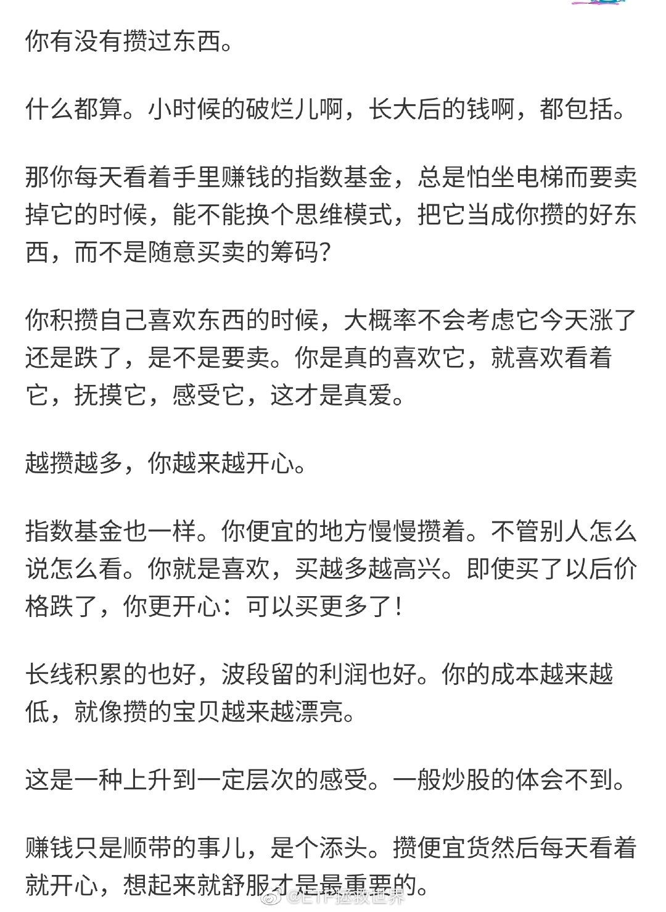

## 2020-03-02 10:39

不瞒你说，买的金融已经快收复上周五的失地了，卖的创业板还很遥远。 ​​​

## 2020-03-02 13:55

只要你在大部分选择该向左还是向右的路口都没有选错，那么生活大概率是越来越好的。

就像大部分买卖都没错，账户资产就一定是越来越高。

所以最重要的是选择。选择又来源于世界观、性格，以及意志力。 ​​​

## 2020-03-02 15:54

回复@左手跳舞的男人:我反对无脑“定投”//@左手跳舞的男人:最近定投的科技基猛跌，亏本了都，不想定投了，谁来给我点自信坚持下去。

## 2020-03-02 16:04

巧了。

## 2020-03-03 10:01

关于仓位，还是这个区间。

## 2020-03-03 10:39

仓位实际上是一种概率。

你认为100%涨，就满仓。100%跌，就空仓。涨跌概率差不多，就半仓。70%会涨，就7成仓。

这个概率你应该通过估值，情绪，资金等状况分析得出。 ​​​

## 2020-03-03 10:54

创业板能不能突破前高是非常有趣的一个观察点。 ​​​

## 2020-03-03 19:38

如果谁家的粉丝把steam举报没了，我会黑他家偶像一万年。

不过话说，咱们是不是也得多点自信。那几个不存在的全球性大网站谣言多，不让上就算了。连游戏网站或者游戏服务器都要堵住是不是稍微有点过了。（PES2020一个足球游戏什么时候能解封？） ​​​

## 2020-03-03 20:11

喷了，dax30场内溢价接近6%。

场内QDII的折溢价真的是一个大问题。 ​​​

## 2020-03-03 20:24

红利目前的状态是：“怎么也不想卖，涨不涨都没关系”

创业板目前考虑的是：“什么时候清仓” ​​​

## 2020-03-03 21:08

今天看到一篇V的翻车贴，突然想到一个问题。特别神奇。老朋友有没有发现一个事实：

这几年，无缘无故怼我的那些V们，不是投资翻车就是自己出问题。或然率竟然高达95.78个巴仙！（剩下的4.22%大概正在翻车的路上）

相反，那些有事的时候帮我说话的V，竟然一个个风起云涌意气风发，投资也好，事业也好全都做的越来越好。

喷了，为什么会这样！

我只能说，人品这个东西，一定程度上决定人生。做事先做人，诚不我欺。

## 2020-03-03 21:33

我有一个体会。

别人倒霉或者需要帮助的时候，你伸手帮一把。

没错，很多人不知道感恩，甚至有可能会有人恩将仇报。

但是没事，你不用在意那些人。你帮100个人，有20个人记得，其中10个一直惦记找机会报答你，准备滴水之恩涌泉相报，这就够了。你最终会受益。

这是不是听起来很功利，好像帮人就是为了自己受益。虽然这不是我的本意，但你这么理解也行，也能让你以后的路更顺一点。

相反，你总是害别人。没问题，一个两个被你害的人不会报复你。但是100个人里面有一个处心积虑铁了心要报仇的，就够你喝一壶。

所以多做好事，少做缺德的事，不说玄之又玄的因果轮回，就按照客观世界的规律看，也是不会错的。

## 2020-03-03 22:25

回复@qingqing55662015:救急不救穷。私人之间没有“借钱”这个说法。借出去了，你就得当成送出去了。所以送多少你要考虑好自己的情况。//@qingqing55662015:我怎么老碰到借钱不还，等我急着用钱又要不回来。还都是亲戚，心都凉了。

## 2020-03-04 11:18

别人都跌，你金融这样尬涨，意思不大。 ​​​

## 2020-03-04 11:47

2018年10月的判断。科技信息是牛市第一阶段。如果牛市继续，第二第三阶段将是金融和有色能源等周期股。//@ETF拯救世界: 回复@江河之走:下一次牛市是科技信息股领衔的牛市。//@江河之走:哪些指数为牛市利器?创业板?传媒?证券?信息?还有吗？//

## 2020-03-04 13:32

芯片基金从1.1涨到1.4用了6个交易日。

从1.4跌到1.05也是6个交易日。

半个月，有人数钱离场，有人接盘站岗。 ​​​

## 2020-03-04 14:25

其实最近几个月申购科技基金的人，绝大多数没有什么投资信仰。如果说有，那就是一个：赚快钱。

所以当他们发现科技基金已经无法为他们赚快钱的时候，他们跑得比谁都快，因为没有信仰，不太会管自己买的东西到底值多少钱。

我不是说有投资信仰就高人一等。不是这个意思。我是说没有信仰的人其实很容易唯利是图。唯利是图很容易引发暴涨暴跌。

有信仰就不同了，拿着不涨的红利踏踏实实的。[拜拜]

## 2020-03-04 14:33

有些东西你拿着就是睡得很稳，不会担心太多，比如指数基金。

有些东西就不行，比如股票。

有些东西你想起来就开心，比如拿着的很便宜的指数基金。

有些东西就不行，想起来就糟心，不知道该卖还是继续拿着，比如很贵的指数基金。 ​​​

## 2020-03-04 15:09

回复@JYou-JasonKidd:别尬吹，都是蒙的。你还别不信，是真的蒙的。//@JYou-JasonKidd:e大您的调仓时机每次都让我觉得开了金手指一样，太稳了，您是不是王莽刘秀他们一伙的大魔导士，是你就眨眨眼

## 2020-03-05 09:44

有人在高呼焊死3000；有人在嘲笑；有人在骂；有人在哭。

你在想办法赚焊死—脱焊—焊死—脱焊…的钱。

这就是面对相同世界不同的反应，最终结局也就不同。 ​​​

## 2020-03-05 10:25

有两种问题不要再私信我了。

第一种是：

基金怎么买，买什么基金，什么叫etf。

我没有兴趣，没有精力，没有动力去做基金普及的工作。看我的东西，有一定金融知识基础，最好有几年交易经验的是最合适的。如果你没有，也不是不能看，前提是你先百度一下基础知识再来。

否则，取关我是最好的。我其实没什么好关注的，能力一般，聊天乏味，智商不在线。

第二种是：

我买了xx基金，xx股票，被套了，怎么办。

我说过无数次了。你买的东西涨了或者跌了怎么办，是交易前应该想好并设计应对方案的。不是交易后再去想，那就晚了。所以你问我，我更不知道。因为我不知道你的财务状况个人情况，更因为我不是什么帮你看股票看基金的老师，别问我。

## 2020-03-05 10:42

辣鸡金融

$全指金融 sh000992$ ​​​

## 2020-03-05 10:51

神秘资金在跟车石锤了。 ​​​

## 2020-03-05 11:21

就第三轮计划未来的变化，有空会写一篇更详细的东西说说。 ​​​
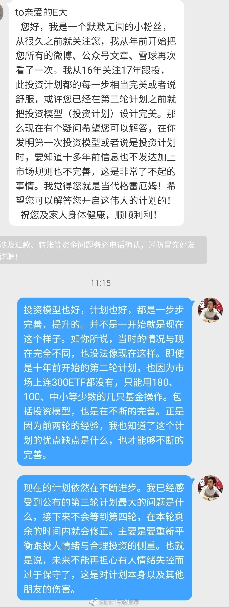

## 2020-03-05 11:33

我劝你善良。

## 2020-03-05 11:35

回复@狂狮爱不可:精神不正常不是高位截瘫。//@狂狮爱不可:回复@ETF拯救世界:你要是精神不正常，第四轮我去你家里给你端茶做饭。

## 2020-03-05 13:17

新高了没 ​​​

## 2020-03-05 14:13

这次欧美有些国家的操作，如果发生在我们这里，已经被国内国外一起骂成筛子了。 ​​​

## 2020-03-05 14:22

很少有地方可以合理合法的利用别人的恐惧和贪婪赚钱。

股市就是其中一个。 ​​​

## 2020-03-05 16:13

今日数据：保守-激进投资者仓位55%-75%之间。极度激进85%，极度保守45%。

## 2020-03-06 09:37

叕新高了。

$全指医药 sh000991$ ​​​

## 2020-03-06 10:13

中国互联网美妆销售第一人，只要不卖假货，挣这么多钱很合理。挣不到的没必要酸。

## 2020-03-06 10:27

看着持仓里面涨幅很大的，拿的踏踏实实的品种，除了高兴，你应该问问自己，下次自己怎么才能坚持拿到赚这么多而不随意卖出。 ​​​

## 2020-03-06 21:49

不知道这一波欧美能不能出现08危机12欧债那样的超级投资机会。 ​​​

## 2020-03-08 09:57

姑娘们领，男人领没有Jj ​​​

## 2020-03-08 10:00

姑娘们节日快乐！祝你们永远美丽，幸福！红包只能女性领，男人抢的没有JJ  ​​​

## 2020-03-08 10:16

一个几块钱的红包就能让你测试一下自己的人格：

当没有人监督你的时候，为了得到利益，你是否会遵守规则？

是不是发现自己没有自以为的这么高尚。这些朋友能够掌握金钱和权力时，一定要好自为之啊。 ​​​

## 2020-03-08 18:26

未来随时发车。如果时间紧的话就不会写文章了，直接发送文字。 ​​​

## 2020-03-08 22:05

少看微博，看多了整个人会变得很丧。 ​​​

## 2020-03-09 08:40

今天要做点事了。不然对不起这个大时代。 ​​​

## 2020-03-09 10:17

日元兑人民币汇率大涨，所以A股日经ETF跌幅收窄。 ​​​

## 2020-03-09 11:47

车已发。不要问为什么买，为什么卖。我没兴趣没精力没意愿解释。 ​​​

## 2020-03-09 12:05

巴菲特当年重仓中石油H的价格除权应该在0.7-0.8之间。卖出价在7-8左右。

目前2.73。 ​​​

## 2020-03-09 12:11

回复@锅锅不是小火锅:没有，这跟发车没关系。我是想起来当年巴菲特中石油赚这么多，看看他的成本是多少。//@锅锅不是小火锅:所以E大还是忍不住解说了下～为了大家心里安稳跟车也是操碎了心

## 2020-03-09 12:20

DAX大概在9000点左右的时候会配置完成。如果不到，就不完成。 ​​​

## 2020-03-09 12:27

回复@Kiwiwei19:早饭还没吃。跟打仗一样。//@Kiwiwei19:老大快吃饭去

## 2020-03-09 12:40

再提示一下，今天的南方油不要场内买，目前大概已经溢价20%+了。除非今晚油价暴涨20%以上，否则场外申购就不会错。 ​​​

## 2020-03-09 13:48

网格表格已更新。 ​​​

## 2020-03-09 14:12

今天只有一个愿望，晚上油价不要大幅反弹。 ​​​

## 2020-03-09 14:21

我不懂啊，就问问。咱们能不能多买点30以下的原油，灌回大庆之类的油田留着以后用……会不会流走…… ​​​

## 2020-03-09 14:35

除了委内瑞拉，今年创业板涨幅全球第一。不仅正收益，还涨了将近20%。

所以我们先走一步了。 ​​​

## 2020-03-09 15:05

跟大家说个最最极端的跌幅吧。

目前的A股全市场估值，大致与2008年6月相同。那之后上证到最低点又跌了39%。

再说一次，怕你阅读能力差，我再说一次。这不是我预计A股要跌40%，也不是我预计要发生jrwj。而是说08年那样的情况再发生一次的话，最差最差基本就是这个跌幅不会再差多少了。 ​​​

## 2020-03-09 15:15

本来我还想说芯片和半导体ETF十个交易日跌了30%。

后来一看原油一天就跌了30%。A股果然还是个弟弟啊。 ​​​

## 2020-03-09 15:37

这几个关键继续买入点位依然没变。分别是23000、21000、17000。//@ETF拯救世界:再给一个点位。如果真的搞大，让恒生崩到21000以下，是非常非常好的买入机会。我给个极限点位17000。万一真的到了，一把配满恒生指数，从那里算，不赚60个巴仙不再看。

## 2020-03-09 16:05

德国已经到了2012年11月以来最便宜。即将进入欧债危机底部区域。 ​​​

## 2020-03-09 16:17

各位目前经历的，是真正的资本市场大时代。级别大概是十年一次的。

没经历过之前87 97 08 的朋友，好好欣赏吧。

过一两年看现在，必将无限感慨。 ​​​

## 2020-03-09 16:19

27-31，反弹15%了

## 2020-03-09 16:41

27-32,19%。辣鸡。//@ETF拯救世界:27-31，反弹15%了

## 2020-03-09 17:40

27-33，22%。闹呢。//@ETF拯救世界:27-32,19%。辣鸡。//@ETF拯救世界:27-31，反弹15%了

## 2020-03-09 17:46

查了一下，门票108。这点便宜没必要吧。

## 2020-03-09 17:58

回复@酣学者:如果是抢108的大米，你这么说我我认了。这是人挤人为了省108去逛景区。别说疫情了，就算没有疫情，为了省108门票钱，花几十块油钱然后这么挤着玩的舒服吗。//@酣学者:何不食肉糜//@ETF拯救世界:查了一下，门票108。这点便宜没必要吧。

## 2020-03-09 18:06

可能是个人性格原因吧。旅游，我最大的要求不是景色好，而是——

人少。

景色再好，人多我也绝对不去。去了也马上转头就走。

多少算多的不能忍受呢，大概就是人和人之间有1米以上距离吧。再近我就很不舒服了。

人生在世，最重要是舒服。不舒服的玩，感觉玩的没质量，不如在家呆着。 ​​​

## 2020-03-09 18:26

回复@CC咚呲哒呲:美股我测不出来。这个市场太诡异。//@CC咚呲哒呲:E大可以点评一下美股目测的最大跌幅吗

## 2020-03-09 18:39

我们的十年国债收益率降至2.5%了。我记录的最低是2002年，到过2.1%。

国债目前除了避险属性，完全比不上投资好股票。 ​​​

## 2020-03-09 23:08

明天看情况，如果合适，继续发车。 ​​​

## 2020-03-10 09:55

欧美的数据还没更新，所以今天估计开不起来了。 ​​​

## 2020-03-10 10:13

150的创业板绝大多数卖掉了，S清了。实际收益率40%-50%。

怎么说呢，如果之后继续涨，我也认了。最高已经到了65倍的创业板指，以后继续涨的这个钱我不配挣。 ​​​

## 2020-03-10 11:14

中午收盘后，S先走一车。 ​​​

## 2020-03-10 11:36

第一，双黄线。不过这个实际行车很难很难完全避免。第二，第一声喇叭不是“提醒”，而是“赶紧XX”。其实轻按一下提醒就行了。第三，第3、4声喇叭除了制造矛盾完全毫无意义。第四，报警了先罚你违章。第五，上传视频是因为不觉得自己错。

## 2020-03-10 11:47

如果南油本身不掉链子，昨天那车已经浮盈7%。 ​​​

## 2020-03-10 11:51

回复@大官渊铭:我在小区里开车，前面有人在机动车道上走我都不按喇叭，在后面慢慢跟着开。。。//@大官渊铭:不管女的对不对，第一声轻按就好，没必要跟野蛮人过不去，我们出去是办事，不为吵架

## 2020-03-10 11:58

我以前有一个同事，坐过一次他的车，除了在长安街上那段消停点，一路上喇叭就没断过。滴滴滴滴不停催骑车的走路的。我说你这么按人家不好，他说，怎么了，是不是他们仇富。

还是跟这位同事和其他几位去餐厅吃饭。不停的催服务员赶紧上菜，态度还特别特别不好。我心说，你们不怕服务员端菜的路上给你往里面吐吐沫吗。

很多事情换位思考一下。如果是你在路上走或者骑车，一辆汽车在后面猛按喇叭，让你赶紧让开。或者你是餐厅服务员，厨师那边炒菜慢或者顾客太多，因为上菜慢被骂，你会怎样。

脾气好就算了，要是碰上脾气差的，又是一个蛮荒故事。

## 2020-03-10 12:24

条件单继续提升。

近日又提了一个需求。

目前条件单是根据当天第一笔成交判断是否触发。这样容易造成挂单慢，无法成交。争取接下来根据9:25的集合竞价价格来判断是否触发，争取在开盘前单子就挂上，提高成交概率。

这个行不行。 ​​​

## 2020-03-10 14:37

意思不大，散了吧。 ​​​

## 2020-03-10 22:12

南油果然掉链子了。昨天油价跌27%，净值只下降了17%。那今天的反弹也大概率跟不上了。

我考虑了一下，这个也有我们的原因。规模不大，申购比较多。 ​​​

## 2020-03-10 22:35

大概解释一下，是这样的。

指数基金一般都能跟上指数涨跌幅。南油我们也跟踪了好久，一直在观察短中长期跟踪效果，不能完全精准，但总体还可以。

昨天油价跌27%，基金净值跌17%，我估计，主要原因还是申购的资金太多了。一方面是我们申购，一方面还有套利的。

如果本身基金规模是3亿，其中2.95亿都是资产，仓位98%，那跟上涨跌幅没问题。突然有一天如果有1.5亿资金进来买，那就变成了2.95/4.5，仓位变成了65%，当天当然跟不上了。

一般国内的基金是当天申购的资金，第二天才能开始买。QDII我估计会更晚一点。所以昨天没跟上，今天大幅反弹应该也不能全跟上。

这个不怪基金公司，规模突然变大，现金太多就跟不上。

## 2020-03-10 23:59

美股现价是一个十年强支撑。如果撑不住，十年上升趋势打破。

还是之前说过很多次的，我认为未来几年美股是波动市，不会有大的涨幅。2028-2029回头看，点位基本与现在差不太多。但是波动会很大，低位买入收益率还是会有保障的。 ​​​

## 2020-03-11 08:28

昨天这个微博基本是美股最低点发的。发完了就拉起来。因为那真的是一个强支撑

## 2020-03-11 10:35

目前油气场内溢价30%。最好不要买溢价这么高的东西。 ​​​

## 2020-03-11 11:32

150福特换奔驰。 ​​​

## 2020-03-11 11:41

我们的媒体采访，包括来国内开会的各种国外专家，都会说这些面儿上的，我们爱听的话。他们的真实想法，得听他们回去跟他们的媒体怎么说。

## 2020-03-11 11:45

回复@彩云朵朵cll:智商情商都是负值的才会到别人家做客的时候说别人不好，说别人家刚生的孩子难看。当然，我这里倒是经常见到这样的人。//@彩云朵朵cll:我们是外人，人家回去跟内人才会说心里话的

## 2020-03-11 11:52

欧洲最大仓位给5%-10%。目前3%多一点，还有很大加仓空间。不急，看看历史性的钻石坑能不能砸出来。 ​​​

## 2020-03-11 12:58

刚看到有朋友说，有人到处散发发车信息，尤其是在一些大平台上。

这就是公开计划的问题之一。按理说投资应该静悄悄的，尤其是买入的时候，根本不应该让人知道你买什么。

当然，基金比股票好很多。基金只会影响短期，长期还是会跟净值走。但是短期也受不了，尤其是现在QDII纷纷限购，弄大了以后谁都买不到。

希望大家不要再传播了。第一个是上面说的投资本身问题，另一个是很多人没有受到风险教育和提示，根本不适合。最后不按照仓位买，出问题了又要骂人，真的受不了。

## 2020-03-11 13:37

两条场内交易信息：

第一，条件单新版已上线应用商店，可以更新。触发后不成交，条件单持续有效。

第二，场内LOF申购降至一折，套利成本更低。 ​​​

## 2020-03-11 13:41

S买标普500而150不买的逻辑在于，S是无限现金流，跌幅大一些可以承受。

150资金有限，需要更合适的入场时机。 ​​​

## 2020-03-11 16:07

什么玩意儿。买什么什么反弹。 ​​​

## 2020-03-11 16:36

危机可怕不可怕。

非常可怕。

资产价格会大幅下跌。

但有一个有意思的问题不知道你是不是注意过。

在危机中买入，即使没有买在最低，几年后也赚好多。

回头看，危机都是好的投资机会。

当然，两个需要注意的。

第一，别上杠杆

第二，注意买入节奏 ​​​

## 2020-03-11 17:10

这几车之所以只发文字，不写文章，原因很简单：

BGM库存没了。 ​​​

## 2020-03-12 08:02

四年多计划一分钱美股没买，这是真的要给买入机会了吗。 ​​​

## 2020-03-12 09:55

目前华宝油气场内溢价33%。场内持有油气的朋友，可以考虑卖出，然后场内申购（注意，不是场内购买，而是场内申购）160416石油基金跨品种套利。

两者虽然不是同一个品种，但高达30%以上的空间是值得做的。

注意，场内你卖了多少钱的油气，也要申购多少钱的石油基金。比如场内卖了10万，马上回头申购10万元石油基金。目前石油基金没有限购，不过我估计很快就会了。

场内申购方法，各券商软件不同，智投举例：

普通交易——场内基金——场内申购——160416

场外持有的（比如且慢、天天等渠道）不要做

## 2020-03-12 10:08

去年8月定的第一目标位23000即将达到。23000以下的恒生进入可投资区域。在第二目标位21000，一直没有但是想买的朋友可以补仓一部分。17000是jrwj级别的大底。配满仓位。

## 2020-03-12 10:56

本来有些投资机会是不应该大声说出来的。太多人参与，真正的一些相关好的投资机会也就没了。

只是心里确实想帮大家，内心抉择很久，还是选择了说一声。

越来越感觉这样的模式是不可以持久的。问题很多。 ​​​

## 2020-03-12 13:11

第五车 ​​​

## 2020-03-12 16:00

我们的卖出不代表一定会跌，很多时候只是我们需要钱去买更喜欢的东西而已。

毕竟，150资源有限。 ​​​

## 2020-03-12 16:06

DAX摸到黄金坑边缘。距离钻石坑还有不到20%。 ​​​

## 2020-03-12 19:54

南方油刚买了一车就干到暂停申购了。

太南了。 ​​​

## 2020-03-12 21:33

这个月虽然连发五车，很热闹，但你仔细看，150其实是在减仓收回现金。

150

卖出创业板3份，中证500 1份，传媒1份，海外债1份。

买入金融1份，南方油1份，DAX 1份。

S也只是正常份数，之前几个月没买的留存资金都没有用。

节奏控制好，慢慢捡好东西。 ​​​

## 2020-03-12 21:39

美股市场真的与其它所有市场都不同。很难很难计算它的大致买入点位。

这些年美股公司不断发债回购自己股票，导致市场不断上涨估值却没有跟着涨多少。这样的财务游戏导致完全无法用通用的方法分析它。 ​​​

## 2020-03-12 21:45

欧洲 -10%。好吧，坦白了，没见过…… ​​​

## 2020-03-12 21:48

想到了大波动，但真的没想到这么大……

## 2020-03-12 21:49

这一波下跌中，欧洲哪天出现+10%的反弹不用感到奇怪。

问题是，不知道哪天出现…… ​​​

## 2020-03-12 21:53

回复@这谁顶得住啊10000:当然要抄啊，新关注的？//@这谁顶得住啊10000:还敢抄底吗，

## 2020-03-12 22:02

一个国家的宽基指数，之前说过，极限跌幅我给到80%。历史上有没有出现过，有。2000年后的纳斯达克和90年代后的日本，都在70多。

目前的情况与当时完全不同，当时它们都是70多倍市盈率开始跌的。

一般来说，从最高点跌50%，发达国家市场也就差不多了。现在看一下，都已经跌了20%多，走了一半了。

所以在这种危机中，你要反复确认几件事，就不会问出“还敢抄底吗”这种几年后看喷饭的问题。

第一，你有没有加杠杆。加了杠杆就会很惨，不要加。

第二，你还有没有钱加仓。投资的钱是不是至少一两年不用。答案都是“是”的话，就问题不大。

第三，你对市场以及自己资产的极限跌幅是否有清醒的认识。有了，你就不会被媒体、自媒体和别人的恐慌带着走。还是之前说的，设想一下，涨30%，跌30%你是不是都舒服。不舒服就把仓位调整到舒服的状态。

第四，你买的是指数。现在不仅是A股指数，还有美国、欧洲。当然欧美还很少很少，不到3%，最多我会买到20%。你说我敢不敢抄，就等着抄呢。

你要说历史没用了，这次全完蛋了怎么办。怎么办，多屯点罐头和压缩饼干吧。

## 2020-03-12 22:15

讲真，如果A股在这种情况下还能挺住不跌，我会越发觉得中国NB，中国人NB。 ​​​

## 2020-03-12 22:20

回复@Pop-walker:我不是看空看多，我是说，我根本不知道该怎么去看美股。真的看不懂，所以150一分钱也没买。//@Pop-walker:所以E大是看空美股么？

## 2020-03-12 22:30

美元白银网格可以先暂停了。 ​​​

## 2020-03-12 22:33

回复@丫丫背后的女人:黄金只在危机开始阶段有点作用。危机深入后，它所谓的避险属性就会失效。中后期只有国债和现金不跌，甚至最后只有现金不会跌。//@丫丫背后的女人:黄金避险属性完全失效

## 2020-03-13 00:31

今夜毫无睡意，只想看着你 ​​​

## 2020-03-13 01:03

每次美股把欧洲带的暴跌收盘以后，他自己开始反弹。太坏了。

没劲，走了。 ​​​

## 2020-03-13 07:18

今天不会还能扛住吧…

## 2020-03-13 12:16

忙了一上午，加了7位数的网格，写东西，排版。

去喝杯咖啡。 ​​​

## 2020-03-13 13:12

什么玩意儿？？？发车的时候明明-6%，怎么喝杯咖啡-2%了？？？ ​​​

## 2020-03-13 13:18

7个月前定个点位，跌破就开始大幅反弹。只有一个原因：蒙的。//@ETF拯救世界:去年8月定的第一目标位23000即将达到。23000以下的恒生进入可投资区域。在第二目标位21000，一直没有但是想买的朋友可以补仓一部分。17000是jrwj级别的大底。配满仓位。

## 2020-03-13 13:20

今晚的DAX大概率也要gg。撤不撤单你自己定吧。 ​​​

## 2020-03-13 13:23

回复@ok小片子:你提醒我了。突然一下就舒坦了。//@ok小片子:这就是你7位数的网格搞得啊e大！//@ETF拯救世界:7个月前定个点位，跌破就开始大幅反弹。只有一个原因：蒙的。

## 2020-03-13 14:07

纳闷了，这些人到底怎么想的。前面路口掉个头有多难。还有高速上倒车、逆行的。有一个算一个，全是辣鸡。

## 2020-03-13 14:47

很简单，因为你们缺口罩，ZF才告诉你们不需要戴口罩，然后你们就信了。

## 2020-03-13 17:48

NT这次还算客观。//@饭统戴老板:Repost

## 2020-03-13 17:57

昨天美股的数据现在才出来。

希望今晚不要反弹太多，下周一还有的买。

另外，美国还好，欧洲真的太便宜了。这样的机会可能是十年才有一次的级别。 ​​​

## 2020-03-13 19:15

反弹6%了。不想说话。

## 2020-03-13 19:26

好吧，开始去看留言。你觉得3000+留言要看多久。 ​​​

## 2020-03-13 20:21

为什么最近两次都买在隔夜反弹上了呢。

我反思了一下。原来是我把买A股的经验套到隔夜上了。

也就是说，在隔夜的形态跌到我过去一定要买的形态时，我买入。这样在A股没问题，而且一买就是短期底部，可以吃反弹。但是隔夜这样操作，一买就买到第二天的反弹。实际上如果我们在欧洲操作，那就一定是昨天收盘买。吃今天的反弹。

这个问题怎么解决，还得再想办法。

现在唯一的希望，就是国内QDII ETF好好发展，不要总是搞这么大的溢价。

## 2020-03-13 20:29

9%。想。求抱抱//@ETF拯救世界:反弹6%了。不想说话。

## 2020-03-13 20:37

其实钻石边缘成本高几个点也无所谓，问题是：

大幅反弹后肯定还要跌啊。啊。啊。

辣鸡。 ​​​

## 2020-03-13 21:33

以后谁再说“欧美投资者成熟”，我就对他呵呵一笑。 ​​​

## 2020-03-13 21:49

今天且慢补仓策略调整：

计划内所有盈利品种不再发出补仓提示。（之前是盈利交易不补仓）

一定要保证所有人拿到比我更低的成本。

进一步解释：

某个品种我买两次，第一次2块，第二次1块，均价1.5。目前1.6元。按照以前的逻辑，会让你补2块那次买入，因为比我的价格低。但现在不会建议补，因为目前市价比我的平均成本高。

## 2020-03-14 09:37

结局不错。下周继续买，相信有机会。 ​​​

## 2020-03-14 16:14

说句实话，哪怕2周前，我万万想不到自己有机会买这么便宜的东西，甚至，有可能更便宜。

喷了。

你给我便宜，我就给你好评。 ​​​

## 2020-03-14 17:11

周一场内油气弄不好会涨停。但12日场内油气换申购石油基金的并不亏。

申购石油基金赚了30%差价，同时周五净值增加6%。

毛估估，油气净值再快速反弹40%，这次转换就无利可图了。 ​​​

## 2020-03-15 07:28

有些我在微博上提示的投资机会，只限于当时。不能我当天提示，你第二天甚至第三天去操作，情况已经完全不同。

看微博的人水平千差万别，没法照顾到所有人。但有一个原则你记住就不会错：

如果你不懂，就不要做。 ​​​

## 2020-03-16 09:26

溢价40%的结果，就是净值涨22%，价格却不动。 ​​​

## 2020-03-16 09:39

看新闻，看这个那个分析宏观经济天下大势倒是没错，但你首先得有自己的独立判断力再看那些。否则，你就是随波逐流的旅鼠。

怎么办，很简单。闭上眼睛想自己的金融资产跌30%会不会崩溃。会，就减仓到不崩溃的仓位。不会，踏踏实实持有。别管那么多利好利空。

如果现在觉得跌30%不会不舒服，但是到时候真跌还是不舒服，那也别减了。别割了，都焦了。那时候就是闭上眼睛关上账户，不看，它就没发生。

## 2020-03-16 15:21

今天一单都没有成交，明日再战。 ​​​

## 2020-03-16 15:23

年初说的大幅波动是什么意思呢。

就是年底看，不是大阳线，也不是大阴线，而是长上影长下影的，实体很小的线。也就是说，虽然全年有过大涨，有过大跌，最终收盘点位与年初不会差太多。

这刚过了两个半月，还有十个月，看看吧。 ​​​

## 2020-03-16 16:51

DAX已经跌到强力支撑位，这个位置会继续买一份，仓位加到4%。 ​​​

## 2020-03-16 16:56

FQ到底违法不违法，我现在有点凌乱了。你懂法，你展开讲讲

## 2020-03-16 20:59

说来也怪，现在看着指数涨跌10%竟然觉得很平常。 ​​​

## 2020-03-16 21:03

16美元以上停的，目前12。依然不买。现在有钱可以买的东西很多，贵金属暂时不在清单上。

## 2020-03-17 07:04

最近评论里面害怕啊，难受啊，心痛啊之类的又开始多了。

在并不遥远的2018下半年，我还比较害怕看到这样的评论。一个是毕竟是参考我的计划浮亏了，心里很难受。一个是这样会严重影响其他人，就像病毒。恐慌蔓延，最终更多人清仓在谷底。

现在我心平气和看这些评论。我也不会再做很多金融心理方面的建设。之前那次有经验的朋友，心智正常的话，现在不会慌。没有经历过的，正好经历一下风雨，成长一下，反正你仓位也轻。

能成长的呢，你就成长。不能的呢，你就离开。我厌倦了给新人一茬一茬做保姆，做心灵导师，做护花使者。我就是来市场上赚钱的，怎么能干这么多兼职呢。

A股高估的创业板已经清仓了，没清的都不是很贵。欧洲加起来仓位不到4%，美国还没开始买，跌再多也没事，正好捡钻石。看了看，挺好，绝大多数品种还在赚钱，跌就跌吧。

有些人高位的时候盼着低位买便宜货，真跌下来了又吓得瑟瑟发抖。没什么对不对，很正常，人类就这样。你愿意在我这宣泄情绪你就尽情哭，尽情抱怨。实在受不了就清仓。多大点事，为了几万块投入这么提心吊胆的真不值当，清了也好，回归美好生活。我也不怕你影响别人，能被你影响的也就那样了。

当年的那个情人节，为了一张清仓截图弄得我兴致全无，大餐都没吃好。现在不会了。人各有命，顺其自然。坚持未必适合你，就像不是每个人都应该上战场拼刺刀。实在不行你就解甲归田，认认真真过你平凡而又安全的一生吧。

## 2020-03-17 10:48

3分钟只有21条评论，过气小V不如狗。 ​​​
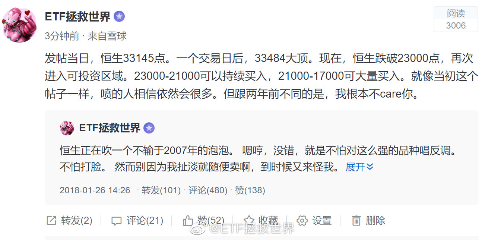

## 2020-03-17 13:47

想在这样的日子里躺在草地上听歌。

闻着嫩绿色的香气。 ​​​

## 2020-03-17 15:50

今日数据：

标普500可以开始慢慢买了。 ​​​

## 2020-03-17 15:54

今日数据：

德国、日本已经极具投资价值。 ​​​

## 2020-03-17 19:19

（拜耳，DAX第五大成分股）

## 2020-03-17 20:23

刚才看拜耳的资料，顺便看了一下第七大成分股阿迪达斯。

阿迪从2016年到今年初翻番用了3年多，谁能想到腰斩只用了两个月……但是这种做消费品的公司利润真高啊。 ​​​

## 2020-03-17 20:26

官宣了，推迟到明年。

## 2020-03-17 20:42

每天都在更新对这个世界的认知。

人类太复杂了。 ​​​

## 2020-03-17 21:38

投资真的要选对入场和出场时机。即使如美股如此持续的长牛，如果你2000年高位入场，到2020的现在，20年也只能赚不超过60%。

年化不到3%。

今年高点标普500指数3400入场的，十年后收益率会是多少？之前说过好几次了，不多说。 ​​​

## 2020-03-17 22:17

投资指数，两个问题比较关键。做对了这辈子问题不大。

第一点，不能买贵。

第二点，高抛低吸。

听起来是不是废话。听起来像，但其实不是。好好品一下，然后把大部分精力放在这两个大方向上，细化策略，结局一定不会差。 ​​​

## 2020-03-17 22:23

很难想象欧美连一次相当级别的反弹都没有。

应该有啊。 ​​​

## 2020-03-17 23:36

最近的一点感想。

说白了，人类，就得抱团。种族、血缘、地缘，甚至校友会等等，各种理由抱在一起。你不抱在一起，就会被别的喜欢抱在一起的欺负。因为资源是有限的，不可能每个人都过得很舒服，那就必然有人吃亏被欺负，有人占便宜。是不是听起来没有那么zz正确，但这就是事实。

有些人牧羊，喜欢外人，看不起自己人。与外人混在一起觉得自己高贵，看自己人怎么都不顺眼，找机会就踩几下，甚至伙同外人来搞死自己人。这当然是他们的选择，但他们不知道的是，他们自己的皮肤颜色，头发的颜色以及瞳孔的颜色，都是永远都不可能改变的。把自己的族群搞得越烂，他自己也最终会更差。

想要做一等公民，就要自己人抱得紧一点，都对自己人好一点，然后自己的实力搞得强一点。你团结，你强大，别人才会看得起你。你跪下，别人不会把你当回事，不会把你当朋友，只会把你当成_____。

## 2020-03-17 23:56

国内这帮QDII真是服了。弄个QDII，几千万刀外汇额度。干嘛呢？过家家呢。

真想做好就加把劲多申请点外汇额度啊。一天天就想追热点一下子发几十只科技基金，服了。 ​​​

## 2020-03-18 00:09

你说美股这么搞，怎么买。这也太考验单日预判能力了吧。最近几天涨跌幅：

-7%；
+5%；
-5%；
-10%；
+9%；
-12%；
+6%。

发愁。 ​​​

## 2020-03-18 10:06

什么连累不连累的，只要你还是中国国籍，该回来就回来。如实上报身体情况，服从安排进行隔离，正常的中国人没人会嫌弃你们。

## 2020-03-18 10:28

在组合中趁乱增加QDII还有一个原因。

即使疫情过去，ZM之间关系的问题。不展开说了。 ​​​

## 2020-03-18 10:49

其实洗碗机最大的作用不是少做点家务活，或者有助于改善家庭关系，

而是它洗的是真干净。

多干净，就是它可以把你的杯子啊、碗啊，变回刚买来时候的样子。（太贵重的餐具就别用它了，洗的劲儿太大，容易弄出划痕） ​​​

## 2020-03-18 12:20

行吧，都删了吧。男的女的，活着都不容易。

反正姑娘们你们知道我爱你们就够了。

（男人再往我怀里钻拉黑警告） ​​​

## 2020-03-18 12:33

欧美反弹的话力度应该在十几二十个点。

按照历史经验看的话。 ​​​

## 2020-03-18 13:28

不要天天想着开车，说真的，你家没矿，不是无限现金流，不能天天开。

我开车有两个标准，第一时间，第二空间。时间和空间至少要拉开其一。否则筹码堆积在一个点位上，没有意义。前几天暴跌，我们进场买点，这个空间就差不多了。继续再等下一个时间或者空间。

你知不知道为什么第三轮四年了你还天天惦记着发车，因为你还有钱。那么，为什么你还有钱？

我会把节奏控制好。涨跌都舒服，仓位控制没那么容易。别老想着抄底抄底抄底，突破突破向上突破，你又不是大宵。

## 2020-03-18 14:09

恒生目前的思路，是下次加仓大概在21000左右。再加就是21000以下。

即使到了21000以下，150也不会买太多，仓位限制。

S也许会多买，无上限。你敢跌我就敢买。 ​​​

## 2020-03-18 14:25

韩国股市2018年2月历史新高，现在已经跌回2007年。

股票，只持有不卖绝对不行。买的贵了更不行。 ​​​

## 2020-03-18 15:24

分享图片 ​​​

## 2020-03-18 18:22

达里奥对中国不错，希望他没事。 ​​​

## 2020-03-19 07:54

美国国债也撑不住了 查看图片 //@ETF拯救世界:回复@丫丫背后的女人:黄金只在危机开始阶段有点作用。危机深入后，它所谓的避险属性就会失效。中后期只有国债和现金不跌，甚至最后只有现金不会跌。//@丫丫背后的女人:黄金避险属性完全失效

## 2020-03-19 09:32

桥水的全天候，在正常情况下问题不大。但是在极端情况下，除了现金所有资产都跌，那么这个策略也很难独善其身。

我一向认为，仓位管理非常重要。现金在组合中占的比重值得研究和重视。现金大多数时候确实会拖后腿，但关键时候可以保命。

我个人感觉，自己对于左侧的研究已经遇到天花板了。下一步要更多精力研究右侧。当出现意料之外情况的时候，如何调整仓位。

## 2020-03-19 10:36

空间出来了。可以准备动一动了 ​​​

## 2020-03-19 13:15

A股最后一个想买的品种距离买入目标位还剩7%。 ​​​

## 2020-03-19 13:41

不要忘记原则：未来几个月甚至一两年用于消费的钱，不要进股市。

最好只用3-5年的闲钱。

这样你才能不做傻事。 ​​​

## 2020-03-19 13:59

2016年4月1日，我们结束了从2015年9月开始的恒生买入周期。

之后至今整整四年，除了两次高抛低吸，再无加码。

过程中最高收益率接近60%。

到了今天，2020年3月19，恒生跌回当初位置，我们再次加仓，在这个估值，技术都合适的时候。

一直想继续买，但依然等了四年。这份耐心，恐怕万里无一。 ​​​

## 2020-03-19 14:07

OH，NO！！！ ​​​

## 2020-03-19 14:12

算了，不看了。

人间不值得。 ​​​

## 2020-03-19 14:21

回复@ETF拯救世界:反弹2%了。所以交易就是要自己静悄悄的做。慢慢底部吸筹一天也ok。这什么玩意儿啊。//@ETF拯救世界:从发车位置反弹1%了。

## 2020-03-19 19:28

不是好消息

## 2020-03-19 19:31

被公司开了，工作类签证失效。出门在外一定多一事不如少一事，你不知道会引起什么后果

## 2020-03-19 22:00

美股，我盼你善良。

给点面子。 ​​​

## 2020-03-19 22:14

“美股三大股指集体翻红，纳指涨超2%，科技股强势大涨，特斯拉大涨超16%。”好吧，今天只要标普不涨超过2%，就还可以做朋友。

## 2020-03-20 09:58

跌几天金融危机，涨几天牛市回归。

说实话你是不是这样的。 ​​​

## 2020-03-20 10:18

从昨天发车时候开始算，恒生不到24小时已经反弹6%了。 ​​​

## 2020-03-20 10:21

回复@勇赶的心2000:这就很奇怪了。150的钱安排的明明白白，绝不会没钱。S之前有多少个月不买或者只买一半，等的就是现在加买。如果我加车，绝对不会默认家里有矿，一定是有车才加，怎么会没钱呢。//@勇赶的心2000:没钱跟了

## 2020-03-20 10:39

30000点的时候你觉得21000是个梦。

21000的时候你又觉得回到30000点是个梦。

其实都不是。 ​  ​ 抽奖详情 ​​​

## 2020-03-20 10:41

震惊，潘石屹被程序员盗号了。

## 2020-03-20 10:57

流动性非常重要。对一家公司，一个国家甚至全球金融系统来说是如此，对你个人以及家庭来说更是如此。

现金，需要的时候能拿出来。非常关键。

正向的自由现金流很重要。最好保证每个月现金流入都大于流出。如果正向自由现金流能持续，买的又是没有杠杆的，不会死的，成本非常低的优质金融资产，那么其实即使真的发生jrwj，你也没有太大风险。

## 2020-03-20 14:06

年前不是让人把我车追尾了吗，刚修好。今天我去取车，跟撞我那人说了，就有了这样的对话。

你说人和人之间要都是这样相处，解决事情，咱们活得是不是得幸福好多倍。 ​​​
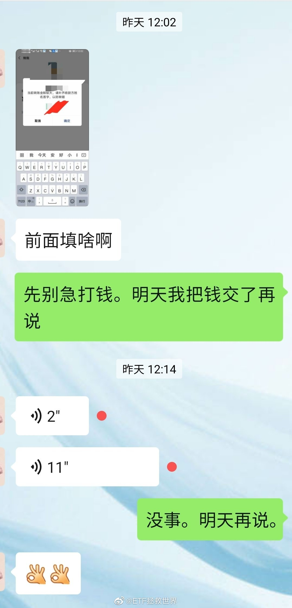 

## 2020-03-20 15:34

什么是舒服，就是昨天买了恒生就舒服。

什么是不舒服，就是昨天没买。

别管以后跌不跌，至少周末能舒服两天…… ​​​

## 2020-03-20 15:54

震惊，老板不务正业，soho中国暴涨34%。//@ETF拯救世界:震惊，潘石屹被程序员盗号了。

## 2020-03-20 17:52

… ​​​
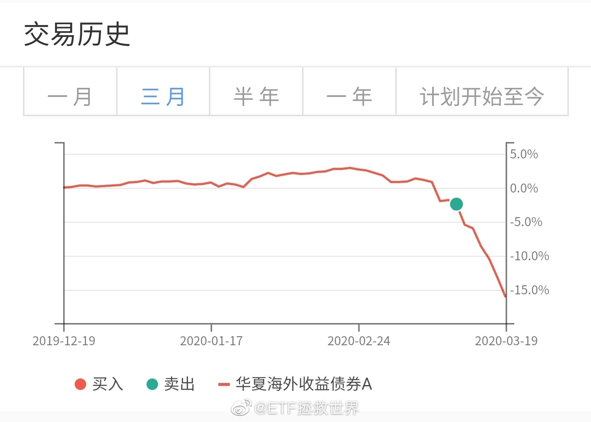

## 2020-03-20 19:58

今日新闻收藏：

“贵州茅台市值超可口可乐 五粮液超越百威”。

看了一下，上汽也超过奔驰 宝马了。 ​​​

## 2020-03-20 20:00

这新闻给哥看笑了。

## 2020-03-20 22:56

意思不大，洗洗睡吧 ​​​

## 2020-03-20 23:03

感觉西方除了股市都不是很在意病毒

## 2020-03-20 23:53

再说一次，我这里不欢迎小白。

我没精力，没义务，没兴趣给你普及金融知识。为什么要买，为什么这么走，你不要问，我不回答。这是我自己的投资计划，为什么要给你做解释？ ​​​

## 2020-03-21 10:09

昨天又跌了3%

## 2020-03-21 10:27

问原油类基金的，这是我们一直以来做的统计功课，免费送给你。

看得懂就看看，看不懂就别多说了。不喜欢原油以后你就别买，多大点事啊。 ​​​
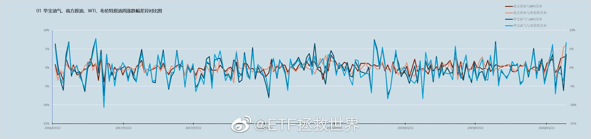 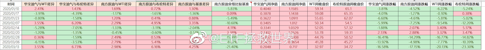

## 2020-03-23 10:17

一定要控制节奏。

## 2020-03-23 10:22

没有什么品种不会跌。如果别人跌的特别便宜，你还在高位，那么理性的投资者就会卖掉你去买便宜的。

所以最终大家都会跌。 ​​​

## 2020-03-23 13:33

看了一眼芯片指数基金跌了30%，心想有没有机会买点。

然后去看了看成分股估值，

90多倍。

行吧，打扰了。 ​​​

## 2020-03-23 14:49

什么时候买回来 ​​​
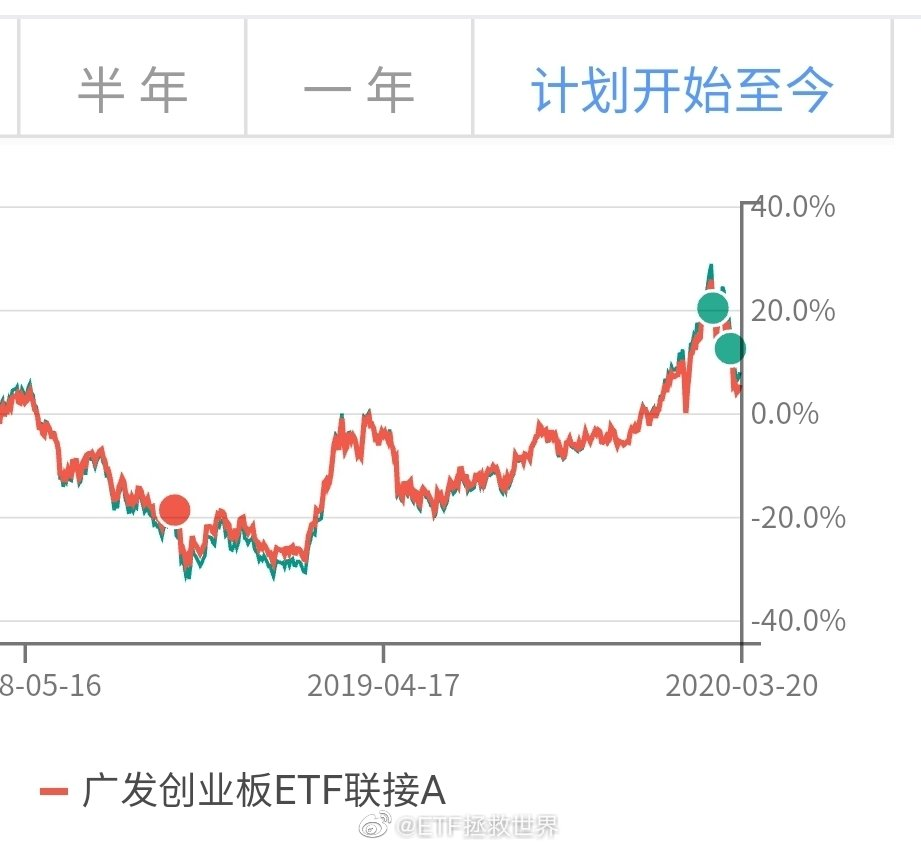

## 2020-03-23 14:56

有没有发现一件事。计划里面卖出的股票类指数，全部都能用更低的价格买回来。

有的时间长点，有的时间短点。 ​​​

## 2020-03-23 16:22

如果DAX有效跌破8200，那就是最强的一根支撑破掉了。再往下是多少很难判断了。

要是一定一定要给个点位，那就是6200周围。问题是，这也太低了吧！

不过综合最近40年美国和英国的指数走势看，极限跌幅确实还有30%。这个真的是极限了，如果还止不住，那可能就是要全面推倒重来了。 ​​​

## 2020-03-23 20:42

从过去美股100年历史看，在大幅下跌后买入，无一例外会赚大钱。大幅是多少？从历史看，50%-80%就一定是属于大幅，且真实发生过。但你不能预期未来一定还能跌这么多，所以在差不多的时候可以开始慢慢买。目前距离最高点跌幅35%。

很多人说危机。危机真的很可怕，但是在危机的后半段开始买入，历史上都不会错。我想，这次也大概率不会错。做好压力测试，以你能承受的节奏买入。

## 2020-03-24 08:54

什么玩意儿涨这么点就熔断了//@财联社APP:日经225指数期货上涨触发熔断机制。//@财联社APP:日经225指数高开高走，涨幅扩大至4.18%。

## 2020-03-24 13:39

好消息，跌了两天，已经降至85倍了。

## 2020-03-24 13:45

我其实有点好奇的，是高位那么多科技类指数基金成立，规模怎么也有几百亿了，他们是把谁的货接走了。 ​​​

## 2020-03-24 15:00

二月底开的条件单网格账户，目前浮亏2.3%。 ​​​
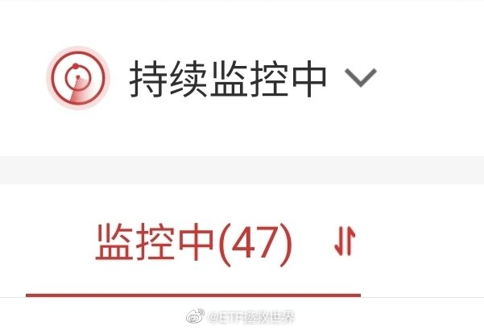

## 2020-03-24 16:07

DAX涨6%，目前9200。自低点8239反弹已经12%。大幅下跌后不反弹极其少见，即使29年也曾经大幅反弹。反弹之后何去何从就要继续观察了。

## 2020-03-24 16:25

感觉最近大家情绪都不高啊。怎么回事，有什么烦心事说出来听听。 ​​​

## 2020-03-24 17:57

刚才那个烦恼的帖子，评论里的情况大概分这么几类：

事业、情感、婚姻、健康、亲子、投资。

前五类我先不说，以后有空展开谈谈我自己的看法。浮于表面，入木三分。

最后的投资，我先说两句。

我说你们那些为了坐电梯，为了利润减少或者由盈转亏就伤心难过的，行不行啊你们。

A股，哪怕你是在盈亏线，或者稍微浮亏的。你知不知道现在只有2600多2700点？你的成本是2600点啊亲。你知不知道2015年第三轮计划以来，沪深300跌了20%，中证500跌了40%，你还赚钱啊。等它们回到原点你赚多少啊。就算回不去，你2600成本到底在烦什么？

美股、港股、欧洲。好嘛，买了一点，浮亏一点，不开心。你知不知道这几个是在真的钻石边缘了。除非世界崩溃，美国、欧洲、日本、中国，总不能一起完蛋吧？比一个月前低了30%多40%的价格让你拿到了，你还在难受？？？

你就这点出息了？万万没想到，关注我的人还有人因为2700赚的少了而难受。这是2700啊，不是7200！

## 2020-03-24 19:32

奥运会顺延一年，欧洲杯顺延一年，为什么股市不能顺延一年？

我建议，明年年初，全球所有交易所把每个投资者的账户重置到今年年初，然后把所有股票价格和指数点位也重置，这样大家的财富都没损失，反正就是电脑系统操作一下的事儿。 ​​​

## 2020-03-24 19:33

日经225市值排名前二十的公司。说实话，大多数我还挺喜欢的。

第九的迅销就是优衣库。 ​​​
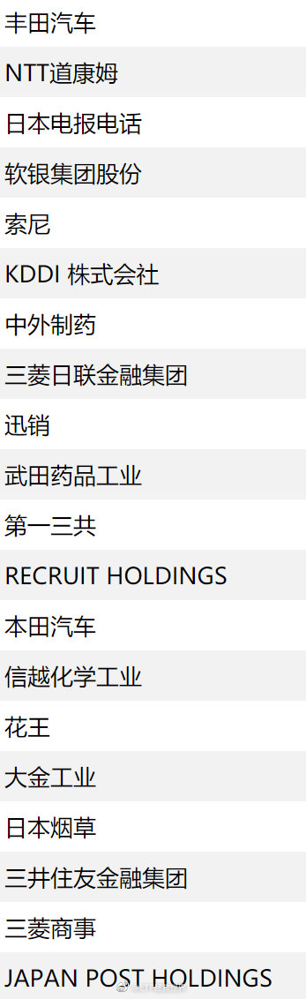

## 2020-03-24 19:49

说起时间重置，想起小时候看过的一部日剧，《重返少年时》

男主的时间总是重置的故事，印象很深。他的记忆还在，所以买股票什么的发财了。

剧情什么的虽然好但最重要的是看完之后我就粉了仲间由纪惠几年…… ​​​

## 2020-03-24 20:34

不过说实话，各位手里始终应该保留一些现金类资产，其中一部分最好还是以美元形式存在。

这部分肯定不会有太好的收益，但是备一点总是没有坏处的。 ​​​

## 2020-03-24 21:20

7%了//@ETF拯救世界: DAX涨6%，目前9200。自低点8239反弹已经12%。大幅下跌后不反弹极其少见，即使29年也曾经大幅反弹。反弹之后何去何从就要继续观察了。

## 2020-03-24 21:44

即使有上涨，也暂时不要想太多反转之类的。先看反弹吧。 ​​​

## 2020-03-25 00:06

9%。你敢10%收盘让我开开眼，下次换车还支持你//@ETF拯救世界:7%了//@ETF拯救世界: DAX涨6%，目前9200。自低点8239反弹已经12%。大幅下跌后不反弹极其少见，即使29年也曾经大幅反弹。反弹之后何去何从就要继续观察了。

## 2020-03-25 01:27

为了卖辆车，大可不必。//@ETF拯救世界:9%。你敢10%收盘让我开开眼，下次换车还支持你//@ETF拯救世界:7%了//@ETF拯救世界: DAX涨6%，目前9200。自低点8239反弹已经12%。大幅下跌后不反弹极其少见，即使29年也曾经大幅反弹。反弹之后何去何从就要继续观察了。

## 2020-03-25 07:49

现在暂时依然是这个观点。

## 2020-03-25 08:12

有一个预感不知道对不对，今天条件单服务器可能要崩…

## 2020-03-25 08:30

上周最后一次买入，时间太紧，150和S各少买了一个东西。值得深刻反思。

可能需要更加强力的统计支持力度。 ​​​

## 2020-03-25 08:47

回复@ETF拯救世界之观海听涛:美股这个级别波动，上次是1929-1932。//@ETF拯救世界之观海听涛:E大，全球指数巨幅震荡的情况，历史上发生的次数多吗？

## 2020-03-25 09:01

还说这个世界上没有超越目前科学能够理解的力量？

## 2020-03-25 09:19

//@caozenghui: //@小章鱼Iris:很棒的视频。谢谢每一个站出来的人，也谢谢带来这支视频的人 Merci de faire cette vidéo.

## 2020-03-25 09:23

友情提示：

如果ETF在9:25集合竞价的时候折溢价过多，即使到了你的条件价位，也可以暂停条件单。等待价格回到合理的水平再重开，这样可以增加一部分利润。

当然，不暂停也没有任何问题。 ​​​

## 2020-03-25 09:54

收回一部分资金，安全垫更厚了，胸前的红领巾更鲜艳了。 ​​​

## 2020-03-25 11:23

再找1-2位小助理

一年多前曾经发过一个招聘启事，找兼职小助理。后来经过三轮筛选，定了四位。这一年多来，这四位，包括之前的初代小助理，都非常认真、负责。我非常满意，大家也相处融洽。

现在工作量越来越大，几位小助理本身的生活情况也都在发生变化，所以人手不够了。需要再找一两位帮忙。

我把之前的招聘启事贴出来，觉得合适的可以试试。

但是，我一定要说几点，请一定要看清楚再发邮件应聘。否则又是一两千人发邮件我压力太大。

第一，工作时间。与之前的条件不同，目前有可能白天有不少工作。主要都是excel表格处理，大多数时间是上午会占用1-3个小时。所以，不适合本身工作繁忙的人。如果你工作清闲，或者干脆这段时间在家赋闲那是最好。另外图片里说“在校大学生”，经过上次的招聘，我发现大学生可能不适合。sorry，没有别的意思，确实不是很合适。所以在校的朋友就别发了。

第二，一定要能相对长期做下去，至少一年吧。我不希望不稳定。

第三，excel水平至少在“不错”以上，更重要的是一定一定要认真、仔细、有责任心。大量工作都是与数字有关，所以这个非常重要。

以上三条，加上图片里之前的招聘条件，如果你觉得自己哪怕有一点不合适，就别写应聘邮件，真的，节省大家时间。

发邮件的时候附上能体现你工作能力和水平的东西吧。

谢谢大家的支持。

另外，申请邮箱也改了，发应聘邮件到这里：etfjob@163.com  如果还是发到图片里的之前的邮箱就等于自动放弃机会了，因为你不够认真……

还有，没通过的朋友我就不发信说明了，进入下一轮的朋友我会联系你。没联系到的朋友，不好意思了……
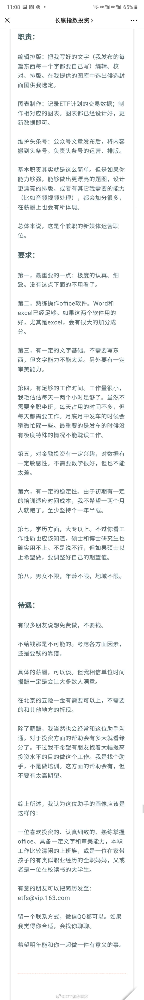

## 2020-03-25 12:33

玉林有个情杀案，微博我就不转了，图片容易引起不适。

一定要拒绝黄赌毒，否则容易出事。

尽量洁身自好，除非实在控制不了……那也要再挣扎挣扎控制一下。 ​​​

## 2020-03-25 14:20

150的卖出，是因为需要资金买更好的东西。

S不卖，是因为无限现金流不需要卖，而且S还有之前省下的20多份储备资金根本没用。

在我这里，你永远不要说“没钱了”。不存在。 ​​​

## 2020-03-25 14:35

有人私信和评论我，嫌我脾气不好，说话不客气。

呵呵呵呵。对啊，我脾气不好，你赶紧走好吗。我不需要你关注，真的不需要。

你赶紧去找对你温柔的，说话客客气气的去关注好吗？相信我，如果你再交点钱买个课什么的，你得到的服务更好。

没有人是完美的人。我缺点很多，有些我愿意尽量改，有些我不愿意。至于在微博对某些人态度不好，我根本就不认为是缺点，所以，你赶紧消失好吗。

这是我自己的微博，只要我遵纪守法，遵守微博社区规定，你管得着我用什么态度说话吗？服了。有要求别人这个那个的时间，你先把对自己的要求提高点。

## 2020-03-25 16:30

不说你不知道，DAX已经反弹22%了。 ​​​

## 2020-03-25 17:47

美股现在确实不贵，但说接近08年金融危机时候水平不能同意。现在15，当时最低到过11以下。

## 2020-03-25 17:54

虽然对涨跌没有特别的情绪和希望，但我还是很希望欧美能再涨两天，让我的波段仓位能再出点…… ​​​

## 2020-03-25 18:44

女王怎么办。

## 2020-03-26 08:27

现在新闻媒体真的可以。昨天桥水倒了，今天桥水做空赚几十亿美元。

人家桥水是在欧洲做对冲，减少在多头上的损失。没你当初说的那么差，也没现在你说的这么NB。

这一把下来桥水毛估估也是损失一两百亿美元了。 ​​​

## 2020-03-26 09:58

$全指医药 sh000991$   感觉有被针对 ​​​

## 2020-03-26 10:07

疯了，恒生再涨1厘不可以吗？

大家挂单要散开啊，不要挂在一起，谁也成交不了啊。 ​​​

## 2020-03-26 10:21

困扰大多数投资人的无非就是几个痛点：

第一：什么时候入场，什么时候出场。

第二：长线持仓等着赚大钱，但是行情不断上下不断坐电梯怎么办。利润来了又走又来又走好难受。

第三：做波段有了利润就收割很舒服。但是卖了就涨清仓以后一飞冲天大牛市赚不了几个大子怎么办。

想办法解决这几个痛点，舒舒服服躺着赚钱就ok。

其它的努力无非是术的进阶。

## 2020-03-26 10:39

观察一个指数，食品饮料。

在我的趋势系统中，这个指数“应该”走弱已经9个月，但事实上，9个月来它并没有跌。而是几乎原地踏步几乎没有涨跌。

后续它怎么走，就非常有意思。要么就是我的系统有问题，我就会想办法改进。要么就是另一种情况。

提醒你：我不是看多或者看空，而是说出这个有意思的现象大家可以一起观察。因为这个在我的系统中是很反常的现象。

## 2020-03-26 11:10

ok了。下午更新表格，会有变化。

## 2020-03-26 14:08

今天意思不大，散了吧。 ​​​

## 2020-03-27 09:37

华宝单品种的“历史交易”功能太贴心了…刚发现的… ​​​

## 2020-03-27 09:49

我说的是这个地方，下面还会有这个品种的成交记录。别的券商好像没发现 查看图片

## 2020-03-27 10:25

初筛简历的小助理快崩溃了，越看越多。看了两天还有500多封未读。 ​​​

## 2020-03-27 10:29

看了这个我想对那个要矿泉水的女孩说声对不起。

## 2020-03-27 10:35

其实很多时候，你对外人再好，他回去了也不一定说你好话。甚至一转身反咬一口也不新鲜。农夫与蛇。

对自己人好一点是最重要的。

说句不好听的，很多人骨子里就觉得洋大人高人一等。洋大人夸一句就沾沾自喜，骂一句就哆哆嗦嗦，没必要。

咱们自己的日子过好了比什么都强，让自己人舒舒服服，开开心心，自然国泰民安。

夫妻离婚的多了，有几个是被外人打散的？还不是自己两个内部有问题才分手。延伸一下也是如此。

人家来了就是客人，热情周到，没错。但是别超国民待遇，对内对外一视同仁就够了。

## 2020-03-27 11:12

说到孩子的择偶我管不管，可能提问的人并不了解我对孩子的态度。

我认为，孩子是一个独立的个体。他不是我的附属。等他成年后，建立了相对成熟的三观，他的事情就可以自己做主。要做什么工作，要跟什么人谈恋爱，要和什么人结婚，那是他的事。我当然会有自己的意见和建议，但只是告诉他，给他参考，绝不会强迫他。

当然，如果我发现他要结婚的对象有明显的问题，比如道德品质极差，又或者是有极度不良嗜好，我会反对。而且是强烈反对。但也只是反对而已，不会进一步强制不允许。但这种时候，我会把我的财富看紧，不会随意交给儿子，因为这样会害了他。

目前的想法大概是这样。

## 2020-03-27 11:27

150仓位，很舒服，你舒服吗。

成熟市场还是少，希望再来一波再加点。 ​​​
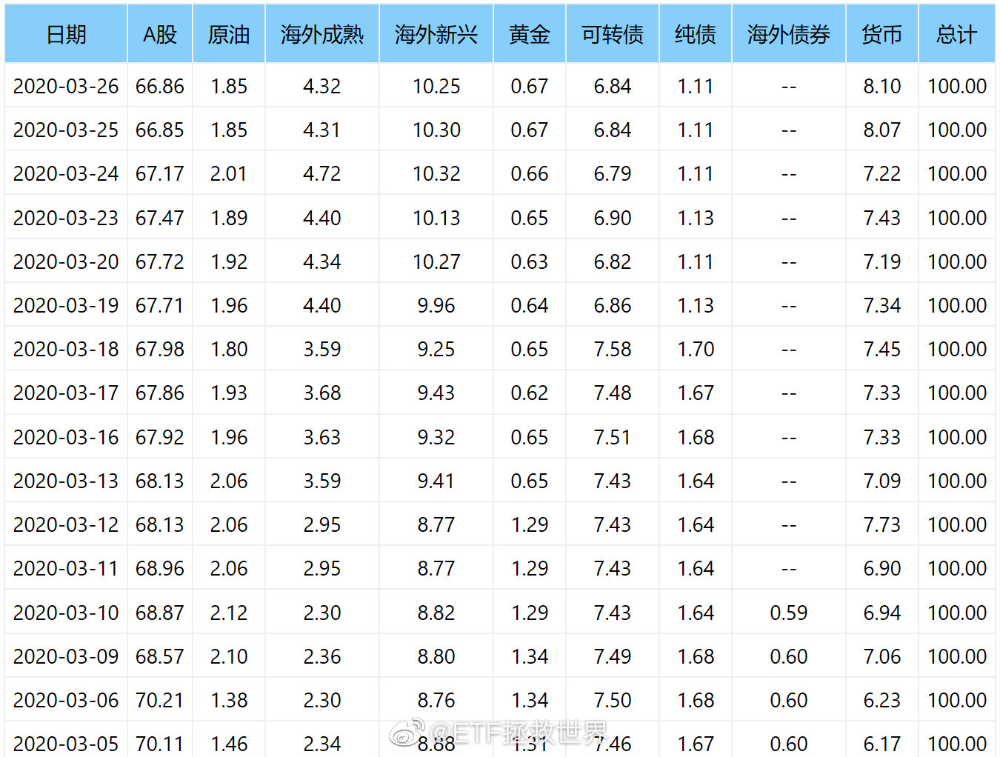

## 2020-03-27 14:26

我从来不相信“踏空”这个说法。只要你有钱，总有一天能买到想买的东西。资本市场上机会无穷无尽，还怕没机会？

怕的是机会来了你没钱了。 ​​​

## 2020-03-27 15:55

对面的情况越严重，以后甩锅给我们的动力越强。关系会越来越差。 ​​​

## 2020-03-27 23:25

决定这个周末不上微博，不看新闻。闹心。

100级到150级难多了。 ​​​
 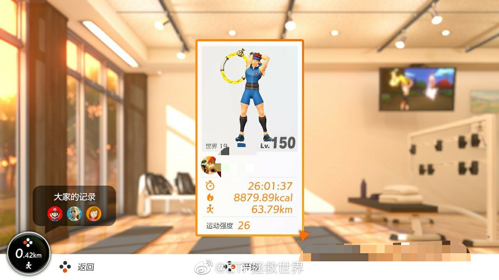 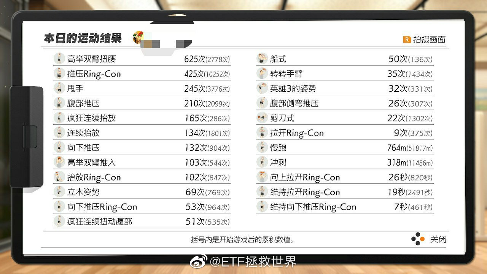

## 2020-03-28 17:49

今天刚看到之前有人在评论里说网格表格错了。我解释一下。

没错。

首先看第一张说明。说明上已经说的很清楚了：

黄色是本次操作。白色为本次操作后立即设置的条件单。

再看第二张表格。

对于之前已经在0.816买入的朋友来说，今天在0.867出掉了。你当然不需要再次买回，而是要继续按照表格中的白色再次设置0.816的买入。

对于那些说表格错误的朋友，请好好看看你的历史交易记录，是不是0.867买入的那网已经买过了？买过了还没出掉你怎么会再买一次？

这个表格更新的意义，是告诉你，你之前一直在交易，那么你今天0.867出了0.816买入的，目前价位回到了0.85区间，好，马上再去设置0.8区间0.816再次买入即可。如果你不懂，说明你根本没弄清楚这个策略的原理，请去认真看看那几篇东西。

对于第一次交易的朋友，买入黄色然后再设置白色即可。

如果哪位觉得这个表格设计的有问题，可以把你的建议提出来。可以就用这个品种举例，你来做一个表格，清晰明白的说清楚应该怎么交易。如果我觉得谁设计得更好，被我采用，我会有礼物送出。
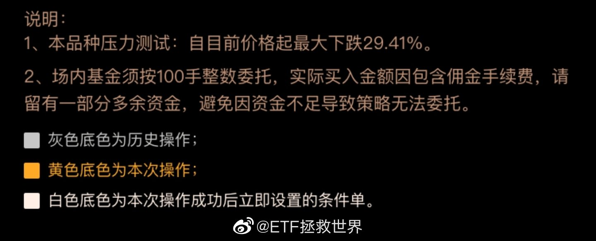 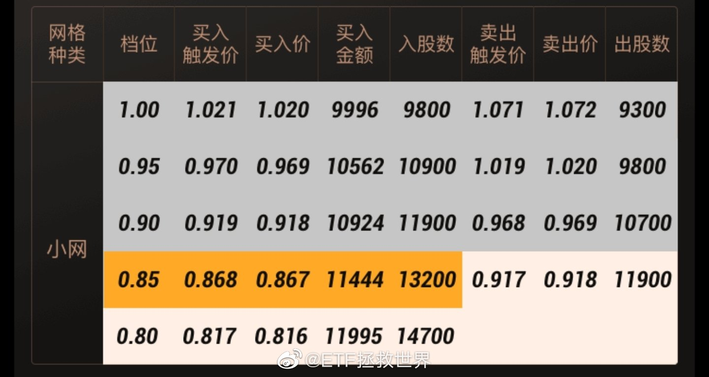

## 2020-03-29 12:31

特别希望有一天我们的护士也能开奥迪上班。

## 2020-03-29 12:46

回复@萌巴哥元宝与呆巴哥喜蛋:哈哈哈哈哈哈哈。看到这条我真的笑了。祝你今后的生活能过的稍微顺心一点吧。//@萌巴哥元宝与呆巴哥喜蛋:我们的护士为什么要开奥迪上班，你歧视国产车啊？跪久了起不来了是吗//@ETF拯救世界:特别希望有一天我们的护士也能开奥迪上班。

## 2020-03-29 23:09

天下大乱的时候，每一条新闻、消息、文字，都应该更加审慎的对待。如果确实感兴趣，就多找几个信源多几个角度看看。

说实话，现在微博上任何消息我都不信了。或者说，在互联网看到的任何信息，都不会马上相信了。 ​​​

## 2020-03-29 23:17

回复@美人鱼丸-:你，还有129个给你点赞的，我不怕麻烦，全部拉黑。观点不同很正常，张嘴就喷粪你还是个人吗，你是粪车吧。//@美人鱼丸-:真特么有病 你不反过来想想在英国开奥迪才上得起医科大学//@ETF拯救世界:特别希望有一天我们的护士也能开奥迪上班。

## 2020-03-29 23:35

重新设置了评论门槛，关注低于100天的朋友不能评论了。

感觉一下子会清净很多。反正之前一条微博一两千的评论也看不过来…… ​​​
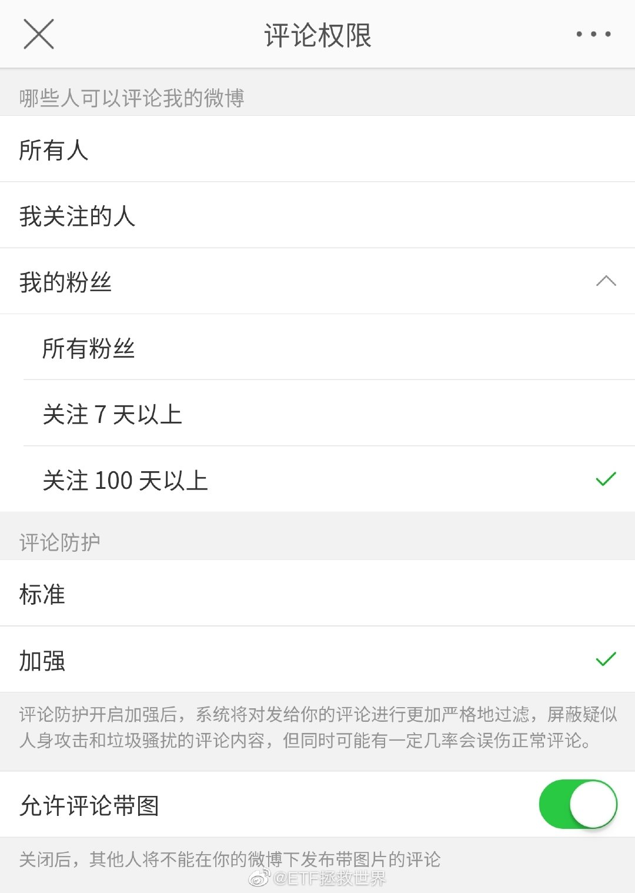

## 2020-03-30 09:09

“中证科技动量”翻译成白话的意思就是在科技股上追涨杀跌的指数。

## 2020-03-30 09:16

？？？？？？？

## 2020-03-30 09:46

日、美、欧QDII ETF/LOF都已经折价了。说明大家是真的不看好啊。之前都大幅溢价。 ​​​

## 2020-03-30 10:10

谁再怀疑达尔文就把这张图扔给他。

## 2020-03-30 10:27

有些亚洲时间段QDII ETF的做市商是辣鸡。欧美隔夜你大幅折溢价就算了，亚洲段都是实时的你也弄这么大折溢价，要你做市何用？ ​​​

## 2020-03-30 10:51

风险继续释放，不到80倍了！//@ETF拯救世界:好消息，跌了两天，已经降至85倍了。

## 2020-03-30 14:00

今天日元/人民币大幅上涨。 ​​​

## 2020-03-30 14:49

今天就这样吧。没有交易欲望，索然无味。下个月第一次发车也是随机的，不一定哪天了。

主要原因是目前各市场趋势不好，距离上次买入空间不够，不急，再看看。 ​​​

## 2020-03-31 09:32

提款 ​​​

## 2020-03-31 09:57

同一个区间利润积累多了，就可以逐渐加大留存数量，为以后赚大钱多积累一些0成本的种子。

赚钱就是那么点事儿，低买高卖。用机械化的程序规范你的交易，克服恐惧和贪婪，不就成了吗。 ​​​

## 2020-03-31 10:35

有没有体会到一丢丢舒服的感觉。

涨跌都舒服内种。 ​​​

## 2020-03-31 21:20

刚看了一下记账软件，家里前三个月消费支出比去年减少了27%。

这样不行，要多买点东西支持国家提振内需。

明天打算看看罗老师的直播，看看有没有便宜划算的东西下手……就算买不到，就当听相声吧。 ​​​

