## 2020-04-01 10:16

综合考虑到目前仓位以及大环境等各方面因素，还是决定要么等空间，要么等趋势。所以月初一车还是暂时不发了。

保持舒服的状态。 ​​​

## 2020-04-01 14:45

分时会骗人，但是K线的中期趋势一般不会。  在股市，理性确实比感性有用。

## 2020-04-01 14:51

晚上看罗老师直播的时候，我会同时打开值得买。如果有想买的东西，会搜一下历史低价，再看看值友们的评论。

没办法，我是个直男价投。如果我发现自己买东西价格没买在历史底部区域，心里会不舒服……

这跟有多少钱没关系，跟省多少钱也没关系，这类似于一个游戏吧。找便宜游戏。 ​​​

## 2020-04-01 18:49

刚才看了一下，几个月过去，最下面的极限点位17000已经上升至17500左右。更容易达到了。//@ETF拯救世界:再给一个点位。如果真的搞大，让恒生崩到21000以下，是非常非常好的买入机会。我给个极限点位17000。万一真的到了，一把配满恒生指数，从那里算，不赚60个巴仙不再看。

## 2020-04-01 21:53

第一次看带货直播，下次应该也不会再看了……还是看美股去吧…… ​​​

## 2020-04-01 22:13

喷了，只要值得买搜：低过老罗 …………哈哈哈

## 2020-04-02 09:13

美股只在最低点买了一份，你以为在等什么。 ​​​

## 2020-04-02 09:30

日经又开始溢价了。神经病啊。 ​​​

## 2020-04-02 09:32

再说一次，看看你的账户，想象一下下跌30%，上涨50%会不会难受。会的话调整到不难受为止。

最好每周审视一下。那就是最适合你的仓位。 ​​​

## 2020-04-02 10:27

3.12日用油气换160416的朋友，不必着急换回去。目前油气依然溢价超过40%，而416几乎没有溢价。目前持有即可。 ​​​​

## 2020-04-02 12:24

咖啡味儿酸奶不好喝，89块钱的65w口红充电器不错。

首批测评。

以上。 ​​​

## 2020-04-02 13:19

怎么“粉丝可见”也不行了吗。我说的是持有即可，不要去追啊 ​​​

## 2020-04-02 14:06

消息灵通的说说真的假的。//@椒图火象:

## 2020-04-02 14:15

人这一辈子，20多岁开始，做投资几十年，即使一开始就买不会死的品种，即使绝大多数投入都是成功的，也难免买到跌幅不小的。

一般来说我们这个体系很难因为某一个品种跌幅大就崩溃，因为已经体系保证了不会单一品种仓位过大。然而即使仓位小，暴跌后也不应该慌乱。

不能心里发慌眼睛一闭挥刀一斩从此眼不见心不烦。也不能不顾体系约束越买越多试图用大量资金摊低成本。

首先心不能乱。因为它并不会是重仓，所以你不必乱。

第二要严格遵守体系规则，设计给它多大的仓位就是多大，不能随心所欲。

第三不能放弃。要利用各种方法把它玩盈利了。各种套利，各种技能都用上。

今天的浮亏不代表未来赚不到钱。只要这个浮亏不会把你弄死，你就有机会更强大。

人的肌肉是怎么变大的？是不断的撕裂，不断的恢复，才能不断的变大。你也一样，失败和挫折带给你的不应该是意志消沉以及怨天尤人，而应该是思考自己做错了什么，如何弥补，以后如何避免，如何做得更好，从而越发强大。

失败是财富，只有失败才能让你成长的更快。当然，大多数人不会因为失败成长，所以他们永远不会成功。

## 2020-04-02 14:44

我几乎从来不分析单独的基金品种，不信你可以搜索一下我的雪球和微博历史发言。有时候提到，也是当时会有一些交易机会，做个提示，并不会长篇大论说谁好，推荐谁或者不推荐谁。

这样做有两个原因，第一个是怕有人说我和基金公司有猫腻。第二个是怕误导各位。

所以我几乎不分析，不评价任何基金品种，只在组合里给它们我认为合适的仓位。

所以现在我也不想讨论任何品种。但有一点我提醒大家注意。

无论是你看到任何消息，与你手中品种有关的，如果你觉得很重要，那就要认真去研究这个消息的真实性，以及会对你的品种造成什么影响。万万不可以人云亦云，尤其是在暴涨暴跌之后。

如果你很容易被别人的情绪和言论影响，你就要认真对待这个问题。要么是认真研究别人说的对不对，要么是闭上眼睛关上耳朵不看不听。否则你很容易被错误的言论误导，最终做出容易后悔的选择。

## 2020-04-02 14:55

举个例子吧。

大家都知道我那次“捷达换宝马”的操作。2008年一辆捷达资金的买入，最终在上汽上面收获了不止一辆宝马的利润。

对于那次操作，各位可以去看当时的记录，没什么好说的。只是有一点我几乎没有说过，但是记忆异常深刻，在这里分享。

2009年初，那时候我已经买了很多上汽。但是就在那个风雨飘摇的日子里，又一则大利空爆出。当时上汽收购的H国双龙工会开始指控上汽，并到法院提起诉讼。要知道当时汽车业风雨飘摇，利润大降，上汽从30多跌到了5块钱（我记得很清楚，因为我朋友30成本，我6块买入，开玩笑跟他说你回本的时候我赚5倍，扎心了。）

当时情况如此糟糕，又碰上诉讼，雪上加霜。我心里也几乎有了一点动摇，想，是不是卖了以后更低再买回来。当然，最终没有动。

谁能想到，那次诉讼正是起飞的号角。

具体时间我忘了，感兴趣的朋友可以去查一查，看看我的记忆是否正确。

大幅下跌后，利空可能是压倒骆驼的稻草，也可能是黎明前最黑的黑暗。

我只是分享经历，不代表任何具体操作观点。

## 2020-04-02 22:40

不知道为什么，今天很多人慌张的问：有石油开采公司申请破产了，是不是石油类基金都彻底完蛋了，要割肉吗？我就想起了这段往事。

## 2020-04-03 09:53

数据错误，并非历史最低

## 2020-04-03 10:10

油气换到416的部分，如果你一直在油气做网格，也需要算好幅度，该出网就出网。

走得再久，也不要忘了出发前的目标。 ​​​​

## 2020-04-03 11:03

不得不说，西方男人追求姑娘的时候，整体上真的比我们嘴甜，说文雅点就是更浪漫……

那天在YT偶尔刷出一个FTM的唱歌视频，下面有个老外的英文评论当时我就震惊了，翻译过来大致是：

“什么？你问我唱的好不好？天呐，这简直是我听过最美妙的声音。你唱的歌曲里面，有我喜欢的，也有我不喜欢的。但是由你唱出来，全部都变成了我最喜欢的歌！”

喷了，试想哪个姑娘听了这样的奉承会不高兴。学到了新的知识点，夸人要这么夸：

有些XX是我喜欢的，有些XX是我不喜欢的，但只要是你的，突然间都让我喜欢的爱不释手，超级喜欢。

追女孩的哥们，试试下次这么用一下。但是注意要不留痕迹，不要刻意，适时使用。

## 2020-04-03 11:27

回复@ETF拯救了我:我不建议骗。就是不建议把别人的缺点硬吹成优点。而是要发现别人身上的闪光点，然后用让别人开心的方式表达出来。最重要是真诚。真诚与否一眼就能看出来。

## 2020-04-03 14:42

最高价卖出，第三天打折接回，这个效率还可以。 ​​​

## 2020-04-03 17:51

很多人担心瑞幸会对中概股整体有影响。有影响是正常的，但我并不太悲观。

第一，如果中概股整体被打压，给我们低价买入的机会不是正好。

第二，如果持续被压制出问题，促成中概加速回国内上市不更是好事？ ​​​

## 2020-04-03 19:28

今晚自己烤鱼吃。

有点内味儿了。 ​​​
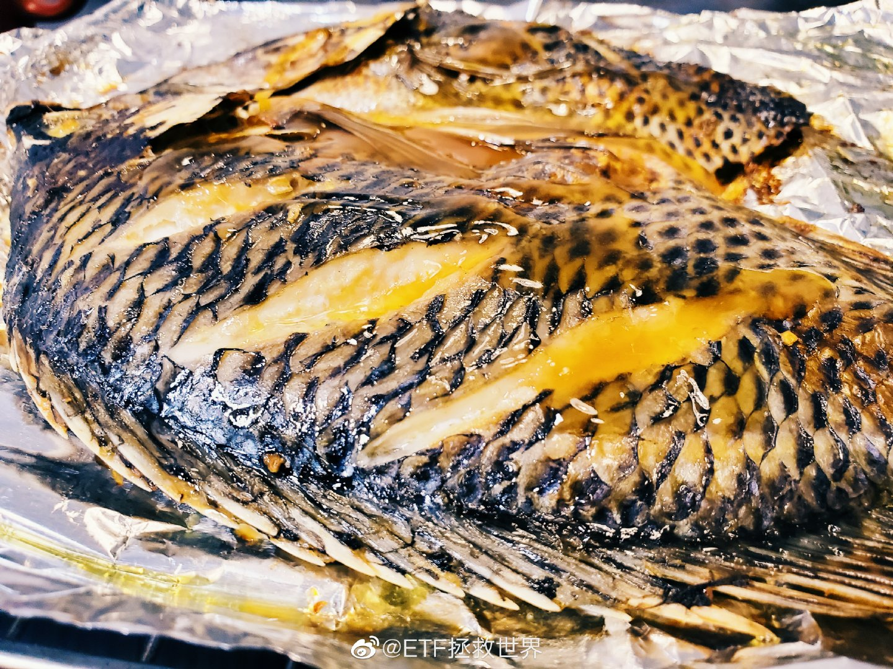

## 2020-04-03 22:34

美国和欧洲会不会跌破前低很关键 ​​​

## 2020-04-04 00:13

愿逝者安息，天佑中华。 ​​​

## 2020-04-05 11:02

2020.4.5   晴   12℃

今日计划：

做研究；写东西；健身环；断食24小时；思考一件事；看一本日本推理小说。 ​​​

## 2020-04-05 13:42

最近一段时间看微博，发现关注的绝大多数做投资的人，三观都挺正的。在大是大非面前，屁股不歪。

但是有些这几年红的，或者是曾经红过的“宏观经济大师”，什么事儿都能说两句的经济专家发表的某些言论，就让人非常反感。不是说不能批评，你不能颠倒黑白肆意抹黑。

以前我觉得以后孩子学什么都无所谓。但现在我有点改变，觉得还是适当引导他学理工。当然不会强求，只是适当引导，并结合他自己的兴趣。因为我发现有些写东西的人，除了用手上的一支笔给世界添乱，对人类进步做不了什么贡献。

我有个朋友跟我说，他几年前刚开始FQ出去的时候，看到一些在海外的华人开个YT视频，说一些之前他很少听过得东西，觉得很有道理。后来越听越不对劲，发现无论我们做什么，他们都会骂，很多事情非常明显的颠倒黑白，无时无刻不在唱衰我们。然后这些人的关注量越来越大，然后就让大家加入他们的会员。我这个朋友跟我说，他明白了，都是生意。

我也不知道他说的对不对，反正我没看过。你们要觉得他说的不对可以骂他，我会转告他。

## 2020-04-05 14:19

屯不屯粮食我不做建议，谁知道未来会怎样，买几袋放家里也没什么所谓，真空包装保质期也有一两年。但这位博主说的，关于浪费粮食的事情我非常赞同。先不要讨论粮食紧缺不紧缺，在座的每位能不能从今天开始把所有买的，做的食物吃干净不要浪费？做到这一点就等于粮食产量增加20%吧。

## 2020-04-05 16:15

其实人生的乐趣之一，就是享受那些好的产品带来的愉悦感。

很有意思的，是有些最好的产品其实花不了多少钱。比如平常写字的中性笔，好像也叫签字笔的。

之前被带货的那款，10支9.9，确实真的便宜，好用不好用我也不知道，没用过。但实际上，公认的几乎是最好用的中性笔，也就十块钱左右一支。一般人，除非要写很多字的人，花10块钱买一只特别好用的笔，写字的时候享受顺滑的乐趣，值不值？我觉得很值。这支10块钱的，最好用的笔也许就能用好多年。

同理还有很多东西也是如此。在力所能及的范围内，享受这个世界上最好，或者是非常好的东西或者服务，其实非常有乐趣。

## 2020-04-05 23:56

看完了。3.5分吧。 ​​​
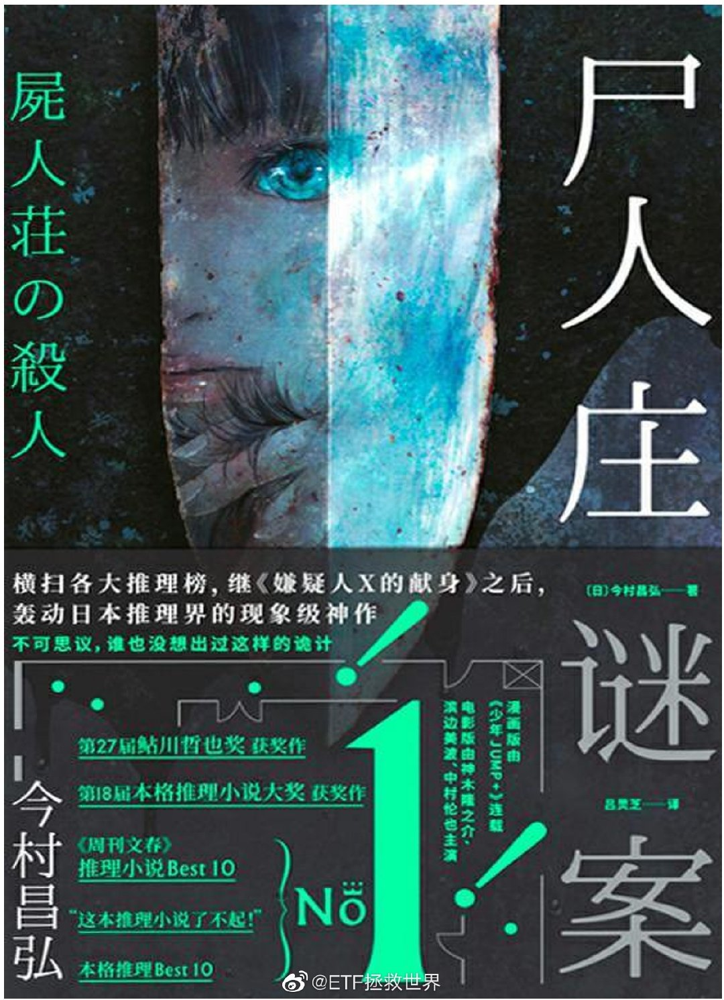

## 2020-04-06 16:15

一天又卖？

## 2020-04-06 16:48

逆行扣3分，骂人能不能算寻衅滋事扣9分？

## 2020-04-06 22:29

多大点事儿啊。 ​​​

## 2020-04-07 08:49

感觉这个病毒是有智慧的而且挺要面子——

你看不起我，我就给你颜色看看。你觉得我好欺负想要群体免疫，我就让你的BOSS进ICU。 

希望首相大人没事，希望中英友好。 ​​​

## 2020-04-07 09:16

某些etf的做市商，我劝你善良。不要搞太大折价。 ​​​

## 2020-04-07 09:33

现在是不是有了更深的体会。

## 2020-04-07 09:46

有些只差一两厘没有成交的朋友，可能心情会比较沮丧，觉得不舒服。

这种事情，别说三分钟，一秒钟都不要沮丧。要不就坦然接受，要不就马上考虑后续怎么修正你自己的策略。是挂低一点，还是定个规则，比如几厘之内改手动。

慢慢的，适合你自己的策略就成型了。

沮丧，失望有什么用？P用都没有。这是命运给你进步的机会，给你完善你策略的机会。懂的伐？

## 2020-04-07 18:38

海豚很聪明。所以我总有一种感觉，它们被关在水族馆一定比其它动物痛苦。

## 2020-04-08 09:34

17岁的时候喜欢喝摩卡、拿铁、星冰乐。

18岁了只喜欢黑咖啡。 ​​​

## 2020-04-08 11:13

说真的，我特别支持每个人都有自己不同的思想。既然不同，那就一定有比较偏激的，有并不客观的。我认为都无所谓，那才是正常的。众口一词并不是什么好事。

但是，必须是表达自己的真实思维。如果一开始就为了达到目的编造谎言，就不能接受。

如果不能表达你的真实想法，可以闭嘴不说。为了达到目的说谎让人感到恶心。

表达主观想法，不正确（很多事情也没有绝对正确），可以接受。为了达到目的扭曲主观认识编造谎言，不能接受。

## 2020-04-08 11:31

回复@gaojialiang1:你在你自己微博骂我，我不会去你微博回骂啊。你随便骂。就像你可以在你家跟你媳妇说我的孩子难看。但你天天蹲我家门口对我说：“你儿子真难看，怎么这么难看，太难看了，中国最难看。”我还不能轰你走？//@gaojialiang1:同意，但有人骂你你不也拉黑他吗

## 2020-04-08 11:43

虽然有些专利很水，但量变到质变是可以期待的。

## 2020-04-08 13:06

上上下下不停的吃真的会感到不好意思

## 2020-04-08 13:06

今晚做个天妇罗。 ​​​

## 2020-04-08 13:26

看到在座的各位都挣钱是我最高兴的事。

真心的。 ​​​

## 2020-04-08 14:15

做波段并不只是为了吃区间利润。也有另一个目的，即你买的品种趋势不好，中期会下跌。但下跌并非一路跌到底，中间会有无数反弹。

你把反弹利润吃到了，你的安全垫就加厚了。当品种持续下跌后，你买了很多筹码，但由于过程中不断吃反弹利润，成本持续降低，最终在底部区间你只是极少浮亏甚至没有浮亏。

这也是吃波段的目的之一。

举例来说，看看你的品种，距离第一次买的时候可能跌了不少。然而你却是赚钱状态，持仓量也比一开始大了很多。就是这个意思。

## 2020-04-08 16:44

里面有好东西。

## 2020-04-08 19:25

韩寒38了，看看这个身材，你还有什么理由不爬起来锻炼。//@落魄的三叔: 一方锻炼，八方点赞。//@月半日寸厨房:我要不要挑战一下？我年轻时五公里跑轻松进18分。现在轻松进40分。顺便减肥。点赞够100，我今年10月份吧，交作业。18分40吧。//@我没在石棱中:以前就是短跑运动员～三重门写的好像

## 2020-04-08 19:55

消费又出爆款了。规律是什么来的？ ​​​

## 2020-04-08 22:48

看看湖北的朋友怎么说。

## 2020-04-09 09:07

再看看，那天是不是最低//@ETF拯救世界:不知道为什么，今天很多人慌张的问：有石油开采公司申请破产了，是不是石油类基金都彻底完蛋了，要割肉吗？我就想起了这段往事。

## 2020-04-09 09:12

很多时候你绝望了，也再坚持一下，也许希望就在一秒后。

有空再看看《迷雾》 ​​​

## 2020-04-09 09:39

如果上个月场内油气换416，不做套利目前账面收益率大概是这样。套利的话可以上50%

如果没有换基本上没动。 ​​​
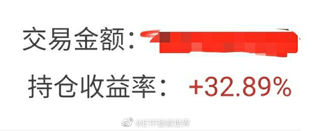

## 2020-04-09 10:35

最新数据，全指医药已经不再便宜。持仓的拿住，最好不要再买了。 ​​​

## 2020-04-09 11:02

上方第一个压力位11600

## 2020-04-09 11:42

今天意思不大，是不是就先散了。 ​​​

## 2020-04-09 13:21

不好意思我又回来了。

有一件挺感动的事儿。之前公众号拿到礼物的有一位“可爱的嘟嘟”，她跟我说，愿意把礼品转送给昨天在微博评论里的那位武汉博友 @PS晴晴 。 我答应了，那我就把airpods 2 耳机送给这位博友。我也会另外再送小礼物给可爱的嘟嘟。

每当我觉得这个世界黑暗的时候，总会有一些善良的人让我重燃希望。

由衷地说一句，这些年在网上遇到的绝大多数朋友，都温和、有礼，让人很舒服。因为我平时太忙，所以有时候跟大家交流会很简短，显得有点冷漠，还望谅解。

请@PS晴晴 私信我，告诉我地址，我把早就准备好的耳机寄过去。真的很不错的耳机，用了就离不开的那种。希望你喜欢。以后要戴着这个耳机听我精选的BGM啊。

加油，you are not alone，湖北的朋友们。
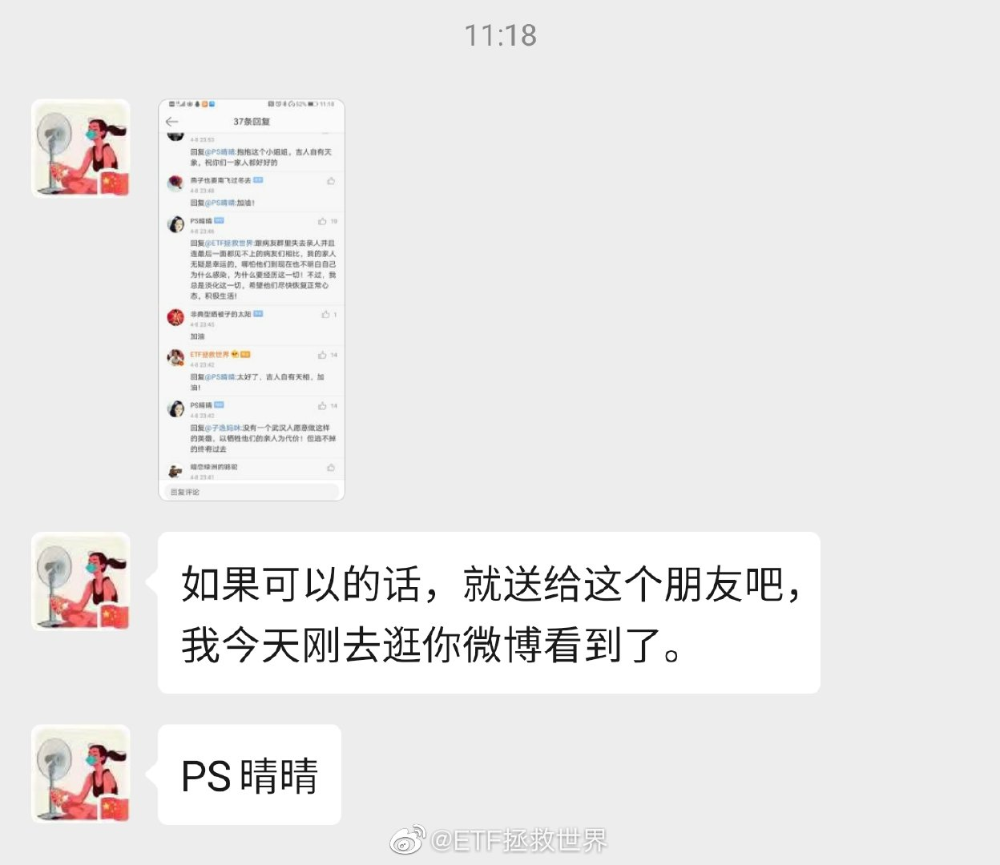

## 2020-04-09 22:14

最终最低点8255，没有有效跌破8200。目前点位10500，反弹28%。前方第一个大的压力位是11000，冲过去难度比较大。如果过不去回调，前期低点附近会有很强很强的支撑。

## 2020-04-09 23:17

早点睡吧。钱是挣不完的。

头发要紧。 ​​​

## 2020-04-10 08:58

设置好的反弹出货价，到了就果断出，一切按计划行事。

别一看涨了就抠抠索索又怕赚少了不舍得卖。大不了多留点。

别相信你的感觉，感觉在市场上是最没用的东西。 ​​​

## 2020-04-10 09:11

2。恕我直言，对绝大多数人来说，不沾黄赌毒，不乱投资，45岁有2000万这辈子基本稳了。毕竟你不可能45岁任何事情都不干，以后一点钱赚不到。另外2000万买理财一年也有70万收入。300万美元在任何国家都是富人了。 50%的机会45岁一分钱都没有，这个太可怕了。概率降到30%我都不愿意尝试。

## 2020-04-10 10:22

很多朋友不同意我说不要碰黄赌毒中的黄，觉得黄可以接受。

最近的新闻，大集团总裁，上市公司独董，碰了，挂了。人生就此改变。

很多事情不必亲身去尝试，每天看看新闻也能学到很多。

违法的“黄”，不碰为妙。有些不违法但是违背社会公序良俗的，也要慎重。 ​​​

## 2020-04-10 11:20

第一波冲击被强力压制。//@ETF拯救世界:上方第一个压力位11600

## 2020-04-10 11:31

你们玩动 森的，会不会有一天突然服务器连不上了。 ​​​

## 2020-04-10 11:32

为什么我感觉今天的直播销售额会大幅下降。 ​​​

## 2020-04-10 13:22

. ​​​
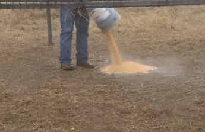

## 2020-04-10 18:07

有很多人，尤其是年轻人，特别害怕别人不知道自己的家庭背景，财务状况。所以才会出很多事儿，比如“你知道我是谁吗”“你知道我爸是谁吗”“信不信我用钱砸死你”。然后就挂了。

或者一到亲戚朋友同学聚会就怕别人看低自己，想尽办法吹。“啊，GWY，咱有银儿，包我身上”“马Y还是马HT？没问题，下个礼拜给你和他们约个局”“最近正在谈一个十亿的项目”“昨天股市跌，又赔了1一个亿——每个小时。”

我反而觉得，扮猪吃老虎是最最有意思的事。所有人觉得我是NOBODY我才高兴呢……不过我这个心理，懂的人不多。

## 2020-04-11 20:17

回复@七月-阳光:第一，考虑全屋定制。收纳空间会大增。第二，二手房成交价与装修水平有一定关系。所以装的好点卖房的时候没准能赚回来，所以别弄太差//@七月-阳光:益达，之前装修房子有什么经验可以分享吗？

## 2020-04-12 19:41

据说欣赏我的人最后都幸福了 ​​​
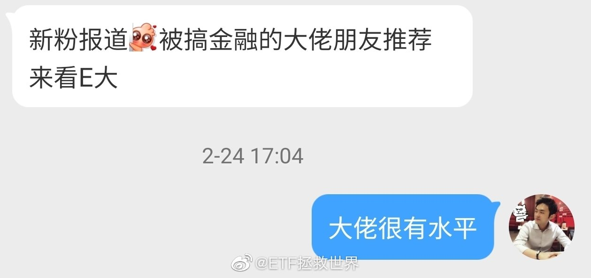 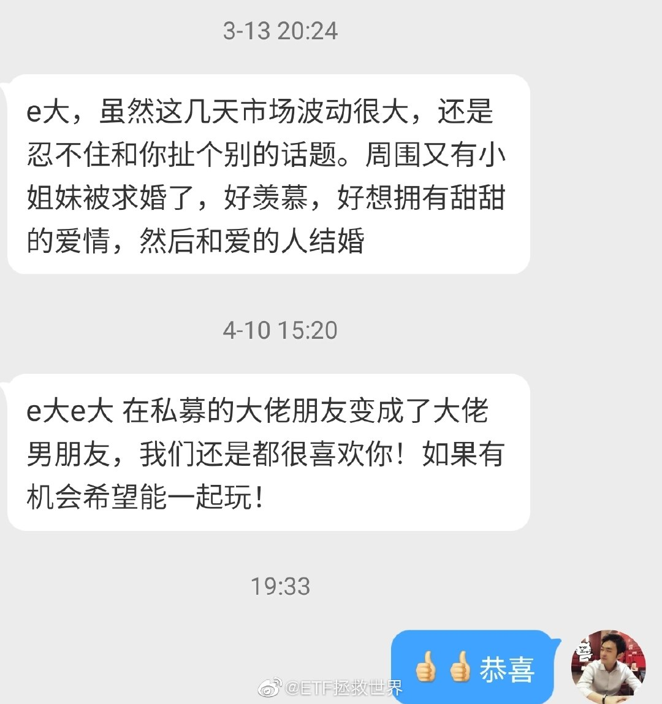

## 2020-04-13 09:37

发车不发车，

第一我会考虑仓位

第二我会考虑现金流

第三我会考虑估值/趋势

第四我会考虑宏观环境

会有个综合判断。我要保证发生极端情况你心态不崩+还有钱买入。

所以发不发都不要问，不要催，不要急。你要觉得特别想交易就自己交易。 ​​​

## 2020-04-13 09:54

李佳琦微博送十瓶SKII神仙水居然有几十万转发评论。不懂，神仙水这么受姑娘们欢迎吗。

好吧，明年3.8送神仙水。没有任何转评赞要求，直接送。 ​​​

## 2020-04-13 12:44

曾经有一位老人家说过，

ZZ就是把自己的人搞得多多的，把敌人的人搞得少少的。

怎么感觉现在到处点火，朋友（哪怕是面儿上的）越来越少了。

这样下去不行啊。只会让真正的敌人趁虚而入。 ​​​

## 2020-04-13 14:42

为什么我下不了决心给你们开个交友帖。我记得去年有个关注我的姑娘刚失恋想找个男朋友，我就帮着转了一下，结果有些人的评论就很不友善，挑人家这个那个的。其实我看人那姑娘多好啊，长得也挺好看，条件什么都挺好的。

所以我就怕人家说想找个男朋友，一堆人在底下说三道四品头论足，人家自己的微博平静的生活被打破了。再遇上心怀不轨的法外之徒张三，就更麻烦了。

所以心有余而力不足啊。网络是很复杂的，还是谨慎点好。

## 2020-04-13 15:00

无惊无险，又到三点。

欢乐的时光总是特别快，又到时间说白白。明儿见吧…… ​​​

## 2020-04-13 15:08

看了眼私信，好多朋友因为关注不到100天憋得难受想说话。

我把限制改成7天各位老朋友觉得怎么样。征求你的意见。看评论里面选项点赞数决定。 ​​​

## 2020-04-14 11:27

前一阵血雨腥风中，你买的美、德、日、港，全部赚钱了。

然而如果你在高位追芯片和5G，那大概率被套了。

所以，你应该喜欢暴跌还是暴涨，这是一个原则问题，你自己得清楚。 ​​​

## 2020-04-14 11:35

回复@我是一只小毛驴从来也不怕:你5G赚了40%，是因为你买的低，是因为创业板跌了3、4年。我这个帖子的意思，不是在讨论品种，而是在讨论应该在哪里买。我掰开揉碎了，您再体会体会。//@我是一只小毛驴从来也不怕:5G赚了40%，这不是原则问题，是节奏问题

## 2020-04-14 17:27

来都来了，聊聊你今天过得怎么样。很舒服还是很糟心。

又或者只是普通糟心的一天。 ​​​

## 2020-04-14 19:58

今天晚餐是三文鱼+乌冬面，配餐的是孤独美食家第三季。 ​​​

## 2020-04-14 22:41

我说句可能要挨骂的话，我现在隐隐觉得，我们这边到处出征的人里面，有敌人的内鬼。

否则很难解释为什么现在这种尤其需要朋友的时候却到处挑事儿。

还有一句更可能挨骂的话：

有人歧视你，你很生气。但你有没有想过，你是不是也歧视别人了。

远的不说了，就咱们这一圈邻居，从南到北，从西到东，哪个不被你取了侮辱性的外号天天叫。人的情感都是一样的。你天天这么侮辱人家，打心底里看不起人家，人家能跟你做朋友？凭什么，凭你这几年发财了有几个臭钱吗。

## 2020-04-14 23:04

其实我感觉，人类解决了生存问题后，最终的需求是尊严。

回想一下，咱们看过、听过的无数悲剧，是不是很大比例都是因为一方感到失去尊严、被蔑视才发生的。无论别人是富有还是贫穷，都不要随意践踏别人的尊严。很多时候，很多人，为了尊严冲动起来连命都可以不要。 ​​​

## 2020-04-15 09:51

医药基金突破2018年5月高点。自“救命底”以来上涨70%。 ​​​

## 2020-04-15 10:06

其实大家应该再回忆一下当时医药面临的大利空。以及在那样利空下无数人是如何继续看空的。

在下降趋势中看空，短期很容易对。因为趋势不好，你唱空赢的概率就大。但中长期看就未必。

如果你是一个真正的投资者，而不是一个嘴炮，你就应该考虑，利空是否已经反映在股价上，是否已经过度反应。利空会不会改变中长期的价值。

这个非常重要。因为嘴炮的目的是吸引注意力，而你的目的是赚钱。

## 2020-04-15 10:17

目前医药已经运行到相对高估+牛市上升趋势阶段。

这个阶段非常难。难在它不是便宜的阶段，可以买可以安心持仓。它虽然是上升趋势，但随时会转头向下。这个区间考虑的不是加仓，而是如何动态平衡。

既然已经到了这个区间，就照例给一个区间上限。目前医药的区间上限是15500左右。这个点位是特大级超级牛市的极限点位。当然，首先是11600站稳了再说吧……

## 2020-04-15 10:28

想要消费券。怎么还不发。 ​​​

## 2020-04-15 11:41

炎热的日子里，除了柠檬水，也可以试试黄瓜片泡水喝。

黄瓜削皮切片放入玻璃凉杯，灌入凉白开水，稍微放置就可以了。喜欢喝冰水的，可以放入冰箱或者加入冰块。

个人认为口感很好，很清爽。这是去热带地区旅游的时候跟当地人学的，分享给你，夏天可以试试。 ​​​

## 2020-04-15 12:37

有没有部门能想办法找出是谁干的。这要是被栽赃的就太冤了。推上一转，不堪设想。//@留几手: 香港人干的//@五岳散人:卧槽，疯了吧这是……

## 2020-04-15 13:08

看网络上有些人的论调确实让人无话好说。在他们的认知里，似乎其它国家，外资公司全都是靠中国养活的。没有中国似乎这些国家就要民不聊生，公司就要统统倒闭了。

谢谢你了，这么说80、90年代之前别人都没法活了。

中国对于世界确实非常重要，尤其是经济方面，对很多国家和外资公司来说都是如此。但绝不至于没有你就活不下去。别整天瞧不起这个瞧不起那个的。相反，如果我们孤立起来，没有了任何伙伴，就是自己单干，恐怕日子就太难过了。

美洲、欧洲、亚洲、非洲、大洋洲。地球就这么大，都悠着点吧。

写到这，又想起有些人赚了点钱，发了点财，就极端看不上没钱的人。言行举止处处流露优越感，恨不得全身镶金子告诉别人自己有钱有权其他人都是下等人。这种人就是真正的弱智。多看看历史，把穷人逼急了，别说你那点钱，连命都保不住。

## 2020-04-15 13:24

回复@em半导体me:我们现在依然穷。人均GDP只有一万美元，人均收入只有3万人民币，4000多美元。只有15%的人够5000元（700多美元）个税起征点。美国人均收入4万刀，28万人民币。东京人均收入30万人民币。差太远了。

## 2020-04-15 13:44

这两车没发，是因为A股仓位合适。目前的一点留存资金，我希望找机会多配置一些境外市场。 ​​​

## 2020-04-16 09:42

对于一般人来说：

第一轮牛熊市你会赚不到钱。因为你不知道宴席吃完了要赶紧走，最后你留下买单了。

第二轮牛熊市你会赚的少。因为这一轮你有了上一轮的教训，吃几口凉菜就走了，最后你可能蹲路边看别人吃大餐，也可能别人吃完你又回来买单了。

第三轮牛熊市，你会吃到大餐，并且在买单前悄悄离场逃单——如果你有足够的悟性。

结论就是，一般有悟性的人，要经过三轮才能搞明白投资，这就是至少十年以上。

当然，有些天赋异禀的，一轮就能弄明白。万中无一。

不过大部分的人是一辈子经过4、5轮牛熊，依然没明白投资是怎么回事。次次买单，喷了。

## 2020-04-16 09:51

为什么我觉得这个长得像《独立日》里面美国总统的人更像美国总统应该是的样子……

## 2020-04-16 14:06

有朋友私信我说，怎么医药极限位最高才15500吗，2015年都到过了啊。各位要清楚，2015是一个非常特殊的年份，光正规两融就2万多亿，配资也有几万亿。当时医药市盈率超过100倍。那已经极度脱离正常情况了。当年的极限位应该在11000左右。如果下次还能来几万亿的杠杆，那我说的15500你就当没看见就行了。

## 2020-04-16 14:21

我说的“极限点位”，是我的投资体系中的一个趋势判断系统。这个极限点位未必不会破，就像2018年，医药我的极限点位是7800，跌破后又跌了10%才见底。因为有时候有极端情绪等等因素。

不会每次都那么精准，但一定是在那个点位周围的一个区域，不会偏离太多。 ​​​
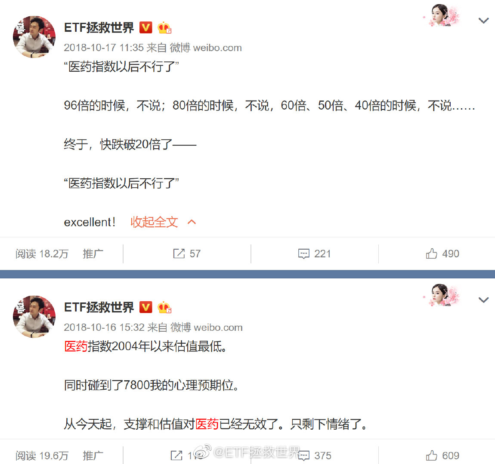

## 2020-04-16 14:29

我觉得挺好。融合了中国传统的乡村、奇趣、宗教以及色彩的审美。不走寻常路，期待！

## 2020-04-17 08:36

谁能想到一年多过去，京东马上新高了。

## 2020-04-17 08:47

今天公开品种有机会再收一网 ​​​

## 2020-04-17 09:43

还不离婚吗。这以后晚上能睡踏实吗。

## 2020-04-17 13:15

谁再在评论里说跌了仓位高了，涨了仓位低了难受就拉黑。

你不懂舒服。 ​​​

## 2020-04-17 14:39

我这个回答有可能被骂（你为什么要女方先注意自己的行为？难道不是男方的责任吗？），但还是贴出来。 ​​​
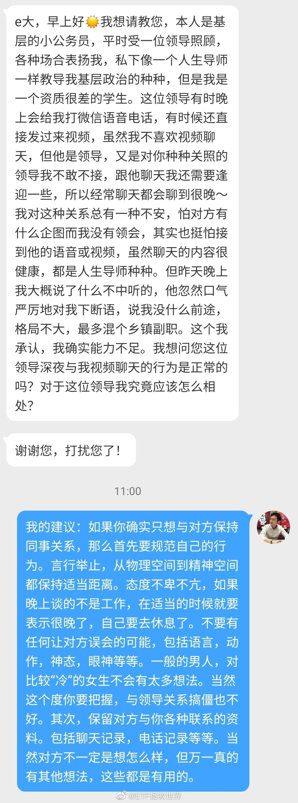

## 2020-04-18 08:36

每天想着把最后一分钱杀进去的朋友看看。

## 2020-04-18 19:59

关于最近原油期货移仓的问题，说一下。

目前计划持仓的华宝油气（0.7%）以及石油基金（0.6%），没有移仓问题。两个基金是持有石油类上市公司股票。

持仓占比0.47%的南方原油是持有原油期货。这个会有移仓问题，但是由于持仓占比很小，不用太在意，尤其是单份持仓金额很少的朋友。

如果比例虽然小，但绝对金额比较大的朋友，场内的话实在担心的，可以先出。

场外绝对金额大的朋友不建议直接赎回。我建议你考虑场外转场内卖出。因为目前场内大幅溢价，溢价率将近50%。你可以将场外份额转入场内，在场内卖出。我们的南方原油场外成本0.7，目前场内价格0.81，如果你转入场内时价格没有大变化，你甚至还能赚十几个点离场。

具体怎么转，可以百度查查，或者咨询你的场外持有机构。你可以先去问问你的场内交易券商基金席位号，然后与场外持有机构沟通转入。

## 2020-04-18 20:21

收到就好。不过听这位幸运儿说她把耳机送给老公用了。大家谈谈有什么感想。

## 2020-04-19 12:48

这事情绝不止脑残这么简单。美国直接发钱到个人账户，还有失业保险，按理说不会活不下去。我从去年HK学到的就是：一般大规模YX后面都有力量在支持。是谁在支持民众与州政府对着干着急开工呢。//@挖龙脉的超级鹿鼎公: 转发微博

## 2020-04-19 13:46

我对武术的幻觉是什么时候破灭的呢。

回想了一下，是十年前在猫扑看到的一段民国时期大师比武的录像。

从那一刻起，武侠小说和武侠电影我都不怎么看了。不是内个味儿了。 ​​​

## 2020-04-19 17:10

没事别玩这种东西。任何机械和人都有一定概率出问题。责任心不强的地方出问题的概率更大。这种高危游戏，出了问题就是挂。

## 2020-04-19 18:01

如何快速换算日元。看日剧或者买东西的时候经常会遇到这个问题。比如孤独美食家里面，一个肉串200日元，到底是多少人民币，看到的时候就会想知道。日元和美元或者欧元还不一样，还不是直接除个汇率6或者7就能算出来。

我一般这么算。就是用这个数字乘6，然后小数点左移两位。比如200日元，就是200*6=1200，左移两位就是12。再比如10000日元，就是600。

当然乘6这个根据汇率变化会有变化，但是大致也就是6-7左右。大差不差，大多数时候知道个大概就够了。

你还有没有更简便的心算方法可以分享出来。

## 2020-04-20 10:19

呵呵，指数报价都能错，喷了。 ​​​

## 2020-04-20 12:29

一方面是意识形态，一方面是潜意识中的人种歧视。

这两点导致了我们与对方在很多问题上不可能得到根本解决。 ​​​

## 2020-04-20 12:49

修正了。不公布一下错误的原因吗 ​​​

## 2020-04-20 14:40

今天买卖都没有成交的。

怎么说呢，感觉生活过得没有滋味。 ​​​

## 2020-04-20 16:21

不知道为什么，感觉看书比追剧有意思。这几年没有一部剧是完整看完的。看着看着就觉得不想继续看下去，也不是拍的不好没意思，就是耐不下心，看不下去。还是看书有意思。是不是送一台oasis2给爱看书的同学呢。

## 2020-04-21 07:39

记录一下负油价的历史。以后各位都有对后辈们吹牛的资本了

## 2020-04-21 07:55

没事还是别出门浪的好。买东西还是上京东淘宝吧…

## 2020-04-21 08:08

其实我觉得落叶落花都很好看，尤其秋天，满地银杏叶非常美。一定要及时扫是不是有其他专业方面的原因？

## 2020-04-21 09:42

这几个月仓位没有增加，但是如果你还有自由现金流，还是要继续积累现金。

一方面是把自己家庭的安全垫积累的厚一点，一方面是为了有可能拿到的更低资产价格做准备。

你得保证无论发生什么情况自己都活着，才能赚更多。也许未来你会看到有些现在激进的人赚很多，但你看不到的是他的身后有多少白骨。 ​​​

## 2020-04-21 17:29

六月合约接力跌。

需求上不去，消耗无法加大，储油罐都满了，地底下的油呼呼呼往上冒。除非经济重启，否则很难解决。 ​​​

## 2020-04-21 18:26

无论男女，结婚对象的智商都非常重要。没结婚的各位，真的，一定要记住。

## 2020-04-22 16:51

忙了一天。

你今天过得怎么样。 ​​​

## 2020-04-22 21:07

中行这次原油宝事件暴露了某些银行对于衍生品风控不过关。从现在开始，白银网格不仅是暂停，手上的两三格到价格出掉后也停止交易。

## 2020-04-23 08:28

之前已经建议过持仓南方油的朋友可以转托管场内卖出。昨天中行又爆雷，估计更多朋友会担心。已经与且慢沟通完毕，他们今天会做一个方便大家操作转托管的东西出来（之前步骤繁琐场外机构都如此），明天可以上线。整个流程我会非常具体的写一篇东西今晚或明早发布。致敬且慢，一切以客户利益为优先考虑。

## 2020-04-23 09:34

医药开始升温，热度持续增加。继续持仓，等待15000狂热或趋势变化。

## 2020-04-23 09:48

我不信有什么东西是多贵都值的。

你贵了我就卖，你便宜了我就买，免费的话我就给你好评。 ​​​

## 2020-04-23 10:44

好吧，跟着你们吃完瓜了。

不过我想说，最近我发现我也有一点黑眼圈了。但我是清白的！我都是在看美股！ ​​​

## 2020-04-23 15:15

你觉得我说的对吗。 ​​​
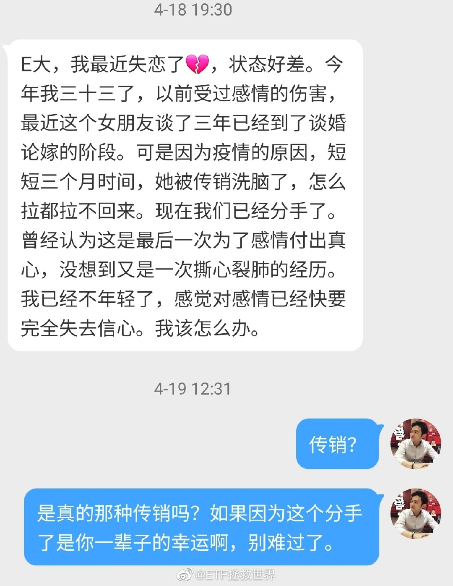

## 2020-04-23 19:12

不想当大厨的小偷不是好的蜘蛛侠。

## 2020-04-23 19:17

私信看多了就会觉得找伴侣这件事，运气因素太大，不公平。

明明很多优质男女，却因为没有缘分碰不到一起。可能那个合适的人就住你隔壁小区你都不知道。

以前很喜欢的一部电影《向左走，向右走》。主要是因为喜欢男女主角，现在看的事情多了，想起来不胜唏嘘。 ​​​

## 2020-04-23 21:42

弄了半天这一波下去就是为了杀中 行吗。

转场功能正在紧急开发，且慢都在加班，明早推送吧 ​​​​
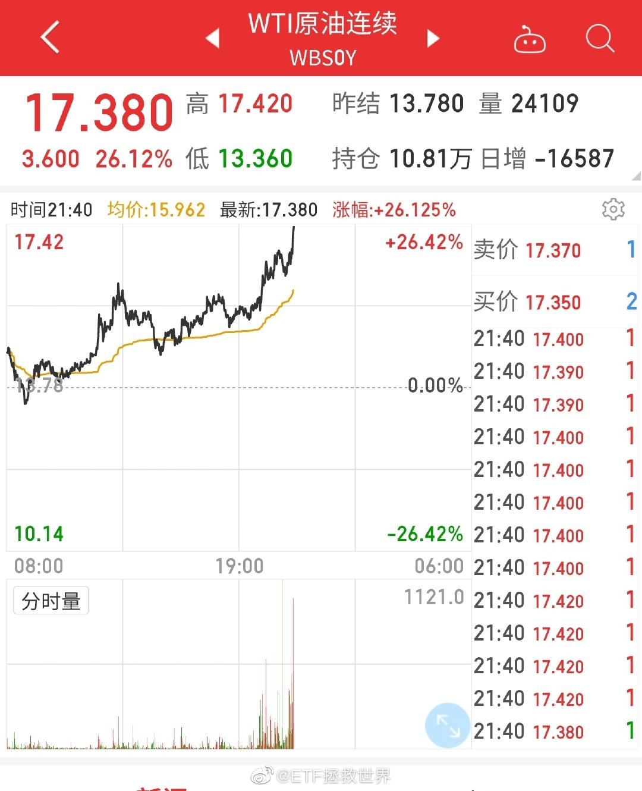

## 2020-04-23 23:43

今天已经有人把我的微博截图，在公众号洋洋洒洒写一篇文章做提示了。不仅如此，还有媒体转发。

我不能怪他。他也是为了吃饭，博眼球，博关注。

这种事情真的两难。我说，就会有很多人知道。我不说，大家也没法操作。

只能希望大家顺利。希望大家知道，我是真心希望各位都赚钱。我尽力了。 ​​​

## 2020-04-24 10:44

之前一直说的对不对。黄、赌、毒。尽量别碰。否则会很麻烦。

## 2020-04-24 12:37

无论你写的多么细致，多么全面，都会有人不看或者看不懂。

所以在设计产品流程的时候，都是按照最最粗心大意的人，阅读能力差的人的情况设计的。

饭已经不止喂到嘴里，还帮着托着腮帮子嚼一嚼。就差帮着咽下去了。 ​​​

## 2020-04-24 12:52

感谢一下。 ​​​
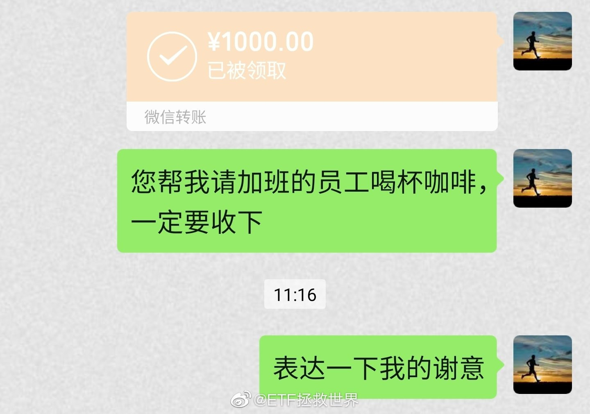

## 2020-04-24 14:36

还有人留言质疑：你搞什么，好久不发文章，也不交易，真不知道在干什么。

我服了。一定要像自媒体一样每天发一篇追热点的文章；无论合适不合适，每个月都要发车让你买买买你才高兴吗。

不好意思，我不是自媒体，我也不需要每天用一篇推送留住读者或者吸引流量，我也不是“定投”。我爱什么时候写东西就什么时候写，什么时候合适交易我才交易，怎么那么难伺候？

我就是不想跟别人一样，怎么了，不跟别人一样就那么不可接受吗。

## 2020-04-24 17:21

前10%的家庭占有60%的金融资产。后40%的家庭只有5%的金融资产。后60%只有12%。

## 2020-04-26 13:04

有空去日本的朋友有机会可以去奈良跟小鹿们玩一玩，真的是美好的体验。再去旁边的东大寺转转，我也很喜欢。

## 2020-04-26 18:55

其实我已经看到未来的结果了。

如果这次转场后溢价消失无法顺利卖出，一定会有人跳出来嘲笑我。

咱们一起看看是哪些人会这么干。 ​​​​

## 2020-04-26 22:55

休息差不多了，开始看留言。 ​​​

## 2020-04-27 09:53

每天开盘的四个小时是人生美好时光之一。 ​​​

## 2020-04-27 10:09

想起一个需要叮嘱的，你要看我微博你就要理解：

我说不买，就是代表不买。不代表要把手里的卖出。只有说卖出才代表卖出。

我说不卖，也不代表可以买。只是代表不卖。

你始终要记住，对于一个品种，是有三种状态：买入、持有、卖出。

前几天我说某个品种不买，评论里有人说啊那我是不是要把手里的卖掉。

能不操心吗你说。

## 2020-04-27 11:24

他们两个天生一对。

## 2020-04-27 11:46

数码产品小贴士：

当你觉得手机用腻的时候，换个手机壳，又能撑1-2个月。 ​​​

## 2020-04-28 10:44

打开条件单惊呆了，买入立赚3%…… ​​​

## 2020-04-28 11:15

我对两个科技产品非常期待。

第一个是真正的无人驾驶。

第二个是极度真实的AR/VR系统。

希望10-15年内能实现。 ​​​

## 2020-04-28 16:42

截止目前，一季报全市场利润下降超过10%，最后可能会超过15%。

连一向生冷不忌的医药和食品饮料也下降了1%…… ​​​

## 2020-04-29 10:10

喷了。 ​​​

## 2020-04-29 10:20

之前害怕波动，现在特别喜欢的举手。

世界没变，但是你变了。你变了，整个世界就变了。 ​​​

## 2020-04-29 10:27

但是我再提醒一下，不厌其烦的。

做波段你很开心，来来回回的赚。但你要明白，这不是赚大钱的路。

大钱是坚定持有中赚到的。这点你还不明白，以后就会懂。但是波段很必要，为什么？因为波段给你提供源源不断利润的同时，也能让你真正坚定持有未来赚大钱的仓位。

否则，不停的坐电梯，赚了——赔了——赚了——赔了，你很容易就会放弃。

## 2020-04-29 10:28

严正警示有用没用，2分钟后揭晓。 ​​​

## 2020-04-29 10:35

刚才有个朋友问我，这种时候发公告，是不是为了不让持有人挣钱走，保持规模挣管理费？

我对他说，你胡说！人家那么大公司能这么龌龊吗。人家能不希望自己的持有人挣钱吗？难道所有持有人都赔钱人家才高兴吗？不可能。

我很生气，拉黑了这个朋友。 ​​​

## 2020-04-29 10:47

鲁迅说过：你不希望信任你家产品的人、理智的人赚钱。反而要帮助那些疯狂的人，这样对不对？

我想了想，这样做是对的。谁不喜欢疯子呢。理智的人go out.以后再也别见。 ​​​

## 2020-04-29 10:53

今天开始，在心中拉黑第一家公司。以后我再买他们家的产品我就是XX。

请各位监督。 ​​​

## 2020-04-29 11:17

两个品种已更新。 ​​​

## 2020-04-29 11:36

你要说突如其来的事情发生了，情绪没有波动是不正常的。不过几分钟也应该就好了。

接下来就是考虑：

如何应对和处理，总结教训，不要再犯。 ​​​

## 2020-04-29 19:50

人，在最巅峰的时候更要戒骄戒躁。越是顺风顺水的时候更要对其他人和善一些。

相反，不顺的时候反而不要卑躬屈膝，不要唯唯诺诺。

我的一点想法，分享给你。 ​​​

## 2020-04-29 19:52

今晚做鳗鱼饭。

下饭菜是龙岭。 ​​​

## 2020-04-29 22:36

美股刚从ICU出来就去蹦迪了。 ​​​

## 2020-04-29 22:52

那份标普500不好说什么时候出，但是DAX会在12000左右出一份//@ETF拯救世界:最终最低点8255，没有有效跌破8200。目前点位10500，反弹28%。前方第一个大的压力位是11000，冲过去难度比较大。如果过不去回调，前期低点附近会有很强很强的支撑。

## 2020-04-30 10:14

建议每天停牌3小时59分59秒提示风险。 ​​​

## 2020-04-30 11:39

听说有的平台今天终于开通转托管。

很欣慰，也算间接为平台进步做了一点自己微不足道的贡献…… ​​​

## 2020-04-30 12:02

刚看到有朋友在评论说有人收费阅读的事情。

我倒是觉得吧，作者也只是多给你一个选择，愿意付费看就付费，不愿意就看免费的。这倒不是什么原则性的问题。

只要读者付出的费用真的值回票价就可以。这个很关键。

不能要求每个人都免费输出。财务自由的人去工作可能是为了情怀和成就感，但你不能要求还需要工资挣钱的人不要钱工作。这样他吃不饱肚子，也没精力创造好东西出来。

其实想想，这个世界上如果什么都免费了，恐怕无论商业、科技、音乐、文学、影视……都不会有好东西出现了。

最关键是物有所值，当然最好是物超所值。

## 2020-04-30 14:17

关于交易，大多数你听到的，说法一致的东西，都是噪音。 ​​​

## 2020-04-30 14:24

为什么说你的80%焦虑都是无意义的呢。

不瞒你说，若干年前我曾经因为专家说地球原油储量不够，只够用100年而辗转反侧，夜不能眠，担忧人类的未来。

万万没想到。几年时间，人类要为油太多没地方放发愁了。 ​​​

## 2020-04-30 14:39

今天你提款了吗 ​​​

## 2020-04-30 18:57

最近在看笔记本。

为什么觉得联想好像突然发力了。产品和性价比都很不错啊。 ​​​

