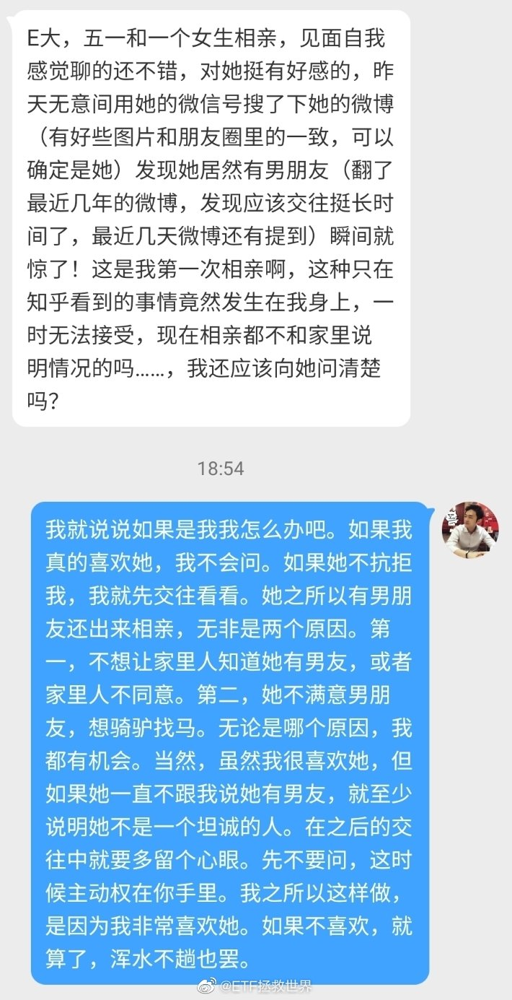
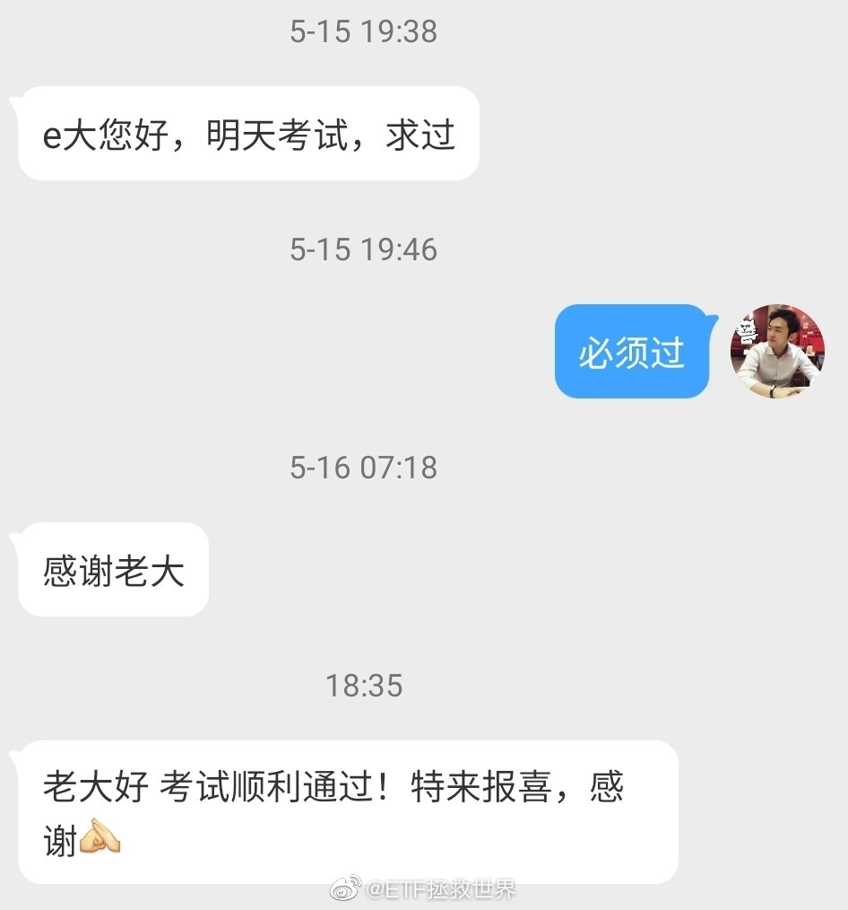
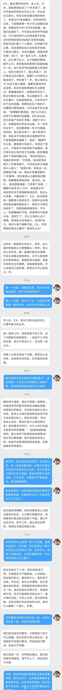

## 2020-05-01 10:23

有些朋友看到外围大跌又慌了。

想想你最近是不是在减仓。波段仓位不用说，亚太仓位全面下降，拿回本金。

长线仓位，150现金仓位持续上升，削峰填谷。s在休息一个月积累现金后买入1/2。

所以不用担心，按理说你已经做好准备了。 ​​​

## 2020-05-01 11:31

回复@DecKen-:我家有个闲置的macbook pro。为什么闲置，我每天用的excel在mac上几乎是废品//@DecKen-:mac才是性价比最高的

## 2020-05-01 11:49

最近在看《大秦帝国》。

已经看到战国初六国会盟准备瓜分老秦了。

秦国风雨飘摇。

那时候的人绝对想不到，是弱秦最终统一天下。 ​​​

## 2020-05-01 12:47

看笑了

## 2020-05-01 17:34

无论如何，一切都是你咎由自取。

## 2020-05-02 23:46

说来惭愧，我一部网文小说都没看过。

能不能给我推荐一个最牛的我长点见识。 ​​​

## 2020-05-04 19:51

港股跌4%。喷了。

是天意吧。 ​​​

## 2020-05-05 19:31

我不懂版权法，但是凭着朴素的直觉，确实不明白为什么作者在平台上发布的文章不属于作者本人而是属于平台，觉得这样有问题。

如果平台给作者发工资可以理解为雇佣关系，作品知识产权是平台的。如果你不发工资，人家只是在你这里发表自己的作品，为什么知识产权是你的呢。

有没有懂知识产权的给我普一下法。

## 2020-05-05 21:58

原油宝用户：

## 2020-05-06 17:03

有朋友留言说，不买5G或者科技吗。

我知道这几天风又起来了。你如果想买，完全可以自己买，不必等计划。

其实我建议各位把这个计划当做一个底部资产，在其上面，可以按照自己的喜好布局。有些计划里没有的品种，喜欢就自己买点。包括各种东西，股票也好，各种指数也好，都可以自己买。

我是不可能跟那么多人一起买入5G或者科技这样60多倍估值的品种。尤其是我越来越体会到很多人是多么脆弱以及缺乏经验之后。

## 2020-05-07 09:13

别人跟你借钱，你有三种应对的选择。第一，当钱丢了，不要借据送给他。第二，做一个现代人，不因为写借据“伤感情”，写借据借给他。做好60%概率钱丢了的准备。第三，不借。

## 2020-05-07 09:21

几年前参观过美国一个农场，真的是非常震惊。一个中年白人农场主，雇一个墨西哥人。两个人管理巨大巨大巨大的一个农场。农机上有GPS，自动耕种自动调头。干净、整洁、高效。与印象中的农村完全不同。

## 2020-05-07 09:43

做投资，你买的东西到底是因为炒作涨还是因为价值涨，你心里得有点数。

我当然不会瞧不上炒作，既然它存在那么久，就一定有道理。也一定有人能从炒作中赚钱，否则炒作的人早就赔完了，消失了。

但是你得知道你自己是不是那块料。别人炒你也跟着炒，别人抓热点你也跟着抓。弄不好，你就是别人的接盘侠。

我的建议就是，炒热点是小马过河。你别听有人吹得特别好，也别听有些“价投”嗤之以鼻。这是很个性化的事，你可以用少量的钱试试。看看自己有没有这个天分。

如果经过几轮你发现自己都赚钱了，风起的时候能跟上，风停的时候能跑掉，那就增加投入继续呗。如果发现每次都是别人吃大餐自己买单，你就踏踏实实干你该干的事儿去。

如果你根本不知道自己买的东西是不是炒热点……行吧，祝你快乐吧……

## 2020-05-07 10:49

注意看护士说话的时候川的表情，一撇嘴有点好笑是怎么回事。

## 2020-05-07 17:21

其实内需不振很大的原因是贫富差距。

一个人，一个家庭特别有钱，一年挣300万以上，能花多少钱。买两套房，平常生活所需都买最高品质的，所有电子产品每年换最新款，孩子教育都是很好的，每年出国玩，一年花不了100万。放开了花使劲花（别太浪费），一年也就花70、80万。还能怎么花，买奢侈品，能买多少。

大多数剩下的钱都是买理财，投资。

但如果少挣100万，少买100万理财。100个特别特别穷的人（年收入1万元以下）每年多挣1万，他们会把这100万都花掉，那就会带动100万消费，然后会增加就业机会，就业再刺激消费，就会有一个更好的循环。

招行年报显示，2%的人占据了80%的财富，剩下的20%财富由98%的人分；（这是金融资产，算上房子没有那么夸张）

据分析，中国有8-9亿人还没坐过飞机；

中国大概只有1.2亿人有护照，也就是说，满打满算，也只有10%的人出过国。

## 2020-05-07 17:43

有杠精说：“别的不说，我们这种三线城市底下县城的有头有脸的人物的子女每年300万是百分百不够用的 想的太浅”

喷了，我已经在原po中说的清清楚楚：（别太浪费）。你要说敞开了消费，一个月300万都能花出去。但那是常态吗？那是TMD败家子。

再说了，他花的300万（起），对这个国家经济会有益处吗。每个月买豪车，包几个二奶，每天游艇出海，上下打点……呵呵。

对了，忘了，这哥们也是听说的或者想象的。如果是他自己一年花300万再来杠就完美了。

我要表达的是什么杠精真的看懂了吗。

我说一年除了买房买车这样的大开销外，花70、80万对于正常富人来说足够足够了，当然是有发言权的。再深我就不想说了，我只能说，我不是靠想象的谢谢。

## 2020-05-08 09:57

你能想到今年这样天下大乱，中证500还涨了5%…… ​​​

## 2020-05-08 10:11

不要害怕波动。没有波动就没有利润。 ​​​

## 2020-05-08 10:38

我看到有人说：我买的xxx三年了还没挣钱怎么办。

有些话我说过无数次了，再说一次。

权益类投资，你以为是存银行或者买理财吗。资产每年以固定的斜率上升？

三年不开张，开张吃三年。你以为是乱说？

贵州茅台，你从08年定投到14年，几乎都赚不到钱。中间还有无数坑。2014年你看着创业板2年多已经翻了几倍，拿着手里的茅台，哭着说为什么茅台不涨啊，六年了啊。然后你卖掉去追创业板吗。

那你就错失了十倍利润。

今年最高涨了超过300%的以岭药业，2011年上市18块，今年年初11块。你如果定投9年，可以说亏的妈妈都不认识你。4个月时间，9年的收益全拿回来了，年化收益率仅次于巴菲特。

指数何尝不是如此。

美国标普500，你从2000年一次买入，或者1998年开始定投买入，到2013年依然不挣钱。然后呢。

你如果相信我，你就应该知道。一个不死的，持续成长的东西不涨的时间越长，你低位买入的越多，成本做得越低，未来你的收益率越高。

信不信由你。

横起来多长，竖起来多高，有一天你才会真的懂。

## 2020-05-08 10:56

所以你的组合里放入不同周期的品种。这些品种有些春天开花，有些夏天或者冬天开花。

合适的时间把涨的好的卖一点，去支援还没涨的。等后者涨起来就再卖一点去支援跌下去的或者依然没涨的。

雪中送炭说说容易，你以为真那么简单吗。人的本性都是追逐荣华富贵看不起衣衫褴褛的。反人性没那么简单。 ​​​

## 2020-05-08 15:40

想出去浪。 ​​​

## 2020-05-08 17:50

如果你明天还要上班，但又没有荷官开牌，你说这日子怎么过。

谁有什么乐子互相分享一下。 ​​​

## 2020-05-09 12:30

写了点东西，小助理正在排版。下午发。闲着没事解解闷。 ​​​

## 2020-05-09 19:16

留言放完了，今次放满100条，后台还有1000多条放不出来。gzh给的空间不够，无奈…… ​​​

## 2020-05-10 13:23

一直在上港服。我只希望大人们高抬贵手，不要把港服墙掉。说真的，这样的事情非常打击年轻人的爱国热情。孩子们只是想玩游戏而已。

## 2020-05-11 09:45

从我亲见过的一起交通肇事致人死亡然后逃逸的案件看，死者家属获得赔偿金谅解后，肇事者就没事了。懂法的朋友能不能给我普及一下，这样是正常合法的吗。

## 2020-05-11 10:13

我问各位一个问题，你会怎么回答。

对你来说很重要的一个人，如果被一个酒驾的人开车撞至身亡，肇事司机逃逸。

你费尽千辛万苦把他挖了出来。

这时候，他提出给你赔偿。赔偿金额大致相当于你们当地一套中档130平米商品房的房价，条件是你不再追究，这个人也不会被追究刑事责任。

当你处在以下两种情况时，你会怎么做。

你会不要钱，一定要让他付出最严重的代价。还是会答应，把钱收下。

第一种情况：

你收入很低，没有房子，买这套房需要工作15年。

第二种情况：

你的资产是赔偿金额的30倍，这个赔偿对你来说并不重要。

这两种情况你会怎么做。

（各位还需要考虑的是：

肇事者既然能拿出这么大笔钱，那就大概率有钱，没准还有势。如果你不选择要赔偿，一定要让他坐牢，由于你的资源很少，他可能只判很少的几年，减刑几次没准一两年就出来了。然后你一分钱也拿不到或者只拿到很少很少的民事赔偿。）

## 2020-05-11 10:25

各位还需要考虑的是：肇事者既然能拿出这么大笔钱，那就大概率有钱，没准还有势。如果你不选择要赔偿，一定要让他坐牢，由于你的资源很少，他可能只判很少的几年，减刑几次没准一两年就出来了。然后你一分钱也拿不到或者只拿到很少很少的民事赔偿。

## 2020-05-11 10:48

随母姓倒是没有什么问题啦。只是你的孩子可能会比较辛苦，这一生中至少要向500个人解释为什么跟亲生爸爸不是一个姓……

## 2020-05-13 09:51

告诉你们一个好消息：

我的一个门票股今年涨了129%。

还差10%就回本了。 ​​​

## 2020-05-13 14:02

有些人看到别人赔钱比自己挣钱还开心。 人太多拉不过来，否则全都拉黑！

## 2020-05-13 14:04

2800多点资产新高了吗。 ​​​

## 2020-05-13 14:28

我说句不好听的，无论你跟你朋友关系多好，尽量别劝他（她）分手、离婚之类的。人家夫妻、男女朋友吵架就是找你倾诉一下，你听听就行了。你劝分，过两天人家好了，合起伙来骂你。

## 2020-05-13 18:09

回复@学期者:你开车变道还要打灯，还不能突然变，你走路突然变向，被后面撞了，你没责任？我说这女的突然变向导致后面刹车不及撞上了，并非全都是后车责任。你来个“不能变向了吗”。照你这么说，开车突然变道撞上后车后，还要问后车：我不能变道了吗？别看你逻辑思维差，但你胡搅蛮缠的能力强啊。

## 2020-05-13 18:55

今日情感问答 ​​​

## 2020-05-13 20:25

守正出奇。

这四个字值得反复琢磨。

没有了“正”，长久看注定失败，即使你偷鸡摸狗小聪明赢了一时。

但只有“正”，很多时候就未免迂腐、不够灵活。

所以还要有“奇”。为了达到“正”的目的，很多时候就要灵活，要比“不正”更灵活、更聪明。

做人做事，大致都是如此。

对付坏人，就要比坏人更聪明、更狠。让坏人不敢再欺负你。做好人，但绝不做一个被人随便欺负的“老实人”。

## 2020-05-14 11:28

出来溜溜弯 微博视频 ​​​

## 2020-05-15 11:53

做了一个小动画给大家。

之所以用这样的视频展示上一轮危机后2009年至今，美国标普500、沪深300、中证500、全指医药、全指消费、全指信息的走势对比，而非用一张简单的图片。是因为这样的视频可以让我们更加清楚的看到在某个时间段某个指数是如何表现，也会对否极泰来和乐极生悲有更深刻的认识。

也是想说明A股没有各位印象中的那么烂。它只是波动比较大而已。

希望你喜欢。  http://t.cn/A6AgIYJk

## 2020-05-15 18:32

看了半天贴图证据，没贴出文中乱搞的石锤啊。如果网上写这么一段就能让人身败名裂就太可怕了。等石锤证据。另外，要看看女方怎么说。//@挖龙脉的超级鹿鼎公:回复@小艾哦520:我也看到了，这女的太猛了，这些全中国出名了//@小艾哦520:@挖龙脉的超级鹿鼎公 @亟兮般若

## 2020-05-15 18:36

我始终觉得很多女性违章是不知道交通规则，而男性大多是明知故犯。另外，罚这么点是不是太少了，咱们的交通法规该升级了。

## 2020-05-15 19:15

我有一个想法。我们这个国家一部分人从车里往车外扔东西、从窗户往楼下扔东西，其实和“只有自己人才是人，其他人只分成可以利用的和多余碍事儿的”是一个道理。主要原因在于潜意识中，只有自己的才重要，没有公德心和把陌生人当人的意识。

## 2020-05-15 20:39

人均GDP只有你1/6，不是发展中国家是什么。

## 2020-05-15 21:47

历史新高。做为股东和忠实消费者，很满意。//@ETF拯救世界:谁能想到一年多过去，京东马上新高了。

## 2020-05-16 09:04

确实不懂。很多人骂华为对员工不好，问题是怎么看不到太多华为员工自己出来骂，相反很多人拼命往里面挤。现在中国的阶段，很多人想舒舒服服赶超对手是不是想太多了？我不用华为是因为产品不是我的菜以及不喜欢大嘴领导，但内心是真心希望华为好。

## 2020-05-16 16:11

我总是不停的重复做一个梦，买过一辆奔驰放在一个修理厂，忘了去取。但是醒了想想好像没有这回事，然后就不停的做同样梦…

## 2020-05-16 18:38

再说一次，有人黑我不用告诉我。

我一点都不关心。谁再来说只能拉黑你。

我不想精神衰弱最后抑郁症，压力已经不小了。

再跟某些大v以及你们群里那些人说一声，这轮做完我就消失，给你们让路，能不能别这么心急？就这么几个买基金的人值得你这么眼红吗？ ​​​

## 2020-05-18 11:35

这些年总在网上看到炒股的人说：黄金没有利息，所以没有价值，不值得买。

其实黄金不是用来收利息的。黄金最大最大的功能是避险。1000年前的乱世中你可以用黄金换东西，100年前还是可以换，现在依然能换。可以预见的，100年、500年后，大概率也可以。

所以家里有余钱的，以后黄金价格跌下来后（划重点），买点实物投资金条收起来挺好。乱世避险也好，低买高卖做点长周期波段也好，不会吃亏。

但是要注意，贵金属的周期，无论上涨还是下跌，都在20年以上，这个特点要心里明白。

我从05年第一次买投资金条，12卖出。16、17再买，还是有点点心得的。

对了，黄金ETF买到一定数量是可以换实物金的。

## 2020-05-19 09:27

标普500这一波最终收益率是2个月22%。 ​​​

## 2020-05-19 09:56

回复@MrMarcoPoon:最关键是折溢价。昨天油气溢价几个点，今天变成折价2%。一来一回涨幅就吃掉了。//@MrMarcoPoon:老大，想问问为什么xop涨了10点，华宝油气只涨了5点，不是对接xop的吗，谢谢回答

## 2020-05-19 16:16

是不是更新补丁后就无法连接港服了，有懂的说说吗。或者如果以后有这样的补丁出来，你们一定要及时告诉我啊。//@昆山法律:回到上世纪80年代只有大院子弟通过日本大使馆关系才能拿到fc玩得时代么？

## 2020-05-19 17:16

昨天在张大妈看到一条让人心酸的评论。

正文是有人推荐洗碗机，有一条评论是这样的：

“装修的时候我说要买洗碗机，老婆和丈母娘坚决不同意，就没装。现在每天都是我在洗碗。”

这条评论暴露了两个问题：

第一，此人家庭地位极低。表现在买一台洗碗机都毫无发言权。这种地位低下的原因当然只有一个：

挣钱太少。

经济基础决定上层建筑。他们应该是还跟丈母娘住在一起，说明无力买房。这样就对家里添置什么电器更无任何话语权。弄不好买电器的钱还是丈母娘掏。如果是自己住，自己掏钱，你买什么电器丈母娘凭什么来管？

绝大多数成年后还要什么事都听父母的，都是经济无法独立的人。

第二，不付出的人不知道付出有多累。

表现在：有些不做家务的人对一些解放生产力的东西不感兴趣。不洗碗的人觉得洗碗机是无用的，不扫地的人觉得扫地机器人是浪费。

还有，不带孩子的人特别想要二胎，因为不知道养育好一个孩子有多累。真正付出心血在养孩子这件事上的，再要二胎都会考虑一下。

不是说你一定要付出，但最起码你要对付出的人有多辛苦要有点了解。感同身受，换位思考，你起码应该在亲人间能做到吧。

如果我想自己掏钱买个能让我舒服的东西而被人管着买不了，我宁愿单身。何苦呢。

## 2020-05-20 05:58

意思不大 ​​​

## 2020-05-20 06:44

我发现很多朋友买了债基但其实对它也不是很了解，以后有空说说吧。

这是挖的第几个坑了。 ​​​

## 2020-05-22 10:16

不敢发帖

害怕引起反弹

不能给市场做人工呼吸

会让它误以为那是爱情 ​​​

## 2020-05-22 12:37

H是一座桥，桥没了，除了灯塔，无人受益。

维持现状最好。 ​​​

## 2020-05-22 14:45

波段是不是基本都吃完拿回本金了。

150是不是持续减仓现金越来越多了。

所以下跌你应该笑还是哭。 ​​​

## 2020-05-22 17:29

一定要逼得大家再出去扫货人肉背奶粉吗。

## 2020-05-25 09:59

对H的态度，也会让T看到我们的决心。同时，M以及它的小弟们如何表现，也会给T上一课。看看真的有事，M会不会牺牲自己来出手帮它。

所以，H能否顺利解决，已经不单是H的问题了。

开弓没有回头箭。这是必须成功的一步棋。 ​​​

## 2020-05-25 10:16

继续有效。//@ETF拯救世界: 刚才看了一下，几个月过去，最下面的极限点位17000已经上升至17500左右。更容易达到了。//@ETF拯救世界:再给一个点位。如果真的搞大，让恒生崩到21000以下，是非常非常好的买入机会。我给个极限点位17000。万一真的到了，一把配满恒生指数，从那里算，不赚60个巴仙不再看。

## 2020-05-25 10:20

回复@狂狮爱不可:我不需要别人给我提建议该说什么。如果我把自己号作炸了，是我觉悟不够，我认了。只要是我想说的，同时认为能说的，我就会说。//@狂狮爱不可:老大，我们聊聊美食，讲讲情感故事，再不行说一说股票，何必谈政治呢

## 2020-05-25 10:41

我知道有些朋友是为我好，不希望我有什么事情，所以对我做些善意的提示，希望我回避一些话题。

但我不能在这方面从善如流。

为什么。因为这就是我。

我今天听话不说这个，明天就要听之前那些恶意喷我的人不说其他的。有人曾经在别的地方喷我聊电影蹭流量，有人喷我说感情、音乐、美食。

我无论说什么，都一定会有人不喜欢。哪怕我只说投资，也会让某些人感到讨厌。

既然怎么都无法让所有人满意，那我就说我想说的。我自己是有一条自我审查红线的，这条线标准还是很高的。所以你翻遍我的微博，恐怕99.99%都让你挑不出什么可以举报的、不该说的信息。

我就是我。有优点有缺点。这是我自己的微博，说自己想说的、能说的话。

总有一天，不是微博倒了，就是我的号炸了，又或者是再没人搭理我灰溜溜的离开了。这些在一开始就有思想准备。世界上的事物，从出生那一刻起就注定了会灭亡。没有永恒的东西。追求长生和永恒不过是痴人的幻想而已。

安全第一，开心第二。人生无非如此。

## 2020-05-25 22:15

日常灵验。 ​​​

## 2020-05-26 07:23

最低8255。现在12000的第一减持位快到了。

## 2020-05-26 10:11

网格账户每天新高，喷了 ​​​

## 2020-05-26 10:19

如果各位经验和承受能力都进步了，那就准备加品种了啊。 ​​​

## 2020-05-26 12:38

男人为什么打遮阳伞就显得很娘。

不公平。

气的浑身发抖。 ​​​

## 2020-05-27 11:10

沉没成本。 ​​​

## 2020-05-27 11:44

准备把微博昵称改为“ETF和老娘舅拯救世界” ​​​

## 2020-05-27 12:14

日经也到了反弹压力位了。 ​​​

## 2020-05-27 14:33

夫妻本是同林鸟，大难临头各自飞。

除非感情特别好到一点秘密都没有的，确实也没必要所有事情都让对方知道。

但你不能因为对方单纯就算计人家。人家一心一意跟你过日子，你却暗地里做好了所有准备，一旦有事让人家什么都没有。这太过分了。要这样何必在一起呢。

另一方面，害人之心不可有，防人之心不可无。咱们善良不想去害人，但也要提防别让别人害了。

当然要做好人，但不能做任人欺负的“老实人”。为了一点鸡毛蒜皮的利益，坏人坏起来可是没有底线的。

## 2020-05-27 15:04

大涨是不可能的，这几个月都不可能的。涨一天跌一天，又没有大行情，就是吃吃波段，做做老娘舅才能维持的了生活这样子。 ​​​

## 2020-05-27 15:33

今天的最大感受：

你们有些小姑娘平常不说话，一碰到感兴趣的说起来小嘴叭叭的，小词儿都挺能整。

要吵架肯定吵不过你们，心里怕怕的。

明天见吧…… ​​​

## 2020-05-27 23:55

转发微博

## 2020-05-28 11:39

这女的精神有问题。真的。遇见这种人一定一定要离得远一点。

## 2020-05-28 12:38

国行PS4 PRO能更新吗。更新后还能连上港服吗。

为什么跟游戏较劲呢。不是有很多大事等着解决吗。 ​​​

## 2020-05-28 18:14

离婚不离婚是人家自己的事，两人后悔了自然会去复婚。能不能不要设置这种人为障碍，制造可能出现的各种麻烦？

## 2020-05-28 20:40

今天一个品种正好最高价是成交价，可能有些朋友没有成交。

挂单了没有成交的，如果是普通条件单，需要重新手动挂单。如果是大V条件单，不用重新挂，系统会自动再挂。 ​​​

## 2020-05-29 07:57

我觉得这个是假的。这个女的演技太差，台词生硬，表情浮夸。有没有人后续跟进看看什么结果。

## 2020-05-31 08:39

//@新京报我们视频:【#警方通报教师涉嫌体罚学生#：发帖人承认其女儿因遭体罚吐血、凌晨2时被老师威胁殴打、送老师6万元等情节系其为扩大影响而故意编造的谎言】（来源@广州白云公安） 查看图片

## 2020-05-31 09:30

打了很多字，觉得怎么也表达不清楚自己的想法，都删了。

一句话，绝大多数人是不可能独立思考的。能独立思考的人，在面对群体狂热的时候，要想办法保护自己。 ​​​

## 2020-05-31 19:08

据我和儿子长期出去锻炼得出的结论：

一年级孩子持续跑步大概极限在300-400米，再多就会心脏有痛感。

轻松的走跑结合2公里正常耗时大概在20-30分钟。

不过无论如何，体罚一年级孩子的老师不会是什么好老师。 ​​​

