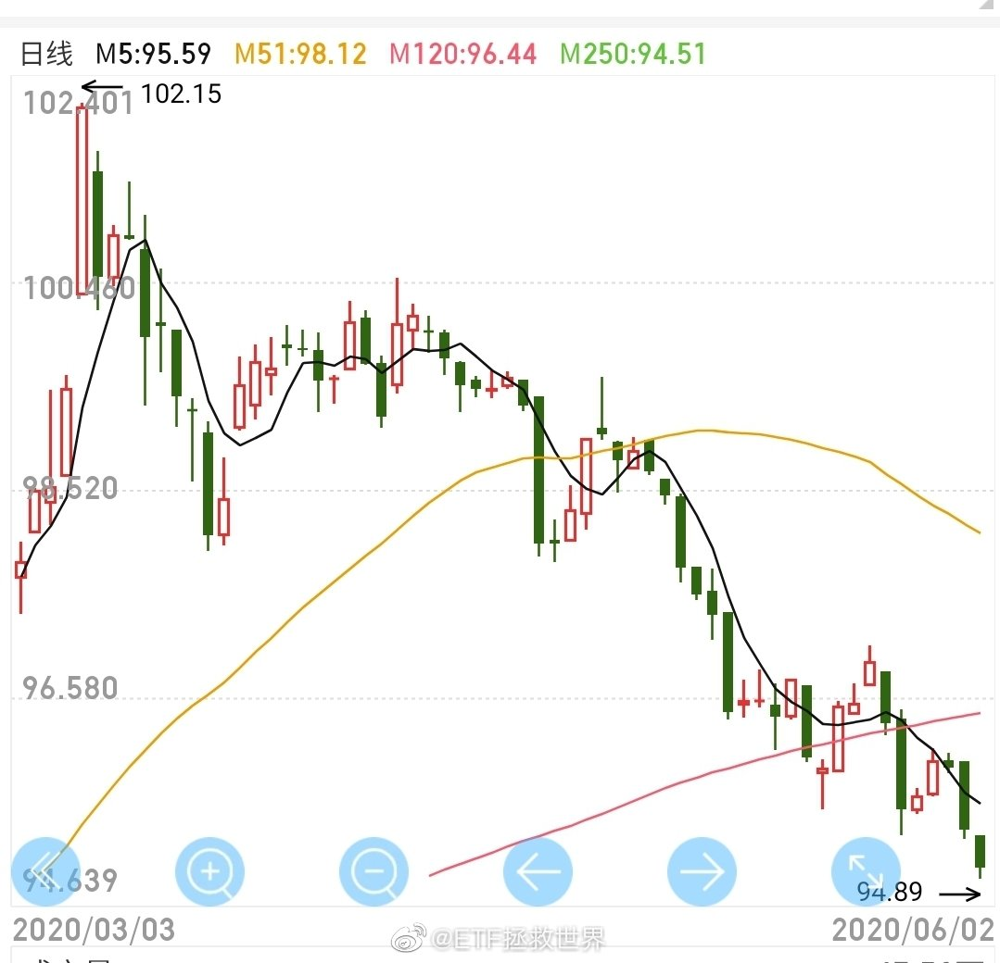
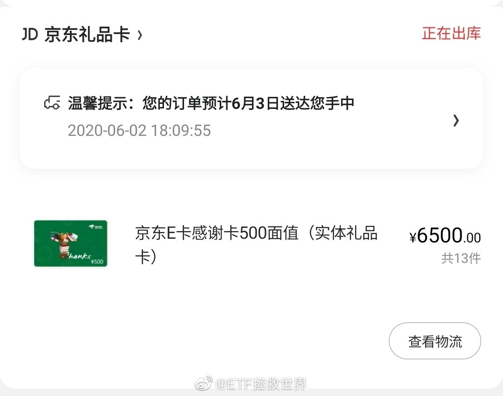
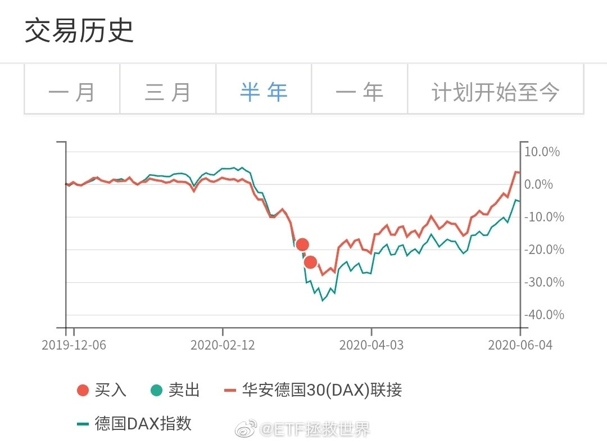
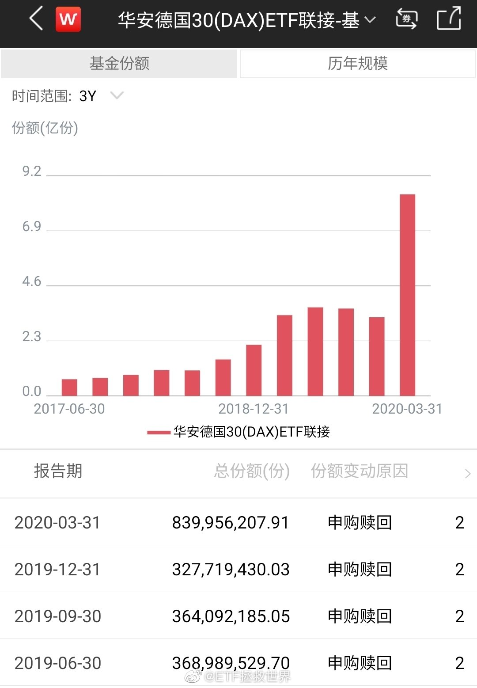
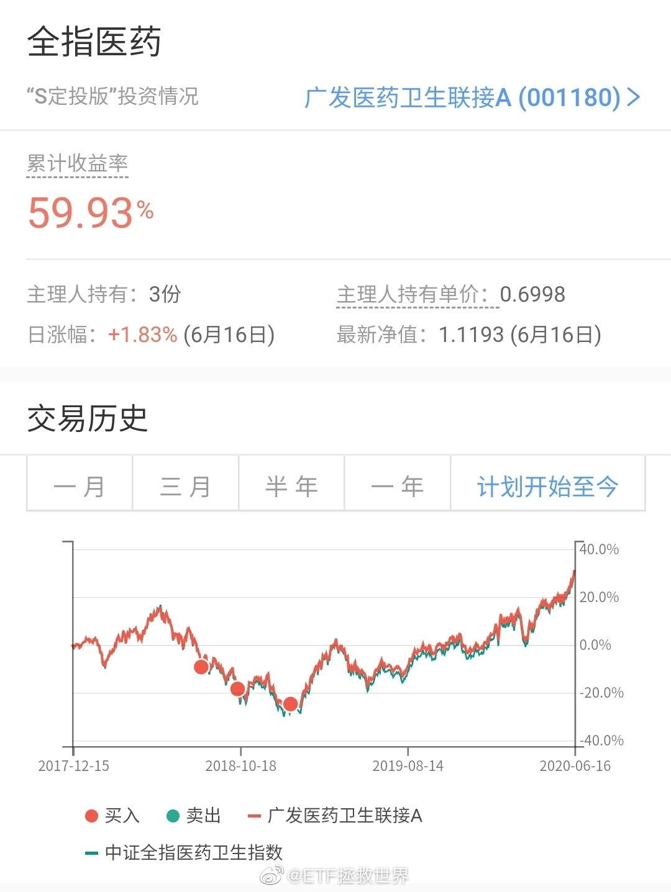
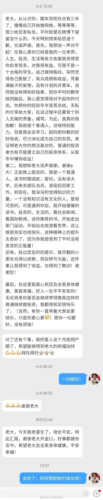
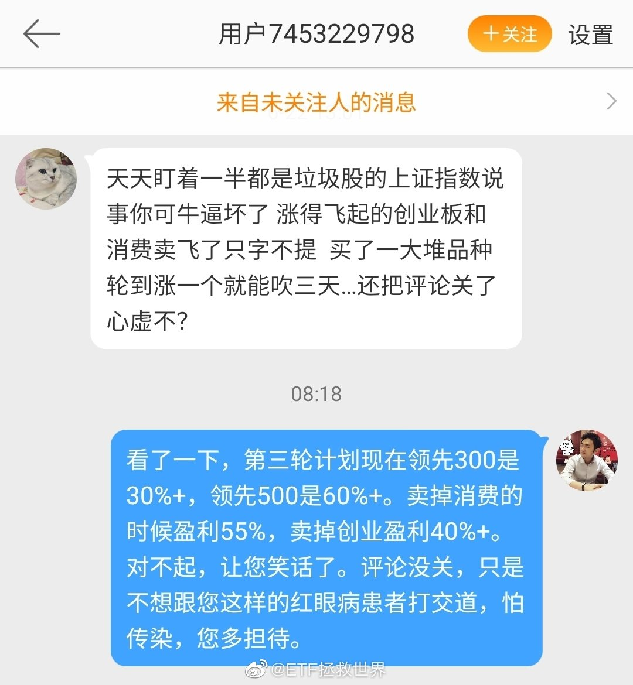
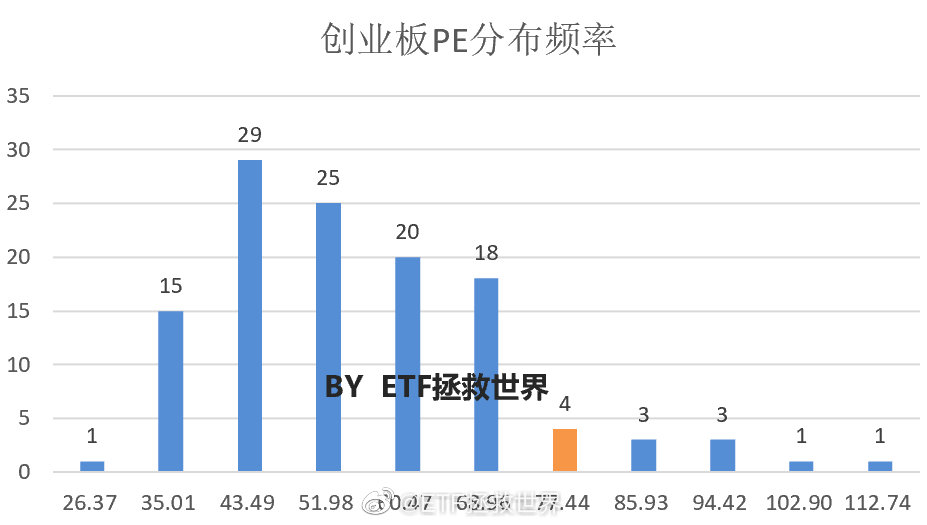
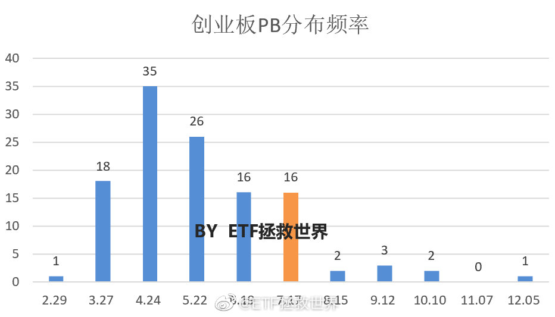
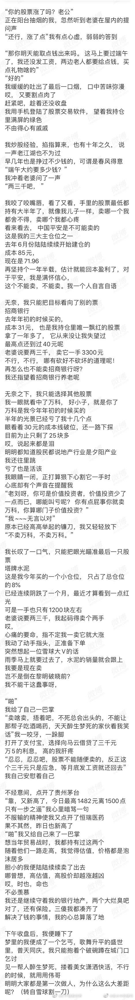

## 2020-06-01 09:13

节日快乐！

今 天 不 许 不 开 心！ ​​​

## 2020-06-01 15:24

赚50%了。金融投资就是三年不开张，开张吃三年。不涨的时间越久，涨的越高。不要急//@ETF拯救世界: 这个品种跌了3年，最多跌了70%多，半个月涨了回来还盈利超过20%。这就是金融投资。之前说过，只要你的品种不死，不要着急它不涨。它会用一两周的时间把几年的收益还给你

## 2020-06-01 16:30

## 2020-06-01 16:33

今天的数据出来了，A股长线仓位我不会再加仓，目前合适。想要加仓的可以自己加或者找其他人参考加。 ​​​

## 2020-06-01 17:17

感觉黑人都特别团结。为什么有些人种在西方也被歧视却很少抱团抗争。

这是文化问题还是基因问题。 ​​​

## 2020-06-01 20:39

乌克兰：1991年人均GDP 1489美元，是中国333美元的347%。 到了2019年，乌克兰人均GDP 3680美元，是中国10276的35.8%。 真心希望大家都读读过去30年的世界历史，尤其是看看发生剧变后是国家哪部分人受益，哪部分人越过越差。真的与你想的不一样。

## 2020-06-02 14:08

国债这么跌我就很高兴了。我不是针对国债，而是在座的所有品种谁跌我都开心。

有钱还怕没东西买吗。正好纯债仓位已经降到1%以下了，等着补仓呢继续加油啊。 ​​​

## 2020-06-02 17:06

12000达成//@ETF拯救世界: 最低8255。现在12000的第一减持位快到了。

## 2020-06-02 18:12

下单了，中奖的各位这周就能拿到卡号了。

之所以现在才下单，是等618，让你能多买点东西。

enjoy it. ​​​

## 2020-06-02 19:24

本来我对怎么治病没什么特殊好恶，能治好就行。

现在说不许说某种治病方法不好，说了就是违法。

说真的，我想去医院看病了，因为突然觉得有点恶心。 ​​​

## 2020-06-03 09:32

为什么贫富差距越来越大。

有资产的，危机中抄底，账户不断新高。

没资产的，危机中失业，钱越来越少。 ​​​

## 2020-06-03 09:49

之前换416还是可以吧。 ​​​

## 2020-06-03 09:58

这里的朋友至少有一半普通话没他好吧。

## 2020-06-03 10:13

医药已经回到2015年6月点位。

距离救命底涨幅76%。 ​​​

## 2020-06-03 10:23

真心的再说一次，特别特别重要：

一个品种跌很多的时候，必然有很多很多人看衰它。会找很多很多理由解释为什么跌很多，然后告诉你它永远没希望。

相反，一个品种越涨越高，也会有很多人看好它。告诉你只有它才是天选之子，一定会永远涨下去。

对于个股来说，真的有可能出现上述的情况。但是对于不会死的指数来说，千万不要轻易被情绪左右。

风水轮流转。跌的越多未来赚钱的机会就越大，即使你在底部不敢再买，也不要轻易卖掉。即使全世界都告诉你毫无希望了。

当然，有些品种是未来几十年都可以长期看好的，只要有大幅回调就可以买，然后长期持有+波段降成本不会错。这几个品种也是几年前就说的：

医药、消费、信息产业。

目前看，医药和以中概互联为代表的科技略高，策略是越涨越卖。

以食品饮料为代表的消费已经涨到我已经不是很懂。手里也没有了，不看了。

## 2020-06-03 10:37

回复@哎呀吗类:胡建人和东北人成语接龙：胡建：心心相印。东北：印贼做父。胡建：父相伤害。东北：害想咋地//@哎呀吗类:福建人表示佩胡//@ETF拯救世界:这里的朋友至少有一半普通话没他好吧。

## 2020-06-03 11:02

开心 查看图片

## 2020-06-03 11:06

从前波动人割你，现在波动你割人。 ​​​

## 2020-06-03 11:18

不同意。我的鼻梁就是初一时候自己捏起来的。很明显的变化。

## 2020-06-03 13:17

舒服、开心，还能挣钱。

这工作是不是能干一辈子。 ​​​

## 2020-06-03 17:59

虽然一直很喜欢DAX，但这波德国反弹这么强（49%）已经超过我的预期了。

再……再飞一会。 ​​​

## 2020-06-03 19:23

我觉得地摊应该是为那些生活比较困难的人提供的一个选项，那些开着BBA在后备箱卖货的是不是就别凑热闹了。

不过地摊+网商前后夹击，商场是彻底歇菜了。 ​​​

## 2020-06-04 14:35

利好中证环保。//@昆山法律:后续再思考，摆摊后环境卫生垃圾处理是不是又是产业链上的？

## 2020-06-05 15:14

你有没有打开账户一看就又在新高，也不知道为什么一直赚钱，很迷茫的感觉。

也许这就是人生吧。 

新高的时候，没有一次操作是无辜的。 ​​​

## 2020-06-05 22:12

这一波华安的dax基金经理要表扬

最后暴跌那两天我们大量申购拉住了净值，下跌跑赢，很正常。

然后快速建仓反弹的时候完全跟上他们做的非常好了。 ​​​

## 2020-06-05 22:25

散户从来都是追涨杀跌。

但这次危机，有一波人勇敢的抄底，还成功了。

增值2亿多。 ​​​

## 2020-06-07 00:53

## 2020-06-08 17:22

美股再回历史危险区域。

这个区域买美股，十年角度看，不会有好的收益率。 ​​​

## 2020-06-09 08:14

基本上海内外市场经过大跌大涨都回到年初的位置了。半年看，今年年初大波动的判断没错。还有半年，走着看吧。

## 2020-06-09 08:48

回复@范海峰73229:我们3月最低位买的美股您没买是吗。还是说您根本不知道我们在干什么？我把你晒出来，以后美股跌下去我还要晒。不停的晒。//@范海峰73229:一直看空美股.一直被打脸

## 2020-06-09 08:58

开了100天评论，还是有那么多无脑人。微博用户知识水平真那么低么。

从去年开始，我就说当时的点位买美股， 十年不会有好收益。一年多过去，你当时买到现在确实没有好收益。3月还赔了几十个点。至少到现在，我没说错，打谁的脸？

我们3月份买，赚二十多个点走人，收益率就是比你在高位买的多，你打谁的脸？

说实话，对一个不断上涨的市场，敢于不看好的人，对一个不断下跌的品种敢于持续买入的，你都应该尊重。为什么？

因为这个市场上已经太多涨时看好跌时看空的人了。跌的时候雪中送炭，涨的时候挥一挥衣袖说再见，可不是谁都能做出来的。

最重要的，当着几十万人的面，旗帜鲜明的说出明确的判断，不模凌两可，不怕“打脸”，你以为谁都能做到吗？

在股市，涨的时候喊多，跌的时候看空，从短期趋势讲是最安全的，最不会被“打脸”的。但是我不愿意、不屑于做。怎么了，招你惹你了？

有些人对别人的要求，就是一定要买在最低点，卖在最高点。如果没有，他会问你，“怎么你买了又跌了，卖了还在涨？你这个辣鸡，打你的脸！”

对别人要求特别高，对自己要求特别低，永远不会从别人身上学到东西，每天期待的不是自己生活更好，而是别人翻船。这些，就是loser的鲜明特征。如果你身边有这样的人，一定要离他远一点。

## 2020-06-09 09:40

回复@ETF拯救世界:还记得这个吗。4月2日。油气基准从那天开始反弹，至今涨幅140%。//@ETF拯救世界:不知道为什么，今天很多人慌张的问：有石油开采公司申请破产了，是不是石油类基金都彻底完蛋了，要割肉吗？我就想起了这段往事。

## 2020-06-09 10:01

做家长的，最重要的是给孩子内心深处潜意识中注入“天塌下来家都是你避难的港湾”。人的抗打击能力当然重要，更重要的是有“爱”在支撑。有爱就有希望，有希望就不会放弃。

## 2020-06-09 10:21

回复@守望星辰大海777:这也不对。比如在座的朋友，如果去炒股，可能有一半以上会赔钱。这是必然发生的吗，是自然选择物竞天择就应该被淘汰吗。实际上平行宇宙还有另一种可能，就是掌握正确的投资理念，结果95%以上都挣钱了。所以很多事情是可以改变的。

## 2020-06-09 10:29

油气做波段品种真的是利器。不过它最大的问题是每次到了低位都暂停申购，导致溢价极大，无法低位买。

这个问题不解决，还是慎重用它做。 ​​​

## 2020-06-09 10:51

路过塔吊的时候一定要快速通过。君子不立危墙之下。

## 2020-06-09 11:03

养老终于在大医药的带领下创了两年新高。

有传媒拖着，不容易啊。传媒你长点心吧。用赵老师的话说，你得支棱起来啊！ ​​​

## 2020-06-09 13:37

今天大家手头都很宽裕啊。 ​​​

## 2020-06-09 13:58

大家大方我也不能抠门。  ​​​

## 2020-06-10 10:53

希望判5年以上，同时大力宣传。

## 2020-06-10 13:18

如果一个品种涨了100%，你只赚了70%。

别为了没赚到那剩下的30%太难受。

做个好人吧，留30%给别人赚。事情做得太绝老天爷都会看不下去。 ​​​

## 2020-06-10 14:19

虽然这么说挺不厚道的，但我希望国 泰 航 空倒闭。 ​​​​

## 2020-06-10 19:08

今天数据出来了。

现在还在追医疗器械的，中长期看，就是在作死。

短线高手腿脚利落的除外。 ​​​

## 2020-06-11 09:53

支棱起来了！

## 2020-06-11 10:17

每天一看账户又新高，

其实挺没意思的是不是。

关键是还特别舒服。不会像原来一样：哎呀我的股票涨了，卖不卖啊，不卖跌了怎么办啊。卖了吧，啊，怎么又涨了！算了不卖了，什么玩意儿怎么跌回去了！

舒舒服服，每天账户数字都在增加，一点都不刺激。 ​​​

## 2020-06-11 12:18

我参与了@凤凰周刊 发起的投票【利用航班延误骗保300多万元被抓，你怎么看？】，我投给了“不知道到底触犯了那条法律”这个选项，你也快来表态吧~

## 2020-06-11 13:51

标普500什么时候接回来。 ​​​

## 2020-06-11 16:38

我想了一下那个案子。

第一，帮亲友订机票违法吗。肯定不违法吧。（不知情就违法了吗。我要送给父母或者爱人一个旅游礼物，作为惊喜先订了不告诉他们，违法吗。）

第二，投保延误险违法吗。肯定不违法吧。

第三，取消订票违法吗。不违法吧。

为什么加起来就违法了呢。法律有规定不能频繁订票频繁取消吗。如果有，当我没说。

## 2020-06-11 17:07

赔钱，把当时一条线上的蚂蚱都拉出来，所有相关人永不录用公职，甚至要坐牢！这是别人的一生！！！这样的事情太让人生气了。

## 2020-06-11 18:14

2000年是纳斯达克十五年高点。之后下跌78%，一直到2015年才再创新高。这次……

## 2020-06-11 18:59

我再次提示一下各位。

我永远不会“看空”更不用说“做空”某个品种。我只能大致判断在哪个位置买，赚钱的概率大。在哪个位置买，长期看赚钱的概率很低而已。

看空或者做空有三点不容易把握。

第一，市场情绪。不是说贵了就不会涨，贵了可能更贵，然后继续贵，然后冲破云霄。这个谁都无法把握。

第二，也许我看对了，确实是会跌。但是时间不可能精确把握。如果很久之后才跌呢，如果先是暴涨再跌呢。所以做空有风险——你看对了，但在验证你正确前，你已经挂了。

第三，如果看错了呢。我觉得贵了，其实不贵呢。

所以，在某个位置我会觉得某些品种很贵，我不会买。但不会卖掉手里的低成本持仓。毕竟你应该了解，不买和马上卖是不同的。

然后更贵的时候，可能我会开始慢慢出货。

贵到我不能忍的时候，可能会大量出货。

不知道你能不能懂上面说的。我总结一下：

贵了不代表马上跌，有可能还会涨。即使会跌，我也不知道什么时候，所以不做空。

贵了，不买，也不代表马上清仓。买入——持有——卖出，是有不同的容忍区间的。投资是三个动作，持有是时间最长的。

比如中概，我之前就说过，已经不适合买了。我也确实没有再买，只是持有。然后又涨了很多，我们才开始卖第一份。包括医药也是如此。认真体会一下。

## 2020-06-11 19:10

人民日报侠客岛说：

## 2020-06-12 06:57

两个交易日后，暴跌6%。第一次晒。别急，以后还有很多次//@ETF拯救世界:回复@范海峰73229:我们3月最低位买的美股您没买是吗。还是说您根本不知道我们在干什么？我把你晒出来，以后美股跌下去我还要晒。不停的晒。//@范海峰73229:一直看空美股.一直被打脸

## 2020-06-12 07:35

再次提醒一下，华宝没有任何微信群，让你加微信加群的都是骗子。

再说一次，都是骗子！ ​​​

## 2020-06-12 08:48

容忍度不同。

我对有“铁粉”标志的朋友，容忍度会很高。在评论里开一些不合时宜的玩笑，甚至出言不逊我都大概率一笑而过。就像你跟哥们开玩笑，笑骂一阵不会当真。

但没有标志的朋友，如果不想被拉黑，就请说话客气点。您哪位啊，大家又不是很熟，你让我不开心了请您出去我觉得也很合理把。 ​​​

## 2020-06-12 09:11

设置好50个条件单，迎接美好的一天。 ​​​

## 2020-06-12 09:18

“男人肯买糖、衣料、化妆品送给女人，而对于书只肯借给她，不买了送她，女人也不要他送。这是什么道理？借了要还的，一借一还，一本书可以做两次接触的借口，而且不着痕迹。这是男女恋爱必然的结果，一借书，问题就大了。”钱老想不到，21世纪会有人用这样的借口做两次接触。

## 2020-06-12 09:51

给医药跪了。 ​​​

## 2020-06-12 14:13

别总是问赚了xx%了怎么办，S XX卖不卖，XX怎么了。

相信自己就随意操作，相信我就等车。

不就赚点钱至于那么心惊肉跳吗。多大点事儿啊。 ​​​

## 2020-06-12 14:57

养老继续两年新高，医药五年新高，传媒支棱到收盘，小网格高卖低买咔咔进货。

每天都舒服有没有。 ​​​

## 2020-06-12 16:45

听说下周一又不能复课，儿子崩溃了。殴打巨型公仔中。

更多精彩内容请关注本台记者后续报道。 ​​​

## 2020-06-13 08:02

这就没得说了，该判判吧

## 2020-06-14 13:12

闲着也是闲着，有空你可以祝福一下我们全家身体健康。 ​​​

## 2020-06-17 08:06

s医药或成最大赢家 ​​​

## 2020-06-17 08:19

回复@卢涨停·:我还没说2900多点，95%的人都赚钱了呢。服不服？不服哪儿凉快哪儿呆着去。想想你除了对做事的人冷嘲热讽，对人类做出过什么贡献吗。loser.//@卢涨停·:S医药大涨了就是最大赢家，S油气大跌了就是持仓占比小，不用在意宁可真是文学家

## 2020-06-17 08:26

回复@小松鼠起来跳:你说到重点了，你具备逻辑思维能力。我根本没说计划怎么样，更没说我怎么样，只是说这个品种涨的最好，辣鸡就急不可待的跳出来了。他要么是逻辑混乱，要么是真的憋坏了//@小松鼠起来跳:语文真烂，益达主语明确，非要扯到全部计划上

## 2020-06-17 08:29

你很难要求需要业绩排名的人不追热门。可惜，历史上没有一次追热门有好下场的

## 2020-06-17 08:40

PDD这么涨有一定道理。

我购物的原则是大件贵重京东，小件TB。

最近我发现小件大多数都是放弃TB在多多买了…确实便宜，加了月卡补贴更香… ​​​

## 2020-06-17 09:03

这两天没有工作，在家休息，看了两集乘风破浪的姐姐。

DH、LY和HSY把我气坏了。讨厌这样的人。 ​​​

## 2020-06-17 09:40

不要因为前几天卖了20%医药难过，觉得没有卖在最高点，怎么卖了还在涨。两个你需要知道的事情。

第一，你的大部分仓位没有卖。150里面80%医药，100%养老，S里面所有医药和养老都踏踏实实持有中。

第二，正因为中途卖掉了这20%，你现在才能非常踏实的持有剩下的绝大多数。因为你不怕过山车了，甚至希望跌回去你能做差价。

不要小看心理因素。你舒服不舒服，一定程度上决定你的投资是否会成功。

还是那句话，别想从头赚到尾。打了胜仗，且打且退，控制好节奏，拿着战利品回家才是最重要的。想吃掉全世界，你先想想npl和xtl是怎么完蛋的。

## 2020-06-17 09:55

医药基金自救命底以来一年半上涨94%。 ​​​

## 2020-06-17 10:30

目前全指医药点位与2015年5月相同，估值下降了44%。

而医药目前的估值与2007年1月相同，指数点位上涨了575%。

这就是持有成长指数长期看会不断上涨的原因。

但是，永远不要买贵。再好的东西买贵了也可能十年不挣钱。 ​​​

## 2020-06-17 10:53

你在贵的时候买了，可能下次贵的时候能赚到指数的年增长率。但这个收益率可能并不高。所以最好的模式是，便宜的时候买，赚估值增加和指数成长的双击收益。最惨的是贵的时候买，便宜的时候卖，这也是大多数人不挣钱的根本原因。

## 2020-06-17 11:03

我看到有人说我，是“什么涨了拿什么出来吹”。

不好意思，我就是什么时候都有的吹，你气不气？

玩笑归玩笑，各位应该了解一件事。我经常拿近期涨的不错的持仓品种出来说，不是为了说明我多厉害，我并不厉害。我的主要目的，

第一是为了给各位做按摩，该拿的时候拿住，别随便放弃。绝大多数人都买过牛股，为什么只有很少人真的赚钱？

第二是虽然持仓，但经常会提示风险。希望各位朋友不要因为涨的高了就忘乎所以，变得疯狂。

另外，有没有发现我跟很多人不同的地方？

很多人是持仓涨了以后会不断的忽悠你还能涨，还能涨10倍，赶紧买。不管他是为了让你接盘还是真这么认为，这种事情我是从没干过。

我只会低位买完了，涨起来后不断告诉你风险越来越大了，我不会再追。

我可能没法让每个人都挣大钱，但我希望没人因为我赔钱。

我又没忽悠别人接盘，在微博提两句自己什么品种涨了又让你不舒服了？太好了，那我就再多说几句，争取让你尽早就医，去眼科挂个专家号。

## 2020-06-17 11:17

2020，除非出现外星人，没什么再能让我感到意外了。 ​​​

## 2020-06-17 11:53

这个班的家长们，能不能让你们的孩子把当时发生了什么说出来。这是让你们孩子学会做一个诚实的，善良的人的最好机会。否则，有些孩子会因为这个背负一生的心理负担。校方，教育局，你们能不能首先做个人，先别考虑推卸责任，把真相调查、公布出来？

## 2020-06-17 21:45

是亲生的没错了。

## 2020-06-18 12:08

做了个核酸测试，一切正常。托大家的福。 ​​​

## 2020-06-18 13:08

今天准备吹红利，喷子就位了吗。 ​​​

## 2020-06-18 18:18

6月18日，终于决定展开调查。不是说教师一定有问题，群众只是想知道到底发生了什么，请认真负责调查，公布真相。如果是教师随意打骂侮辱孩子，就要负她该负的责任，同时一脚踢出教师队伍，为了其他老师，也为了孩子们。

## 2020-06-18 19:05

有朋友说，不知道为什么要加入和我关系的那段描述。

一看就是没有经历的朋友。

之所以记忆如此深刻，是因为那个人曾陪你走过一段人生。所以她身上发生的事情，你才会永远忘不了。如果是普通同学，大概唏嘘一声，也就抛在脑后了。

听过那首歌吗。写的真好。

“那片笑声让我想起

我的那些花儿

在我生命每个角落

静静为我开着

我曾以为我会永远

守在她身旁

今天我们已经离去

在人海茫茫

她们已经被风吹走

散落在天涯

有些故事还没讲完

那就算了吧

那些心情在岁月中

已经难辨真假

如今这里荒草丛生没有了鲜花

好在曾经拥有你们的春秋和冬夏

她们都老了吧

她们在哪里呀

幸运的是

我曾陪她们开放”

写字的人有故事，可惜听故事的人没有酒。

## 2020-06-19 10:03

有些品种贵，当然是贵。但是贵了就跑赚不了几个钱。

做好跑路的准备，什么时候跑，市场会告诉你。 ​​​

## 2020-06-19 11:14

是不是看了我去年的微博

## 2020-06-19 11:17

股市还在涨，债市还在跌。

还能盼着更好的情况出现吗？ ​​​

## 2020-06-19 14:13

2900点，在座的各位资产没有不断新高只能说不及格… ​​​

## 2020-06-19 16:29

记得之前说病毒离开人体几个小时就死了。怎么现在蔬菜和肉都不让用水龙头洗了。

病毒离开人体到底还能活多久？ ​​​

## 2020-06-20 18:04

看完第二期，HSY荣登我心目中最讨厌第一名，继续努力啊。姐姐们保养的真好啊，金莎真的快40了吗…

## 2020-06-20 19:58

越来越好。 ​​​

## 2020-06-21 07:13

知道为什么公众号每个月只有一两篇文章了吧。

## 2020-06-21 18:05

东城小区全员检测。

这样的力度还控制不住就邪门了。 ​​​

## 2020-06-22 09:56

很多做投资的朋友会有一个疑问。

看历史K线，大牛市结束后，那样大幅度动辄50%以上的暴跌中，为什么持仓的人在跌十几二十个点的时候不跑，还有很多人要抢着接飞刀去买入？

原因很简单。

他们被洗脑了。

被大V洗脑倒是其次，主要是被市场洗脑了。

大牛市中，股票、指数，尤其是龙头板块不断上涨。只要你卖出，事后看一定是错的。这样，时间长了，就会给所有人加上一个思想钢印：

“xx会永远涨，哪怕跌，也是暂时回调，是最好的介入时机”

当所有人达成这个共识后，市场就会崩溃。

其实很少人买在最高点，绝大多数被深套的，都是在不断下跌不断买入中被套死。

其中少数优质品种，真的是暂时调整。有些，永远不会回去了。

这段话，如果我是在空仓后的大涨中说，会被人骂是踏空狗，是嫉妒。现在我仓位不轻，也有不少强势品种，说这个话，你应该明白是非常客观。

这个市场是观察人性最好的地方。什么是人性，绝不是一句贪婪恐惧就能概括。

## 2020-06-22 11:40

本来自己买的东西挺便宜了。

再一看评论里居然有人比自己还便宜买到。

就很气。 ​​​

## 2020-06-22 11:48

我没说投资，我说的是买东西！投资上你们挣得比我多我开心还来不及好吗。

## 2020-06-22 16:32

今日收盘后仓位建议：保守——激进在50%-70%之间。极度激进可以80%，极度保守可以40%。如需减仓，建议优先考虑创业板与医疗方向仓位。

## 2020-06-22 17:51

如果真的搞起来，我们的胜算有没有7成。

## 2020-06-23 11:50

今天吹传媒，想必没什么争议吧。//@ETF拯救世界:支棱起来了！

## 2020-06-23 12:05

如果今天下午不跌，养老基金将创2015年8月12日以来5年新高。当然，各位的账户依然是继续历史新高。//@ETF拯救世界:今天吹传媒，想必没什么争议吧。//@ETF拯救世界:支棱起来了！

## 2020-06-23 12:20

查看图片 //@ETF拯救世界:开心 查看图片

## 2020-06-23 12:44

个人认为，人口减少两三亿，同时最低收入的两三亿人收入增加100%-200%以上，然后整体素质提升，人少了，有钱了，挺好。

## 2020-06-23 12:52

为什么强势品种不停涨？

因为专业投资者的基金经理不买强势品种，净值就上不去。净值上不去规模就要掉，排名、奖金和提成也跟着掉。

业余投资者就不用说了，追涨杀跌最拿手。

再说一次。高，肯定是高，贵，肯定是贵。但什么时候卖市场会告诉你。不要猜顶，这是过去十几年赚大钱的心得。

底部买入不要怕，上涨过程中坚定持有不要怕，顶部坚定卖出更不要怕“踏空”。

不就这么点事儿吗，没什么难的。

每天都有人希望我被打脸。涨的过程中卖掉，然后继续涨。或者不卖，又跌了。每次他们都会特别兴奋——好不容易找到我没有做到最好的操作就来打。

所以对我来说，其实不说判断，或者不明确的说是最保险的，就不会被打脸。

但我知道自己是个人，是人就会错。在市场中，不犯大错，大方向不错，最后结果就会好。100次操作，有10个小错误，太正常了，我能接受，在座的各位也能接受。只是那些来打脸的人不会接受。

他们对我的要求是：完美。一次都不错。每次买在最低，卖在最高，满仓持有最强势指数，弱势指数一点都没有。33个品种，每个都赚大钱，一个浮亏都没有。

所以，他们对我才是真爱啊。

## 2020-06-23 13:12

隐秘的角落，看了一集多一点，拍的不错，演得不错，也很精致。

但我看不下去。我不喜欢看让我心里堵得慌的东西。这剧故事、表演、画面、音乐，都让我心里堵得慌，不开心。

做人最重要是开心啊。 ​​​

## 2020-06-23 13:24

今天到现在你的账户增值不少，但其实股票涨跌比例是1200:2600 ​​​

## 2020-06-23 17:10

强烈建议做指数的时候也玩个股。

这样你就不会在未来觉得自己是个被指数投资耽误的股神了。会减少很多焦躁的情绪。

毕竟，每天几十只涨停，如果你炒股，没准隔三差五就能买到。 ​​​

## 2020-06-23 23:21

真人肯定拍不好。为什么不先拍一个动画版呢，至少三五年后能看了

## 2020-06-24 08:22

我想问问大家，为了夸我牛逼，专门注册一个小号，这是不是真爱。

昨天让且慢统计了一下，已经帮各位盈利十几亿。我确实卖不到最高，但我尽力了。 ​​​

## 2020-06-24 08:41

看了一眼创业板。

之前卖出一份是在1.2014，现在1.2965，距离当时上涨7.9%。没想到，这一届网友已经如此严格了。

更别说，我们卖掉后创业板曾大幅暴跌30%以上。

我不明白一件事，为什么这样一个必然会死的透透的东西，我不继续持有是罪。现在的创业板指，已经进入我严格定义的“必死”区域。为什么我知道一个品种在必死区域，还要继续持有？

有些人买卖，并不是看本质，而是看走势。他会觉得你买了还在跌就是sb，完全不管已经在钻石坑，随时会大涨。也不会管你卖了还涨你就是loser，完全不管已经到了哈迪斯顶。

现在已经好多了。回想起2015年4-5月，我清仓后在雪球被骂成筛子，被无数人骂踏空狗，现在这一两个出来蹦跶的，已经不算什么了。

巴菲特2007年赚了几倍后在12块清仓中石油，在中石油涨到21的时候还不是被各路“股神”甚至央视抓出来道歉？

我就想吃中间一段，多出来的疯狂我不想吃怎么就不行呢？到底为什么不行呢？我几十个点的利润走了为什么不行呢？一定要跟你一起疯狂到爆炸死无全尸才好吗？

再说一次，创业板指，这个PE70+，PB7+的牛指，某些人眼中的不持有就是犯罪的牛指，必然崩溃。

这话我本来不想说，就怕让别人觉得我现在没有是踏空狗为自己找借口。但你逼我说，以后看，也算是造福很多人了。
 

## 2020-06-24 08:59

回复@LIE开啦:这是创业板的历史月估值。现在是黄线，蓝线是历史。你看看过去120个月，有几个月比现在高。高的那几个月，全在2015。//@LIE开啦:pe那张图，70以上的有12家，70以下的有上百家，怎么就整体pe70+

## 2020-06-24 09:18

今天没什么心情说话了，不发微博了。

有空会认真看一看过去几天的评论，把阴阳怪气的都拉黑。 ​​​

## 2020-06-25 15:17

朋友转给我的。段子的成分居多，不过也应该代表一部分人的状态了。

持有价值股的不好受，你以为喝酒吃药的好受吗。未必。

咱们应该是最舒服的一群人。不仅赚钱，每天都很舒服，无论涨跌。

昨天又新高了吧。 ​​​

## 2020-06-25 15:40

呵呵，用膝盖想都能明白的事。 查看图片

## 2020-06-25 16:07

关键是到现在依然没有人出来说到底怎么调查怎么处理。如果实在不能判刑，顶替的人先赔被顶替的每人88万行吗。

## 2020-06-27 09:45

就像跳楼女孩案件中最让我气愤的是在群里点赞的家长一样，高考顶替案里最让我绝望的是那些责怪报案人多事，影响家乡名声，怕给自己惹麻烦的亲戚，同乡和工作人员。

做个人这么难吗？ ​​​

## 2020-06-28 10:38

反正今天不开盘，闲着也是闲着。

有单身朋友想扩大一下交友范围的，可以在这条下面评论简单介绍一下自己（不要太详细，注意保护隐私），说说想找什么样的男/女朋友，或者看看有没有合适自己的。

能关注我100天还没有取关或者被拉黑的，三观都不会太差。[doge]

另外，注意，关注我的经济实力一定也不会太差，至少是有闲钱投资，已经比大多数人强了。

已婚的/有不良企图的/对别人评头论足的一律删除并且拉黑一万年。

## 2020-06-29 18:30

举报很正常，什么人都有。但是这样的举报居然受理了，然后要整改？

## 2020-06-30 10:10

15500渐行渐近。

## 2020-06-30 10:14

所有的点位都不是渐渐蒙出来的，而是早就蒙好了。

## 2020-06-30 10:17

回头再看钻石坑。当然，这个10倍不是一轮让你实现的。而是你有了7800以下的持仓，不断高抛低吸，2-3轮赚10倍。

## 2020-06-30 10:23

别人都看好的时候你也看好，一点都不难。

别人都看跌，你买了，还在跌，别人都在嘲笑你的时候，你是不是足够自信，就体现出来了。

说句实话，想在投资上打击我的信心，让我随波逐流不再特立独行，没人能做到。

当然知道自己不可能所有细节都是完美的，但大方向是有足够的自信。 ​​​

## 2020-06-30 10:34

回复@WHMMFY:千万不要“等”。从目前的这个点位开始，崩是肯定崩，但什么时候，什么点位开始不知道。君子不立围墙之下，走远点看着就行了，不要“等”。你等了它不崩你就要着急，何苦呢。挣自己的钱去，让人家自己去疯就可以了。//@WHMMFY:等着前几天仓位降下和创业板崩盘

## 2020-06-30 10:41

一直以来，我就特别不明白散户投资圈这种互相看不上的风气。

有人喜欢银行股，有人喜欢创业板，有人喜欢科技，有人喜欢医药消费。这不挺好吗，百花齐放才是春。

结果有些银粉天天骂创粉，创粉天天骂银粉。以前我还看两眼，现在多看一眼算我输。

人家买什么股票，赔了赚了关你什么事情呢？你做好自己的事不行吗？你不喜欢就不买啊，人家买了，赚钱了又不从你兜里掏，赔钱了也不会跪下叫你爸爸，你是不是吃饱了撑得管人家买什么？还是工作太轻松，要加担子。

推而广之也是如此。

买股票还是买债券，买指数还是买主动，买个股还是买基金，各有所好，各取所需。为什么就一定要跟着你的喜好做呢？你喜欢吃咸粽子，我喜欢吃甜粽子不可以吗？

当然，我说的是没有利益关系的人，吃饱了撑的骂别人。有些人就是为了博眼球吸粉，没完没了的碰瓷，这种人就不是“闲”了，而是_____。

## 2020-06-30 13:50

别说那么多，先喝一杯Dry Martine庆祝一下。 ​​​

## 2020-06-30 17:42

开心最重要，互动前100名，看看谁手气壮。  ​​​

## 2020-06-30 18:19

拿着现金是隔一段时间烧一部分，乱投资是把现金放在一起一次烧完。

