## 2020-07-01 10:20

除了你自己，这世上没有任何一个人或者物品可以跟随你一辈子。

有的长一点，有的短一点，最终都是生命中的过客。

所以有缘在一起的时候就要好好珍惜，感受人或者物品带给你的快乐。不愿失去就尽量争取。如果实在无法挽回的失去了，也不必太过痛苦。

一切最终都会离去，要接受这个事实。

————用了十几年的理财记账软件有可能要挂了有感。

## 2020-07-01 10:37

音频节目有搞头吗。费了半天劲弄出来没人听就没意思了。

而且音频可以聊什么呢。到处都有的东西再做一次就是浪费生命。 ​​​

## 2020-07-01 11:19

不知道做一个理财软件要多少钱。

现在也有一些软件，不过大多数是记账而已。

记账只是最初级的。高级的应该是能记录你的所有场内场外金融交易，然后随时给出资产配置比例。

更高级的应该是根据你设定的理财目标，给出资产配置建议。

除此之外，还可以分析你的收入/消费行为，哪里做得好，哪里有问题。如果要达到目标，哪里需要加强哪里要改进。

这样的软件一年收100、200不贵吧。有几万人用的话，自己养自己应该问题不大。后期再接点广告之类的，应该能赚钱。

不知道为什么没人做这件事。

## 2020-07-01 11:30

今天还卖出的机构，觉悟都太低。 ​​​

## 2020-07-01 13:08

希望红利和金融接力医药。百花齐放才是春。 ​​​

## 2020-07-01 14:49

目前红利+50+300+金融仓位25.42%。极度舒服。

每天都能做到仓位舒服就对了。 ​​​

## 2020-07-01 15:16

今天就到这儿，明儿见。

都要开开心心的。开心最重要！别人不能决定你的心情，只有你自己可以。 ​​​

## 2020-07-01 19:48

如果你认可我，请不要交钱给剽窃我文字拿去贩卖的那些人。

我的很多投资记录确实不卖，但有些朋友可能真的想看。我会考虑一个解决方法，不排除免费公开。

无论如何，不要花钱去买。因为那些剽窃的人是真正的人渣。请不要把你的钱给人渣。 ​​​

## 2020-07-02 00:08

还没睡的敢不敢说说你在干嘛。 ​​​

## 2020-07-02 09:26

今日生活小贴士：

不要总想着贪便宜，很多时候贪小便宜吃大亏。

力所能及的范围内买最好的东西。 ​​​

## 2020-07-02 10:05

之前很多人吐槽红利，说什么价值投资没戏了。

其实你知不知道，在2019年3、4月，创业板/医药这样近期大热门还被压在地板上摩擦的时候，富国红利净值几乎已经是历史最高了，挡在前面的只有2015年5月的几个交易日而已。

（创业板还需要涨66%才能回去）

人家早就回到股灾前了，怎么就不行了呢。

这就是人类。

人类从一个整体来讲，是特别不理性的。整个群体有一个特别奇怪的特征，就是喜欢用最近的表现定义某个人或者某件事。

很简单的例子。

比如说中国古话有句叫做“浪子回头金不换”。什么意思，意思是无论你做过多少坏事，只要你现在改了，比黄金还珍贵。

但如果你一辈子做好事，老了以后做了一件坏事，所有人都会说你是坏人。

这不是很奇怪吗？

再说一次，做投资，千万不要把最近发生的推演到未来。如果有人这么做，就是连门都没入。

这也是为什么每年冠军基金第二年极大概率翻车的原因。

## 2020-07-02 10:13

回复@ghost0128:没什么好说的，不贵不便宜，趋势不错，拿着呗，别想它，就当丢了。//@ghost0128:益达，说说500吧，创新高了

## 2020-07-02 11:03

两融余额4年半新高，赌徒回来了。 ​​​

## 2020-07-02 13:50

很多人低位不买，涨起来后加杠杆买。

你说是不是很奇怪。

这么做生意能不赔吗。 ​​​

## 2020-07-02 14:18

回复@慕容婷菲:是啊。只有不涨你才能多买，只有多买未来才能多赚。但是很多人总也想不明白这个简单的道理。//@慕容婷菲:这两天很深刻的体会到益达说的熊市越长对投资越有利，只可惜跟车完，自己买的股票时机也没把握好。好想这个下跌的行情持续长一点呀

## 2020-07-02 14:27

我最不理解“空仓”的人。

空仓意味着你认为100%会跌。

哪怕只有1%的机会涨，你也至少应该买个1%吧？

不，人家就空仓。

喷了，这得对自己的预知能力多自信啊。 ​​​

## 2020-07-02 14:33

既然杠杆已经开始加了，下一步就是观察你周围之前对股市没有兴趣的人什么时候开始聊股市。

开始聊是一个信号，但不是关键的信号。更重要的是他们什么时候真的拿钱入市。

拿钱入市很重要，但还不是最关键的信号。

最关键的信号是他们什么时候开始吹赚了多少钱同时向你推荐股票或者基金，这就有点危险了。

等他们开始加码把存款挪到股市希望赚更多的时候，你就应该知道，

你可以准备逃单了。

## 2020-07-02 15:07

与很多人的雄心壮志不同，我对自己的要求已经说了十几年了，那就是：

熊市不赔钱，牛市尽量跟上指数涨幅。

对，没有要求自己牛市远超指数（300+500）涨幅，就是大概跟上80%、90%就行。所以如果你对自己要求很高，希望赚的远超指数，请不要再关注我。

第三轮，熊市不赔钱又做到了。至于牛市是不是能大概跟上指数，看吧。

## 2020-07-02 19:00

这几天给且慢录了一小段音频，给几位朋友听了一下，反应都不错，都说大部分关注我的朋友会喜欢。

过几天且慢应该会放出来。

因为没录过，所以过程中也觉得很新鲜有意思。所以我在想如果大多数人听过后真觉得有搞头，然后等我懒癌症状轻一点以后多录一些，找个平台放上去。

没什么别的目的，如果有人需要，对我来说又好玩有新的体验，那就玩玩呗。

## 2020-07-02 19:49

其实新冠就是外星人的先遣部队。//@割肉艺术家2020: //@大麦哲伦星系的水兵月:结合之前新墨西哥州的剧情，所以下半年要上演外星人入侵剧情了吗？然后外星人被新冠灭掉……？

## 2020-07-03 09:41

现在回头看，有没有比当时懂一点。

## 2020-07-03 09:59

网格新加的那个指数看来终究是买不到了。 ​​​

## 2020-07-03 10:03

有朋友内心充满焦灼：赚了几十个点了，卖不卖啊。

跌的时候反而没那么焦虑。

每个人的情况不同，没有一个标准答案。所以你不要问我，也不要问任何人，问你自己。

问问自己，从现在开始，涨36.7%，跌31.85%，哪种情况会后悔。如果是涨了会后悔，就不要动或者加仓。如果跌了会后悔，那就减仓。

加减到正好舒服为止。

配置仓位，就是预计未来，然后代入情景，然后调整仓位。

## 2020-07-03 10:08

刚开始做投资的时候，你会上蹿下跳，心惊胆战每一天。

等你因缘际会入了门，会忍不住想去劝那些上蹿下跳的人跟你一起入门。

再往前走，你会不想再劝任何人，只是觉得上蹿下跳有点可笑。

最终，你不会再关心别人怎么做，只会冷静淡然的独自走在投资这条开满鲜花的路上。 ​​​

## 2020-07-03 10:49

医药：“我还行，再扶我起来看看” ​​​

## 2020-07-03 11:05

养老净值5年新高。 ​​​

## 2020-07-03 11:11

落霞与孤鹜齐飞 ，秋水共长天一色 ​​​

## 2020-07-03 11:14

一切的不淡定都来自于你对未知未来的恐惧。 ​​​

## 2020-07-03 12:47

你可能不知道，最后一次买的那份券商，收益率已经超过80%了。

那是最近6年最低的一天，那是名副其实的钻石坑。 ​​​

## 2020-07-03 16:43

分享图片 ​​​
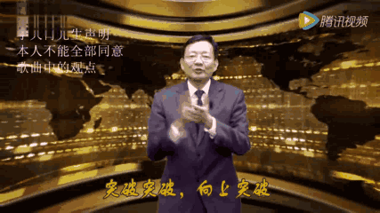

## 2020-07-03 17:56

这篇文章很久前写的。告诉我，最重要的那三个字是什么

## 2020-07-04 09:40

“就算我夸大其词了，你又损失了什么，你们又损失了什么。”这个人意识中是没有正义的，只有“利益”。衡量一切的标准就是利益，没有其它。

## 2020-07-04 09:50

回复@路过秋天的少年:看这段视频前我甚至觉得为了干掉坏人，用一些手段是可以接受的。但她这个态度让我恶心了。//@路过秋天的少年:一个人受欺负了的时候，正义解决不了问题的时候，估计大多数人都会选择非正规途径来解决。除非愿意默默承受被欺负。

## 2020-07-04 10:01

话说回来，对坏人，一定要狠。用各种合法的手段干掉他。

如果坏人不死，好人就要被欺负。

没有犯错的人被欺负，是不公平的。公平非常非常重要。

不要做坏人，也不能做被任意欺负的老实人。 ​​​

## 2020-07-04 11:53

想放下一切，爱谁谁，开车去大西北。

越来越想。 ​​​

## 2020-07-04 18:40

一定要严惩。另外，系安全带。

## 2020-07-05 12:01

正常是这样。 查看图片

## 2020-07-05 14:04

大周末的，闲着也是闲着，打开公众号看看也挺好的。 ​​​

## 2020-07-05 17:42

我不是说谨慎不好。

但做人，总是要乐观打底，谨慎行事。

如果总是悲观，永远担心崩盘，股票不敢买，基金不敢投，甚至好多年过去一直希望房子崩盘也不敢入手，最终恐怕就离财富渐行渐远了。

很多时候，网上悲观的论调会很吃香。乐观一点就会被嘲笑为鸡汤。

这个世界黑暗的一面很黑，但其实光明的一面也很明亮。悲观的东西，可以看，参考一下，看看逻辑。内心深处，始终要有光明在。

内心有光明和希望，做人就会开心很多。做人开心了，未来也许就比另一个平行世界的未来好很多。

## 2020-07-06 09:26

到哪步了。

## 2020-07-06 09:35

你看看现在拔地而起的几个品种，一天涨一年的理财收益，“三年不开张，开张吃三年”。所以急什么，花开自有时。

## 2020-07-06 09:44

我说的很多话一开始你都不信。觉得我是为有些持仓品种涨幅不好找借口，又或者是熊市忽悠你买入不安好心。

时间长了你才会发现，原来都是真的。

但也晚了。

缘分很重要。 ​​​

## 2020-07-06 09:58

有些人深谙“价值投资”之道。

群众一买他就卖，说着“别人贪婪我恐惧”，总想让群众为他买单。

殊不知，人民群众才是历史的书写者。

所以，群众情绪刚开始激动起来的时候，不要逆行，容易被踩死。 ​​​

## 2020-07-06 10:02

其实我们来投资，不要在人群中被潮流，被七嘴八舌裹挟着一会向北，一会向南。你的脑子会乱，腿也会不听使唤。

你要找一个很高的地方坐好，看着下面的人和市场。你站的高了，才能看清更大的战场。站得越高，看的越全面。 ​​​

## 2020-07-06 10:22

回复@归舟听雨:你说对了。所以不要问为什么涨，也不要听分析师分析为什么涨，他们只是因为涨了往回找理由。短期不要问为什么，执行自己的投资策略就完事。

## 2020-07-06 10:29

经过我用matlab严谨分析，得出结论：

虽然有三、四十万在公众号和微博关注我的人，其实其中只有不超过5000人是真把我当朋友的。

其他人都是看热闹顺带着捡点钱……

1%吧。 ​​​

## 2020-07-06 11:49

回复@原上孤烟:你就顺着他说，夸他，让他请你吃好吃的。你什么都没损失，朋友高兴了，你吃到好吃的了，其实你也没少挣。所有人都开心。但你要跟他说你挣得比他多，他不高兴，没准还要让你请客，多不好。

## 2020-07-06 12:03

回复@原上孤烟: 一切尽在掌握。//@原上孤烟:回复@ETF拯救世界:为了缓解尴尬的气氛，我说你这半个月的操作还是很犀利的，朋友说改天请我吃饭，交流交流，神了😂

## 2020-07-06 13:37

做好心理准备，一亿股神即将出现。 ​​​

## 2020-07-06 14:01

回复@Qripretty_Origimal:不知道。不过2015年6月至今，A股跌幅中位数是55%。只有15%的股票是上涨的。如果当时被套的人高抛低吸都解套了，那就没有亏钱的了。//@Qripretty_Origimal:是不是现在市场上就没有亏钱的了。。。

## 2020-07-06 14:17

两融余额再次突破12000亿。

上次上升趋势中突破12000亿是2015年3月，上次反弹趋势中突破12000亿是2015年11月。

自己品味一下。 ​​​

## 2020-07-06 14:19

关于市场本身的钱/股比例数据需要关注两个。

一个是两融余额，一个是大股东减持数量。 ​​​

## 2020-07-06 14:43

看到这样的我就

有个女儿疼都疼不过来，还这样。 ​​​
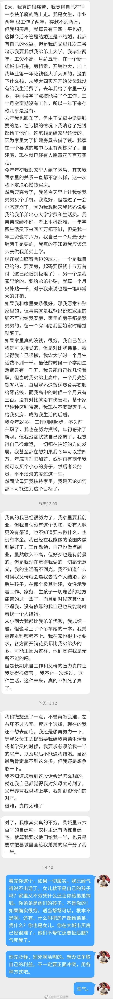

## 2020-07-06 14:58

如果孩子对自己不好，那就18岁GD，自己去养活自己。我也不需要你养老。

就此一条标准。

因为男女对孩子态度有区别的，都是辣鸡。 ​​​

## 2020-07-06 15:17

收盘了，人很空虚。 ​​​

## 2020-07-06 16:05

可以给自己买点一直想买的小礼物。拿在手里摸一摸。

开心最重要。 ​​​

## 2020-07-07 09:03

未来，在微博上，我尽量不再对走势发表看法，也不再对各位操作做什么建议。

虽然我一直尽量明确，几乎不会模棱两可，但因为人太多，理解能力千差万别。还有人会将我的话强行理解为自己潜意识中的判断。为了避免误会，我还是少说。

至于建议就更是如此。我鼓励你“拿住”，虽然也许中长期看没问题，但短期突然暴跌怎么办。未来行情一定是波动加大，有些人恐怕会心生怨恨。

综上，我要少说。我的判断都体现在150配置中，那个不会误会。

请大家监督。如果我违反了，请在评论中指出。
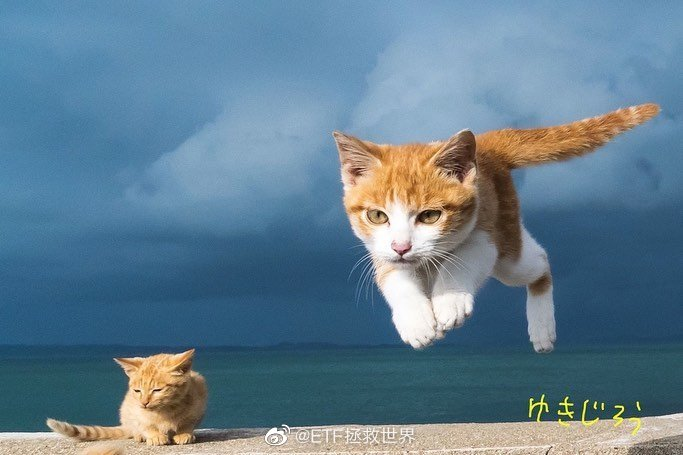

## 2020-07-07 09:34

股市经典问题：

“都赚钱了，谁赔了？”

问这个问题的，未来你会知道，别急。 ​​​

## 2020-07-07 09:52

其实做投资久了，你就会发现这件事跟其他事一样。

想要做好，必不可少的一个东西叫做“信念”。

没有信念，没有梦想，没有坚持，什么都做不好。

做投资也是如此。没有信念，波动两下就被洗下去了。赚什么钱。 ​​​

## 2020-07-07 10:30

昨天那条关于女儿的微博评论里，有位朋友说，

“社会规则就是这样的。我爸爸不把财产分给我姐姐，但我姐夫的爸爸会把财产给姐夫，最后都是一样的”

我想说，这是狗屁的社会规则！

如果我有女儿，我才不会管这bull shit社会规则。我只知道，她是我的女儿，我不会因为她老公拿到老公家里的财产，就不分给她我的财产。为什么，很简单，她是我的女儿！

是我的孩子，我就不会因为她是个女孩就让她受委屈。如果她的小家庭资产都是她老公带来的，那吵架的时候老公一句：“这房子也是我的，车子也是我的，你们家拿什么了？ ” 我女儿该说什么？什么东西都是婚前对方家庭给的，万一离婚我女儿是不是要拎着箱子走人？最终什么都没了？

从我儿子小时候，我就不停的对他灌输一个思想：爸爸很爱你，但你要知道，你不是这个家庭的中心。我们爱你照顾你的同时，不会一切围着你转。你只是家里平等的一分子。

我现在没有女儿，但如果有，我也会对他们两个说，你们是平等的，大家都是平等的一分子。未来如果我对你们态度以及财产分配有差别，也只是会因为你们对我的态度。谁对我好，我就对谁好。绝不会因为你们是男孩或者女孩有区别。

明白我的意思了吗，我的意思是，我不会管什么社会规则，不会管别人如何分配财产。我只知道，她是我的女儿，我就要对她好。就这么简单。

现在不是农业社会了，不是住在农村了，不需要因为要跟邻居打架需要儿子帮手了，这种辣鸡社会规则还是早点灭亡比较好。

## 2020-07-07 10:58

两融余额12418。这样涨下去，2-3天就能突破13000亿。

上次上升趋势中首次突破13000亿是2015年3月。 ​​​

## 2020-07-07 13:10

意……意思……不……大……吧…… ​​​

## 2020-07-07 13:28

记住，舒服最重要。

如果实在实在特别难受，就卖点。

多大点事儿。你买股票也不是只买100股，买基金也不是只买10块钱。总有余地让你稍微卖点。

总之要让自己舒服。

无论对错，记住经验教训，以后就做的更好了。

赚点钱不至于的，多大点事儿啊。一天天上蹿下跳的，中华复兴还指望你呢。 ​​​

## 2020-07-07 15:29

高考前半年，我开始找人大附的退休老师补某个弱科。

一开始一起上课的有七位同学，到最后一节课只剩我一个人。

这次补课效果太好，导致这门课成绩比一模高了几十分，总成绩突飞猛进。

也正因为总成绩上去了，居然正好踩到母校的调档线，一分不差。

从那以后我就明白一件事，影响我一生，

努力，坚持，不放弃，再加上幸运，事情就成了。

自己能把握的是努力不放弃，运气只能依靠多攒人品。

一个体会，不一定对。

## 2020-07-07 16:04

还有印象很深的是高三跟女朋友在不上课的下午去公园。

坐在长椅上我认真看书，她不停捣乱，真讨厌。 ​​​

## 2020-07-07 17:10

震惊，我和孟岩的高中直线距离几百米。 ​​​

## 2020-07-07 18:29

我想来想去，还是建议你去试试。别浪费了这么好的行情。真的。我这里未必是你的最优选择。趁着年轻闲着也是闲着，试试呗。

## 2020-07-07 19:45

送你700分，你去清华第一学期考完试就会退学。还是踏踏实实拿着700万过朴实无华且枯燥的日子吧。

## 2020-07-07 21:47

建信今天又跑赢0.8%。最近算是知耻后勇了 ​​​

## 2020-07-08 06:08

特别神奇，为什么都喜欢买新基金。

## 2020-07-08 09:34

既然底部买好了，也涨起来了，现阶段你要做的就是观察。

观察市场、数据、其他人的情绪、新闻中隐藏的信息。

观察寻找一切有助于你判断的蛛丝马迹 ​​​

## 2020-07-08 09:52

转发微博

## 2020-07-08 10:11

果然牛市来了。最近几天，gzh和微博关注人数都在暴增。

无数人私信在问150和S还能不能跟了。

其实周日已经说的很清楚，再说一次。

不能了。

除非后面大幅下跌，也许我还会在两个策略上少量加仓。否则我对你的买入建仓已经没有任何价值。我对你买什么也没有任何建议。

而且说句实话，我不喜欢市场涨起来后开始关注投资进行投资的人。就像我不喜欢趋炎附势，嫌贫爱富的人一样。而且你们只是喜欢钱，而不是喜欢投资。根本不是一路人。

这话说的有点以偏概全，也有点重，不好意思，觉得不舒服可以取关我。

我不在乎有多少人关注。尤其是这种时候关注的。赚钱的时候有多少人来关注你，赔钱的时候就有多少人骂你，这个我懂。

这几年浮浮沉沉中始终不放弃，无论浮亏浮盈都在相互扶持往前走的才是真朋友。其他人我管不了，也不想管。我也没精力再对任何0基础的人进行投资者教育了。真的很累。不是一般的累。

好消息是会有很多人欢迎新人入场。你可以毫不费力找到他们，他们会给你投资建议，帮你投资。如果你不找，他们会来找你。

就酱。

## 2020-07-08 10:23

回复@我有只叫多多的猫:上班摸鱼才是赚老板的钱。每天日夜无休忙工作是帮老板赚钱。//@我有只叫多多的猫:回复@遇见你温柔如初:你不上班的吗每天住在微博老板给饭吃吗

## 2020-07-08 10:35

牛市小贴士：

跟着新手买，新手买什么你买什么，赚的最多。

不要跟老手。一个个缩头缩脑的没出息。 ​​​

## 2020-07-08 10:51

500，i了。 ​​​

## 2020-07-08 14:08

“指数不能买，涨的太慢。” ​​​

## 2020-07-08 14:42

还有没买的小礼物赶紧买。明天跌了就没理由买了。 ​​​

## 2020-07-08 14:44

震惊。关注的一个每天看空中国的博主突然说股票大幅盈利了。 ​​​

## 2020-07-08 15:50

与很多牛人不同，我不知道明天、下周、下个月怎么走。

但这丝毫不影响我赚钱。

这话说过无数次了。我希望你真正理解。

对我来说，只有一个指标是最核心的：值博率。

目前的值博率，大致回到了5:5的阶段。也就是说涨跌概率差不多。这种时候一动不如一静，踏实持仓，等待值博率变化再动。

对了，钻石坑的值博率大致是9:1。

## 2020-07-08 20:41

有个常年喷我的把这条翻出来在私信里骂我。我自己转出来。首先，我想问问有几个人看不懂这条是个段子。第二，就算我预测短期行情了，错了，啊打脸好疼……慢着，我大幅减仓了还是清仓了？150计划80%多的仓位赚嗨了，S等于满仓啊。我就喜欢看着喷子明明很讨厌我还要看着我赚钱看着我跟大家每天开开心心

## 2020-07-08 22:12

富国红利还差1.5%就会创出历史新高。

是2015年5200点以来的历史新高。

为什么一个品种一段时间表现不好就会被喷，就会被说成是辣鸡？

人性。 ​​​

## 2020-07-09 00:37

虽然很想看，但我就是不会点下载。真没必要用这种方式推广软件，这样做做不大的。

## 2020-07-09 08:12

有点像王丽坤是怎么回事

## 2020-07-09 09:24

如何知道牛市成色足不足：

看利空出现的时候市场如何反应。 ​​​

## 2020-07-09 09:30

回复@崔111112:这你就有所不知了。知不知道2007年有一首爆红歌曲叫做《死了都不卖》//@崔111112:现在人好像普遍比原来聪明了，比原来能拿能扛，不知道以后会不会比原来跌的更惨

## 2020-07-09 09:44

牛市就是教育你每一次卖出都是错的。

绝大部分人形成统一的认识后，变化就发生了。 ​​​

## 2020-07-09 10:18

医药距离“救命底”上涨110%。

距离15500重压线还有5.9%。 ​​​

## 2020-07-09 10:26

关键时刻的历史回顾//@ETF拯救世界: 回复@牙神111:我投资一个指数不会连基本面都不看。我对医药的策略中，已经考虑过去三十年日本医药行业变化的样本，考虑目前各国医药行业估值，考虑政策面影响。我不说，不代表我不知道。只看估值更是对我的极大误解。//@牙神111:E大，医药的估值基础已发生重大变化

## 2020-07-09 10:27

钻石坑里，有人医药套了10%哭了。//@ETF拯救世界: 回复@美味o果冻o:巴菲特所有重仓股票买入后平均下跌都超过20%-30%。不影响最后他赚很多钱。9%仓位，浮亏10%，总浮亏0.9%。哭个屁……//@美味o果冻o:医药已经套了10%多了

## 2020-07-09 10:29

后来仓位到了12%。第一大行业仓。

## 2020-07-09 10:30

“医药指数不行了”

## 2020-07-09 10:46

只是想说明，独立思考真的很难很难。一个人跟所有人对抗不止需要勇气，更需要自信。

另外还有一点体会。

看一个人投资是否成熟，要看他是高位看空，低位看多；还是永远看多或者永远看空。这不是一个层次的思路。

最可怕的，是高位看多，低位突然改变逻辑看空。又或者是低位看空，高位突然转换思维方式毅然加仓。

只要能低买高卖，就是不错的投资人。其它的只是细节问题而已。

## 2020-07-09 10:51

今日营业结束。

享受生活，不能简单活着。

明儿见。 ​​​

## 2020-07-09 17:48

股市涨了，连情感私信都没了。

充分说明当你有钱了，损失个把男/女朋友才不会放在心上呢。 ​​​

## 2020-07-10 08:13

我喜欢。小时候每天唱着酸酸甜甜去上学//@挖龙脉的超级鹿鼎公:张含韵明显唱的最好，表演也够到位，但是观众缘好像就是不好，不过这个人设也挺好，明星们应该非常喜欢张含韵，有她就有人垫底，以后有节目必须拉上张含韵，小张同学以后档期应该不会愁//@混沌与概率1997: 这是高手组呀

## 2020-07-10 08:32

不在一个channel上，玩笑真的不能乱开。 ​​​

## 2020-07-10 09:58

看着60%、70%+有点拿不住的举手。 ​​​

## 2020-07-10 10:14

两融余额13265，用了2个交易日。上次上升趋势中突破14000亿是2015年3月。目前的趋势看，如果不跌，突破14000亿用不了一周。

## 2020-07-10 10:19

广发纯债能改的都改成再投资。博时债也是。 ​​​

## 2020-07-10 10:50

40w了。

老说不在乎有多少人关注，但其实关注的人多还是比人少开心。也没别的，说白了就是虚荣心，幼稚。

18岁，倒也能理解。

2015年发出第一条微博到现在5年，富婆断断续续给买的高科技带评论带转发带点赞粉丝已经399999个了。什么都不说了，比心富婆，[心]你。

没错。其实这个微博只有你一个真实的人关注，其他都是机器人。意不意外，开不开心。你以为是每天跟很多人一起玩，其实是我和很多机器人跟你一个人玩……

就像你莫名其妙进了一个300人的炒股群，除了你全是托。

无论如何，这5年在这里感受到的乐趣和感动，还是远远大于愤怒和忧伤。所以大概率还会继续玩下去，直到有一天觉得这事儿没意思了，或者发现没意思的人多了。

那么未来的日子，还请你和另外的399999位富婆买的机器粉多关照。

接下来就到了最激动人心的时候。普天同庆的日子怎么可以不抽奖。

这条微博评论里抽100位朋友（本来想设置888位，发现最多只能100），1688送给你们。——不是每位1688！是一共1688！还每位，你以为在津巴布韦呢。

可以在评论里聊聊这几年在我这里玩的感受，别尴尬，还有好几千智能机器粉与你一起评论呢。也可以说说觉得我哪里还有不足，你可以提出来，反正我也不会改，还可能把你拉黑。

不需要转发让更多人知道，咱们自己聊聊就挺好。

那位朋友说了，哎，你怎么老抽奖送钱啊。有什么阴谋。

是这样的。钱这东西吧，就跟水一样，不停的流动。你越想紧紧攥住它，可能越快从你指缝流走。不如趁着没流走的时候，跟大家分享一些。每个人都开开心心的你说多好。开心最重要。这年头，能用钱买到的开心不多了。

另外一点，主要是我比较穷，等我以后发财了每天抽16888。别急，上证200万点我估摸着就差不多了，很快。 http://t.cn/A6yxR7Pp
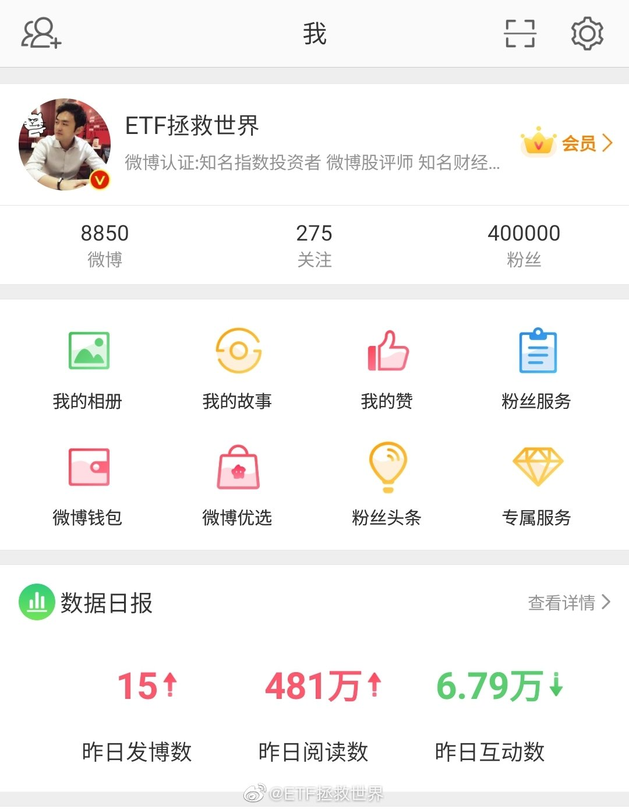

## 2020-07-10 11:48

今天卸车的收益率以及配置图。 ​​​
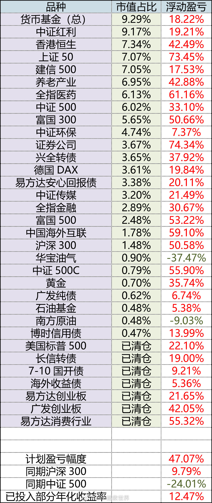 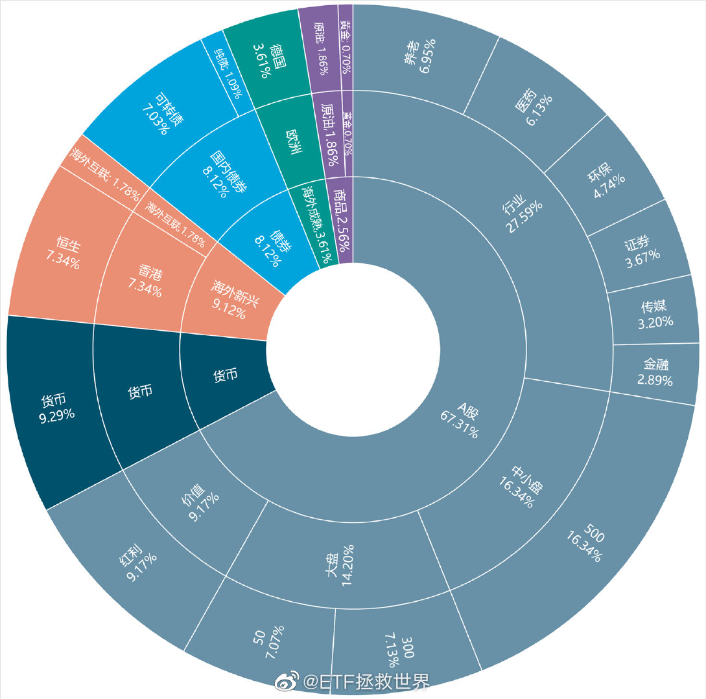

## 2020-07-10 13:57

知行合一。15500前面我先卸一车。后面再涨就不是我的价值趋势系统能解释的了。当然，这就跟我的价值趋势系统只能解释到低点在7800，结果跌到6900一样，系统不一定什么时候都那么准。剩下的持仓就看缘分了。

## 2020-07-10 14:19

中证医疗PB已经超过10倍，创业板指PB即将到达10倍。

这两个指数依然在狂飙。

不得不佩服人民群众。 ​​​

## 2020-07-10 14:35

兄弟们，如果你碰到这种情况，会怎么做。 ​​​
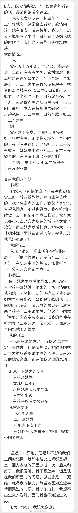 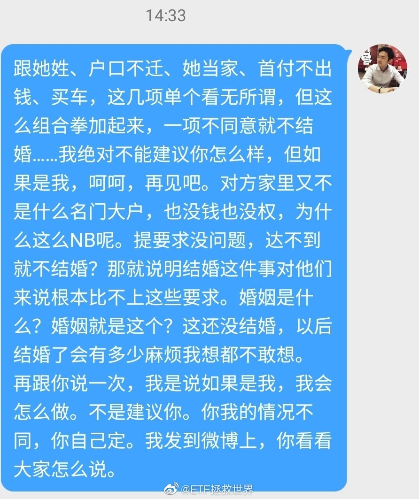

## 2020-07-11 08:11

恭喜@陈炳男啊 等100名用户等额平分【1688元现金】。微博官方唯一抽奖工具@微博抽奖平台 对本次抽奖进行监督，结果公正有效。公示链接：微博抽奖平台

## 2020-07-11 21:30

真好。

不要放弃希望，一切都会好起来！ ​​​
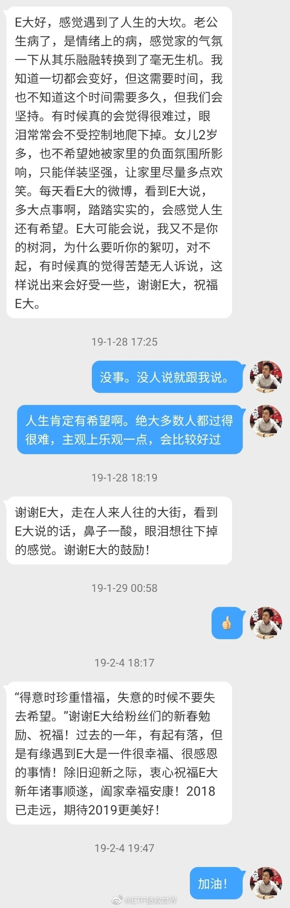 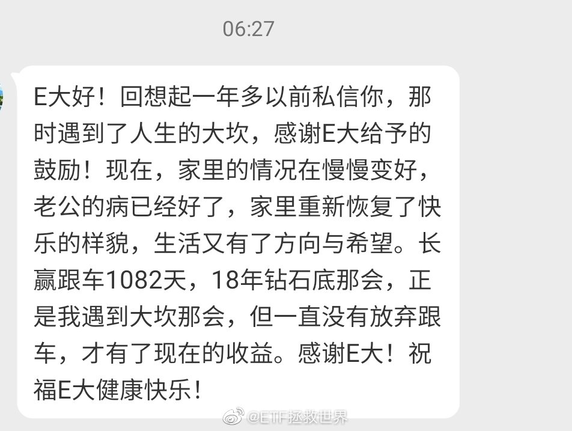

## 2020-07-12 08:08

晃了十秒钟

## 2020-07-12 09:04

顺便安利还有一种专门放电子产品的，出去玩、出差的时候特别好用。 ​​​
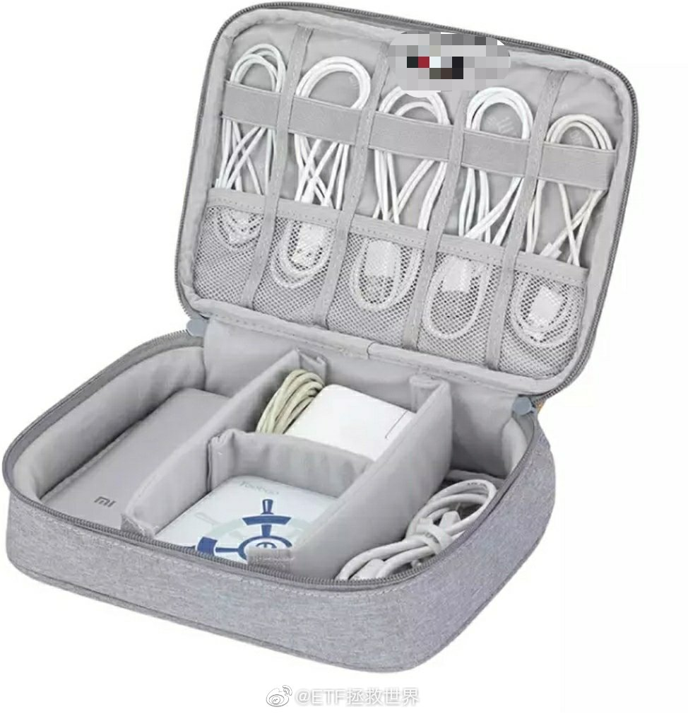

## 2020-07-12 10:52

生活小贴士：

喝胶囊咖啡的时候额外加半杯奶。（黑咖啡除外） ​​​

## 2020-07-13 09:56

野百合也有春天。 ​​​

## 2020-07-13 10:01

看着手中这两年被那人狂踩的品种，为你赚到越来越多的钱。

你就应该知道：

涨时看好，跌时看空，什么品种最近涨的好就吹，最近跌的多就踩的那些人，

无论他的粉丝有多少，名气有多大，

可能水平真的不如你。 ​​​

## 2020-07-13 10:29

刚吃了那个去医闹说他是很大很大大V的瓜。

整件事的来龙去脉我不清楚，也不评论对错。我只说两点。

第一，他拍医生视频时候的动作，语言真的让我恶心。我真的很讨厌这种贱了吧唧的人。

第二，脑子是怎么想的说出自己是“大V”来威胁别人。我不是什么大V，但毕竟也有40万机器粉。我在日常生活中不希望任何一个人知道我的微博和公众号（当然很多同事朋友都莫名其妙知道了……）。

拿出“我是大V”来威胁别人是最最最脑残的一件事。哦，不对，更脑残的是你还根本不是……

## 2020-07-13 11:04

有没有感觉赚的有点麻木了。

有没有真正体会：赚点钱意思不大。 ​​​

## 2020-07-13 11:18

关于本金的问题，之前写文章说过。

如果你本金不多，最应该盼着的不是大牛市，而是大熊市或者震荡市。然后赶紧通过各种方式去赚/攒本金。

这话在熊市里说你觉得不重要或者是忽悠你。牛市来了才知道是真的。 ​​​

## 2020-07-13 11:39

你还在看帖子，人家已经面基了。

据我所知，还有其它地区的朋友也组织类似的聚会了。还有好多私聊的，这很好。

不过一定在不是非常了解的情况下还是要保持警惕，注意财物及人身安全。虽然我这里99%的朋友都特别好，但是剩下那1%的辣鸡也不得不防。（基数大，1%的人也有很多）

另外要注意疫情的问题，健康最重要。

加油！祝福大家。
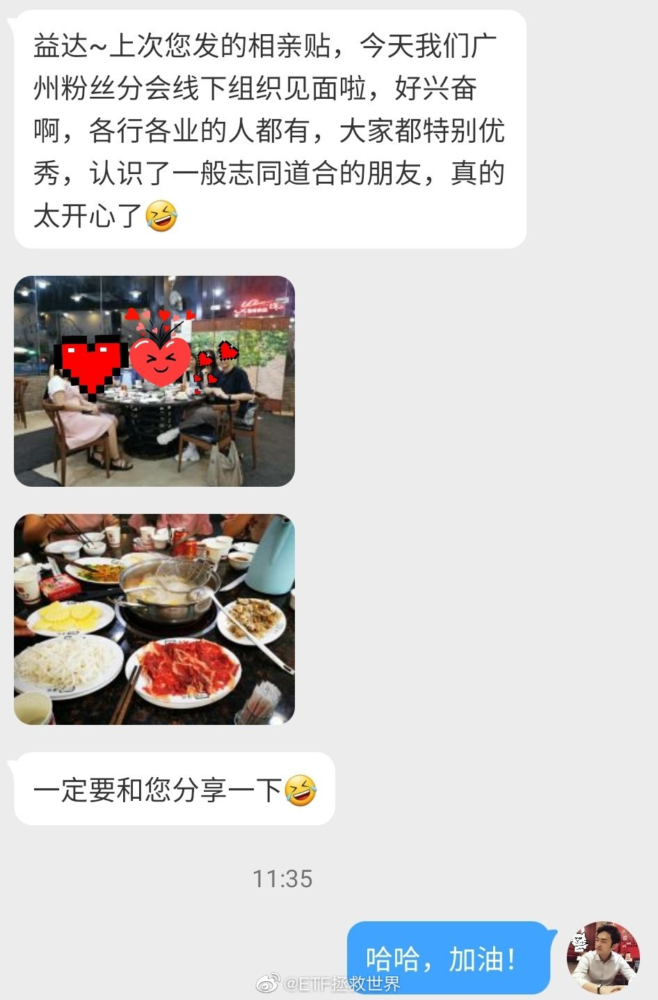

## 2020-07-13 14:14

有没有体会到什么叫做“坐轿子”。 ​​​

## 2020-07-13 14:22

牛市，最关键是不要上蹿下跳。

手里绝大多数仓位拿住了。小仓位随便瞎搞搞好了伐。 ​​​

## 2020-07-13 14:36

别以为做个投资买个基金买个股票就应该一天到晚心惊胆战或者激动人心的。

不是的。

大概90%的时间其实没什么要做的。5%的时间买，5%的时间卖。其他时间就是等着。等着跌，等着涨。

你可以用很多时间去研究，去收集信息。甚至你可以做出很多判断。但交易的次数不应该随着你的研究和判断越来越多。

交易由策略和体系完成就可以了，你不要人为的干涉太多。

如果你花了太多时间在交易上，那你的收益率极大概率会越来越低。

当然，天才短线选手除外。我说的是普通人。

## 2020-07-13 14:58

环保也支棱起来了。 ​​​

## 2020-07-13 15:31

回复@你好大麦茶:这一波后不少车友可以拿到家庭财政大权了//@你好大麦茶:回复@ETF拯救世界:自从收益率碾压老公股票以后，家里就和谐了

## 2020-07-13 16:00

和谐生活小贴士：

如果你的投资收益率比另一半多，请不要讽刺、挖苦对方（尤其是在外人面前）。最好能就优点给予一定的表扬。

很多人比你想象中的更爱面子（尤其是男性）。

一个得到里子，一个得到面子，大家好才是真的好。 ​​​

## 2020-07-13 16:19

我觉得有些人不是逻辑不行，而是脑子有问题。或者说，我也真的怀疑是不是有什么利益因素在里面？

比如说，有女孩晚上在外面遭遇坏人这样的新闻。有人好心在评论里提示一下：晚上出门尽量多穿一些，会安全一点。

有女孩就开骂了：你不去管坏人你管我们？我们愿意穿什么就穿什么！法律都不管我你管得着吗？xxxxxxxxx。

这是什么逻辑呢。这个逻辑就是说，你为什么让我过马路走斑马线的时候左右看？绿灯我就能走，我管他有没有车违章撞上来呢。他撞我是他的问题，你为什么不去管他而来让我看车？

当然没错。无论是晚上的坏人，还是不守交规的司机，法律都要严惩。问题在于，中国十几亿人，世界几十亿人，你以为个个都是守法吗？如果有法律就所有人都会遵守，每年还会有这么多犯罪吗？好心好意提醒你晚上出去多加一件衣服，过马路左右看看，都是为了让你离危险远一点。因为就是有男人看到女人穿的暴露就会兽性大发，就是有司机不遵守交规或者醉酒xd导致交通事故啊。

能提醒你的，都是真的为你好的。你爱听不听，谁稀罕管你？

我说，“请不要讽刺、挖苦对方”“不要总是显露出看不起对方的状态”，就有人评论说，他做错了我也不说？那么在你印象中，指出错误只有讽刺挖苦一种方法吗？有话不能好好说吗？有错误不能诚恳的，讲究策略的指出吗？就必须总是“你这也不行那也不行”的看不起对方吗？这么不好你离婚不就完了吗，何苦总是这么折磨别人？

你是脑子不行还是被[拳头]洗脑了？

随便吧，你过成什么样跟我有P关系，继续作吧。

## 2020-07-13 17:52

一秒钟几十万上下我浪费时间来跟你讨论情趣内衣的问题……

今天数据还没算呢。

耽误事儿！ ​​​

## 2020-07-14 09:23

昨天晚上我一个人都没拉黑。

观点虽然天上地下差太远，但没喷我又没有阴阳怪气，我就不拉黑。

那我今天再给大家一个建议：

我建议大家如果拿着大笔现金走路，最好放在兜里或者包里，藏起来，不要拿在手里，不要让别人看见。尤其是晚上。

不然容易被人盯上，容易被抢。

这个会被质疑吗。

“你胡说，拿在手里是安全的。经研究表明，被抢的人没有把现金拿在手里的。也就是说，拿在手里和装在包里，被抢的概率是一样的。”

“那么拿着现金走路，会不会激发一些坏人抢你的冲动……他本来没想抢你，但他看见你的钱，突然激情了……”

“你要责备的是抢钱的坏人，我拿着现金走路是我的自由。你这么说，是我没有拿着现金走路的自由了吗？还是说你认为我拿着现金走路被抢了是我的错？”

“行吧，你开心就好。”

## 2020-07-14 09:38

从这个例子里看出那个所谓数据的问题所在了吗。被抢的人99%都把钱放在兜里了。这样看来，拿在手里被抢只有1%，反而是拿在手里更安全？你不觉得这个结论很可笑吗？我们讨论的，应该是同样一个人，拿在手里被抢可能性大，还是放在包里可能性大。而不是看被抢的人把钱放在哪里。因为有人抢钱不管你放哪

## 2020-07-14 10:04

给医药和养老爸爸跪了。 ​​​

## 2020-07-14 12:29

要用耳机听 ​​​

## 2020-07-14 13:57

可能你不相信，跌了一天，不少人又被套了。 ​​​

## 2020-07-15 08:11

仔细感受了一下，发现还是赚钱的日子更舒服。 ​​​

## 2020-07-15 10:00

第一个1倍。

## 2020-07-15 10:09

回复@xuhuangkai:到了。如果你自己操作，不要来问我。如果你是参考我的操作，那是完全公开的，你看就行了。每天问该怎么办你累不累。我累。//@xuhuangkai:医药到了外太空吗？现在该怎么办呢//@ETF拯救世界:第一个1倍。

## 2020-07-15 10:13

牛市见顶的另一个标志：

有人开始在评论里嘲笑低位买入赚几十个点甚至翻倍卖出的人卖早了。

嘲笑得越厉害，见顶的可能性越大。如果开始骂人，那几乎就确认了。

类似这样的：

“呵呵，踏空狗，我入场x个月就赚了xx%。”

2015年5月-6月，我在球球每天几百人骂。所以这也算一条经验了。 ​​​

## 2020-07-15 13:26

太对了。自己爹妈不教育社会上有人教育。

## 2020-07-16 13:28

这么跌到收盘的话明天会反弹啊。 ​​​

## 2020-07-16 13:38

回复@圆圆圈圈0808:还可以再大一点，我还撑得住//@圆圆圈圈0808:真的印证了年初E大的判断：大波动啊

## 2020-07-16 13:40

回复@烧鸭小哥哟:熊市很多人发现晚买一天能便宜不少。后来您猜怎么着，嘿，好多人很多次再也买不到了。//@烧鸭小哥哟:实不相瞒，我发现以往卖出推迟一天能多卖点钱

## 2020-07-16 14:22

不需要我按摩吧。

问自己几个问题：

我高位接盘了吗？

我逢高减仓了吗？

我准备好如果跌很多，低位买入未来赚更多了吗？ ​​​

## 2020-07-16 14:39

跌太多了，我发车时候也就2个点。

场外的朋友明天赎回也可以，有可能反弹，自己看着办吧。 ​​​

## 2020-07-16 14:45

回复@崔111112:什么乱七八糟的。你见过赚60%多被“洗掉”的？你怎么那么喜欢被洗。//@崔111112:老大，这好像是敌人大清洗活动啊，把我们小散户洗屁了，是不是该轮到他们主力涨了

## 2020-07-16 14:54

最疼的是14000亿两融。 ​​​

## 2020-07-16 15:09

前几天让你给自己买小礼物买了吧。

买了现在手里好歹能剩点东西是不是。 ​​​

## 2020-07-16 17:15

很多人太不成熟。以后我会直接拉黑。sorry。

你没错。不过大家一个FM，一个AM，都不是一个channel，我也正好厌倦再做投资者教育了。 ​​​

## 2020-07-16 17:45

在这种日子里，你知道怎么让自己保持好心情吗。

我的做法：

不看账户，不更新理财软件收盘净值。

不看它就没发生！

终极解决办法，推荐给你。 ​​​

## 2020-07-17 09:34

未来三天反弹力度很重要。 ​​​

## 2020-07-17 09:36

昨天两融余额只降了60亿。

融资客选择了硬扛。 ​​​

## 2020-07-17 09:58

越涨越高的时候我连续在公众号和微博说得很清楚，你看着大涨想买的心情我很理解，但我帮不了你，我对你买入的行为不会有任何帮助了。建议你去请别人帮你。

我也相信各位没有在高位买一分钱，大多数朋友还在不断小幅减仓。

所以如果高位买入被套了别到我这哭，我真的没法做的更好了。 ​​​

## 2020-07-17 10:15

可以依计赎回了。

## 2020-07-17 13:25

哈哈哈哈哈。很多人还没有进化完成。

## 2020-07-17 15:37

还算对得起各位老铁。666//@ETF拯救世界:可以依计赎回了。

## 2020-07-17 16:00

150医药未来的操作方向：

医药已经离开大气层15500，跌回人间。高位也算减仓两次。这是目前的状态。

众所周知我很喜欢医药。相对于另一些喜欢的品种，这次真正把仓位建起来的也只有它，所以就更加喜欢。就像有几个孩子，虽然都喜欢，但那个对自己好又有出息的就尤其喜欢。

还剩下几份医药，如果未来不突破新高，不重回太空，不打算卖了。

如果跌回去也很正常。下面有三个加仓点位，我暂时不说，以后找机会说，省得偷桃子的太多咱们没得摘了。这三个加仓点位会把高位卖掉的接回来，有可能还会加更多。

基本就是这个思路。一切尽在掌握。

## 2020-07-18 08:53

喜欢张含韵。好可爱。 ​​​

## 2020-07-19 08:45

老师心态崩了。老师啊，做人开心最重要。老师当然是灵魂工程师，值得所有人尊敬。但有人不尊重你你也没办法啊。拿了工资，认真做好教学育人工作就行了，至于学生尊重不尊重你，那就不是你能控制的了，心态不能崩啊。人最痛苦的就是求而不得，求所有人的尊重那更是注定非常痛苦的一件事了。

## 2020-07-19 10:29

其实“感恩”这件事真就不是哪个人都能做到的。

很多人会觉得，你对我再好，也是应该的，我为什么要感恩你？

如果你认真感受一下，很多人做的事情真的是与别人不同的。我儿子上学一年，我就能很明显的感受到每个老师的教学态度，对孩子的关爱程度等等完全不同。那我就会对好的老师非常感恩。

这是她的工作吗？是。她拿了工资吗？拿了。但是她做的超过了这个职业对她的基本要求，我就觉得要谢谢她。

其它事情也是如此。

千万别觉得所有人对你好都是应该的，这样会倒霉。比如你觉得服务员对你再热情周到都应该，你是来消费的，他赚你的钱了所以应该。然后你就对人家吆五喝六不尊重，最后人家就往你的菜里吐口水。

对做的好的人真心的感谢，最终会有更大的正反馈到你的身上。这件事说起来很玄，其实我认为是合理的。你的感谢甚至感恩，会让别人感受到温暖。即使被温暖的人只有10%，只有10%的人能感受到你的谢意，那也会有巨大的正反馈能量回到你的身上。这10%的人会继续对你好，甚至对你更好。你的收获会更多。

你当然不要为了收获更多而虚情假意，从内心深处真的感谢一些人对自己的好才是王道啊。因为这样，你的世界会光明很多。不信你试试。

## 2020-07-19 13:48

我最近用过的的微信头像，分享给你 ​​​
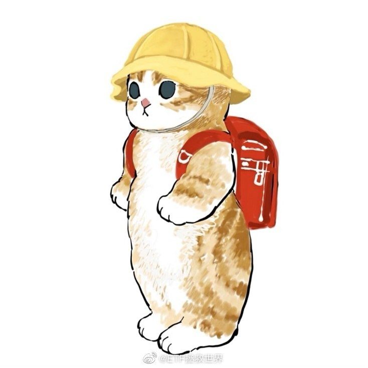  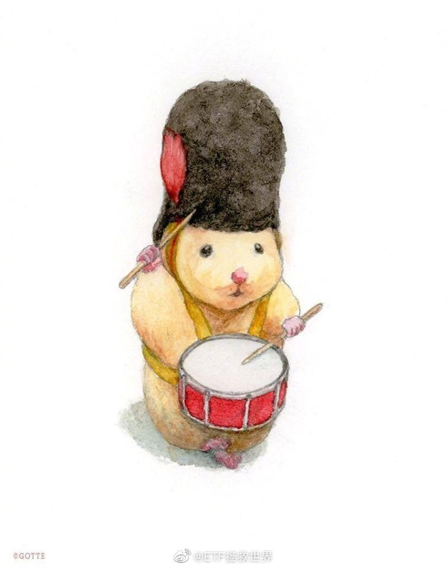 

## 2020-07-19 22:23

我小学的时候，在外地的学校上过几年学。那里的学校比北京乱不少。我上学的那个学校，是当地的绝对名校，即使如此，现在回头看，校园霸凌也非常严重。

校园里喜欢欺负人的，主要是那些与中学或者社会上小混混有关系的孩子。个别坏孩子下手真的狠。欺负人的时候抽耳光能把人嘴抽出血。我印象深的还有一次，几个孩子下课的时候把一个同学用红领巾绑在树上，上课了人都跑了。上着上着课那个被绑的同学才回来，听说是校长给解开的……还有更侮辱性的霸凌，我就不说了。这些坏孩子不仅欺负同学，连校门口的麻辣烫摊子都敢砸……

我们家在当地没有一个亲戚，所以家里也没有哥哥之类的做靠山。为了自保，我只好在学校里广交朋友，用现在的话说算是“黑白通吃”。（上次说的游戏币被抢走，我也马上出去找人帮我要回来了）所以几年里面也没有被人欺负过，但也只能做到自保。记忆中只有两三次看到认识的坏同学欺负人欺负的太狠，找理由把他拉走。所以我跟那几个被欺负的同学关系也很不错……

我说这些，是说我虽然没有经历过霸凌，但那几年的经历让我绝对知道孩子世界中黑暗的一面是什么样。但就算我所知道最最最严重的霸凌，我想，那个欺负人的孩子也罪不至死！

更何况，这个新闻里被杀的孩子，到底有没有传说中的“长期霸凌”那个女孩？我想，如果真的有，官方没有理由隐瞒。很多人不相信官方的结论，坚信网上传言的被杀孩子却是长期霸凌女孩。没有任何人证、物证，就是“认为”“觉得”传言是真的，就不断煽风点火，会造成什么后果，你们这些人想过吗？

且不说那个大概率是“冤死”的孩子，也不说中年丧子可怜的父亲母亲，不说那些目睹惨案半夜惊醒留下一生阴影的同学。我就说你们这些人的孩子去上学了，你心里能踏实吗？

谁能保证在学校跟其他同学没有一点摩擦？碰撞？意见不和甚至拳脚相加？如果你的孩子跟别人冲突了，第二天对方家长拿刀去学校把你的孩子带到厕所……你会怎么样？

十几亿人，几亿家长，什么人都有。很多人的行为不是常理能解释的。这些年听到到小学幼儿园行凶的人不是一个两个，他们又跟这些孩子有什么仇？现代人压力这么大，随便一个点就有可能引爆。如果这样极端的家长被你的孩子碰上了，你该怎么办？

很多人叫好。说杀得好，杀人的人“伟大”。我真的觉得冷。说实话，这几年上网接触的人多了，对人性的恶早已了然于胸。但比“恶”更让我绝望的，是那么多人依然愚昧。遇到事情永远不会独立思考。看到谣言就全盘接受，丝毫不考虑证据、事实。你怀疑，你就去找证据。拿出证据推翻现在的结论。但太多的人不会这么想，只会看到别人怎么说就怎么信，这是真的让人绝望。

我的绝望是因为这份不经思考的狂热、冷血，未来有可能会在合适的契机下再次引发大悲剧。我们的历史上这样的事情没有发生过吗？惨痛的后果不是要我们所有人来承担吗?

其实想通了，这些也是无所谓的。每个人的人生在宇宙中连一瞬间都算不上。我们的星球在宇宙中连一个沙粒都不是。毁灭真的来临时，坦然接受就行了。人类其实就是这个星球的病毒，对其他生物以及地球来说就是灾难。人类作为一个整体也让人绝望，什么结果都合理。只是可惜了其中良知尚存的那一小部分。

## 2020-07-20 10:19

​​​

## 2020-07-20 10:58

回复@唐马拉其:白冰有点像初代小助理。//@唐马拉其:有没有喜欢白冰的

## 2020-07-20 13:55

每次上升的市场（尽量不用牛、熊说话了），都是一次财富再分配。

有一段时间会让你觉得所有人的钱都增加了，很多人会困惑：我们都赚钱了谁赔了。

然后就是真正的再分配。很多人会拿着钱离开，很多人的钱再也拿不回来了。

上升市场中，很多人真的是来“送钱”。把自己的血汗钱送给别人。这些人一开始以为自己赚了，其实最后当然是赔了。

反过来，在下跌市场中慢慢收集筹码，一开始你以为自己赔了，过一段时间你才会明白，自己是赚了。

赚钱还是赔钱，一开始就注定了。

## 2020-07-20 14:14

有些指数品种不涨，真的不要太在意。指数跟股票或者主动基不一样。股票不涨可能就是这家公司真不行了。主动基不涨可能是这个基金经理真不行。而指数很大可能是它在蓄势。不停的攒能量，在你想不到的时候爆发。

所以我持有一些这两年涨幅不行的指数，心里特别踏实。因为我眼看着它越来越便宜，我就知道它涨只是早晚的事情而已。

这个道理很多朋友不理解。他们更喜欢那些近期表现好的。这当然也没错，但对于我们这种持续有收入的，或者卖出盈利很大品种手里拿着现金的人来说，不涨的那些才是真的好啊。

## 2020-07-20 22:31

重庆的房子，不考虑升值学区什么的，江景，环境物业不错的楼盘有没有推荐。 ​​​

## 2020-07-21 10:00

考虑了很久，决定把一些历史内部资料逐步在公众号更新。

同时，会加入最新点评以及对当时操作的反思和进一步优化的思考。

注意，不要再去买其他人贩卖的以前的合集。很多策略和整个体系已经有了升华，以前的东西未必全都是好的。我会在以后的更新中更正那些错误。

懒癌患者的我每次都是被人逼的没办法才会多做一些事情。谁能想到，每次这些事情最终竟然带来的都是读者和我的双赢。

为什么一定要逼得我这么努力呢，让我什么都不干慢慢的凉掉不好吗……好气哦。

## 2020-07-21 13:37

我想到一件事。

你们说灯塔很多群众今年表现的这么反智，与他们的“快乐教育”有没有关系。

很大一部分人被快乐教育祸害成傻子了。 ​​​

## 2020-07-21 17:46

最低8255，谁说趋势系统没用的来看看一次次见效的事实。

## 2020-07-21 18:42

白银快21了。

之前评论里抱怨白银的那些朋友，你们会自责吗。 ​​​

## 2020-07-21 21:31

且慢更新版本后，各位资产账户的总“累计收益率”去掉了。

我认为取消是合理的，因为以前的累计收益率不合理。

之前的逻辑是，你的总盈利金额/账户历史最大成本=累计收益率。各位觉得这样准确吗。除非你只转入一次资金，不再转入转出。只要有资金进出，这个累计收益率就不准确。怎么不合理，你想想就明白。

所以，你打开任何股票软件，几乎都只有“总盈亏金额”，没有“累计收益率”这个项目，因为真的没法计算。

现在显示累计收益金额，这个是绝对准确的。

## 2020-07-22 08:52

转发微博

## 2020-07-22 10:26

今天可以更新理财软件收盘价了。 ​​​

## 2020-07-22 10:39

一波疫情过去，瘦了十几斤。练出了人鱼线，10公里跑入了40分钟。

顺便还在股市赚了1个小目标。

————————————————————————————————————————————————————————————————————————————————————————————————————

朋友圈看到的，与君共勉。

## 2020-07-22 10:54

生活小贴士：

运动鞋可以用洗衣机洗。 ​​​

## 2020-07-22 11:08

新高的日子里，一片其乐融融。 ​​​

## 2020-07-22 11:14

每天上一样的班，吃一样的饭，说一样的话，创一样的新高，没什么意思。

无非是钱越来越多而已。

每天都做一点从没做过的事情才有意思。不信你试试。 ​​​

## 2020-07-22 23:29

不知道为什么，类似情况私信的大多数都是好好的家被老公借外债弄垮了。是不是男人天生激进？

借债，尤其是高息债真的风险很大，一定要慎重。

还有，类似的情况，请男人们有点担当吧。两个月在家呆着，送个外卖还点钱也好啊。 ​​​
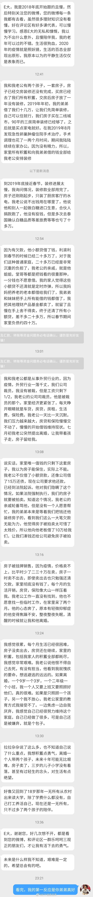

## 2020-07-22 23:49

来点正能量。

好梦，晚安。 ​​​
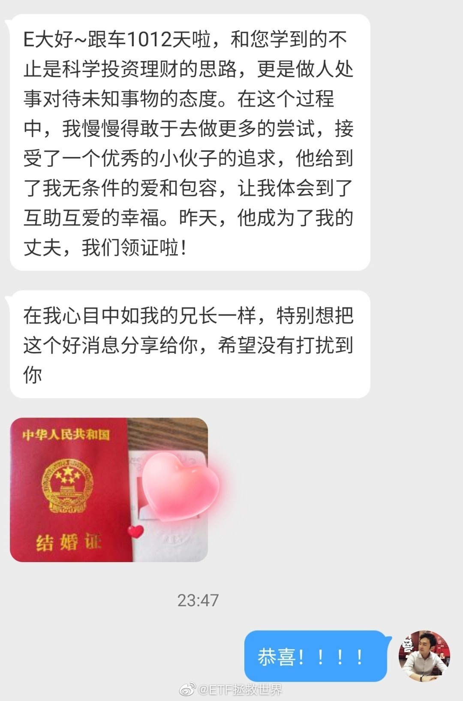

## 2020-07-23 08:07

十几二十万没多少钱，一家人努努力早晚能还清。

但这样满嘴谎言，依然不停继续借的，已经毫无希望了。

如果是我，会立即以第三宇宙速度逃离这个借贷和重男轻女的双重黑洞。 ​​​
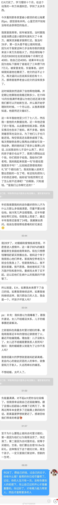

## 2020-07-23 09:33

关于资金安排有几点我说一下。

第一，150和S目前都盈利很多。有急需用钱的可以把赚钱多的赎回一部分乃至全部赎回也没事。你都急于用钱了就不要想后面会不会少赚了。

第二，150已经明确是3-5年不用的钱。即使如此，布局的时候我依然给出了更大的安全边际，你随时能抽走的资金会有不少。

第三，S是针对没有积蓄的朋友。对这部分朋友，我在布局的时候也考虑到应急资金的问题。所以跟S的话，现在手里也会有很多积蓄了。有急用完全能够应对。

第四，大家希望把每一分钱都投入赚更多这个心态我理解。但未必是所有人都适合这么做。你很难保证自己会不会突然有用钱的地方。你的投资赚钱时候还好，如果买入后一路下跌，在钻石坑需要用钱你不得不低位割肉卖出，那才是最大的人间悲剧。

你以为每一分钱都投入才能赚更多，其实很多时候你留一部分现金反而会赚的更多。这个道理你必须要明白。

总之我会尽量在配置层面为你留出安全空间，你也要对自己的家庭资产配置有个更全面的考虑。

关于投资的事要不要跟另一半商量。虽然之前也有朋友说自己的另一半极度保守，根本不允许进行一点点金融投资，不瞒着对方就没法投。但总体来说，还是双方有商有量比较好。

再说一次，黄、赌、毒一定不要碰。尤其是后两者，如果你发现另一半碰了，那你就要认真考虑了。因为碰了就很难戒掉。

## 2020-07-23 09:53

回复@Z译文的热爱:这个我不知道。因为我还没有切身感受。过些年有经验了告诉你答案。//@Z译文的热爱:回复@ETF拯救世界:真心想问，年纪大是指多少岁算大。

## 2020-07-23 10:56

很多新人震惊的发现自己在3200多点开始赔钱了。 ​​​

## 2020-07-23 11:50

回复@朵朵-冷暖自知:一百年来咱们就没有容易过。都加油干吧。//@朵朵-冷暖自知:感觉中华民族挺难的

## 2020-07-24 09:24

刚才在看过去写的内部资料。2015年7月30是第一份。在那份资料里写了下面这句话。

2020年，所有人都知道这三个是好东西了。 ​​​

## 2020-07-24 09:36

回复@价值趋势笑傲江湖:我的三位好友和三位红颜知己：ETF拯救世界: 《不得不写的文章：批发干货与鸡汤》 //@价值趋势笑傲江湖:回复@嗯日子还是要过的不是吗:还有仨是谁？

## 2020-07-24 09:48

当你把最近这次投资经历总结出的“经验”运用到下一次实践中时，一定要注意，下次可能会有些不同。

比如，这次你持有一个牛股或者一支翻倍基金，由于没有经验，刚刚回本或者赚了十几个点就跑了。那你就会想：我下次一定要拿的久一点，多赚点。

下次你回本或者赚了十几个点，坚定的拿着不放弃，谁能想到这支股票一路下跌，退市了。

再下次你又有了经验，再次回本或者赚十几个点就走，结果它又翻了好几倍。

这种情况非常容易出现，一定要警惕。

你的失败经验，绝不应该是推翻你过往所有投资哲学和投资体系的新宠。这份经验应该融入你过去的体系中，通过反思，将过去体系的不足用经验弥补。想出办法让你的体系更加强大，不再犯类似的错误。而非推倒重来。

否则一次次的打完左脸打右脸，就是可以预见的了。

太阳底下没有新鲜事。然而今天的太阳却与昨天的有些许不同。

## 2020-07-24 10:13

运动小贴士：

这些年虽然跑步成绩一直不怎么样，但鞋买了很多，可以说阅鞋无数。

前几年一直买ASICS和美津浓。但这几年觉得不思进取，不进则退。前一段买了A家最新款的顶级跑鞋，越发觉得重，跑起来很累，脚感也不那么出色了。

倒是觉得nike的react不错。慢跑的话可以去试试飞马系列，慢跑+日常出街可以考虑react flyknit / flyknit2 。我买的都是白色款，颜值够，非常轻，鞋底特别软，走路或者跑步穿着非常舒服。

react的好价一般都在300、400多，缺点是鞋比较瘦，要去店里试试，脚肥的要买大一点。

PS：非广告，谁收钱了谁今天赔100万。

## 2020-07-24 11:15

有些人的钱在波动中越来越少。

有些人的钱在波动中越来越多。 ​​​

## 2020-07-24 11:20

填空题：

一根长阴后反弹，但未突破前期高点，再次下跌后跌破长阴低点，这种形态叫做：（     ） ​​​

## 2020-07-24 13:21

触发买入。

## 2020-07-24 13:33

回复@宁一毅:用心推荐就推荐大家都合用的，你天天给人推荐保时捷那不叫推荐，那叫装x//@宁一毅:回复@ETF拯救世界:一分钟几十万上下的博主推荐的鞋居然才3、400？

## 2020-07-24 14:08

什么玩意儿啊。我真没收钱啊！啊！啊！

## 2020-07-24 14:18

碰到大跌，大家聚在一起讲讲段子卖卖惨是不是开心很多。

喝什么鸡汤，看看你账户里攒的现金它不香吗。 ​​​

## 2020-07-24 19:50

回复@Crystal夏暖暖:你跟车了吗。跟了的话请立即下车。我承担不起你们夫妻二人的股神期待。如果没跟，以后不要说这种让我气不打一处来的话//@Crystal夏暖暖:老公大骂上周涨了那么多不减仓，今周亏成狗，好内疚

## 2020-07-24 20:00

知道我为什么一直说，不要给任何人投资建议了吧。

你不让人家买，涨了人家会骂你。

你让人家买，跌了人家还会骂你。

即使两周后证明你看对了，下周错了也要挨骂。

看看前一条微博，那还是夫妻。你知不知道你给人家出主意那个人人家会怎么骂你？

不要再给任何人投资建议！你永远是被责怪的那个人。 ​​​

## 2020-07-25 19:45

今晚儿子不在家。

獭祭二割三分+🦐 庆祝一下。

突如其来的小确幸。 ​​​

## 2020-07-26 09:27

有意思的人生不会从天上掉下来。

要么继续忍受，要么改变自己。 ​​​
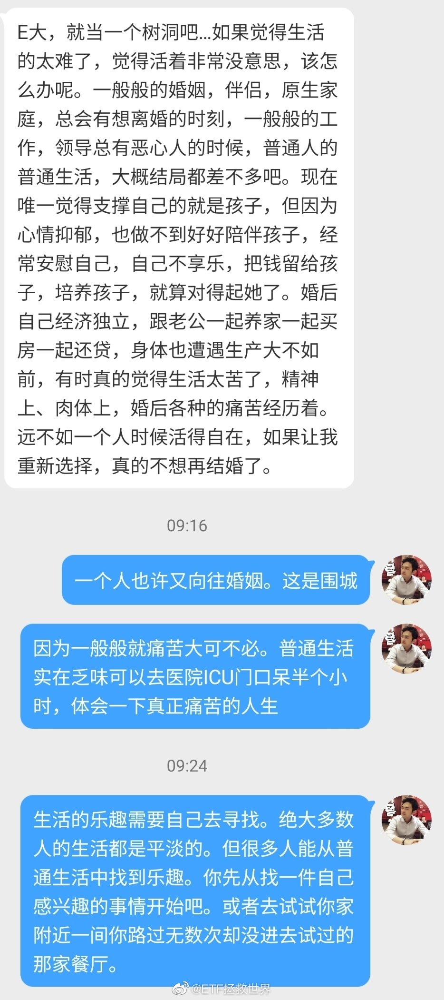

## 2020-07-26 12:17

一位博友私信我让我看的。我大概看了一下，有些分析还是很合理的。非黑即白的极端，没有共情能力无法体会别人的感受……也转给你看看吧。

## 2020-07-27 10:50

立个flag，年底前体脂率下降8。

做不到送3888🧧。 ​​​
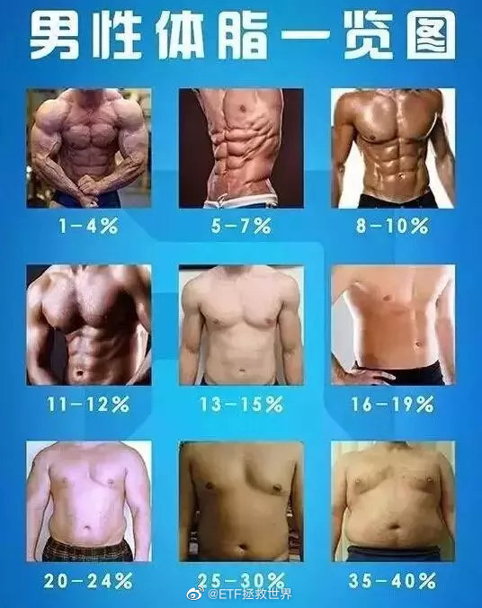

## 2020-07-27 14:29

我没有开新三板，未来也不开。没有韭菜的市场我不会去。

## 2020-07-27 18:04

就不给你放大图，急死你。 ​​​
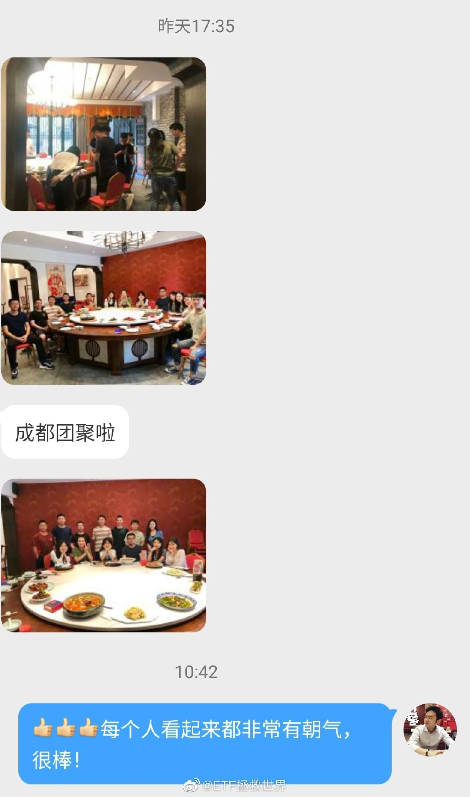

## 2020-07-27 18:18

深圳。你们说他们这样拿着照片是不是很奇怪。

奇怪的事以后不要做了啊。 ​​​
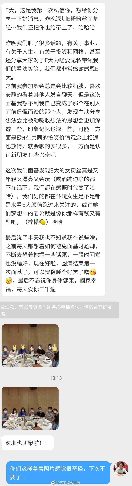 

## 2020-07-27 18:43

再次不厌其烦的提醒一下。

因为之前那个交友帖，听说各地的朋友纷纷自己拉了群，也有朋友自己互相加了微信私聊。大家认识了志同道合的新朋友，都很开心。

我在为各位高兴的同时，再次提醒：

虽然我这里绝大多数朋友都是好人，但不可避免的有一小撮坏人在暗中窥探。相信其中也有几个不怀好意混入群聊甚至参与线下聚会的。

所以，请各位在交友的同时，无论男女，一定要注意自己的人身以及财产安全。在没有完全了解别人的时候，不要轻易付出金钱、感情以及其他。

虽然有朋友觉得这么说可能有点伤感情，但确实一定一定要注意。

希望大家都能越来越好，开开心心的。

## 2020-07-27 20:55

再多说两句关于“投资群”。

我非常不喜欢投资群。除非是三五志同道合的朋友。否则投资群越大，人越多，负面效果越明显。

尤其是很多本来正确投资理念还没成型的朋友进去后，更是百害无一益。

再者，有人的地方就有江湖。几十几百人凑在一起，又是牵扯到金钱利益的主题，更是不免乌烟瘴气矛盾重重。

还有，有没有人怀着不可告人的目的进群？很多朋友都非常单纯，非常容易相信别人，这就又埋下了祸根。

另外，几十几百人说话，你一言我一语，不停刷新信息，太耽误时间。而且大概率是没有意义甚至有害的信息占用了你宝贵的时间。

投资本来就是安安静静，踏踏实实，慢慢研究，慢慢实践才有乐趣。你在我这里好不容易能够静下心来对待投资，到群里又开始心浮气躁那又何苦呢。

综上，投资群，不入也罢。

风花雪月群就不一样了，有空记得拉我。

## 2020-07-28 18:36

今天发现国行switch上了免费的跳绳游戏。

挺好的，可以试试。 ​​​

## 2020-07-28 19:59

因为一个人

爱上一座城市 ​​​

## 2020-07-29 07:45

第二天，体脂率累计下降0.4，总目标完成5%。摄入热量1000卡，运动1.5小时。今天要增加蛋白质以及膳食纤维，减少碳水。 查看图片

## 2020-07-29 09:02

几张图告诉你什么叫追涨杀跌。

注意，主动基金持仓前十的算术平均市盈率是67.23 ​​​
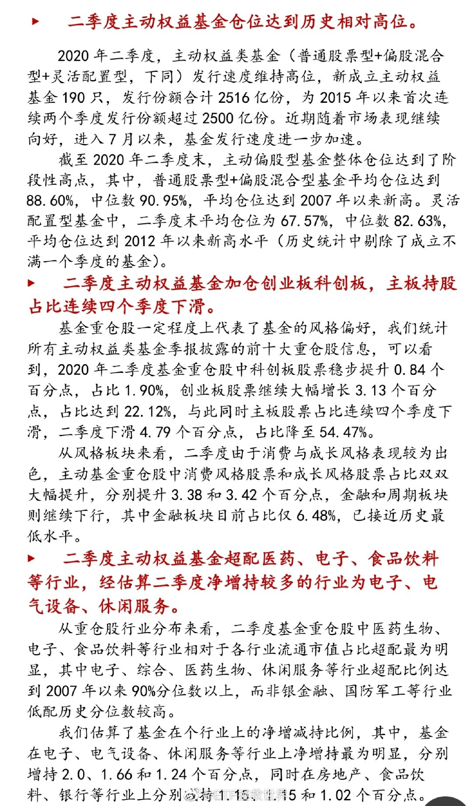 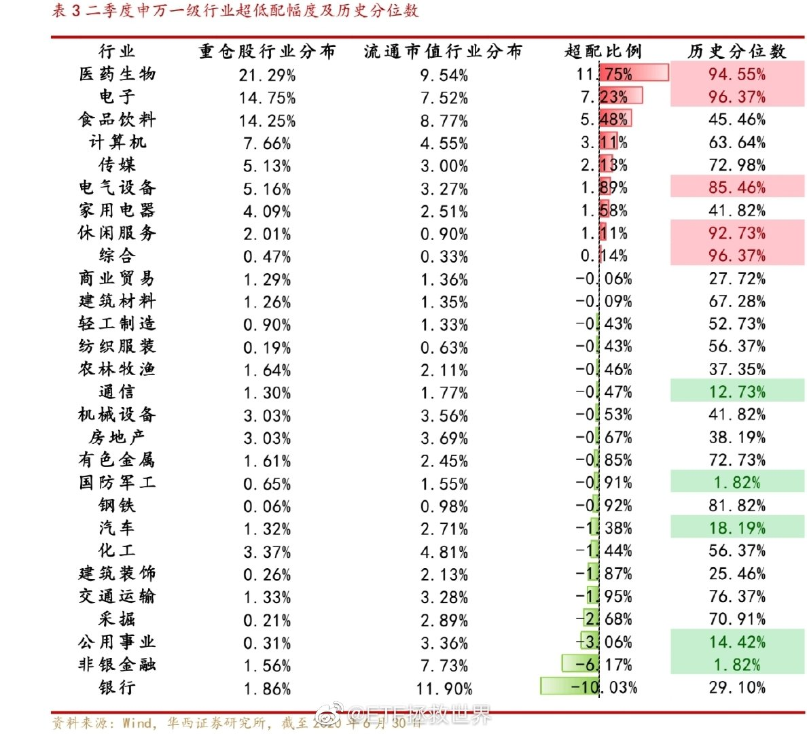 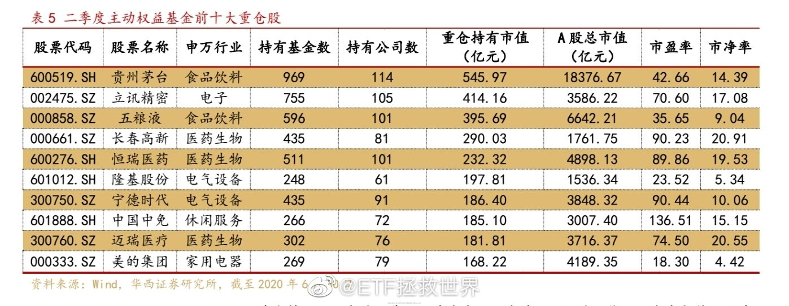

## 2020-07-29 10:10

又是那个经典问题。最后一小时当然是系统问题，有关部门要负责。但是，作为考生，是不是应该早一点登录系统，一定要等到最后吗。就像绿灯过马路要不要左右看。错的不是你，但可以离危险远一点。

## 2020-07-29 14:17

前几天被老公骂的那位集美不知道今天有没有骂回去。 ​​​
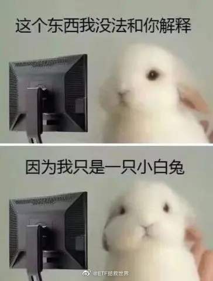

## 2020-07-29 17:24

有时候看网上有些人，尤其是某些在外企工作的人或者留学生说话，总是中文里夹着几个英文单词。看了看其中一部分英文单词好像又不是翻译不过来。怎么理解这种行为呢，将近一百年前钱钟书就给了很好的解释：

“他并无中文难达的新意，需要借英文来讲；所以他说话里嵌的英文字，还比不得嘴里嵌的金牙，因为金牙不仅妆点，尚可使用，只好比牙缝里嵌的肉馅，表示饭菜好吃，此外全无用处。”

## 2020-07-29 18:11

之前我怀疑过筋膜枪是不是智商税。这几天运动量大，拿出来用了一下觉得确实有用。肌肉酸痛的情况缓解很多。

但我依然认为贵的筋膜枪还是智商税…… ​​​

## 2020-07-29 23:46

在下确实精力不够，这种问题没法一一回复。 ​​​
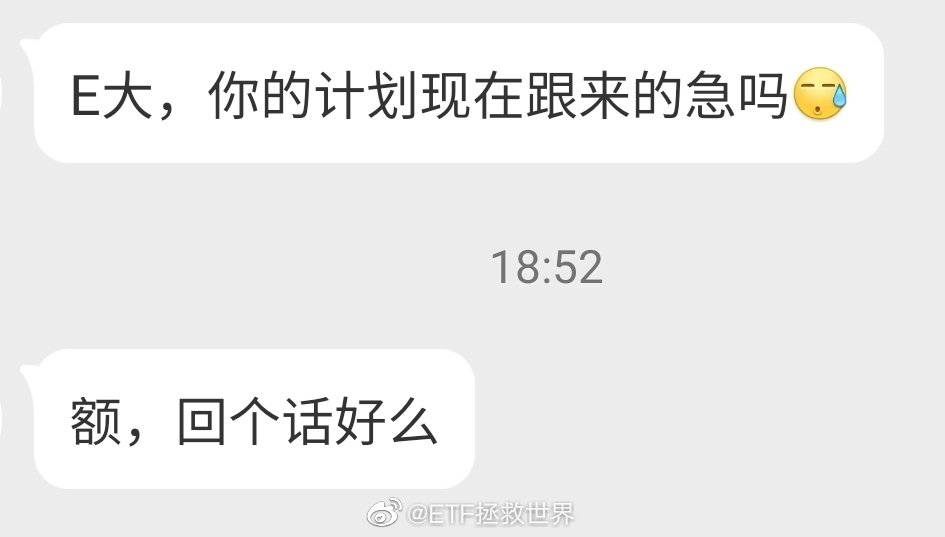 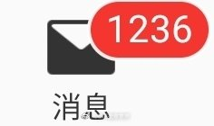

## 2020-07-30 13:23

一句话总结，谁涨买谁。

## 2020-07-30 22:31

大晚上的没事儿别八卦，早睡早起。保持心情愉快。 ​​​

## 2020-07-30 22:56

生气。 ​​​
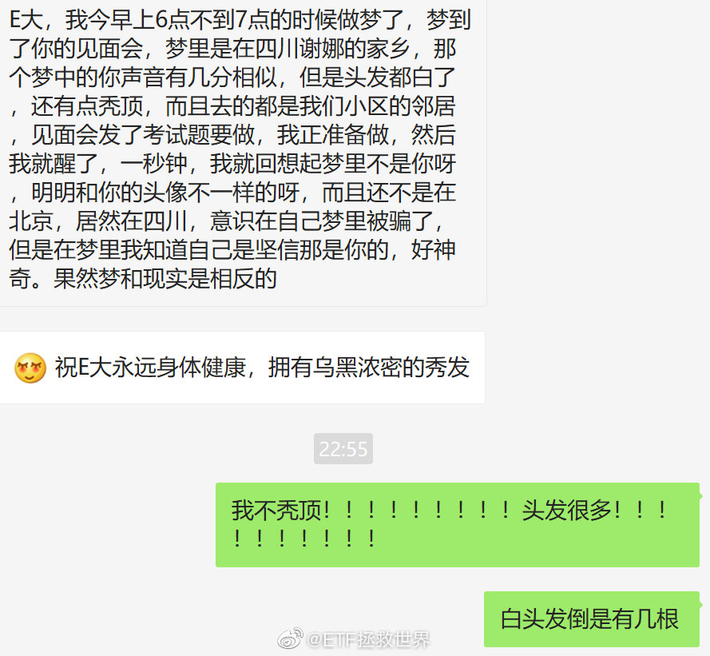

## 2020-07-31 09:00

月底发红包。

 ​​​

## 2020-07-31 09:56

有些板块贵不贵？肯定贵啊。我也偶尔会提两句。因为这是事实。

但有没有必要天天口诛笔伐呢，我认为没有必要。

很多人认为持有这些高估品种的人，是真的认为这些品种依然值得买，依然值得持有。我看未必。

投资的人分三个等级。

第一个等级是不知道什么是值，所以便宜不买贵了追。结果就成了散财童子。

第二个等级是知道什么是值。只要价格倒了“不值”的地方就卖，结果可能赚不到太多。

第三个等级是知道什么是值，所以会在便宜的地方买了，到了不值的地方依然不着急跑。虽然他知道这里已经不值了，但他愿意享受泡沫带来的利润。这种人能赚大钱。

现在这些高估板块中有没有第三类人呢。有。他们不是不知道手上的东西贵了。他们知道，但是他们愿意喝带泡沫的啤酒，愿意收下疯子送的礼金，何乐而不为呢。

他们不怕突然崩盘走不掉吗？70%的利润跌几个点走怕什么呢。更何况一路以来已经慢慢回收资金了。就好像你知道盛宴什么时候结束，已经吃的很饱了，已经做好准备随时跑路买单。

扮猪吃老虎才是最高境界。

所以，不要天天提示风险。尤其是手里没有的时候，容易让人嘲笑是犯了红眼病。像我们手里拿着医药，说医药贵就好一点。至少我们不会因为没赚到钱就喷自己，对吗。

天天说贵，会让某些人卖掉这些品种后有了责怪的对象——你说贵我清仓了，怎么还在涨？你这个辣鸡，你害我少赚了很多钱。

虽然可能即使你不说他也拿不住。也可能他听你的抄了底或者逃了顶也不会感谢你，只会觉得自己是投资天才。

何苦呢。

## 2020-07-31 10:43

有些朋友的条件单是按照市价成交的。

我请你再认真去看我的文章以及交易表格。上面清清楚楚告诉你用什么方式挂单，触发价是多少，挂单价是多少。

所有细节我都想到了，别让我的心血白费。 ​​​

## 2020-07-31 13:34

悲观的人空仓等着崩盘越涨越高，疯狂的人一个小波动随时被套。

乐观而又理性的人每天笑嘻嘻。 ​​​

