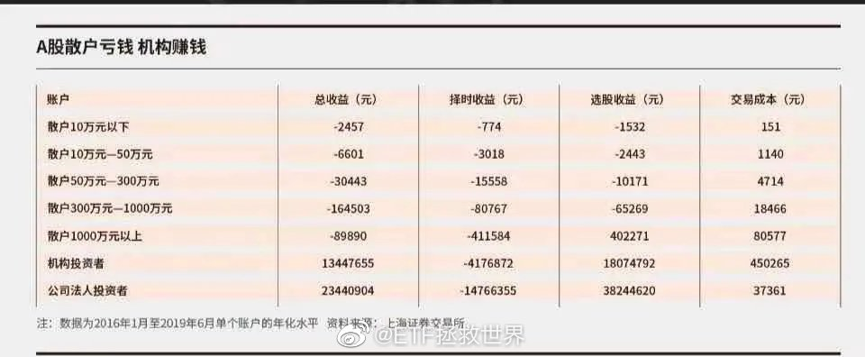
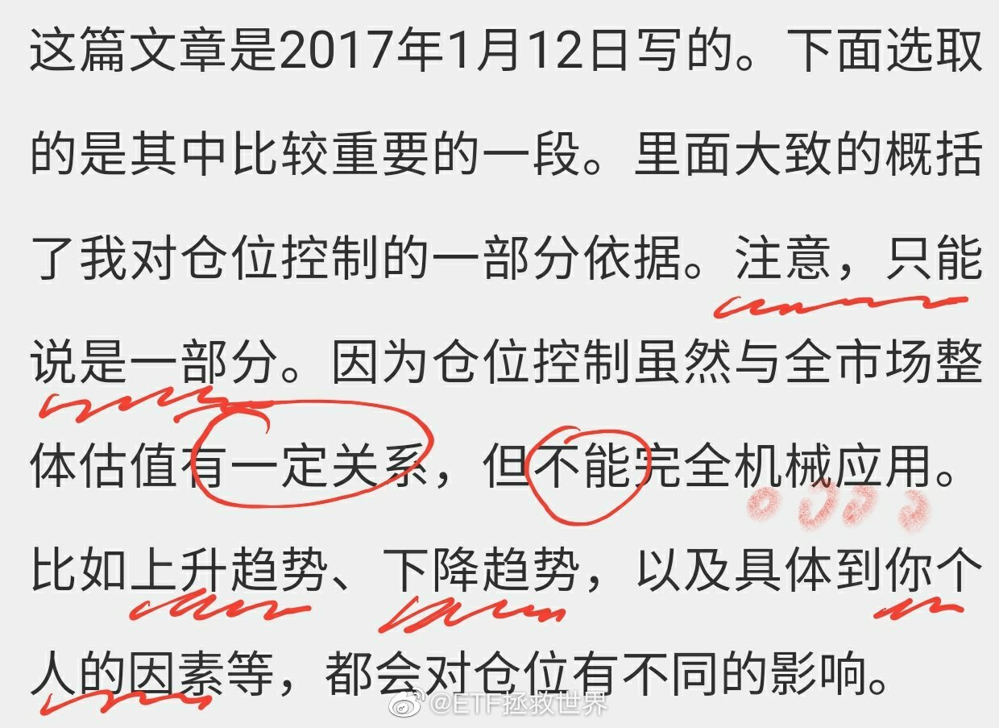
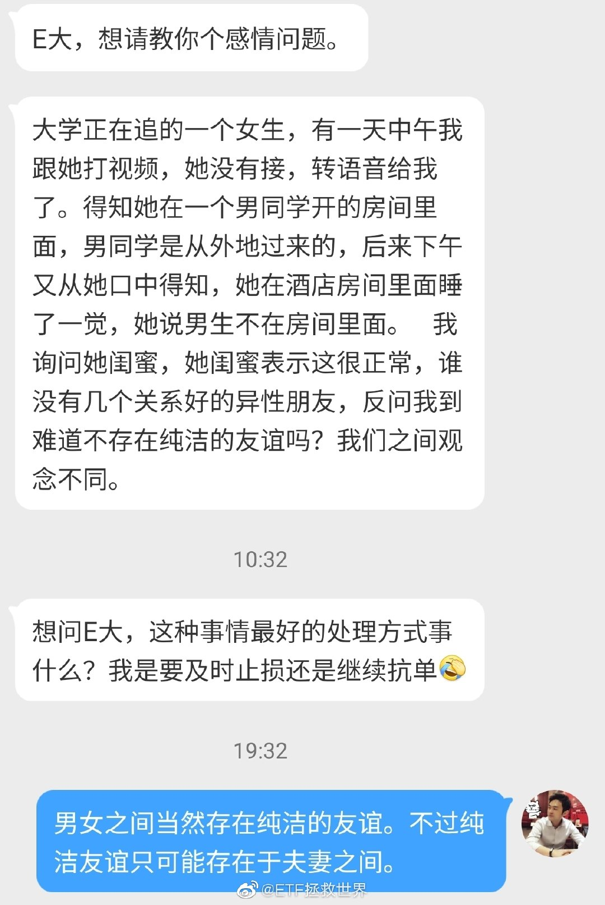
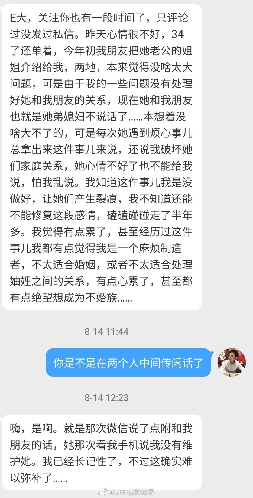
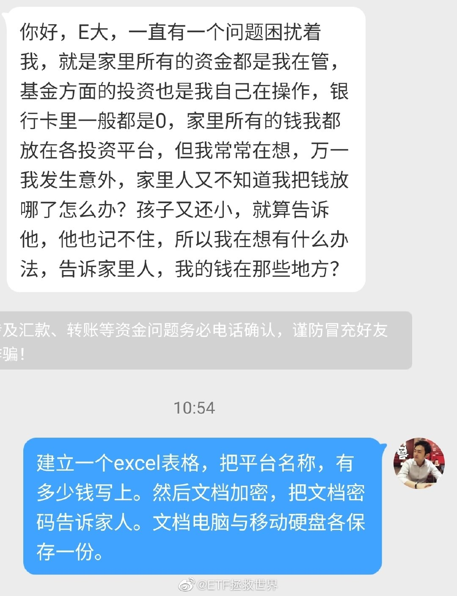
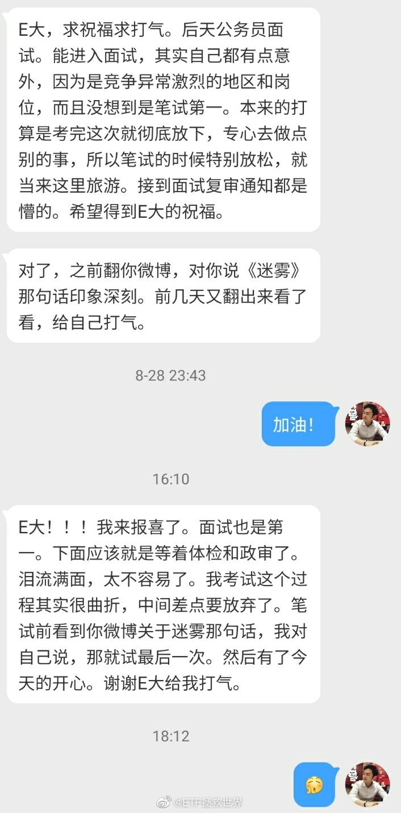
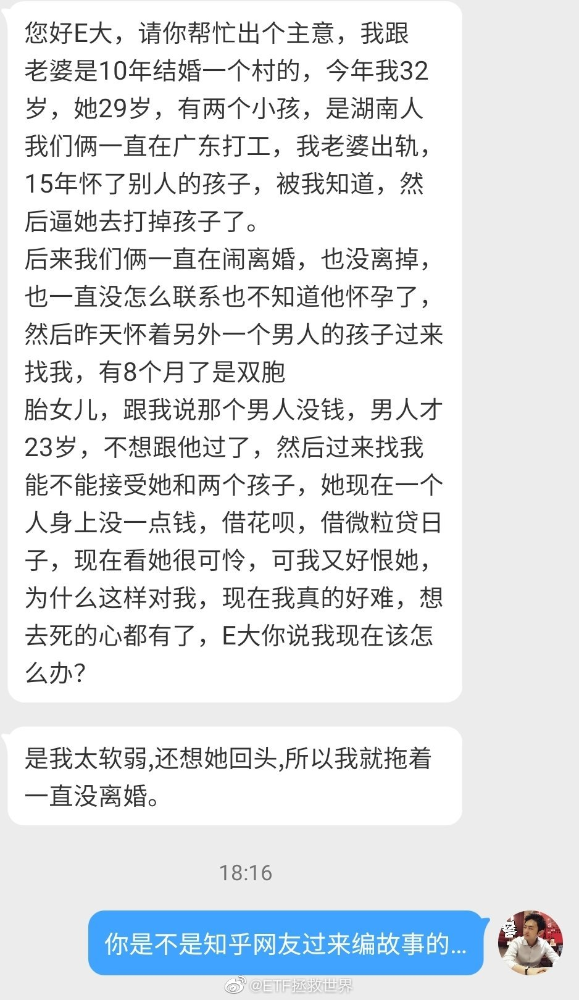

## 2020-08-02 15:27

别人为什么欺负你。从对方的角度讲，是合理正当的。他就是为了自己的利益。他不干你，他的好日子就结束了。

从我们的角度讲，要么就是干，要么就是跪下。自己生闷气一点用都没有。这就是自然规则。

另外，我有一种越来越清晰的想法。中国人从来也不是善茬，本质上并不像我们自己说的这么温良恭俭让。否则怎么可能打下这么大的疆域并且维持几千年。

我D更是如此。除非实力确实差的太多没法干会吃点亏，否则从来不会一直忍气吞声。很多时候我们表面上不声不响，其实悄悄干了很多事。经济，军事各方面这几年哪个不是实力大幅增长。近几年光最先进的大型战舰就下水了多少？

踏踏实实干好自己的事，别操心那么多。

## 2020-08-02 16:29

这两期姐姐的某些表演，比如新物种或者gentlewomen等，让我对女性的美和魅力有了新的认知。

帅，飒，独立…太有魅力了。 ​​​

## 2020-08-03 09:30

叕新高

## 2020-08-03 09:34

当你繁花似锦的时候围上来的笑脸未必是朋友。

你穷困潦倒的时候，搂着你的肩膀说看好你给你支持的才是真兄弟。 ​​​

## 2020-08-03 09:42

2016.1-2019.6月股民收益率。

“基金太慢”。股民说。

是赔的太慢吗。 ​​​

## 2020-08-03 10:12

像极了股市。

## 2020-08-03 10:32

转发微博

## 2020-08-03 10:49

我写的，转发的一些消息，数据，是希望与大家一起更加全面地观察这个市场，更加敏锐的在黑暗森林中嗅到一些不同的气味。

我希望各位能从今天开始摒弃那种只看一个消息，一个数据就判断某件事会发生，就预测市场会改变的思考方式。

证券市场涨跌不是一个简单的线性问题，没有一个数据和信息能决定市场的涨跌。各位要做的应该是尽可能收集各方面的信息，融入自己的判断系统、投资体系，做出综合判断。

## 2020-08-03 15:18

事实证明：别听老公瞎bb

## 2020-08-03 15:51

夫妻双方关于理财是否要听对方的，我有一个想法。

如果对方：

对金融投资毫无研究；

或者，对金融投资颇有研究，但数十年如一日赔钱——

那么，ta的操作建议就是噪音。ta的投资行为就大概率是典型的乌合之众行为。

不知道对不对，请举反例驳斥我。 ​​​

## 2020-08-03 16:37

不懂就问，TT海外总部为什么不放在德国呢。 ​​​

## 2020-08-04 14:43

你在这里住一个月会不会腻。 ​​​
   

## 2020-08-05 21:44

灵魂拷问：

最近建信500怎么了。 ​​​

## 2020-08-08 20:54

你有没有想过，如果明天地球爆炸，有什么事是你可以做到却因为没有去做而会感到遗憾的。 ​​​

## 2020-08-10 22:53

关于财富，最近经历的一些事，引发的一些感想。

首先，作为一个人，在我看来，一定要“正”。人的行为举止言谈话语够“正”，就会吸引“正”的能量，就会出现同样气场的人来帮你。

一个人的人品，要比能力重要得多。人品不行的人，能力越强越可怕。一定要离人品不行的人越远越好。离他越近越倒霉。

其次。做事业，要动脑筋。做人守正，做事出奇。做事情不能因循守旧，一定要动脑子。出现问题，要深入思考怎么解决问题。如果一直做不好，就要考虑怎么改变。做的事情不变，结果不会有改变。

最后，成功需要运气。但首先要的是努力以及动脑子。我所见的一些失败的人，真的是有很多共通点。最大的问题就是意识不到问题所在，不会动脑子。

还有一点。对于大多数人来说，70%-90%吧，踏踏实实找一份工作，努力把这份工作做好。有精力的话做一些副业，有了余钱认真做一些靠谱的金融投资，是最佳的财富路径。大多数人，没事不要去创业，成功的或然率非常非常低。

## 2020-08-10 23:29

遗憾？这不属于盗窃吗。

## 2020-08-11 10:24

军工：整体估值85倍，85.42%成分股估值超过50倍，1/3成分股市盈率超过100倍。

伟大！ ​​​

## 2020-08-11 10:38

有些朋友看到某个板块近期在涨自己没有就气的直哭，全然不顾手里的品种也涨幅非常好。

相当于什么呢，相当于你娶了小迪回家，却天天生气的看着颖宝和大幂幂YY。

全世界的钱都让你赚好不好？ ​​​

## 2020-08-11 10:44

回复@童龄Forever:很多人追求的开心是“每一秒都开心”。很多人追求的赚钱是“每一秒都新高”//@童龄Forever:如果可以不太贪心 有相当一部分人的生活会更好

## 2020-08-11 12:35

呵呵，事出反常必有妖。如果真的挖出有内幕，不知道前一段为这篇文章摇旗呐喊的人会作何感想

## 2020-08-11 20:40

白银留的利润可以先出1/3了 ​​​

## 2020-08-12 09:44

## 2020-08-12 09:55

我从来不觉得只有自己的投资方式是好的。

我认为只要能赚钱，怎么投资都是合理的。价值投资一定比趋势投资、量化投资、甚至打板强？

未必。

小迪一定比颖宝、大幂幂、丫丫好吗？不一定。

只是，你来投资，一定要清楚自己适合什么。你用这种方式投资，得想想自己有没有那份灵气和慧根。有了，你就去做，没有，你就别做。你不知道自己有没有，那就是没有。你以为自己有，也可能没有。

可能每个都好，都很漂亮，但只有小迪和丫丫适合你。

还有一点。有些投资方式特别适合大多数人，而有些投资方式只适合很少很少的人。这个概率问题就很重要。所以最重要的还是清楚自己是什么人，自己想要的是什么，谁更适合自己。

挣钱要挣得明明白白。你为什么在这个品种上赚钱了，这个品种是真的好还是炒作，它值不值现在的价格，你心里得清楚。否则，稀里糊涂赚的钱，就会踏踏实实赔回去。

人家玩击鼓传花，你以为是在玩抢凳子，那就不好了。

## 2020-08-12 12:35

我说句可能又要被骂的。

倡导拒绝餐饮浪费不对吗。无论从个人健康管理、国家粮食安全各个角度讲没有问题吧。

每天教孩子“粒粒皆辛苦”，“一粥一饭当思来处不易；半丝半缕恒念物力维艰”，怎么倡导一下节约骂的人这么多呢。严格禁止公款浪费不更是好事吗。

我觉得咱们讨论事情就好好就事论事，不要扯别的。

## 2020-08-12 14:08

再卸两车。 ​​​

## 2020-08-12 14:25

各位可以谈谈，这样上涨过程中极慢速的出货，与满仓不动或者快速减仓相比，你的心态是不是更好了。

无论是涨还是跌，会不会觉得都很开心和踏实。 ​​​

## 2020-08-12 17:34

准不准，就问你准不准。

## 2020-08-12 17:46

3C小技巧：

如果你的airpods有一只耳朵不出声了，尝试以下操作（苹果手机）：

在手机上蓝牙选择“忽略此设备”。把耳机放入耳机盒30秒以上。打开耳机盒盖，靠近手机。手机会显示动画，按提示连接。

问题大概率解决了。

如果还解决不了，去店里换吧…… ​​​

## 2020-08-13 21:05

回复@余睿nerazzurri:很多朋友觉得我不务正业总说别的。其实当你碰到问题的时候才知道这些“废话”多么有价值//@余睿nerazzurri:e大，这个技巧真的有用！！！我刚好一边耳机坏了，纠结了好久要不要买新的，看了你这条生活小技巧试了后两边都有声音了，e大威武！！

## 2020-08-13 22:04

Dax历史新高。

不卖。 ​​​

## 2020-08-14 11:32

没有波动，生活变得索然无味。

只好下单买个新手机才能维持的了生活这样子。 ​​​

## 2020-08-14 19:35

野球场小贴士：

拼的最凶的最能咋呼的是50+的大叔。

站在对方门前等射门的前锋水平都很次，胖子居多。 ​​​

## 2020-08-15 21:55

刚跑步回来，开始看1000条留言…… ​​​

## 2020-08-16 09:14

回复@好听还不重复的微博昵称:这个很难一两句说清楚。与年龄有关，与双方财务水平有关，与社会发展阶段有关。//@好听还不重复的微博昵称:有点想问益达，男女之间的感情的底层力量是金钱与物质，还是精神上的体验？@ETF拯救世界

## 2020-08-16 11:55

我发现很多人的阅读能力真的不行，我再强调一次，估值定仓位不能机械应用。这几句话一定要真的弄明白！ ​​​

## 2020-08-17 09:45

“资产配置不叫投资”

买股票算投资；买债券算投资；买基金算投资；买黄金算投资；买原油算投资；买美国德国日本QDII算投资……

合在一起，加上仓位配置和择时，不算投资！

喷了。 ​​​

## 2020-08-17 09:59

在有些意识模糊半睡半醒的时候，比如早晨起床前，总是会想起某个地方，非常熟悉，甚至记得在那里生活过一段时间。最重要的是那个地方还有点恐怖，非常刺激。

还有就是之前说的那辆车。买了以后放在某个修车厂，所有场景总是不断浮现在眼前。

特别真实，然而反复确认自己的行程，真的没有在那个地方住过，也没有买过那辆车。

是不是发生了什么不得了的事情。

## 2020-08-17 10:58

富国红利只要今天不跌，就是继续历史新高。为什么一个3400点历史新高的品种要被喷？因为有一年表现不好。

## 2020-08-17 11:08

一年前在S宁买的G703鼠标滚轮坏了，想申请售后发现居然没有选项。

再去京东找了一个同期买的鼠标，试了试售后只要填写故障就上门取件维修。

就凭这个，你叫我京吹我也认了。 ​​​

## 2020-08-17 15:29

不管未来会怎么样，

至少我们现在很开心。 ​​​

## 2020-08-17 16:37

突然想念一片海。

## 2020-08-17 17:10

昨天晚上看了两集 三十而已。

被王漫妮店里那个辣鸡同事和副店长气的看不下去了。

可以让那个辣鸡同事炒股把钱赔光吗。 ​​​

## 2020-08-17 19:33

老铁，你觉得我说的对不对。觉得对就敲666 ​​​

## 2020-08-18 08:33

有人说“苹果不是科技股，是消费股”

那么，这么说，亚马逊，微软，甚至谷歌，阿里，腾讯，都不能算科技股？

什么是科技股，我认为通过生产，销售高科技产品，或者设计，建设高科技网络为消费者直接提供服务都是科技股。

老巴为什么说不投科技股，不是因为科技股不直接服务消费者，而是科技股产品替代很快。可乐50年后也有人喝，并且50年后与现在基本不会有太大变化。微软苹果50年后一定有人用吗。要用这个思维去理解老巴说的消费和高科技。

这类股票，和上一轮互联网高潮时期的诺基亚，微软，AOL，戴尔，难道本质不一样吗？怎么就不是科技股了？

至于苹果护城河宽不宽，会不会长生不死，这不是这里讨论的问题。我要说的是，它必须不断更新产品，不断通过技术革新维持领先地位，那它就是老巴以前说的科技股。 

真的是，老巴做点什么都有人为他狡辩。人家自己都及时转向买黄金和科技了，还有人说买黄金股不是因为看好黄金，买苹果不是买科技。喷了。

## 2020-08-18 11:35

挣点钱意思不大。 ​​​

## 2020-08-18 16:57

水淹大佛膝，火烧凌云窟。//@caozenghui://@老蘇老了: 卧槽……

## 2020-08-18 17:15

如果不想惹麻烦，第一守则，不要在背后说别人坏话。早晚会传到那个人耳朵里。

最好多在背后夸你真正喜欢的人。早晚他也会知道的。

第二守则，别人跟你说秘密，在你这里就到了终点，不要告诉第三个人。更好的做法是根本不听别人的秘密。

第三守则，如果你有不想让别人知道的秘密，不要告诉任何人。因为只要有两个人知道，那么它就不再是秘密了。

## 2020-08-19 08:54

虽然私信不可能每一封都看到，但就我看到的这一部分来说，困扰很多朋友的，除了投资方面，其实就是几件事：

感情纠葛、财务问题（尤其是家庭间的，包括与父母，与兄弟姐妹）等等。

我也不敢说自己是什么感情专家，更不敢说深谙家庭相处之道，但我想跟面临这些苦恼的朋友说一句：

太不值了。

各位，我总是说要开心。但各位把自己的人生耗费在这些鸡毛蒜皮家长里短上，因为这些不开心，真的太不值了。人生很短，真的没有必要。

恋爱遇到渣男渣女，当你发现对方本质很渣的时候，你难道不应该非常庆幸吗。庆幸这么早就发现了，总比婚后才意识到好很多吗。离开渣人还怕碰不到更好的？好，退一万步讲，真的一辈子碰不到好人了，一直单身，那也比跟渣人在一起强一万倍。

与家里人的财务问题。我想首先你应该明确，你作为一个人，首先你应该对自己好。你让自己开心、富足、美满，才有可能让身边的人都变得更好。所以，你不能勉强、委屈自己，来满足别人的需求。退一步说，如果那个人对自己非常好，那么你牺牲自己去成全他，没有问题。但那个人如果根本对你也不好，只因为他与你有某种血缘关系，那你真没必要这么伟大。

在我看来，70%以上私信的苦恼，都是来源于小事。还是之前说的，越看越觉得不值。就拿今天看的两个，一个是两口子结婚，家里的家具男方母亲都给换了新的，结果女方发现床垫没换新的就大闹，一定要让男方母亲再给买。男方夹在中间快崩溃了。第二个是一位朋友的哥哥让这位朋友自己的借吧借钱给他做生意。借了一笔又一笔，导致这位朋友很苦恼。

各位可以看看，这都是什么事？就这些破事，也值得各位如此烦恼？人生只有一次，每一天，每一个小时，每一分钟过去了都不会再回来。把所有精力纠结在这些小事上你真的不会心痛吗？

上面两件事，烦个屁啊。第一件，要么跟不懂事的媳妇离婚。要么你自己买个床垫，与母亲说好，就说是母亲掏的钱，这事不就完了吗？解决这件事之后，要找机会不断与妻子沟通，让她也明白不要再在这些小事上浪费生命，对小事一笑置之，好好享受生命。

第二件，如果自己也确实没钱，直接跟哥哥说不能再借了。借呗是上征信的，未来买房买车贷款能不能批下来都已经不清楚了。如果因为1万多这个生意就做不下去了，我看也真的没必要再做了。不如早点去找个有前途的工作吧。没什么不好意思，你已经尽力了。

就这些破事，鸡毛蒜皮的小事，每天让很多朋友痛苦不堪。如果一个人让你不舒服，就离他远一点。如果父母让你不舒服，你就去远一点的城市找个工作。找伴侣，最重要是三观是否一致，对方是否正直、善良、希望你开心。否则，你将面对的就是几十年的炼狱生活。

最后说一次，都是小事！！！除了生死，都是小事！不要再因为这些小事郁闷了，毫无必要。与能让自己开心的人在一起！做让自己开心的事！

## 2020-08-19 09:01

回复@平平-----淡淡:我说了多少次了？借钱，你就要当给钱。借了钱你就别想拿回来。人家真的还了，就相当于白捡，要请对方吃饭。

## 2020-08-19 14:51

订了新手机后，这个手机已经两次从手里飞出去了。今天更是屏幕朝下直扑水泥地并滑行2.36米。

到底是它在怪我喜新厌旧还是我潜意识中要疏远它？ ​​​

## 2020-08-19 21:13

我突然明白一件事：为什么很多人觉得女性开车更危险。

为什么我们在媒体上看到的事故新闻好像“女司机”事故占比更大呢。

然而，前一段时间有个交管的数据，分明是男性司机事故占比大啊。

除了很多女司机虽然有车本但其实很少开车所以出事比例会降低外，有一个关键点大家可能忽略了，那就是：

男性司机也许事故占比大，但是，男性司机的事故，大多数都是“常规事故”。你知道，常规的事故是不可能上新闻的。比如闯红灯，压线，甚至更严重的肇事等。

但你观察，很多上新闻的交通事故都显得有一点沙雕。比如不拉手刹车子在十字路口转圈司机下车人肉刹车，比如把油门当刹车冲向行人或者路边建筑……等等。也就是说，只有沙雕事故才能上新闻。

我之前发过一条微博，当时我就感觉很多男性司机的违章都是“明知故犯”，这样的违章一般不会太出乎意料。但是有一小部分女司机确实容易发生一些不同寻常的违章，这样就比较容易上新闻。

重申一下，我不是歧视女性。但我身边见到老鼠蟑螂之类会吓得大叫和手足无措的确实是女性朋友比例远高于男性。那么一小部分女性开车的时候是不是会比男性更加容易慌乱，有待研究。

这是我的一点思考，对不对的您多担待。总之一句话，我个人认为，总的交通事故男性可能比例会多，但一些不同寻常的事故女性似乎更多一点。所以女性上交通新闻的比例也会高那么一点点。

## 2020-08-19 22:13

虽然不喜欢大老师综艺节目里面神神叨叨的样子，但他的歌从一开始花儿内时候到现在一直觉得好听。

你要说词曲抄的比较多，但声音也挺喜欢的。 ​​​

## 2020-08-20 10:37

走过这一轮下跌——上涨，跟我一起观察这个市场的风云变幻，你总算知道为什么有些人说起股市总是骂骂咧咧“MD，不要炒股，都是骗钱的。”

看看大多数人什么时候进，什么时候出，媒体机构如何趁热打铁，恍然大悟了吧。 ​​​

## 2020-08-20 11:17

来投资，首先要想清楚两件事。

第一件事，你放进市场的钱会去谁的口袋里，谁的钱会到你的口袋里。

券商佣金，印花税，IPO，公/私募，保险，大鳄，GJD，风投和大股东减持……这些都是铁定要赚钱的。

谁在送钱。公司分红？谢谢你了。

绝大多数钱都要靠互摸口袋。

第二件事，你的优势是什么。

与上面所有人相比，投资这件事你有什么优势。投研优势、数据优势、技术优势，信息优势，还是？凭什么你从市场上源源不断提款？

想明白这两件事，很多事情才能做的更好。

说句实话，对于散户来说，一轮牛熊过去，能从这个市场上挣到钱就已经算是出类拔萃了。

## 2020-08-21 16:53

首先，我认为内什么上海丈母娘招年化10%女婿的新闻就是个假新闻。要么是骗子，要么是联合炒作。

不过我的重点不是这个。

年化10%，10年赚多少？答案是2010-2020这十年，收益率超过160%即可。

简单不简单？太简单了。2015年那波大行情，创业板最高涨了6倍，中证500最高涨了4倍，沪深300最高涨了将近2倍。

哪怕你完全跟不上这个涨幅，接下来只要你保住胜利果实，也基本能完成十年160%的要求。

巧了，2010年也正好是第二轮计划开始的时间，2010年到2015年7月，计划整体收益率大致是200%多。

接下来的大熊市，150计划从未跌破第二轮计划结束时的高点。也就是说第三轮计划从未亏损，到现在又是接近50%的收益率，那么第二轮、第三轮的十年收益率已经超过了300%。十年总的年化收益率大概是14%多。

所以前几天有人喷，“取得市场平均收益”。朋友们，取得市场平均收益已经非常非常不错了！比如2015年，由于4、5月已经基本清仓，导致最后两个月的疯狂暴涨没有吃到。无数人嘲笑和辱骂，那又如何呢？结果全市场白骨累累的时候谁在笑？谁还有钱干分级A两、三个礼拜赚70%？

所以，最关键的在于，熊市不赔钱！别人账户缩水70%的时候，你1分钱没赔，这个差距会有多大你知道吗。之后他赚200%也追不上你。

“熊市不赔钱或者极少赔钱，牛市大致跟上”，永远将是我的追求。随便你怎么嘲笑怎么看不起，我只知道——

我的账户又TMD新高了呢。

## 2020-08-23 10:47

于老师教明星、网红、直播以及保安公司做人。

## 2020-08-23 10:55

你还有没有更好的建议 ​​​

## 2020-08-24 12:26

长期看气候变暖导致北方变江南没错，但南方可能变沼泽。

## 2020-08-25 10:26

今天你有什么故事，说来听听 ​​​

## 2020-08-25 13:51

科创50更NB。一半成分股市盈率超过100倍。伟大！我知道有人又要嘲笑我：投资科技股你还看市盈率？

## 2020-08-25 15:03

我对于未来普通人财富分层有一个想法，不知道对不对。

一共三层。

第一层是理性投资，有资产的人。房产、股权包括你买的股票、基金等。由于这些品种会不断上涨，这一层的人财富会越来越多。拥有越多就越富有。社会新增财富的绝大多数都归这部分人了。

第二层是只依靠工资收入的人。对于大多数人来说，工资收入不可能增长太多。何况物价也在上涨，再碰上疫情失业了就更加捉襟见肘。这部分人不投资，手停口停，挣多少花多少，恐怕所占财富的比例会越来越小。

第三层是乱投资的。好不容易攒点钱都赔光了，钱越来越少。惨。

## 2020-08-26 10:49

正好一个月，体脂下降1.8。还剩4个月，还是太慢了。 查看图片

## 2020-08-26 14:09

去尤文好吗。

## 2020-08-28 12:11

不要太想我 ​​​

## 2020-08-28 16:24

大家这么高兴，当然要发红包。

8月红包888，一定要开心啊！
  ​​​

## 2020-08-29 13:56

日常灵验。 ​​​

## 2020-08-30 18:14

主要是个人的努力，当然也有祝福加成。 ​​​

## 2020-08-30 18:17

我的直觉有没有道理。 ​​​

## 2020-08-31 08:11

8月28日，商务部、科技部调整发布《中国禁止出口限制出口技术目录》，“基于数据分析的个性化信息推送服务技术” 等列入目录。

## 2020-08-31 08:58

每次锻炼懈怠了就去ins看看C罗和拉莫斯激励一下自己。

还有没有类似经常发健身视频的球员ins推荐关注？ ​​​

## 2020-08-31 10:20

还没新高的请取关。 ​​​

## 2020-08-31 14:51

没有新高也没有关西，不必取关！明天会更好！（场面一度十分尴尬）

