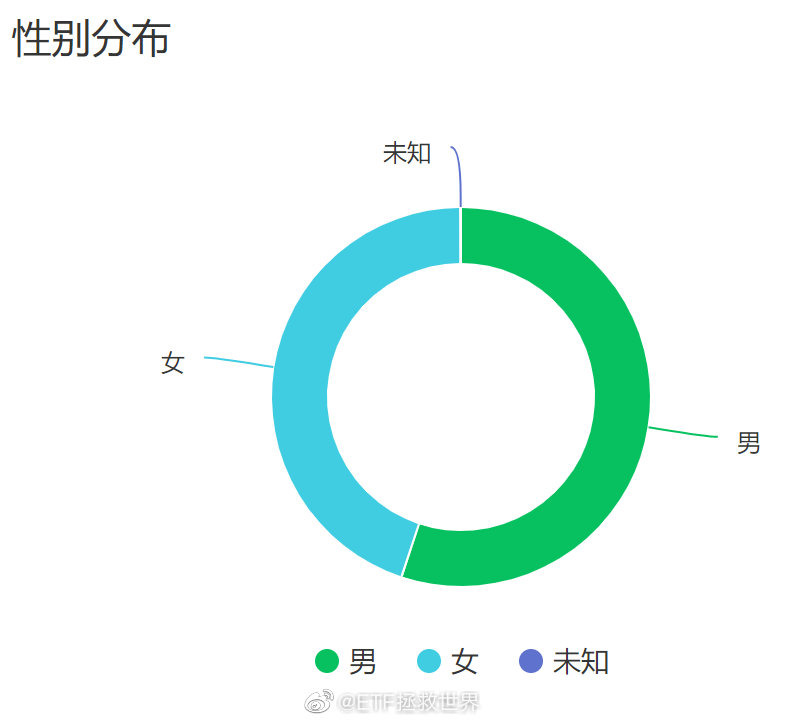
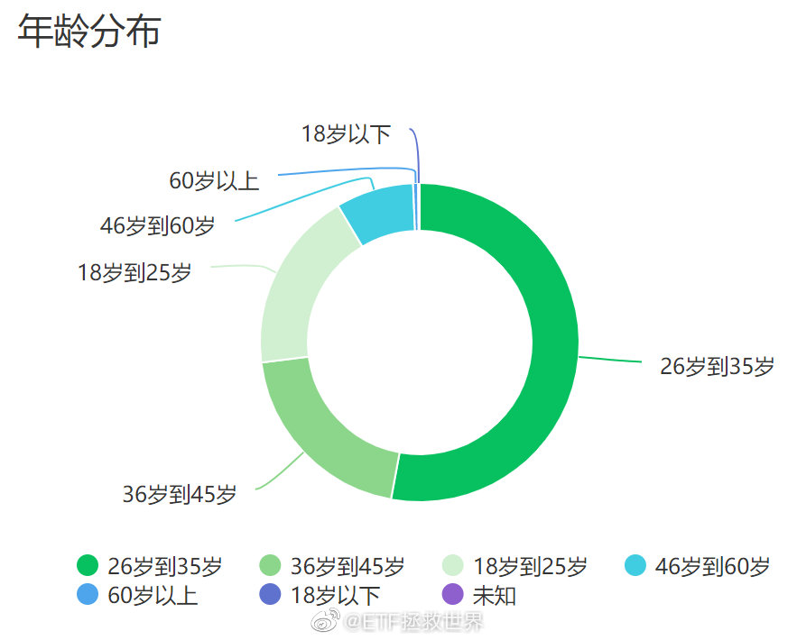
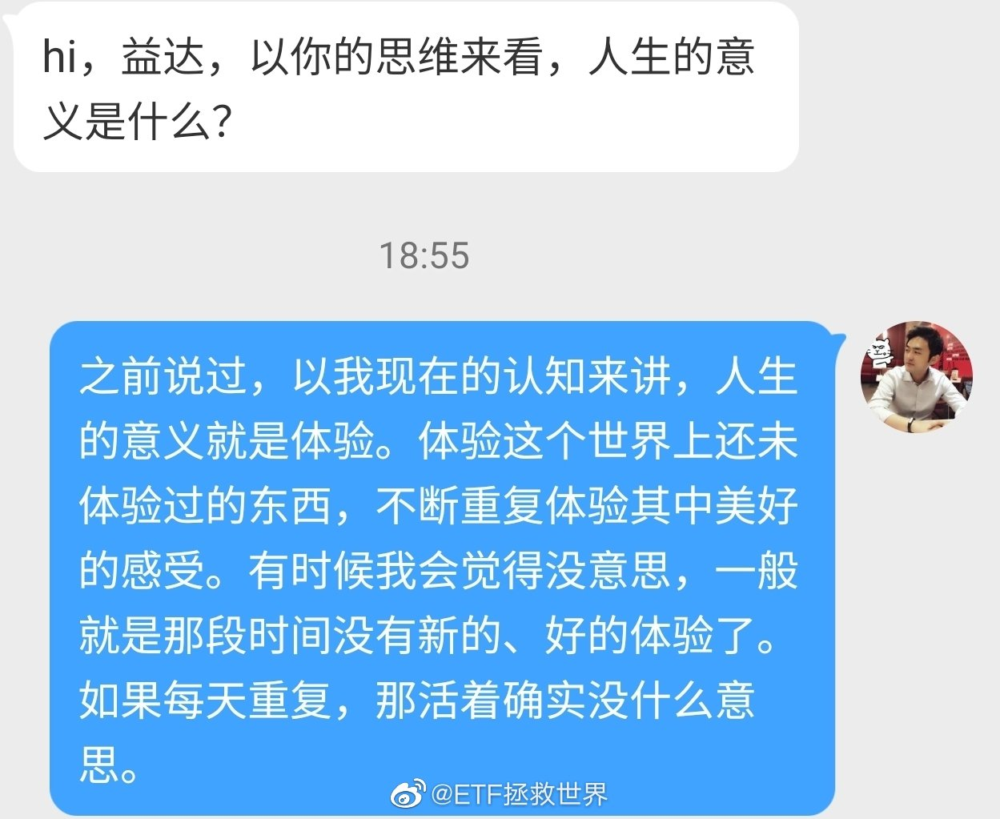
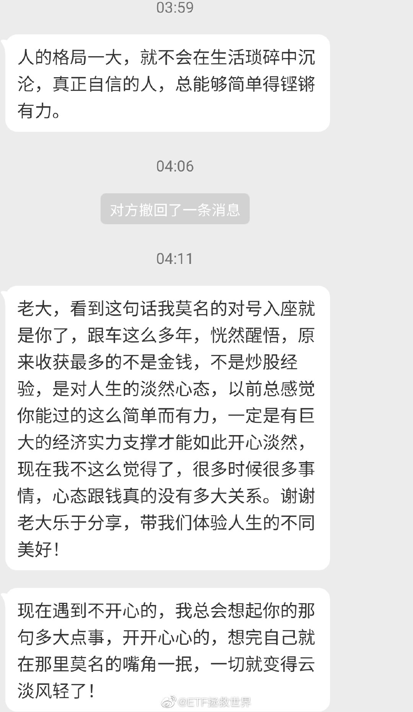
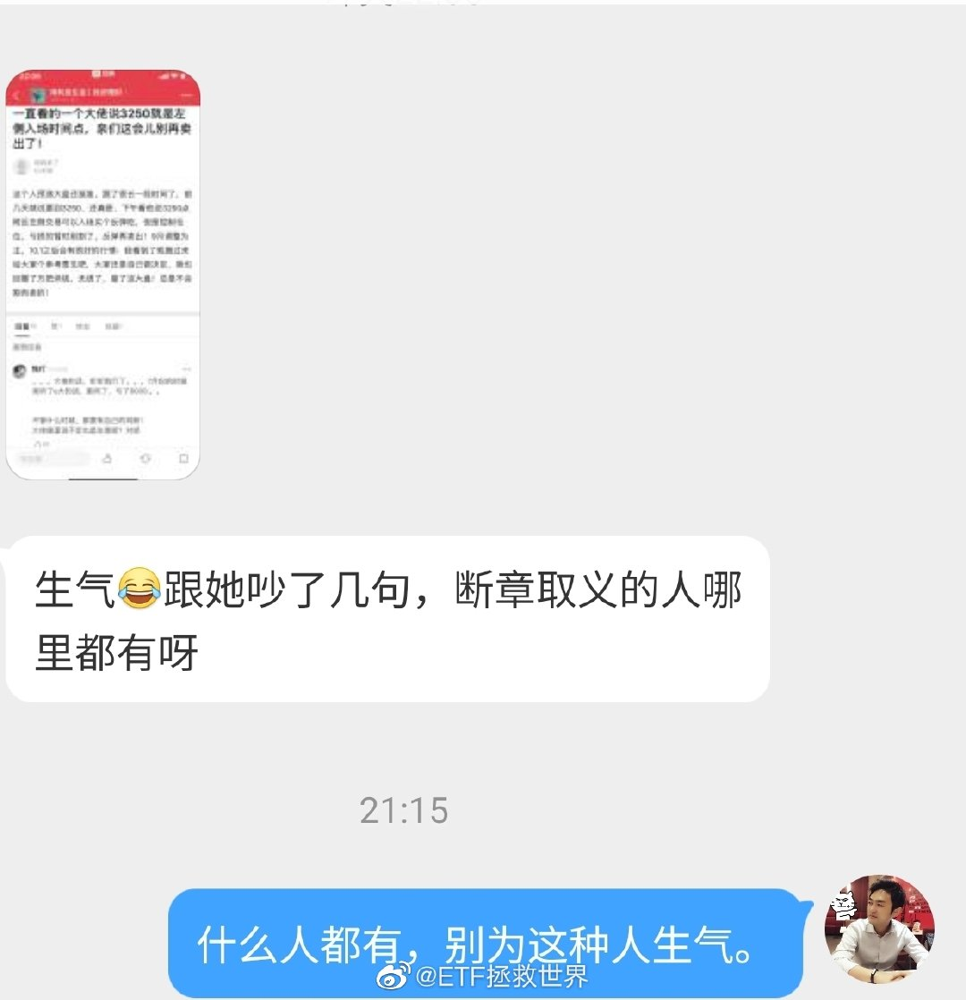
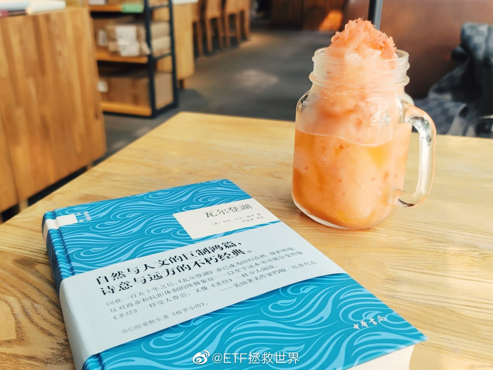
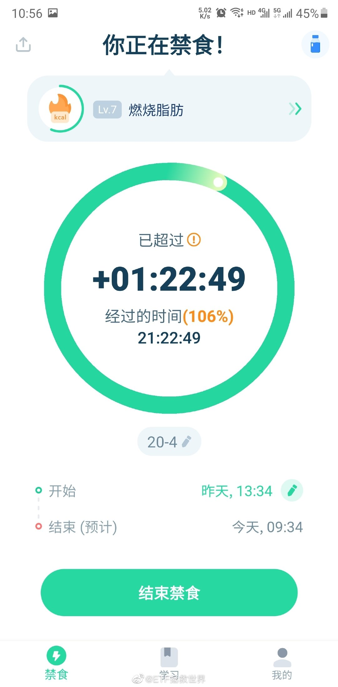

## 2020-09-01 09:53

513100已经进入博傻阶段。

傻子和疯子不久之后就会买单，敬请期待。 ​​​

## 2020-09-01 10:51

先卖一点吧……另外说好的送武汉医生小米产品的事正在让他选产品，说到做到。 查看图片

## 2020-09-01 11:10

其实做投资赚钱吧，真没太难。

拿闲钱，低位买入不会死的资产。然后踏踏实实拿着，不管它几个月几年不涨。

最后飞一次就把几年的好收益还给你。

赚差不多了就卖了，再找跌了好多的，不会死的分散买入继续持有。

别管别人说这个品种跌这么多完蛋了没戏了，也别管别人嘲笑你买的品种几年没涨。

你管别人怎么说呢？你听他的他给你发奖金吗？他自己都不知道赔成什么样了。

## 2020-09-01 13:54

这么有才华又善良幽默的博主，粉了！ ​​​

## 2020-09-01 14:10

哈哈哈哈，该。

## 2020-09-01 20:39

英国持续下跌，德国维持高位——

这大概就是人生吧。 ​​​

## 2020-09-01 21:16

这个班主任，一定，100%，心理有问题。

## 2020-09-02 10:26

谁还记得我好多年前在博客上说，如果一直在使用某家公司的产品或者服务，那就买那家公司的股票，把花的钱挣回来。

谁能想到，这十年我在京东买的东西居然都变成白嫖了…… ​​​

## 2020-09-02 13:16

狗庄太坏了。 ​​​

## 2020-09-02 13:59

真的，强烈推荐你遇到不开心的事情时候试一试：

你就想想，这件事我玩儿命努力、争取，想尽办法能不能改变。

能，就去努力改变它。

不能，就接受它。

当你发现自己根本不可能改变，只能接受的时候，会一下子轻松很多。 ​​​

## 2020-09-02 14:04

回复@张大头ETF:健身真的是只要努力就会有收获的一件事。世界上很少有这样的事情。//@张大头ETF:比如健身目标没有达到？

## 2020-09-02 14:20

纯债仓位未来最大可以给到20%-30%。

现在是1.5%。 ​​​

## 2020-09-02 22:11

纳斯达克这么涨，平稳着陆的可能非常小了。 ​​​

## 2020-09-03 09:47

不出意外的话，我们持有的dax今晚净值又会新高了。

为什么dax、恒生能拿的非常稳，除了波段几乎没有卖出，而美股就是拿不住呢。

因为美股确实看不懂了。看不懂的东西就是拿不住，没有办法。 ​​​

## 2020-09-03 10:34

冲鸭 ​​​

## 2020-09-03 14:43

一天天的，啥也不是！

要再开几个网格吃饭了。 ​​​

## 2020-09-03 16:14

DAX又是1.5%+。

德味！ ​​​

## 2020-09-03 22:33

我发现NOTE20 U的摄像头调校有问题，不要买。

## 2020-09-03 23:10

-4%，给个熔断得唔得。//@ETF拯救世界:-2.62%。敢不敢一天干26%。

## 2020-09-03 23:22

-5%。差不多行了，别搞得大家一哄而散把主力套在山顶就尴尬了。//@ETF拯救世界:-4%，给个熔断得唔得。//@ETF拯救世界:-2.62%。敢不敢一天干26%。

## 2020-09-04 00:44

想要一只！

## 2020-09-04 09:42

你涨我不涨，你跌我跟跌。

什么玩意儿。

要跌你就跌深点，几个月没发车了。 ​​​

## 2020-09-04 09:47

很多人把说错“打脸”看的比命都重要。

不好意思，我不这么认为。

因为我已经发现、确认、并承认自己是个人。只要是人，就会出错。何况是在中短期几乎不可能预测的资本市场。

所以说错就说错了呗。多大点事儿啊。

不过我对一种错误非常看重，那就是“做错”。无论是自己的还是别人的，我都会认真研究，避免重蹈覆辙。

同一个错误，第一次犯，完全可以原谅。第二次做错就证明自己不是个聪明人。第三次做错，证明自己不适合这个游戏，尽快退出才是王道。

## 2020-09-07 08:08

解！放！了！ ​​​

## 2020-09-07 10:06

唯一让人开心的走势是债券一路向南。

市场永远不缺机会。缺的是发现机会的眼睛和发现机会时候手里的钱。 ​​​

## 2020-09-07 10:34

我再次诚挚的给各位一个建议：

看到很多貌似合理的，严谨的，科学的数据统计时，多想一想，再决定是否接受这个结论。

因为周末发了一条微博，评论里有人搬出“数据统计”。我就是想让你知道，数据统计结果是可以人为操纵的。

即使数据是正确的，计算过程是正确的，结论也可以随意操控。

举个例子：

我相信有90%以上的入室盗窃都是在房门锁着的情况下发生的。那么，我们可以不可以得出结论：锁着房门要比不锁危险？因为只有10%的入室盗窃是房门没锁的情况下发生啊。

这个不用我说，你也知道这个结论一定不正确。

这个结论不正确在，锁门与未锁门的基数不同。如果有99%的房门都锁了，有1%没锁。然而1%没锁的房门却贡献了10%的盗窃率。如果这样比较，你就会明白——哦，原来还是锁上门安全啊。

这是显而易见的。然而场景换一下，很多朋友就被头脑里的感情所支配，没那么理性了。

如果说我们想要得出一个结论，就要全面的考察数据。

比如说，你要研究条件A和条件B在最终结果中比例差不多，那么你要看在所有样本中A和B所占的比例是不是也同样差不多。如果条件A在所有样本中占比非常大，条件B在所有样本中占比非常小，然而结果却是条件A和B差不多，那么很明显，条件B是更容易触发结果。

再比如，你还要研究同样的样本，当它是条件A的时候，触发结果的比例是多少。当它变成条件B，触发结果的比例是多少。也就是说，在同样个体上，A和B的比例是否一样。

还有，你还要研究外界对A和B的反应。比如说，一个人走在楼道里，两边都是关着的门，可能他根本就没想过进去偷钱。然而当有一扇门开着，里面满地都是钱，屋里没人，楼道里没有摄像头，你觉得一个好人变成小偷的概率会不会提高？

就是说，诱惑是否出现在一个正常人面前的时候，这个正常人所做出的动作是不同的。当诱惑足够，一个好人内心深处的恶魔也许就会被激发。

条件A和条件B也许都会触发结果。这不意味着它们触发结果的比例相同。所以我们要从上述几个方面考虑：

第一，A和B在总样本中比例是否相同？如果A比例远远大于B，却导致了相似的结果，那么B触发结果的几率大。

第二，同一个样本，A与B状态触发结果的概率是否相同？这个非常重要。

第三，状态A和B会不会导致外界因素的改变？锁着的门和一扇开着的，暴露出屋里满地都是钱的门，哪个更危险？再说一次，状态的改变会引发外界因素的改变。你不要不相信这一点。

且不说流传的一些数据结果是不是真的。就算是真的有这样的报告，这些报告是否详细地研究了上述问题？如果没有，仅凭一些取舍后的数据，能说明什么？

我总在强调，不是说状态A就不会引发结果（有些外界因素无论是状态A还是B都会被触发），更不是讨论结果触发是不是B的责任，而是状态B是否会提升触发结果的概率这个客观事实。

关于之前的话题我不想再讨论。累。我只是想说，如果你看到“数据统计”，要多打几个问号，然后去深入研究它。

投资如此，生活更应如此。

## 2020-09-07 11:13

看了一眼公众号，关注我的朋友男女比例从几年前的70:30已经变成55:45。

特别好！ 

女性朋友才是最可爱的人，不接受反驳谢谢。 ​​​
 

## 2020-09-07 14:08

科创50还在新低。不过好消息是，估值已经降到88.88倍了！//@ETF拯救世界:科创50更NB。一半成分股市盈率超过100倍。伟大！我知道有人又要嘲笑我：投资科技股你还看市盈率？

## 2020-09-07 14:33

关机了。再见。 ​​​

## 2020-09-07 14:38

关于现在“抄底”：

你抄我鼓掌，搁我我不抄。 ​​​

## 2020-09-07 15:21

这一段不停嚷嚷手里有钱要投要投赶紧发车赶紧发车的，

一身冷汗吧。 ​​​

## 2020-09-08 10:00

抱团取暖，兄弟们一起往上打谁都不许卖，大家一起做净值，的关键，

是不能有叛徒。 ​​​

## 2020-09-08 10:17

为什么你总觉得好人干不过坏人呢。

因为坏人没有底线。好人有底线，就很难赢。

所以，坏人侵犯你利益的时候，你就应该想方设法，在不违法的情况下，突破一定的道德底线给他一记重拳。

让他知道，你，不能随便欺负我。 ​​​

## 2020-09-08 18:57

就是这样的想法。

所以投资总是很有意思，不断有新的体验。 ​​​

## 2020-09-09 06:49

虽然有人说“纳斯达克跌一半你才有权利得瑟”，但我还是觉得，这条发在最高点后连续暴跌三天有点神奇啦

## 2020-09-09 09:45

本周是重要时间窗口。一切会在周五有个答案。 ​​​

## 2020-09-09 10:00

PE接近100倍的“爆发”板块；PB接近10倍的“长牛”板块。

疯狂最终都会买单，早晚的事。

追高这些品种，短期当然可能赚钱，但你能不能守住赚的钱和你的本金，很难讲。技术高手和运气好的人也许可以一次次成功。

你得问问自己是不是运气好或者短线技术强。有时候两者很容易搞混。 ​​​

## 2020-09-09 13:55

确实是这样。

只要不是生死，就都不是大事。事情总有解决的办法，如果没有，就接受它。

心里有希望，然后努力实现它。虽然实现以后你会发现也许并未有你想的那么好，但前面还有更多希望。

开心还是难过，很大程度上是你自己决定的。

这些话像不像鸡汤。你试试就知道它们的力量了。哪怕只用在投资上，也会与之前截然不同。

## 2020-09-09 15:11

再说一次，我的微博是我自己的，私人的。在这个地方我愿意说什么就说什么，不违法，不违规，不违反社区规定。拥护一切中国人民拥护的，反对一切中国人民反对的。

微博也没按着你的脑袋关注我，你爱看看，不爱看取关走人。别看不上我这个看不上我那个。我也没想让你看上，爱看谁看谁去。别跟我这儿看的津津有味一转身叽叽歪歪好像我欠你300万似的。

我买什么，卖什么，赚多少，赔多少，看对了，看错了，嘚瑟了，认怂了，说投资、说感情、说人生、聊新闻，跟你一毛钱关系都没有。不爱看还关注你这叫什么，我有个朋友说这叫J，我痛斥了这个朋友：“别骂人，骂人不好。也许人家确实是，但你不能骂出来。”

我们一帮朋友在这聊聊天你说你没事儿跟这儿凑什么热闹撘什么茬儿。你谁啊，都不认识你啊。赶紧走人，出去记得把门儿带上。

## 2020-09-09 16:29

几年前我就说过，这一轮上涨会是一次“慢牛”。

现在我的观点依然不变。2018年11月至今，已经接近两年了，已经很慢了吗？

刚走了一半而已。 ​​​

## 2020-09-10 18:39

今天指数没跌多少，但涨跌家数对比是：

500:3500 ​​​

## 2020-09-10 21:20

大家可以给我点提示吗？7月听我说什么会赔8000割肉出局？

我说什么了？

我们的计划这几个月除了纯债一分钱没买过，一直在高位减持。我还劝不要追涨高位品种，我做错什么了？

我就一句话：造谣的人不得house。自己乱买赔钱赖别人的人不得house！

对，说的就是你！虽然我不知道你是谁，但你就是个人渣！
 

## 2020-09-10 22:26

我特别想看下午被砸到跌停的时候主播是怎么说的。

## 2020-09-10 22:35

有朋友说是看了717的。717我们定时发车，关他高位接盘的什么事？我们当时卖出的盈利几十个点，不让卖了？我们盈利几十个点卖，你跟着割肉？什么玩意儿啊。  查看图片

## 2020-09-11 10:49

什么玩意儿啊，偷跑是吗。

如果再暴跌，就不用下车了。都焦了还下什么车。 ​​​

## 2020-09-11 12:18

buds live拿到了。用了500买手机送的券，等于699拿下。

买的金色。到手后发现耳机真好看，但耳机盒有点娘……有点玫瑰金的感觉，像小化妆盒一样。

开了主动降噪是有作用的。而且佩戴的感觉比airpods pro舒服很多，不会有头晕的感觉。与之前的buds +相比，佩戴舒服太多了。

音质方面非常不错。当然我对器材的感知能力并不是特别灵敏，但大概的好坏还是有感觉的。

就是点的时候不是很灵敏，点击区域要求很严。

说真的，这耳机如果双十一什么的能从现在的1200降到几百块，我个人感觉很值。比1999的airpod pro值太多了，跟airpod 2也有的打。

这是第一感觉。有机会会带着出去运动看看怎么样。

## 2020-09-11 16:04

品控真是不行，突然一边就没反应了。一会又有了。看了一眼，越南制造。

## 2020-09-11 16:07

我记得丁磊在电信局当过几年工程师。后来辞职去了趟深圳，还跟当时的小马哥相谈甚欢。是从《腾讯传》看的。这本书挺有意思，没事儿可以看看。

## 2020-09-13 10:03

花木兰我还没看，也没打算去影院看，因为对这类片子兴趣不大。

不过我绝不会看外网评分就评判好坏，豆瓣评分也存疑。

因为主演去年的言论被某些人恶意刷恶评是有可能的。

所以等以后我在腾讯爱奇艺看完了再评价。 ​​​

## 2020-09-13 12:07

危机了！

BGM曲库已经数月没有新加入歌曲，找不到好听的音乐了！

请在评论里推荐符合发车BGM审美的音乐，多谢晒！ ​​​

## 2020-09-14 08:19

我承认有可能我确实并不真的懂女人。

因为我现在越来越发现至少很大一部分女人根本不懂男人。很多男人的行为，表现，她们并不理解为什么会出现。

——早上看了一个热帖下的评论有感。具体的就不说了，保密的同时避免扎心…… ​​​

## 2020-09-14 14:09

偷得浮生半日闲 ​​​

## 2020-09-15 10:53

有没有爱吃阳澄湖大闸蟹的朋友？

我正准备下单，如果有就评论区留言，我顺手多买一箱抽一位送你。

PS：抽奖对象只限铁粉。因为如果不限制有可能会有奇怪的人来占便宜，请其他朋友见谅吧~ ​ 抽奖详情 ​​​

## 2020-09-16 10:27

有些人把炒股看做是赌博。

我就不同了，我把所有投资都看成赌博。

看成赌博不对吗？太对了吧。难道投资不是赌博吗。你买入就是赌涨，你卖出或者买空就是赌跌。

看到这里无数价投要忍不住骂人了吧。别急，您再想想。

但金融投资这项赌博与老虎机之类的不同点在于，它可以计算并控制概率！

这一点就将投资与其它类型的赌博完全区分开了！

当你认真计算过概率后，如果你认为概率低，你就可以拿着现金不买。或者，你计算十种投资品种的获胜概率，去买那些概率高的。

这是不是太棒了？你去玩老虎机，这一把和下一把赢的概率完全一样。但你做投资就不是了。同一个品种，你1块钱买和100块钱买；买这个股票和那个股票，买这个行业和那个行业……获胜的概率完全不同。

这样的赌博你不喜欢？

只要理性，只要有耐心，只要在大概率会赢的地方买，在大概率未来收益率会不好的地方卖，你就挣钱了。这样的赌博不简单？

提款机啊。

那你问我科创50买不买？

兄弟，我们来赌，不是因为赌场新上了一台老虎机，或者新来了一个漂亮的荷官。而是因为经过我们计算，这局获胜的概率大，我们才下注。

明白我的意思了吗。

我们投资，不是因为手里突然有钱了，或者别人都开始抄了，又或者多了一个可投资品种。而是因为：

那个投资品种值得投资了！

## 2020-09-16 10:57

有点饿了。 ​​​

## 2020-09-16 17:03

目前仓位不宜过低。保守-激进保持在40%-70%之间为宜。

除创业板100、食品饮料，部分科技、部分医疗非常贵外，其它品种都还好。 ​​​

## 2020-09-16 18:16

问题：你什么时候发现自己是个节俭的人？

回答：

当我发现自己跟小助理开的是同一款车的时候。 ​​​

## 2020-09-16 20:04

这视频急死我了，明明拍了那么长，翻来覆去放那两句，宁愿加背景音乐也不多放两句，想听听还说什么了就是听不到。

## 2020-09-17 10:04

前几天继续减持医药和养老后，反弹了一天，相信很多朋友心里不免略带质疑。

这两天连续下跌，你可能又会觉得卖的好。

过几天又涨了，就又会觉得卖的辣鸡。

不要用那么短的眼光评判一个人。

路遥知马力，日久见人心。 ​​​

## 2020-09-17 11:21

敢跌我们就敢买。

你不跌我们怎么买。钱都腾出来了赶紧的别磨叽。 ​​​

## 2020-09-17 14:11

辣鸡环保新高了。

哪儿说理去。 ​​​

## 2020-09-17 14:34

有些事情你不能细想。

比如，为什么投资一个品种的几个ETF一起募集呢。

各种渠道狂推，全都售罄是必然的。那么一下子几百亿，只能买这几十只股票。流通量又不大……

到底为什么要一起募呢。

那当然是有目的了。不能细说，自己考虑吧。 ​​​

## 2020-09-17 16:17

我可能有心理疾病。

股市上一天缩水几十万收盘后我连想都不会想。

买东西，比如一件衣服，发现买贵了100块心里就挺难受。

但是买大东西，比如房子车子，买完了降价几万几十万又没什么感觉。

到底是怎么回事。 ​​​

## 2020-09-18 08:48

手表真火啊。

京东秒没。官网10.24才能发货。 ​​​

## 2020-09-18 08:54

两条教训：第一，自己不要强行加塞。别人实在要加就让他加，早晚有人收拾他。第二，较劲的时候别提“你打我你打我”这种要求，否则对方可能真的会满足你。

## 2020-09-18 09:37

说实话，我一直不理解的是接盘新股的人。

一只股票上市，等于是一场宴席。吃鲍鱼的是原始股东，吃松鼠桂鱼的是投行，吃干炸小黄鱼的是新股中签的……

那么在高估上市加十几几十个涨停后接盘的人呢？

端着盘子舔，舔好了能有点油花儿，舔不好就让鱼刺卡了嗓子，到底图什么呢。

如果一件事，前面所有人都保证100%挣钱，那么买单的是谁啊。

## 2020-09-18 16:14

十一有什么计划吗。

说来听听。

除了吃我送的大闸蟹。 ​​​

## 2020-09-18 18:20

恭喜@沉入星辰 1名用户获得【阳澄湖大闸蟹一箱】。微博官方唯一抽奖工具@微博抽奖平台 对本次抽奖进行监督，结果公正有效。公示链接：微博抽奖平台

## 2020-09-19 11:16

肇事逃逸的直接20年不可以吗。肇事也许不能完全避免，量刑可以轻。但你撞死人就跑只判6年吗。

## 2020-09-19 18:18

犯错谁都在所难免。最重要的是你犯了错，对别人造成伤害，你就要负责。

你撞了人就跑，这是人干的事情吗。这已经不是无意伤害的问题了好吗。

作为曾经的受害人家属，我就是希望这种肇事逃逸要严惩，严到犯了错就不敢跑，怎么了，有问题吗？

你知道家里人被撞了，肇事者跑了找不到是什么感觉吗？你什么都不知道在这装什么理中客？

交通事故肇事，我能谅解。肇事完了你跑了，我永远不谅解！我为什么要谅解人渣？

## 2020-09-20 20:23

恭喜@青年夏天 1名用户获得【阳澄湖大闸蟹一箱】。微博官方唯一抽奖工具@微博抽奖平台 对本次抽奖进行监督，结果公正有效。公示链接：微博抽奖平台

## 2020-09-21 10:32

新高不卖。 ​​​

## 2020-09-21 10:43

新高不卖的意思，是不要因为你持仓的品种涨的不错你就惊慌失措害怕坐电梯赶紧卖掉。如果你有各种投资策略，比如再平衡啊，比如网格啊等等，当然要坚定执行。不是说一分钱都不能卖，而是说不要主观猜顶随意清仓新高品种。

## 2020-09-21 16:36

看原博评论很多人不明白：你违停还打人？ 当然了，被违停的人打概率要比被一般人打概率大很多很多。为什么？因为违停的人一是不在意规则，一是不认为自己错。一个不在意规则/不认为自己错的人，发现你在举报他，他发火的概率会很大。这就是很多社会新闻里面你发现很多人明明自己错了却理直气壮的原因

## 2020-09-21 16:48

欧洲下跌3%，美股还能扛吗？ ​​​

## 2020-09-21 17:27

喷了，卖的第二天见顶。//@ETF拯救世界:先卖一点吧……另外说好的送武汉医生小米产品的事正在让他选产品，说到做到。 查看图片

## 2020-09-21 17:30

外面的辣鸡跟喷子不一样，没法拉黑。所以出门在外能不起冲突就不要起冲突。

## 2020-09-21 23:21

纳斯达克明早不要让我失望。

毕竟有人说跌一半才允许我得瑟呢。 ​​​

## 2020-09-22 10:36

网格表格已更新。

提款之旅再次启程。 ​​​

## 2020-09-22 11:15

科创50：

目前平均PE85+，平均PB 8+，二季度利润增长：0。

相比之下，二季度利润增速40%+的医疗和利润增速25%+的食品饮料也显得不贵了呢。 ​​​

## 2020-09-22 18:13

其实别人真的不是很在乎你，不要压力太大。

大家都很忙的。 ​​​

## 2020-09-24 11:28

情况就是这么个情况。 ​​​

## 2020-09-24 11:31

不要催发车，150和S都是。

你不知道自己被保护的多好。 ​​​

## 2020-09-24 11:43

现金，永远不会烧手。

资本市场的机会无穷无尽。但你的钱是有限的。

不要急着挥棒。等球飞到最佳区域。 ​​​

## 2020-09-24 11:53

3月全球股灾中买入，涨起来以后，我们一分钱权益类没买。

最近五个月越涨越高，追的人越来越多。他们现在大多数已经被套的死死的。我们长线仓位除了高位持续减仓，只买了两份债券，现在都是盈利状态。

连几个品种的网格都卖光了。

现在跌回来，网格又开始新一轮提款。长线也会买。这种投资经历相信会带给你极大的愉悦感。然而如果你高位忍不住追进去，现在就会心情很差。

做人啊，开心最重要。

## 2020-09-24 17:11

21000、17500依然有效。//@ETF拯救世界:刚才看了一下，几个月过去，最下面的极限点位17000已经上升至17500左右。更容易达到了。

## 2020-09-25 11:52

今天我又来这家吃了…

## 2020-09-27 14:07

这么无聊不如派糖999。

祝大家双节快乐，祝国泰民安。

  ​​​

## 2020-09-27 21:52

本来今天一切都很完美。

增加了运动量（10km)，断食也坚持的非常好。

身体感觉很舒服。

直到晚上收到一位小助理送的饼干。

 ​​​

## 2020-09-28 09:59

$科创50 sh000688$ 

90倍。200亿接盘。 ​​​

## 2020-09-28 10:45

有没有可能这个世界和宇宙根本就不存在。

一切都是假的。是你想象出来的。你也不存在，只有意识。

或者你就是个模拟人生游戏里面的人物，其他人都是NPC。 ​​​

## 2020-09-28 15:02

公募基金无法解决的问题就是，

无论是基金发行机构还是基金销售机构，它们的利益最大化就是多发产品，多卖产品，多提管理费和销售费用。最终客户是否赚钱并不是最重要的。

这也导致你观察到的，很多热门行业产品，在高位大量发行，套了很多人。也能看到在牛市高位区域热钱汹涌而入，而两类机构照单全收。

所以，为什么这么多年，虽然基金管理资产规模越来越大，股票类管理规模比例却越来越低（货币基金和债券基金已经从十年前占比合计12%到现在的57%）——

你的利益与客户的利益根本就不一样，怎么发展啊。

## 2020-09-28 17:10

敌在本能寺 ​​​

## 2020-09-28 18:45

听懂掌声。

## 2020-09-28 19:04

特别长！没耐心的不用看了。

好在叙事还算清楚，只是行文有些啰嗦。前面一大段原生家庭的具体事情其实跟后面的没什么关系。

两个人在一起久了，真的很容易发生各种问题。我也没什么好的建议。

家里不温暖，人生就更艰难了。 ​​​

## 2020-09-28 19:29

“贵人鸟、富贵鸟”，你听这些名字，年轻人会买吗。

## 2020-09-29 18:32

突然意识到认识各位已经好几年，

这时间久到我都不好意思再装18岁了。 ​​​

## 2020-09-29 19:03

过节期间必须写点东西了。有很强烈的表达欲。

保底一篇起。 ​​​

## 2020-09-30 11:05

突发新闻：

看到一个男的巨帅，像年轻时候的木村拓哉。

有意的姑娘速度打车过来。坐标国贸。  ​​​

