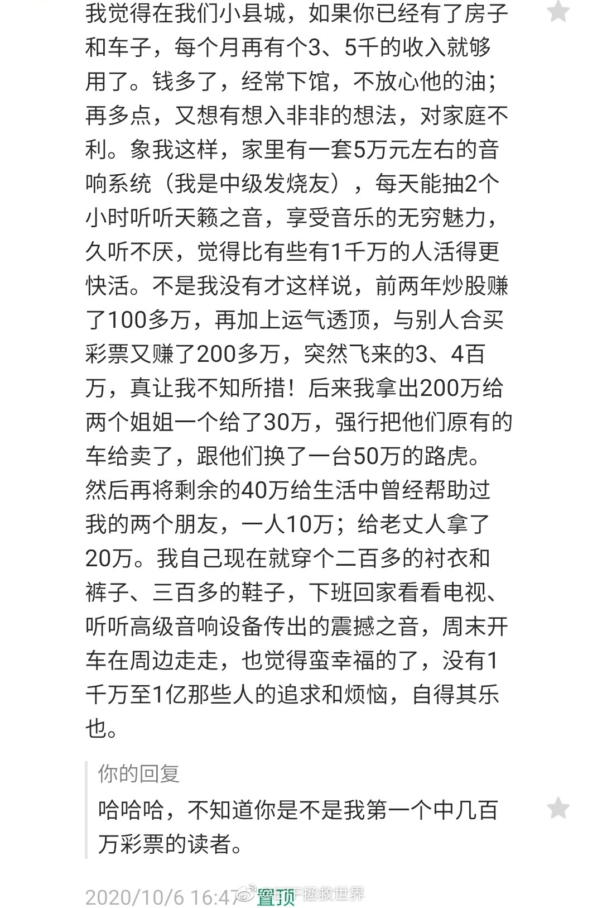
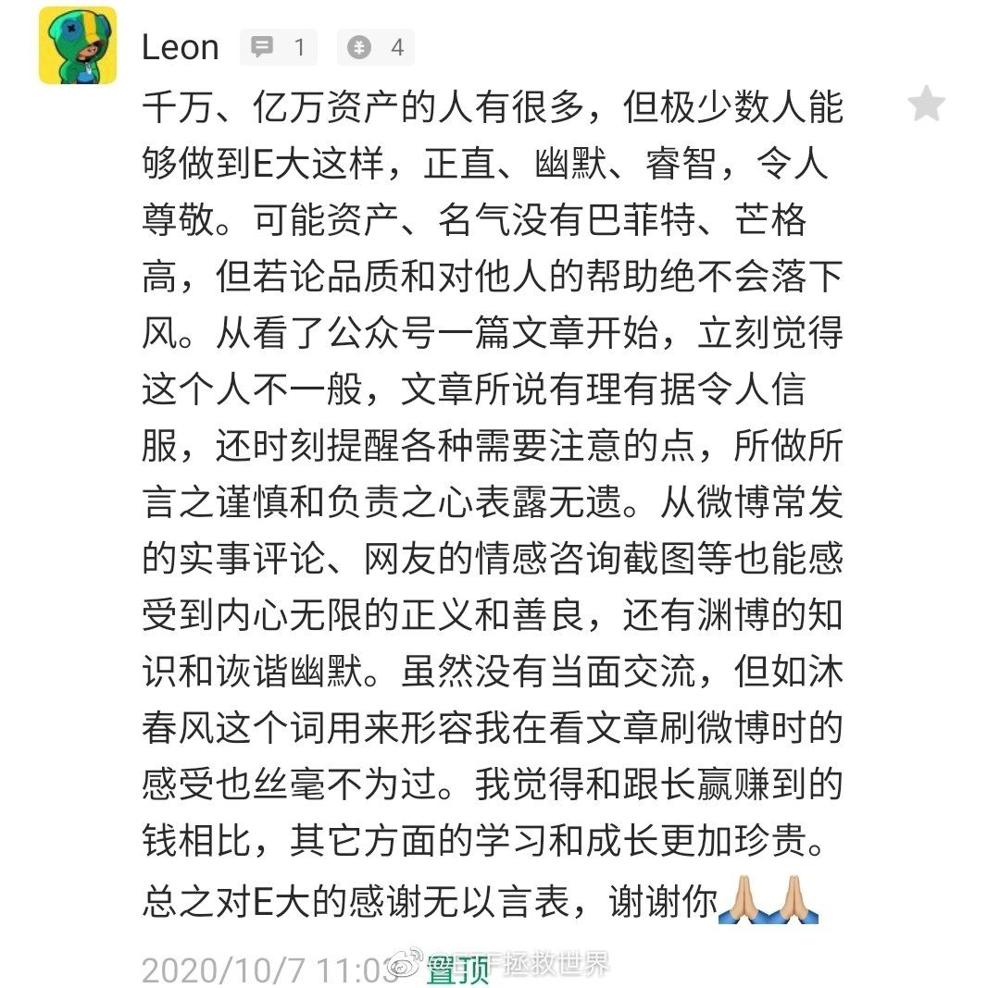
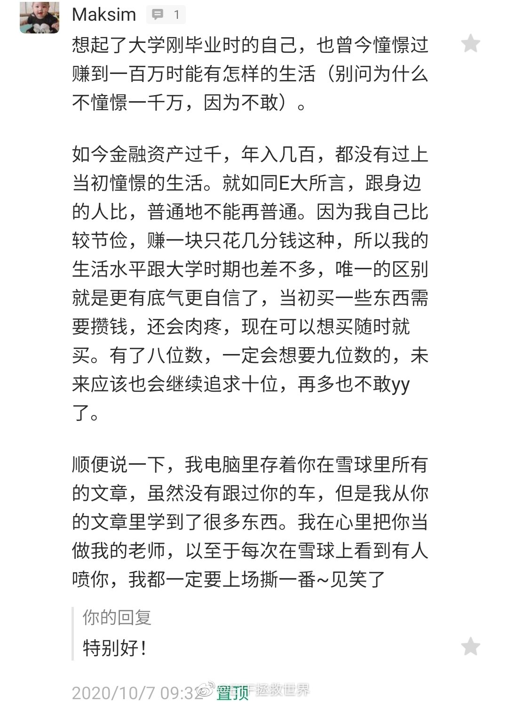
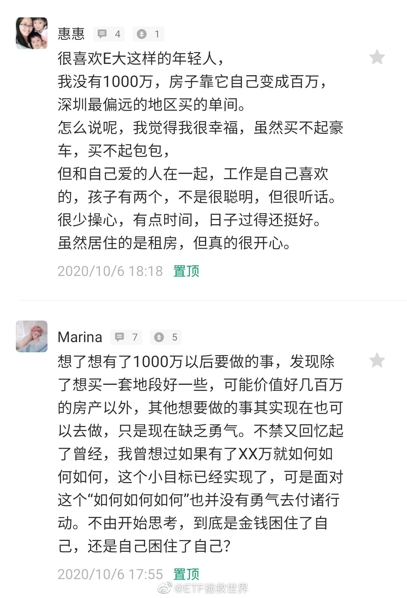
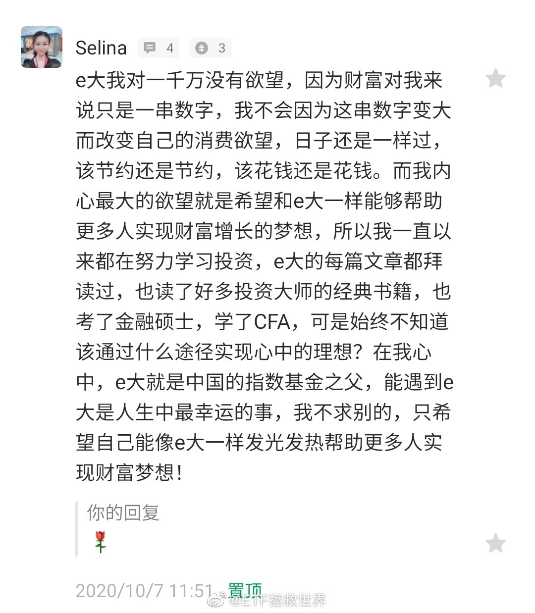
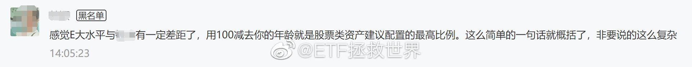
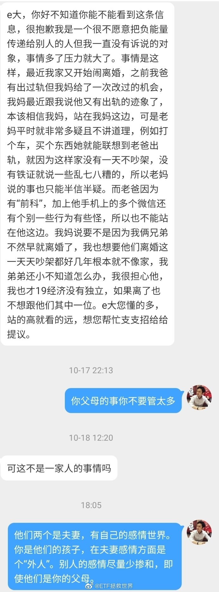
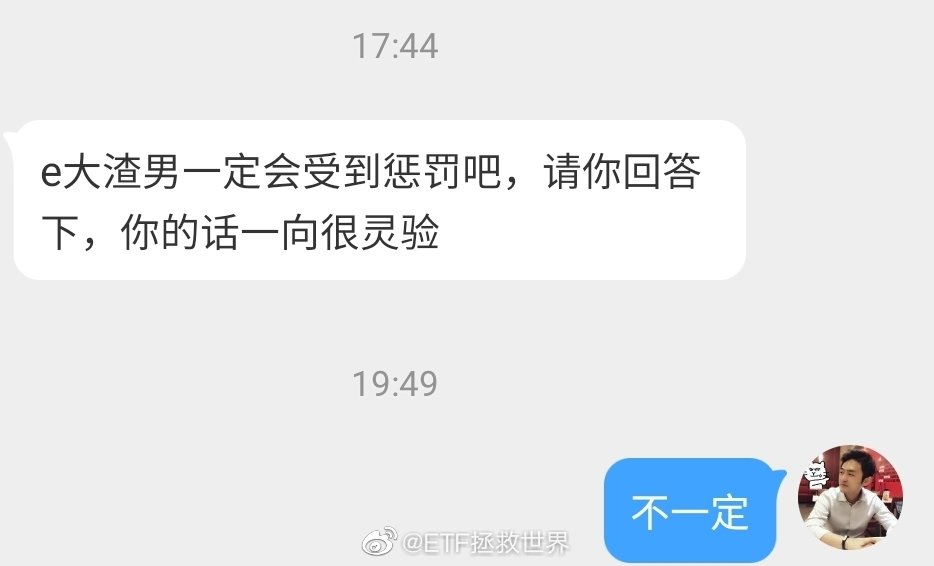
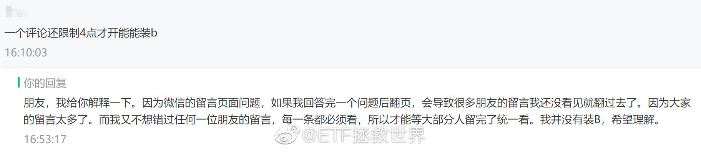

## 2020-10-01 08:08

结婚或者找男女朋友一定要慎重。

## 2020-10-03 15:51

跟亲戚聚会，一定要保护好孩子。如果有贱兮兮的亲戚在各方面打击孩子，开不合时宜的玩笑，一定要帮孩子怼回去。

不要怕影响关系，那种人不做亲戚也没什么损失。 ​​​

## 2020-10-03 16:31

洪崖洞没必要上去。外面看看就行了。除非你特别喜欢拥挤的环境。

## 2020-10-04 19:58

用了半天时间，终于把所有账户的情况理清楚了。各类资产的占比也非常明白。

由于几个月没有大量买入，叠加不断有现金流流入，股票+股票基金比例在下降。相信绝大多数朋友也都是这个情况。

如果你觉得权益类资产过低，同时被流入现金不断稀释，那么每个月的自由现金流可以拿一部分出来强制买入。当然，这部分比例要小一点。

所以关键还是一个比例问题。

## 2020-10-07 09:19

这就是我说的，数据可能是真的，但发布者和解读者会隐瞒一些事实，引导你解读出错误的结论。

## 2020-10-07 15:55

震惊，不知道是不是我读者中第一个中几百万彩票的朋友。

另外随手截了几个因为精选评论限制无法上墙的留言。所以留言一定要快，当天就留，否则没位子了就没法上了。 ​​​
    

## 2020-10-07 16:21

回复@金融christ:因为男的打女的太容易了，容易到会让你分不清是欺负她还是她对不起你。女的打男的男的不还手，群众就知道肯定不是欺负人，而是男的心甘情愿挨打。也许为了爱，也许为了愧疚。//@金融christ:请教老师。。。为何女打男一巴掌的场面和男打女一巴掌的场面群众反应迥异？

## 2020-10-09 09:39

辣鸡叕新高了。//@ETF拯救世界:叒新高了，看懂掌声。

## 2020-10-09 10:15

不知道你有没有认真思考过这个问题。

长线仓位低位持续买入，然后长期持有，然后赚大钱，然后落袋为安；

波动仓位设好条件单，上上下下一笔一笔提款……

为什么钱会源源不断流入你的账户。为什么这么简单赚钱。

不需要你耗费多少精力和时间，该吃吃该玩玩。

相反，为什么一轮牛熊下来其他人大多数却会赔。

这其实是很值得深思的一件事。整件事中，到底哪个关键环节做对了，哪个关键环节与众不同。

## 2020-10-09 12:19

出去浪。 ​​​

## 2020-10-09 14:16

我不评论。请看我微博几年时间的朋友自己思考判断这样的信息。没去过日本的挑战性更大一点。

## 2020-10-09 17:03

国与国之间没什么正义不正义的。

对方做的很多事你觉得特别可恨，特别不公平，但从对方的角度看，就是正确的。因为它这么做就是为了它自己的利益。它的人民也不会为你觉得不公平。人民都是占了便宜偷着乐，吃了亏可不答应。

别说对方了，就是第三方都不会为你感觉不公平。这世界上打仗的地方多了，你为哪个国家义愤填膺过。甚至，有的国家被别人干掉对你有好处，你可能还会希望它真的被干掉。

都是为了争夺利益。对方再无耻，再下三滥我都觉得很正常。我们的利益受到侵害了，我们用尽各种办法见招拆招，有实力有机会再搞对方就完了。其它的说太多也没用。

## 2020-10-10 18:39

50了。服了。

## 2020-10-11 13:22

最近有个不成熟的想法：

女人在好色程度上并不亚于男人。

同意掌声。 ​​​

## 2020-10-12 10:46

新高不卖。 ​​​

## 2020-10-12 11:46

债券跌得让人非常开心。 ​​​

## 2020-10-12 14:50

你觉得这件事责任在谁。我先说：责任肯定不是孩子的。

## 2020-10-12 14:57

喜欢潇洒哥，也喜欢TIMO~~~~

## 2020-10-12 15:07

恒生是不是又有机会提款了。

品种表现辣鸡不代表你提不到款。关键是______。（5分） ​​​

## 2020-10-12 15:25

各位到市场上投资，你不可能买到所有品种在所有时间都是大牛。

那么当你买到大牛、肉鸡和辣鸡的时候，该怎么做，就得分别有预案。

然后根据你的预案进行操作。

换句话说，当你点击买入按钮之后发生的所有可能，你都已经做好准备了。这种时候无论发生什么，你都能游刃有余，按照预案执行就可以了。

最怕是什么，最怕是买的时候也不知道为什么买，涨了，横盘，跌了，也不知道该怎么办。赚了点狂喜，赔了点抑郁。涨的时候哆哆嗦嗦不知道该落袋还是继续持有，跌的时候不知道该割肉还是继续赔。

浮浮沉沉，确认过眼神，自己是一根被收割的海草。

所以无论买到什么，几个月、半年、一两年后，你打开账户一看：

99%的品种全是红的！而且每个品种都知根知底，都有操作预案——

这就说明你入门了。

## 2020-10-12 16:43

讲真，我想进这个群，谁有群号拉我进去啊。没别的，就是想等她们拍完照进去把下午茶吃了……//@红茶家的三叔: 嗯，这个。。

## 2020-10-13 18:10

公众号刚看到有一条留言：

“感觉你的水平和xx有一定差距了。用100-年龄就是你的仓位这么简单的事要说这么多。”

喷了。看了眼关注时间：2020年8月26日。

拉黑。 ​​​

## 2020-10-14 15:30

喷了，这件衣服即将重新合身了…… ​​​

## 2020-10-14 22:16

有可能过一阵要送一批小礼物。如果能成，估计经常刷我微博的朋友会很喜欢。

具体是什么我不能说。

我只能告诉你，相当庸俗。 ​​​

## 2020-10-15 11:15

非常普通的一天 ​​​

## 2020-10-15 14:24

突然被昨天那个相亲的新闻启发到了：

如果你相亲或者其他途径认识了一个人，那个人你不喜欢，ta却对你穷追不舍，你倒是可以借鉴新闻里卖基金的那个人：

跟ta说自己做传销，要拉他进下线。一般人就会退了。如果还不退，就说自己做这个倾家荡产了，还借了300多万，向他借钱去还钱。绝大多数人都会退了。

如果还不退，然后把钱借给你，那还犹豫什么？接受他的爱吧。这是真爱。最关键的，爱你，他还有钱！

## 2020-10-15 23:05

身体很诚实

## 2020-10-16 09:44

现在债基分红选再投资。 ​​​

## 2020-10-16 18:24

很多痛苦来源于你有所求而不得。

如果对人对事绝望了，就会瞬间开心起来。

听懂掌声。 ​​​

## 2020-10-20 17:28

一日不见，如隔三秋。 ​​​

## 2020-10-20 18:07

反正我是这样想的。 ​​​

## 2020-10-22 14:19

且慢的投顾业务上线了。我了解了一下，自动跟车（暂时不支持长赢）、投顾费用返还等方案细节还是很不错的~感兴趣的朋友可以看看。

## 2020-10-23 18:05

红利ETF要分红了，所以网格价格也要全部重新设定。

具体调整稍后为您带来。 ​​​

## 2020-10-23 18:46

回复@潇筱逍201610:图片评论 查看图片 //@潇筱逍201610:好的宝贝😊

## 2020-10-24 12:09

我最近在考虑体系和成功的关系。

有了一点新的理解。

无论做什么事，都应该是体系建立起来，路径正确了，才有可能持续成功。

就以投资来说，体系没有建立，方向不正确，即使一时赚了钱，最终的结果也会很惨。

比如你入市正好赶上牛市赚钱了，或者连续中新股，又或者听了消息炒对了一波热点等等。这些导致你赚钱的事件会让你产生错觉，认为自己能力强/运气好/路子对。毫无疑问，如果继续用这样的方式去炒，利润和本金都会交回去。除非你赚了一把就走，就像在澳门一样。

所以一次的赚钱与否其实一点都不重要。因为你的人生很长，交易生涯也会很长，你必须有能力保证未来大多数时间的交易都是挣钱的，这需要一整套体系来保证，而不是一次次的撞大运。

类似的例子有很多。只要你认真想，就会发现其实大多数事情都是如此：成功是需要体系支撑的。如果你想做一件事怎么都做不好（排除运气因素），那不如试着从改变你做这件事的体系入手，也许会有不一样的结果。

做事的方法和体系不变，结果大概率也不会变的。

## 2020-10-28 16:37

对任何人来说，健康才是最重要的，大家都一定要保重身体。身体好了，才能做更多对人民群众有益的、更有意义的事！祝尽快康复~（大家看我说的对不对，是不是有一千万该烦恼的还是很烦恼 ）

## 2020-10-28 17:47

好家伙。70%火锅汤泼自己朋友身上了。

## 2020-10-28 21:06

回复@ETF拖地僧:不意外。前几天网格调整懂了吧//@ETF拖地僧:E大，好消息，德国大跌了啦//@ETF拯救世界:好家伙。70%火锅汤泼自己朋友身上了。

## 2020-10-28 21:33

上面有生鱼片，现在吃安全吗。

在线等挺急的。 ​​​

## 2020-10-29 08:07

今天估计很多朋友的条件单通知会咔咔往外冒。 ​​​

## 2020-10-29 16:21

领10月红包了！本月1010。

其实这红包也不算我发的。因为每个月微博会分几百块钱给我，我就加点转手送给大家了。您别嫌少，开心一下。

#ETF拯救世界的红包#拼的就是手速！超酷的ETF拯救世界 在发红包哦，人品在线，运气爆表，好运从赢红包开始，快来一起嗨抢吧！  ​​​

## 2020-10-29 16:58

我把中奖的人微博看了一遍。从来没有转或赞我的，也没讨论过投资的，评论里也没见过的，同时满足这几个条件就拉黑。他们大概率就是抽奖专业户。

给真正的朋友腾地儿。 ​​​

## 2020-10-29 19:56

我看了半天，不确认你说的是“E大你这个渣男一定受到惩罚”，还是“E大，你说渣男是不是一定会受到惩罚”

保险起见，还是这样回答比较安全。 ​​​

## 2020-10-29 21:37

应当事人要要求，上条微博删了。

如果以后不能接受我截图发微博，请不必给我私信。

我是希望能回复给很多类似情况的朋友看，一对一我确实没这个精力。 ​​​

## 2020-10-30 08:54

你盯着一个字两分钟，会发现这个字突然变得非常陌生，好像不认识了。

你与一个人相处久了，也会发现ta好像与你刚认识ta的时候不一样。 ​​​

## 2020-10-30 12:52

刚发现，10月居然发了3篇文章！

爆发了！

好努力的人——有被自己感动到。 ​​​

## 2020-10-30 14:10

好久好久没有买A股了吧。

不会太远了。 ​​​

## 2020-10-30 16:54

无论做什么都会被骂。 ​​​

## 2020-10-30 17:34

双11买到什么好东西了吗。

不妨说说，让弟兄们开开眼。 ​​​

## 2020-10-31 11:03

昨天的数据出来了。

如果之前的高位你没卖，那么现在大多数板块已经没有必要卖了。

A股又快比国债便宜了。 ​​​

