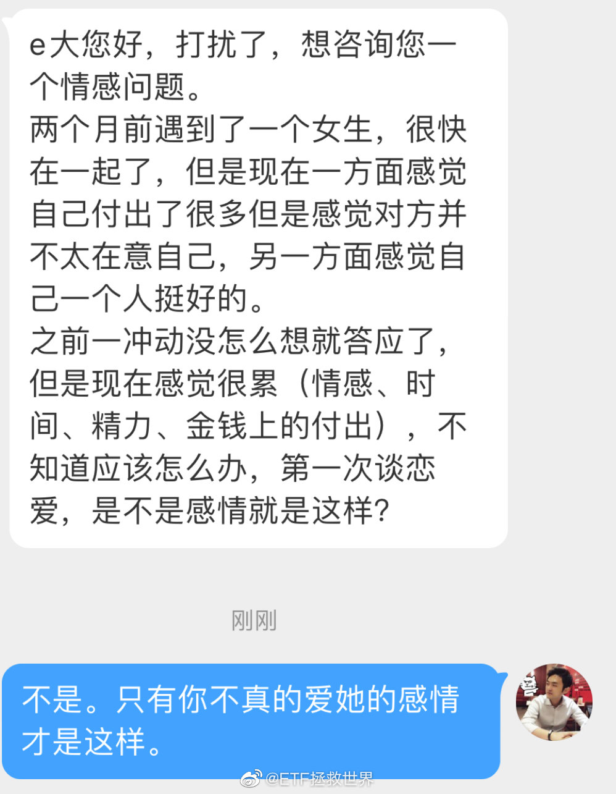
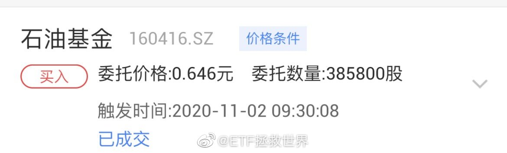
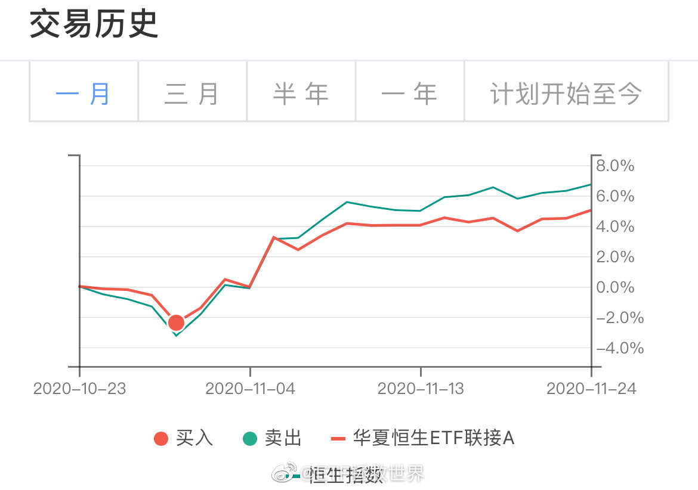
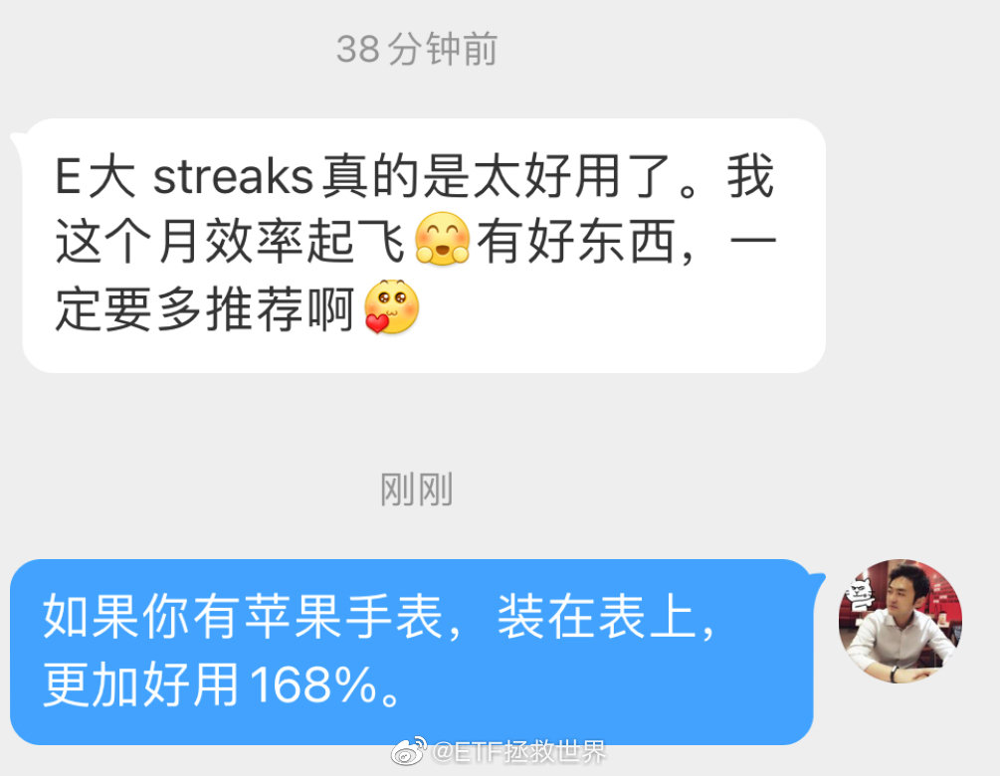
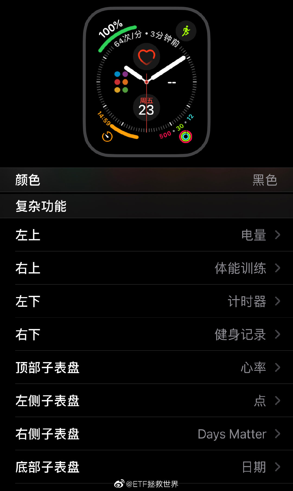

## 2020-11-18 20:41

当你慢慢发现自己的父母是个普通人、自己是个普通人、自己的孩子也是个普通人的时候……

你与这个世界也就彻底和解了。 ​​​

## 2020-11-23 09:56

有色网格保守了。 ​​​

## 2020-11-23 10:11

有些指数不讲武德，天天新高，我劝你耗子尾汁。 ​​​

## 2020-11-23 10:22

其实投资、育儿……甚至咱们每个人的人生，都是一个道理。

每一个品种在一个周期中，都有表现不好的时候，也有光彩夺目的时候。不能要求所有品种在同一个时间表现好，就像不能要求所有孩子或者所有人都在同一个时间是第一名。

很难说命运给每一个人的未来安排了什么。也很难说现在的成功或者不成功到底是好事还是坏事。人这一辈子只要没走完，就不能盖棺定论。

所以，

落后的不用急，想想是因为什么暂时落后，能不能改进，有没有进步空间。如果有，努力修正策略，努力追上去。尽力就行，不用过于追求一时的结果。

领先的不用嘚瑟。一时的领先并不意味着永恒的幸福和快乐，何况嘚瑟更是人生幸福最大的杀手。与至亲好友分享喜悦，然后收拾心情，继续努力。不必让不相关的人知道你有多行，除了虚荣，皆是祸害。

花开有时，春夏秋冬，各有欢喜。

## 2020-11-23 10:45

说起来像灌鸡汤，但以我18岁的人生经历来说，有一个想法却真实的越来越清晰：

失败，真的未必是坏事。

经历失败后，只要能够反思，到底是我不行，还是我做这件事根本就不行，又或者是方法策略不行，还是我做人不行……找到问题，修正、提高，更加强大。

失败好就好在，失败的越早，成本越低。你刚工作没有经验乱投资，最多赔个几千几万……如果你一定要等到自己有钱了，人过中年了才开始乱投资，那赔个几十万几百万才是真正的悲剧。

所以，失败了就失败了，无所谓。哪个成功的人没失败过。最重要的是反思，想办法提高，变得更强大。这一步是最最最重要的。

失败总是痛苦的，不用回避。但是随便痛苦一下就好了，不要痛苦太久，没有意义，没用。

## 2020-11-23 11:23

这四个字值多少钱你根本意识不到。

## 2020-11-23 11:31

普通人想要做点不普通的事，就必须用一些简单的、容易理解容易操作的规则约束自己。制定策略，然后坚决执行。

比如每天读书半小时、网格条件单、每天扔一件东西、每天运动半小时、每天喝水2L、新高不卖、每天做一会一直想做却拖拉着不做的事……

每天都变强一点点，每天钱多一点点，每天垃圾和体重少一点点，时间长了，就不那么普通了。

## 2020-11-23 11:33

今天发的东西够顶几天？

我是不是又可以消失一段时间了。 ​​​

## 2020-11-23 18:18

不是你的菜就赶紧分开，不要互相耽误 ​​​

## 2020-11-24 08:37

如果是真的，这个车主智商为零，历史知识为负。

## 2020-11-24 09:56

赚了一点小钱的一个小网。

高风险品种，今日已出，经验不足承受力低的朋友勿参考。

风险高，没有放入表格，别埋怨，大多数人承受不了它的波动。是我自己玩的品种。 ​​​

## 2020-11-24 11:17

又一只辣鸡新高了。

新高不卖这个原则主要是治疗你赚点钱就拿不住慌里慌张乱卖这种病的。

至少连续上涨的时候你还能多赚点。 ​​​

## 2020-11-24 12:30

出大事了，自拍了一下感觉发际线有点后退啊。

是不是手机的问题！

慌乱中。 ​​​

## 2020-11-25 08:26

今天又是一个好日子 ​​​

## 2020-11-25 08:55

医药再爆利空。

一步步接近下方第一个接回点位。不用急，是你的就是你的，跑不了。不是你的急也没用，徒增烦恼。

医药极限仓位可以给到15%。现在150卖的只剩4%，s只剩2%，浮盈依然50% 70%，大有可为。

舒服吗。 ​​​

## 2020-11-25 09:35

1 锁定不会死的品种

2 买入后上涨就卧倒不动。直到满足卖出条件。

3 买入后下跌就乱动。一直用各种策略动到它盈利为止。盈利后卧倒不动，直到满足卖出条件。

总而言之，不赚钱不走。永远别想把我当韭菜割掉。 ​​​

## 2020-11-25 09:36

恒生啪的一声就突破了，很快啊！ ​​​

## 2020-11-25 09:43

猜猜是谁在跑。

## 2020-11-25 09:57

机构抱团，涨的时候大家开开心心，意气风发，净值一起high。

就是不要跑。一个跑两个跑三个跑，心不齐了，队伍不好带了，那就麻烦了。

大家手里拿了那么多筹码，怎么办，谁跑得快谁损失少呗。

那为什么当初要抱团？

废话，不报团净值上不去，规模上不去，奖金你给发啊。 ​​​

## 2020-11-25 13:12

如果是经常在办公室待着，又不是总是玩手游的话，其实电池多大并不是很重要。

反正我到办公室就会把手机放到桌面的无线充电器上，基本不知道什么叫电量不够……

人和人的需求不同，你得知道自己真的要的是什么。 ​​​

## 2020-11-25 20:43

有些词别人可以形容自己，这是幽默，是自嘲。

你却以为你也可以用同样的词形容别人。

不好意思，别人不会接受，会认为你是侮辱人家。 ​​​

## 2020-11-26 07:30

95.6%的悼念者其实连一场老马的比赛也没看过。

76.6%不知道他效力过哪些俱乐部，得过几次世界杯，场上踢什么位置。 ​​​

## 2020-11-26 09:15

反正已经说到这了，我就再说说我对名人和偶像的看法。

小时候，我关注的偶像重点是颜值，那时候我是颜狗本狗没错了。

大一点，会关注NB的人，各行各业。

再大一点，我会在专业领域NB的人里面，选出我可以学到东西的人关注。

因为这个时候我知道，一个人的精力是有限的。如果别人的专业非常NB，但是对我的进步没有帮助，那么还是少一点关注比较好，精力不够。

所以我非常喜欢看人物传记。我试图从这些人的过程以及成功经验中，学到一些东西。

至于看过哪些人的，那就太多了。就拿今天说的足球来说，我就看过C罗、梅西、苏亚雷斯、杰拉德、穆里尼奥、弗格森、克鲁伊夫、贝克汉姆等等等等的自传以及传记。

其他领域和行业就更多，当然主要还是在企业和财经领域。

可能与我本人天性比较懒散有关，对我影响最大的、帮助最大的是那些拥有自律、努力特质的人。所以我对C罗、杰拉德、小贝等人的敬重，远超小罗、阿德以及不适合提及名字的球员。这无关技战术水平，这与他们对我的激励启发有关。因为这些人的自律、努力、忠诚，对我的帮助太大了。

这，也许才是偶像真正的意义吧。18岁的我，姑且这么认为。

## 2020-11-26 09:36

不过我也想了一下，有些朋友在评论里诚恳的指出问题，也有道理，我也虚心接受。

看破不说破，还能做朋友。

以后我会更注意。一个是是不是合时宜的问题，还有一个是人与人之间阅读理解能力和逻辑思维能力差的太多了。一样的文字可能产生382种解读，所以容易误会的话少说。

你看，是不是又level up了。

人生更美好了不是吗哈哈哈。

## 2020-11-26 15:00

今天是相当普通无趣的一天。

但没有意外、普通的一天，某个角度说就是幸运。

这个世界每天都有人离开。好好珍惜那些为数不多的，真心对你好的人。 ​​​

## 2020-11-26 17:49

我想问问大家关于父母债务问题的看法，因为刚才那个帖子我发现评论里很多朋友和我想的不一样。

我的想法：

父母的投资或者借贷发生前，我会努力和他们沟通，争取不要进行高风险的投资。也会提醒他们一定要注意风险，研究投资项目。也会跟他们说之前我说过的，借钱等于送钱这个意思。

如果依然无法改变，那么只能顺其自然。

后期如果项目失败或者债务出现问题，无法偿还债务。我会在自己的能力范围内帮他们。但如果数额太大，需要我的生活发生巨大变化，影响了自己的家庭以及后代无法正常生活，那么，我帮不了的就没法帮。

请注意，这里有个关键：

如果他们是因为生病或者其他意外需要钱，哪怕卖房哪怕举债我也愿意帮。因为这件事他们很无辜。但是，他们自己决定进行的投资或者借债出了问题，我只能在能力范围内帮。

这是完全不同性质的。成年人，就要对自己行为造成的后果负主要责任。

不知道你是怎么想的。估计有朋友会觉得我冷血。但这就是我的真实想法。

## 2020-11-27 09:55

感恩节什么的过不过单说

“知恩图报”应该是正常人必备的素质

真心对你好的人不会太多，对他们也好点，有机会就回报一些，你自己也会快乐很多。物质也好，精神也好，让对你好的人感受到你的感恩之心。

但是现实是很多人永远只会觉得别人欠自己，别人对自己再好都是理所应当的。说实话，这样的人真不少，甚至有可能是大多数。

## 2020-11-29 20:21

回复@BuBu蛇:那你就不理智了。如果你不想有任何损失，那么第一年你可以配置93%的无风险品种和7%的股票指数。这样，你在绝对没有损失本金的情况下也许会有超额收益。第二年股票指数可以根据你第一年的收益率加仓。//@BuBu蛇:几千万，我估计就只买货币基金了。

## 2020-11-30 08:12

工作使我快乐。 ​​​

## 2020-11-30 08:58

今天的BGM听起来，怎么说呢……

让人心里面有一种很痒，但挠不到，又难受又high的那种感觉。

如果能一边听一边撸我封面上这几只小猫的话，应该会缓解很多…… ​​​

## 2020-11-30 09:06

快到选择方向的时候了。

## 2020-11-30 09:36

最不讲武德的居然是目前A股仓位第三的上证50。 ​​​

## 2020-11-30 09:55

野百合也有春天，这是一种信念。

有了信念，才能坚持做一件事。不随波逐流，不人云亦云，不追涨杀跌，不黯然离场。 ​​​

## 2020-11-30 10:12

之前给新朋友写给这样一段话，请再看一遍：

“
这一段时间，无论是微博还是公众号，都多了一些新朋友。对新朋友来说最大的困扰是：

车都跟不上了。

由于150计划的补仓特殊设定：某个品种成本高于我，则不会发送补仓通知。这样，当你看到上面这张收益率表格的时候，你就知道，除了3只浮亏品种，你现在关注计划是几乎没有任何可以买的东西了。

出现这种情况，我要对新朋友们说一声抱歉。在我这里你确实跟不上车了，但请理解我，理解我为何如此设置规则：

因为我希望你们所有人的成本都比我低。只要我在这个品种上赚钱，你就一定能赚钱。我真的希望你们所有人都赚钱，比我赚得多，一个浮亏品种都没有。这是我对这个计划的最大心愿。

那么是不是比我买的高了就不能赚钱了呢？那当然不是。但从我的角度来说，成本高于我，这个安全边际我就没法把握了。比如上面表格中，我已经有很多品种盈利50%以上。那么对你来说，现在买安全吗？这个我真的很难说。那么下周这些品种涨幅在60%了，又有新朋友要买，那么还安全吗？

有十万人，就有十万种组合和可能。我把握不了。

我可以尽量把握自己的持仓成本在一个安全的范围内，也能尽量保证这个成本在未来是能赚钱的。但你比我高的话，我就真的没那么大信心。所以，我只能告诉你，别跟了。

是的，别跟了。

但请理解我的意思。我说过，你比我成本高，不代表你赚不到钱。我只是无法把握你的安全边际。所以如果我是你，也想投资基金，那么可以去看看其他靠谱大V或者投资顾问的建议，选一些自己适用的投资策略去投资。

我不希望你因为一直跟我买不到合适的仓位最终在上涨中赚不到钱。我真的不希望这样。

所以你取消关注我也可以，不取消关注把我未来的思路、建议作参考也可以。总而言之，如果你是新朋友，在这轮牛市里，我对你的买入已经几乎没有任何价值了。

很遗憾，但缘分这个东西不能强求啊。没有在正确的时间遇到正确的人，才是常态。

不过最后提醒你一句，很多人在牛市里买了最牛的品种，最终还是赔钱了。这听起来很诡异，但却是真的。以后你会懂。”

## 2020-11-30 11:15

这一网医药差几厘没有买在这几天的最低。

水平下降的厉害，居然买不到最低了。

取关吧，博主水平很渣。 ​​​

## 2020-11-30 11:22

老时间，微信。

一键三连不要忘。 ​​​

## 2020-11-30 11:34

可惜没人给我广告费 ​​​
 

## 2020-11-30 13:07

大的思路：

宽基，选择标准宽基+增强宽基。

行业，选择标准行业+主动行业（相当于增强）。

大概就是这个意思。基本上主动只会在行业主动里面选。包括之前的内地消费和这次的健康产业。 ​​​

