## 2020-12-01 09:43

下跌过程中，

从阶段最低点反弹个5%，

这要求过分吗？ ​​​

## 2020-12-01 09:48

我解释一下，

挂的价格高几厘，是有原因的。

这么多人买，怎么可能设定到最低。那样可能所有人买不到。

如果我自己买……

公开操作是很难的，因为交易本来就应该是悄悄的，不动声色的，声东击西的，鬼神莫测的。公开的话，比自己操作难864%。 ​​​

## 2020-12-01 10:01

这里聚集了A股市场上最不正常的一群人：

涨也高兴，跌也高兴。不仅如此，涨跌都能源源不断的提款。 ​​​

## 2020-12-01 10:06

医药最下面的两根支撑分别是10500和9000。

无论是什么策略投资，请做好跌幅在25%和35%，最多到50%的心理准备。 ​​​

## 2020-12-01 10:58

家用打印机，我推荐墨仓式的。

不解释。 ​​​

## 2020-12-01 11:16

50又来了。昨天早上杀进去今天早上割肉的迷茫了。 ​​​

## 2020-12-01 14:19

新高不卖。

不猜顶。什么时候该走了，市场会告诉你。 ​​​

## 2020-12-01 15:01

你是不是总是听别人说，炒股票应该“拿住”。只有长线持有，才能挣大钱。赚钱了不要卖，会赚更多。

我说，bullshit！

跟普通人说这些是bullshit。拿不住！

因为普通人，85%的人，根本不知道自己炒的股票到底怎么样，这家公司有没有问题，高管有没有问题，行业有没有问题，过几年会不会死！

也不知道自己的股票是不是还能涨回去，不知道会不会掉头下跌，不知道会不会退市。

你让他怎么拿？

想要拿的住，有三个关键点：

第一，不会死。不会死的东西你不会怕了吧？

第二，成本低。你成本非常非常低，怎么跌你都很难赔钱了，你还会吓得拿不住吗？

第三，如果你也不知道会不会死，成本也不低，那么就只有一个可能普通人能拿得住，那就是：占比低！占自己资产只有5%以内，他就不会怕。甚至连看都不会看，那样才能拿的住。这也是为什么有钱人可能越来越有钱的原因之一——买了很多，但是只占了资产比例很低，结果涨很多倍自己都不知道，更不会总是想着卖。总是快进快出拿不住的根本原因其实就是——穷。

所以，跟普通人张口就来“拿住不卖长线持有”就是bullshit！85%的普通人根本永远也不可能重仓长期持有个股。

当然了，那些已经套的死死的肯定就长线持有了。我是说赚钱的时候——不 可 能。

一切恐惧，来源于未知。

## 2020-12-01 20:12

每天看微博新闻，总觉得自己是不是思维真的跟不上时代了。

比如排几个小时队去买奶茶。

如果排几个小时队领钱也行了，居然是买东西，买一种并不稀缺的东西，买一种喝了会让自己发胖也不稀缺的东西。

比如抽盲盒。

具体的不了解，但这个跟赌场是一样的。可想而知，商家为了赚钱，会把胜率定的很低。另外，连里面是什么都不知道，我怎么可能掏钱去买……

然而这样的事情就是每天大量发生，还越来越多，越来越火……

确实脱节了。

## 2020-12-02 09:57

“前11月A股IPO募资4200亿 创10年新高” ​​​

## 2020-12-02 10:01

中概互联150没了，S还有一份。

希望有机会买回来。 ​​​

## 2020-12-03 08:20

贱。 ​​​
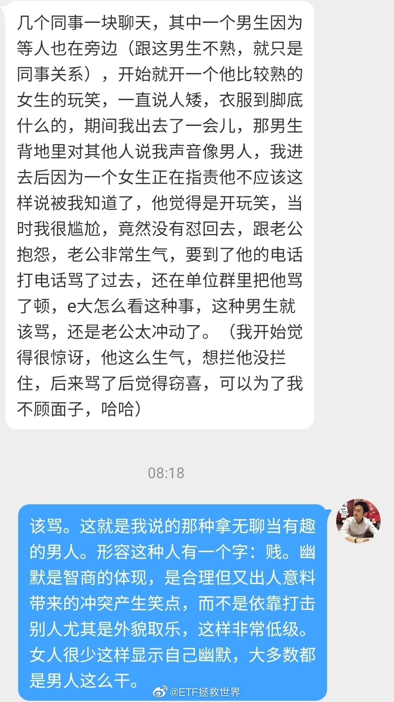

## 2020-12-03 08:40

开玩笑的时候分寸感最难把握。

有两种情况不用太顾虑，一种是很熟悉，你知道对方不会生气，比如兄弟。另一种是你根本不在意对方生不生气，比如某些上级对下级。

其它的时候，开玩笑的时候真的要注意分寸。有时候一句话可能就改变了你的人生。

闲的没事别给自己制造困难和敌人。想表现幽默很简单啊，冲自己开火，效果好，不得罪人，大家都很开心。不信你试试。不过不要频繁，体会一下。

## 2020-12-03 09:35

有些公司，上市没多久就开始增发、配股、高管减持。

有些公司，就发行的时候融了点钱，后来就一直分红。现金流太好了，每年赚好多钱，也没什么支出，想再融资都没理由。

我估计，后者的大股东非常后悔：为什么要上市无缘无故给这帮小股东分红呢。 ​​​

## 2020-12-03 09:38

xx，还差一哆嗦，能不能5天5%就看你了，耗子尾汁。 ​​​

## 2020-12-03 10:04

交易的乐趣，很多朋友慢慢有了体会。

不是什么预测，不是什么猜顶猜底。

而是制定适合自己的策略，执行。然后领钱。

周而复始。 ​​​

## 2020-12-03 10:31

为什么贫富差距会加大，原因很多。

其中一点是个人的选择。

你从小就坚定执行任何收入拿出20%存起来然后谨慎投资。另一个人月光甚至借贷，那么即使你们做的工作一样，收入一样，最终贫富差距就会越来越大。

借贷消费的人，会背上高额利息，最终赚的钱很大一部分还利息了，最穷。

月光的人好不到哪去，手停口停，失业等于一切结束。最终还是要借贷消费，然后还是穷。

有了资产不仅不怕失业，谨慎投资，钱会越来越多。（难道你的账户不是不停新高吗）

这些都是非常老生常谈的道理，但在这个世界，你会感受越来越明显。

防杠：

我说的是同样收入的人。不要扯什么借钱或者月光的人会更努力。

也不要扯什么通胀什么收益率，这智商就别出来杠了。

最后，不要扯什么7赔2平1赚。我说的就是谨慎理智投资，这种人钱越来越多的原因之一，也是疯狂的人进入市场提供的。

## 2020-12-03 10:36

还行吧。一般般。没什么亮点。

## 2020-12-03 11:39

兴全转债分红。再投。

PS

我出去浪了，别太想我。 ​​​

## 2020-12-03 13:41

表格已更新。另外在条件单“历史记录”里面找到买入的那笔，直接“重新创建”更方便。

ps

被冻回来了。5555 ​​​

## 2020-12-03 13:46

造孽啊 ​​​
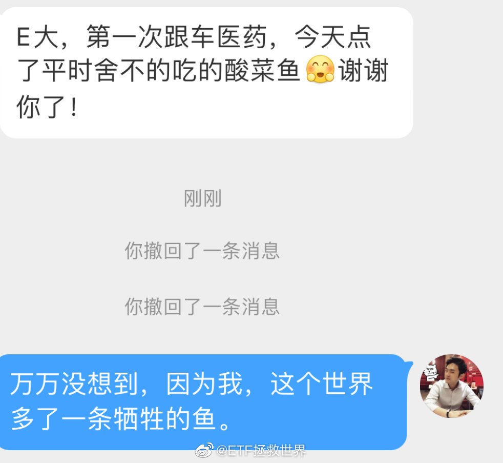

## 2020-12-04 13:08

分享图片 ​ 抽奖详情 ​​​
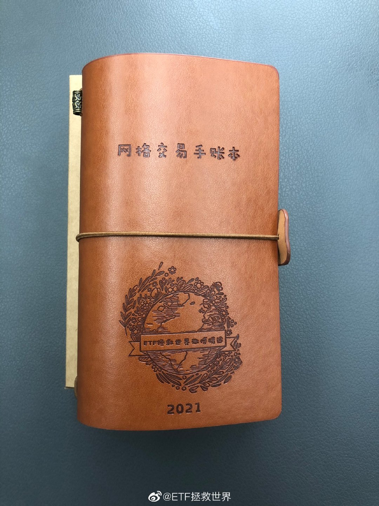

## 2020-12-05 10:55

恭喜@sun要努力呀 等100名用户获得【网格交易手账本】。微博官方唯一抽奖工具@微博抽奖平台 对本次抽奖进行监督，结果公正有效。公示链接：微博抽奖平台

## 2020-12-05 11:04

恭喜@yanyun116118 等100名用户获得【网格交易手账】。微博官方唯一抽奖工具@微博抽奖平台 对本次抽奖进行监督，结果公正有效。公示链接：微博抽奖平台

## 2020-12-05 11:07

好，第一次抽奖结果出来了，我也展开说说吧。

前一段时间，某不方便透露姓名的爱心人士表示愿意做一批手账本送给大家，然后设计了方案。我觉得挺好的，就答应了。现在基本已经搞定了，所以可以开始送了。

首先需要说明的是，微博抽奖每次只能抽100位。所以必须分几次抽。

我设计的抽奖方案是这样的：

首先，昨天的那个帖子评论的铁粉朋友里面抽200位。因为我什么都没说就贴了一张图，评论想要的，那就是真的想要了。所以200份送给你们。

（这200份分两次抽出，我不知道会不会一位朋友抽到两次。如果有，请联系我自觉放弃一份的名额，我替其他朋友谢谢你）

其次，在且慢跟车的朋友，在华宝做网格交易的朋友，各一百份。这个未来我也会单独开帖。

另外，我还会找一篇过去的微博，在那篇评论里面抽100位。哪篇我还没想好。

这就是500份了。

另外，还有50份特别版。在特别版封面上会印上各位的名字，这50份我会在公众号通过一定方式找到一部分朋友送出。另外还会送一小部分给一些特别的朋友。

所以一共是550份。这些送完了，我会看看情况。如果说还是有很多朋友想要，我会自费再做500份送出。这个不一定，到时候看情况。

至于很多朋友说要买，我非常感谢大家信任。但我10000000%不可能卖。哪怕我只用成本价，哪怕我只卖1块钱，都会有人说我流量变现，消费粉丝。我不愿意又出钱又出力还被人说三道四。

所以我白送，你没话说了吧。

另外，送的东西，好了坏了估计收到的朋友不会太挑剔。如果是花钱买，那就不好说了。让大家不痛快的事我不愿意干。

祝大家好运吧，其实机会挺大的~

## 2020-12-05 11:27

我唯一没想好的，是有人抽奖中了以后高价卖怎么办。如果是这样，我真的会很失望。也请没抽中的朋友不要去买，不是什么好东西，别花钱。

## 2020-12-05 13:36

特别好 ​​​
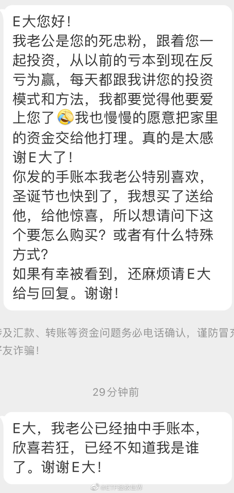

## 2020-12-05 14:10

两个人在一起，

有共同的话题，有差不多一致的三观，互相关心，

就特别幸福和难得了，

要珍惜。 ​​​

## 2020-12-06 09:25

想要空间整洁的关键不是收纳，收纳只占20%。

东西少，垃圾少最关键，占50%。

物归原位占30%。 ​​​

## 2020-12-06 17:04

我这里有没有受骗的朋友。能不能说说是为什么被骗。是主要因为高收益投资承诺吗。

## 2020-12-07 10:03

回复@ETF拯救世界:又差了5厘，最高2.025就回调了。现在技术真的这么差了吗。难受。//@ETF拯救世界:上方压力位2.03。跌下去就接着吃网，涨上去就吃大摩健康。不香吗。//@ETF拯救世界:还行吧。一般般。没什么亮点。

## 2020-12-07 10:33

一年多前的一条微博，建议新朋友再看看。

## 2020-12-07 10:35

还有这条，关于骗钱的。最后的两点建议必须深刻理解。

## 2020-12-07 11:21

70、80后上位后，这种莫名其妙的政策会不会少一点？

## 2020-12-07 13:22

两位大师切磋打了个平手。

## 2020-12-09 10:15

昨天看到有人带着一堆人每天短线交易场外基金。

而且很勤奋的每天六点起床研究哪只最强。

当时我就震惊了。主要是没想到有那么多人跟。 ​​​

## 2020-12-09 13:14

我是真的真的不理解啊。我这里有没有朋友愿意排几个小时队买奶茶的，请告诉我你到底是怎么想的！别人不许嘲笑他，否则我会拉黑！

## 2020-12-09 13:34

回复@微笑-开心果-:月收入/720，得出你的一小时大概值多少钱。然后看看浪费一小时在这个事情上值不值。当然，只是一个非常不精确的算法，但这个思路值得深入思考一下。//@微笑-开心果-:是免费的吗。。。免费我觉得也不值得排这么久的队啊。。。

## 2020-12-09 13:55

医药上次的网格买入点这次指导意义不强。有两种情况。

第一是由于支撑点上移，到达难度比上次大。也就是说，有可能跌不到上次买入的位置。

第二，如果真的到了，那么跌破的可能性较大。而且，会大概率继续下跌。也就是说，如果跌到了，那么大概率不会像上次一样撑住。

当然，撑不住是好事，就有机会继续第二网买入，未来也就会赚更多。

我就是在这里提前打个心态疫苗。真发生了不要乱。

## 2020-12-09 14:56

有时候觉得儿子真的挺幸运的。

失败的时候我会鼓励他安慰他，跟他讲运气以及努力程度的问题，听他诉说痛苦，帮他化解。

胜利的时候我会跟他一起庆祝，启发他努力的重要性：跟胜利的喜悦比，努力时候的辛苦不值一提。

在我小时候，失败和胜利的时候，家长是不会询问以及跟我分享胜利分担痛苦的。甚至在胜利的时候经常会泼冷水……

希望儿子成为一个遇到失败不气馁，越挫越勇的人。也希望他能够在一生中经常品尝胜利的滋味，不虚度一生。

## 2020-12-09 19:48

二十多年前的书，推荐一下。 ​​​

## 2020-12-11 09:47

又是提款的一天。

简简单单的策略。

踏踏实实的交易。

轻轻松松的提款。 ​​​

## 2020-12-11 10:27

表格更新中。

新加入一个品种，去掉一个品种。更新完毕后我会说一声。 ​​​

## 2020-12-11 10:49

波动是不是好事，真的很难说。

你的长线仓位当然希望一路涨，但你的波动仓位就希望不断波动。所以对你来说，波动其实是中性的。

但如果你只有长线仓位，或者只有波动仓位，如果市场不断波动或者不断上涨，那你就有点难受了。

舒服最重要。 ​​​

## 2020-12-11 11:06

已更新

## 2020-12-11 15:08

【手账抽奖贴—且慢跟车的100本】

评论抽奖，不限制是否铁粉，开奖日期12月16日下午15:00。

一定要注意看下面的规则，否则可能被拉黑。

1、上次中奖的朋友不要再次评论。否则取消上次中奖资格，同时拉黑。

2、必须是在且慢跟车长赢的朋友。

中奖后，在填写邮寄地址的地方，后面加括号填入在且慢跟车的用户姓名以及身份证后四位。比如邮寄地址是：xx省xx市xx小区xx号（且慢：张三 1234）寄送奖品的时候括号内的文字会删掉，不必担心。

如果未在且慢跟车又评论本帖，拉黑。

3、有以上限制主要是统计信息需要耗费大量精力。同时你不符合要求又来抽奖，就拉低了符合要求的朋友中奖概率，不公平。希望理解。

祝大家好运。 http://t.cn/A6qUkCXs
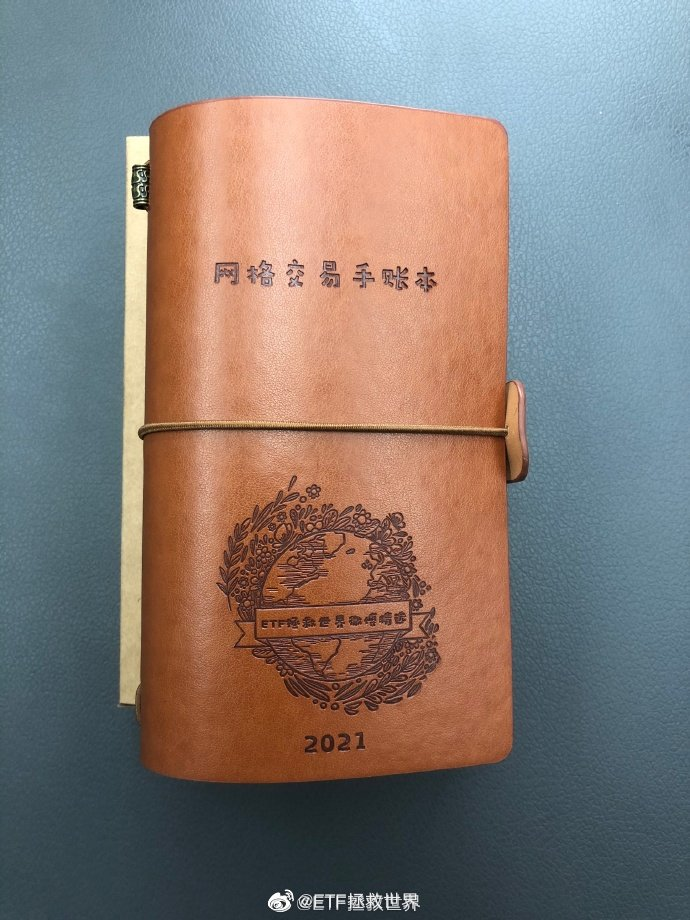

## 2020-12-11 15:19

微博你不要吃相这么差好不好啊求求你了。

别在我的微博内容里面乱加东西了好吗？否则别人会以为我收钱打广告，冤枉啊。

我谢谢你了微博！不要再加了！！！ ​​​
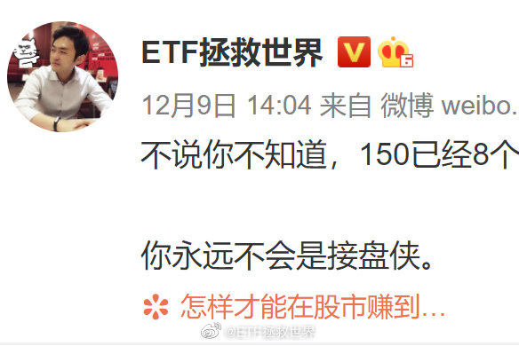

## 2020-12-12 19:00

大家的热情远超我的想象。这轮原定的100本加到300本，总数从550加到1050本。多出来的费用我来承担。

## 2020-12-13 11:42

今年炒股的人赚了多少呢。

根据最新报表，2020年前上市的所有公司股东总数为1.94113亿。

今年，上涨的股票有2134只，股东数为1.05814亿。

今年，下跌的股票有1580只，股东数为0.87834亿。

涨幅在4%以内的股票有1831只，股东总数为1.02254亿。

涨幅大于10%的股票有1595只，股东数为0.76156亿。低于10%的股东总数为1.17956亿。

涨幅大于20%的股票有1206只，股东数为0.57271亿。

都说今年是个投资大年，但其实有45%炒股的人没赚钱。53%的人赚了4%以内。赚了20%以上的不到30%。

当然，一般来说一个人不会只买一只股票。所以如果平均组合一下，可能赚钱的人会多一点。

但你别忘了，很多人是市场高位时候入场的。甚至很多人3月低位卖出，6、7月又买回来。所以这部分就不细究了，大致就是说，今年一半多一点的人炒股赚钱了，但是一多半盈利不到10%，跟上沪深300和中证500的人可能不到30%。

一亿多人辛辛苦苦天天盯着盘炒股真的不太明白为什么——对于其中大多数人来说。

## 2020-12-13 12:20

统计股民盈亏数据只是第一步。有个大致的轮廓后，更加重要的是对自己的操作有什么启发。

我们都知道投资或者德州或者21点，都要计算概率才能赢。那么，我们就要做大概率会赢的投资，选择大概率会赢的品种。

然后，再看看输的人是怎么操作的，我们就不能与他们一样，我们要开发出克服人性的，高抛低吸的操作策略。从品种到操作策略，让自己的赢面越来越大。

这，才是观察和统计的意义所在。

还有一点在于，你首先要观察认识自己。看看自己在投资上，到底是不普通的人还是一个普通的人。如果只是一个与70%、80%的人一样的普通人，那么你就应该有普通人做出不普通成绩的方法。如果你本来就是一个不普通的人，当然可以不与普通人站在一起，你有自己的方法。

观察自己、认识自己。然后观察群体，分析数据，设计大概率会赢的策略。

## 2020-12-14 09:44

如果有朋友买到了，卖出价格设置买入价格*1.07。卖出份额为买入份额*0.93。

（已修改） ​​​

## 2020-12-14 10:03

吃泡面打卡本来就很好笑了，吃完了你不顺手给人扔垃圾箱里就不仅是好笑的问题了。除非没有垃圾箱，否则都是辣鸡。

## 2020-12-14 10:41

买到了就买到了，没买到也不用不开心。

差几厘到不了价格，这也不是技术问题，就是运气问题。你跟运气生气那不是吃饱了撑的吗。

无论你挂多少，都有可能就差一点点没买到或者没卖出。你可以想想办法看看有没有可能解决，如果没有，就平静接受，等待命运下次的眷顾。

你的心情主要由你自己决定，这句话得记住。

## 2020-12-14 10:52

关于卖出，比买入难很多。根本原因在于不死的品种跌起来是有底的，而涨起来是无限的。

有底的东西你就知道大概哪里买，而无限的东西就很难把握。只用“贵”或者“便宜”去定义就很难。

所以卖出的部分我会参考右侧，也就是涨起来无论多贵也先不卖，等开始跌了再卖。

话说我持有的一只股票一直涨的非常好，周五还历史新高，我也设定了卖出的价格。

今天早上一开机，啪的一声，很快啊，卖出价格预警就跳出来了。

我慢悠悠的打开交易软件，准备挂单——不用挂了，开盘一字跌停了。

哈哈哈哈哈哈靠。

## 2020-12-15 09:58

如果收盘医药不掉链子，那么半个月前发车的健康收益率就是7%以上了，连续反弹新高。

你买在最近半年最低位。

当然，继续跌对你来说也无所谓。因为同样买在最低位的医药网格已经走人了，等着接回来继续吃呢。 ​​​

## 2020-12-15 10:36

一支球球大V高位极力推荐过的股票快退市了。

这位大V是球球几位喷过我的V里面喷的最莫名其妙的一位，喷我不是因为专业、理念、利益纠葛，到现在我也不知道为什么突然就被毫无瓜葛的他喷了。所以印象极深。

看到那些跟我关系不错的V都混得风生水起，喷我的都各种凋零，我就放心了。

要做事，先做人。

做个人吧！

## 2020-12-15 11:36

公众号的朋友即将闻讯赶来拉低中奖率。  ​​​

## 2020-12-15 14:19

刚才有个朋友问我，E老师，发生肾么事了，我说怎么回事，给我发了几张截图，我一看！嗷！原来是辣鸡环保又新高了！

我啪的一下就把环保指数的最新成分股拿出来了，很快啊。我这一看，不得了，我大意了，没有加仓。环保指数不懂规矩啊，怎么修改指数编制规则，变成新能源指数了。塔说塔是乱改的，塔可不是乱改，这是有备而来啊。

环保指数，不！讲！武！德！来骗，来偷袭我这18岁的直男！这好吗？这不好。以后不要犯这样的聪明，小！聪！明！

还好，我们一份都没卖！不要窝里斗！

## 2020-12-15 14:40

回复@喋喋的小呆毛:要想收益过得去，持仓就得带点绿。//@喋喋的小呆毛:啊。。。。。环保啊，好像是当初最绿的辣个吖

## 2020-12-15 14:50

踏踏实实的。

## 2020-12-16 10:12

很多事情我告诉你，你觉得我是在扯淡，或者是为了持仓表现不好的品种找借口。

但最终时间会告诉你，90%都是正确的。如果你还没走开，那你会有一点感悟，下次可能就会做得更好。如果你没有耐心走开了，那你可能永远也不会明白。

当然，一切都是最好的安排。每个人都会有自己的命运，来源于自己的选择，无法改变。

## 2020-12-16 10:24

今天是0.001。行吧。毁灭吧，累了。

## 2020-12-16 10:50

到了，更新表格中。更新后通知。 ​​​

## 2020-12-16 11:07

买到了也没什么开心的。

压力测试做不到下跌60%的不要开始。否则别人的天堂就是你的地狱。 ​​​

## 2020-12-16 14:16

一厘都不差是不是有点过分了。 ​​​

## 2020-12-16 15:06

恭喜@猜猜我的微博名是啥 等100名用户获得【网格交易手账】。微博官方唯一抽奖工具@微博抽奖平台 对本次抽奖进行监督，结果公正有效。公示链接：微博抽奖平台

## 2020-12-16 15:17

恭喜@Saberioo 等100名用户获得【网格交易手账本】。微博官方唯一抽奖工具@微博抽奖平台 对本次抽奖进行监督，结果公正有效。公示链接：微博抽奖平台

## 2020-12-16 15:22

回复@木木木木头了:我也想。但是微博抽奖上限就是100个。你以为我想这么麻烦一次次弄呢……//@木木木木头了:唉呀嘛，还不如一次来呢

## 2020-12-16 15:39

没中奖的，告诉你们一个好消息，这次的300本很多很多人填地址信息的时候没有按照要求填写，如果后期还没有联系@且慢管家，那么自动取消中奖资格，会将他们的名额重新抽。

## 2020-12-16 18:52

冰汽时代里，-50度还出门是要截肢的！

## 2020-12-17 11:18

有朋友在公众号后台问，为什么S不经常发车啊。

那你是想经常发车买什么什么赔，还是想偶尔发车十几个交易日盈利11%啊。 ​​​

## 2020-12-17 11:41

我有个朋友让我帮着问一下，房屋拆迁，大家庭（兄弟姐妹）内部平分拆迁款这种协议怎么写，有模板吗。 ​​​

## 2020-12-17 14:10

其实我有一事不明，还请教各位。

大概多少年前开始了吧，我就发现一个现象：

即，姑娘们喜欢哪个男明星，这个男明星就在网上被骂的很惨。包括之前的韩流，包括近几年的一些国产男明星小鲜肉，包括最近的丁真。

我是有点不理解啊，单纯的不理解，没有任何倾向性。

你说这姑娘们喜欢帅哥又不是今时今日才有，古代就有潘安出门被少女少妇们掷果盈车。可见这是非常正常的人性而已，为什么有一部分男性非要吃这个醋呢。

你说姑娘们喜欢个男明星，不就跟你喜欢什么波多啊，三上啊（这两位我并不知道是谁也没看过她们的作品），本质上是一样的吗。姑娘们也没有天天在网上谴责你看动作片，骂这些动作女明星啊。

另一个，姑娘们喜欢明星，本质上是“虚拟”的。因为根本看不见摸不着。心里喜欢，听听歌，追追剧，看看演唱会。过几年就脱粉了，也不影响你跟妹子谈恋爱啊。

再有，即使姑娘们不喜欢男明星，也未必就喜欢你啊。妹子不喜欢你不是因为喜欢男明星啊。没准妹子不喜欢男明星了，转身喜欢你隔壁那个帅哥了，人家天天出双入对你不是更难受吗。

总而言之吧，反正我不是很理解。

男性朋友们，你有没有骂过各个阶段的当红小生，你怎么想的，简单谈谈。

## 2020-12-18 08:05

分级基金要消失了，我很怀念它。

总体来说，这是一个天才的产品。会玩的人真的能赚很多，而且是低风险条件下。

然而，对于不会玩的人来说，它就是地狱。

当然，这也怪不得别人。自己不认真了解产品就去买，抱着加杠杆赌一把的心态去买，赔光了，怪谁呢。

天才的产品要消失了，一路走好。 ​​​

## 2020-12-18 09:45

辣鸡又新高了，好烦

看了一眼网格账户，更烦了 ​​​

## 2020-12-18 10:04

当年低位骂环保的，让粉丝卖出的那些大v，良心会痛吗。 ​​​

## 2020-12-18 10:10

温故知新

## 2020-12-18 10:33

轿夫

## 2020-12-18 11:44

Epic疯了，18号开始，每天一款免费游戏，送15天。

现在是天际线。

还送-10$优惠券。 ​​​

## 2020-12-18 14:55

平平无奇的一天。

明晚见。不见不散。 ​​​

## 2020-12-19 17:49

回复@朗佐ball2:不多，偶尔休闲一下。玩游戏总让我有一种负罪感，不知道为什么。就觉得时间被浪费了，很奇怪的感觉//@朗佐ball2:很难不领，不过e大玩游戏的时间多吗

## 2020-12-19 20:05

我是真的服了。

我相信大多数朋友们都不敢相信，我一而再再而三反复强调，反复告知应该如何填写信息，居然还有很多人不填。然后给我发私信让我帮他填。

我以前根本不相信高考有忘记带准考证的人，毕竟这么重要，毕竟老师家长反复说。现在我信了。

我最后再说一次，如果你没有按照要求填，那么该怎么做。如果你还不做，那真的神都救不了你了。另外，你们也应该感到抱歉，无形之中你给别人增加了很多工作。请联系该联系的人后跟人家说一声不好意思，说一声谢谢。

1：第一批的200本不需要特别标注。有写错地址的，没有精力一个个给你改，会按照你填的地址寄出。至于收不到就当丢了吧。

2：第二批且慢的，如果没有特别标注在且慢的信息，请联系 @且慢管家 

3：第三批华宝的，如果没有特别标注在华宝的信息，请联系 @华宝智投 

如果三批中奖者有重复的，会取消其所有中奖资格。

如果有各种原因不要的，放弃机会，可以私信给我。除了不要的，其他的不要再给我私信了，我回不过来。送个东西已经搭了太多时间和精力。

## 2020-12-19 21:37

事出反常必有妖。蹲个后续。

## 2020-12-20 11:37

其实恋爱中的男女真的智商会下降至少一半，当然，有些人的智商本来额度就不足（比如昨天那个60万充值美容院的），难免被骗。

这里说的智商不止是你能做出高数题的智商，还有逻辑推理以及对人性的把握能力，当然还有家庭成长环境以及阅历问题。恋爱次数太少，更容易被骗。从小被家庭保护的太好，也容易被骗。

所以另一方面讲，我觉得作为家长也不要把孩子保护得太好。让他多经历一些事情，多摔几个小跟头，多遭遇一些小挫折，多谈几次恋爱，对他来说其实是好事。最重要的是在他受到挫折后提供最强力的支撑，让他的信心和希望不至于被打掉就够了。

回到刚才那个出轨的女性，居然相信水果店老板会离婚与她在一起，大概率就是经历太少导致的。

## 2020-12-20 16:33

今天足球学校校长亲自下场指导。

前国脚。 ​​​

## 2020-12-21 07:48

人生很长，摔一跤，落后了，非常正常。但是只有不放弃，才有机会取得最后的成功。

## 2020-12-21 07:55

回复@快乐大番茄:无论你的实力多强，你放弃了就什么都没了。你怎么知道自己未来实力强不强运气好不好？所以不放弃才是我说的重点//@快乐大番茄:前两天看到过，确实很励志毋庸置疑，只是想另一个角度思考下，是不是对手太弱了，一般情况下同级别应该是赶不上的吧？

## 2020-12-21 08:18

回复@你好哇微博:再说一次，你看这件事要跳出这件事本身，而不是拘泥于这件事的结果。不放弃追求的是一种争取机会的精神。不放弃就有机会，放弃了就什么都没了。//@你好哇微博:过度解读了。人家摔跤不过是把领先优势减少了一点，换个人完全不一样

## 2020-12-21 09:05

其实人与人最大的差距我感觉是思维模式。

思维模式很重要的一个方面就是遇到一件事情从哪个角度去思考，去深入挖掘获取信息，用什么样的方式去回应，争取什么样的结果。

所以同样一件事，每个人都有自己的思考和处理方法。这件事能够带给你的启发和效果也不同。就像那个经典的案例：同样是半杯水，有人看到的是空了半杯，有人看到的还有半杯。

思维模式不同的人在一起经常会很不舒服，就是因为大家都不是一个频道，一个fm一个am，说不到一起去。如果一个家庭，一个组织，思维模式相同就会比较和谐比较有竞争力，不同就比较麻烦。

所以，你的思维模式如果与我不同，我建议你赶紧取关。否则我看你难受，你看我也难受。相顾两茫茫，不言语，费思量。

其实很多话题我都有自己的看法，但我不想说，因为与很多人的观点不同。说也说服不了你，最后弄得吵起来没什么意思。我又不需要热点不需要流量，所以就不说了。

总而言之，各位。很多人有消极思维其实是好的。如果所有人都积极思维，都拼命奋斗，都不甘于躺平了享受蹂躏，那么我们这些积极思维的人想要成功那得多难啊，增加了多少竞争者啊！所以，如果再听到不相关的人埋怨这个埋怨那个，你一定要给他鼓掌，鼓励他继续埋怨、继续颓废、继续怨天尤人、继续找各种理由说明自己的失败全是来自于不公平，别人的成功都是有内幕有猫腻。

世界因你我他而精彩。

## 2020-12-21 09:29

$中证环保 sh000827$ 

好家伙。我直呼好家伙！ ​​​

## 2020-12-21 09:35

再回头看这个，是不是又有点新的感悟。“至少连续上涨的时候你还能多赚点。 ​​​​”

## 2020-12-21 09:44

我经常想起去年有个人在某论坛喷我的一条罪状：

“他总是把经典投资书上的东西改个样子发在微博上”

经常看我微博的朋友们，请你们诚恳的告诉我，我哪条微博是投资书上写的大道理。难道不都是结合时事的一点感悟、经验、技巧以及思考吗。 ​​​

## 2020-12-21 10:03

目前环保持仓结构前三位：

宁德；隆基；长电

合计仓位30%顶格…… ​​​

## 2020-12-21 10:09

大涨的时候不要乱跑，就像吃宴席的时候不要随意下桌，因为你不知道后面有什么硬菜。

不过你要慢慢往门口挪了，也要注意观察店家什么时候开始催买单。别傻了吧唧跟人又碰杯又推心置腹聊天的。

情况不对拔腿就走，吃饱了就行。买单？什么是买单？ ​​​

## 2020-12-21 10:54

不说你不知道，最后下的那网3个交易日已经涨了2%。

希望有机会收割一把吧。 ​​​

## 2020-12-21 13:08

看到这张图，想起一件事。那年从香港回北京的飞机上，认识了邻座的姑娘。聊天说起都喜欢看恐怖片，回来她就把这个电影的dvd借给了我。看完以后我说还给你啊，她说不用啦。我说那我请你吃饭吧，她说好啊……不过她借我的是枪版，我早扔了。我对画质要求很高的。

## 2020-12-21 13:17

恋爱小贴士：

带姑娘看电影要看恐怖片。这样一害怕没准就会抱着你。

不要看青春爱情片。

里面都是帅哥。散场了灯一亮回头看到你，可能接下来的饭都没机会吃了。 ​​​

## 2020-12-21 13:25

金融小贴士：

如果你在某个品种上赚了50%，它今天涨了4%，

那么收盘后你的收益率不是54%，而是56%。 ​​​

## 2020-12-21 13:48

自己的命运都是自己选择的。

## 2020-12-21 13:51

“呵呵，什么涨吹什么”

“对啊，每天都有的吹，你有没有气死啊” ​​​

## 2020-12-21 14:25

今天大摩又要新高了。 ​​​

## 2020-12-21 14:40

回复@追求确定性2:不，买了环保长期不挣钱，但不抛弃不放弃的人才是那个运动员。//@追求确定性2:环保就是那个后来居上滑冰运动员吗

## 2020-12-21 17:06

我最近在想一件事。

川之前针对我们搞了这么多事情，我一直认为是为了大选。然而大选结果已经出来了，他却依然对我们疯狂动作，这恐怕就没这么简单了。

他是一个重视利益的人。无利不起早，这么做，一定是某个利益团体在后面承诺了巨大的利益。否则，没有理由马上就卸任了还这么疯狂。

那么背后指使他这么做的利益团体是谁呢。

结合最近某个团体在大选结果已经出来的情况下依然大力挺川，而这个团体如此的痛恨我们，不把我们搞垮誓不罢休，我想，答案应该呼之欲出。

这个团体背后一定与川有某种联系，不知道未来有没有机会曝光。留个帖子未来回头看看准不准。

## 2020-12-22 09:55

环保第一压力位1910一线。 ​​​

## 2020-12-22 13:27

放心，我坐门口儿盯着呢，你踏踏实实吃你的。

买不了单。 ​​​

## 2020-12-22 15:51

不说你不知道，今年到今天为止，只有54%的股票是上涨的。 ​​​

## 2020-12-23 10:05

昨天看到有人评论白酒之类的股票，已经不能用过去的标准去看了。

“这次不一样了，未来不一样了”

好的，那么我们就看看，这次到底有什么不一样。

再给点时间。 ​​​

## 2020-12-23 10:15

倒了一杯82年的Sprite，回来一看，啪的一声，又新高了！很快啊！ ​​​

## 2020-12-23 10:20

昨天新高后一路大跌，收盘跌了将近3%。

你一害怕，忘了“新高不卖”，哆哆嗦嗦清仓了。

今天涨4%，继续新高。

A股85%的交易都是散户里的疯子带来的，你跟着他们走就歇菜了。 ​​​

## 2020-12-23 10:25

开始第一波攻势。

## 2020-12-23 10:36

格雷厄姆有一句经典的话：股票长期是称重机，短期是投票机（是不是又有人要说我微博抄经典艰难度日了）

换成我们的操作，就是买的时候看它便宜还是贵，卖的时候看它趋势有没有变。

因为长期看，只要买的便宜就不会亏，毕竟是称重机。而短期的投票，尤其是疯子们傻子们的投票，可能会把价格买到天上。所以我们不能随意下车，坐轿子它不舒服吗。

## 2020-12-23 11:14

我很好奇，鸡娃的家长在鸡娃的同时，有没有鸡自己？也就是说，有没有努力让自己在各方面变得更优秀？

如果没有，敢情你自己不想努力，就是让孩子帮你完成心愿啊。这跟玩模拟人生游戏区别不大吧。

孩子每天都在进步，都在变得更强，这么好的榜样在身边，就没能激励一下你也努力点吗！ ​​​

## 2020-12-23 11:32

这个数字挑战我的认知了。

## 2020-12-23 12:19

服了。全球合力鸡光伏

## 2020-12-23 12:47

图二的两句话说的对不对

## 2020-12-23 14:28

其实那个本子我没有参与什么设计。

如果我要设计，会加入很多一定非常有用的模块。

比如，我会设计一个模块，让你每年记录自己的资产。现金、股票、债券、股票基金、债券基金、外币……然后有个合计，然后有与自己目标的对比，有与过去的对比，然后可以用一根尺子就画出漂亮的资产走势图。这个十几二十年后看就会很棒。

类似的东西可以有很多。只是我没动力去做……

## 2020-12-23 16:03

超LV不是正常的吗？都是奢侈品，一个LV包背十年，一瓶茅台一仰脖咕咚咕咚就喝完了。喝完还得买，你说超你不正常吗？？？

## 2020-12-23 16:54

不知道为什么好像有朋友在评论里表示，LV背十年不可能。

以下这些款全都超过10年，你10年前买了今天背不出去吗。

分别是：

Neverfull（2007）、Alma、Speedy。尤其是alma和speedy，诞生于30年代和60年代，到现在大家都在背，为什么不行呢。 ​​​
  

## 2020-12-23 17:07

你男的，天天抢1500的茅台。抢不到就高价买，2、3000。一瓶酒，喝完就没了。喝完不仅对身体不好，还容易醉驾还容易借酒生事。这么多缺点，没人说你。

人家女的，攒点钱买个包，几千一万块，能背好多年，就变成消费主义让你嘲笑了。

凭什么。不公平啊。 ​​​

## 2020-12-24 07:19

再看看这个。后一种公司如果减持，很奇怪吗？我觉得正常思维减持是应该的吧

## 2020-12-24 09:35

以前看书，觉得几十年前那些抱团漂亮50的美国机构都是傻子，那么明显的泡沫看不出来吗，为什么要买？

现在才明白，从一个整体来说，他们没得选。你不买，你的业绩就要落后，客户赎回，奖金取消，甚至下岗。最终，坚持信仰的会被淘汰。

所以，到底是谁的错呢。谁也没有错。

资本就是逐利的。 ​​​

## 2020-12-24 10:25

你有没有发现，你持有的品种涨幅在10%以内的时候，哪天涨个3%、5%你会特别兴奋。

涨幅超过20%，再涨3、5个点，甚至新高，就没那么兴奋。

收益率超过70%，涨5%，新高，你也只会淡淡的看一眼然后想中午吃什么。

这就像你只有10万块的时候，赚3、5万开心到爆。

哪天你有了几百万，赚个3、5万还不如吃点好吃的带给你的快乐更多。

所以其实快乐的阈值是越来越高的。

为什么小孩子脸上总是挂着笑容，而大街上你去看看每个大人都阴沉着脸不开心。压力，孩子没有压力吗，每天上学、考试，还要上无数培训班。

因为你的世界里已经很少有新鲜的东西，让你快乐的门槛也越来越高了。

## 2020-12-24 10:30

阿里都跌了快30%了，中概互联还不给我们机会吗。这不公平！

## 2020-12-24 12:11

禁止二选一对东东是利好还是利空呢 ​​​

## 2020-12-24 18:09

所有人，平安夜，都给我平平安安开开心心的！ ​ 抽奖详情 ​​​

## 2020-12-24 21:51

恭喜@variolift2018 等100名用户获得【网格交易手帐一本】。微博官方唯一抽奖工具@微博抽奖平台 对本次抽奖进行监督，结果公正有效。公示链接：微博抽奖平台

## 2020-12-25 09:10

有戏了//@ETF拯救世界:阿里都跌了快30%了，中概互联还不给我们机会吗。这不公平！

## 2020-12-25 09:47

弱水三千，我只取一瓢饮。

好的股票和板块很多，我只希望与属于我的那些一起越飞越高。 ​​​

## 2020-12-25 10:10

回复@ESun_G:我把你以及回复的这些的辣鸡全部拉黑。不好意思，比较粗鲁，但这么说你们不过分。你们到底知不知道我们在做什么？//@ESun_G:传媒加仓加不动了

## 2020-12-25 11:26

很多人根本就没想明白组合和投资到底是怎么回事。

为什么要创建一个持仓品种相关性很弱的组合？当然有很多原因，其中有一条：

当你的组合中其它品种都涨幅很大，而你手里依然有可投资资金的时候，那些没涨的品种才是最珍贵的。

有了它们，你手里的钱才有机会在其它品种不便宜的时候依然买到便宜货。

那么，为什么你有机会买便宜货呢？因为这个品种现在不受欢迎。如果人人都喜欢，就像消费、医药、环保……你何德何能买到便宜货？你想买？可以，追去啊。我们都赚了几十个点了，你来接盘啊。

你之所以有机会买便宜货，就因为它们没人买。没人买就一定差吗？就一定赚不到钱吗？

你组合中其它品种正在汹涌澎湃的涨，在创新高。你把减持的钱用来买还没涨的。未来现在已经减持的，涨的好的变差了，而你低位加仓的又涨了。你的资产不是永远在不断上涨吗？

好嘛，你就想买了就涨。感情股市是你家开的啊。你问问这里的几十万朋友，那些一起经历大起大落的老朋友，谁不是买了就套一套几年才赚了那么多的？跟车的朋友已经赚了10位数的人民币了，不都是这么来的？

想不明白就来玩，心可真大啊。我伺候不了，真的。熊市再来找我吧，现在我帮不上你什么忙了。

## 2020-12-25 14:41

新高不卖。

踏踏实实坐轿子。如果站稳1910一线，下一明显压力位在2250一线。 ​​​

## 2020-12-25 15:09

这跟我印象中的美女荷官不太一样。

## 2020-12-25 22:11

半年最佳买点 ​​​
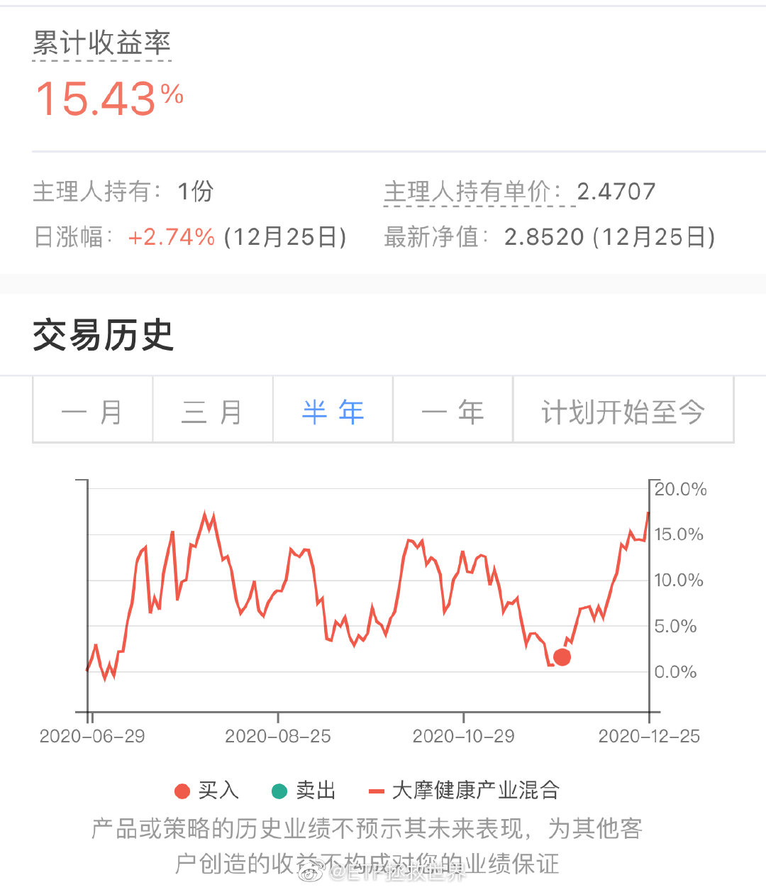

## 2020-12-26 18:55

这两天看了两部奈飞的剧

《弥留之国的爱丽丝》★★★★
《甜蜜家园》★★★

能接受cult片子的休闲时候可以试试…记得别让孩子看。 ​​​

## 2020-12-27 08:08

昨天看了一段脱口秀，有一些想法不吐不快，可能又要被骂，没关系，我简单说。

虽然这位脱口秀演员对“男人”这个群体极尽挖苦讽刺，但我一点点都不在意，因为我知道我不是那样，没什么好在意的。只是，我想对部分涉世未深，又或者思维容易被别人引导的女性朋友说两句：

任何群体，都有各种各样的人，差别极大。男人、女人、老人、孩子、中国人、外国人、xx省人、x族人……千万不要将一类人贴一个标签，然后内心深处认为这类人都是这样。

为什么，因为这会让你的人生变得非常坎坷和不幸福。如果你在内心深处真的认同了“中国男人”就是****，****……那你当然会对男性失去信心，更有可能有样学样，在生活中挖苦讽刺身边的男性，不说你也知道，你的人生当然会出问题。

昨天有朋友给我私信，说生了孩子老公什么也不管，经常出去喝酒，回来也不帮着带孩子，自己一个人非常绝望，问我怎么办。你看，这位朋友如果看了这样的脱口秀，当然会特别认同，会跟着鼓掌，觉得“说的真对啊”。但是，是所有的男人都这样吗？同样最近的新闻，北京顺义的确诊病例流调那位男士，每天除了上班就是带孩子、去辅导班、去书店、去买菜，还在认真准备考研。

我的意思是什么呢。

我的意思是，姑娘们，有人骂男人，是有钱赚的。不骂就没有关注度，就没有商业利益。你千万不要傻傻的认为她说的都是真的，所有男人都那样。否则，别人骂了男人发财了找个金龟婿结婚生子人生幸福，你也信以为真付出代价，恐怕就不妙了。

要相信，无论哪个人群中，都是有好人的。

## 2020-12-27 08:44

我发现一个问题，

评论中“铁粉”的整体素质，无论是阅读能力、表达能力、逻辑推理能力和理解能力，都比不是铁粉的高3个lv。

不知道新浪这个铁粉是怎么划分的，还是很准的。

以后发东西发红包都只给铁粉发了。 ​​​

## 2020-12-27 09:36

有很多女性似乎觉得只要是男人看了那样的讽刺视频就会生气、愤怒、继而破口大骂……

我谢谢你了。大多数正常的男性看完了都会内心毫无波澜好吗？一个演员，说一些部分女性爱听的话，讽刺一下男性，有什么生气的？不要把所有男人都想的这么小气、狭隘、毫无理性。大多数男人还要为了未来、为了家庭埋头奋斗打拼，没功夫生这个气着这个急。

如果我不是想到了有部分女性涉世未深，接触的人少，看多了这种东西可能会产生一些负面的思想钢印，对幸福人生毫无益处，我才不会发这个微博好吗。我只是希望关注我的朋友们都足够理性、足够思维独立、有足够的能力辨别是非。

当然，我知道我说什么有些人都听不懂，甚至根本就不听。对立、仇恨已经充满了他们的内心，让他们无法客观的看任何与自己不同的观点。没事，我本来也不是跟你说的。

另外，从评论里我观察到一个现象：

幸福的女性都能很理性客观的看待男女关系，知道男女之间不应该是对抗冲突而应该是携手向前。也能将艺术表演和现实人生分清楚。特别好，我希望我这里所有的女性都特别幸福。

## 2020-12-27 11:44

最后再说两句话，我就去工作了，写一篇对于明年的寄语（公众号发）。

有些朋友不理解“表演”、“新闻”、“网络故事”和现实的区别。看了一些表演读了一些新闻和故事，就将它代入生活，恐这恐那，duck不必。

新闻之所以成为新闻，就是因为它的极端和不平常。无论你在新闻上看到了什么，你都应该知道它是极不平常的，所以它才是新闻。因为新闻就影响你看待周围人的眼神，没有必要而且极度愚蠢。

至于婚姻，生孩子，我个人认为都不是必要的。虽然我对自己的婚姻很满意，也特别爱我的孩子——我觉得我的孩子是这世界上最可爱的生物，他给了我无限的快乐——但我从不认为每个人都一定需要婚姻和孩子。

如果没有遇到真正动心的，或者有足够理由让你嫁给他或者娶她的人，单身也没什么不好。多谈谈恋爱，正大光明的多与一些异性交往，它不香吗？

但是，一定不要主观的将自己封闭起来。有缘遇见对的人就勇敢在一起，没有缘分ta买错了车票去了别的地方没有遇到自己也没事，就自己好好生活。但不能总是想着男人都不是好东西，女人都只看物质不重感情……你才遇到了几个男人和女人？你只是遇人不淑，过去的经历是来锻炼你的，好的正在来的路上，堵车呢。

至于什么生育率啊，什么抚养比啊，我根本不在意。很多事情不是你想改变就改变的，你愿意多要几个孩子就多要，愿意不要就不要，操那么多心累不累。过好自己的人生吧，人类早晚会毁灭的，地球也会毁灭，别想太多。

## 2020-12-27 14:58

知道我在微博上第一次感受到女权的严厉是哪次吗。

是有一次我说，我经常跟儿子说，作为男孩子要有责任心。对自己该承担的责任承担起来，要做个小男子汉，长大了做家庭的支柱，努力让一家人过得幸福。

这么一句话，被女权骂了。

从那以后，我认怂了。行吧。但我依然会教育儿子做个有责任感的男子汉的。

你可以教育你儿子未来谈恋爱、结婚后跟女方AA，家里什么事情都不出头，一人一半责任。

我不愿意，谢谢。

## 2020-12-28 14:07

各指数今天基本持平，然而涨跌股票家数对比是1000:3000

中小股票今年太惨了！ ​​​

## 2020-12-28 15:28

我看有朋友问中概互联什么时候买。

不出意外的话，应该是网格先于150和S买。

那么，你猜猜多少钱开始买第一网513050。

本帖评论猜价格，一个人只能猜一次。最接近的3位朋友每人一份手账。如果近似度相同，先评论的得奖。

答案的话，我一会会发一个定时帖。这个定时帖会在明天15:10分显示出来。

主要就为了做个游戏，大家开心一下。
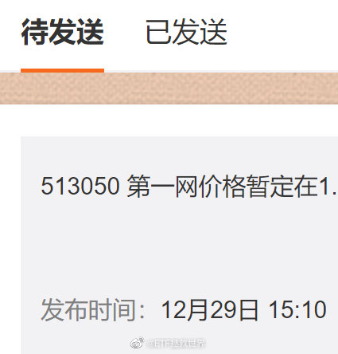

## 2020-12-28 16:38

外卖和便利店的沙拉之类的生食还能吃吗。懂的说说。 ​​​

## 2020-12-28 17:23

这样看我就是个普通人，胆子也比较小，只敢上班积累本金 ​​​
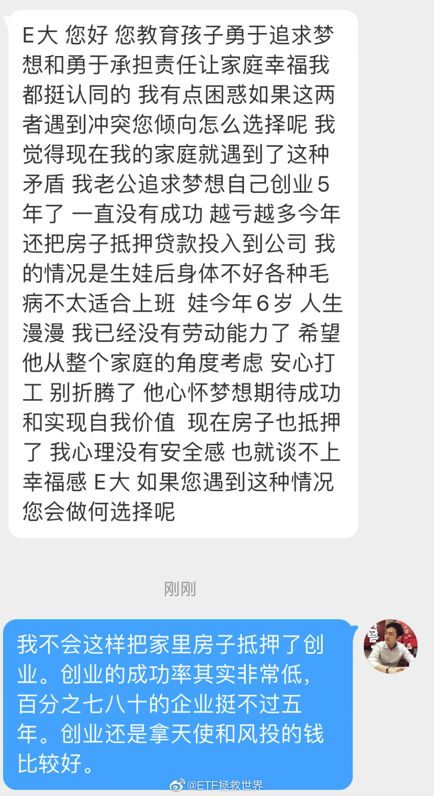

## 2020-12-28 18:53

看了一下各位的年龄。

25岁以下的只有18%。年轻人中70%也有脑子知道独立思考（关注理财说明有闲钱同时爱思考），那就是只有占总数5%左右的思想比较偏激不成熟的年轻人关注我。

这也是为什么我的评论区相对来说比较理性的原因。 ​​​
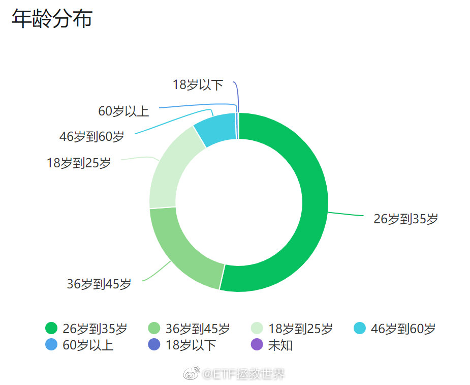

## 2020-12-28 19:41

DAX历史新高。德国也是几乎所有朋友都能补齐的品种。所以为什么害怕跌呢？没有大跌，哪里来的便宜货？哪里来的超额利润？

## 2020-12-28 19:43

我建议无论男女，与交往对象刚认识的时候，都认真从头看一遍ta的微博。

然后再决定是否开始交往。 ​​​

## 2020-12-29 06:58

图一这三位有手账吗，没有的话私信我 ​​​
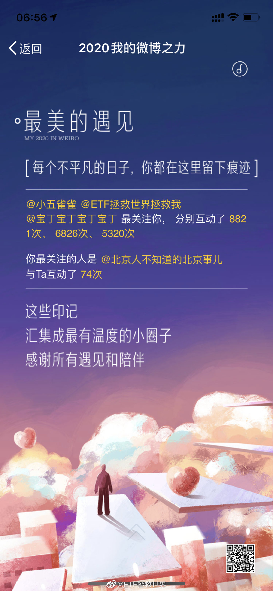 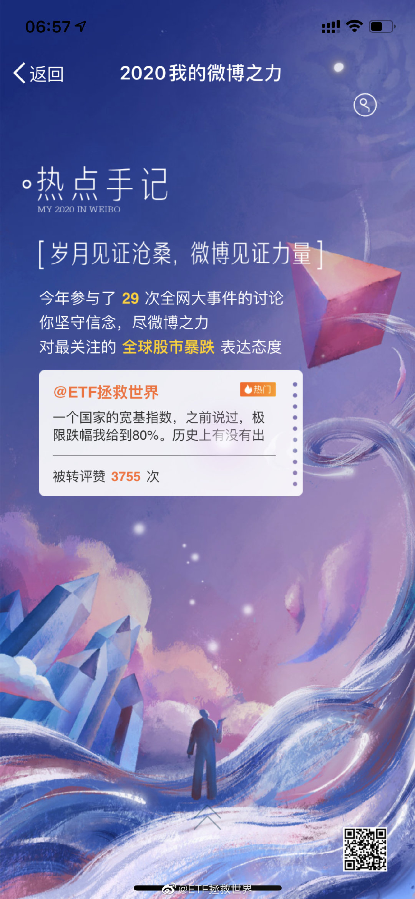 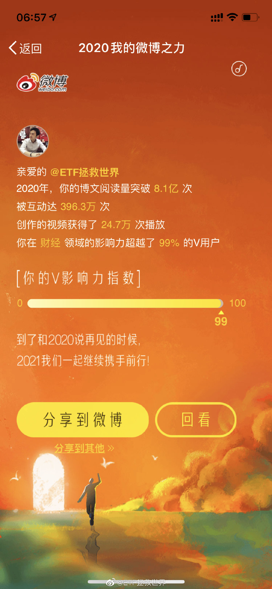

## 2020-12-29 07:52

很多朋友不明白为什么每次我都要花很多时间去精心挑选BGM。

不就是一段音乐吗。

不是，那代表了我对美的一部分认知。很重要。 ​​​
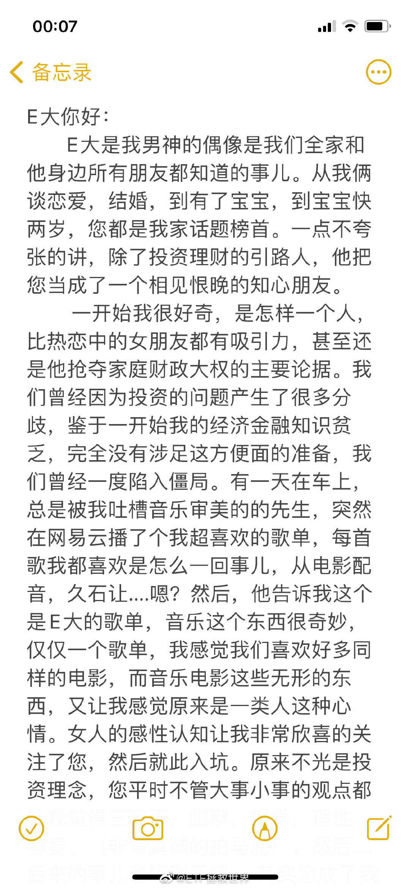 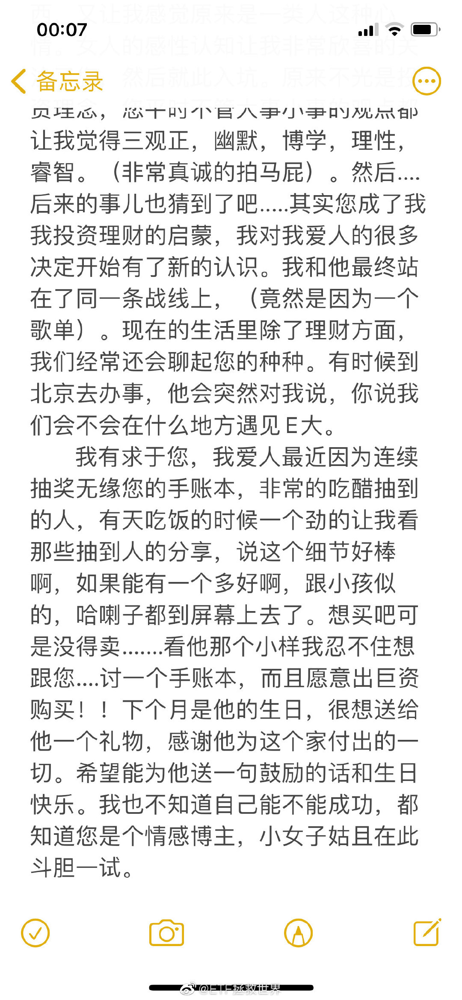

## 2020-12-29 10:36

传媒不讲武德！再跌一个多点对你来说很难吗？

 ​​​

## 2020-12-29 10:44

回复@了凡09:图片评论 查看图片 //@了凡09:准备买入DAX和日经指数吗？//@ETF拯救世界:DAX历史新高。德国也是几乎所有朋友都能补齐的品种。所以为什么害怕跌呢？没有大跌，哪里来的便宜货？哪里来的超额利润？

## 2020-12-29 10:51

有些品种长期持有就很好，顺便做做波段。

有些品种主要做做波段，把利润长期持有。

一天反弹就是4%以上的品种，不做波段太可惜了。 ​​​

## 2020-12-29 11:08

不知道小米11有没有变得轻薄一点，手感好一点。

股票赚了一点，想回馈没机会。不知道会不会又是“下次一定支持” ​​​

## 2020-12-29 13:48

新高不卖，没说新高的第二天也不能卖。 ​​​

## 2020-12-29 22:41

很久没有看到让我猜不到结局的推理小说了

东野圭吾的《恶意》算一个

对推理小说感兴趣的朋友可以看看 ​​​

## 2020-12-30 10:36

2018年10月钻石坑最后一次买入环保后，在这个品种上两年没有交易。

昨天150第一次卖出了持仓部分的11%。S没有动。

在暴涨后适当减仓，不仅在战术上能够起到再平衡的作用，在心理上也会起到支持你坚定持有剩下份额的信心。

我本人就不是很懂有些人一下子满仓一下子清仓的动作。难道他们账户里只有1000块钱吗。

## 2020-12-30 11:02

为了排名杀红了眼。 ​​​

## 2020-12-31 12:23

我很少修改文章，这篇是越改字越多。

主要不是聊投资。聊了一年投资了，整天钱钱钱的，庸俗。 ​​​
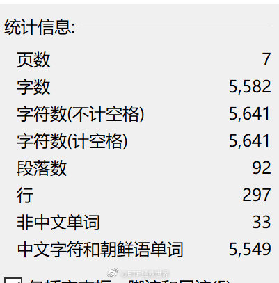

## 2020-12-31 21:00

薇娅的颜值还是能打的 ​​​

