## 2021-01-01 07:23

新年快乐！ ​ 抽奖详情 ​​​

## 2021-01-03 12:13

2021年，有几个板块会在最后的疯狂后放烟花。

从最高点算，跌幅三五十个点不会让人感动惊讶。 ​​​
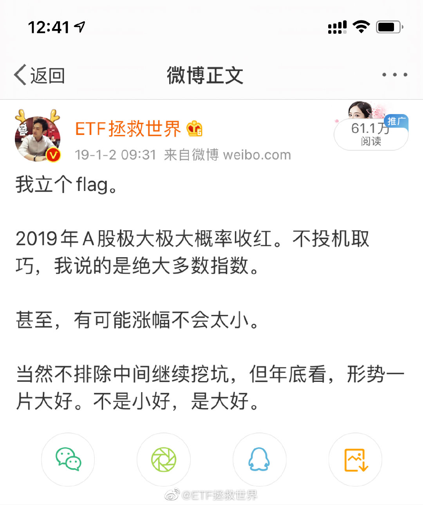 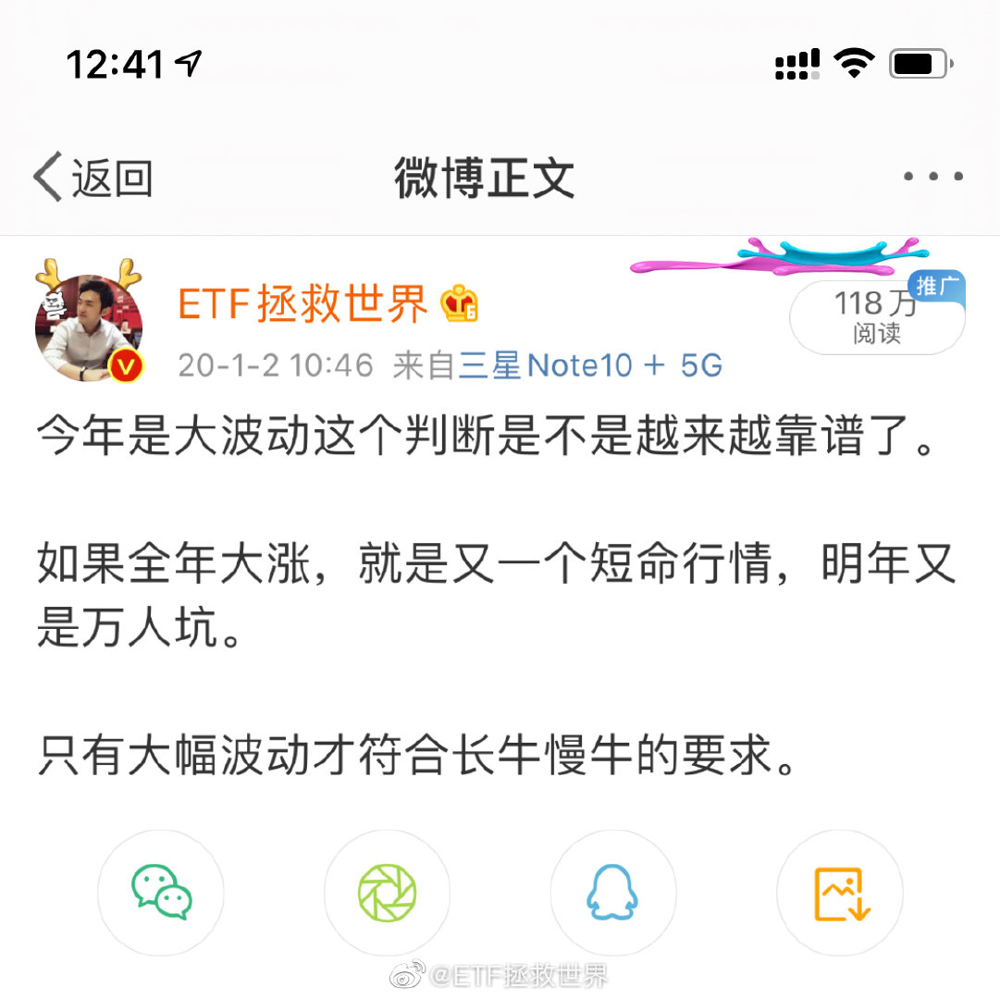

## 2021-01-03 15:46

月收入不到一万的人在网上说500万不够花。

## 2021-01-03 17:20

云南咖啡这件事，我想先看看那份《倡议》的原文 ​​​

## 2021-01-04 09:40

一直涨我会流鼻血。 ​​​

## 2021-01-04 09:46

我想不会有人想到，有些朋友第一支翻番指数竟然是辣鸡环保。 ​​​

## 2021-01-04 10:02

持仓品种大涨，有三种态度面对。

第一是信心满满，坚定持有。相信这个品种是天降孤星，是皇冠上的明珠，是前后五百年最值得投资的品种，绝不会卖。

第二种是战战兢兢患得患失。生怕不卖就坐电梯，怕它不涨，又怕它乱涨，想来想去还是清仓妥帖。

第三种是踏踏实实拿着，享受价值回归，享受泡沫。但是又不会盲目乐观，找机会就走一部分，情况不对又走一部分，始终保持理智。最后接盘的是别人，提款的是自己。

你是哪种。

## 2021-01-04 10:11

你有没有发现一个问题。

无论我们持仓的品种表现多好，我都不会吹它有多好，多么值得买，多么值得投资。一个字都不会说。

不能我们赚钱了鼓动别人抬轿子。这是基本的良知。 ​​​

## 2021-01-04 10:34

今年看烟花几乎是必然的了。弄不好上半年就能看一波。也就是说，有可能不止一波。 ​​​

## 2021-01-04 11:00

真的不要暴拉。拉的越猛越不是好事（除了底部区域）。

慢慢涨才能长久。 ​​​

## 2021-01-04 11:24

你人生的第一轮牛市中，你无所畏惧，你相信黄金两万点，你相信死了都不卖。

结果很憔悴。

你人生的第二轮牛市，你坚守价值，相信股票不会涨破大气层，相信巴菲特。

结果目瞪口呆。

多年以后，你打开证券账户，准会想起点击“开户”按钮的那个遥远的下午。 ​​​

## 2021-01-04 11:34

其实上证3500还是4000一点都不重要。因为无论它是多少点，都跟你挣钱不挣钱，挣多少毫无关系。

这些点位的作用在于“财富效应”。那些不炒股的，或者只拿了一点钱来炒股的，看到这些点位，发现牛市来了，就会拿出更多的钱进来干。

踏踏实实的坐好你的轿子吧。 ​​​

## 2021-01-04 14:19

总该不会涨停吧 ​​​
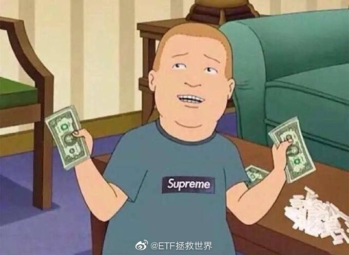

## 2021-01-04 14:45

如果有人聊天的时候突然跟你说未来要给你什么好处，比如资助你买房啊，上学啊，过年或者生日给你个大红包等等吧。

你别往心里去，千万别当回事。别人大概率只是一时兴起说说而已，你真当回事，心心念念，翘首以待，大概率就要失望了。

只要你不当回事，就没人能伤害你。万一对方真给你了，你反而能有个惊喜。

反过来说，你也不要随意给别人承诺什么好处。你做不到，就又多了一个埋怨你的人。

## 2021-01-04 15:26

恭喜@暴躁小萝莉Tr 等100名用户获得【网格交易手账】。微博官方唯一抽奖工具@微博抽奖平台 对本次抽奖进行监督，结果公正有效。公示链接：微博抽奖平台

## 2021-01-04 16:38

之前800多本的物流信息我已经全部上传完毕。能查到的就是填写正确的，等收货即可。查不到物流信息的就是你的资料有问题，也别问我为什么有问题，之前已经说太多了。

第一批的100本错版也已经再次发了。

今天的之外还有100本，然后我再加送一点，这件事就算圆满结束了（当然对你来说可能不圆满……）。

没事，没拿到的不用急，以后争取多送点有价值的好东西。我虽然没钱也没什么时间搞这些，但好歹有份心意。

## 2021-01-04 19:07

没有十分的必要，尽量不要说谎话。哪怕你不说真话，也别说谎话。

否则，后期圆谎将耗费你十二分的精力。一个谎言要用十个来圆，然后就是100个。 ​​​

## 2021-01-04 19:20

说实话，我个人相信多多那个知乎发言应该不是官方的意思，因为太违背正常的逻辑了。即使多多真的这么想，也绝不会这么说出来。

但是，这件事多多不冤枉。居然把官方账户交给外包人员运营？那么多员工，连运营知乎官方账户的人都没有吗。一个错误导致系统坍塌并不意外。

我这样一个小账号的公众号和微博都绝对不敢交给任何人帮我打理，哪怕是我非常信任的小助理们，哪怕是有抽奖那么麻烦的信息处理。

当然，即使是真相，大众也不会相信……这个事情应该是互联网舆情处理经典案例之一了。

## 2021-01-05 14:10

辣鸡恒生也开始挑战52周新高。

可惜最近美元太弱导致ETF没跟上。不过有弱就有强，汇率问题不是大问题。 ​​​

## 2021-01-05 14:29

最近很多人跟我说下车买房了。

果然，在股市赚的钱最终都要交给房地产。 ​​​

## 2021-01-05 15:07

现在的女孩子都很棒啊。刚才跟我说下车买房的姑娘31岁，从0开始自己攒钱在西直门买了房。

西直门单价多少你晓得伐。 ​​​

## 2021-01-05 15:35

回复@_晴天时爱晴:是不是脱口秀看多了啊//@_晴天时爱晴:我们班有个女生当着几个男生面说，男生30岁之前自己赚不到1kw就是垃圾，我估计说这话的女生也许是和本话题女主一样厉害

## 2021-01-05 16:29

我再冒着被骂的风险说两句男女的事情。因为实在是不吐不快。

最近我想了想，得出一个结论：其实之所以女权的问题在微博或者其他论坛打的这么火，除了一部分别有用心的人煽风点火外，很大的原因在于：

这是一个经验主义的问题。

也就是说，几乎所有男人，以及一部分从小从蜜罐里长大的女人，包括大多数大城市的、东北的、川渝的、上海的女性，并没有另外一部分，尤其是部分农村以及小城镇长大的女性那种男女不平等的成长经验，不能体会她们成长过程中受到的各种不平等待遇。

同样，另一方面，后者也没有体会过家庭、组织、社会的相对平等的待遇，所以产生了相对偏激的看法，即：所有女性都遭遇了自己从小所遭受的不公，所有男人都是压迫自己的辣鸡。

为什么有这样的思考结果呢，因为我也是从自己的经验出发得出的体会。就拿家庭来举例。

我从小就在北京生活。我回忆了一下，在我的父母辈、平辈的所有亲戚、邻居中，从未感受到家庭中男性对女性有压迫。甚至相反，好几个家庭都是女性非常强势，男性反而比较弱。

从更老一辈的财产分配等事情上讲，也从未出现什么重男轻女的情况。遗产之类的都是兄弟姐妹平分，从来不会出现什么因为是女孩而少分不分的情况。

男女在家庭中不平等的情况是我上网之后才意识到。说实话，看到很多新闻我非常震惊。

比如我转发甚至痛骂过的某些地方男人吃饭女人不可以上桌，比如家里重男轻女把财产都留给儿子。这些对我来说都是闻所未闻，也让我非常非常生气。我也说过，如果我是女的，你敢不让我上桌吃饭，我当时转身就走，脾气暴一点把桌子给你掀了。

可想而知，那些从小就在男女吃饭不能同桌，家里宅基地或者遗产女性都没份这样环境下长大的女性，当然对女权问题极其敏感。这样一想，那我可就太理解了。

这只是家庭。还有其他很多方面，工作啊之类，很多。

我非常非常支持打破这些不平等的东西，都是人，凭什么用男女来划分？

但是，不得不说，现在网上有时候对于女权已经有点变味儿了。

有些女权认为，男女不应该有任何差别。我要说的是，你可算了吧。男女本身就有很大差别，怎么可能完全一样？

有个脱口秀说，“没有男人的世界，我会过上幸福平静的生活”。您先别着急，我建议您把男性开除地球球籍之前，最好先在女性中培养一批人，从事以下职业，否则，您的幸福平静生活绝不可能实现，它们是：

煤矿工人；
外卖员；
海员；
工地施工人员；
装修工人；
石油、地质勘探人员；
核电站工作人员；
野外电力维修工；
消防员；
……

您先把这些又苦又累的工作接过去，再让男人消失比较好。

我是什么意思呢，我的意思是，我非常非常支持平权，但也希望女权主义者能够认识到男女从生理到心理有着客观的不同。完全一致是不可能的，至少从工作来讲，上述工作确实更适合男性去做啊。

经验主义害死人。

很多人碰到了一两个渣男渣女，就认为全世界没有好男人好女人了。有些人碰到一两个辣鸡上司辣鸡同时，就认为所有职场的人都是辣鸡。有些人更好笑，其实ta谁也没碰到，看两条新闻就觉得全世界没救了。

新闻当然是极端的啊，否则能成新闻？

就好像有人看到一点点社会问题，就马上开始骂zf，开始骂tz。我可去你大爷的吧。

推而广之，其实不光女权的问题。很多问题都是因为每个人的成长经历不同，导致世界观完全不同。你好好想想，为什么50、60年代的某些人对某些群体特别憎恨，而大部分90、00后反而很拥护。因为他们的成长环境差太多了，每个人看到的都是不一样的一面，怎么可能有共识？

所以，最后，我的意思是，我理解某些人目前的世界观、目前的言行举止。也希望这些朋友知道，你所看到的世界并不是全貌，这个世界上也有好人，有好男人。这些好男人为了你的幸福生活做了很多。

另外，什么时候你碰到了男女不公平的事，给我私信，我依然会为你发声，依然还会帮你骂人。我也希望你看到某些事情也能真正客观的去评价、判断之后再决定自己的立场和态度。自己是男是女不应该是支持或者反对某件事的原因，这件事是否应该支持才是最重要的。

## 2021-01-05 17:11

我好害怕和逻辑混乱的人说话。真的，心里会感觉堵得慌。

好累，可爱的女孩纸们，请抱紧我。 ​​​
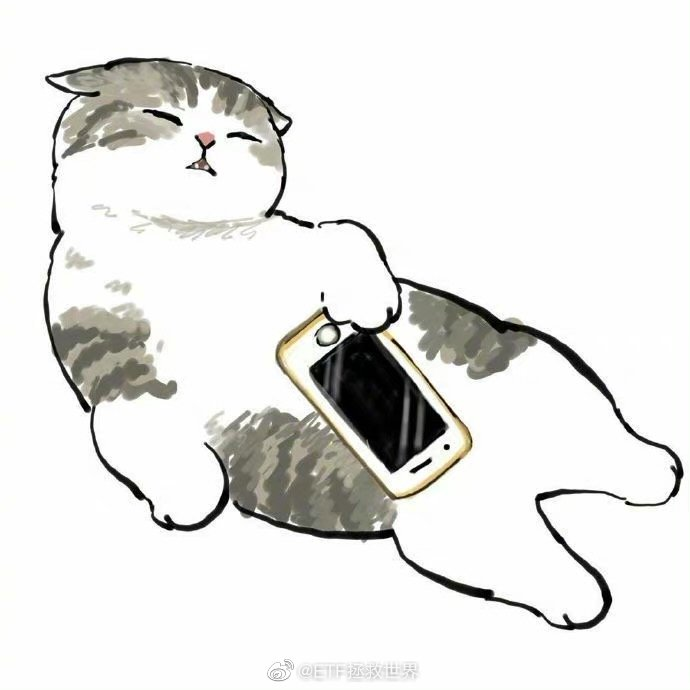

## 2021-01-05 19:35

拿到特别版的小助理。

有那么好吗，不至于不至于。 ​​​
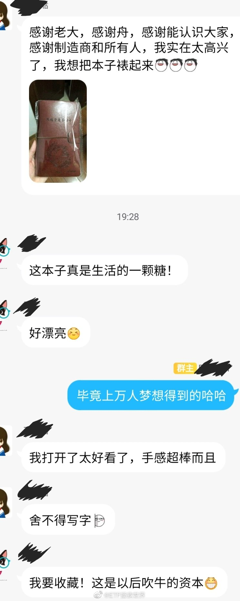

## 2021-01-05 23:13

非常有意思的一件事。也许之前积累了很多矛盾，终于在一件小事上爆发了。评论也很有意思。但我觉得最重要的，是这两个人可能是因为很多因素选择了结婚，但他们之间极大概率，没有爱。

## 2021-01-06 08:30

最高温度11℃。零下。大风。 ​​​
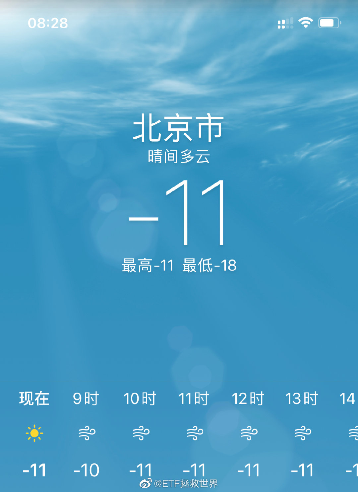

## 2021-01-06 10:21

3月份油价30美元的时候进场抄底，现在50美元了，抄底的品种还在浮亏。[微笑]

根源在于油价最低的时候其跟踪的外盘原油基金突然改变了持仓规则，将大量近期合约改到了远期。远期合约波动没有近期的大，所以下跌都吃到了，反弹吃不到。

这个事情属于意外。我们每天生活都会碰到很多意外，碰到了怎么办，装死吗。

不。能改变的事情就要努力去做。

当晚知道这件事后，我马上联系且慢和华宝，协调打通两家场内场外份额转换的通道，用最快的速度开发出一键转场内的功能。

由于当时场内价格大幅溢价，所以场外份额转场内后，不仅不赔钱，甚至还能盈利。

最终经过努力，大多数朋友都顺利的转到了场内卖出，没有损失甚至盈利了。

这就是能改变的事情就努力去做的一个例子。只要有机会翻盘，再难也要去做。躺下装死很容易，但只有动脑子想办法不遗余力的去拼才能赢。

## 2021-01-06 10:42

两融余额目前16556亿，再创2015年7月以来新高。

历史两融余额最高位在2015年6月，数字是22000亿。

历史首次突破16556亿是在2015年4月。两个月后，也就是两融余额顶点的时候，A股爆破，烟花灿烂。

基本上两融余额等于融资余额。融券额非常少。目前融资额是15111。也就是说，有1.5万亿的合法杠杆资金在场内干。

2015年后，两融余额最低点是7100亿。知道什么时候吗——2019年2月，钻石坑边缘。

这些数据不代表任何看法，只是罗列事实，不要过度解读。

## 2021-01-06 13:02

行情中后期，一定是新手比老手赚得多。

因为老手会害怕，新手不会。不仅不会，还会嘲笑老手。

当然了，最后的结局是新手连哭的力气都没了。这次不知道，反正每次历史都是这样的。 ​​​

## 2021-01-06 14:36

无惊无险又到3点，是时候说再见。

又是岁月静好&amp;新高的一天。

（涨跌家数对比1000:3100） ​​​

## 2021-01-06 20:19

看到关于那个悔婚事件的一个说法，我没经验，有经验的朋友可以说说是不是。

分析说是双方家庭在较劲。

女方父母关于半夜买内衣是想给男方一个下马威，有点小刁难的意思，意思是我家闺女不好欺负，以后过门了别欺负我们。当然，女方家里这样肯定也不是平白无故的，应该是之前接触中就感到闺女过去有可能会受气。

男方婆婆也不示弱，买个小的送过去，意思是别嘚瑟嫁过来就乖点别跟我来这套。

因为距离那样的生活环境太远，不知道有没有可能。

如果真是这样，我依然是很震惊。这些人是不是都疯了，两个人结婚不是应该互相扶持，像战友一样跟这个辣鸡世界打仗吗，怎么还没到一起就开始抢权了。还不光这两个人，等于两个家族都开始集体抢班夺权了。

另外说实话，彩礼和嫁妆这两样还真是我上网以后才知道的存在……

## 2021-01-07 09:49

看了一眼环保 ​​​

## 2021-01-07 09:54

有人说我的图用过一次了 ​​​
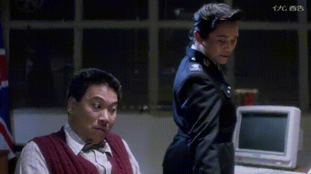

## 2021-01-07 10:25

再说一次，新朋友不用关注我。这轮牛市我对你不会有什么帮助了。这一点几个月前就说的很清楚。

收益率，以及新朋友的买入和老朋友的卖出 ​​​
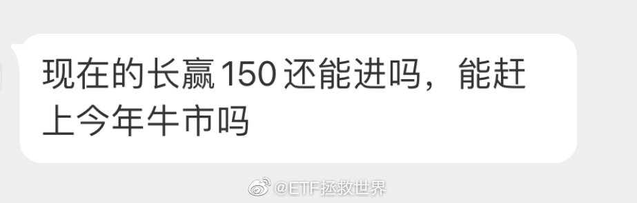

## 2021-01-07 11:51

其实经过2020年，我本人最大的变化是，不会再在意外国人对中国的看法了。 ​​​

## 2021-01-07 11:59

回复@etf拯救世界专属铁粉:不要考虑钱，问问哪个最能让你开心你就去做哪个。另外，一定是要清的干干净净才能买房吗。一套房子几百万，连几千几万块都不能留给金融市场吗。这个问题我始终没想明白。

## 2021-01-07 13:37

今天所有股票涨幅中位数 -3.08%。

指数一片岁月静好…… ​​​

## 2021-01-07 21:06

男人至死是少年。

## 2021-01-07 21:36

我以为是玩赛博朋克又碰到bug了。

## 2021-01-07 22:00

没事真的别喝了，一级致癌物。喝也别喝醉。

## 2021-01-08 07:52

特斯拉生动的演绎了什么叫横起来多长，竖起来多高 ​​​
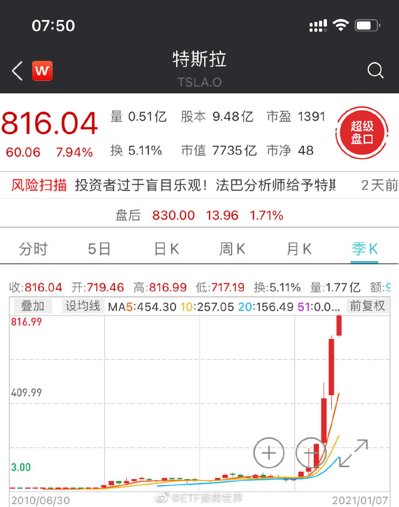

## 2021-01-08 09:08

众所周知，股价、市值和利润没有关系。

## 2021-01-08 09:14

好消息不断。

私信太多，类似的能看到的我会回，如果没回就是没看到。 ​​​
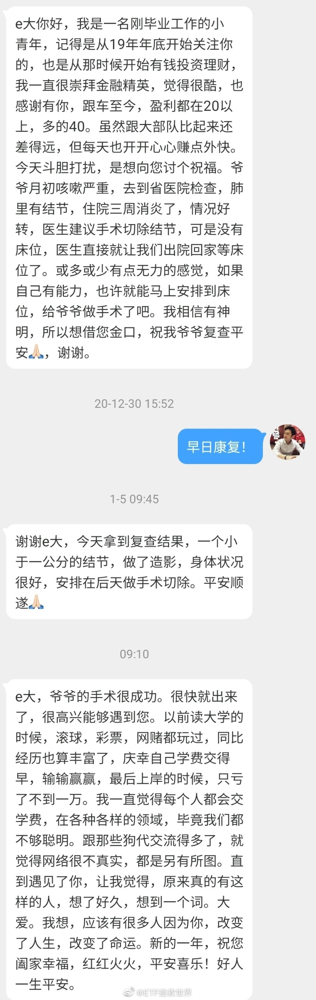

## 2021-01-08 10:44

辣鸡恒生，辣鸡500，辣鸡传媒。

你们都是辣鸡，所以我会不离不弃。 ​​​

## 2021-01-08 10:48

有人说以后的市场以大为美，小股票完了。

我不信。

成年人说，我都要。 ​​​

## 2021-01-08 11:28

有朋友问，有大佬说新能源高估了卖不卖。

这个问题其实问的是不是多余。

我已经说过无数次了，交易是根据交易体系来确定的，怎么会因为一篇新闻报道而决定，那不是韭菜吗？

高估不高估，低估不低估，情绪如何，由各种数据和信息汇总判断，买不买卖不卖，由策略和体系决定。

该卖的时候体系会说，我也不知道什么时候卖。

## 2021-01-09 08:02

川宝只能上tiktok了

## 2021-01-09 09:08

挺好 ​​​
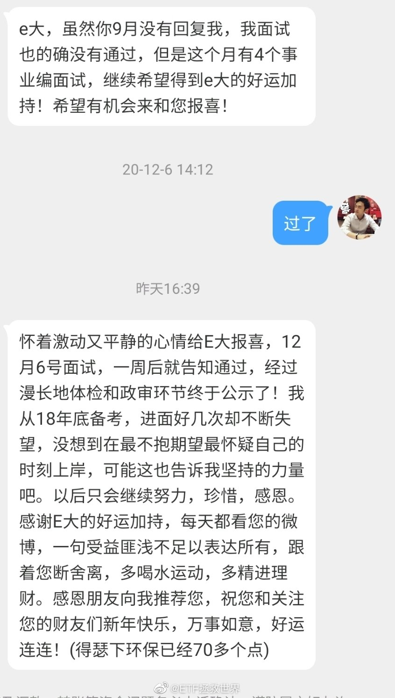

## 2021-01-09 12:09

回复@silerly:定投是每个月固定的。收入不是。应该是任何收入的一定比例都存起来或者投资，两者不同//@silerly:基金定投就可以啦

## 2021-01-10 20:03

图片评论 查看图片

## 2021-01-10 20:09

请把老头关进去。请给小姑娘奖励。

## 2021-01-11 10:05

恒生这一年价格几乎一动没动，典型的震荡市，但整个过程中你提了多少款你心里清楚。

还说你不是股神？

另外，有辣鸡的品种吗？

只有辣鸡的操作。 ​​​

## 2021-01-11 14:41

“抄底”。

## 2021-01-11 18:05

知道我为什么不喜欢牛市开始投资的人了吧。

因为他们并不是真的喜欢投资，也不是对投资感兴趣，他们只是喜欢钱。

不喜欢也不感兴趣，就不会研究甚至不会考虑我们到底在干什么，根本就不是一路人。强行走在一起就容易出叛徒。

没有战斗力的队伍。 ​​​

## 2021-01-11 18:18

回复@开心小沟谷:尤其说的就是你们这种阅读理解能力差的。再见。//@开心小沟谷:回复@早日Fire:这些话我也觉得怪怪的

## 2021-01-11 20:29

今日数据：

目前A股整体并不贵，贵的只是部分板块。我看不出大幅减至轻仓的必要性。

甚至s准备上量加仓。 ​​​

## 2021-01-11 20:50

某计划与外资同步买入利率债。

## 2021-01-11 21:49

大摩健康今天涨0.9% ？… ​​​

## 2021-01-11 23:05

一直很困惑，为什么不合法app和网站总是被关停后上了新闻我才知道。

好生气。 ​​​

## 2021-01-12 07:16

回复@萱萱的小麦2018:从最高点回调了5%叫低点，盈利超过70%卖出叫低点。所以你的要求就是一定要卖在最高点。晒喷子。//@萱萱的小麦2018:环保高点不卖，低点卖，金融三傻低点不买，涨了再买，绝对神操作啊！

## 2021-01-12 07:33

回复@幸运的kds777:巴菲特12块清仓中石油，然后涨到21被骂成什么了。无论左侧右侧谁能卖在最高点？//@幸运的kds777:回复@遇见你温柔如初:他想鱼头吃到鱼尾，操作超过巴菲特

## 2021-01-12 10:21

低位卖出。 ​​​
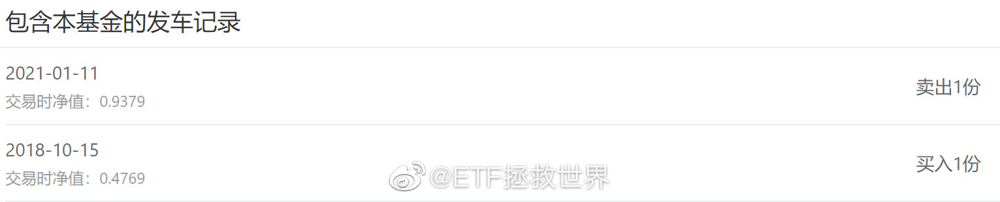

## 2021-01-12 10:44

盈利后的卖出真的真的真的很难。

这种难你不自己去操作一个品种，你是体会不到的。

卖早了少吃很多，卖晚了坐电梯。不卖就从大幅盈利变成亏损最终退市。大幅下跌后不卖等反弹，反而等来的可能是继续暴跌。大幅下跌后卖出，反而可能会大幅反弹。而大幅上涨后卖出，又有可能迎来继续的暴涨，没有天空。

目前我本人是有一套卖出的策略，但不能说完美。我也怀疑世界上有没有一种完美的卖出体系：每次卖在最高点，哪怕是每次卖在最高区域。

这个问题我也一直在不断的探索，希望未来还能继续提升。

我现在能做的只能是摁住自己的人性，相信自己的策略，每次坚决执行。在开发出更好的卖出策略前，除了相信它我别无选择。

## 2021-01-12 14:50

接连便是难懂的话，什么“低位割肉”，什么“高位追涨”之类，引得众人都哄笑起来：评论里充满了快活的空气。 ​​​

## 2021-01-12 16:00

我发现很多朋友会觉得别人微博啊，或者别的地方把你拉黑是别人的错。

这个我就不明白了。别人的微博是别人自己的，拉黑你有什么问题吗。你去人家做客人家不欢迎你把你请出去不正常吗。

反正没有铁粉标志的人说话让我不舒服就会拉黑。我不觉得有什么问题，你也可以拉黑我啊，我保证不会生气甚至有点高兴。

## 2021-01-12 22:01

我看很多朋友评论说昨天没上车，今天大涨强行扒车。

这个我真的无可奈何。你一定要比我成本高的买，以后又觉得收益率不够，这就让我很无奈。 ​​​

## 2021-01-12 22:14

没谈过恋爱的人有一个问题就是把恋爱看得过于神圣。 ​​​
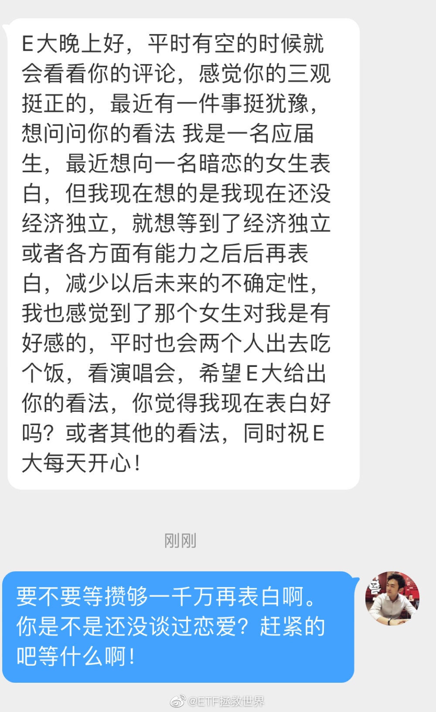

## 2021-01-12 22:58

回复@来两个鸡蛋饼:如果还想保持目前的状态，就不要贸然表白，以免万一失败连朋友都没得做。要通过有技巧的试探弄清楚对方是否也有这个意思。如果一点都没有还是慎重。//@来两个鸡蛋饼:想问E大 在社会上已经几年了 然后喜欢一个女孩子 女孩子比我优秀 我可以和他表白吗

## 2021-01-12 23:10

回复@欇欇生江上:这你就错了，只能说明你不懂男人。大多数男人是，只要女孩看他一眼，他就会觉得女孩喜欢他。跟他说句话，他就会开始想两个人的孩子叫什么名字了。//@欇欇生江上:我脚的吧，女孩子对你是不是也有好感，你自己心里是最清楚的

## 2021-01-12 23:18

回复@苏格拉姐:如果女性对男性表白，男性顾左右而言他，比如“今天你喝多了明天酒醒再说”，那第二天女性也不要再次说了，真相是他真的不喜欢你……男性如果真的不喜欢一个女性，你是很难通过打动他而改变现实的……//@苏格拉姐:不是吧。。。那说明以前示好装傻的就是真的一点不感兴趣

## 2021-01-13 08:49

回复@_青春的小尾巴Sunny:捡合适的看吧，我也经常说的不对。大家还是要自己鉴别一下//@_青春的小尾巴Sunny:e哥，关注您快6年啦，我属于话很少那种人，您对我的思想、生活影响真的特别大，感恩//@ETF拯救世界:解读：pb4.77，超过十年均值一倍是合理的。下一步：投资不能看pb。

## 2021-01-13 10:38

行情无聊提前营业 ​​​
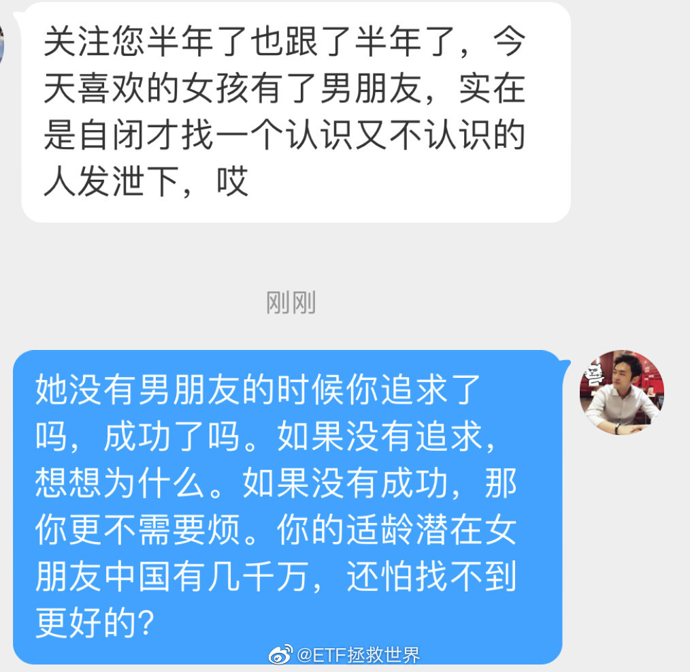

## 2021-01-13 10:49

年轻人就是太容易因为感情痛苦

过几年就好了

到时候你钓个鱼啊，盘个手串儿啊，养个花鸟鱼虫啊，

就不想女人了 ​​​

## 2021-01-13 11:15

今天吹信息可以吗 ​​​

## 2021-01-13 11:21

不知道为什么你们不喜欢债券。

我超喜欢的。就是仓位不够。 ​​​

## 2021-01-13 12:12

今天偶尔翻到一个两年没更新的公众号，网上搜了一下相关情况，有一些感触。

在这里我提醒各位：

公募基金在基金公司的网站上都可以查到你的持仓份额。没事的时候你可以隔一段时间去看看，自己名下的基金是不是都入账了。无论你是在哪里买的，你的基金都在基金公司，只要能查到，就绝对安全。

另外，我只对我自己投资并公开的品种负责，其他品种我没研究过，不敢说行还是不行，也与我无关。

## 2021-01-13 13:58

图片评论 查看图片

## 2021-01-13 16:39

说起来你不信，

全市场估值居然已经跌回黄金坑边缘了……

可想而知大多数股票多惨。 ​​​

## 2021-01-13 16:49

回复@赵大板板板:不奇怪。上次3200点是2020年7月，当时到现在下跌的股票占62%。跌幅超过20%的股票有1093只。//@赵大板板板:回复@赵大板板板:昨天听到个真实的故事 3200买的套在3600

## 2021-01-13 17:20

目前市场已经出现极为诡异的情况。

一方面是早上那个新闻：基金抱团股的PB已经从过去十年平均的2.x涨到了现在的4.x。

另一方面，几乎一半的小股票PB只有不到2倍。目前的全市场估值居然与2018年6、7月差不多。那可是再过4个月就会迈入钻石坑的时候。

大就一定好吗？小就一定差吗？我不信。我相信未来几年，一定有很多小股票涨幅巨大，当然，你得有这个本事从几千只里面选出它们……

## 2021-01-14 09:37

通利分红，改再投 ​​​

## 2021-01-14 09:41

今天吹一下还会奶崩吗

## 2021-01-14 10:05

很多人不喜欢利率债。等到股市下跌的时候你才知道债券的香。

## 2021-01-14 10:41

燥起来！//@ETF拯救世界:今天吹一下还会奶崩吗

## 2021-01-14 11:24

大摩健康也好，信息技术也好，能让你稍微体会一下如果我不极度保守会怎样操作。

但我很难不保守，因为队伍整体作战素质还有待提高。 ​​​

## 2021-01-14 12:34

水浅王八多。 ​​​

## 2021-01-14 14:48

儿子女同学：“墙的英语怎么说”
儿子：“wall”
女同学：“眼睛的英语怎么说”
儿子：“eye”
女同学：“膝盖的英语怎么说”
儿子：“knee”

女同学：“合起来呢”

听完这个，当时我就震惊了！ ​​​

## 2021-01-15 08:24

购物APP小贴士：

使用购物或者出行等消费app的时候，页面出现“金融”两个字让你办业务，立即关闭该页面。 ​​​

## 2021-01-15 09:18

史书都是胜利者写的。可以让失败者无法说话甚至彻底消失。

## 2021-01-15 10:15

什么是情绪呢，怎么监控呢。

其中有一点就是你要监控旅鼠们有没有给某个板块起一些恶俗的绰号：

比如“大烂臭”，比如“三傻”

这些绰号出现后，你就应该知道有些事情可能要起变化了。

首先是说明这些品种涨不动不让人喜欢，

更重要的是这些绰号真的恶俗到极致，让人看了就感到恶心，除了那些品味极差的人是起不出这样的名字的。这些人能有什么高明的眼光确实值得怀疑。

## 2021-01-15 10:45

恒生开始挑战第一压力位29200。 ​​​

## 2021-01-15 11:15

不知道现在白酒基金评论圈是什么样子，有谁指个路吗。因为我不知道哪个白酒基金比较火。 ​​​

## 2021-01-15 15:54

周五，又是资产增加的一天。祝大家周末不用加班。

回见。 ​​​

## 2021-01-16 08:00

我是不是太冷血了。

总之我觉得就是，如果我有余力，这种锦上添花的事情我就帮帮你。如果我自己也很难，那就坦然拒绝，没什么过意不去的。

为了面子自己难受这种事，我做不出来。 ​​​
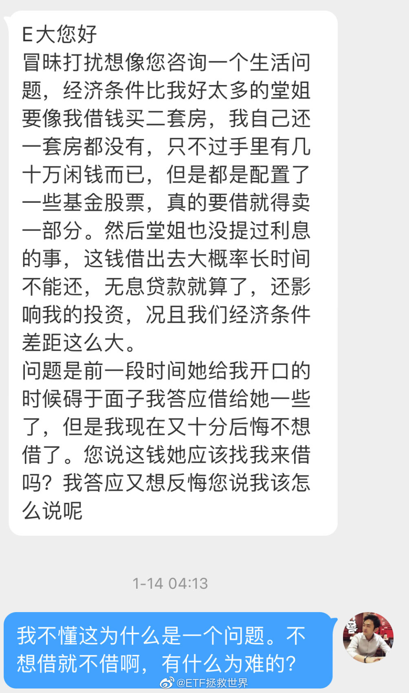

## 2021-01-16 08:06

回复@冰激凌8052:这些很重要，但不是最重要。最重要是借钱后你自己的感受。如果帮助过你，你借给他你会很开心，因为是一个回报。显然问题并不是这样//@冰激凌8052:她帮助过你没有？平时待你如何？你们关系亲近吗？这些我觉得是要考虑一下的。

## 2021-01-16 12:03

改变人生小贴士：

你有没有特别想做但一直没有做的事情。

如果有，

就现在，right now，今は，지금，Jetzt，тепер……

立即去做。但是不用做很多，就做一点点。多么一点点都无所谓。

比如你想练琴，拿出来，弹一下也可以。

然后每天弹一下。当然，大概率你会多弹几下。但无所谓，想停就停。但每天保底就一下。

你想写东西，每天就写10个字。你想学编程，每天就学半页。你想锻炼，每天就练一个仰卧起坐。

然后，不用谢我。

## 2021-01-16 12:28

欧洲真的连一个疫苗都弄不出来吗，不会吧。那么多大医药公司呢

## 2021-01-17 10:04

第一，在商言商。熟人介绍只是搭建了沟通的桥梁。用不用，怎么用，合同怎么签，都是你决定的。“熟人”并不代表什么，因为还有个词叫“杀熟”。

第二，每次被坑都应该成长，对自己的人生都应该是有意义的。否则被坑的毫无意义。 ​​​
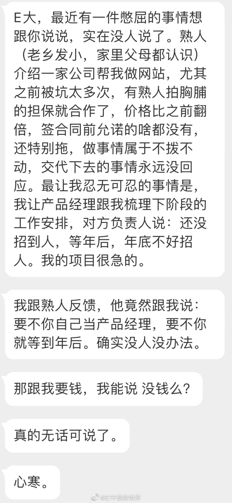

## 2021-01-17 12:24

今天看到有一位大V说，去面馆吃面被粉丝认出，两人相谈甚欢，深入的探讨了价值投资。

人和人确实不一样。这种场面如果发生在我身上，哪怕想想都会觉得非常不舒服。

我希望自己能自由自在的逛街、吃饭，自由自在的做任何不违法不违规不违反公序良俗的事情。

做一个小透明，不要有任何人认出我打扰我。

## 2021-01-17 12:55

IT小贴士：

使用mac的朋友如果有轻度使用office文件的需求，可以试试mac版的WPS。 ​​​

## 2021-01-17 13:28

有时候看评论就会觉得，有些人是不是童年遭遇过很大的不幸，或者现实生活中过的特别不如意。不然怎么能写出那些字的。

这种时候就会觉得不知道他讨厌、可恨，还是可怜。

别人朋友之间聊聊什么软件好用，他都能跳出来破口大骂。你说，这种人是不是每天生活在痛苦中。幸福的人会这样吗。

我不知道，或者我问问各位，你很幸福的时候，会无缘无故的在网上骂人吗。

但话说回来，老话说“可怜之人必有可恨之处”，这话肯定不全面不客观。但用在某些人身上应该是合适的。

## 2021-01-17 15:08

有人觉得我说一些其它的让人讨厌，但真的能帮到不少朋友。

有些话题你不喜欢不看就好，没必要骂。

这个世界不仅仅只有投资和钱，更重要的是生活本身。 ​​​
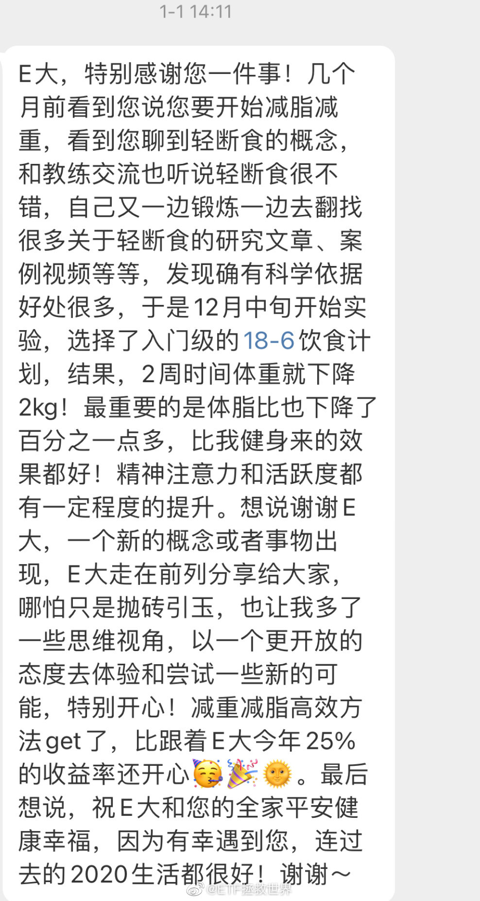 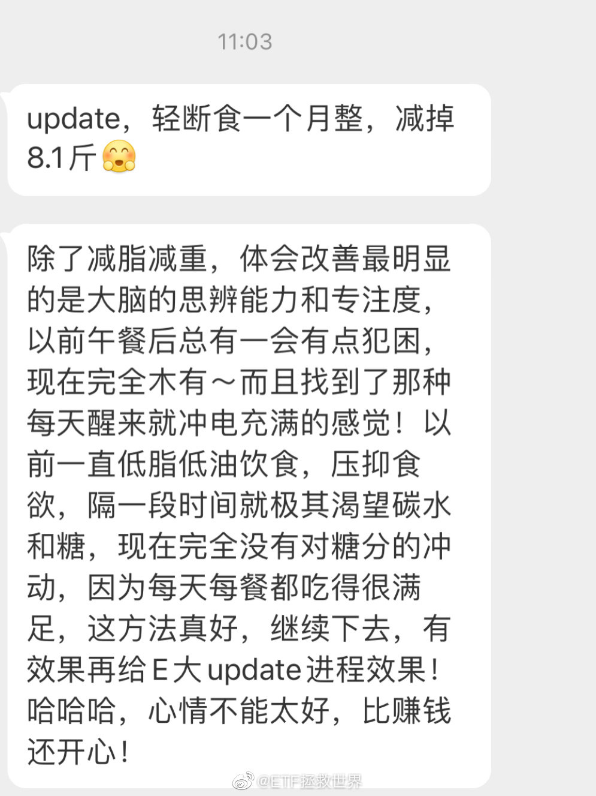

## 2021-01-17 15:33

生活小贴士：

如果你所在的地区水质硬，水碱大，淋浴的花洒出水口堵了：

不用针刺，不用醋泡，只要用手指按一下被堵出水口周围的橡胶把水垢挤出即可。（除非你家的花洒特别特别便宜没有这个功能……）

这是今天最后一条，明天见…… ​​​

## 2021-01-18 09:52

回复@夏日暖阳花满枝:“七分饱”很难控制，因为没有量化。而无论是16-8还是20-4，都很容易量化很容易操作。就像我说做波段你根本没法操作，我说做5%网格你赚的很开心。//@夏日暖阳花满枝:我很奇怪的是说轻断食就很多人喜欢，说中医的七分饱就没有爱了

## 2021-01-18 10:03

希望微博开发出一键拉黑辣鸡功能。

打开“粉丝”界面，点击“拉黑有可能让您不开心的辣鸡”。

自动识别辣鸡然后批量拉黑。

第五次工业革命。 ​​​

## 2021-01-18 10:16

不用苹果手机的前置摄像头自拍，你不知道自己有多丑。 ​​​

## 2021-01-18 10:47

回复@六谷星云:“除了自己这种投资方式，除了自己买的投资品种，其它的都是辣鸡。”这种观念我不理解。大家各买各的心头好不就完了吗。//@六谷星云:益达，怎么看“董乐”之争

## 2021-01-18 10:57

我虽然比较推崇买指数基金，但你有没有看过我贬低别的品种。

相反，我还鼓励你多尝试各个品种。股票也好，主动基也好，甚至期货期权也好，都去试试呗。

适合我的，未必适合你。小马过河，冷暖自知。千万不要年纪轻轻就把自己禁锢在某个“概念”或者某个“流派”中。

做人也是一样。你有自己的坚持和信仰非常好，但你的坚持和信仰未必适合别人。什么时候还能开放心态接受新事物，说明你还年轻。到了封闭自己的那一天，就老了。

## 2021-01-18 11:02

回复@风过留痕1124:涨的好当然推。但我不会推，不好意思，我也有点自己的小信仰和小坚持呢。//@风过留痕1124:最近大V都在推主动基组合

## 2021-01-18 11:13

很多人在为了今年、去年赚钱了还是赔钱了，赚多少还是赔多少开心、难过。

他们都大错特错了。

巴菲特绝大多数财产都是50岁以后赚的，说明与你未来的收益相比，现在的多一点少一点并不重要。那么什么才是最重要的？

对绝大多数人来说，你每一个阶段赚钱与否，赚了多少，可以说一点点都不重要。重要的是你在这段经历中学到了什么。学到的东西在接下来的投资生活中会不会让你做的比以前更好。

太多人是赚钱的时候不明所以，赔钱的时候晕晕乎乎。一轮下来，不知道自己为什么赚，也不知道为什么赔。不知道为什么涨，不知道为什么跌。

怎么说呢，由衷的感谢他们吧。

## 2021-01-18 11:20

回复@-Flamingos-:哦，是吗，我都没看呢。//@-Flamingos-:信息技术起飞了

## 2021-01-18 11:23

看打仗了。

## 2021-01-18 12:26

所有人都在说拥抱核心资产，拥抱赛道股，小股票彻底打入深渊。你就该知道，事情可能正在发生变化。

## 2021-01-18 13:08

我觉得有些人可能天生就是为了给人添堵才出现在这个世界上。

以前在张大妈看到有人贴出自己刚装修好的房子，底下一堆评论就开始喷，这也不好那也不好，又贵又难看……

我就纳闷了，人家家里装修的难看关你屁事啊。你打开文章觉得有值得借鉴的就说声谢谢，没有什么好借鉴的关上不就完了吗，骂人家干嘛？人家辛辛苦苦花钱又装修又写字又拍照的，你给人家添堵，至于吗。

就像昨天我说花洒堵了按一下就好了，就有人评论那么麻烦干嘛，换一个不就行了吗。我？？？？？ 是换一个麻烦还是按一下麻烦。（也可能是我穷体会不到家里东西动不动就换的高级感觉）

总之看很多评论就感觉到两个字：刻薄。别人分享学不到东西，还要使劲的踩，显示自己的高贵。

就好像朋友家生了孩子，朋友圈贴个照片，你评论：好难看。 你说你是不是贱。

区别就是，朋友圈别人都知道你很贱，在别的地方别人不知道那个很贱的是你……

## 2021-01-18 13:38

我不是说生活中大家应该一团和气，永远没有冲突才好。你得分事儿啊。

我说的那些：

人家装修过程中你提意见没问题，装修好了你喷人家有用吗？除了添堵。

人家买奔驰C之前，你喷完了，给人家添点钱买个E，那没问题。人家买完了你喷有用吗？除了添堵。

人家就是跑个养生步，你非让人家把配速提到专业水平干嘛啊，膝盖跑废了你给换新啊。没用啊，除了添堵。

还能改变的，帮人家更好的，你提个不同意见没问题。木已成舟，你去别人那BB，除了让人堵得慌和体现自己的高级和2，有什么用啊？

## 2021-01-18 13:47

回复@不加盐的89度:不要催。该发的时候就发：啪的一声，很快啊，买了就涨。乱买可不行，乱买的那些还没解套呢。//@不加盐的89度:我不管，我就问有车没

## 2021-01-18 13:51

本周、下周是一批指数的关键周。

能不能空中加油展开一波上涨，就看这两周了。 ​​​

## 2021-01-18 14:19

又是新高的一天。

意思不大，只是感觉有点舒服。 ​​​

## 2021-01-18 14:38

刚才评论里有个反应很快的朋友，我说这样的朋友吵架不会吃亏：

“我拍了一张家里的背景墙到朋友圈，说家里刚贴的小鱼好可爱，她来一句说我家角落里路由器的三个接收线像三炷香，我特么当场就想回一句，是吧，就差你照片了。”

这是一种很稀缺的能力。你别不信。

不信的话我问你，有多少次你跟别人语言冲突的时候不知道该说什么，结果回家晚上躺床上回忆起来，怼死人不偿命的话一句一句在脑子里全冒出来了。

但是，晚了。

有这样经历的朋友把666打在公屏上。

## 2021-01-18 14:53

不过在外面除非必要，尽量不要跟人起冲突。因为你不知道对面那个人是什么人。别说动手受伤了，哪怕是真出了人命，对方拿个精神病证明也可能一点事儿都没有。犯不上。

## 2021-01-18 15:05

新高确认。今天就到这里吧。大家吃点好吃的开心一下。崇文门附近的姑娘们可以试试1983的巧克力拿破仑。明儿见！

## 2021-01-18 19:40

zs我恨你！ 查看图片

## 2021-01-19 08:55

最近越来越多人开始吹港股了

轿子坐稳了。 ​​​

## 2021-01-19 09:26

法律并不是一成不变的。

30多年前，“流氓罪”、“投机倒把罪”、“fgm罪”都是很严重的。现在，都没了。

别说别的，就说投机倒把罪，我想各位有一个算一个都得进去——你们不仅投机倒把商品，居然投机倒把股票和基金，低买高卖赚差价。

很多事情现在是违法的，未来未必。很多事情现在是合法的，未来也未必。

且不说现在与过去，就说现在的很多规定，执行起来未必也那么严格。就说港股美股很多人在做，你的资金又进又出这合规吗？那么多机构大张旗鼓的做开户广告合规吗？很多东西无非是黑不说白不说得过且过了。

（在这里我强烈建议拓宽港股通的交易范围！那么多好股票为什么不涵盖在港股通范围内！）

回到开头。

我的意思是说，判断一件事，请独立思考，不是说不能看别人怎么说，而是别人说完了自己想一想他说的对不对，逻辑、证据是不是清晰合理。有时候众口一词未必是正确的，当然，特立独行很多时候也只是傻缺的代名词。

所以，同意一件事的人多还是人少并不是最关键的，最关键的是你要判断这件事是不是合理。

而法律本身，永远都是在变的。除了杀人放火坑蒙拐骗偷，很多灰色的东西是会变的。

话说回来，当年投机倒把没被抓住的，大部分都发财了。

## 2021-01-19 10:10

智投的登录又出问题了。

我感到非常非常非常抱歉，各位信任我，却出了登录的问题，我很自责。

我已经督促他们尽快、彻底解决这个问题。

如果迟迟不能解决，我会自己解决这个问题。

再说一次，非常抱歉。对不起各位。

（条件单不受登录影响，会自动运行） ​​​

## 2021-01-19 10:22

如果能够站稳，第二压力位是31400左右。再往上就进入可减仓区域。

## 2021-01-19 10:31

各位智投开户的朋友，这里有个暂时应对的解决办法，如果下次用智投登录不上去可以先这样解决：

去券商官网，下载PC端或另一个手机app，官网地址是：

www.cnhbstock.com

在“浏览用户”——网上交易软件或手机交易软件中下载

手机交易软件中有两个，一个是智投，一个是“华宝手机证券”

区别是智投可以做条件单。我个人建议首先用智投，如果登录有问题就用另一个。

99%的登录问题会解决。

当然，智投的登录问题一定要解决，否则各位答应我也不会答应。

各位辛苦了。

## 2021-01-19 10:42

饿死我了。刚看到到点吃东西了。 ​​​
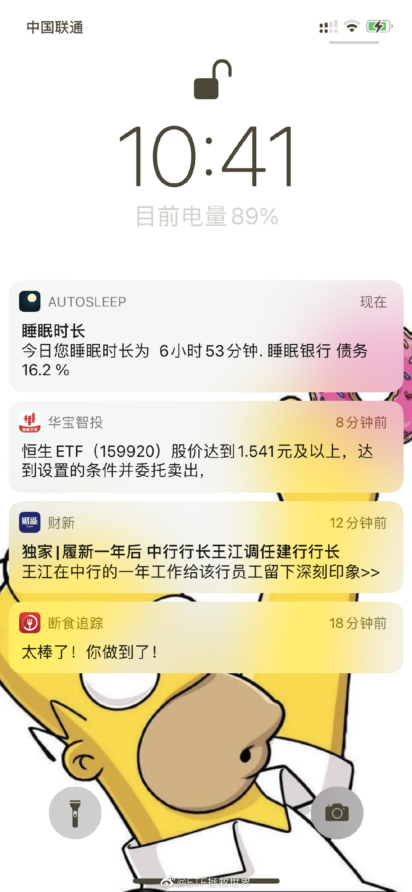

## 2021-01-19 11:10

不知道为什么我觉得男性基因里是不是自带一种沙雕属性，总是会做出一些奇奇怪怪的“幽默”行为。

## 2021-01-19 11:18

前几年球球上有个大V买的股票涨幅特别好，好几倍那种。他一下子非常火。

去年那么大的行情，他加杠杆重仓的股票跌幅将近40%。人也不多说话了，评论也少了。

越是这种时候，我就越关注他持仓的股票。追热点的人不值得看，值得看的人是在某个品种表现极差却能够坚定不移有理有据分析的。不是说这种一定是对的，但是值得关注的。

风水轮流转，我只关心什么时候可以出手帮帮那些落魄的人和落魄的品种。

## 2021-01-19 11:24

## 2021-01-19 11:57

坐轿子的感觉，你不试一次是体会不到的。

体会一次以后就戒不掉了。

每天家里的几个轿子轮着被抬，每天欢乐今宵。 ​​​

## 2021-01-19 12:54

昨天的瓜我倒是还有一个跟你们不一样的关注点：

无论男女，找另一半的时候一定要擦亮双眼。

尤其是你的资源比对方多很多，或者比对方重视声誉的时候。

还有一点，交往的时候谨慎处理财务问题。 ​​​

## 2021-01-19 14:03

食品饮料的买卖双方擦肩而过时互道一声“XX”。 ​​​

## 2021-01-19 18:29

我之前说过好几次，在这轮行情中，我已经不能对新朋友有任何贡献了。我请新朋友不要再参考我的操作。关注我也可以，不关注我也可以，总之我对你没什么用了。

在这里我想再重申一下这个问题。甚至我有点极端的想停止公开推送计划，禁止新人跟车。当然，老朋友还会有办法看到。

这是因为接下来的很多操作都是基于旧有持仓的，比如换仓等。与新开仓不是一个逻辑。

跟车的人多少我一点点点都不在意。我在意的是你不要因为我赔钱。

## 2021-01-20 09:16

怎么说呢。

Zs吧，之前除了她的粉丝，恐怕多多少少了解她一点的，大部分都觉得她早晚出事吧。

为什么呢，因为她有些事，尤其是有些话太出格了。

所以，嘴上还是得有把门的。不然弄得好多人希望你出事，那就不太妙了。 ​​​

## 2021-01-20 09:39

去年最猛的白酒一跌再跌。

去年最差的港股变成了当红炸子鸡。

这就是市场，这也是人生。 ​​​

## 2021-01-20 10:18

这件事让我特别生气的是，我感到自己的智商不够用了。

虽然没有仔细梳理，但打开微博就是这件事，所以陆陆续续也吃了几口瓜。

然而直到现在，我都不知道这两人到底是怎么回事。谁欠谁的钱，公司是怎么回事，做什么的，官司是个什么官司，是怎么个交往过程，dy过程又是怎么回事。

所有人都在吃瓜，弄清楚的我估计没几个。整个事件就像小爽的一直以来的文字一样，那么天马行空，那么后现代，让人弄不清楚。

智商不够的感觉就好气。

## 2021-01-20 14:37

不知道今天能不能新高。

就像不看照片就去相亲，有点期待，又有点担心。 ​​​

## 2021-01-20 17:24

年报开始披露了。一月份3家，2月份52家，3月份1105家，4月底披露完毕。大戏2-3个月以后才能开始，有点期待呢。

## 2021-01-20 20:45

what's wrong with u,dude

6%？ ​​​
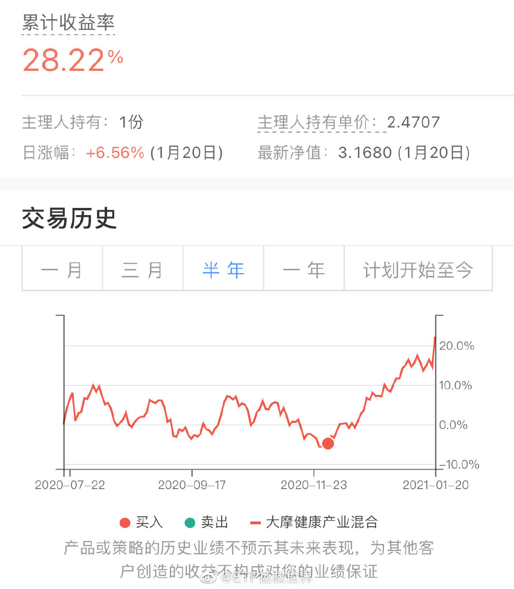

## 2021-01-20 21:16

新高。确认了，是全智贤本贤

## 2021-01-21 09:32

很多人好像为了返乡政策怒火中烧。

过年想回家团聚肯定没错，但其实你有没有想过一个问题：

家乡的乡亲们希望你回去吗。 ​​​

## 2021-01-21 09:41

回复@某不营养的韭菜柯学:你说出了我想说的//@某不营养的韭菜柯学:不用问，除了自己家人，都是拿着鸡毛当令箭。舆情上，其实跟去年说境外留学生“千里投毒”有异曲同工之妙。这么一看，人均双标，小丑竟是我自己

## 2021-01-21 09:55

其实之前就表达过这个想法：

总是觉得人类作为一个整体，其实是挺辣鸡的：自私、贪婪。

但是，会有极小一部分人会让我觉得温暖。他们善良。

让我爱整个人类我有点爱不起来，因为大多数人并不知道什么是爱，你爱他，他不会爱你，反而可能觉得你是个xx。

所以我只能选择那些值得爱的人，尽量对他们好一点。

但无论如何，人类总体就是辣鸡。大多数人都是。

为什么很多人觉得猫猫狗狗比人好？

因为猫猫狗狗是那种，你对它好，它就会一辈子爱你的生物。（对了，猫不是……）

## 2021-01-21 10:24

恒指突破3万点。

第一次突破是2007年。

那一年，是第一次出现基金发行配售的年份。

有几只当时配售的QDII基金这两年收益终于转正了。

现在，又开始配售了。 ​​​

## 2021-01-21 10:48

500时不时的支棱一下。

就像特别努力成绩又不好偶尔还能考个80分的孩子。

看着让人心里有点酸酸的。 ​​​

## 2021-01-21 11:20

贫富差距为什么会拉大呢。

因为持有资产的人钱越来越多每天新高，收入一样而没有持有资产的人钱越来越少。

要知道大葱已经16块钱一斤了。（刚去app看了，已经从前几天的16降到9块了……前几天网上热评大葱价格的时候我去看的，不要说我造谣啊啊啊） ​​​

## 2021-01-21 14:41

无欲则刚。 ​​​

## 2021-01-22 14:52

再说一次，新朋友不要参考我的操作。

可以自己做或者参考别人。我对你来说毫无价值。

祝各位能取得满意的收益。 ​​​
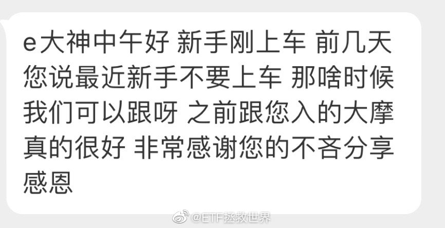 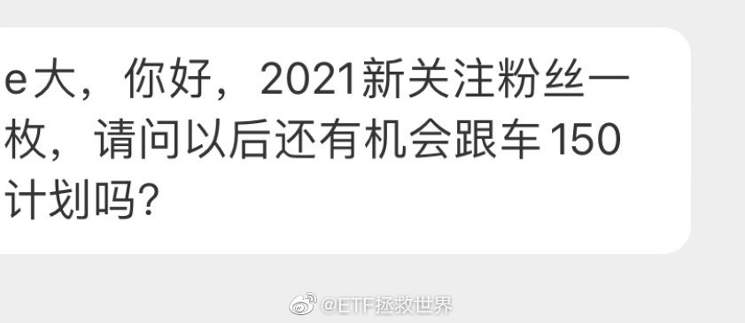 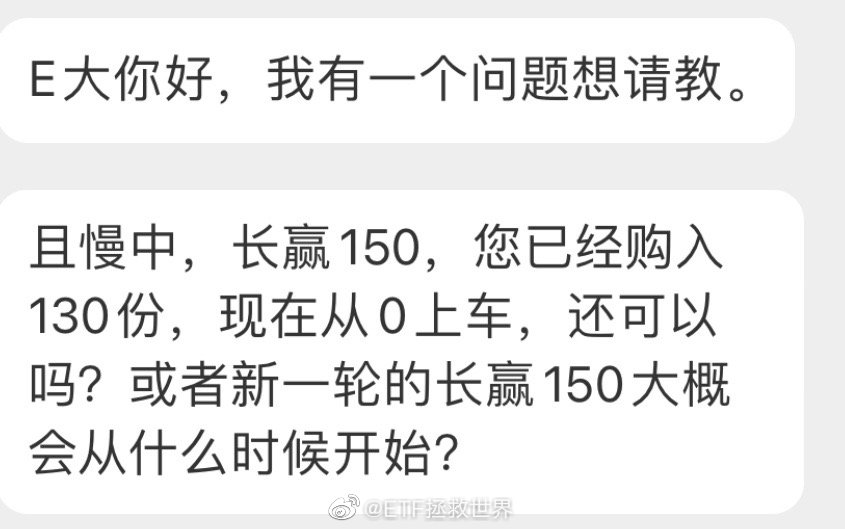

## 2021-01-23 14:45

（先看图再看字）

回答：

1、男性领导在独处的情况下主动摸女性下属的手是否正常，我想99.99%的人答案都是一样的。

至于你的反应是否过激，我想不仅是没有过激，甚至是太迟钝了。

在一部古代著名小说其中一个著名的场景中，就是男女二人坐下饮酒。先是言语互撩，然后男方故意碰落一根筷子，捡筷子的时候在女方脚上摸了一把。女方不嗔反笑，男方便知事已成了七八分，于是水到渠成的求爱成功。

人类本身与几百年前并没有太大差异。男女之间的交往，双方可接受的亲密程度大多数情况下是互相试探由远至近的。大多数情况下，男性会根据女性的反应决定停止还是进一步行动。即使他是你的顶头上司，也极少极少会毫无缘由的突然快进到最后一步。因为如此无法控制自己的人，还没做到领导职位就已经被干掉了。大多数情况下，都是双方互动，或者是一方无心做了什么事，说了什么话，做出了什么表情，给了什么眼神，让另一方误会的结果。

那么整件事中这位领导是如何一步步试探的呢：

发出邀请，开车送你回家——问你是否有男朋友——大晚上下车散步——共进晚餐——称赞你的身体部位——抓住你的手——下车再次散步——再次抓住你的手

那么请问，现在你回头看，你从哪一步开始就应该有所警惕并拒绝了呢？

我的建议：如果你不想与一位异性深入交往，请从第一步或者第二步就开始拒绝。千万千万不要让对方产生幻想，否则后患无穷。无论男女，都是如此。

2、AA的钱给也行，不给也行。不是最重要的。最重要的是以后不要与对方有任何非工作上的接触，即使工作上的接触也要非常严肃，不要再有任何肢体上的接触，总之一句话，杜绝对方一切不切实际的幻想的机会。

一点小建议，不一定对。只能说你确实没有谈过恋爱，非常不了解男人。

最后，请女权不要喷我。我没有说这件事是女方的责任，也没有为男方开脱。我是给这位朋友一些以后与异性交往的建议，我怕了你们了，真的。
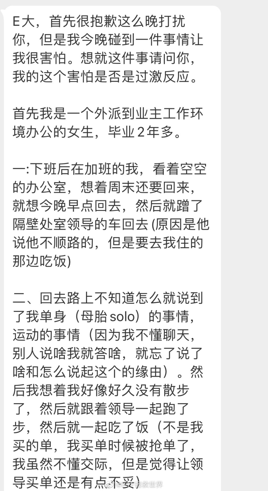 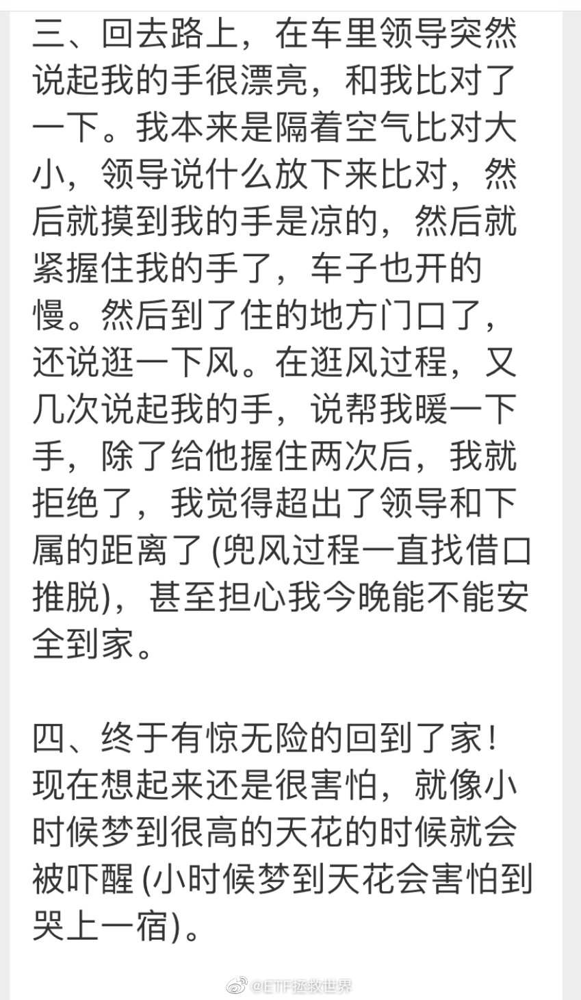 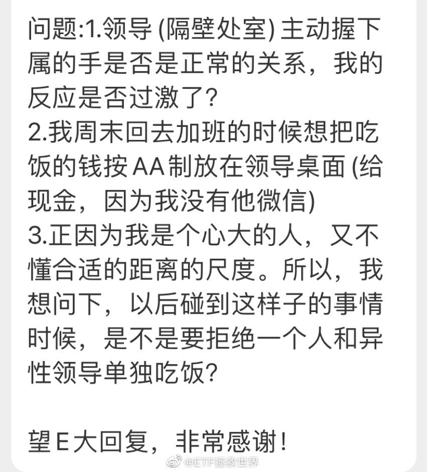

## 2021-01-23 15:35

回复@玉色仙姿:那么请教，我建议无论男女如果不想与对方发展就注意保持距离，这句话暴露了我的什么本性呢？如果要是让您来回答这个问题，您准备怎么跟这个姑娘说呢。我真的特别好奇。//@玉色仙姿:路遥知马力，日久见人心，果然本性无法掩藏

## 2021-01-23 15:47

回复@每日视频热搜榜:“因为现在是绿灯，所以我过马路不看左右两边。有车闯红灯撞我又怎样，你应该去骂司机，为什么嘱咐我过马路要左右看看？我又没错，现在是绿灯！”他们基本就是这个思路。是啊，法律当然会惩罚司机，但你的命已经没了。

## 2021-01-23 17:32

今天我在微博又进步了。因为看到一位朋友评论，她的大概意思是：

“他们在意的是不停的争论谁对谁错，而我们已经清楚明白的知道、并非常同意他们的对错判断。区别是我们更重视的是进一步如何解决问题，避免伤害。他们却依然不断的在我们已经同意他们的情况下，继续假设我们不同意他们，然后不断重复谁对谁错，不断重复。这不是男女的差距，而是思维成熟与否的差距。（也有可能是智商的差距）”

简直醍醐灌顶好吗。我决定送这位朋友一本手帐，我会私信联系你……

## 2021-01-23 17:46

看个好笑的私信结束一天的微博吧。

你永远想不到扎你的刀是从哪个方向过来的。 ​​​
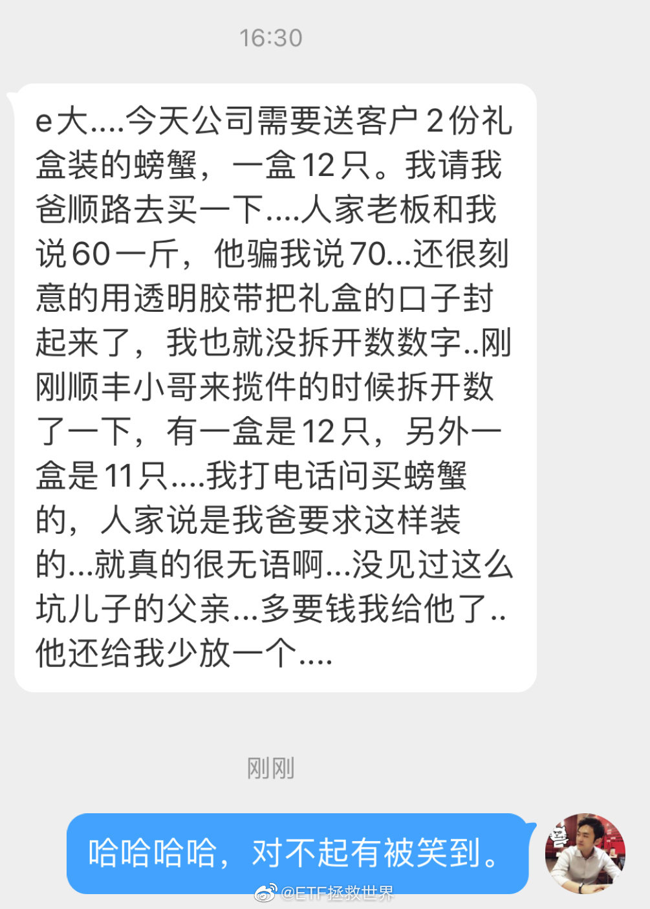

## 2021-01-24 11:04

想帮忙，但是有心杀敌无力回天。

这世界上坏人太多了！尤其是臭男人里面比例更高。 ​​​
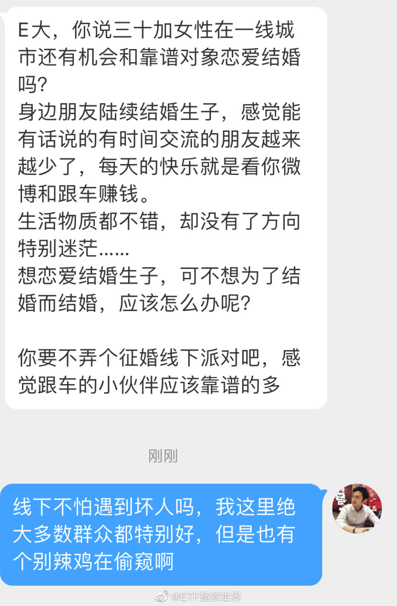

## 2021-01-24 11:28

其实一个城市几千万人，肯定有合适的，为什么就是不容易遇上。国家能不能把单身男女根据事业，颜值，财富做个排行榜，大家找自己对应的那个区间谈恋爱多好啊！

## 2021-01-24 11:44

与儿子达成了一个协议：

如果每天睡觉前他把自己的所有物品收拾好物归原位，那么就奖励一块钱。

每天记录，月底统一发放。 ​​​

## 2021-01-25 08:47

为什么听以前的歌会想起以前的事和以前的人。

人长大了好多东西都没了，只想着搞钱。

没那么在乎钱的年纪才有心情在乎其他东西。 ​​​

## 2021-01-25 09:29

又到了搞钱的时间。

搞钱使我快乐。 ​​​

## 2021-01-25 09:37

别忘了这个。

## 2021-01-25 09:44

这几天跟一些机构的朋友沟通了一些数据。

我没法给你非常精确的数据，但我能告诉你的是，去年不仅股民整体没怎么赚钱（涨幅中位数2%），涨幅巨大的基金持有者收益率也远小于你的想象。

有些过去两年翻番的基金，其持有者的平均收益率只有30%多。

随着行情继续向上，新基民的大量涌入，老基民的不断加仓，平均收益率会越来越低。最终只要市场有一个十几二十几个点的波动，就会大面积亏损。

朋友们，对你的未来投资我只有一条建议：

熊市买入。越跌越买。牛市涨幅巨大后不要追涨。

## 2021-01-25 09:47

持有者收益率低的原因不仅是牛市入场晚。还有一个原因是持有时间过短，频繁买卖，根本无法享受大涨的收益。基民平均持仓基金时间只有7个月。

## 2021-01-25 10:06

回复@求财不劫色:本轮上涨分化性极强，不是所有品种都疯狂。我认为你说的是可以的，不排除后期会有轮动机会。//@求财不劫色:请问益达，牛市涨幅巨大后，买入一些没怎么涨但又估值比较低的品种等抬轿，这种做法是否可取？

## 2021-01-25 10:09

为什么持仓期短是收益率杀手呢。

拿环保来说。很多朋友在去年3月暴跌中补仓完毕，如果按照平均持有期7个月来说，就是10月卖出，那也不错，你的7个月收益率可以拿到36%。

但是如果你不卖，再等3个月就能拿到100%的收益率。 ​​​

## 2021-01-25 10:16

别老看不起500。

富国500已经创出买入后的新高了，建信500还差1%。

不断新高又不贵，踏踏实实拿着呗。

着什么急，你很急吗，我不急。你急你先走。 ​​​

## 2021-01-25 10:31

回复@最喜欢紫色的小阿狸:拿不住的都是因为……穷……//@最喜欢紫色的小阿狸:为什么能拿的住呢？因为用闲钱买的，不慌

## 2021-01-25 10:35

猿辅导以后上市了我无论如何得买一点。

它又从我兜里赚钱了！

（非投资建议，切勿盲目交易） ​​​

## 2021-01-25 11:10

喷了。今天500涨幅和300差不多，结果股票涨跌幅比例还是：

1200:3000…… ​​​

## 2021-01-25 12:34

我在想一件事。

如果小爽不起诉男方，2000万就当丢了，对她来说是不是更好的选择。

现在的状态是不是相当于损失了2个亿。

她起诉的时候没想过男方会鱼死网破爆料吗。

当然，以她们一家一向的行为方式，这2000万很难放弃。前几天老爸道歉声明还做广告呢。（我真的服百度了） ​​​

## 2021-01-25 13:07

很红很暴力。 ​​​

## 2021-01-25 13:12

回复@享享乐陶陶:一直都在减啊。否则你手里的这些也拿不住啊。//@享享乐陶陶:有点恐高了 何时减仓啊

## 2021-01-25 13:20

对很多朋友来说，2018年开始，环保就是A股持仓品种中表现最差，且看不到希望的一个品种。

两年多都是如此。

谁能想到，短短的2、3个月，它摇身一变变成了很多朋友持仓中赚钱最多、涨幅最大的品种。70%、80%是小意思，100%以上也不稀奇。

这就是金融市场。你必须有足够的耐心很坚持，市场才会给你奖励。

有时候人生也是这样。

## 2021-01-25 13:25

回复@有酒有故事有时间:谁告诉你某个品种什么时候跌，什么时候涨，他就是100%的骗子，要不然就是傻子。记住这句话。//@有酒有故事有时间:白酒什么时候泻？

## 2021-01-25 13:31

有些朋友特别有意思。

如果我的品种涨幅不错，比如医药或者环保，如果已经很贵了，那么别人说他很贵，不值得买了，我会非常重视。并且从内心敬重他是真正的价值投资者，也绝对会同意他说的买的话一定要谨慎。

但有些朋友不是。他买的品种无论多贵，只要别人说贵，甚至别人根本没有唱空，只是说贵了，他就蹿了。生气、暴躁、骂人。

我真的真的不理解。如果你的品种在低位，别人说你的品种不好不值得买，你嘲笑他是可以理解的。你的品种明明已经贵到爆，还不许别人说吗？

别人提出自己的看法而已，至于这么暴躁吗。你看好你继续拿啊，人家觉得贵摆出数据提示一下自己的朋友不行吗？关你什么事啊。

我真的不理解啊。

是不是你怕没人接盘自己少赚啊……

## 2021-01-25 13:46

我有时候会嘲笑那些底部看空的人。比如要救我一命的朋友，比如那些底部劝人割肉的大V……

但你有没有任何一次看到我持仓的品种涨起来以后，别人看空这个品种我去骂、去嘲笑别人的。

没有，也绝对不会有。

我尊重所有底部看多，涨起来看空的朋友。这与我是否持仓毫无关系，也与他看空的太早还是在最高位看空无关。

我尊重的是他低位敢于买，高位敢于卖的这种尊重价值，低买高卖的精神。哪怕我涨了很多的品种他骂的再厉害，看空做空的再猛我也不会生气，甚至会尊重他。

哪怕这个品种他看空后又涨了很多，我当然也绝对不会去嘲笑他。去嘲笑别人卖早了的人就是脑子有病的人。真的，有病。

我只会看不起那些低位看空，高位看多的人。因为他和我不是一路人，看不起也很正常，是吧。

## 2021-01-25 13:55

为什么嘲笑别人卖早了的人脑子是有病呢。2015年4月、5月卖掉的人都会被不卖的人嘲笑，因为少赚了30、50个点。然而6月以后先卖掉的人活得很开心并且赚得更多，嘲笑他们的人全死了。人家看了雷达在进行战略大撤退，你还在偷地瓜吃。对，你多吃了几口地瓜，却不知道无人轰炸机已经到你的头顶了。

## 2021-01-25 14:35

回复@孟月德:几年前沪深300全都是金融权重，现在是白酒权重。你说当初买沪深300是偶然还是必然？

## 2021-01-25 14:42

回复@孟月德:另外你可能弄错了。隆基股份2019年就已经是环保的十大成分股了，包括大牛股亿纬锂能当时都已经是十大成分股。哪个指数不换仓？

## 2021-01-25 14:53

当年我们看着长江实业、新世界、中移动和九龙仓买恒指。现在恒指是腾讯、小米、阿里、美团、平安。你说是偶然还是必然呢。//@ETF拯救世界:回复@孟月德:另外你可能弄错了。隆基股份2019年就已经是环保的十大成分股了，包括大牛股亿纬锂能当时都已经是十大成分股。哪个指数不换仓？

## 2021-01-25 14:58

本来妥妥的新高现在又薛定谔了。

行吧，今天营业结束。去忙了。 ​​​

## 2021-01-25 15:39

​​​
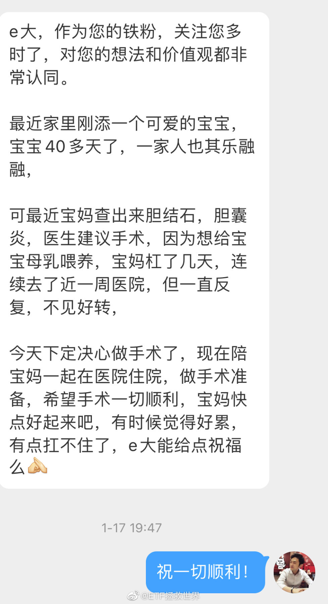 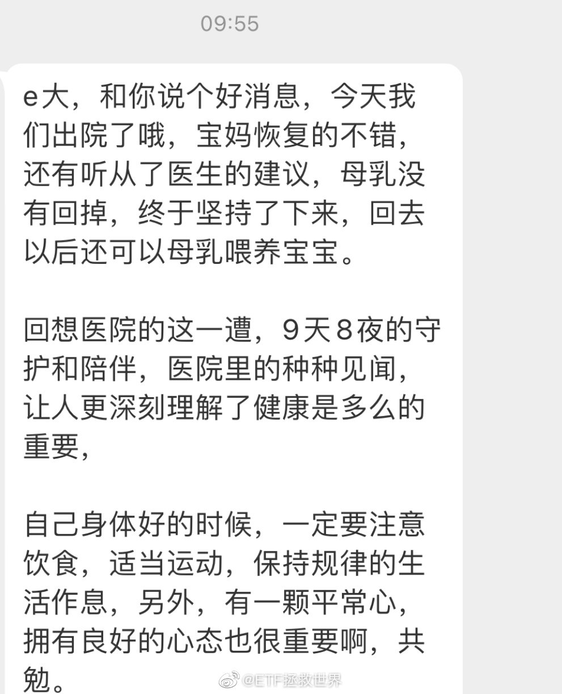

## 2021-01-25 21:55

把刚才两条微博设置成只有我自己可见了。有三个原因。

第一是那哥们把我解黑后又骂我了。[允悲] 但是我跟他聊了一会，最后他理解、认同了我。然后向我道歉并感谢了我……注意，不是因为我威胁他要网曝他，是因为交流后他真的认同我了。

第二个原因，像个怨妇一样说那些有的没的，没什么意思。我是怎样的人绝大多数人明白就够了。

第三个原因也是最重要的，是刚才且慢跟我传达了一下客户收益率的问题。具体的东西我不能说，但是应该可以说的是且慢的客户收益率在行业中是比第二名高的，这让我非常非常开心。其他的事情也不在乎了。基金涨了多少很重要，但更重要的其实是买基金的人能赚多少。

今天又新高了，大家都要开心啊。

## 2021-01-26 08:49

这条信息已经收入我的市场观察记录

## 2021-01-26 14:06

继续出货。

慢点才有意思，不要急。 ​​​

## 2021-01-26 19:36

昨天有人看不起我这个号，意思是粉丝太少。

呵呵，买几百万僵尸粉有意思吗。

没有。

买自带转评赞的机器人粉才是王道。 ​​​
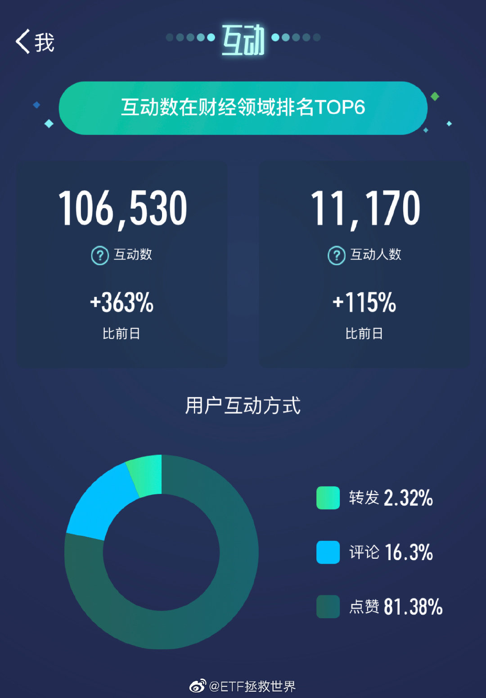

## 2021-01-27 09:31

知道我为什么去年开始就说不希望新朋友关注我，也不喜欢新朋友了吗。

去支付宝或者天天找个热门或者表现不好基金评论区看看就知道了。

我真的真的真的不想跟那些人有任何联系。

绝不是自命清高或者看不起你的意思，就是想清静清静，也不想再做什么投资者教育了。 ​​​

## 2021-01-27 09:46

当有亲戚朋友同事跟你说买基金收益率很高的时候：

高情商：

wow！好棒！你怎么这么厉害，赶紧请我吃饭/发红包！让我沾沾喜气。吃饭的时候教教我怎么买基金啊！

（双赢）

低情商：

你买了多少？赚了多少钱？

（双输） ​​​

## 2021-01-27 10:00

人类总体是这样一个群体：身边的人（除了至亲好友）好了，比如发财，心里会不高兴。但同时，你如果有能力让身边的人高兴，实际上对你的人生会帮助极大。所以这时候就要注意两点：第一，自己得意的时候要低调。实在忍不住吹的时候就少说两个量级。第二，别人吹的时候看破不说破，恭喜两句，对方会开心。

## 2021-01-27 10:22

填空题：

食品饮料前几天的低点会不会破非常关键。

如果破了，就是一个典型的_____。（5分） ​​​

## 2021-01-27 12:21

真的真的不要给别人投资建议。

不要说给别人投资建议了，就说像我这样，只是公开了自己的操作都会被骂，更何况你给别人投资建议？

有人私信骂我，说我不看好军工没买，结果军工之前一段时间表现不错，他信了我没买，现在买了。

我没有权利不买吗？板块市盈率90倍的品种，我真的下不去手啊。不看好什么，不买什么也是一种罪了吗。我真的不懂。如果市场疯狂，我不跟着疯，就是该让你骂吗。我只是把自己的操作和对投资的想法说出来而已啊，为什么要骂我？

做人真的很难。

说投资不说品种，有人说我抄书，把书上的东西拿来说；

说品种，涨得好的说我什么涨吹什么，涨的不好的怪我买了不挣钱 ，没买的涨了埋怨我不买害他赚不到；

卖早了私信骂我说他赚少了，卖晚了讽刺我坐电梯。

不说投资说电影聊社会新闻说我蹭热度；

聊情感生活说我不务正业花样吸粉。

做人真的很难，不要再让自己的人生难上加难。永远，永远不要给任何人投资建议，永远！

## 2021-01-27 13:21

一个月前判断2250是第二压力位。结果前天最高冲到2250.93回调。看看后面是否能冲过去。

## 2021-01-27 13:26

抽烟除了为国家税收做贡献没有任何好处。

## 2021-01-27 13:55

很多没有经历过熊市的朋友，他们心中最大的疑问是：

为什么要那么小心的做投资？为什么不满仓干？为什么不追热点？

灵魂三问。

别急，时间会给你答案。 ​​​

## 2021-01-28 07:52

这么看LV真的没法和茅台比。茅台营收977亿，利润可以干到455亿…

## 2021-01-28 08:15

被骗的两个必要条件：

第一，思想上贪心。

第二，行动上掏钱。 ​​​
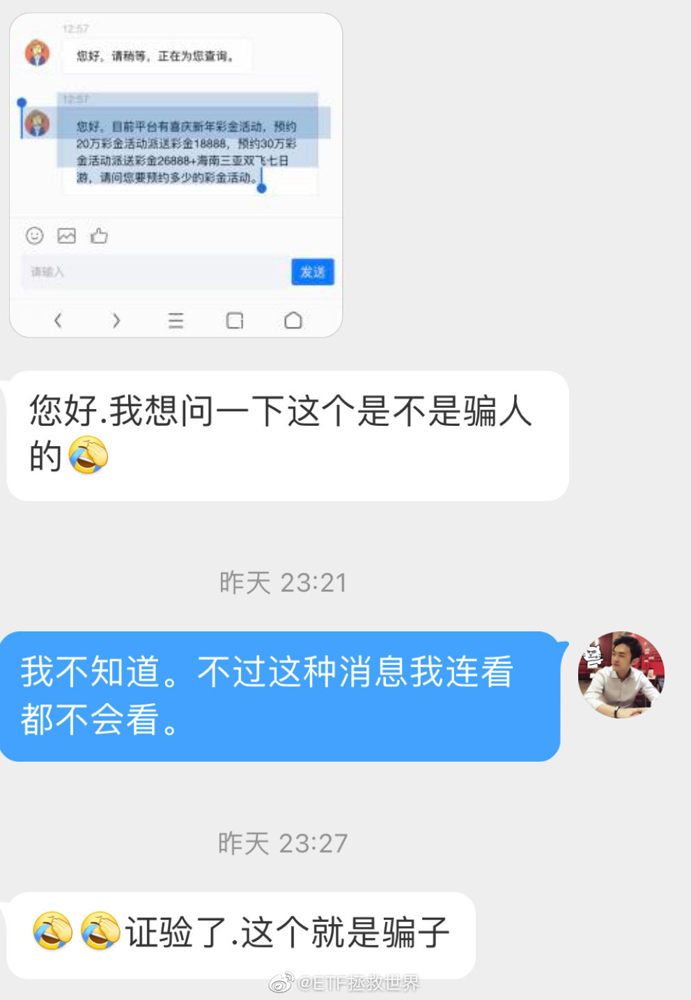 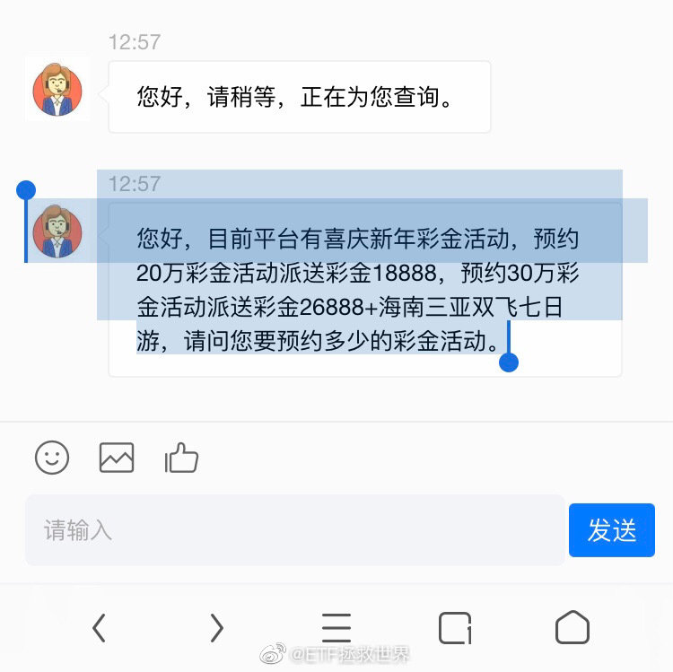

## 2021-01-28 09:41

再涨1%这么难吗？

我们只是想赚个7%而已啊。 ​​​

## 2021-01-28 09:47

为什么散户不能逢高卖出PB4.8的抱团基金，在平均PB2倍的股票中找到一些优质的让机构来接盘呢。一句话，散兵游勇始终没有战斗力。

## 2021-01-28 10:01

今天“ikun永相随”，过几天没准就粉转黑，脱粉回踩。

所以好了坏了，喜欢了讨厌了，看淡点。 ​​​

## 2021-01-28 10:21

红利网格价格正在更新，一会可以去看一下，重新设置买入价位。 ​​​

## 2021-01-28 10:29

低位开开心心收集种子，踏踏实实拿一两年，高位慢慢收割连本带利收入口袋。

这种感觉有多好，我想很多朋友已经体会到了。

这才叫投资吧。 ​​​

## 2021-01-28 11:31

不讲武德！就差几个点上去碰一下怎么了？行，你不碰就下来，我们就继续提款……//@ETF拯救世界:如果能够站稳，第二压力位是31400左右。再往上就进入可减仓区域。

## 2021-01-28 13:36

继续慢慢出货。

出货范围已经拓展至欧洲。 ​​​

## 2021-01-28 14:28

现在是3500点，股民不用说了，这几年股民其实是非常难的，如果你不是跟机构抱团。大概至少一半股民这几年没挣钱。

基民的话，3500点，我没有依据的毛估估，其中也已经有20%-30%的人亏损了。

我之前一再说，新朋友不要参考我的交易，最好也不要关注我，其实是对各位负责。 ​​​

## 2021-01-28 14:43

有闲钱的朋友做逆回购，现在5.5%-6%还是不错的。

2-1钱回来。 ​​​

## 2021-01-28 18:08

今日数据：

目前全市场估值与2018年6月相似，已经进入“黄金坑”。

我本人会在这个位置维持一定仓位，不会轻仓。

（没有给你仓位建议的意思，也没有建议你买入或者卖出的意思。只是说明我自己的仓位，求求你无论涨跌别骂我。） ​​​

## 2021-01-28 18:28

为什么会出现这种情况呢。我看了一下，2018年6月至今，可比的3495只股票中，上涨的是1643只，比例为47%。也就是说，指数从2847涨到3505，实际上超过一半（53%）的股票是下跌的。即使不算业绩上涨因素，全市场估值又回去了也非常正常。

## 2021-01-28 18:30

刚才在评论里有朋友说，券商统计2018年1月至今只有20%的股民赔钱。我绝不相信。因为那个时候至今，只有31%的股票上涨。再考虑散户整体基本不可能黄金/钻石坑入场，怎么可能只有30%的股票上涨却有80%的股民挣钱？

## 2021-01-28 18:37

再说个具体的指数。比如中证红利。很多朋友觉得涨的少，不喜欢。但我不知道有多喜欢。目前它的估值与2018.06也基本一致，pb已经进入历史最低5%。但是注意，红利全收益指数从当时的6101涨到了现在的7262。也就是说，维持着历史最低估值不变，已经多赚了20%。年化8%以上。我可太喜欢了！pb不到1.2！

## 2021-01-28 18:44

回复@涛落沙明-:今年上涨比例为23.77%，涨幅中位数是-7.09，最惨股票已经跌了58.68%。//@涛落沙明-:果然和我感觉的完全不同。感觉今年涨了好多。

## 2021-01-29 22:22

这是什么病懂的说说 ​​​
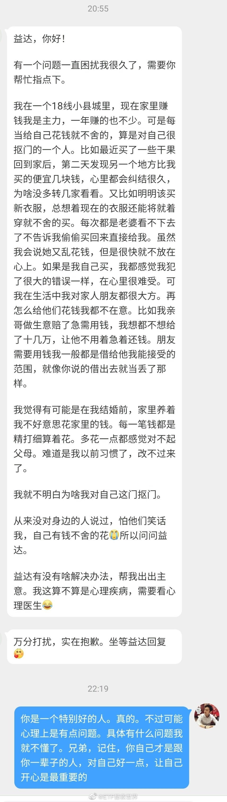

## 2021-01-29 22:26

谢谢，看到这个祝福我的抑郁症又加重了。 ​​​

## 2021-01-30 10:27

摆正自己的位置 ​​​
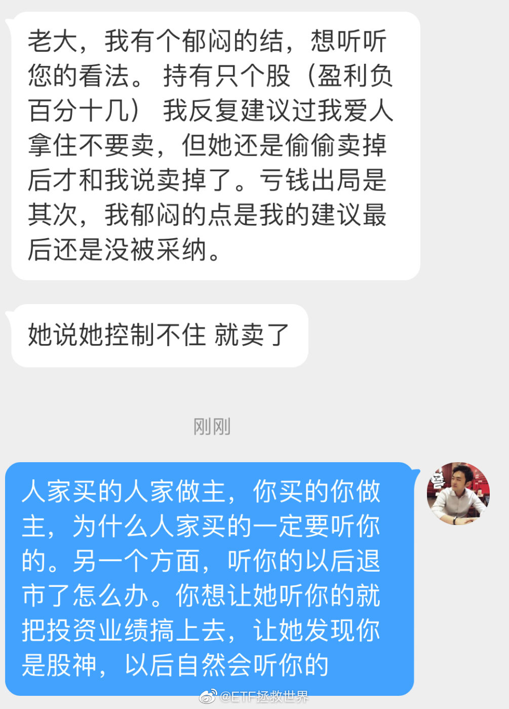

## 2021-01-30 19:30

回复@热带大菠萝:我求求你们这些新朋友不要跟了好吗。求求你们了！早听我的多好啊，现在听也不晚！千万别再跟了！//@热带大菠萝:广发信息技术跌了4个点快5个点了，下周适合补仓吗？

## 2021-01-30 19:46

先问问自己是不是真的看了每一个字 ​​​
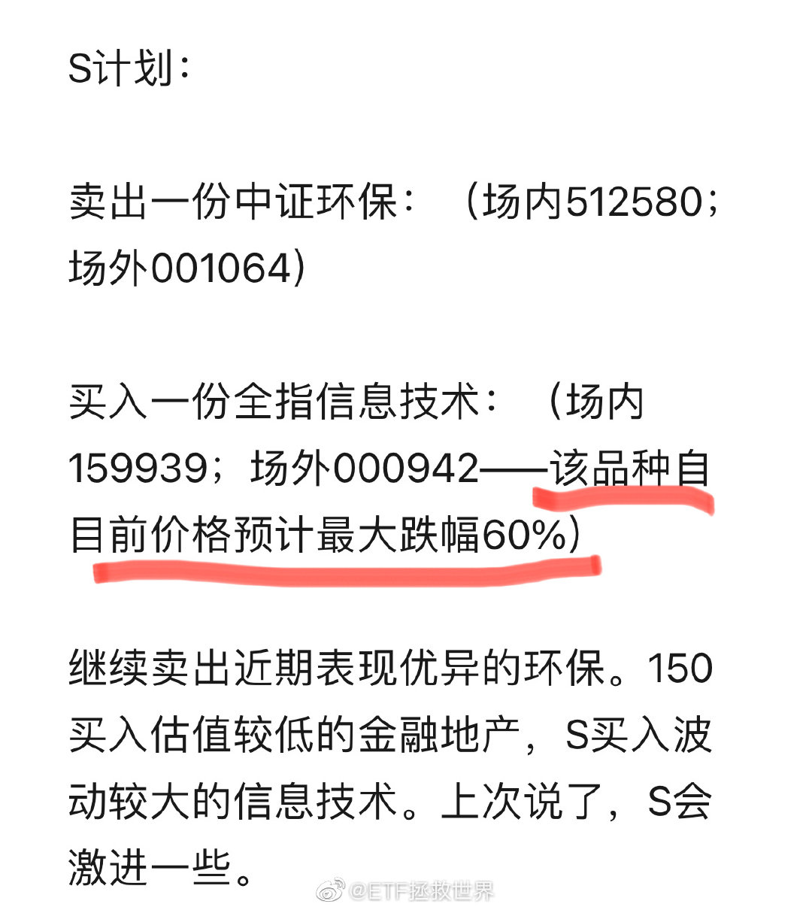

## 2021-01-31 12:35

震惊！基金小V跪求新车友不要再上车的真实原因竟然是这个！ ​​​
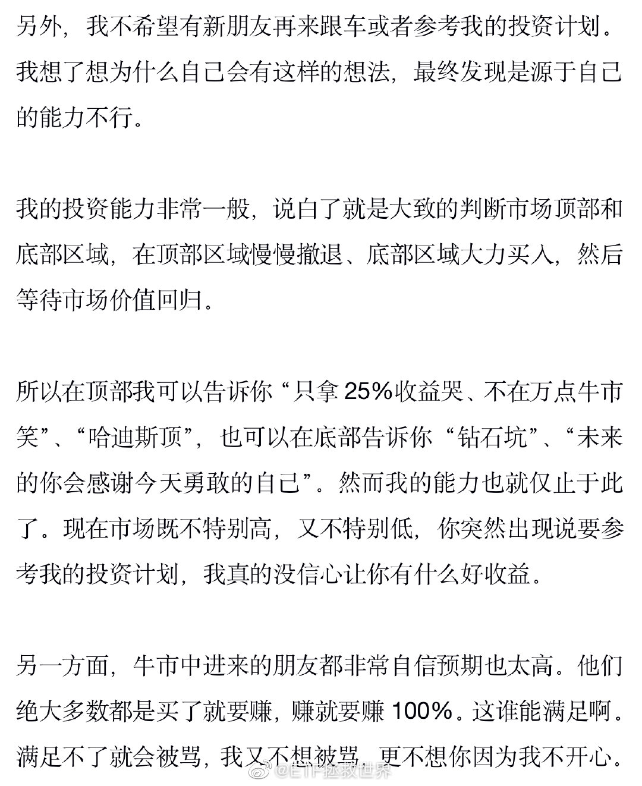 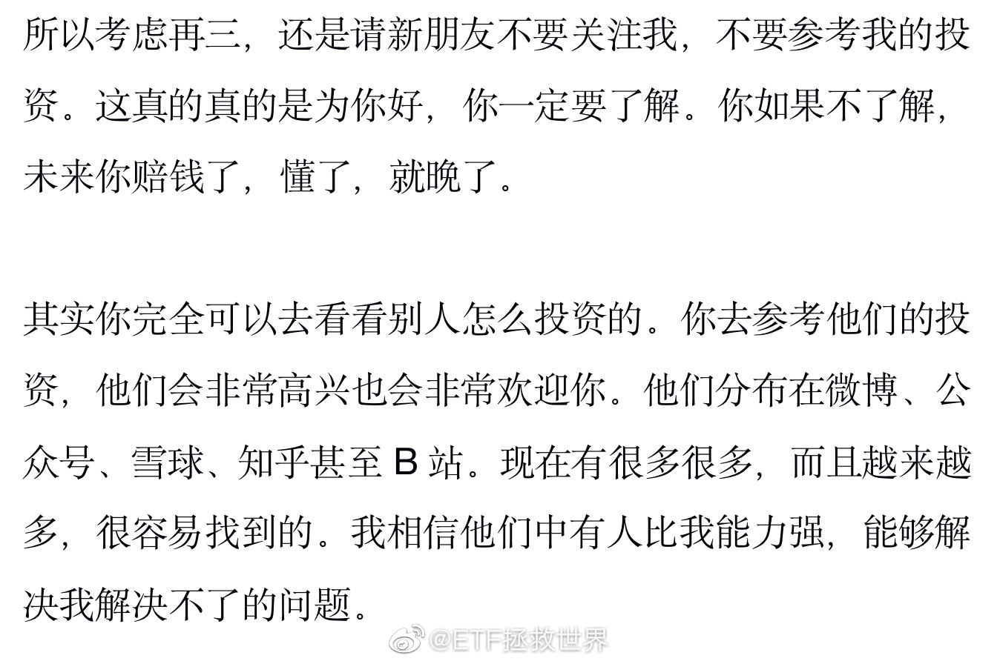

## 2021-01-31 23:02

分享图片 ​​​
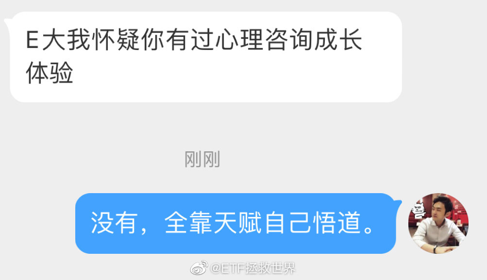

